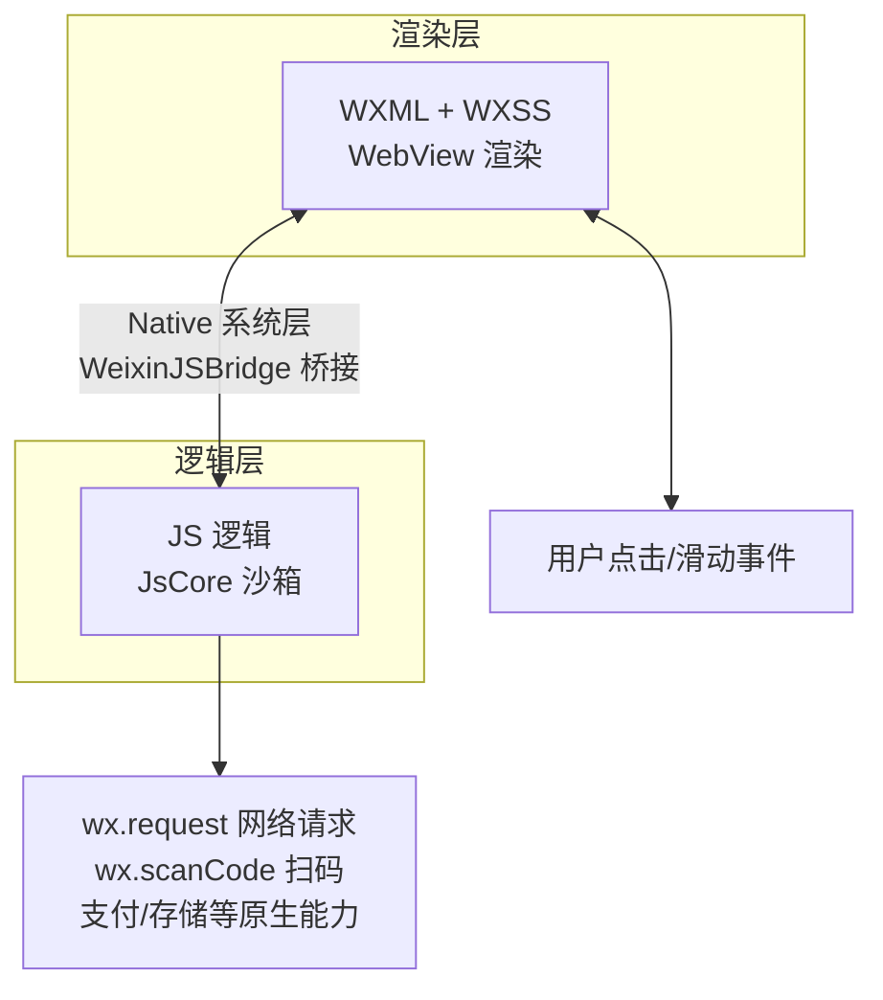
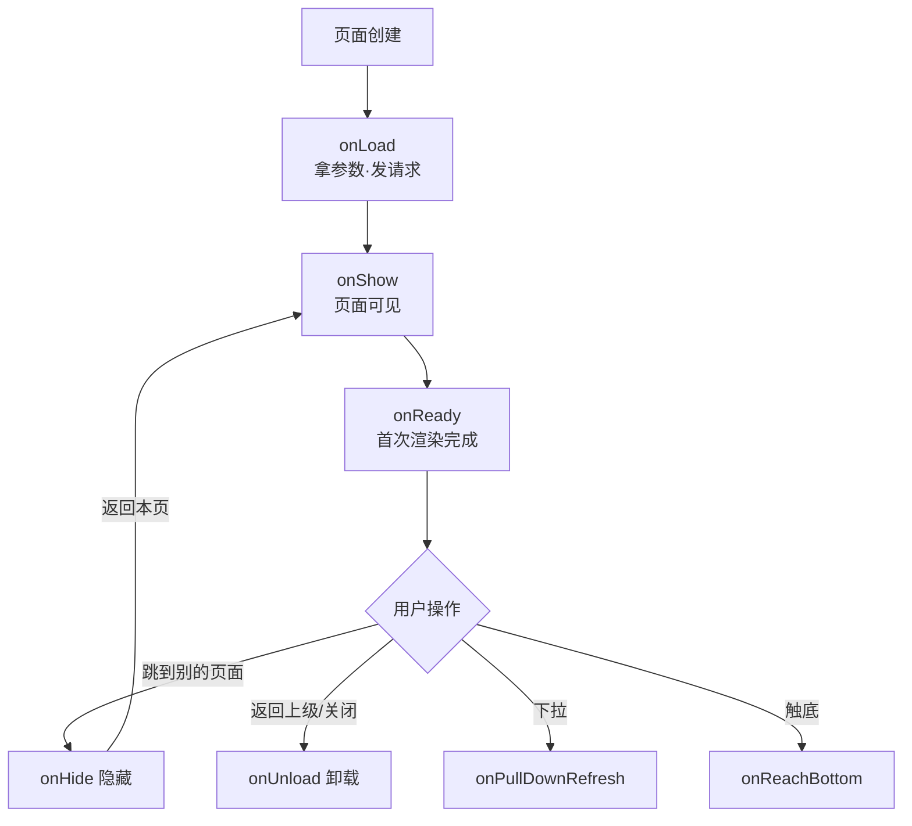
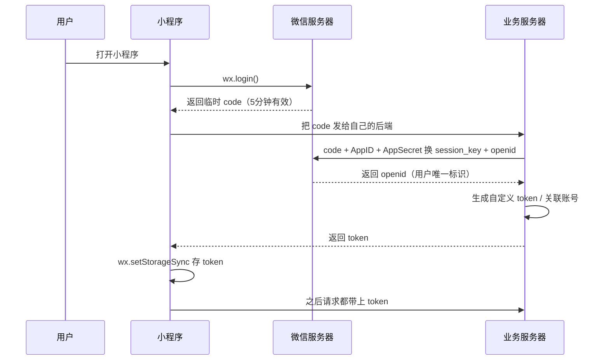
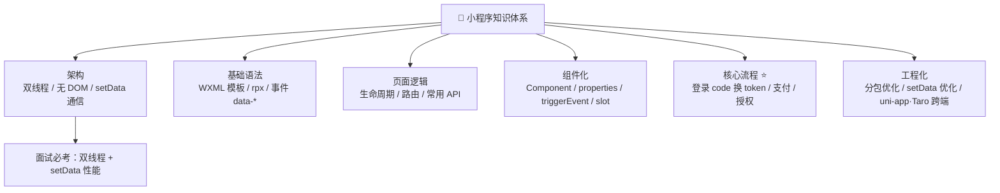

# 🍵 小程序学习笔记 —— 微信口袋里的魔法世界 🪄

> 嘿嘿～欢迎来到小程序的小课堂！🎀
> 不用下载、点开即用、还能分享给闺蜜～
> 从架构到登录流程，一篇全搞定！(๑•̀ㅂ•́)و✧

---

## 📚 目录

| 章节 | 内容 | 难度 |
| --- | --- | --- |
| 一 | 小程序是什么？双线程架构 | ⭐ |
| 二 | 开发准备与项目结构 | ⭐ |
| 三 | app.json 全局配置 | ⭐⭐ |
| 四 | WXML 模板语法 | ⭐⭐ |
| 五 | WXSS 与 rpx 适配 | ⭐⭐ |
| 六 | 事件系统 | ⭐⭐ |
| 七 | 数据绑定与 setData | ⭐⭐⭐ |
| 八 | 生命周期（页面 + 组件） | ⭐⭐⭐ |
| 九 | 自定义组件与通信 | ⭐⭐⭐ |
| 十 | 常用 API 速查 | ⭐⭐ |
| 十一 | 登录流程（必考！） | ⭐⭐⭐⭐ |
| 十二 | 性能优化 | ⭐⭐⭐ |
| 十三 | 跨端框架 uni-app / Taro | ⭐⭐ |
| 十四 | 面试高频考点速览 | 🔥 |

---

## 一、小程序是什么？🤔

**小程序**：寄生在微信（等 App）里的"轻应用"——不用安装、用完即走、体验接近原生 App～

### 1.1 小程序 vs H5 vs 原生 App

| 维度 | 小程序 | H5 网页 | 原生 App |
| --- | --- | --- | --- |
| 安装 | ❌ 免安装 | ❌ 免安装 | ✅ 要下载 |
| 运行环境 | 微 App 内（微信） | 浏览器 | 手机系统 |
| 能力 | 微信生态（支付/分享/授权）| 受浏览器限制 | 最强（摄像头/推送...） |
| 开发成本 | 中 | 低 | 高（双端） |
| 审核 | ✅ 要提审发布 | ❌ 随时上线 | ✅ 应用商店审核 |
| 入口 | 扫码/搜索/分享 | URL 链接 | 图标点击 |
| 推广 | 社交裂变强 🚀 | 依赖流量 | 靠商店 |

### 1.2 双线程架构（面试必考！）⭐⭐⭐

> 🎀 小程序和网页最大的不同：**渲染层和逻辑层是分开的两个线程**！
> 就像后厨（逻辑层）和前厅（渲染层）分开了，传菜全靠"服务员"～🏃‍♀️



| 线程 | 负责 | 语言 |
| --- | --- | --- |
| 渲染层（多个） | 页面显示 | WXML + WXSS |
| 逻辑层（1 个） | 数据和逻辑 | JavaScript |
| Native 层 | 中转站 + 原生能力 | 系统调度 |

**这样设计的好处：**
- ✅ JS 卡死不影响页面滑动（体验流畅）
- ✅ 安全：JS 摸不到 DOM 和 BOM，防止恶意操作
- ❌ 代价：**通信有延迟**（所以 setData 不能滥用，后面细讲）

> 💡 这就是为什么小程序里**没有 document、window**，也用不了 DOM 操作！

---

## 二、开发准备与项目结构 🛠️

### 2.1 开发三件套

1. 注册账号：[mp.weixin.qq.com](https://mp.weixin.qq.com) → 拿到 **AppID**（身份证）
2. 下载 **微信开发者工具**（写代码 + 预览 + 调试 + 上传一站式）
3. 新建项目（填 AppID）→ 自带 Hello World 模板

### 2.2 一个页面的"四件套" 👗

每个页面由 4 个**同名文件**组成（必须放在同一文件夹）：

| 文件 | 作用 | 类比网页 |
| --- | --- | --- |
| `index.wxml` | 结构 | HTML |
| `index.wxss` | 样式 | CSS |
| `index.js` | 逻辑 | JS |
| `index.json` | 页面配置 | - |

### 2.3 项目整体结构

```
miniprogram/
├── app.js               # 小程序入口：全局逻辑、App 生命周期
├── app.json             # 全局配置：页面路径、窗口、tabBar（必须有！）
├── app.wxss             # 全局样式
├── sitemap.json         # 搜索优化配置
├── pages/
│   ├── index/           # 首页（四个同名文件）
│   │   ├── index.wxml
│   │   ├── index.wxss
│   │   ├── index.js
│   │   └── index.json
│   └── logs/
├── components/          # 自定义组件
│   └── nav-bar/
└── utils/               # 工具函数
    └── request.js
```

### 2.4 最简单的页面代码

```js
// pages/index/index.js
Page({
  data: {
    msg: 'Hello 小程序！',
  },
  onTap() {
    this.setData({ msg: '你点到我啦~' });
  },
});
```

```xml
<!-- pages/index/index.wxml -->
<view class="box" bindtap="onTap">{{ msg }}</view>
```

---

## 三、app.json 全局配置 ⚙️

```jsonc
{
  // 🌟 页面路径列表：第一项 = 首页！新增页面必须在这里注册
  "pages": [
    "pages/index/index",
    "pages/logs/logs"
  ],

  // 窗口外观
  "window": {
    "navigationBarTitleText": "我的小程序",
    "navigationBarBackgroundColor": "#ff6b9d",
    "navigationBarTextStyle": "white",
    "backgroundColor": "#f5f5f5",
    "enablePullDownRefresh": true      // 下拉刷新
  },

  // 🌟 底部 tabBar（2~5 个）
  "tabBar": {
    "color": "#999",
    "selectedColor": "#ff6b9d",
    "list": [
      { "pagePath": "pages/index/index", "text": "首页", "iconPath": "a.png", "selectedIconPath": "a2.png" },
      { "pagePath": "pages/logs/logs", "text": "日志", "iconPath": "b.png", "selectedIconPath": "b2.png" }
    ]
  },

  // 分包加载（性能优化，见第十二章）
  "subPackages": [
    { "root": "packageA", "pages": ["pages/cat/cat"] }
  ]
}
```

> ⚠️ 高频坑：**新页面忘了在 pages 里注册** → 访问直接白屏报错！
> tabBar 页面必须用 `wx.switchTab` 跳转，普通 `navigateTo` 跳不过去！

---

## 四、WXML 模板语法 📄

### 4.1 数据绑定 {{}}

```xml
<!-- 基本绑定 -->
<view>{{ msg }}</view>
<!-- 属性绑定：属性值也要 {{}} -->
<image src="{{ avatarUrl }}" />
<!-- 表达式也行 -->
<view>{{ count > 0 ? '有货' : '售罄' }}</view>
<view>{{ obj.name }} {{ list[0] }}</view>
```

### 4.2 列表渲染 wx:for

```xml
<!-- wx:for 默认变量：item（值）和 index（下标） -->
<view wx:for="{{ goodsList }}" wx:key="id">
  {{ index }} - {{ item.name }}：￥{{ item.price }}
</view>

<!-- 改名：wx:for-item / wx:for-index -->
<view wx:for="{{ list }}" wx:for-item="book" wx:for-index="i" wx:key="id">
  {{ i }}、{{ book.title }}
</view>
```

> ⚠️ `wx:key` 必写！相当于 Vue 的 `:key`，帮框架认出每一项，提升 diff 性能、防止状态错乱～

### 4.3 条件渲染 wx:if vs hidden

```xml
<view wx:if="{{ isVip }}">尊贵的 VIP ✨</view>
<view wx:elif {{ level > 5 }}></view>
<view wx:else>普通用户</view>

<view hidden="{{ isLoading }}">加载完成</view>
```

| 维度 | wx:if | hidden |
| --- | --- | --- |
| 原理 | **真移除/创建**节点 | `display: none` 隐藏 |
| 切换开销 | 高（重新渲染） | 低 |
| 初始开销 | false 时不渲染（惰性） | 一直渲染 |
| 使用场景 | 条件很少变 | 频繁切换显示/隐藏 |

### 4.4 block 包裹标签 & 模板

```xml
<!-- block：本身不渲染，纯逻辑容器 -->
<block wx:for="{{ list }}" wx:key="id">
  <view>{{ item.name }}</view>
  <view>{{ item.price }}</view>
</block>

<!-- template 模板：定义 + 使用 -->
<template name="card">
  <view class="card">{{ name }}</view>
</template>
<template is="card" data="{{ name: '小甜' }}" />
```

---

## 五、WXSS 与 rpx 适配 📱

### 5.1 rpx：响应式像素（小程序的招牌单位）🌟

> 🎀 把屏幕宽度**固定分成 750 份**，1 份 = 1rpx。
> 不管 iPhone 还是安卓，写 `750rpx` 永远铺满全屏！

| 设备 | 屏幕宽 | 1rpx = |
| --- | --- | --- |
| iPhone 6（基准） | 375px | 0.5px |
| iPhone 6 Plus | 414px | ≈0.552px |
| 设计稿（通常 750px 宽） | - | **量出来多少 px 就写多少 rpx** ✨ |

```css
/* 设计稿 750px 宽，量的按钮宽度 350px → 直接写 350rpx */
.btn {
  width: 350rpx;   /* 所有设备都自动适配！ */
  height: 88rpx;
  font-size: 28rpx;
}
```

### 5.2 其他样式特性

```css
/* 样式导入（类似 @import） */
@import '../../common.wxss';

/* 全局样式 app.wxss 对所有页面生效，页面样式覆盖全局 */
```

| 特性 | 说明 |
| --- | --- |
| 选择器 | 支持 class、id、element 等，**不支持** `*` 通配符和后代选择器性能差 |
| 全局样式 | `app.wxss` 中定义，作用于所有页面 |
| 局部样式 | 页面 wxss 只对当前页面生效 |
| 内联样式 | `style="color:{{color}};"` 动态样式 |

---

## 六、事件系统 🖱️

### 6.1 绑定事件：bind vs catch

```xml
<view bindtap="onTap">点我（会冒泡）</view>
<view catchtap="onTap">点我（阻止冒泡）</view>
<!-- catch + 事件名 = 阻止事件向上冒泡 -->
```

| 写法 | 冒泡 | 说明 |
| --- | --- | --- |
| `bindtap` | ✅ 会向上传 | 普通绑定 |
| `catchtap` | ❌ 阻止冒泡 | 点击子元素不影响父元素 |

### 6.2 常用事件速查表

| 事件 | 触发 |
| --- | --- |
| `tap` | 手指点击（最常用！） |
| `longpress` | 长按（350ms） |
| `touchstart / touchmove / touchend` | 触摸开始/移动/结束 |
| `input` | 输入框内容变化 |
| `confirm` | 输入框点完成 |
| `scroll` | 滚动 |
| `submit` | 表单提交 |

### 6.3 事件传参：data-* 自定义属性 ⭐

> 🎀 小程序**不能**像网页那样 `onclick="fn(1)"` 直接传参！
> 参数要挂在 `data-*` 上，事件对象里取～

```xml
<view
  wx:for="{{ list }}" wx:key="id"
  data-id="{{ item.id }}" data-name="{{ item.name }}"
  bindtap="onItemClick"
>{{ item.name }}</view>
```

```js
Page({
  onItemClick(e) {
    // e.currentTarget.dataset = { id: 1, name: '奶茶' }
    const { id, name } = e.currentTarget.dataset;
    console.log(`点了 ${id} 号商品：${name}`);
  },
});
```

### 6.4 事件对象结构

```js
handleTap(e) {
  e.type;              // 事件类型 'tap'
  e.currentTarget;     // 当前绑定事件的组件（dataset 在这）⭐
  e.target;            // 触发事件的组件（可能是内部子节点）
  e.detail;            // 额外信息（input 事件里是输入的值 e.detail.value）
  e.touches;           // 触摸点信息（位置坐标等）
  e.timeStamp;         // 时间戳
}
```

> ⚠️ 取自定义数据用 `e.currentTarget.dataset`（别用 `e.target`，点子元素时会拿不到！）

---

## 七、数据绑定与 setData 💉

### 7.1 核心规则：改 data 必须用 setData！

> 🎀 小程序的视图 = f(data)。直接 `this.data.xx = 1` **只改内存，页面不会变**！
> 必须通过 `setData` 通知渲染层："数据变啦，快更新！" 📢

```js
Page({
  data: { count: 0, user: { name: '小甜' }, list: [] },

  // ✅ 正确姿势
  add() {
    this.setData({ count: this.data.count + 1 });
  },

  // ✅ 修改对象/数组的某个值：用 '路径' 写法
  updateName() {
    this.setData({ 'user.name': '小美' });          // 对象某属性
    this.setData({ 'list[0].checked': true });      // 数组某项
  },
});
```

### 7.2 setData 的性能优化（必考！）⭐

每次 setData 都是**逻辑层 → 渲染层的通信**（还记得双线程吗），滥用会卡顿！

```js
// 😫 坏习惯1：高频调用（一秒几十次）
setInterval(() => this.setData({ t: Date.now() }), 16);

// 😫 坏习惯2：把超大数据全量传过去
this.setData({ hugeList: 一万条数据 });

// ✅ 好习惯
this.setData({ 'list[3].status': 'done' });   // ① 精准更新，只传变化的部分
this.setData({ count: this.data.count + 1 }); // ② 合并多次调用为一次
// ③ 纯逻辑数据不放 data（不渲染的变量挂到 this.xxx 上）
this.timer = 123;   // 不用于渲染就别放 data 里～
```

---

## 八、生命周期 🔄（必考！）

### 8.1 应用级生命周期（app.js）

```js
App({
  onLaunch() {},   // 小程序初始化（全局只触发一次：冷启动）
  onShow() {},     // 启动 / 从后台切回前台
  onHide() {},     // 切到后台（按 Home 键）
});
```

### 8.2 页面生命周期（重点！）

```js
Page({
  onLoad(options) {},     // ① 页面加载：只一次，options 是跳转参数 ⭐
  onShow() {},            // ② 页面显示：每次进入都触发（含返回）
  onReady() {},           // ③ 初次渲染完成：只一次，可拿节点信息
  onHide() {},            // ④ 页面隐藏：跳走/切后台
  onUnload() {},          // ⑤ 页面卸载：navigateBack 或重定向

  // 用户行为相关
  onPullDownRefresh() {}, // 下拉刷新
  onReachBottom() {},     // 上拉触底（加载更多）
  onShareAppMessage() {}, // 分享给好友
});
```

### 8.3 生命周期流程图



> 💡 面试经典题：**onLoad 和 onShow 的区别？**
> onLoad 只触发一次（适合拿跳转参数、首次请求）；onShow 每次可见都触发（适合刷新数据，比如从编辑页返回要更新列表）～

### 8.4 组件生命周期

| 钩子 | 触发时机 |
| --- | --- |
| `created` | 组件实例创建（还不能用 this.data） |
| `attached` | 进入页面节点树（初始化数据的好时机）⭐ |
| `ready` | 布局完成 |
| `detached` | 移出节点树（清理定时器等） |

---

## 九、自定义组件与通信 🧩

### 9.1 创建组件三步走

```
① 建文件夹 components/nav-bar/
② 四件套：wxml / wxss / js / json（同页面）
③ json 里声明：{ "component": true }
```

```js
// components/nav-bar/nav-bar.js
Component({
  // 属性：父传子的"接收口"
  properties: {
    title: { type: String, value: '默认标题' },
    showBack: { type: Boolean, value: false },
  },

  // 私有数据
  data: { count: 0 },

  // 方法
  methods: {
    onBack() {
      // 子传父：triggerEvent，像 Vue 的 $emit！
      this.triggerEvent('back', { from: 'navbar' });
    },
  },
});
```

```xml
<!-- 使用组件的页面：index.json -->
{ "usingComponents": { "nav-bar": "/components/nav-bar/nav-bar" } }

<!-- index.wxml -->
<nav-bar title="{{ pageTitle }}" bind:back="onBackEvent" />
```

### 9.2 组件通信方式汇总

| 方向 | 方式 | 示例 |
| --- | --- | --- |
| 父 → 子 | **properties 属性** | `<nav-bar title="首页" />` |
| 子 → 父 | **triggerEvent 事件** | `this.triggerEvent('back')` |
| 任意 | 全局事件总线 / 状态管理 | mobx-mini-program 等 |
| 获取实例 | selectComponent | `this.selectComponent('#navBar')` |

### 9.3 插槽 slot

```xml
<!-- 组件内部 wxml -->
<view>
  <slot name="header"></slot>
  <view>中间内容</view>
  <slot name="footer"></slot>
</view>
```

```xml
<!-- 使用时塞内容 -->
<my-comp>
  <view slot="header">我是头部</view>
  <view slot="footer">我是尾部</view>
</my-comp>
```

> ⚠️ 多插槽要在 js 里声明：`options: { multipleSlots: true }`

---

## 十、常用 API 速查 🧰

### 10.1 网络请求 wx.request

```js
// Promise 化封装（小程序 API 默认是回调式）
const request = (url, method = 'GET', data = {}) =>
  new Promise((resolve, reject) => {
    wx.request({
      url: `https://api.example.com${url}`,
      method,
      data,
      header: { Authorization: `Bearer ${wx.getStorageSync('token')}` },
      success: res => res.statusCode === 200 ? resolve(res.data) : reject(res),
      fail: reject,
    });
  });

// 使用
const res = await request('/goods/list');
```

> ⚠️ 合法域名：请求的域名必须在后台「开发设置 → 服务器域名」配置（开发时可勾选"不校验合法域名"）

### 10.2 常用 API 一览表

| 分类 | API | 作用 |
| --- | --- | --- |
| 路由 | `wx.navigateTo` | 保留当前页，跳转（最多 10 层） |
| 路由 | `wx.redirectTo` | 关闭当前页，跳转 |
| 路由 | `wx.switchTab` | 跳 tabBar 页（专用！） |
| 路由 | `wx.navigateBack` | 返回上一页 |
| 存储 | `wx.setStorageSync / getStorageSync` | 本地缓存（同步版） |
| 存储 | `wx.removeStorageSync / clearStorageSync` | 删除缓存 |
| 交互 | `wx.showToast` | 轻提示（成功/加载中） |
| 交互 | `wx.showModal` | 确认对话框 |
| 交互 | `wx.showLoading / hideLoading` | 加载动画 |
| 分享 | `wx.shareAppMessage` | 转发好友 |
| 授权 | `wx.getUserProfile` | 获取用户信息（需用户点确认） |
| 支付 | `wx.requestPayment` | 唤起支付 |
| 设备 | `wx.scanCode` | 扫一扫 |
| 图片 | `wx.chooseImage / previewImage` | 选图 / 预览 |
| 下拉 | `wx.stopPullDownRefresh` | 停止下拉刷新动画 |

```js
// 路由传参：url 上拼 query
wx.navigateTo({ url: `/pages/detail/detail?id=${id}&name=${name}` });
// detail 页 onLoad 里接收
onLoad(options) {
  console.log(options.id, options.name);   // 字符串！注意类型转换
}
```

---

## 十一、登录流程 🔐（必考重头戏！）

### 11.1 流程时序图



### 11.2 代码实现

```js
// utils/auth.js
async function login() {
  // ① 拿临时凭证 code
  const { code } = await wx.login();

  // ② 发给自己的后端换 token
  const res = await request('/user/login', 'POST', { code });

  // ③ 存起来，以后请求都带上
  wx.setStorageSync('token', res.token);
  return res;
}

// ③ 补充：需要头像昵称时再调（必须由用户点击触发！）
Page({
  async onGetProfile(e) {
    const res = await wx.getUserProfile({
      desc: '用于完善会员资料',   // 必填，展示给用户看
    });
    this.setData({ userInfo: res.userInfo });
  },
});
```

### 11.3 关键概念表

| 概念 | 说明 |
| --- | --- |
| `code` | 临时登录凭证，5 分钟有效，只能用一次 |
| `openid` | 用户在**同一个小程序**里的唯一 ID |
| `unionid` | 用户在**同主体多个应用**（小程序+公众号）里的统一 ID |
| `session_key` | 会话密钥，后端用来解密用户数据（不能下发给前端！） |
| AppSecret | 后端密钥，**绝不能写在小程序代码里** ⚠️ |

> 🎀 为什么不能前端直接找微信换 openid？
> 因为需要 AppSecret（相当于密码），写在人人可见的前端代码里 = 裸奔 🔞
> 所以后端作为"中间人"帮忙换，安全！

---

## 十二、性能优化 🚀

### 12.1 启动优化：分包加载

> 主包太大 → 启动慢。把不常用页面拆进分包，用到再下载！

```jsonc
// app.json
{
  "pages": ["pages/index/index"],           // 主包：tabBar 页 + 首屏
  "subPackages": [                          // 分包
    {
      "root": "packageA",
      "pages": ["pages/detail/detail"]
    },
    {
      "root": "packageB",
      "pages": ["pages/order/order"]
    }
  ],
  // 分包预下载：闲时提前拉好，用户无感
  "preloadRule": {
    "pages/index/index": { "network": "all", "packages": ["packageA"] }
  }
}
```

**分包限制**：整个小程序所有分包大小 ≤ 20M（曾 2M→现 30M 以官方为准），单个分包 ≤ 2M～

### 12.2 优化清单

| 类别 | 手段 |
| --- | --- |
| 启动 | 分包 + 预下载；首屏 data 精简 |
| 渲染 | setData 精准/合并更新；长列表虚拟滚动或分页 |
| 图片 | 压缩 + 合适尺寸；`lazy-load` 懒加载 |
| 请求 | 合并请求；非首屏请求延后（onReady 后） |
| 资源 | 大图走 CDN；wxss 里别引超大背景图 |
| 组件 | 复杂页面拆组件，避免整页 setData |

```xml
<!-- 图片懒加载 -->
<image src="{{ item.img }}" lazy-load mode="aspectFill" />
```

---

## 十三、跨端框架：uni-app / Taro ⚔️

> 一次开发，多端运行（微信/支付宝/抖音小程序 + H5 + App），中小团队最爱～

| 维度 | uni-app | Taro |
| --- | --- | --- |
| 语法 | **Vue 风格** | 支持 **React**（3.x 也支持 Vue3） |
| 主刀团队 | DCloud | 京东 |
| 编译 | 编译到各端原生代码 | 同上 |
| UI 库 | uni-ui 等 | Taro UI / NutUI |
| 适合人群 | Vue 党 | React 党 |
| 共同点 | 条件编译处理平台差异：`#ifdef MP-WEIXIN` |

```vue
<!-- uni-app 写一个页面：完全是 Vue 味儿 🍇 -->
<template>
  <view @tap="add">{{ count }}</view>
</template>

<script setup>
import { ref } from 'vue';
const count = ref(0);
const add = () => count.value++;
</script>
```

> 🎀 选择建议：团队用 Vue → uni-app；团队用 React → Taro；
> 只做一个微信小程序且要极致性能/最新特性 → 原生小程序！

---

## 十四、面试高频考点速览 🔥

| 考点 | 一句话答案 |
| --- | --- |
| 双线程架构 | 渲染层（WebView）+ 逻辑层（JsCore）分离，经 Native 层通信，安全且不互相卡顿 |
| 为什么没有 DOM | 逻辑层在独立沙箱，摸不到 window/document，通过 setData 通信更新视图 |
| setData 原则 | 改 data 必须 setData；精准更新（路径写法）、合并调用、大数据别传 |
| wx:if vs hidden | wx:if 真移除（惰性、切换贵）；hidden 仅隐藏（切换便宜） |
| onLoad vs onShow | onLoad 一次（拿参数）；onShow 每次可见（刷新数据） |
| 登录流程 | wx.login 拿 code → 后端用 code+AppID+Secret 换 openid → 发 token 存本地 |
| openid vs unionid | openid 同小程序唯一；unionid 同主体多应用统一 |
| bindtap vs catchtap | catch 阻止冒泡 |
| 事件传参方式 | data-* 自定义属性 + e.currentTarget.dataset 取值 |
| 父子组件通信 | properties（父传子）+ triggerEvent（子传父） |
| tabbar 页面跳转 | 必须 wx.switchTab |
| rpx 原理 | 屏幕宽固定分 750 份，设计稿 750px 量多少写多少 |
| 分包作用 | 减小主包体积加快启动；preloadRule 预下载 |

---

## 🎁 结语：知识地图



> 🎀 恭喜通关小程序！学习建议：
> ① 装好**微信开发者工具**，跟着官方模板跑起来，把每个 API 都点一遍！
> ② 重点吃透三件事：**双线程架构、登录流程、setData 优化**（面试三连击 💥）
> ③ 原生玩熟后，用 uni-app 写个小项目体验"一套代码多端跑"～
> 接下来想学 Vue3、React、uni-app 实战还是原理类知识，随时喊我！(๑•̀ㅂ•́)و✧
