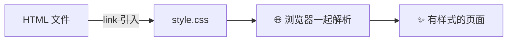
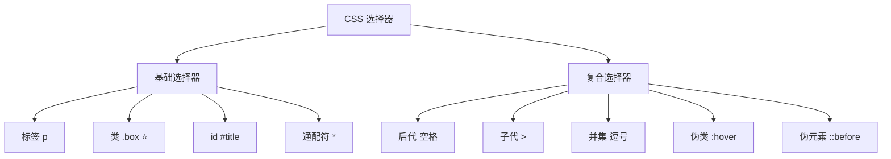
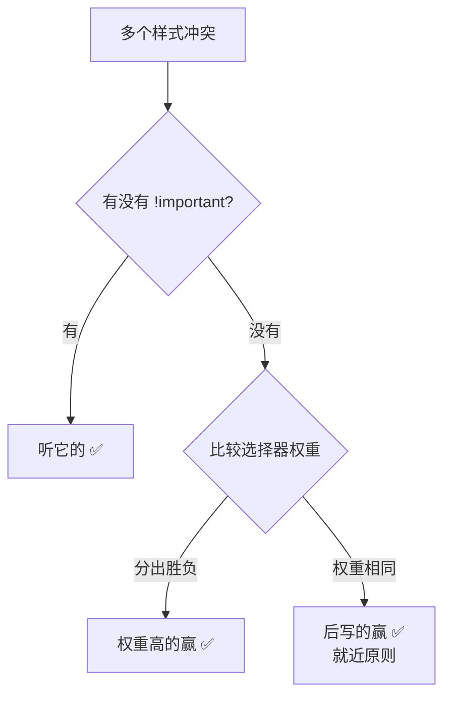
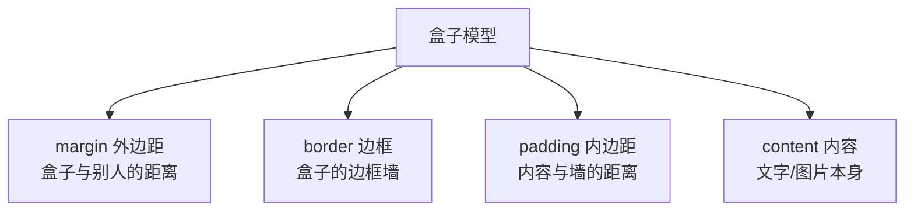
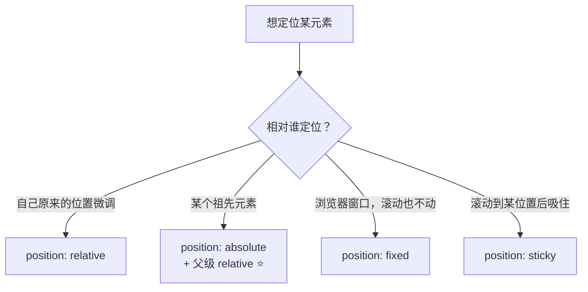
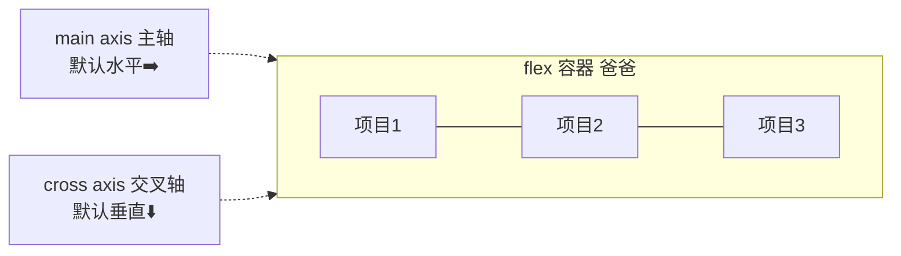
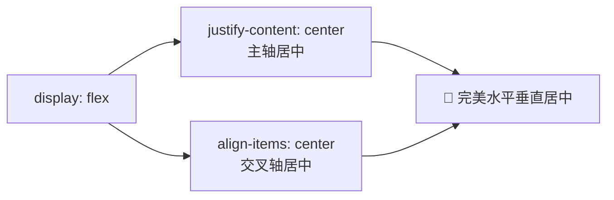
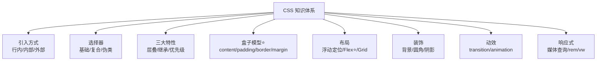

# 🎨 CSS 超详细学习笔记

> 欢迎来到前端三剑客之 **CSS** 的化妆间！(๑˃̵ᴗ˂̵)و
> HTML 已经搭好骨架啦，现在轮到 CSS 出场，把素颜的网页打扮得漂漂亮亮～💅

---

## 📖 目录

1. [CSS 是什么？](#一css-是什么)
2. [CSS 三种引入方式](#二css-三种引入方式)
3. [基础选择器：精准找到你要打扮的元素](#三基础选择器)
4. [复合选择器](#四复合选择器)
5. [层叠性与优先级：打架了听谁的？](#五层叠性与优先级)
6. [字体与文本属性](#六字体与文本属性)
7. [盒子模型（重中之重⭐）](#七盒子模型)
8. [显示模式 display](#八显示模式-display)
9. [浮动与定位](#九浮动与定位)
10. [Flex 弹性布局（现代布局首选⭐）](#十flex-弹性布局)
11. [背景与圆角边框](#十一背景与圆角边框)
12. [过渡与动画](#十二过渡与动画)
13. [响应式布局](#十三响应式布局)
14. [实战小案例](#十四实战小案例)
15. [总结与易错点](#十五总结与易错点)

---

## 一、CSS 是什么？✨

**CSS**（Cascading Style Sheets，层叠样式表）——网页界的"化妆师"💄

> **比喻时间** 🍰：
> - HTML 画了张素颜草图（结构）
> - **CSS 负责化妆**：涂什么口红（颜色）、穿什么衣服（背景）、站什么姿势（布局）
> - JavaScript 负责表演（交互）

一句话：**CSS 控制网页的一切"外观"**——颜色、大小、位置、动画，全是它管！

### CSS 长什么样？

```css
选择器 {
  属性: 值;
  属性: 值;
}
```

```css
p {
  color: pink;        /* 文字颜色：少女粉 💗 */
  font-size: 16px;    /* 字号：16像素 */
}
```

拆解一下这行"咒语" 🔮：

```text
  p { color: pink; }
  ↑    ↑      ↑
选择器 属性    值
（给谁化妆）（化哪里）（化成什么样）
```

---

## 二、CSS 三种引入方式 🚪

CSS 写在哪里？有三种"入口"：

### 1. 行内样式（不推荐 ❌）

```html
<p style="color: red; font-size: 20px;">我是红色文字</p>
```

> 结构和样式混在一起，又乱又难复用，应急才用～

### 2. 内部样式（小 demo 可以用 🤏）

```html
<head>
  <style>
    p { color: pink; }
  </style>
</head>
```

### 3. 外部样式（正式项目标配 ✅）

```html
<head>
  <link rel="stylesheet" href="style.css">
</head>
```

### 三种方式对比

| 方式 | 写在哪 | 优点 | 缺点 | 使用场景 |
|------|--------|------|------|---------|
| 行内样式 | 标签的 style 属性 | 简单直接 | 结构样式混杂、无法复用 | ❌ 尽量不用 |
| 内部样式 | `<style>` 标签里 | 部分分离 | 多页面无法共用 | 小 demo |
| 外部样式 | 独立 .css 文件 | **完全分离、可复用、可缓存** | 需要多一个文件 | ✅ 正式项目 |



---

## 三、基础选择器 🔍

选择器就是**"告诉 CSS 要打扮谁"**。先认识四大基础选择器：

```css
/* 1. 标签选择器：给所有 p 标签化妆 */
p { color: gray; }

/* 2. 类选择器（最常用⭐）：给 class="box" 的元素化妆 */
.box { width: 200px; }

/* 3. id 选择器：给 id="title" 的唯一元素化妆 */
#title { font-size: 32px; }

/* 4. 通配符选择器：给所有元素化妆（常用于清除默认样式） */
* { margin: 0; padding: 0; }
```

| 选择器 | 语法 | 作用范围 | 使用频率 |
|--------|------|---------|---------|
| 标签选择器 | `p { }` | 页面里**所有**同名标签 | ⭐⭐⭐ |
| 类选择器 | `.box { }` | 所有 `class="box"` 的元素 | ⭐⭐⭐⭐⭐ |
| id 选择器 | `#title { }` | 唯一的 `id="title"` 元素 | ⭐⭐ |
| 通配符选择器 | `* { }` | 所有元素 | ⭐⭐⭐ |

> 💡 类选择器是**日常主力**！一个元素还能挂多个类：`class="box red big"`（空格隔开）

---

## 四、复合选择器 🧩

单个选择器不够用时，就组合起来用～

### 4.1 后代选择器（空格）

```css
/* 选中 .box 里面所有的 span（儿子、孙子、曾孙...都算） */
.box span { color: red; }
```

### 4.2 子代选择器（>）

```css
/* 只选中 .box 的"亲儿子" span，孙子不管 */
.box > span { color: blue; }
```

### 4.3 并集选择器（逗号）

```css
/* h1、p、.box 三位一起化妆 */
h1, p, .box { margin: 0; }
```

### 4.4 交集选择器（紧连着写）

```css
/* 既是 p 标签、又有 box 类的元素 */
p.box { color: green; }
```

### 4.5 伪类选择器（冒号 ⭐）

**"伪类"= 元素处于某种**状态**时的样子**，比如鼠标悬停：

```css
a:hover { color: orange; }   /* 鼠标悬停时变橙色 */
```

常用伪类一览：

| 伪类 | 含义 |
|------|------|
| `:hover` | 鼠标悬停时 ⭐⭐⭐⭐⭐ |
| `:active` | 鼠标按住不放时 |
| `:focus` | 获得焦点时（比如点击输入框）|
| `:first-child` | 是老爸的第一个孩子 |
| `:last-child` | 是老爸的最后一个孩子 |
| `:nth-child(n)` | 是老爸的第 n 个孩子 |
| `:checked` | 表单项被选中时 |

```css
/* 奇偶行变色：表格斑马纹常用 🦓 */
tr:nth-child(odd) { background: #f5f5f5; }   /* 奇数行 */
tr:nth-child(even) { background: #fff; }     /* 偶数行 */
```

### 4.6 伪元素选择器（双冒号）

"伪元素"= 凭空创造出**不存在的元素**：

```css
/* 在 p 内容的前面/后面插入内容 */
p::before { content: "🌸"; }
p::after  { content: "✨"; }

/* 首字下沉、首行样式 */
p::first-letter { font-size: 40px; }
p::first-line { color: gray; }
```

### 选择器家族图



---

## 五、层叠性与优先级 ⚖️

CSS 全称叫"**层叠**样式表"，层叠 = 样式可以叠加、覆盖。那打架了听谁的？

### 规则一：就近原则 📍

同一个元素被多个样式命中时，**离得近的（后写的）覆盖先写的**：

```css
p { color: red; }
p { color: blue; }   /* 最终蓝色！后面的赢了 💙 */
```

### 规则二：优先级（权重）计算 🧮

不同选择器打架，按**权重**算：

| 选择器 | 权重 | 记忆 |
|--------|------|------|
| 行内样式 `style=""` | (1,0,0,0) | 大 boss 👑 |
| id 选择器 `#box` | (0,1,0,0) | 老大 |
| 类/伪类 `.box` `:hover` | (0,0,1,0) | 老二 |
| 标签/伪元素 `p` `::before` | (0,0,0,1) | 老三 |
| 通配符 `*`、继承的样式 | (0,0,0,0) | 小透明 |

> 💥 终极大招：`!important` 加在属性值后面，无视一切直接赢（但滥用会被同事打 😤）

```css
p { color: red !important; }  /* 谁也抢不过我！*/
```

### 判断流程图



---

## 六、字体与文本属性 ✍️

### 6.1 字体三件套

```css
p {
  font-size: 16px;            /* 字号（浏览器默认 16px）*/
  font-family: "微软雅黑", sans-serif;  /* 字体（可写多个备胎）*/
  font-weight: bold;          /* 加粗：normal正常 / bold加粗 / 100~900 */
  font-style: italic;         /* 斜体 */
  line-height: 1.5;           /* 行高：写数字表示倍数，超好用⭐ */
}
```

### 6.2 文本属性

```css
p {
  color: #ff6699;             /* 文字颜色：颜色名/十六进制/rgb */
  text-align: center;         /* 水平对齐：left / center / right */
  text-decoration: none;      /* 装饰线：none去掉 / underline下划线 / line-through删除线 */
  text-indent: 2em;           /* 首行缩进2字符（中文段落超常用⭐）*/
  letter-spacing: 2px;        /* 字间距 */
}
```

### 颜色的四种写法 🌈

| 写法 | 示例 | 说明 |
|------|------|------|
| 颜色名 | `red` | 简单但只有140个 |
| 十六进制 | `#ff6699` | 最常用 ⭐ |
| rgb | `rgb(255, 0, 102)` | 红/绿/蓝 各 0~255 |
| rgba | `rgba(255, 0, 102, 0.5)` | 最后一位是透明度 0~1 |

```css
/* 超实用：文字透明、整体透明 */
color: rgba(0, 0, 0, 0.5);   /* 半透明黑字 */
opacity: 0.5;                /* 整个元素半透明（包括内容）*/
```

---

## 七、盒子模型 📦（重中之重⭐⭐⭐⭐⭐）

**页面里每个元素都是一个"盒子"**！理解盒子模型 = 理解 CSS 布局的一半！

### 盒子的四层结构



从里到外：**content → padding → border → margin**

```text
┌─────────────────────────────────┐
│  margin（外边距：我和别人的距离）     │
│  ┌───────────────────────────┐  │
│  │  border（边框：我的围墙）      │  │
│  │  ┌─────────────────────┐  │  │
│  │  │  padding（内边距：    │  │  │
│  │  │  内容离墙的距离）      │  │  │
│  │  │  ┌───────────────┐  │  │  │
│  │  │  │ content 内容   │  │  │  │
│  │  │  └───────────────┘  │  │  │
│  │  └─────────────────────┘  │  │
│  └───────────────────────────┘  │
└─────────────────────────────────┘
```

### 代码示例

```css
.box {
  width: 200px;               /* 内容宽度 */
  height: 200px;

  padding: 20px;              /* 四个方向都 20px */
  padding: 10px 20px;         /* 上下10 左右20 */
  padding: 10px 20px 30px 40px; /* 上 右 下 左（顺时针⏰）*/

  border: 1px solid pink;     /* 边框：宽度 样式 颜色 */
  margin: 30px;               /* 外边距 */
}
```

> 🧠 **顺时针口诀**：`padding: 上 右 下 左`——从上面开始转一圈（上右下左）⏰

### 盒子实际大小怎么算？

**默认情况下（content-box）：**

```text
实际宽度 = width + 左右padding + 左右border (+ 左右margin 不算自身)
```

举例：width:200px + padding:20px + border:1px → 实际占 **242px**！

### box-sizing：改变计算方式 ⭐

```css
/* 怪异盒子：width 就包含 padding 和 border，算账方便！*/
* {
  box-sizing: border-box;
}
```

| 模式 | width 包含什么 | 实际宽度 |
|------|--------------|---------|
| `content-box`（默认） | 只有内容 | width + padding + border |
| `border-box`（推荐⭐） | 内容 + padding + border | 就等于 width |

> 💡 实战第一行代码经常就是 `* { box-sizing: border-box; }`，从此算宽度不再头秃～

### margin 塌陷（小坑坑 🕳️）

**垂直方向**的 margin 相邻时会**合并**，取大值而非相加：

```text
上面的盒子 margin-bottom: 50px
下面的盒子 margin-top: 30px
→ 两个盒子间距是 50px（不是80px！大的赢了）
```

> 解决办法：给下面的盒子改用 padding，或给父级加 overflow:hidden / border。

---

## 八、显示模式 display 🎭

还记得 HTML 篇讲的块级/行内吗？CSS 可以**改变显示模式**：

```css
div { display: inline; }       /* 块级 → 行内 */
span { display: block; }       /* 行内 → 块级 */
a { display: inline-block; }   /* 行内 → 行内块（能设宽高又挤一行）*/
div { display: none; }         /* 隐藏（不占位置）*/
div { visibility: hidden; }    /* 隐藏（但占着位置，像隐身人👻）*/
```

### display:none vs visibility:hidden vs opacity:0

| 方式 | 肉眼可见？ | 还占位置吗？ | 能触发事件吗？ |
|------|----------|------------|-------------|
| `display: none` | ❌ | ❌ 不占 | ❌ |
| `visibility: hidden` | ❌ | ✅ 占 | ❌ |
| `opacity: 0` | ❌ | ✅ 占 | ✅（透明但摸得到！）|

---

## 九、浮动与定位 🧭

### 9.1 浮动 float（传统布局元老）

```css
.box { float: left; }   /* 往左漂，后面的内容流上来补位 */
```

浮动特性：
- 浮动元素**脱离标准流**（不再占原来的位置，像飘起来🎈）
- 浮动的盒子一行显示，顶端对齐
- 浮动元素具有**行内块特性**（能设宽高）

**浮动的坑：父盒子高度塌陷 ⚠️**

```text
子元素全浮动了 → 父元素没了支撑 → 高度变 0 → 布局乱套 😱
```

**清除浮动的方法：**

```css
/* 方法1：额外标签法（在最后加一个空标签） */
.clear { clear: both; }

/* 方法2：单伪元素法（推荐 ⭐） */
.clearfix::after {
  content: "";
  display: block;
  clear: both;
}

/* 方法3：父级加 overflow: hidden; */
.father { overflow: hidden; }
```

### 9.2 定位 position

想"钉"在页面某个位置？用定位！

| 定位模式 | 参照物 | 是否脱离标准流 | 典型场景 |
|---------|--------|-------------|---------|
| `static`（默认） | 不定位 | - | 正常文档流 |
| `relative` 相对定位 | **自己原来的位置** | ❌ 不脱 | 微调位置、给绝对定位当爹 |
| `absolute` 绝对定位 | **最近的定位祖先**（没有就浏览器） | ✅ 脱离 | 弹窗、角标、遮罩 |
| `fixed` 固定定位 | **浏览器窗口** | ✅ 脱离 | 顶部导航、回顶部按钮、悬浮广告 |
| `sticky` 粘性定位 | 滚动到阈值后固定 | 半脱离 | 滚动吸顶的表头 ⭐ |

```css
/* 定位搭配"边偏移"使用 */
.box {
  position: absolute;
  top: 50px;      /* 距上方 50px */
  left: 100px;    /* 距左边 100px */
}
```

### 子绝父相（黄金口诀 ⭐⭐⭐）

> **子元素用绝对定位，父元素用相对定位**——爸爸占位不动，儿子随意飞 🪁

```css
.father {
  position: relative;   /* 爹：相对定位，还占位置 */
}
.son {
  position: absolute;   /* 儿子：以爹为参照物 */
  right: 0;
  top: 0;               /* 贴在爹的右上角（角标常用）*/
}
```

### 定位模式选择流程图



### z-index：谁压在谁上面？

```css
.a { position: absolute; z-index: 1; }
.b { position: absolute; z-index: 2; }  /* b 在 a 上面（数字大的赢）*/
```

> ⚠️ z-index **只对定位元素有效**（static 的不配参加叠罗汉 🙅）

---

## 十、Flex 弹性布局 ⭐⭐⭐⭐⭐

**现代布局之王**！一行代码让子元素排排站，水平垂直居中不再是噩梦！

### 开启 Flex：给父元素（容器）设置

```css
.father {
  display: flex;
  /* 从此子元素（flex项）自动排成一行，像穿在绳上的珠子 📿 */
}
```

### 核心概念图



> 🧠 记住：**主轴**（默认水平）和**交叉轴**（默认垂直）互相垂直。所有对齐属性都围绕这两根轴！

### 父容器（容器）属性

```css
.father {
  display: flex;

  /* 1. 主轴方向 */
  flex-direction: row;            /* 水平（默认）*/
  /* row-reverse 水平反转 | column 垂直 | column-reverse 垂直反转 */

  /* 2. 主轴对齐方式 ⭐ */
  justify-content: center;        /* 居中 */
  /* flex-start 起点对齐(默认) | flex-end 终点 | space-between 两端贴边中间平分 |
     space-around 每个元素左右间距相等 | space-evenly 所有间距完全相等 */

  /* 3. 交叉轴对齐方式 ⭐ */
  align-items: center;            /* 垂直居中 */
  /* flex-start | flex-end | stretch 拉伸(默认) | baseline 基线 */

  /* 4. 换行 */
  flex-wrap: wrap;                /* 默认nowrap不换行，会挤扁！*/

  /* 5. 多行对齐（换行后行与行的间距）*/
  align-content: space-between;
}
```

**justify-content 效果对照**（➡️为主轴方向）：

| 值 | 效果示意 |
|----|---------|
| `flex-start` | `■■■______` 都靠起点 |
| `center` | `___■■■___` 居中 |
| `flex-end` | `______■■■` 都靠终点 |
| `space-between` | `■■___■■___■■` 两端贴边，中间平分 |
| `space-around` | `_■_■_■_` 每个元素周围间距相等 |
| `space-evenly` | `_■__■__■_` 所有空隙完全相等 |

### 子元素（flex 项）属性

```css
.son {
  flex: 1;             /* 占剩余空间的比例（超常用⭐）*/
  align-self: center;  /* 单独设置自己的交叉轴对齐 */
  order: -1;           /* 排序，数字小在前 */
}
```

### 🌟 神仙应用：完美水平垂直居中

```css
/* 以前的写法要定位+transform绕半天，现在两行搞定！*/
.father {
  display: flex;
  justify-content: center;   /* 水平居中 */
  align-items: center;       /* 垂直居中 */
}
```



---

## 十一、背景与圆角边框 🖼️

### 11.1 背景属性

```css
.box {
  background-color: pink;                  /* 背景色 */
  background-image: url(cat.jpg);          /* 背景图 */

  background-repeat: no-repeat;            /* 不平铺（默认repeat铺满）*/
  background-position: center center;      /* 位置：方位词/精确px ⭐ */
  background-size: cover;                  /* 尺寸 ⭐ */
  /* cover 铺满容器(可能裁切) | contain 完整显示(可能留白) */

  /* 简写（顺序不强制，常用这个顺序）*/
  background: pink url(cat.jpg) no-repeat center/cover;
}
```

| 属性 | 常用值 | 说明 |
|------|-------|------|
| `background-size` | `cover` | 铺满且不变形，超出裁掉 ⭐ |
| `background-size` | `contain` | 完整显示，可能留白 |
| `background-position` | `center` | 居中（精灵图常用坐标定位）|

### 11.2 圆角与阴影

```css
.box {
  border-radius: 10px;           /* 四个角都圆 */
  border-radius: 50%;            /* 圆形（配正方形用）⭐ */
  border-radius: 10px 20px 30px 40px;  /* 左上 右上 右下 左下 */

  box-shadow: 0 4px 8px rgba(0, 0, 0, 0.2);  /* 阴影 ⭐ */
  /* 参数：水平偏移 垂直偏移 模糊度 颜色 */
}
```

---

## 十二、过渡与动画 🎬

### 12.1 过渡 transition（从 A 状态渐变到 B 状态）

```css
.box {
  width: 100px;
  transition: width 0.5s ease;   /* width 变化时，用0.5秒慢慢变 */
}

.box:hover {
  width: 300px;   /* 悬停时宽度平滑变大，而不是瞬间跳变 ✨ */
}
```

```text
transition: 属性 过渡时间 速度曲线 延迟时间;
             all   0.5s    ease      0s
```

| 速度曲线 | 效果 |
|---------|------|
| `ease` | 先快后慢（默认）|
| `linear` | 匀速 |
| `ease-in` | 先慢后快 |
| `ease-out` | 先快后慢 |
| `cubic-bezier()` | 自定义曲线 🎢 |

### 12.2 关键帧动画 @keyframes（自动播放的连续动画）

```css
/* 1. 定义动画：名字叫 move */
@keyframes move {
  0%   { transform: translateX(0); }
  50%  { transform: translateX(200px); }
  100% { transform: translateX(0); }
}

/* 2. 使用动画 */
.box {
  animation: move 2s ease infinite alternate;
  /* 动画名 时长 速度 次数(infinite无限) alternate往返 */
}
```

### transition vs animation

| 对比 | transition 过渡 | animation 动画 |
|------|---------------|---------------|
| 触发方式 | 需要"事件"触发（hover等）| 页面加载即自动播放 |
| 状态数量 | 两个状态 A→B | 可定义多个关键帧 🎞️ |
| 能否循环 | ❌ | ✅ infinite |
| 使用场景 | 悬停效果、面板展开 | 加载动画、旋转图标 |

---

## 十三、响应式布局 📱💻🖥️

一套代码适配手机/平板/电脑！

### 13.1 媒体查询 @media

```css
/* 屏幕宽度 ≤ 768px（手机）时生效 */
@media screen and (max-width: 768px) {
  .box { width: 100%; }
}

/* 屏幕宽度 ≥ 1200px（大屏）时生效 */
@media screen and (min-width: 1200px) {
  .box { width: 1200px; }
}
```

### 13.2 常用单位对比

| 单位 | 相对于谁 | 场景 |
|------|---------|------|
| `px` | 绝对像素 | 边框、固定尺寸 |
| `%` | 父元素 | 自适应宽度 |
| `em` | **自己/父级**的字号 | 有继承坑，少用 |
| `rem` ⭐ | **根元素 html** 的字号 | 响应式神器！|
| `vw` / `vh` ⭐ | 视口宽度/高度的 1% | 全屏页面 |

```css
html { font-size: 16px; }   /* 1rem = 16px */
.box { width: 12.5rem; }    /* = 200px */

/* 移动端适配原理：JS或媒体查询改变 html 的 font-size，
   所有 rem 尺寸就等比缩放啦～ */
```

### 13.3 响应式方案对比

| 方案 | 思路 | 代表 |
|------|------|------|
| 媒体查询 | 断点切换布局 | PC/手机双版 |
| rem 布局 | 根字号等比缩放 | 淘宝移动端 |
| vw/vh | 按视口百分比 | 现代移动端 ⭐ |
| Flex/Grid | 弹性伸缩 | 天然自适应 ⭐ |

---

## 十四、实战小案例 🛠️

做一个会变身的"按钮卡片"，综合运用选择器、盒子模型、Flex、过渡～

```html
<!DOCTYPE html>
<html lang="zh-CN">
<head>
  <meta charset="UTF-8">
  <title>CSS 实战：变美卡片</title>
  <style>
    /* ① 清除默认样式 + 怪异盒子（实战好习惯⭐） */
    * { margin: 0; padding: 0; box-sizing: border-box; }

    /* ② 让内容水平垂直居中：Flex 两行搞定 */
    body {
      height: 100vh;
      display: flex;
      justify-content: center;
      align-items: center;
      background: linear-gradient(135deg, #ffe6f2, #e6f7ff);
    }

    /* ③ 盒子模型综合运用 */
    .card {
      width: 260px;
      padding: 30px 24px;
      background: #fff;
      border-radius: 16px;                          /* 圆角 */
      box-shadow: 0 10px 30px rgba(255, 105, 180, 0.2); /* 阴影 */
      text-align: center;
      transition: all 0.4s ease;                     /* ④ 过渡：一切变化慢慢来 */
    }

    /* ⑤ 伪类：悬停时上浮放大 */
    .card:hover {
      transform: translateY(-10px) scale(1.05);
      box-shadow: 0 20px 40px rgba(255, 105, 180, 0.35);
    }

    .avatar {
      width: 80px;
      height: 80px;
      border-radius: 50%;           /* 圆形头像 */
      margin: 0 auto 16px;
    }

    .name { font-size: 20px; color: #333; }
    .desc {
      font-size: 14px;
      color: #999;
      line-height: 1.6;
      margin: 8px 0 20px;
    }

    /* ⑥ 子绝父相：角标贴在卡片右上角 */
    .card { position: relative; }
    .badge {
      position: absolute;
      top: -8px;
      right: -8px;
      padding: 4px 10px;
      background: #ff6699;
      color: #fff;
      font-size: 12px;
      border-radius: 999px;
    }

    /* ⑦ 按钮 */
    .btn {
      display: inline-block;        /* 行内→能设宽高 */
      padding: 10px 32px;
      background: #ff6699;
      color: #fff;
      border: none;
      border-radius: 999px;
      cursor: pointer;              /* 小手光标 */
      transition: background 0.3s;
    }
    .btn:hover { background: #ff3377; }

    /* ⑧ 关键帧动画：头像呼吸效果 */
    @keyframes breathe {
      0%, 100% { transform: scale(1); }
      50% { transform: scale(1.08); }
    }
    .avatar { animation: breathe 2s ease infinite; }
  </style>
</head>
<body>
  <div class="card">
    <span class="badge">NEW ✨</span>
    
    <p class="name">小可爱</p>
    <p class="desc">正在学习 CSS 的前端萌新<br>今天也要加油鸭～</p>
    <button class="btn">关注我 💗</button>
  </div>
</body>
</html>
```

**本案例知识点清单：**

- ✅ 通配符清除样式 + `box-sizing: border-box`
- ✅ Flex 水平垂直居中
- ✅ 盒子模型（padding/margin/border-radius/box-shadow）
- ✅ 伪类 `:hover` + 过渡 transition
- ✅ 子绝父相定位角标
- ✅ `@keyframes` 呼吸动画

---

## 十五、总结与易错点 🎁

### CSS 知识地图



### 布局方案选型速查

| 需求 | 推荐方案 |
|------|---------|
| 一行排几个盒子 | Flex ⭐ |
| 水平垂直居中 | Flex（justify + align）⭐ |
| 二维网格布局 | Grid |
| 贴边/角标/弹窗 | 定位（子绝父相）⭐ |
| 旧项目图文环绕 | 浮动 float |
| 滚动吸顶 | sticky |

### 易错点红黑榜 🚨

| # | 易错点 | 正确姿势 |
|---|--------|---------|
| 1 | 忘了 `box-sizing: border-box` | 实战开头全局设置，算宽度不头秃 |
| 2 | 行内元素直接设宽高 | 无效！先 `display: block/inline-block` 或用 Flex |
| 3 | 垂直方向 margin 想相加 | 会塌陷取大值，注意规避 |
| 4 | 子元素全浮动导致父高度塌陷 | 清除浮动：伪元素 `clear: both` |
| 5 | `z-index` 不生效 | 只对**定位元素**有效（static 无效）|
| 6 | Flex 子项被挤扁 | 默认不换行！加 `flex-wrap: wrap` |
| 7 | 定位偏移写错参照物 | absolute 找最近的**定位过的祖先** |
| 8 | 优先级算不清 | 记牢：行内 > id > 类 > 标签；实在不行 !important（慎用）|
| 9 | `background-size` 用 cover 图片裁掉了 | 想完整显示用 `contain` |
| 10 | transition 加在 :hover 里 | 应加在**原状态**上，hover 才有过渡效果 ⭐ |

### 学习建议 💡

1. **盒子和 Flex 是核心**：这两块吃透，80% 的布局都不怕 💪
2. **F12 调试大法**：Elements 面板里点点改改，实时看效果，学 CSS 最快的路 🚀
3. **抄作业式学习**：看到好看的按钮/卡片，右键检查，模仿着写一遍 ✍️
4. **小工具**：Flexbox Froggy（青蛙游戏学 Flex）、CSS-Tricks 的 Flex 速查表 🐸

---

> 🎉 恭喜读完 CSS 篇！网页已经会化妆啦～
> 下一站：**JavaScript**，给网页注入灵魂的时间到啦！🧠⚡
