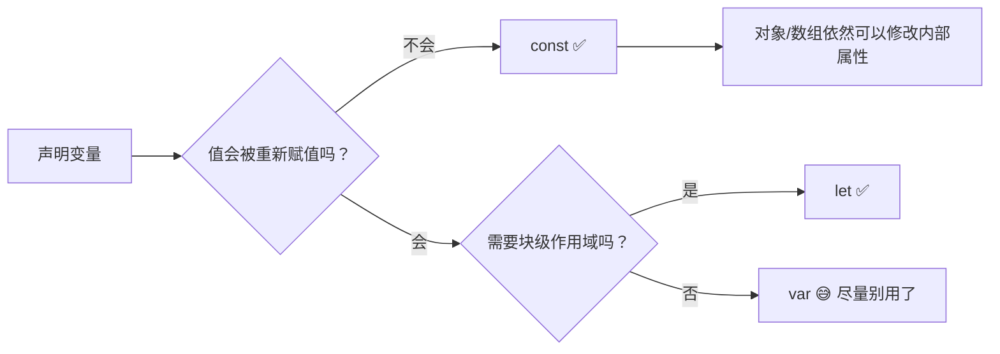
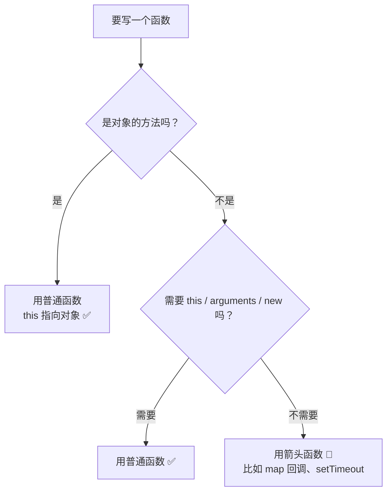
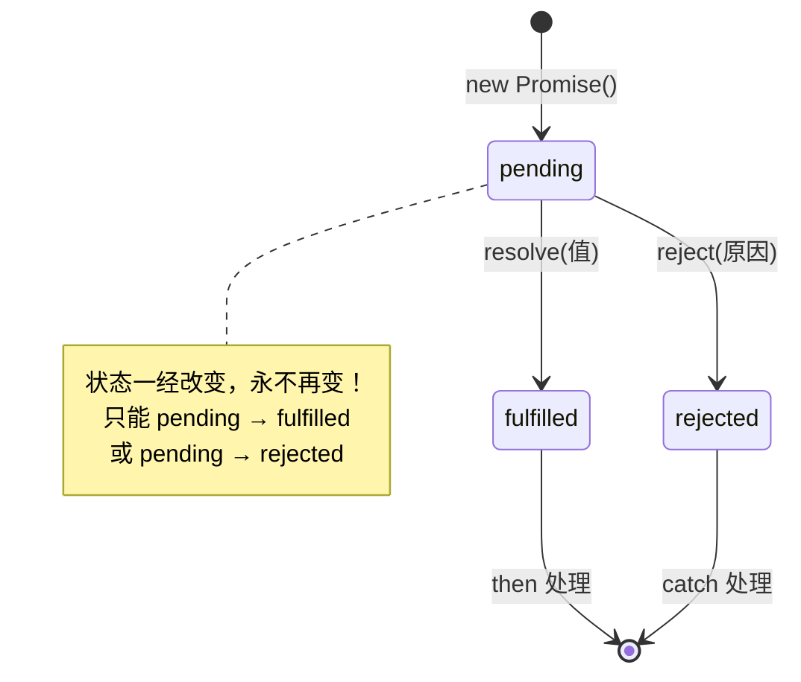
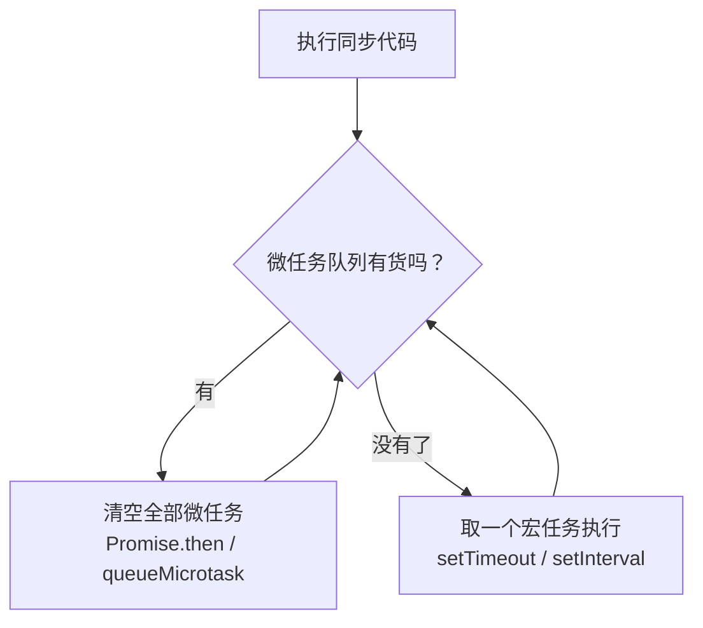
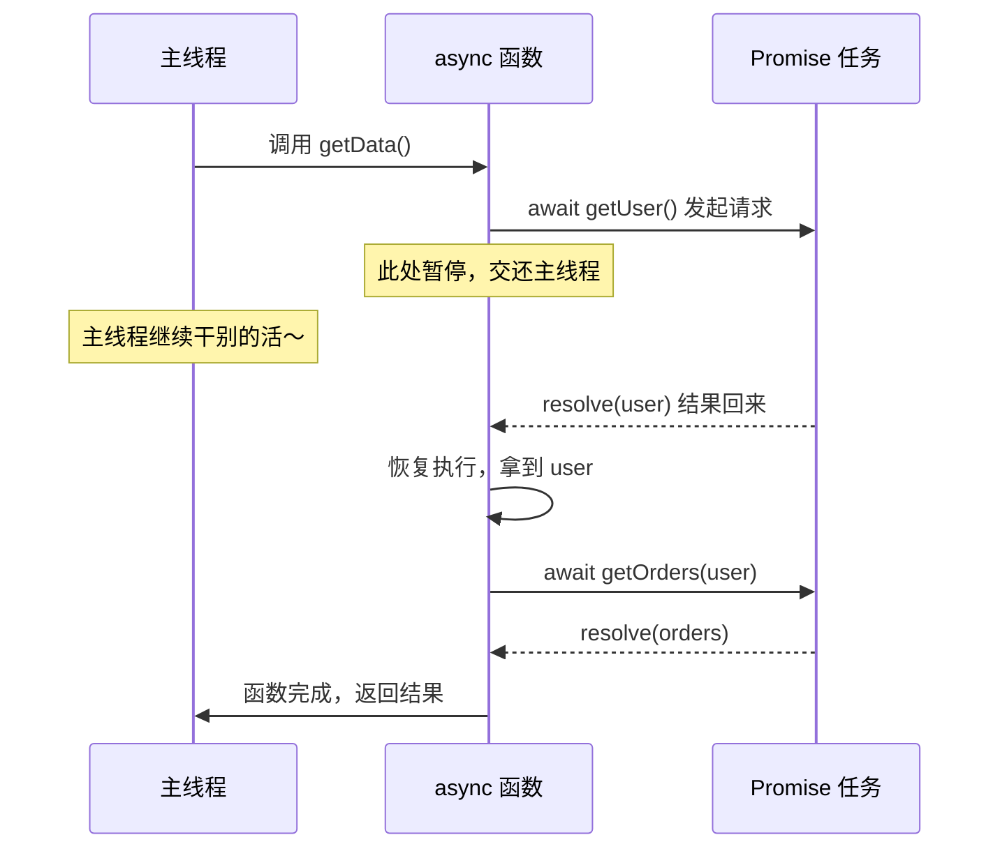
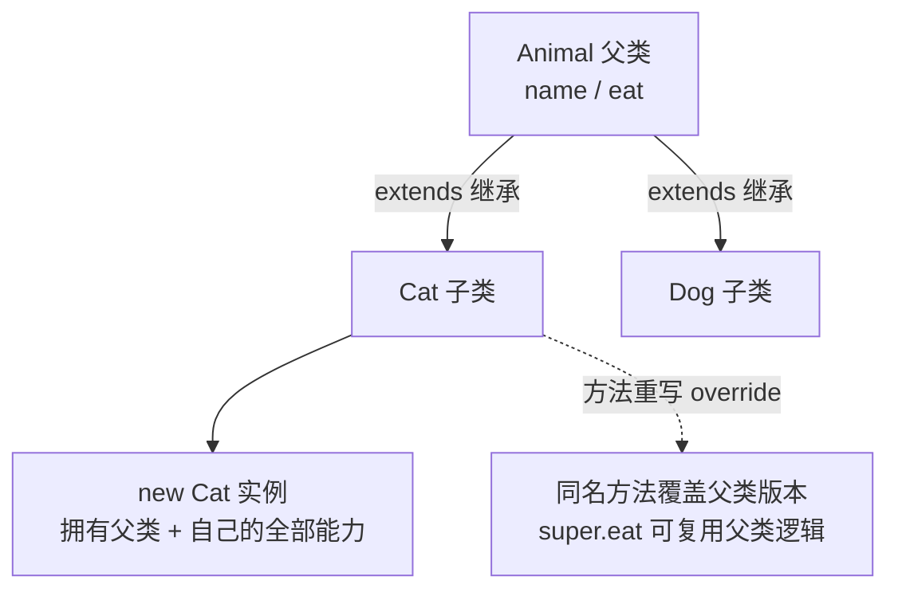
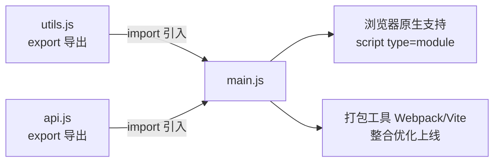
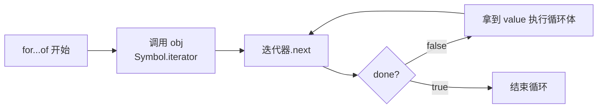
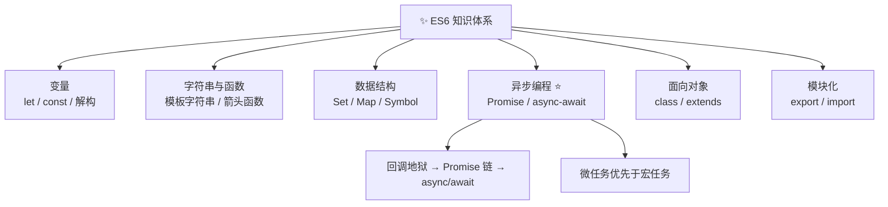

# ✨ ES6 学习笔记 —— 新语法小书包 🎒

> 嘿嘿～欢迎来到 ES6 的小课堂！🎀
> 这里的每个知识点都掰开揉碎讲给你听，边看边敲代码，保证明明白白！(๑•̀ㅂ•́)و✧

---

## 📚 目录

| 章节 | 内容 | 难度 |
| --- | --- | --- |
| 一 | ES6 是什么？ | ⭐ |
| 二 | let 与 const | ⭐⭐ |
| 三 | 解构赋值 | ⭐⭐ |
| 四 | 模板字符串 | ⭐ |
| 五 | 字符串新方法 | ⭐ |
| 六 | 函数扩展（箭头函数重点！） | ⭐⭐⭐ |
| 七 | 扩展运算符 `...` | ⭐⭐ |
| 八 | 数组新方法 | ⭐⭐ |
| 九 | 对象扩展与新运算符 `?.` `??` | ⭐⭐ |
| 十 | Symbol | ⭐⭐⭐ |
| 十一 | Set 和 Map | ⭐⭐ |
| 十二 | Promise（重头戏！） | ⭐⭐⭐⭐ |
| 十三 | async / await | ⭐⭐⭐ |
| 十四 | Class 类 | ⭐⭐⭐ |
| 十五 | Module 模块化 | ⭐⭐ |
| 十六 | Iterator 与 for...of | ⭐⭐⭐ |
| 十七 | 面试高频考点速览 | 🔥 |

---

## 一、ES6 是什么？🤔

**ES6 = ECMAScript 2015**，是 JavaScript 的第六个大版本，一次性加入了一大波好用的新语法～

> 💡 小贴士：平时大家说"ES6"，一般泛指 **ES2015 以及之后的新特性**（就像"美式咖啡"泛指一大类咖啡一样啦 ☕）

**它解决了什么痛点？**

| 以前的痛 😫 | ES6 的药 💊 |
| --- | --- |
| `var` 变量提升、全局污染 | `let` / `const` 块级作用域 |
| 字符串拼接一堆 `+` 号 | 模板字符串 `` `${}` `` |
| 回调地狱 🕳️ | Promise / async-await |
| 没有类，原型继承绕晕人 | `class` 语法糖 |
| 全局 script 标签乱引用 | ES Module 模块化 |

**兼容性**：现代浏览器全都支持！老项目要兼容 IE 的话，用 **Babel** 把 ES6 转译回 ES5 就好啦～

---

## 二、let 与 const —— 新的变量声明方式 📦

### 2.1 三兄弟对比表

| 特性 | var | let | const |
| --- | --- | --- | --- |
| 作用域 | 函数作用域 | **块级作用域** `{}` | **块级作用域** `{}` |
| 变量提升 | ✅ 有（值为 undefined） | ❌ 无（暂时性死区） | ❌ 无（暂时性死区） |
| 重复声明 | ✅ 允许 | ❌ 报错 | ❌ 报错 |
| 重新赋值 | ✅ 允许 | ✅ 允许 | ❌ 报错（引用不可变） |
| 全局声明挂到 window | ✅ 会 | ❌ 不会 | ❌ 不会 |

### 2.2 块级作用域是什么？

用 `{}` 包起来的范围就是一块"领地"，`let` 声明的变量只在自己的领地里有效～

```js
{
  let girl = '小红';
  const PI = 3.14;
}
console.log(girl); // ❌ ReferenceError: girl is not defined
```

### 2.3 经典面试题：循环打印 🎯

```js
// 😫 var 版本：i 是全局的，循环结束后变成 3
for (var i = 0; i < 3; i++) {
  setTimeout(() => console.log(i)); // 3 3 3
}

// ✅ let 版本：每轮循环都是一个新的 i
for (let j = 0; j < 3; j++) {
  setTimeout(() => console.log(j)); // 0 1 2
}
```

> 🎀 记忆口诀：**var 是大喇叭（全楼层都听得见），let 是小声话（只在自己房间说）**

### 2.4 暂时性死区（TDZ）

在 `let`/`const` 声明**之前**访问变量，直接报错，像走进了一片"迷雾区"：

```js
console.log(a); // undefined（var 提升，不报错）
var a = 1;

console.log(b); // ❌ ReferenceError！（还没声明就想用？拒绝！）
let b = 2;
```

### 2.5 const 的"不可变"是啥意思？

```js
const list = [1, 2, 3];
list.push(4);      // ✅ 可以！改的是"内容"
list = [5, 6];     // ❌ 报错！不能换"整个箱子"
```

> 💡 `const` 锁的是**变量名指向的那个地址**，箱子不能换，但箱子里装的东西随便改～



---

## 三、解构赋值 —— 一键拆快递 📬

把数组或对象里的值，像拆快递一样**一次性取出来**赋给变量～

### 3.1 数组解构：按位置拆

```js
const [a, b, c] = [1, 2, 3];
console.log(a, b, c); // 1 2 3

// 跳着取
const [x, , z] = ['苹果', '香蕉', '草莓'];
console.log(z); // '草莓'

// 剩余的全打包
const [first, ...rest] = [1, 2, 3, 4];
console.log(rest); // [2, 3, 4]

// 默认值：拆出来是空的就用备用款
const [m = 10, n = 20] = [5];
console.log(m, n); // 5 20
```

### 3.2 对象解构：按名字拆

```js
const student = { name: '小美', age: 18, hobby: '敲代码' };

const { name, age, hobby } = student;
console.log(name, age, hobby); // 小美 18 敲代码

// 改个变量名：名字: 新名字
const { name: myName } = student;
console.log(myName); // 小美

// 默认值
const { city = '北京' } = student;
console.log(city); // 北京（原来没有就用默认）
```

### 3.3 实战常用场景 🛠️

```js
// ① 一行交换两个变量（超优雅！）
let a = 1, b = 2;
[a, b] = [b, a];
console.log(a, b); // 2 1

// ② 函数参数解构（React 里天天见！）
function printUser({ name, age }) {
  console.log(`${name} 今年 ${age} 岁`);
}
printUser({ name: '小美', age: 18 });

// ③ 函数返回多个值
function getPoint() {
  return { x: 10, y: 20 };
}
const { x, y } = getPoint();

// ④ 模块导入解构
// import { ref, reactive } from 'vue';
```

---

## 四、模板字符串 —— 告别加号拼接 🧵

用**反引号** `` ` `` 包起来，`${}` 里可以放任何表达式～

```js
const name = '小甜';
const age = 18;

// 😫 以前：引号加号满天飞
const old = '我叫' + name + '，今年' + age + '岁';

// ✅ 现在：清晰得像读句子
const now = `我叫${name}，明年${age + 1}岁`;

// 支持换行，不用 \n 啦（写 HTML 神器！）
const html = `
  <div class="card">
    <h2>${name}</h2>
  </div>
`;

// ${} 里还能放函数调用、三元表达式
const msg = `你好，${age >= 18 ? '成年玩家' : '未成年玩家'}`;
```

---

## 五、字符串新方法 ✂️

| 方法 | 作用 | 示例 |
| --- | --- | --- |
| `includes('x')` | 是否包含 | `'hello'.includes('ell')` → `true` |
| `startsWith('x')` | 是否以 x 开头 | `'abc'.startsWith('a')` → `true` |
| `endsWith('x')` | 是否以 x 结尾 | `'abc'.endsWith('c')` → `true` |
| `repeat(n)` | 重复 n 次 | `'哈'.repeat(3)` → `'哈哈哈'` |
| `padStart(n, 'x')` | 头部补齐到 n 位 | `'5'.padStart(3, '0')` → `'005'` |
| `padEnd(n, 'x')` | 尾部补齐到 n 位 | `'5'.padEnd(3, '0')` → `'500'` |
| `trimStart()` / `trimEnd()` | 去首/尾空格 | `'  a '.trimStart()` → `'a '` |

> 💡 `padStart` 超实用：手机号脱敏、时间补零（`09:05`）、金额补位都能用！

```js
// 经典：日期补零
const h = String(9).padStart(2, '0'); // '09'

// 经典：身份证打码
const id = '110101199001011234'.replace(/(\d{6})\d{8}(\d{4})/, '$1********$2');
```

---

## 六、函数扩展 —— 箭头函数是重点！🏹

### 6.1 参数默认值

```js
// 以前：|| 兜底（0、'' 这种 falsy 值会被误伤！）
// 现在：直接写进参数
function greet(name = '游客', words = '欢迎光临') {
  console.log(`${name}，${words}`);
}
greet();            // 游客，欢迎光临
greet('小美');       // 小美，欢迎光临

// 默认值还能用前面的参数
function foo(a, b = a * 2) {
  console.log(a, b);
}
foo(3); // 3 6
```

### 6.2 rest 参数（剩余参数）

```js
// ...args 把"剩下的参数"收集成真数组（arguments 是伪数组，不好用）
function sum(...nums) {
  return nums.reduce((total, n) => total + n, 0);
}
sum(1, 2, 3, 4); // 10
```

### 6.3 箭头函数：写法升级 ⬆️

```js
// 完整版
const add = (a, b) => { return a + b; };

// 只有一句 return？省略大括号和 return
const add = (a, b) => a + b;

// 只有一个参数？省略小括号
const double = n => n * 2;

// 没有参数？小括号必须留
const sayHi = () => console.log('hi~');

// 直接返回对象？要加括号包住（不然 {} 会被当成函数体）
const getUser = () => ({ name: '小美', age: 18 });
```

### 6.4 ⭐ 箭头函数的 this（必考！）

> 🎀 一句话记住：**箭头函数没有自己的 this，它用的 this 是"定义时"外面那一层的 this**（就像继承零花钱，自己不挣钱，直接找爸妈要 💰）

```js
const person = {
  name: '小甜',
  // ✅ 普通函数：谁调用我，this 就是谁（这里是 person）
  sayHi() {
    console.log(`你好，我是 ${this.name}`);
  },
  // ❌ 箭头函数：没有自己的 this，往外找到全局（window/undefined）
  sayBye: () => {
    console.log(`再见，我是 ${this.name}`); // undefined
  },
};

person.sayHi(); // 你好，我是 小甜
person.sayBye(); // 再见，我是 undefined
```

### 6.5 普通函数 vs 箭头函数对比表

| 特性 | 普通函数 | 箭头函数 |
| --- | --- | --- |
| this | 调用时决定（谁调用指向谁） | 定义时继承外层 ❌ 不能改 |
| arguments | ✅ 有 | ❌ 没有（用 rest 参数代替） |
| 作为构造函数 new | ✅ 可以 | ❌ 报错 |
| prototype 原型 | ✅ 有 | ❌ 没有 |
| 适合场景 | 对象方法、需要 this 的地方 | 回调函数、工具函数 |



---

## 七、扩展运算符 `...` —— 三个点的魔法 ✨

同一个 `...`，**放在等号右边/参数外 = 展开**，**放在参数定义处 = 收集**：

### 7.1 展开数组 / 对象

```js
const arr1 = [1, 2, 3];
const arr2 = [4, 5];

// 合并数组
const merged = [...arr1, ...arr2];        // [1,2,3,4,5]

// 浅拷贝（新地址，互不影响）
const copy = [...arr1];
copy.push(99);
console.log(arr1);  // [1,2,3] 没被动 ✅

// 合并对象（后面的覆盖前面的）
const base = { color: 'pink', size: 'M' };
const custom = { ...base, size: 'L' };    // {color:'pink', size:'L'}

// 函数传参展开
Math.max(...arr1);  // 3（等价 Math.max(1,2,3)）
```

### 7.2 伪数组转真数组

```js
// arguments、DOM 节点列表都是"伪数组"（没有 map 等方法）
const divs = document.querySelectorAll('div');
const realArr = [...divs]; // 现在 .map() .filter() 随便用 ✅
```

> ⚠️ 注意：`...` 展开是**浅拷贝**！数组里嵌套的对象还是共享的哦～

---

## 八、数组新方法 —— 数据处理六剑客 ⚔️

### 8.1 方法总览表

| 方法 | 作用 | 返回值 | 会改原数组？ |
| --- | --- | --- | --- |
| `forEach` | 遍历 | undefined | - |
| `map` | 映射加工 | **新数组**（同长度） | ❌ |
| `filter` | 过滤筛选 | **新数组**（可能更短） | ❌ |
| `reduce` | 累计汇总 | 一个值 | ❌ |
| `find` | 找第一个符合条件的 | 元素 / undefined | ❌ |
| `findIndex` | 找第一个符合条件的位置 | 下标 / -1 | ❌ |
| `some` | 有一个满足就行 | true / false | ❌ |
| `every` | 全都满足才行 | true / false | ❌ |
| `includes` | 是否包含某值 | true / false | ❌ |
| `flat(n)` | 拍平嵌套数组 | 新数组 | ❌ |
| `Array.from` | 伪数组/可迭代 → 真数组 | 新数组 | - |
| `Array.of` | 生成数组 | 新数组 | - |

### 8.2 代码示例

```js
const goods = [
  { name: '奶茶', price: 15, stock: 10 },
  { name: '蛋糕', price: 30, stock: 0 },
  { name: '咖啡', price: 20, stock: 5 },
];

// map：每件商品打八折
const discounted = goods.map(g => ({ ...g, price: g.price * 0.8 }));

// filter：只要有货的
const inStock = goods.filter(g => g.stock > 0);

// find：找到就收工（哪怕有多个也只返回第一个）
const coffee = goods.find(g => g.name === '咖啡');

// reduce：算总价（pre 是累计值，cur 是当前项）
const total = goods.reduce((pre, cur) => pre + cur.price, 0); // 65

// some / every
goods.some(g => g.stock === 0);  // true（有售罄的）
goods.every(g => g.price > 10);  // true（都大于10）

// flat：拍平嵌套
[1, [2, [3, [4]]]].flat(Infinity); // [1, 2, 3, 4]

// Array.from：还能接受第二个参数做 map
Array.from('hello', ch => ch.toUpperCase()); // ['H','E','L','L','O']
```

### 8.3 map vs forEach 怎么选？

```mermaid
flowchart LR
    A[要遍历数组] --> B{需要返回处理后的新数组吗？}
    B -- 需要 --> C[map ✅]
    B -- 不需要<br/>只是执行操作 --> D[forEach]
    C --> E[可以链式调用：<br/>map().filter().reduce()]
```

---

## 九、对象扩展 —— 写法瘦身计划 💪

### 9.1 属性和方法简写

```js
const name = '小甜';
const age = 18;

// 😫 以前
const user1 = { name: name, age: age, say: function () {} };

// ✅ 现在：key 和变量同名可省略，方法省略 function
const user2 = {
  name,          // 等价 name: name
  age,
  say() {},      // 等价 say: function() {}
  [name + 'Tag']: '自定义属性名', // 属性名表达式：用 [] 包表达式
};
```

### 9.2 Object 静态方法三件套

| 方法 | 作用 | 返回 |
| --- | --- | --- |
| `Object.keys(obj)` | 所有 key | `['name', 'age']` |
| `Object.values(obj)` | 所有 value | `['小甜', 18]` |
| `Object.entries(obj)` | 键值对数组 | `[['name','小甜'], ['age',18]]` |

```js
const obj = { a: 1, b: 2 };
Object.entries(obj).forEach(([k, v]) => console.log(k, v));
// a 1
// b 2
```

### 9.3 可选链 `?.` 和空值合并 `??`（超好用！）🌟

```js
const res = { data: { list: [1, 2] } };

// 😫 以前：一层层 && 判空，写到手抽筋
const oldWay = res && res.data && res.data.list;

// ✅ 现在：?. 链式取值，中途有 undefined/null 直接返回 undefined，不报错
const newWay = res.data?.list?.[0];
const city = res.user?.address?.city; // undefined（不会炸！）

// ?? 空值合并：只有 null / undefined 才用默认值
const count = 0;
count || 10;   // 10 😫（0 是 falsy，被误伤了！）
count ?? 10;   // 0  ✅（0 不是 null/undefined，保留）
```

> 🎀 记住这对黄金搭档：**`?.` 防炸（防报错），`??` 兜底（给默认值）**

---

## 十、Symbol —— 独一无二的身份证 🆔

ES6 引入的**第七种基本数据类型**，每个 `Symbol()` 都是全世界唯一的～

### 10.1 基本用法

```js
const s1 = Symbol('id');
const s2 = Symbol('id');

console.log(s1 === s2);       // false！描述一样也是不同的值
console.log(typeof s1);       // 'symbol'

// 当作对象的"隐藏属性名"，不怕和别人的 key 撞车
const grade = {
  [Symbol('语文')]: 95,
  [Symbol('数学')]: 98,
};
```

### 10.2 七种基本数据类型全家福 👨‍👩‍👧

| 类型 | 示例 |
| --- | --- |
| Number | `1`、`3.14`、`NaN` |
| String | `'hello'` |
| Boolean | `true` / `false` |
| Undefined | 声明了没赋值 |
| Null | 故意的空值 |
| **Symbol** | `Symbol('id')`（ES6 新增）|
| BigInt | `9007199254740993n`（超大整数）|

### 10.3 内置 Symbol（了解即可）

- `Symbol.iterator`：对象的迭代器接口（第十六章会见到它！）
- `Symbol.toStringTag`：自定义 `Object.prototype.toString` 的输出

---

## 十一、Set 和 Map —— 新的集合容器 🧰

### 11.1 Set：不重复的集合

```js
const s = new Set([1, 2, 2, 3, 3, 3]);
console.log(s.size);   // 3（自动去重！）

s.add(4);      // 添加
s.delete(1);   // 删除
s.has(2);      // true（有没有）
s.clear();     // 清空

// 🔥 经典操作：数组去重一行搞定
const unique = [...new Set([1, 1, 2, 2, 3])]; // [1, 2, 3]

// 字符串去重
[...new Set('aabbcc')].join(''); // 'abc'
```

### 11.2 Map：加强版对象

普通对象的 key 只能是**字符串**，Map 的 key **随便什么都行**（对象、函数、NaN 都可以）！

```js
const m = new Map();

m.set('name', '小甜');          // 字符串 key
m.set({ id: 1 }, '我是对象key'); // 对象 key！

m.get('name');    // '小甜'
m.has('name');    // true
m.delete('name');
m.size;           // 1

// 遍历（顺序就是插入顺序，超稳定）
m.forEach((v, k) => console.log(k, v));
```

### 11.3 对比表

| 特性 | Array 数组 | Set 集合 |
| --- | --- | --- |
| 元素重复 | ✅ 可以 | ❌ 自动去重 |
| 下标访问 | ✅ `arr[0]` | ❌ 没有 |
| 有序 | ✅ | ✅ |

| 特性 | Object 对象 | Map |
| --- | --- | --- |
| key 类型 | 只能字符串/Symbol | 任意类型 ✅ |
| 获取长度 | 手动算 😫 | `m.size` ✅ |
| 遍历顺序 | 不完全可靠 | 插入顺序 ✅ |
| 频繁增删 | 一般 | 更快 ✅ |

---

## 十二、Promise —— 告别回调地狱 🌈（重头戏！）

### 12.1 先看痛点：回调地狱 🕳️

```js
// 😫 以前：三层嵌套就像洋葱，看一眼流泪一次
getUser(id, (user) => {
  getOrders(user, (orders) => {
    getDetail(orders[0], (detail) => {
      console.log(detail);
    });
  });
});
```

### 12.2 Promise 是什么？

> 🎀 一个 Promise 就是一张"**欠条**"：现在先给你个承诺，事办成了给你 `resolve`（结果），办砸了给你 `reject`（原因）～

```js
const p = new Promise((resolve, reject) => {
  // 执行异步任务
  const success = true;

  if (success) {
    resolve('成功啦 🎉');  // 状态 → fulfilled
  } else {
    reject(new Error('失败惹 😢')); // 状态 → rejected
  }
});

// 使用：then 拿成功结果，catch 拿失败原因
p.then(res => console.log(res))
 .catch(err => console.log(err.message))
 .finally(() => console.log('不管成败都执行（比如关 loading）'));
```

### 12.3 三种状态（必考！）



| 状态 | 含义 | 触发 |
| --- | --- | --- |
| `pending` | 等待中（初始） | 刚 new 出来 |
| `fulfilled` | 成功 | 调用 `resolve()` |
| `rejected` | 失败 | 调用 `reject()` |

### 12.4 链式调用：把洋葱拍扁 🧅➡️🥞

```js
// then 会返回一个"新的 Promise"，所以能一直 .then 下去
getUser(1)
  .then(user => getOrders(user))       // 返回 Promise
  .then(orders => getDetail(orders[0])) // 继续返回 Promise
  .then(detail => console.log(detail))
  .catch(err => console.log('任何一步出错都会到这', err));

// then 里的返回值会被包装成 Promise
Promise.resolve(1)
  .then(v => v + 1)       // 返回普通值 2
  .then(v => v * 10)      // 20
  .then(v => console.log(v)); // 20
```

### 12.5 并发四兄弟（必考！）🏃‍♀️🏃‍♀️🏃‍♀️🏃‍♀️

| 方法 | 规则 | 一句话记忆 |
| --- | --- | --- |
| `Promise.all` | **全部成功才成功**，一个失败就整体失败 | 一荣俱荣，一损俱损 💔 |
| `Promise.race` | 谁**先完成**听谁的（无论成败） | 赛跑 🏁 谁快谁赢 |
| `Promise.allSettled` | 等**全部完成**（不管成败），给出各自结果 | 全员到齐再开会 📋 |
| `Promise.any` | **第一个成功**的结果；全失败才失败 | 有一个好人就行 😊 |

```js
const p1 = new Promise(r => setTimeout(() => r('A'), 1000));
const p2 = new Promise(r => setTimeout(() => r('B'), 2000));

// 全部拿到（顺序 = 传入顺序，不是完成顺序！）
Promise.all([p1, p2]).then(([a, b]) => console.log(a, b)); // A B

// 实战：请求超时控制
Promise.race([
  fetch('/api/data'),
  new Promise((_, reject) => setTimeout(() => reject(new Error('超时！')), 3000)),
]);
```

### 12.6 微任务与事件循环（进阶必考）⏰

> Promise 的 `.then` 回调是**微任务**，`setTimeout` 是**宏任务**。
> 每轮事件循环：**先把微任务队列清空，再取一个宏任务**～

```js
console.log('1 同步');

setTimeout(() => console.log('2 宏任务'), 0);

Promise.resolve().then(() => console.log('3 微任务'));

console.log('4 同步');

// 输出顺序：1 → 4 → 3 → 2 ✅
```



---

## 十三、async / await —— 异步的终极优雅 ✨

### 13.1 基本用法

> 🎀 `async/await` 是 Promise 的**语法糖**：用"写同步代码的方式"写异步，代码看起来像排队打饭，一步等一步 🍚

```js
// async 函数：自动把返回值包装成 Promise
async function getData() {
  try {
    // await：等这个 Promise 有结果再往下走（不阻塞主线程！）
    const user = await getUser(1);
    const orders = await getOrders(user);
    const detail = await getDetail(orders[0]);

    console.log(detail);
    return detail;            // 相当于 resolve(detail)
  } catch (err) {
    console.log('出错啦：', err); // 任何一步失败都到这
  }
}

getData();
```

### 13.2 执行流程图



### 13.3 await 的"并发"陷阱（高频坑！）⚠️

```js
// 😫 串行：第二个等第一个跑完才开始（总耗时 = 2s + 2s = 4s）
const a = await fetchA(); // 2s
const b = await fetchB(); // 2s

// ✅ 并行：同时发出请求（总耗时 ≈ 2s）
const [a, b] = await Promise.all([fetchA(), fetchB()]);

// ✅ 也可以先发车再等结果
const pa = fetchA();
const pb = fetchB();
const a = await pa;
const b = await pb;
```

### 13.4 回调 → Promise → async/await 演化对比

| 维度 | 回调函数 | Promise | async/await |
| --- | --- | --- | --- |
| 代码形态 | 嵌套洋葱 🧅 | 链式 then 🍡 | 同步顺序 🥞 |
| 错误处理 | 每层单独判 | `.catch()` 统一 | `try/catch` |
| 可读性 | 😫 | 🙂 | 😍 |
| 本质 | - | 对象 | Promise 语法糖 |

---

## 十四、Class 类 —— 面向对象的正确打开方式 🏫

### 14.1 基本写法

```js
class Student {
  // 构造器：new 的时候自动执行
  constructor(name, age) {
    this.name = name;
    this.age = age;
    this.#secret = '私有属性'; // # 开头 = 私有，外面访问不到
  }

  // 实例方法（挂在原型上，所有实例共享）
  sayHi() {
    console.log(`我是 ${this.name}，${this.age} 岁`);
  }

  // 静态方法：属于类本身，不用 new 就能调
  static compare(s1, s2) {
    return s1.age - s2.age;
  }

  // getter：像属性一样访问
  get info() {
    return `${this.name}(${this.age})`;
  }
}

const s1 = new Student('小美', 18);
s1.sayHi();           // 我是 小美，18 岁
s1.info;              // 小美(18)
Student.compare(s1, s2); // 类直接调用
```

### 14.2 继承：extends + super

```js
class Animal {
  constructor(name) {
    this.name = name;
  }
  eat() {
    console.log(`${this.name} 在吃饭 🍚`);
  }
}

class Cat extends Animal {
  constructor(name, color) {
    super(name);      // ⚠️ 必须先调 super（执行父类构造器），才能用 this！
    this.color = color;
  }
  // 重写父类方法
  eat() {
    super.eat();      // 也可以用 super.xxx 调父类方法
    console.log('吃完舔爪爪 🐾');
  }
  meow() {
    console.log(`${this.name}：喵～`);
  }
}

const cat = new Cat('咪咪', '橘色');
cat.eat();  // 咪咪 在吃饭 🍚 → 吃完舔爪爪 🐾
cat.meow(); // 咪咪：喵～
```

### 14.3 继承关系图



> 💡 本质提醒：class 只是**原型继承的语法糖**，底层还是 `prototype` 那一套，只是写起来像 Java 啦～

---

## 十五、Module 模块化 —— JS 的乐高积木 🧱

### 15.1 导出 export

```js
// ===== utils.js =====

// ① 命名导出：可以导出多个
export const PI = 3.14159;
export function sum(a, b) {
  return a + b;
}
export const config = { debug: true };

// ② 也可以统一在底部导出
const mul = (a, b) => a * b;
export { mul };

// ③ 默认导出：每个模块只能有一个 ⚠️
export default class Calculator {
  add(a, b) { return a + b; }
}
```

### 15.2 导入 import

```js
// ===== main.js =====

// 导入默认导出：名字随便起（不用大括号）
import Calc from './utils.js';

// 导入命名导出：名字必须对上（用大括号）
import { PI, sum, config } from './utils.js';

// 起别名：防止重名
import { PI as PI_NUM } from './utils.js';

// 一次全收：打包成命名空间对象
import * as utils from './utils.js';
utils.sum(1, 2);

// 按需加载（路由懒加载就是这么玩的！）
const { open } = await import('./dialog.js');

// 🔥 Vue/React 项目里的动态导入 = 路由懒加载
// const Login = () => import('../views/Login.vue');
```

### 15.3 导入导出规则表

| 导出方式 | 导入方式 | 数量限制 | 名字要求 |
| --- | --- | --- | --- |
| `export const xxx` | `import { xxx }` | 多个 | 必须同名（或 as 改名） |
| `export default xxx` | `import 任意名` | **仅 1 个** | 名字随意 |

### 15.4 模块化流程图



> 💡 两大优点：**作用域隔离**（模块有自己的作用域，不再全局污染）+ **按需复用**（想要啥 import 啥）

---

## 十六、Iterator 与 for...of 🔄

### 16.1 for...of：遍历一切"可迭代"的东西

```js
// 数组 ✅
for (const item of [1, 2, 3]) console.log(item);

// 字符串 ✅
for (const ch of 'abc') console.log(ch);

// Map ✅（直接拿键值对，超贴心）
for (const [key, value] of new Map([['a', 1]])) {
  console.log(key, value);
}

// Set ✅
for (const v of new Set([1, 2])) console.log(v);

// 普通对象 ❌（不是可迭代对象！用 for...in 或 Object.entries）
```

### 16.2 for...of vs for...in 对比（必考！）

| 维度 | for...of | for...in |
| --- | --- | --- |
| 遍历什么 | **值**（value） | **键**（key，含原型上的）|
| 适用对象 | Array / String / Map / Set | 对象（以及一切） |
| 普通对象 | ❌ 不支持 | ✅ 支持 |
| 原型链属性 | 不会带出来 ✅ | 可能带出来 ⚠️ |

```js
Array.prototype.hack = '别学我';
const arr = [1, 2, 3];

for (const v of arr) console.log(v); // 1 2 3 ✅ 干干净净
for (const k in arr) console.log(k); // '0' '1' '2' 'hack' 😫 连原型上的都来了
```

### 16.3 原理：Iterator 协议（了解）

```js
// for...of 的背后：调用对象的 Symbol.iterator 方法，拿到迭代器
const arr = [1, 2];
const it = arr[Symbol.iterator]();

it.next(); // { value: 1, done: false }
it.next(); // { value: 2, done: false }
it.next(); // { value: undefined, done: true }
```



---

## 十七、面试高频考点速览 🔥

| 考点 | 一句话答案 |
| --- | --- |
| var/let/const 区别 | 作用域、提升、重复声明、重新赋值四维对比（见第二章表格） |
| 箭头函数 this | 没有自己的 this，继承**定义时**外层作用域的 this |
| Promise 状态 | pending → fulfilled / rejected，**一经改变不可逆** |
| Promise.all vs race | all 全成才成才；race 谁先完成听谁；any 首个成功；allSettled 全员结果 |
| await 并发优化 | 无依赖的请求用 `Promise.all` 包起来一起 await |
| for...of vs for...in | of 遍历**值**（可迭代对象）；in 遍历**键**（含原型链） |
| Set 去重 | `[...new Set(arr)]` 一行搞定 |
| `??` vs `\|\|` | `\|\|` 对所有 falsy 兜底；`??` 只对 null/undefined 兜底 |
| `?.` 可选链 | 中途 undefined/null 短路返回 undefined，不报错 |
| class 本质 | 原型继承的语法糖；继承用 extends，子类构造器必须先 super() |
| 事件循环顺序 | 同步代码 → 清空微任务队列 → 一个宏任务 → 循环 |

---

## 🎁 结语：知识地图



> 🎀 恭喜你把 ES6 的核心知识点全部拿下！
> 学习建议：**每段代码都亲手敲一遍**，尤其是 Promise 和箭头函数 this 这两个高频考点～
> 下次面试官问到，直接自信输出！💪✨
