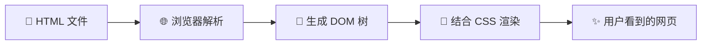
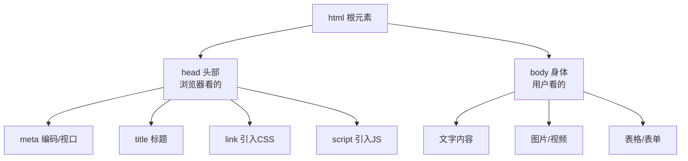
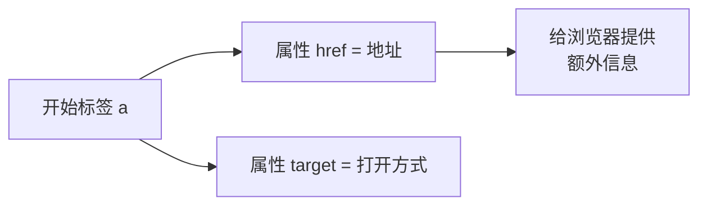
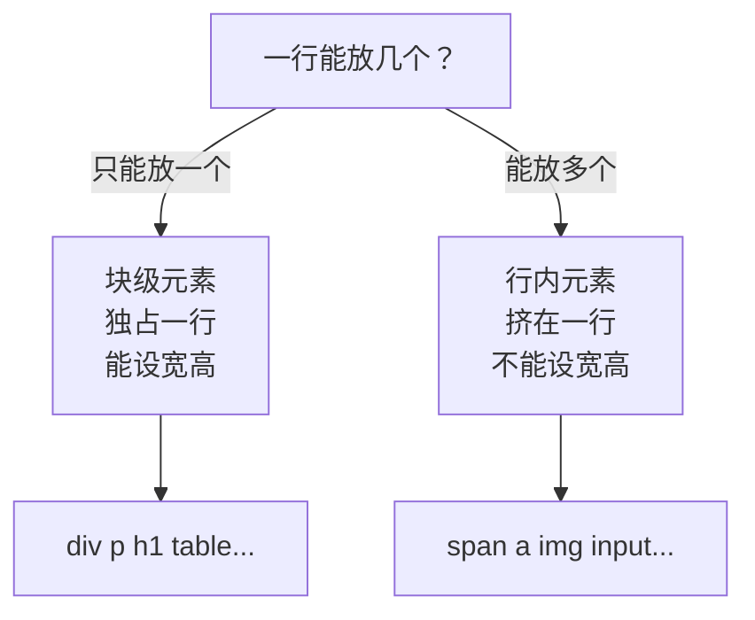
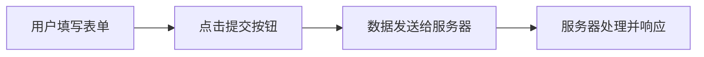
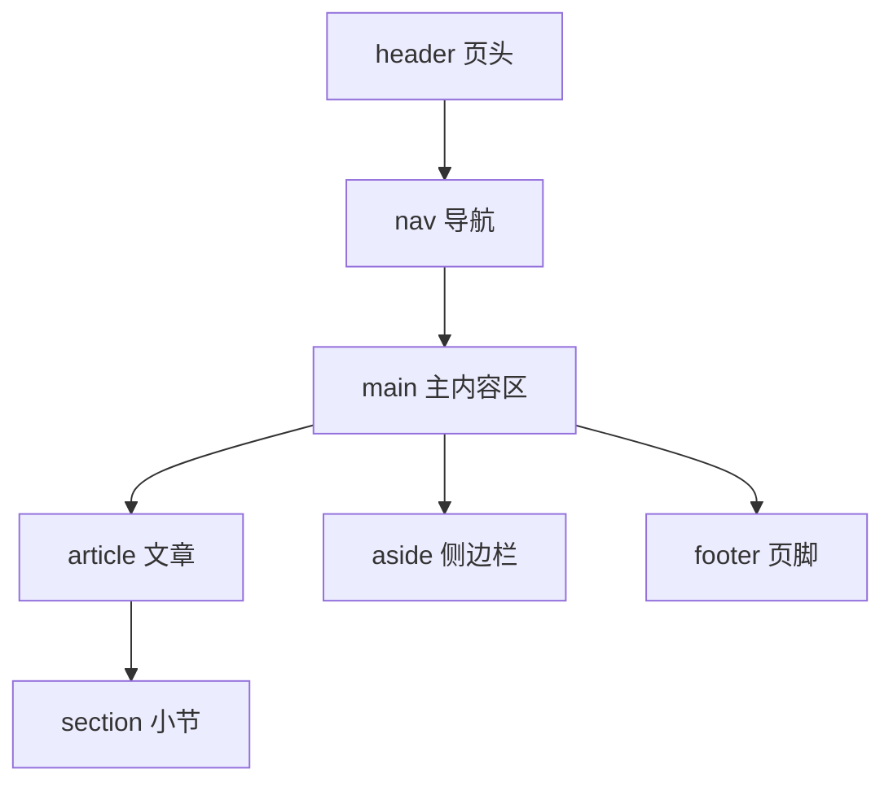
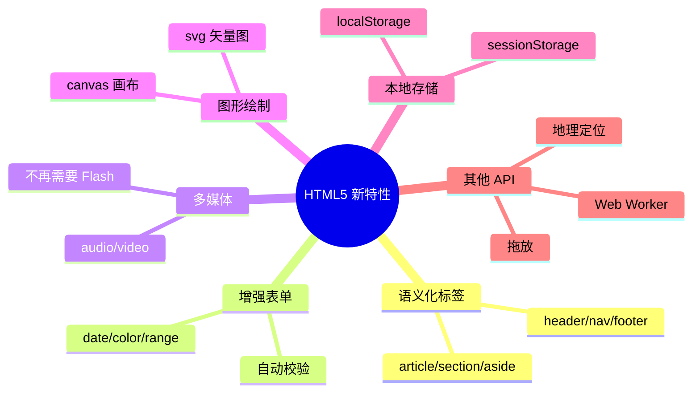
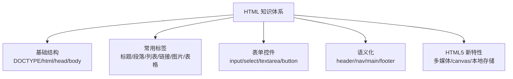

# 🌸 HTML 超详细学习笔记

> 嘿嘿～欢迎来到前端三剑客之 **HTML** 的课堂！(๑•̀ㅂ•́)و✧
> 放轻松，HTML 是前端里最温柔的一门课，跟着我一步步来，保证你能听懂！

---

## 📖 目录

1. [HTML 是什么？](#一html是什么)
2. [HTML 文档基本结构](#二html-文档基本结构)
3. [常用标签大全](#三常用标签大全)
4. [标签的"属性"](#四标签的属性)
5. [块级元素 vs 行内元素](#五块级元素-vs-行内元素)
6. [表单：和用户对话的窗口](#六表单和用户对话的窗口)
7. [语义化标签：让代码会"说话"](#七语义化标签让代码会说话)
8. [HTML5 新特性](#八html5-新特性)
9. [实战小案例](#九实战小案例)
10. [总结与易错点](#十总结与易错点)

---

## 一、HTML 是什么？🎉

**HTML**（HyperText Markup Language，超文本标记语言）——名字听着吓人，其实超简单！

用一个比喻来说 🍰：

> **网页 = 一栋房子**
> - **HTML** = 房子的骨架（承重墙、门窗框架）🏠
> - **CSS** = 装修（刷漆、贴壁纸、摆家具）🎨
> - **JavaScript** = 水电与智能设备（开灯、响门铃）⚡

HTML **不是编程语言**，它是**标记语言**——只用一堆"标签"来告诉浏览器："这里是标题、那里是图片、这边是段落"。

### 浏览器是怎么显示网页的？



一句话总结：**你写 HTML → 浏览器"翻译" → 用户看到漂亮页面**～

---

## 二、HTML 文档基本结构 🏗️

每个 HTML 页面都是从这个"标准骨架"开始的，就像写信要有格式一样 ✉️：

```html
<!DOCTYPE html>
<html lang="zh-CN">
  <head>
    <meta charset="UTF-8">
    <meta name="viewport" content="width=device-width, initial-scale=1.0">
    <title>我的第一个网页</title>
  </head>
  <body>
    <h1>Hello World!</h1>
    <p>这是我写的第一个网页哦～</p>
  </body>
</html>
```

### 每一部分是干嘛的？

| 代码 | 作用 | 小贴士 💡 |
|------|------|----------|
| `<!DOCTYPE html>` | 声明这是 HTML5 文档 | 必须写在**第一行**！ |
| `<html>` | 根标签，包裹整个页面 | `lang` 属性告诉浏览器语言 |
| `<head>` | "大脑"——给浏览器看的信息 | 里面的内容**不会**显示在页面上 |
| `<meta charset="UTF-8">` | 字符编码 | 不写它，中文可能变乱码 😱 |
| `<title>` | 浏览器标签页上的标题 | 就是标签页上那行小字～ |
| `<body>` | "身体"——用户看到的一切 | 页面内容都写在这里！ |

### head vs body 一图看懂



### 标签的书写规则 ✍️

```text
标签 = 开始标签 + 内容 + 结束标签

<p>你好呀</p>
 ↑    ↑    ↑
开始  内容  结束（多一个 /）
```

- 标签名不区分大小写，但**约定俗成用小写** ✅
- 有些标签**没有结束标签**（空标签），如 `<br>`、``、`<input>`
- 标签可以**嵌套**，但要正确嵌套（像俄罗斯套娃 🪆）：

```html
<!-- ✅ 正确：层层包裹 -->
<p>我要<b>加粗</b>这段话</p>

<!-- ❌ 错误：标签交叉了 -->
<p>我要<b>加粗</p>这段话</b>
```

---

## 三、常用标签大全 🧰

### 3.1 标题标签 h1~h6 📢

```html
<h1>一级标题（最大最重要）</h1>
<h2>二级标题</h2>
<h3>三级标题</h3>
<h4>四级标题</h4>
<h5>五级标题</h5>
<h6>六级标题（最小）</h6>
```

> ⚠️ 小提醒：一个页面**只用一个 h1** 哦～它代表页面主标题，用多了搜索引擎会晕的 😵

### 3.2 段落与文本 📝

```html
<p>我是一个段落，浏览器会自动在我上下留出空隙～</p>

<br>              <!-- 换行（空标签） -->
<hr>              <!-- 水平分割线 -->

<strong>我是加粗，表示重要内容</strong>
<b>我也是加粗，单纯想变粗</b>
<em>我是斜体，表示强调</em>
<i>我也是斜体，单纯想变斜</i>
<del>我是删除线</del>
<ins>我是下划线</ins>
<span>我是行内容器，专门包小段文字</span>
```

**strong vs b / em vs i** 长得一样，区别在"含义"：

| 标签 | 显示效果 | 语义 |
|------|---------|------|
| `<strong>` | **加粗** | 内容很重要 ⭐ |
| `<b>` | **加粗** | 只是视觉加粗 |
| `<em>` | *斜体* | 强调语气 ⭐ |
| `<i>` | *斜体* | 只是视觉斜体 |

> 💡 有语义的标签（strong/em）对 SEO 更友好，优先用它俩～

### 3.3 列表 📋

三种列表，各有用途：

```html
<!-- 1. 无序列表：顺序无所谓（菜单、导航）-->
<ul>
  <li>苹果 🍎</li>
  <li>香蕉 🍌</li>
  <li>草莓 🍓</li>
</ul>

<!-- 2. 有序列表：顺序有意义（步骤、排名）-->
<ol>
  <li>打开冰箱</li>
  <li>放进大象</li>
  <li>关上冰箱</li>
</ol>

<!-- 3. 定义列表：名词 + 解释（术语表）-->
<dl>
  <dt>HTML</dt>
  <dd>超文本标记语言</dd>
  <dt>CSS</dt>
  <dd>层叠样式表</dd>
</dl>
```

| 列表类型 | 场景举例 |
|---------|---------|
| `<ul>` 无序 | 导航栏、购物清单 🛒 |
| `<ol>` 有序 | 做菜步骤、排行榜 🏆 |
| `<dl>` 定义 | 词典、FAQ 术语 📕 |

### 3.4 超链接 🔗

```html
<!-- 跳转到别的网站 -->
<a href="https://www.baidu.com">去百度</a>

<!-- 新标签页打开（target="_blank"）-->
<a href="https://www.baidu.com" target="_blank">新窗口去百度</a>

<!-- 跳转到页面内的某个位置（锚点）-->
<a href="#chapter2">跳到第二章</a>
<h2 id="chapter2">第二章</h2>

<!-- 发邮件 / 打电话 -->
<a href="mailto:someone@example.com">发邮件给我</a>
<a href="tel:10086">打电话</a>
```

> ⚠️ 注意：正式项目中 `target="_blank"` 建议加上 `rel="noopener noreferrer"`，更安全哦～

### 3.5 图片 🖼️

```html

```

| 属性 | 必写？ | 说明 |
|------|-------|------|
| `src` | ✅ 必写 | 图片地址（URL 或本地路径） |
| `alt` | ✅ 强烈建议 | 图片加载失败时显示的替代文字，也是给"屏幕阅读器"听的 🦯 |
| `width` / `height` | 可选 | 宽 / 高（单位像素） |

**图片路径的两种写法：**

```text
相对路径：相对于当前 HTML 文件的位置
  ./cat.jpg      → 同目录下的图片（./ 可省略）
  ./images/cat.jpg → 子文件夹里的图片
  ../cat.jpg     → 上一级目录的图片

绝对路径：从根开始的完整地址
  https://xxx.com/cat.jpg → 网络图片
```

### 3.6 表格 📊

```html
<table border="1">
  <caption>期中成绩单</caption>
  <thead>
    <tr>
      <th>姓名</th>
      <th>科目</th>
      <th>分数</th>
    </tr>
  </thead>
  <tbody>
    <tr>
      <td>小明</td>
      <td>HTML</td>
      <td>100</td>
    </tr>
    <tr>
      <td>小红</td>
      <td>CSS</td>
      <td>98</td>
    </tr>
  </tbody>
</table>
```

**表格家族成员介绍：**

| 标签 | 角色 | 记忆法 🧠 |
|------|------|----------|
| `<table>` | 表格总管 | 一个完整的表 |
| `<caption>` | 表格标题 | 表的"帽子" 👒 |
| `<thead>` | 表头区 | 顶部的头 |
| `<tbody>` | 表身区 | 中间的身体 |
| `<tr>` | 行 | **r**ow = 行 |
| `<th>` | 表头单元格 | **h**eader，自带加粗居中 |
| `<td>` | 普通单元格 | **d**ata = 数据 |

**合并单元格**（面试常问 ⭐）：

```html
<td colspan="2">横向合并2格</td>   <!-- 占两列 -->
<td rowspan="2">纵向合并2格</td>   <!-- 占两行 -->
```

> 🧠 记忆：**c**olspan = **col**umn（列）方向合并；**r**owspan = **row**（行）方向合并

### 3.7 多媒体 🎵

```html
<!-- 音频：controls 显示播放控件 -->
<audio src="music.mp3" controls></audio>

<!-- 视频：controls 控件 + loop 循环 + muted 静音 + autoplay 自动播放（需配合muted）-->
<video src="movie.mp4" controls loop muted width="600"></video>
```

---

## 四、标签的属性 🏷️

属性写在**开始标签**里，格式是 `属性名="属性值"`，用来给标签"附加信息"：

```html
<a href="https://baidu.com" target="_blank">链接</a>
    ↑                  ↑
   属性名              属性名      ← 这两个就是属性
```



**通用属性**（几乎所有标签都有）：

| 属性 | 作用 | 举例 |
|------|------|------|
| `id` | 唯一标识（全页唯一） | `<p id="main">` |
| `class` | 类名（可重复，可多个） | `<p class="red big">` |
| `style` | 行内样式 | `<p style="color:red">` |
| `title` | 悬停提示文字 | `悬停看看我👀` |
| `hidden` | 隐藏元素 | |

> ⚠️ `id` 像**身份证号**（独一无二），`class` 像**班级/社团**（可以多人同班）～

---

## 五、块级元素 vs 行内元素 📦

这是初学者最容易懵的知识点！一张表搞定：

| 对比项 | 块级元素 | 行内元素 |
|--------|---------|---------|
| 独占一行？ | ✅ 独占一行 | ❌ 挤在一行 |
| 宽高可设置？ | ✅ 可以 | ❌ 设置无效 |
| 默认宽度 | 撑满父容器 | 由内容撑开 |
| 典型代表 | `div` `p` `h1~6` `ul` `table` | `span` `a` `img` `strong` `em` `input` |

```html
<!-- 块级：每个 div 各占一行，像盖楼 🏢 -->
<div>我是第一块</div>
<div>我是第二块</div>

<!-- 行内：挤在一行，像手拉手 👫 -->
<span>我</span><span>们</span><span>挤</span><span>一</span><span>行</span>
```



> 🎁 补充：还有个特殊分类叫**行内块元素**（如 `img`、`input`）——既能挤在一行，又能设置宽高，两边的优点都占啦～

---

## 六、表单：和用户对话的窗口 💬

表单就是**收集用户信息**的工具：登录框、搜索框、注册页，都是它！



### 6.1 基本结构

```html
<form action="/login" method="post">
  <!-- 表单项都写在这里 -->
</form>
```

| 属性 | 作用 |
|------|------|
| `action` | 数据提交到哪个地址 |
| `method` | 提交方式：`get`（数据拼在 URL 上，不安全） / `post`（藏在请求体里，较安全） |

### 6.2 常用表单控件

```html
<form action="/register" method="post">
  <!-- 1. 文本框 -->
  <label for="username">用户名：</label>
  <input type="text" id="username" name="username" placeholder="请输入用户名">

  <!-- 2. 密码框（输入变圆点）-->
  <label for="pwd">密码：</label>
  <input type="password" id="pwd" name="password">

  <!-- 3. 单选框（name 相同才能互斥！）-->
  <input type="radio" name="gender" value="male" checked> 男
  <input type="radio" name="gender" value="female"> 女

  <!-- 4. 复选框 -->
  <input type="checkbox" name="hobby" value="code"> 敲代码
  <input type="checkbox" name="hobby" value="game"> 打游戏

  <!-- 5. 下拉框 -->
  <select name="city">
    <option value="beijing">北京</option>
    <option value="shanghai" selected>上海</option>
  </select>

  <!-- 6. 多行文本域 -->
  <textarea name="intro" rows="4" cols="30">自我介绍一下吧～</textarea>

  <!-- 7. 文件上传 -->
  <input type="file">

  <!-- 8. 提交 & 重置按钮 -->
  <button type="submit">注册</button>
  <button type="reset">重置</button>
</form>
```

### input 的 type 大家族 👨‍👩‍👧‍👦

| type 值 | 效果 |
|---------|------|
| `text` | 单行文本框 |
| `password` | 密码框 |
| `radio` | 单选按钮 |
| `checkbox` | 复选框 |
| `file` | 文件选择 |
| `date` | 日期选择器 📅 |
| `email` | 邮箱框（自带格式校验）|
| `number` | 数字框 |
| `range` | 滑块 🎚️ |
| `color` | 取色器 🎨 |
| `hidden` | 隐藏域（用户看不见）|
| `submit` | 提交按钮 |

### 表单常用属性

| 属性 | 作用 | 适用控件 |
|------|------|---------|
| `placeholder` | 灰色提示文字 | text / password 等 |
| `value` | 默认值 | 大多数控件 |
| `checked` | 默认选中 | radio / checkbox |
| `selected` | 默认选中 | option |
| `disabled` | 禁用（灰掉）| 全部 |
| `required` | 必填才能提交 | 大多数控件 |
| `label for/id` | 点文字也能选中控件 | 提升体验神器 ⭐ |

---

## 七、语义化标签：让代码会"说话"🗣️

**语义化** = 用"有含义"的标签代替满屏的 div，好处多多：

- ✅ 对开发者友好：代码结构一目了然
- ✅ 对搜索引擎友好：SEO 排名更好 📈
- ✅ 对屏幕阅读器友好：无障碍访问 💗

### 传统 div 布局 vs 语义化布局

```html
<!-- ❌ 以前：div 一把梭 -->
<div class="header"></div>
<div class="nav"></div>
<div class="main"></div>
<div class="footer"></div>

<!-- ✅ 现在：语义化标签 -->
<header></header>
<nav></nav>
<main></main>
<footer></footer>
```

### 常用语义化标签地图 🗺️

```html
<body>
  <header>   <!-- 页头：logo、网站名 -->
    <nav>    <!-- 导航栏：菜单链接 -->
      <ul><li><a href="#">首页</a></li></ul>
    </nav>
  </header>

  <main>                    <!-- 主内容（一个页面仅一个）-->
    <article>               <!-- 独立文章：一篇博客 -->
      <h1>文章标题</h1>
      <section>             <!-- 文章里的小节 -->
        <h2>第一章</h2>
        <p>内容...</p>
      </section>
    </article>
    <aside>相关推荐/侧边栏</aside>
  </main>

  <footer>  <!-- 页脚：版权信息、联系方式 -->
    <p>© 2026 小课堂</p>
  </footer>
</body>
```

**页面结构一览图：**



| 标签 | 含义 | 常放什么 |
|------|------|---------|
| `<header>` | 页头/区块头 | logo、标题、搜索框 |
| `<nav>` | 导航 | 菜单链接 |
| `<main>` | 主内容 | 页面核心（仅 1 个）|
| `<article>` | 独立内容块 | 一篇文章、一条评论 |
| `<section>` | 内容小节 | 文章的章节 |
| `<aside>` | 侧边内容 | 广告、推荐、目录 |
| `<footer>` | 页脚/区块尾 | 版权、备案号 |
| `<figure>` + `<figcaption>` | 图 + 图注 | 配图说明 |

---

## 八、HTML5 新特性 ✨

HTML5 不只是"新一代 HTML"，还带来了好多实用功能：

### 8.1 新特性全家福



### 8.2 重点特性速览

**① 多媒体**（最大的变革，干掉了 Flash 🪦）

```html
<video src="mv.mp4" controls autoplay muted></video>
<audio src="song.mp3" controls></audio>
```

**② 本地存储**（JS 部分会细讲，先混个脸熟 👋）

| 特性 | 生命周期 | 容量 |
|------|---------|------|
| `localStorage` | 永久保存，手动删 | 约 5~10MB |
| `sessionStorage` | 关闭标签页就没了 | 约 5MB |

**③ canvas 画布**（用 JS 画图、做游戏、做动画 🎮）

```html
<canvas id="myCanvas" width="400" height="300"></canvas>
<script>
  const ctx = document.getElementById('myCanvas').getContext('2d');
  ctx.fillStyle = 'pink';           // 选个少女粉 💗
  ctx.fillRect(50, 50, 200, 100);   // 画个矩形
</script>
```

---

## 九、实战小案例 🛠️

来啦！综合运用上面知识，写一个"个人介绍卡"～

```html
<!DOCTYPE html>
<html lang="zh-CN">
<head>
  <meta charset="UTF-8">
  <meta name="viewport" content="width=device-width, initial-scale=1.0">
  <title>我的小名片</title>
</head>
<body>
  <header>
    <h1>🌸 小可爱的个人主页</h1>
    <nav>
      <ul>
        <li><a href="#about">关于我</a></li>
        <li><a href="#hobby">我的爱好</a></li>
        <li><a href="#contact">联系我</a></li>
      </ul>
    </nav>
  </header>

  <main>
    <section id="about">
      <h2>关于我</h2>
      <p>我是一名正在学习前端的<strong>小白</strong>，目标成为<strong>前端大神</strong>！💪</p>
      
    </section>

    <section id="hobby">
      <h2>我的爱好</h2>
      <ul>
        <li>敲代码 💻</li>
        <li>喝奶茶 🧋</li>
        <li>撸猫 🐱</li>
      </ul>
    </section>

    <section id="contact">
      <h2>联系我</h2>
      <form action="/msg" method="post">
        <p>
          <label for="name">昵称：</label>
          <input type="text" id="name" name="name" placeholder="你的昵称" required>
        </p>
        <p>
          <label for="msg">留言：</label><br>
          <textarea id="msg" name="msg" rows="3" cols="30" placeholder="想对我说的话..."></textarea>
        </p>
        <button type="submit">发送 💌</button>
      </form>
    </section>
  </main>

  <footer>
    <hr>
    <p><small>© 2026 小可爱的前端学习之旅</small></p>
  </footer>
</body>
</html>
```

**用到的知识点检查清单：**

- ✅ 文档骨架（DOCTYPE、head、body）
- ✅ 语义化标签（header/nav/main/section/footer）
- ✅ 标题、段落、列表、图片、链接（含锚点）
- ✅ 表单（input、textarea、label、button）

---

## 十、总结与易错点 🎁

### 知识地图回顾



### 易错点红黑榜 🚨

| # | 易错点 | 正确姿势 |
|---|--------|---------|
| 1 | 忘写 `<!DOCTYPE html>` | 永远放第一行 |
| 2 | 忘写 `<meta charset="UTF-8">` | 否则中文乱码 |
| 3 | 标签交叉嵌套 | 像套娃一样层层闭合 |
| 4 | `id` 写重复 | id 全页唯一，复用请用 class |
| 5 | 单选框不互斥 | 同组 radio 的 `name` 必须相同 |
| 6 | 一页多个 `<h1>` / `<main>` | 都只能有一个 |
| 7 | `img` 不写 `alt` | 养成习惯必写 alt |
| 8 | 行内元素设置宽高 | 无效！先转换 display（CSS 篇讲）|
| 9 | 表格合并单元格后没删多余格子 | colspan/rowspan 占了位，被占的 td 要删掉 |
| 10 | 用 `<b>`/`<i>` 只为样式 | 样式交给 CSS，语义用 strong/em |

### 学习建议 💡

1. **多敲多练**：看十遍不如敲一遍，每个标签都亲手试过才叫学会 ✍️
2. **F12 大法**：浏览器右键"检查"，看别人网页怎么写的，偷偷学艺 🕵️
3. **循序渐进**：HTML 打好基础 → CSS 化妆 → JS 注入灵魂 → 三者合体变大神 🚀

---

> 🎉 恭喜你读完 HTML 篇！骨架已经搭好啦～
> 下一站：**CSS**，给网页化妆的时间到啦！💅✨
