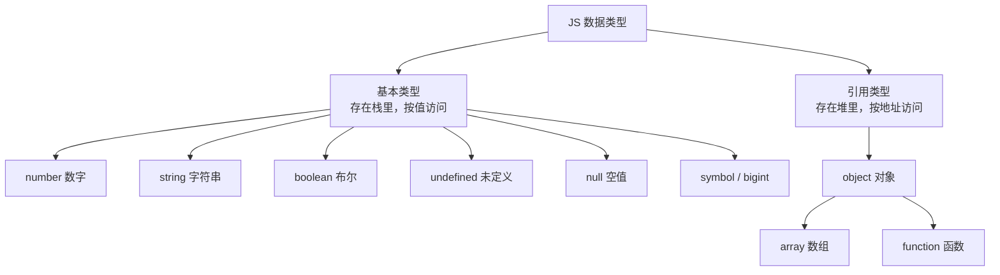
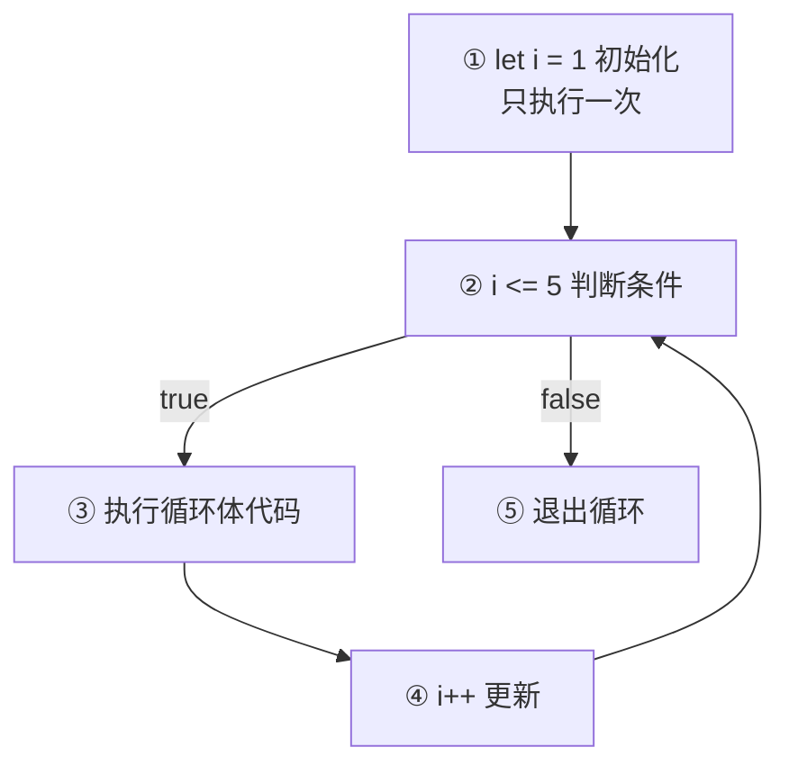
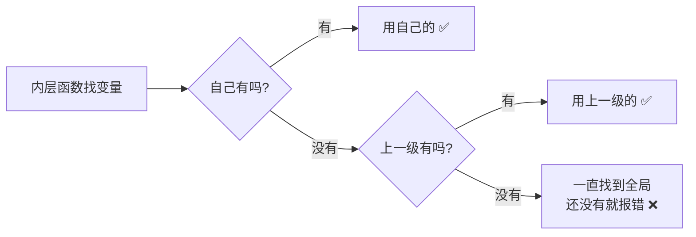
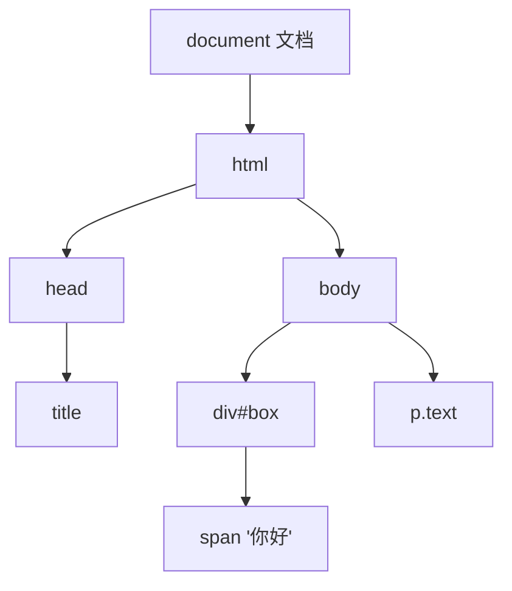
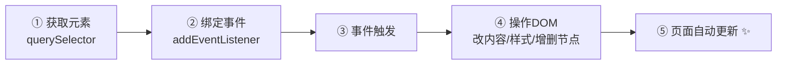
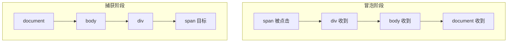
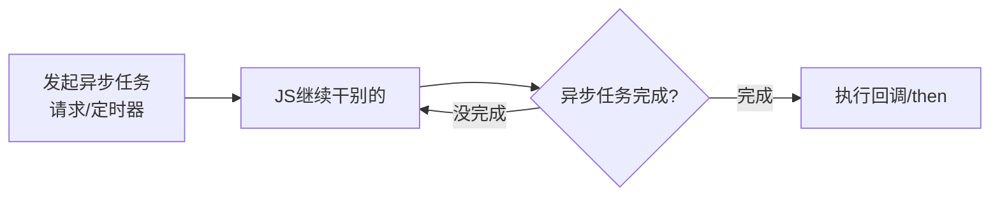
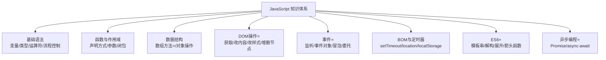
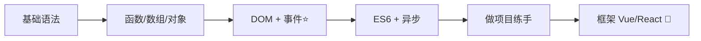

# ⚡ JavaScript 超详细学习笔记

> 前端三剑客压轴大佬登场——**JavaScript**！(๑•̀ㅂ•́)و✧
> HTML 是骨架、CSS 是化妆，而 JS 就是**灵魂**：能让网页听懂你的话、动起来、还会思考！🧠

---

## 📖 目录

1. [JavaScript 是什么？](#一javascript-是什么)
2. [变量与常量](#二变量与常量)
3. [数据类型](#三数据类型)
4. [运算符](#四运算符)
5. [流程控制](#五流程控制)
6. [函数](#六函数)
7. [数组](#七数组)
8. [对象](#八对象)
9. [作用域与闭包（进阶）](#九作用域与闭包)
10. [DOM 操作（核心⭐）](#十dom-操作)
11. [事件：让网页听懂用户的话](#十一事件)
12. [定时器与 BOM](#十二定时器与-bom)
13. [ES6+ 新特性](#十三es6-新特性)
14. [异步编程：Promise 与 async/await](#十四异步编程)
15. [实战小案例：TodoList](#十五实战小案例)
16. [总结与易错点](#十六总结与易错点)

---

## 一、JavaScript 是什么？🌟

**JavaScript（JS）** 是一门**运行在浏览器里的编程语言**，让网页从"好看的画"变成"能互动的应用"。

> 🍰 比喻时间：
> - HTML = 身体 🧍
> - CSS = 衣服 👗
> - **JS = 大脑和神经** 🧠（点击有反应、数据会变化、页面能更新）

### JS 能干什么？

| 能力 | 例子 |
|------|------|
| 操作网页内容 | 点按钮换文字、显示/隐藏盒子 |
| 响应用户操作 | 点击、滑动、键盘输入 |
| 数据处理 | 计算价格、筛选搜索结果 |
| 与服务器通信 | 登录验证、加载数据（Ajax/fetch）|
| 存储数据 | localStorage 记住购物车 🛒 |

### JS 写在哪里？

```html
<!-- 1. 行内（不推荐）-->
<button onclick="alert('点我干嘛~')">点我</button>

<!-- 2. 内部 script 标签 -->
<body>
  <button id="btn">点我</button>
  <script>
    alert('Hello JS! 💫');
  </script>
</body>

<!-- 3. 外部文件（推荐✅）-->
<script src="index.js"></script>
```

> ⚠️ 注意：script 要写在**HTML结构的后面**（body 结束前），因为 JS 要先"找到"页面元素才能操作它！

### JS 的三个输出方式（调试入门）

```javascript
console.log('控制台输出，调试最爱 💕');  // F12 控制台看
alert('弹窗警告！');                      // 打断式弹窗
document.write('写在页面上');              // 很少用
prompt('请输入你的名字：');               // 输入框，返回输入内容
```

---

## 二、变量与常量 📦

变量 = **装数据的盒子**，贴个名字标签方便以后找它 🏷️

### 三种声明方式

```javascript
var name = '小可爱';     // 老古董，有很多坑，别用了 ❌
let age = 18;            // 变量：以后可以重新赋值 ✅
const PI = 3.14159;      // 常量：一旦赋值不能改 ✅
```

| 关键字 | 能否重新赋值 | 作用域 | 有变量提升？ | 建议 |
|--------|------------|--------|------------|------|
| `var` | ✅ | 函数作用域（坑！）| 有（坑！）| ❌ 别用 |
| `let` | ✅ | 块级作用域 `{}` | 无 | ✅ 会变的用我 |
| `const` | ❌ 报错 | 块级作用域 `{}` | 无 | ✅ 不变的用我 |

```javascript
let mood = '开心';
mood = '超开心';         // ✅ let 可以改

const birthday = '01-01';
birthday = '02-02';     // ❌ TypeError！常量不让改
```

> 💡 好习惯：**优先用 const，需要改才用 let**，一眼就知道哪些数据会变～

### 变量命名规则

- 只能包含：字母、数字、`$`、`_`
- **不能以数字开头**：`1name` ❌
- **不能用关键字**：`let` `if` `for` ❌
- 区分大小写：`name` 和 `Name` 是两个变量！
- 命名要有意义：用 `userName` 而不是 `a` ✅
- 驼峰命名法：`myFirstName`（首单词小写，后面单词首字母大写）🐪

---

## 三、数据类型 🧬

JS 的数据类型分两大门派：



### 基本类型速览

| 类型 | 说明 | 示例 |
|------|------|------|
| `number` | 数字（整数小数都是它）| `18` `3.14` `-1` `NaN` |
| `string` | 字符串（引号包起来）| `'hello'` `"你好"` `` `模板` `` |
| `boolean` | 布尔（真/假）| `true` `false` |
| `undefined` | 声明了但没赋值 | `let a;` → a 是 undefined |
| `null` | 主动赋的"空值" | `let a = null;`（故意说它是空的）|

### typeof 检测类型

```javascript
console.log(typeof 18);          // 'number'
console.log(typeof 'hi');        // 'string'
console.log(typeof true);        // 'boolean'
console.log(typeof undefined);   // 'undefined'
console.log(typeof null);        // 'object'（历史遗留bug，面试坑🕳️）
console.log(typeof [1,2]);       // 'object'（数组也是对象！）
console.log(typeof function(){});// 'function'
```

### 数据类型转换（超常用⭐）

```javascript
// 1. 转字符串
String(123);        // '123'
(123).toString();   // '123'
123 + '';           // '123'（拼接空字符串，骚操作）

// 2. 转数字
Number('123');      // 123
parseInt('123px');  // 123（取整数部分，能识别单位）
parseFloat('3.14'); // 3.14
'6' - 0;            // 6（减号触发转换）

// 3. 转布尔
Boolean(0);         // false
Boolean('');        // false
Boolean(null);      // false
Boolean(undefined); // false
Boolean(NaN);       // false
// ↑ 这5个是"假值"，其他全是 true！
```

> 🚨 **经典大坑**：`+` 号遇到字符串会变成**拼接**！

```javascript
console.log(1 + 1);        // 2（数字加数字）
console.log('1' + 1);      // '11'（字符串拼接！）
console.log('1' + 1 + 1);  // '111'
console.log(1 + 1 + '1');  // '21'（先算1+1=2，再拼接）
```

---

## 四、运算符 ➕➖

### 算术运算符

```javascript
let a = 10, b = 3;
console.log(a + b);   // 13
console.log(a - b);   // 7
console.log(a * b);   // 30
console.log(a / b);   // 3.3333...（JS除法结果是小数！）
console.log(a % b);   // 1（取余/取模：判断奇偶、隔行变色超好用⭐）
console.log(a ** b);  // 1000（幂运算）

// 自增自减
a++;  // a = a + 1
a--;  // a = a - 1
```

### 赋值运算符

```javascript
let x = 10;
x += 5;   // x = x + 5 → 15
x -= 3;   // x = x - 3
x *= 2;   // x = x * 2
x /= 4;   // x = x / 4
x %= 3;   // x = x % 3
```

### 比较运算符（⭐重点：== 和 ===）

```javascript
console.log(5 > 3);          // true
console.log(5 >= 5);         // true

// == 松散比较：会偷偷转换类型（坑！）
console.log(5 == '5');       // true（字符串被转成数字）
console.log(0 == false);     // true
console.log(null == undefined); // true

// === 严格比较：类型和值都要一样 ⭐推荐
console.log(5 === '5');      // false（类型不同，直接false）
console.log(5 === 5);        // true
```

| 运算符 | 名字 | 规则 | 建议 |
|--------|------|------|------|
| `==` | 等于 | 值相等就行（偷偷转型）| ⚠️ 慎用 |
| `===` | 全等 | 类型+值都要相等 | ✅ 永远用它 |
| `!=` | 不等于 | 松散比较 | ⚠️ |
| `!==` | 不全等 | 严格比较 | ✅ |

> 🧠 口诀：**写比较，三个等号起步**！

### 逻辑运算符

```javascript
// && 与：两边都 true 才 true
console.log(true && false);  // false

// || 或：一边 true 就 true
console.log(true || false);  // true

// ! 非：取反
console.log(!true);          // false
```

**逻辑中断（面试爱考⭐）：**

```javascript
// && 遇到假就停，返回那个"假值"；都真则返回最后一个
console.log(0 && 123);       // 0（0是假的，直接返回）
console.log(123 && 'hi');    // 'hi'

// || 遇到真就停，返回那个"真值"
console.log('' || '默认值'); // '默认值'（空串是假的）
console.log(123 || 'xx');    // 123

// 实用场景：默认值
let name = userInput || '游客';  // 用户没填就用"游客"
```

### 三元运算符

```javascript
// 条件 ? 真结果 : 假结果
let age = 20;
let type = age >= 18 ? '成年' : '未成年';
console.log(type);  // '成年'
```

---

## 五、流程控制 🚦

程序不是从头跑到尾的直线，它会"拐弯"和"绕圈"！

### 5.1 if 分支

```javascript
let score = 85;

if (score >= 90) {
  console.log('优秀 🎉');
} else if (score >= 60) {
  console.log('及格 😊');
} else {
  console.log('加油 💪');
}
// 输出：及格 😊
```

### 5.2 switch 分支

```javascript
let day = 3;
switch (day) {
  case 1:
    console.log('星期一');
    break;               // ⚠️ 不写break会"穿透"继续执行！
  case 2:
    console.log('星期二');
    break;
  case 3:
    console.log('星期三');  // ✅ 输出这个
    break;
  default:
    console.log('其他');
}
```

### if vs switch

| 对比 | if | switch |
|------|----|--------|
| 适合场景 | 范围判断（>60）| 固定值匹配（星期几）|
| 用的符号 | 比较表达式 | `===` 全等匹配 |

### 5.3 循环

```javascript
// 1. for 循环（知道循环次数用我⭐）
for (let i = 1; i <= 5; i++) {
  console.log(`第${i}次循环`);
}

// 2. while 循环（不知道循环几次，满足条件就一直转）
let i = 1;
while (i <= 5) {
  console.log(i);
  i++;               // ⚠️ 忘了i++就是死循环！
}

// 3. do...while（先执行一次再判断）
let n = 10;
do {
  console.log('我至少执行一次');
} while (n < 5);
```

**for 循环执行顺序图解：**



### break 和 continue

```javascript
// break：直接跳出整个循环
for (let i = 1; i <= 5; i++) {
  if (i === 3) break;
  console.log(i);      // 1 2
}

// continue：跳过本次，继续下一次
for (let i = 1; i <= 5; i++) {
  if (i === 3) continue;
  console.log(i);      // 1 2 4 5
}
```

---

## 六、函数 🔧

函数 = **打包好的一段代码**，起个名字，想用就喊它（一次打包，处处复用）🎁

### 6.1 声明与调用

```javascript
// 1. 声明函数（函数声明式）
function sing() {
  console.log('🎵 啦啦啦～');
}

// 2. 调用函数（不调用就不执行！）
sing();   // 🎵 啦啦啦～

// 3. 函数表达式写法
const dance = function () {
  console.log('💃 蹦擦擦');
};
dance();

// 4. 箭头函数（ES6，超简洁⭐）
const rap = () => {
  console.log('🎤 yo yo');
};
rap();
```

### 6.2 参数与返回值

```javascript
// 参数：往函数里"传东西"
// 返回值：函数"还给你"的结果
function add(x, y) {
  return x + y;      // return：把结果交出去，并结束函数
}

let sum = add(3, 5); // 传入3和5，接住返回的8
console.log(sum);    // 8
```

**函数参数细节：**

```javascript
// 1. 形参 vs 实参
function greet(name) { ... }   // name 是形参（占位的）
greet('小可爱');                // '小可爱' 是实参（真传的）

// 2. 没传参数 → 形参是 undefined
function test(a) { console.log(a); }
test();          // undefined

// 3. 默认参数（ES6⭐）
function greet(name = '游客') {
  console.log(`你好，${name}`);
}
greet();         // 你好，游客
greet('小明');   // 你好，小明

// 4. return 后面的代码不执行！
function f() {
  return 1;
  console.log('我永远看不到');  // ❌ 死代码
}
```

### 6.3 箭头函数进阶写法

```javascript
// 完整版
const add = (x, y) => {
  return x + y;
};

// 只有一句代码：省略 {} 和 return ⭐
const add2 = (x, y) => x + y;

// 只有一个参数：省略小括号
const double = n => n * 2;

// 没有参数：小括号必须写
const say = () => console.log('hi');
```

### 6.4 作用域

```javascript
let global = '我是全局变量，谁都能用';

function f() {
  let inner = '我是局部变量，只有函数里能用';
  console.log(global);  // ✅ 能访问全局
}
// console.log(inner);  // ❌ ReferenceError：外面访问不到
```

> 🧠 **就近原则**：找变量时，先在自己身上找 → 再去上一级找 → 一直找到全局（作用域链）🔗

---

## 七、数组 📚

数组 = **一排带编号的盒子**，一个变量装好多数据！

### 7.1 创建与访问

```javascript
// 创建
let fruits = ['苹果', '香蕉', '草莓'];
let nums = new Array(1, 2, 3);   // 另一种写法，少用

// 访问：下标从 0 开始！⭐
console.log(fruits[0]);    // '苹果'
console.log(fruits[1]);    // '香蕉'
console.log(fruits.length);// 3（数组长度）

// 最后一个元素的小技巧
console.log(fruits[fruits.length - 1]);  // '草莓'
```

```text
下标：      0        1        2
         ┌──────┬──────┬──────┐
fruits → │ 苹果  │ 香蕉  │ 草莓 │
         └──────┴──────┴──────┘
length = 3
```

### 7.2 增删改查

```javascript
let arr = ['a', 'b', 'c'];

// 改
arr[0] = 'x';              // ['x','b','c']

// 增
arr.push('d');             // 尾部加 → ['x','b','c','d']
arr.unshift('0');          // 头部加 → ['0','x','b','c','d']

// 删
arr.pop();                 // 删尾部，返回删掉的元素
arr.shift();               // 删头部
arr.splice(1, 1);          // 从下标1开始删1个 ⭐万能

// 查
arr.indexOf('b');          // 找到返回下标，找不到返回 -1
arr.includes('b');         // 返回 true/false ⭐
```

| 方法 | 作用 | 返回值 |
|------|------|--------|
| `push` | 尾部添加 | 新长度 |
| `unshift` | 头部添加 | 新长度 |
| `pop` | 尾部删除 | 被删的元素 |
| `shift` | 头部删除 | 被删的元素 |
| `splice(开始, 个数)` | 任意位置增删 | 被删的数组 |
| `indexOf` | 查找下标 | 下标 / -1 |
| `includes` | 是否包含 | true / false |

### 7.3 高阶方法（现代JS必会⭐⭐⭐）

```javascript
let nums = [1, 2, 3, 4, 5];

// forEach：遍历（只转一圈，不返回）
nums.forEach((item, index) => {
  console.log(index, item);   // 0 1 / 1 2 / 2 3 ...
});

// map：加工每一个，返回新数组 ⭐
let double = nums.map(n => n * 2);       // [2,4,6,8,10]

// filter：筛选符合条件的，返回新数组 ⭐
let even = nums.filter(n => n % 2 === 0);// [2,4]

// find：找第一个满足条件的元素
let first = nums.find(n => n > 3);       // 4

// some / every：一些满足 / 全部满足 → true/false
nums.some(n => n > 4);    // true
nums.every(n => n > 0);   // true

// reduce：累加器
let total = nums.reduce((sum, n) => sum + n, 0);  // 15
```

**三大高频方法对比：**

| 方法 | 干嘛的 | 返回什么 | 原数组变吗 |
|------|--------|---------|-----------|
| `forEach` | 纯遍历 | undefined | 否 |
| `map` | 一个变一个 | **新数组**（同长度）| 否 |
| `filter` | 挑选 | **新数组**（可能更短）| 否 |

---

## 八、对象 🎭

数组适合存"一堆同类数据"，对象适合描述**一个事物的多个特征**：

```javascript
// 描述一只猫 🐱：名字、年龄、颜色、会喵喵叫
let cat = {
  name: '咪咪',           // 属性：键值对
  age: 2,
  color: '橘色',
  miao: function () {     // 方法：对象里的函数
    console.log(this.name + '：喵~');  // this 指对象自己
  }
};
```

### 增删改查

```javascript
// 查（两种写法）
console.log(cat.name);       // 点语法（常用⭐）
console.log(cat['age']);     // 中括号（key是变量/字符串时用）

// 改
cat.age = 3;

// 增
cat.weight = 5;

// 删
delete cat.color;
```

### 遍历对象

```javascript
// for...in：遍历key ⭐
for (let key in cat) {
  console.log(key, cat[key]);   // name 咪咪 / age 3 ...
}

// Object.keys/values：拿到key数组/值数组
console.log(Object.keys(cat));   // ['name','age','miao']
console.log(Object.values(cat)); // ['咪咪', 3, f]

// Object.entries：[[key,value]] 对
Object.entries(cat).forEach(([k, v]) => console.log(k, v));
```

### 内置对象 Math（数学工具箱🧰）

```javascript
Math.random();       // 0~1 的随机小数（含0不含1）
Math.floor(4.9);     // 4（向下取整）
Math.ceil(4.1);      // 5（向上取整）
Math.round(4.5);     // 5（四舍五入）
Math.abs(-3);        // 3（绝对值）
Math.max(1, 5, 3);   // 5
Math.min(1, 5, 3);   // 1
Math.PI;             // 3.14159...

// ⭐经典组合：取 1~10 的随机整数
Math.floor(Math.random() * 10) + 1;
```

### 日期对象 Date

```javascript
let now = new Date();
now.getFullYear();   // 年
now.getMonth();      // 月（0~11！1月是0，大坑⚠️）
now.getDate();       // 日
now.getDay();        // 星期（0是周日）
now.getHours();      // 时
now.getMinutes();    // 分
now.getSeconds();    // 秒

// 时间戳：1970年至今的毫秒数
Date.now();
```

---

## 九、作用域与闭包 🌀（进阶）

### 9.1 作用域链

函数里面还能套函数，内层访问变量时会**一层层往外找**：



### 9.2 闭包（面试必考⭐）

**闭包 = 内层函数"扣留"了外层函数的变量，外层执行完也赖着不走** 🧲

```javascript
function counter() {
  let count = 0;              // 外层的私有变量
  return function () {
    count++;                  // 内层函数还在用它！
    return count;
  };
}

const add = counter();   // counter执行完了，但count被"扣留"
console.log(add());      // 1
console.log(add());      // 2（count 一直活着，没被重置）
console.log(add());      // 3
```

> 💡 作用：让变量**私有化**并**常驻内存**——外面拿不到 count，只能通过 add 操作它。

---

## 十、DOM 操作 ⭐⭐⭐⭐⭐

**DOM（Document Object Model，文档对象模型）**：浏览器把 HTML 解析成一棵"树"，JS 通过操作这棵树来改变页面！

### DOM 树长这样



> 🌰 简单说：**每个 HTML 标签都是树上的一个"节点"（对象）**，JS 拿到节点就能为所欲为～

### 10.1 获取元素（5种方式）

```javascript
// ⭐⭐⭐ 现代"id选择器"和"类选择器"（返回单个/多个）
document.querySelector('#box');       // CSS选择器，返回第一个
document.querySelectorAll('.item');   // 返回所有匹配的（伪数组）

// 传统三兄弟
document.getElementById('box');         // 按id，返回单个
document.getElementsByClassName('item');// 按类名（动态集合）
document.getElementsByTagName('p');     // 按标签名
```

| 方法 | 参数 | 返回 | 推荐度 |
|------|------|------|--------|
| `querySelector` | 任意CSS选择器 | **单个**元素/null | ⭐⭐⭐⭐⭐ |
| `querySelectorAll` | 任意CSS选择器 | ** NodeList集合** | ⭐⭐⭐⭐⭐ |
| `getElementById` | id名（不带#）| 单个 | ⭐⭐⭐ |
| `getElementsByClassName` | 类名（不带.）| HTMLCollection | ⭐⭐ |

### 10.2 操作元素内容

```javascript
const box = document.querySelector('.box');

box.innerText = '修改文字内容';     // 只认文字
box.innerHTML = '<b>加粗</b>内容';  // 认HTML标签 ⭐

console.log(box.innerText);        // 读取内容
```

| 属性 | 读写文字 | 解析HTML标签 | 安全性 |
|------|---------|-------------|--------|
| `innerText` | ✅ | ❌ 当纯文本 | ✅ 更安全 |
| `innerHTML` | ✅ | ✅ 会渲染标签 | ⚠️ 用户输入慎用（XSS攻击）|

### 10.3 操作元素属性

```javascript
// 1. 常规属性
const img = document.querySelector('img');
img.src = 'cat.jpg';
img.title = '一只猫';

// 2. style 行内样式 ⭐
box.style.color = 'pink';
box.style.backgroundColor = '#ff6699';   // 驼峰命名！background-color ❌
box.style.width = '200px';               // 带单位！

// 3. className 操作类名（会覆盖原有类！⚠️）
box.className = 'newClass';

// 4. classList 操作类名（追加/删除，推荐⭐）
box.classList.add('active');      // 加类
box.classList.remove('active');   // 删类
box.classList.toggle('active');   // 有就删，没有就加（开关神器💡）
box.classList.contains('active'); // 有没有这个类？

// 5. 自定义属性 data-*
box.dataset.index;   // 读取 data-index 属性
```

### 10.4 节点操作（增删元素）

```javascript
// 创建 + 添加
const li = document.createElement('li');   // 创建（还在内存里）
li.innerText = '我是新来的';
ul.appendChild(li);                        // 追加到 ul 尾部 ⭐
ul.insertBefore(li, ul.children[0]);       // 插到第一个前面

// 删除
ul.removeChild(li);                        // 父删子
li.remove();                               // 自己删自己 ⭐

// 克隆
const copy = li.cloneNode(true);           // true深拷贝（连后代一起）
```

### DOM 操作流程图



---

## 十一、事件 🖱️

事件 = **用户的动作**（点击、移动、输入）→ JS 提前"埋伏"好处理函数，一触发就执行！

### 11.1 事件监听（标准写法⭐）

```javascript
const btn = document.querySelector('button');

btn.addEventListener('click', function () {
  console.log('按钮被点了！💥');
});

// 箭头函数写法
btn.addEventListener('click', () => console.log('点啦~'));
```

### 11.2 常见事件大全

| 事件 | 触发时机 |
|------|---------|
| `click` | 点击 🖱️ |
| `dblclick` | 双击 |
| `mouseenter` / `mouseover` | 鼠标移入 |
| `mouseleave` / `mouseout` | 鼠标移出 |
| `mousemove` | 鼠标移动 |
| `keydown` / `keyup` | 键盘按下/松开 ⌨️ |
| `input` | 输入框内容变化（每敲一个字都触发）⭐ |
| `change` | 内容变化且失焦（常用于select/文件选择）|
| `focus` / `blur` | 获得焦点 / 失去焦点 |
| `submit` | 表单提交 |
| `scroll` | 滚动 📜 |
| `load` | 页面/资源加载完成 |

### 11.3 事件对象 event

事件处理函数的第一个参数，装着**事件的详细信息**：

```javascript
btn.addEventListener('click', function (e) {
  console.log(e.target);        // 真正被点击的元素 ⭐
  console.log(e.type);          // 'click' 事件类型
});

// 键盘事件
input.addEventListener('keydown', function (e) {
  console.log(e.key);           // 按了哪个键，如 'Enter'
  if (e.key === 'Enter') {
    console.log('回车确认！');
  }
});
```

### 11.4 事件冒泡与捕获 🫧

事件流动分三个阶段：**捕获（从上往下找）→ 目标 → 冒泡（从下往上汇报）**



```javascript
// 默认在"冒泡阶段"处理；阻止冒泡：
son.addEventListener('click', function (e) {
  e.stopPropagation();   // 别再往上汇报了！
});

// 阻止默认行为（如阻止链接跳转、表单提交）
a.addEventListener('click', function (e) {
  e.preventDefault();
});
```

### 11.5 事件委托（性能优化⭐）

> **不给100个li绑事件，只给它们的父元素ul绑一个**——利用冒泡原理，省内存还支持新增元素！

```javascript
const ul = document.querySelector('ul');

ul.addEventListener('click', function (e) {
  if (e.target.tagName === 'LI') {       // 判断点的是不是li
    console.log('点到li啦：', e.target.innerText);
  }
});
```

---

## 十二、定时器与 BOM ⏰

### 12.1 两种定时器

```javascript
// 1. setTimeout：延时执行一次（炸弹💣：3秒后爆炸）
let timer1 = setTimeout(() => {
  console.log('3秒后我才出现');
}, 3000);

clearTimeout(timer1);   // 拆弹（取消）

// 2. setInterval：每隔一段时间执行一次（闹钟⏰：每小时响）
let timer2 = setInterval(() => {
  console.log('每2秒响一次');
}, 2000);

clearInterval(timer2);  // 关闹钟
```

| 对比 | setTimeout | setInterval |
|------|-----------|-------------|
| 执行次数 | 1 次 | 无限次（直到清除）|
| 场景 | 延迟弹窗、倒计时 | 轮播图、时钟、轮询 |

### 12.2 BOM 常用对象

BOM（浏览器对象模型）——操作浏览器本身：

```javascript
// location：地址栏
console.log(location.href);        // 当前网址
location.href = 'https://baidu.com';  // 跳转页面 ⭐

// navigator：浏览器信息
navigator.userAgent;               // 浏览器标识

// history：历史记录
history.back();                    // 后退
history.forward();                 // 前进

// localStorage：本地存储（HTML5篇见过的老朋友👋）
localStorage.setItem('name', '小可爱');   // 存
localStorage.getItem('name');             // 取
localStorage.removeItem('name');         // 删
```

---

## 十三、ES6+ 新特性 🚀

### 13.1 模板字符串（反引号⭐）

```javascript
let name = '小可爱';
let age = 18;

// 老写法（拼接地狱 😫）
let str = '我叫' + name + '，今年' + age + '岁';

// 新写法（清爽！✨）
let str2 = `我叫${name}，明年${age + 1}岁`;
// 反引号 ` ` 包起来，${} 里可以写表达式！
```

### 13.2 解构赋值 🎁

```javascript
// 数组解构
let [a, b, c] = [1, 2, 3];

// 对象解构（超常用⭐）
let cat = { name: '咪咪', age: 2 };
let { name, age } = cat;      // 变量名必须和属性名一致

// 函数参数解构
function print({ name, age }) {
  console.log(name, age);
}
print(cat);
```

### 13.3 展开运算符 ...

```javascript
// 合并数组
let arr1 = [1, 2], arr2 = [3, 4];
let all = [...arr1, ...arr2];       // [1,2,3,4]

// 复制数组（真拷贝，改新的不影响旧的）
let copy = [...arr1];

// 合并/复制对象 ⭐
let obj1 = { a: 1 }, obj2 = { b: 2 };
let merged = { ...obj1, ...obj2 };  // {a:1, b:2}
```

### 13.4 其他高频特性

```javascript
// 1. 可选链 ?.：安全访问深层属性（没有就不报错）
console.log(user?.address?.city);    // user不存在也不炸

// 2. 空值合并 ??
let name = userInput ?? '游客';      // 只有null/undefined才用默认值

// 3. let / const 块级作用域
// 4. 箭头函数
// 5. 模块化 import / export（工程化再细讲）
```

---

## 十四、异步编程 🌊

### 14.1 为什么需要异步？

JS 是**单线程**的（一次只能干一件事）。但网络请求、定时器要等很久，总不能干等着吧？

> 🍜 比喻：你去面馆点单（发起请求），不会站在窗口干等（阻塞），而是**先找座位玩手机**（继续执行别的代码），**面好了老板喊你**（回调）！



### 14.2 Promise：给"未来结果"的承诺 🤝

```javascript
// 三种状态：pending等待 → fulfilled成功 / rejected失败

const p = new Promise((resolve, reject) => {
  setTimeout(() => {
    resolve('成功啦 🎉');      // 成功时调用
    // reject('失败了 😢');    // 失败时调用
  }, 1000);
});

p.then(res => console.log(res))   // 接收成功
 .catch(err => console.log(err))  // 接收失败
 .finally(() => console.log('都会执行'));
```

### 14.3 async/await：把异步写成像同步（超级好用⭐⭐⭐）

```javascript
// 请求接口的老朋友 fetch 配合演示
async function getData() {
  try {
    const res = await fetch('https://api.example.com/data');  // 等待请求
    const data = await res.json();                            // 等待解析
    console.log(data);   // 拿到数据再往下走，像同步一样丝滑～
  } catch (err) {
    console.log('出错啦：', err);
  }
}
getData();
```

| 写法 | 特点 |
|------|------|
| 回调函数 | 嵌套多了像"地狱" Callback Hell 😱 |
| `.then()` 链 | 层层.then，还算清晰 |
| `async/await` ⭐ | 同步写法处理异步，配 try/catch |

> 💡 规则：**await 只能写在 async 函数里**；await 后面通常跟 Promise。

---

## 十五、实战小案例 🛠️

综合运用 DOM + 事件 + 数组，做一个 **TodoList 待办清单**！

```html
<!DOCTYPE html>
<html lang="zh-CN">
<head>
  <meta charset="UTF-8">
  <title>JS实战：待办清单</title>
  <style>
    * { margin: 0; padding: 0; box-sizing: border-box; }
    body { font-family: sans-serif; background: #f6f7fb; padding: 40px; }
    .wrap { max-width: 420px; margin: 0 auto; }
    h1 { text-align: center; margin-bottom: 20px; }
    form { display: flex; gap: 8px; margin-bottom: 16px; }
    input { flex: 1; padding: 10px; border: 1px solid #ddd; border-radius: 8px; }
    button { padding: 10px 20px; border: none; background: #ff6699;
             color: #fff; border-radius: 8px; cursor: pointer; }
    li { list-style: none; background: #fff; padding: 12px; border-radius: 8px;
         margin-bottom: 8px; display: flex; justify-content: space-between;
         align-items: center; box-shadow: 0 2px 6px rgba(0,0,0,.05); }
    li.done span { text-decoration: line-through; color: #aaa; }
    .del { background: #eee; color: #666; padding: 4px 10px; }
  </style>
</head>
<body>
  <div class="wrap">
    <h1>🌸 我的待办清单</h1>
    <form id="form">
      <input id="input" placeholder="今天要做什么呀？" autocomplete="off">
      <button type="submit">添加</button>
    </form>
    <ul id="list"></ul>
  </div>

  <script>
    // ① 获取元素
    const form = document.querySelector('#form');
    const input = document.querySelector('#input');
    const list = document.querySelector('#list');

    // ② 数据：用数组保存待办事项
    let todos = [];

    // ③ 渲染函数：数据 → 页面
    function render() {
      list.innerHTML = todos.map((todo, i) => `
        <li class="${todo.done ? 'done' : ''}" data-index="${i}">
          <span>${todo.text}</span>
          <button class="del">删除</button>
        </li>
      `).join('');
    }

    // ④ 提交表单：添加待办
    form.addEventListener('submit', function (e) {
      e.preventDefault();               // 阻止表单默认跳转
      const text = input.value.trim();  // 去掉首尾空格
      if (!text) return;                // 空内容不加
      todos.push({ text: text, done: false });
      input.value = '';                 // 清空输入框
      render();
    });

    // ⑤ 事件委托：点击切换完成 / 删除
    list.addEventListener('click', function (e) {
      const li = e.target.closest('li');       // 找到被点的li
      const index = li.dataset.index;          // 拿到自定义属性

      if (e.target.className === 'del') {
        todos.splice(index, 1);                // 删除
      } else {
        todos[index].done = !todos[index].done; // 切换完成状态
      }
      render();
    });
  </script>
</body>
</html>
```

**本案例知识点清单：**

- ✅ 获取元素 querySelector
- ✅ 事件监听（submit、click）+ 事件对象 e
- ✅ e.preventDefault() 阻止默认行为
- ✅ 数组方法（push / splice / map）
- ✅ 模板字符串动态渲染 innerHTML
- ✅ 事件委托 + dataset 自定义属性
- ✅ classList 类名切换

---

## 十六、总结与易错点 🎁

### JS 知识地图



### 学习路线建议



### 易错点红黑榜 🚨

| # | 易错点 | 正确姿势 |
|---|--------|---------|
| 1 | 用 `var` 声明变量 | 用 `let`/`const`（块级作用域）|
| 2 | `==` 比较踩坑 | 永远用 `===` ⭐ |
| 3 | `'1' + 1` 结果是 `'11'` | `+` 遇字符串变拼接，先转数字 |
| 4 | `typeof null` 是 `'object'` | 历史bug，判断null用 `x === null` |
| 5 | 数组下标从1开始？ | **从 0 开始**！ |
| 6 | 忘写 i++ 造成死循环 | 循环三要素：初始化/条件/更新 |
| 7 | style 写 `background-color` | JS里用驼峰 `backgroundColor` |
| 8 | `className` 直接赋值 | 会覆盖！用 `classList.add` ⭐ |
| 9 | script 写在 head 里找不到元素 | 写在 body 底部或用 defer |
| 10 | 循环里绑事件拿不到 i | 用 `let` 声明 i 或事件委托 |
| 11 | 箭头函数里的 this | 箭头函数没有自己的this（继承外面）|
| 12 | await 写在普通函数里 | 必须写在 async 函数内 ⭐ |

### 学习建议 💡

1. **DOM + 事件是核心**：网页交互全靠它俩，多写小案例（轮播图、TodoList、计算器）💪
2. **console.log 大法**：不确定就打印，变量值一目了然 🔍
3. **调试技巧**：F12 → Sources 打断点，一步一步看代码执行 🐛
4. **多看报错**：红色报错信息会告诉你哪行错了，别慌，认真读！
5. **进阶路线**：JS 基础扎实后 → ES6 深入 → 异步进阶 → Vue/React 框架 🚀

---

> 🎉🎉🎉 恭喜！前端三剑客（HTML + CSS + JavaScript）全部通关！
> 骨架会搭了、妆会化了、灵魂也有了～
> 接下来可以去学 **Vue / React 框架**、**Node.js** 或者做几个完整项目练手啦！
> 记住：多写多敲，代码是敲会的，不是看会的！(๑•̀ㅂ•́)و✧🚀
