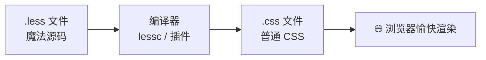
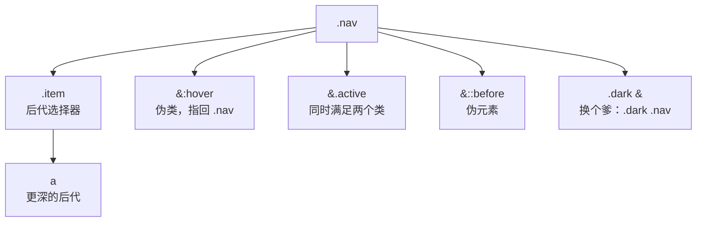
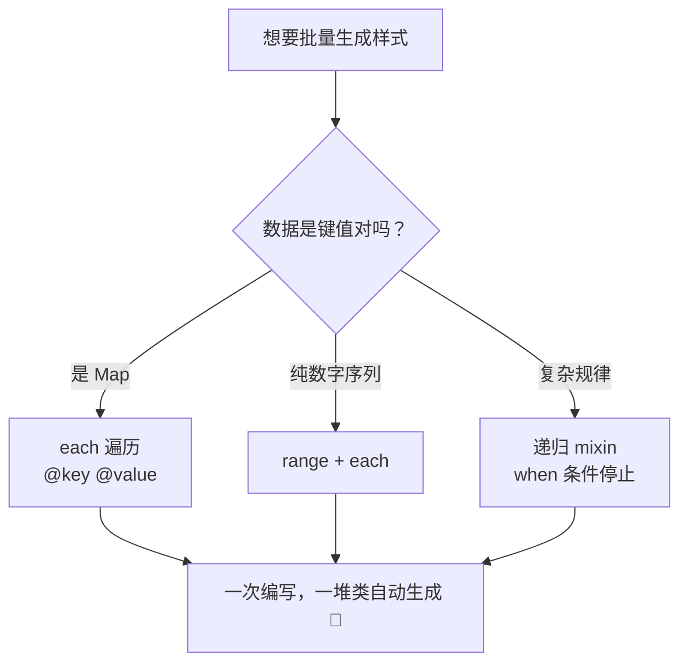

# 🎨 Less 学习笔记 —— 给 CSS 施个魔法 ✨

> 嘿嘿～欢迎来到 Less 的小课堂！🎀
> 原生 CSS 就像"手搓火锅"，Less 就像"自动火锅机"：
> 变量、嵌套、函数全都有，样式代码瞬间优雅 10 倍！(๑•̀ㅂ•́)و✧

---

## 📚 目录

| 章节 | 内容 | 难度 |
| --- | --- | --- |
| 一 | Less 是什么？ | ⭐ |
| 二 | 安装与使用 | ⭐ |
| 三 | 变量 @ | ⭐ |
| 四 | 嵌套规则 & `&` 父选择器 | ⭐⭐ |
| 五 | 混入 Mixins | ⭐⭐⭐ |
| 六 | 运算 Operations | ⭐⭐ |
| 七 | 内置函数库 | ⭐⭐ |
| 八 | 映射 Maps 与守卫 when | ⭐⭐⭐ |
| 九 | 循环 each 与递归 | ⭐⭐⭐ |
| 十 | 导入 @import | ⭐⭐ |
| 十一 | 实战演练 🌟 | ⭐⭐⭐ |
| 十二 | 预处理器三国杀对比 | ⭐⭐ |
| 十三 | 高频问题速览 | 🔥 |

---

## 一、Less 是什么？🤔

**Less = CSS 预处理器**（Preprocessor）：用更强大的语法写样式，再**编译**成普通 CSS 给浏览器～

> 🎀 浏览器只认识 CSS，不认识 Less！所以 Less 代码要先用工具"翻译"成 CSS，就像说方言要先翻译成普通话 📢

### 1.1 原生 CSS 的痛点 vs Less 的药 💊

| CSS 的痛 😫 | Less 的药 💊 |
| --- | --- |
| 颜色/尺寸写死，改主题要全局替换 | **变量** `@primary: pink;` 一处改全局变 |
| 后代选择器一层层写 `.nav .item .link` | **嵌套** 一目了然的层级结构 |
| 重复代码复制粘贴 | **混入 Mixins** 复用样式块 |
| 自己算 `200px - 20px` | **运算** 直接写算式 |
| 没有函数 | **内置函数** 一大筐 |
| 文件拆分要引多个 link | **@import** 打包成一个文件 |

### 1.2 编译流程



### 1.3 一见倾心的对比

```less
/* 😫 原生 CSS：又臭又长，改个颜色要翻全文件 */
.nav { background: #ff6b9d; }
.nav .item { color: #ff6b9d; }
.nav .item:hover { color: #ffffff; background: #ff6b9d; }

/* ✨ Less：变量管全局，嵌套理层级 */
@primary: #ff6b9d;

.nav {
  background: @primary;
  .item {
    color: @primary;
    &:hover {
      color: #fff;
      background: @primary;
    }
  }
}
```

---

## 二、安装与使用 🛠️

### 2.1 方式一：npm 命令行（理解原理用）

```bash
# 安装
npm install -g less

# 编译：把 style.less 编译成 style.css
lessc style.less style.css

# 压缩版
lessc style.less style.css --clean-css
```

### 2.2 方式二：VS Code 插件（写 demo 最爽）⭐

安装 **Easy LESS** 插件 → 保存 `.less` 文件时**自动生成同名 `.css**`，零配置！

### 2.3 方式三：项目中用构建工具（实战主流）

```bash
# Vite 项目：装好即用，无需配置！
npm create vite@latest my-app -- --template vue
# 直接 import './style.less' 就能用

# 需要装依赖（Vite 已内置支持，Webpack 需要配置 loader）
npm i less -D
```

### 2.4 浏览器直接跑（仅学习用，别上生产！⚠️）

```html
<link rel="stylesheet/less" href="style.less" />
<script src="https://cdn.jsdelivr.net/npm/less"></script>
```

> 💡 这种方式在浏览器里现场编译，性能差，只适合本地玩玩～

---

## 三、变量 @ —— 一处定义，处处使用 🏷️

### 3.1 基本用法

```less
// 定义：@名字: 值;
@primary-color: #ff6b9d;
@base-size: 16px;
@img-path: "../assets/images";

.btn {
  color: @primary-color;          // 使用
  font-size: @base-size;
  background: url("@{img-path}/bg.png"); // 插值写法：@{}
}
```

### 3.2 变量的"懒加载"与作用域

```less
// 变量可以先用后定义（提升效果）✨
.btn { color: @link; }   // 编译时能找到下面的定义
@link: #409eff;

// 作用域：就近原则（先找自己的，再往外找）
@var: red;
.page {
  @var: blue;             // 局部变量
  .title { color: @var; } // blue ✅
}
.footer { color: @var; }  // red
```

### 3.3 变量也能当属性名/选择器名

```less
@my-selector: .banner;
@property: color;

@{my-selector} {          // 选择器插值
  @{property}: #333;      // 属性名插值
  background-@{property}: #fff; // 拼接也行
}
```

> 🎀 命名建议：`@w-颜色`、`@bg-背景`、`@spacing-间距`... 项目开头统一建一个 `variables.less`，团队共用！

---

## 四、嵌套规则 —— 层级一目了然 🪆

### 4.1 基本嵌套

```less
.nav {
  padding: 10px;

  .item {                 // 相当于 .nav .item
    color: #333;

    a {                   // 相当于 .nav .item a
      text-decoration: none;
    }
  }
}
```

编译结果 👇

```css
.nav { padding: 10px; }
.nav .item { color: #333; }
.nav .item a { text-decoration: none; }
```

### 4.2 `&` 父选择器：指回上一层 🪃

```less
.btn {
  color: #333;

  &:hover {          // .btn:hover ✅
    color: #ff6b9d;
  }

  &.active {         // .btn.active（连着写，不是后代）✅
    font-weight: bold;
  }

  .dark & {          // .dark .btn（& 放后面 = 换位置）✅
    color: #fff;
  }

  &-sm {             // .btn-sm（字符串拼接）⚠️ 慎用，可读性差
    font-size: 12px;
  }
}
```

> ⚠️ 注意 `&.active` 和 `.active` 的区别：
> `&.active` = `.btn.active`（同一个元素）
> `.active` = `.btn .active`（子元素）

### 4.3 伪元素/伪类/媒体查询也照嵌套不误

```less
.card {
  &::before { content: ''; }        // .card::before

  @media (max-width: 768px) {       // 媒体查询写进选择器里，超清爽！
    padding: 8px;
    .title { font-size: 14px; }
  }
}
```

### 4.4 嵌套层级图



> 💡 使用建议：**嵌套别超过 4 层**！层数太深说明选择器太具体，优先级会失控哦～

---

## 五、混入 Mixins —— 样式界的复制粘贴 🧬

### 5.1 基本混入：像用类一样用样式

```less
// 定义一个"样式块"
.border-radius {
  -webkit-border-radius: 8px;
  border-radius: 8px;
}

.btn {
  .border-radius();   // 引用：整个样式块复制过来！
}
```

### 5.2 带参数的混入：还能传参！🌟

```less
// 定义带参数的 mixin（括号声明 = 只用来混入，本身不会输出到 CSS）
.border-radius(@radius: 8px) {   // 8px 是默认值
  border-radius: @radius;
}

.card  { .border-radius(); }      // 用默认值 8px
.btn   { .border-radius(20px); }  // 传参 20px
.badge { .border-radius(50%); }   // 圆形
```

### 5.3 `...arguments` 与多参数

```less
.box-shadow(@x: 0, @y: 4px, @blur: 8px, @color: rgba(0,0,0,.2)) {
  box-shadow: @arguments;   // @arguments = 所有参数一起上
}

.card { .box-shadow(); }
.btn  { .box-shadow(2px, 2px, 4px, #ccc); }

// @rest 剩余参数：来多少收多少
.stack(@items...) {
  box-shadow: @items;
}
```

### 5.4 命名空间：给 mixin 分组收纳 🗂️

```less
// 把 mixin 装进"文件夹"
#theme {
  .dark { background: #333; color: #fff; }
  .light { background: #fff; color: #333; }
}

.page {
  #theme.dark();   // 像"路径"一样引用
}
```

### 5.5 带条件的 mixin（模式匹配）

```less
// 根据 @switch 的值匹配不同的 mixin
.text(dark, @size) { color: #333; font-size: @size; }
.text(light, @size) { color: #fff; font-size: @size; }

.header { .text(dark, 16px); }   // 匹配到第一条
.hero   { .text(light, 24px); }  // 匹配到第二条

// @_ 通配符：不管哪个模式都会带上
.text(@_, @size) { line-height: 1.5; }
```

### 5.6 mixin vs class 选择器

| 特性 | `.border-radius()` 带括号 | `.border-radius` 不带括号 |
| --- | --- | --- |
| 会输出到 CSS 吗 | ❌ 不会（纯工具） | ✅ 会（当普通类输出） |
| 能传参吗 | ✅ | ❌ |
| 使用建议 | 工具样式用这个 | 需要同时在 HTML 里用的类 |

---

## 六、运算 Operations —— CSS 自带计算器 🧮

### 6.1 数值运算

```less
@width: 100px;

.box {
  width: @width - 20px;       // 80px
  height: @width / 2;         // 50px
  padding: (@width - 40px) * 2; // 120px（先算括号）
  margin: 10px + 5;           // 15px（单位可以只写一边）
}
```

### 6.2 颜色运算 🌈

```less
@primary: #ff6b9d;

.btn {
  color: @primary + 30;        // 颜色变亮一点
  background: @primary - 30;   // 颜色变暗一点
  border-color: @primary * 0.8; // 乘个系数
}
```

> 💡 日常更推荐用**颜色函数**（下一章），语义更清晰～

---

## 七、内置函数库 —— Less 的百宝袋 🎒

### 7.1 常用函数速查表

| 分类 | 函数 | 作用 | 示例 |
| --- | --- | --- | --- |
| 颜色 | `lighten(色, %)` | 变亮 | `lighten(@c, 20%)` |
| 颜色 | `darken(色, %)` | 变暗 | `darken(@c, 20%)` |
| 颜色 | `fade(色, 透明度)` | 设置透明度 | `fade(@c, 50%)` |
| 颜色 | `fadein / fadeout` | 提高/降低不透明度 | `fadeout(@c, 20%)` |
| 颜色 | `rgba(色, a)` | 转 rgba | `rgba(@c, 0.5)` |
| 颜色 | `mix(色1, 色2, 权重)` | 混色 | `mix(#f00, #00f, 50%)` |
| 颜色 | `hue / saturation / lightness` | 取色相/饱和度/亮度 | `hue(#ff6b9d)` |
| 数学 | `round / ceil / floor` | 四舍五入/向上/向下 | `ceil(2.1)` → 3 |
| 数学 | `percentage` | 转百分比 | `percentage(0.5)` → 50% |
| 数学 | `min / max / abs / sqrt / pow` | 常规数学 | `pow(2, 3)` → 8 |
| 字符串 | `replace(串, 正则, 值)` | 替换 | `replace('a-b', '-', '_')` |
| 类型 | `iscolor / isnumber / isstring` | 类型判断 | `iscolor(red)` → true |
| 类型 | `ispixel / isem / ispercentage` | 单位判断 | `ispixel(10px)` → true |

### 7.2 实用示例

```less
@primary: #409eff;

.btn {
  background: @primary;
  &:hover   { background: darken(@primary, 10%); }  // 悬停变深
  &:active  { background: darken(@primary, 20%); }  // 按下更深
}

.mask {
  background: fade(#000, 50%);   // 半透明遮罩 rgba(0,0,0,0.5)
}

.gradient-text {
  color: mix(#ff6b9d, #409eff, 50%);  // 两个品牌色混一混
}
```

---

## 八、映射 Maps 与守卫 when 🗺️

### 8.1 用 mixin 当 Map（进阶常用）🌟

```less
// 定义一个"颜色字典"
@colors: {
  primary: #409eff;
  success: #67c23a;
  warning: #e6a23c;
  danger:  #f56c6c;
}

// 取值语法：字典[@key]
.btn-primary { background: @colors[primary]; }  // #409eff
.btn-danger  { background: @colors[danger]; }   // #f56c6c

// 遍历 Map（配合 each，见第十章）
```

### 8.2 守卫 when：给 mixin 加条件

```less
// 根据亮度自动选黑字/白字（高级用法！）
.set-text-color(@bg) when (lightness(@bg) >= 50%) {
  color: #333;    // 背景亮 → 用深色文字
}
.set-text-color(@bg) when (lightness(@bg) < 50%) {
  color: #fff;    // 背景暗 → 用浅色文字
}

.card-white { background: #fff;    .set-text-color(#fff); }    // 深字
.card-black { background: #222;    .set-text-color(#222); }    // 白字

// when 还能组合条件
.mix(@a) when (@a > 10) and (@a < 100) { ... }
.mix(@a) when (@a < 0), (@a > 100) { ... }   // 逗号 = 或
.mix(@a) when not (@a = 5) { ... }           // not 取反
```

---

## 九、循环 each 与递归 —— 批量生产流水线 🏭

### 9.1 each 遍历列表/Map

```less
// 遍历颜色 Map，批量生成工具类 🌟 超实用！
@colors: {
  primary: #409eff;
  success: #67c23a;
  danger:  #f56c6c;
}

each(@colors, {
  .text-@{key} { color: @value; }
  .bg-@{key}   { background: @value; }
});
```

编译结果 👇

```css
.text-primary { color: #409eff; }
.bg-primary   { background: #409eff; }
.text-success { color: #67c23a; }
/* ...自动生成一整套工具类！ */
```

### 9.2 递归循环：自己调自己

```less
// 生成 margin 工具类：.m-4 .m-8 .m-12 ... .m-40
.margin-loop(@i) when (@i <= 40) {
  .m-@{i} { margin: @i * 1px; }
  .margin-loop(@i + 4);   // 递归调用自己，步长 4
}
.margin-loop(4);

// 栅格系统也是这么生成的（12 列）
.column-loop(@i) when (@i <= 12) {
  .col-@{i} { width: percentage(@i / 12); }
  .column-loop(@i + 1);
}
.column-loop(1);
```

### 9.3 range 生成数字序列

```less
each(range(4), {
  .p-@{value} { padding: @value * 4px; }
});
// .p-1 padding 4px / .p-2 padding 8px / .p-3 / .p-4
```



---

## 十、导入 @import —— 文件也要做收纳 📁

### 10.1 基本导入

```less
// main.less —— 统一入口
@import "variables.less";   // 后缀可省略：@import "variables";
@import "mixins";
@import "components/button";
@import "components/card";
```

> 💡 Less 的 `@import` 是**编译时合并**：最终打包成一个 CSS 文件，不像 CSS 原生 @import 会多发请求（性能差）！

### 10.2 导入选项

```less
// reference：只引用不输出（拿来用 mixin/变量，但不输出它的样式）
@import (reference) "button.less";

// once：默认行为，同文件只导入一次
@import (once) "theme.less";

// multiple：允许导入多次
@import (multiple) "common.less";
```

### 10.3 推荐的项目文件结构 🗂️

```
styles/
├── main.less          # 入口：只负责 @import
├── variables.less     # 所有变量（颜色/尺寸）
├── mixins.less        # 公用 mixin
├── reset.less         # 样式重置
├── animations.less    # 动画
└── components/
    ├── button.less
    ├── card.less
    └── modal.less
```

---

## 十一、实战演练 🌟

### 11.1 实战一：主题色按钮组件

```less
// ===== variables.less =====
@themes: {
  primary: #409eff;
  success: #67c23a;
  warning: #e6a23c;
  danger:  #f56c6c;
};
@btn-radius: 6px;
@btn-padding: 8px 20px;

// ===== mixins.less =====
.button-style(@bg) {
  background: @bg;
  border-color: @bg;
  color: #fff;
  &:hover  { background: lighten(@bg, 10%); }
  &:active { background: darken(@bg, 10%); }
  &.plain {
    background: fade(@bg, 10%);
    color: @bg;
    &:hover { background: fade(@bg, 20%); }
  }
}

// ===== button.less：each 一键生成四种主题按钮 =====
each(@themes, {
  .btn-@{key} {
    padding: @btn-padding;
    border-radius: @btn-radius;
    .button-style(@value);   // 复用 mixin
  }
});
```

编译后自动拥有：`.btn-primary`、`.btn-success`、`.btn-warning`、`.btn-danger` + 各自的 hover/active/plain 状态！🎉

### 11.2 实战二：响应式断点 mixin

```less
// 定义断点
@breakpoints: {
  sm: 576px;
  md: 768px;
  lg: 992px;
  xl: 1200px;
}

// 响应式 mixin：@media 写一次到处用
.respond-to(@bp, @rules) {
  @media (min-width: @breakpoints[@bp]) {
    @rules();
  }
}

.container {
  padding: 16px;

  .respond-to(md, {
    padding: 24px;       // ≥768px 时生效
  });

  .respond-to(lg, {
    padding: 32px;       // ≥992px 时生效
  });
}
```

### 11.3 实战三：等分栅格

```less
.generate-columns(12);
.generate-columns(@n, @i: 1) when (@i <= @n) {
  .col-@{i} { width: (@i * 100% / @n); }
  .generate-columns(@n, @i + 1);
}
// 自动生成 .col-1 ~ .col-12，一个迷你版栅格系统就出炉啦 🍱
```

---

## 十二、预处理器三国杀 ⚔️

| 维度 | Less | Sass/SCSS | Stylus |
| --- | --- | --- | --- |
| 语法风格 | 接近 CSS，上手最快 | SCSS 接近 CSS / Sass 缩进式 | 超自由（可省略大括号冒号） |
| 变量符号 | `@color` | `$color` | 直接 `color = pink` |
| 学习成本 | ⭐ 最低 | ⭐⭐ | ⭐⭐⭐ |
| 功能丰富度 | 够用 | 最强（if/for/内置模块多） | 强 |
| 编译方式 | JS 编译（lessc） | Dart Sass | JS |
| 社区生态 | Bootstrap 3/4 在用 | **Bootstrap 5、主流首选** ✨ | 相对小众 |
| 适用建议 | 小项目、快速上手、老项目维护 | 新项目主流选择，面试重点 | 个人喜好 |

> 🎀 结论：**Less 入门最友好，学会它再转 Sass 只需要半天**（概念全相通：变量/嵌套/mixin/函数），稳赚不亏～ 💰

---

## 十三、高频问题速览 🔥

| 问题 | 一句话答案 |
| --- | --- |
| Less 是什么 | CSS 预处理器，用变量/嵌套/函数增强 CSS，需编译成 CSS 运行 |
| Less vs CSS 区别 | Less 是"开发语言"，浏览器只认编译后的 CSS |
| `&` 的作用 | 指代父选择器：`&:hover`、`&.active`、`.dark &` |
| `&.active` 与 `.active` 区别 | 前者是"同一元素"（.btn.active），后者是"后代"（.btn .active） |
| mixin 带括号 vs 不带括号 | 带括号不输出到 CSS（纯工具），不带会输出 |
| 变量作用域规则 | 就近原则：先找当前作用域，找不到再向外层找 |
| `@import` vs CSS 原生 import | Less 编译时合并成一个文件，性能好 |
| 如何批量生成类 | `each` 遍历 Map / 递归 mixin + when |
| 深度选择器穿透 | `:deep()` 配合预处理器使用（Vue3 Scoped） |
| Less 还值得学吗 | 老项目必备；概念与 Sass 相通，学一个顶俩 ✅ |

---

## 🎁 结语：知识地图

```mermaid
flowchart TD
    Less[🎨 Less 知识体系] --> A[变量 @<br/>颜色/尺寸/插值/作用域]
    Less --> B[嵌套 &<br/>层级结构 / & 父选择器 / 媒体查询]
    Less --> C[混入 Mixin<br/>传参 / 默认值 / 命名空间 / 模式匹配]
    Less --> D[运算与函数<br/>数值运算 / lighten·darken·fade]
    Less --> E[逻辑能力<br/>when 守卫 / each 循环 / 递归]
    Less --> F[工程化<br/>@import 拆分 / Map 字典 / 文件结构]
    E --> E1[一键生成工具类·栅格·主题 🏭]
```

> 🎀 恭喜通关 Less！学习建议：
> ① 装 VS Code 的 **Easy LESS** 插件，边写边看编译结果，理解最快！
> ② 把"实战一"的主题按钮敲一遍，体会 each + mixin + Map 组合技的威力 💪
> ③ 概念通了之后，想转 Sass/SCSS 就是换个符号的事～
> 接下来想学 Sass 深入版、Flex/Grid 布局，还是别的什么，随时喊我！(๑•̀ㅂ•́)و✧
