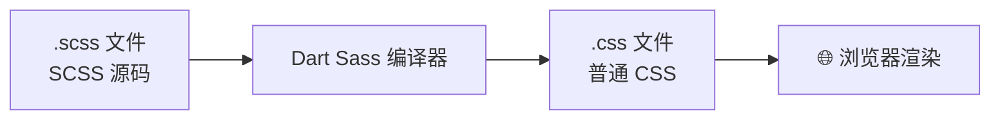

# 🌸 Sass 学习笔记 —— CSS 预处理器的女王 👑

> 嘿嘿～欢迎来到 Sass 的小课堂！🎀
> 学过 Less 的宝子有福了：Sass 概念全相通，但功能更强大！
> 模块化、自定义函数、流程控制...全是简历上的加分项！(๑•̀ㅂ•́)و✧

---

## 📚 目录

| 章节 | 内容 | 难度 |
| --- | --- | --- |
| 一 | Sass 是什么？SCSS 和 Sass 啥关系？ | ⭐ |
| 二 | 安装与使用 | ⭐ |
| 三 | 变量 $ 及 !default / !global | ⭐⭐ |
| 四 | 嵌套规则与 & 父选择器 | ⭐⭐ |
| 五 | 七大数据类型 | ⭐⭐ |
| 六 | 模块化 @use（重点！） | ⭐⭐⭐ |
| 七 | 混入 @mixin / @include / @content | ⭐⭐⭐ |
| 八 | 继承 @extend 与占位符 % | ⭐⭐⭐ |
| 九 | 运算与插值 #{} | ⭐⭐ |
| 十 | 流程控制 @if / @each / @for / @while | ⭐⭐⭐ |
| 十一 | 内置函数 + @function 自定义 | ⭐⭐⭐ |
| 十二 | 实战演练 🌟 | ⭐⭐⭐ |
| 十三 | Sass vs Less 终极对比 | ⭐⭐ |
| 十四 | 高频问题速览 | 🔥 |

---

## 一、Sass 是什么？🤔

**Sass = 最流行、最强大的 CSS 预处理器**（比 Less 资历更老、功能更强），Bootstrap 5、主流组件库都在用它～

### 1.1 SCSS 和 Sass 是什么关系？（必考！）

Sass 有**两套语法**，同一个人穿两件衣服 👗：

| 维度 | SCSS（新语法，主流 ✨） | Sass（老语法，缩进式） |
| --- | --- | --- |
| 文件后缀 | `.scss` | `.sass` |
| 大括号 `{}` | ✅ 要写 | ❌ 不要（靠缩进） |
| 分号 `;` | ✅ 要写 | ❌ 不要 |
| 写法风格 | 和 CSS 几乎一样 | 像 Python 的极简风 |

```scss
// ===== SCSS 写法（推荐！和 CSS 无缝衔接）=====
.nav {
  background: #333;
  .item {
    color: #fff;
    &:hover { color: pink; }
  }
}
```

```sass
// ===== Sass 缩进写法（了解即可，新项目别用）=====
.nav
  background: #333
  .item
    color: #fff
    &:hover
      color: pink
```

> 🎀 现在 99% 的项目都用 **SCSS 语法**！后面全部用 SCSS 讲解～
> 说"Sass"的时候，一般默认指的就是 SCSS 啦！

### 1.2 编译流程（和 Less 一样要翻译）



---

## 二、安装与使用 🛠️

### 2.1 方式一：npm 安装（当前官方推荐 Dart Sass）

```bash
# 安装（全局）
npm install -g sass

# 编译单个文件
sass style.scss style.css

# 监听模式：保存自动编译
sass --watch style.scss style.css

# 监听整个目录
sass --watch src/scss:dist/css
```

### 2.2 方式二：VS Code 插件（写 demo 神器）⭐

安装 **Live Sass Compiler** 插件 → 点击状态栏 `Watch Sass` → 保存 `.scss` 自动出 `.css`～

### 2.3 方式三：项目构建工具（实战主流）

```bash
# Vite 项目（2023+）：直接支持，无需任何配置！
npm i -D sass        # 装个依赖就行
# <style lang="scss"> 随便写

# Vue 脚手架创建时选 CSS pre-processor → Sass/SCSS
npm create vue@latest
```

> 💡 Vite 已内置 SCSS 支持，只需 `npm i -D sass` 安装编译器，开箱即用～

---

## 三、变量 $ —— 换个符号，功能更强 💰

### 3.1 基本用法

```scss
// SCSS 用 $ 定义变量（Less 是 @）
$primary-color: #409eff;
$base-size: 16px;
$max-width: 1200px;

.btn {
  color: $primary-color;
  font-size: $base-size;
}
```

### 3.2 作用域：就近原则

```scss
$color: red;

.page {
  $color: blue;        // 局部变量（只在这个大括号里有效）
  .title { color: $color; }  // blue
}

.footer { color: $color; }   // red（外面的还是 red）
```

### 3.3 两个特殊标记 !default / !global（必考！）

```scss
// !default：有值就用你的，没值才用我的（组件库标配！）
$primary: #409eff !default;   // 如果别人先定义了 $primary，这句就失效

// !global：把局部变量提升为全局
.page {
  $color: blue !global;
}
.footer { color: $color; }    // blue ✅（被提升成全局了）
```

> 🎀 `!default` 的妙用：组件库的变量都用 `!default` 定义，
> 使用方想改主题，只要在引入前**重新赋值**就能覆盖，完美实现"可配置"！

```scss
// ===== 组件库内部：variables.scss =====
$btn-bg: gray !default;

// ===== 你的项目：先覆盖再引入 =====
$btn-bg: pink;                 // 先定义我的值
@use "library/variables";      // 引入组件库
// 组件库里所有 $btn-bg 都变成 pink 啦 ✨
```

---

## 四、嵌套规则与 & 父选择器 🪆

### 4.1 选择器嵌套（和 Less 一样）

```scss
.nav {
  padding: 10px;

  .item {
    color: #333;

    a { text-decoration: none; }
  }
}
```

### 4.2 属性嵌套（SCSS 独有彩蛋 🥚）

```scss
// font-family / font-size 可以嵌套在 font 里
.btn {
  font: {
    family: 'PingFang SC', sans-serif;
    size: 14px;
    weight: bold;
  }
  // border 也可以
  border: 1px solid #ccc {
    left: none;
    right: none;
  }
}
```

### 4.3 `&` 父选择器全家福

```scss
.btn {
  &:hover { color: pink; }     // .btn:hover
  &.active { font-weight: bold; } // .btn.active
  .dark & { color: #fff; }     // .dark .btn
  &-sm { font-size: 12px; }    // .btn-sm（拼接）
  & + & { margin-left: 8px; }  // .btn + .btn（相邻兄弟）
}
```

> ⚠️ 和 Less 一样：嵌套别超过 4 层，`&` 尽量别拿来拼字符串（可读性差、重构会哭 😭）

---

## 五、七大数据类型 📊

SCSS 不只是"写样式"，它有自己的数据类型系统：

| 类型 | 示例 | 说明 |
| --- | --- | --- |
| 数字 | `1`、`10px`、`20%` | 带不带单位都行 |
| 字符串 | `"foo"`、`bar` | 引号可省 |
| 颜色 | `red`、`#ff6b9d`、`rgba(0,0,0,.5)` | - |
| 布尔 | `true` / `false` | 用于条件判断 |
| 空值 | `null` | 表示"没有值" |
| 列表 List | `1px 2px 3px`、`Arial, sans-serif` | 空格或逗号分隔 |
| 映射 Map | `(primary: #409eff, danger: #f56c6c)` | 键值对，必须带括号 |

```scss
// Map 的定义与取值（超级常用！）
$colors: (
  primary: #409eff,
  success: #67c23a,
  warning: #e6a23c,
  danger:  #f56c6c,
);

.btn-primary { background: map-get($colors, primary); }
// 或者用插值：#{$colors} 整个输出（很少这么用）

// 检查类型
type-of(10px);        // number
type-of($colors);     // map
meta.type-of(#fff);   // color（新版模块函数）
```

---

## 六、模块化 @use —— Sass 的王牌功能 🃏（重点！）

> 🎀 老语法 `@import` 已被官方**弃用**（deprecated）！新项目一律用 `@use`～
> 面试官超爱问这俩的区别！

### 6.1 @use 基本用法：带命名空间

```scss
// ===== variables.scss =====
$primary: #409eff;
@mixin center { display: flex; justify-content: center; align-items: center; }

// ===== main.scss =====
@use 'variables';           // 引入模块

.btn {
  color: variables.$primary;        // ✅ 必须带命名空间访问！
  @include variables.center;        // mixin 也要带命名空间
}
```

### 6.2 as 起别名 / as *

```scss
// as 起个短别名
@use 'variables' as v;
.btn { color: v.$primary; }

// as * ：全局倒入（不带命名空间，慎用，怕重名）
@use 'variables' as *;
.btn { color: $primary; }
```

### 6.3 私有成员：`-` 或 `_` 开头

```scss
// ===== helpers.scss =====
$-secret: #333;       // - 开头 = 私有变量，外部拿不到！
@mixin -internal {}    // 私有 mixin

// ===== main.scss =====
@use 'helpers';
.foo { color: helpers.$-secret; }  // ❌ 报错！私有的不给用
```

### 6.4 forward 转发：做个"批发商"

```scss
// ===== _index.scss（文件夹入口，@use '文件夹' 时自动找它）=====
@forward 'variables';    // 把子模块再转发出去
@forward 'mixins';

// ===== 使用方 =====
@use 'styles';           // 一句话拿到全部！
.btn { color: styles.$primary; }
```

### 6.5 with 配置模块（配合 !default）

```scss
// ===== _config.scss（可配置主题）=====
$theme: light !default;

// ===== 使用方：引入时传配置 =====
@use 'config' with ($theme: dark);
```

### 6.6 @use vs @import 对比表（必考！）

| 维度 | @use（新 ✨） | @import（旧，已弃用） |
| --- | --- | --- |
| 命名空间 | ✅ 每个模块独立命名空间 | ❌ 全部混进全局，容易重名打架 |
| 重复导入 | 自动去重 | 多次引入可能重复输出 |
| 私有成员 | ✅ `-` 开头可私有 | ❌ 全公开 |
| 模块配置 | ✅ `with ()` 可传参 | ❌ 没有 |
| 加载时机 | 编译前统一处理 | 按顺序串行处理 |
| 官方态度 | **推荐** ✅ | 弃用 ⚠️ |

```mermaid
flowchart TD
    A[main.scss] -->|@use| B[variables.scss<br/>变量]
    A -->|@use| C[mixins.scss<br/>混入]
    A -->|@use| D[_index.scss]
    D -->|@forward| E[转发一批子模块]
    A --> F[访问必须带命名空间<br/>variables.$primary ✅]
    B -->|私有成员 $-xx| G[外部不可访问 🔒]
```

### 6.7 推荐项目结构 🗂️

```
scss/
├── main.scss            # 入口：只 @use，不写样式
├── _variables.scss      # 变量（下划线开头 = partial 局部文件，不会被单独编译）
├── _mixins.scss         # 混入
├── _functions.scss      # 函数
├── _reset.scss          # 重置样式
└── components/
    ├── _button.scss
    └── _card.scss
```

> 💡 **partial 局部文件**：`_` 开头的文件只用来被导入，编译器不会单独生成它的 CSS～

---

## 七、混入 @mixin / @include —— 样式复用王者 🔁

### 7.1 基本用法

```scss
// 定义
@mixin flex-center {
  display: flex;
  justify-content: center;
  align-items: center;
}

// 使用
.modal { @include flex-center; }        // 记得加 @include！
.card  { @include flex-center; }
```

### 7.2 带参数 + 默认值

```scss
@mixin button($bg: gray, $radius: 4px) {
  background: $bg;
  border-radius: $radius;
  color: #fff;
}

.btn-a { @include button; }                    // 全用默认
.btn-b { @include button(pink); }              // 位置传参
.btn-c { @include button($bg: blue, $radius: 8px); } // 具名传参（推荐！）
```

### 7.3 可变参数 ...

```scss
@mixin box-shadow($shadows...) {
  box-shadow: $shadows;   // 一股脑全传给 box-shadow
}

.card { @include box-shadow(0 1px 2px #ccc, 0 2px 8px #ddd); }
```

### 7.4 @content 内容插槽（超重要！）🌟

> 🎀 mixin 不止能"给"样式，还能"要"样式！
> `@content` 就是个插槽，使用时塞进去的内容会填到那里～（媒体查询/BEM 神器）

```scss
// 定义一个响应式 mixin
@mixin respond-to($bp) {
  @media (min-width: $bp) {
    @content;            // 插槽：使用时写的样式会出现在这里
  }
}

.container {
  padding: 16px;

  @include respond-to(768px) {
    padding: 24px;       // 这些样式会填进 @media 里 ✨
  }
}
```

编译结果 👇

```css
.container { padding: 16px; }
@media (min-width: 768px) {
  .container { padding: 24px; }
}
```

---

## 八、继承 @extend 与占位符 % —— 另一种复用 🧬

### 8.1 @extend 继承已有选择器

```scss
.btn {
  padding: 8px 16px;
  border: none;
}

.btn-primary {
  @extend .btn;          // 把 .btn 的样式"继承"过来
  background: #409eff;
}
```

编译结果（注意是**选择器合并**，不是复制！）：

```css
.btn, .btn-primary { padding: 8px 16px; border: none; }
.btn-primary { background: #409eff; }
```

### 8.2 占位符 %：只为继承而生（推荐！）

```scss
// % 开头：不写 @extend 就完全不输出到 CSS
%flex-center {
  display: flex;
  justify-content: center;
  align-items: center;
}

.modal { @extend %flex-center; }
.card  { @extend %flex-center; }
// CSS 里只有 .modal, .card { ... }，没有 %flex-center 的痕迹 ✨
```

### 8.3 mixin vs @extend vs % 对比表（必考！）

| 维度 | @mixin | @extend / % 占位符 |
| --- | --- | --- |
| 复制方式 | **复制代码**到每个使用处 | **合并选择器**（共用一份代码） |
| 能传参数吗 | ✅ 可以 | ❌ 不行 |
| CSS 体积 | 用得多会变大 | 更省体积 |
| 风险 | 无 | 继承链复杂时选择器会爆炸 `.a, .b, .c...` 😱 |
| 使用建议 | **需要参数/逻辑 → mixin（默认选它）** | 纯静态样式且用得多 → % 占位符 |

```mermaid
flowchart TD
    A[要复用一段样式] --> B{需要传参数吗？<br/>或包含媒体查询/@content？}
    B -- 是 --> C[@mixin ✅<br/>灵活之王]
    B -- 否 --> C2{同一段样式被很多类用？}
    C2 -- 是 --> D[% 占位符 + @extend<br/>合并选择器更省体积]
    C2 -- 否 --> E[直接写公共类<br/>HTML 里多挂一个 class]
```

> ⚠️ `@extend` 在大项目里容易产生超长选择器链，且不能跨 `@media` 使用，**新项目优先 mixin**～

---

## 九、运算与插值 #{} ➗

### 9.1 运算

```scss
$width: 100px;

.box {
  width: $width - 20px;        // 80px
  height: ($width / 2);        // 50px（除法建议用 math.div）
  margin: 10px * 2;            // 20px
  color: #409eff + 100;        // 颜色也能算
}
```

### 9.2 插值 #{}

```scss
$name: 'card';
$side: left;

.#{$name} { ... }              // .card：选择器里用变量必须 #{}！
margin-#{$side}: 10px;         // margin-left：属性名拼接
content: 'I am #{$name}';      // 字符串里嵌变量

// ⚠️ 注意：$name 直接写在选择器位置不行，必须 #{$name} 包起来
```

### 9.3 除法的正确姿势（新版变化！）

```scss
// 老版本直接 $a / $b 可能被当成 CSS 原生除法（font: 10px/8px）
// 新版（Dart Sass 1.33+）推荐用 math 模块：

@use 'sass:math';

.half { width: math.div(100px, 2); }       // 50px ✅
.rate { width: math.percentage(math.div(1, 3)); } // 33.33%
```

---

## 十、流程控制 —— 让样式"会思考" 🧠

### 10.1 @if / @else if / @else

```scss
@mixin text-color($bg-lightness) {
  @if $bg-lightness > 50 {
    color: #333;           // 背景亮 → 深字
  } @else if $bg-lightness == 50 {
    color: #666;
  } @else {
    color: #fff;           // 背景暗 → 白字
  }
}

.light-box { @include text-color(80); }
.dark-box  { @include text-color(20); }
```

### 10.2 @each 遍历（Map + List 都行）🌟

```scss
// 遍历 Map：一键生成整套主题工具类（实战超高频！）
$colors: (
  primary: #409eff,
  success: #67c23a,
  danger:  #f56c6c,
);

@each $name, $color in $colors {
  .text-#{$name} { color: $color; }
  .bg-#{$name}   { background: $color; }
}

// 遍历 List
@each $size in (small, medium, large) {
  .icon-#{$size} { font-size: index(small medium large, $size) * 8px; }
}
```

### 10.3 @for 循环

```scss
// from 1 through 3：包含 3（1 2 3）
@for $i from 1 through 3 {
  .col-#{$i} { width: math.percentage(math.div($i, 12)); }
}

// from 1 to 3：不包含 3（1 2）
@for $i from 1 to 3 {
  .mt-#{$i * 4} { margin-top: $i * 4px; }
}
```

### 10.4 @while 循环

```scss
$i: 1;
@while $i <= 3 {
  .p-#{$i} { padding: $i * 4px; }
  $i: $i + 1;    // 别忘了自己加，不然死循环 💥
}
```

### 10.5 流程控制选择图

```mermaid
flowchart TD
    A[要批量生成] --> B{数据结构是？}
    B -- Map 键值对 --> C[@each $key, $val in $map 🌟]
    B -- List 列表 --> D[@each $item in $list]
    B -- 连续数字 --> E[@for from/through/to]
    B -- 复杂条件递增 --> F[@while<br/>记得手动 $i + 1]
    G[单个分支判断] --> H[@if / @else]
```

---

## 十一、内置函数 + 自定义函数 🧰

### 11.1 常用内置函数速查表

| 分类 | 函数 | 作用 | 示例 |
| --- | --- | --- | --- |
| 颜色 | `lighten($c, %)` | 变亮 | `lighten(#409eff, 20%)` |
| 颜色 | `darken($c, %)` | 变暗 | `darken(#409eff, 20%)` |
| 颜色 | `rgba($c, a)` | 加透明度 | `rgba(#000, 0.5)` |
| 颜色 | `mix($a, $b, w)` | 混色 | `mix(#f00, #00f, 50%)` |
| 颜色 | `adjust-hue($c, deg)` | 调色相 | `adjust-hue(#f00, 90deg)` |
| 颜色 | `desaturate($c, %)` | 降饱和 | `desaturate(#f36, 40%)` |
| Map | `map-get($map, key)` | 取值 | `map-get($colors, primary)` |
| Map | `map-has-key($map, k)` | 有这个 key 吗 | 返回 true/false |
| Map | `map-keys / map-values` | 所有 key/value | 列表形式返回 |
| Map | `map-merge($m1, $m2)` | 合并 Map | - |
| 字符串 | `unquote / quote` | 去引号/加引号 | `quote(hello)` |
| 字符串 | `to-upper-case` | 转大写 | - |
| 字符串 | `str-index($s, $sub)` | 查子串位置 | - |
| 数学 | `math.div / math.floor / math.ceil` | 除法/取整 | `math.div(10, 4)` |
| 数学 | `math.round / math.abs / math.max` | 常规数学 | - |
| 数学 | `math.percentage` | 转百分比 | `math.percentage(0.5)` |
| 判断 | `if($cond, $a, $b)` | 三元表达式 | `if(true, 1px, 2px)` |

> 💡 新版 Dart Sass 推荐用模块化函数：`@use 'sass:math'` 然后 `math.div()`、
> `@use 'sass:color'` 然后 `color.adjust()`、`@use 'sass:map'` 然后 `map.get()`～

### 11.2 @function 自定义函数

```scss
// 定义：@function 名字(参数) { @return 返回值; }
@function rem($px) {
  $base: 16px;
  @return math.div($px, $base) * 1rem;   // px 转 rem 工具
}

.title { font-size: rem(32); }    // 2rem
.text  { font-size: rem(14); }    // 0.875rem

// 配合 Map 做层级查询
$z-index: (modal: 100, dropdown: 50, tooltip: 200);

@function z($name) {
  @if not map-has-key($z-index, $name) {
    @error "z-index 里没有 #{$name} 这一项哦！";   // @error 主动报错
  }
  @return map-get($z-index, $name);
}

.modal   { z-index: z(modal); }    // 100
.tooltip { z-index: z(tooltip); }  // 200
```

> 🎀 mixin 是"给样式"，@function 是"给值"！要结果就算函数，要样式就用 mixin～

---

## 十二、实战演练 🌟

### 12.1 实战一：BEM + 嵌套（优雅写 BEM）

```scss
// BEM：块__元素--修饰器，类名长到怀疑人生？
// card__title、card__body--active...
.card {
  display: block;

  &__title {          // .card__title
    font-size: 18px;
    font-weight: bold;
  }
  &__body {           // .card__body
    padding: 16px;
  }
  &--active {         // .card--active
    border-color: #409eff;

    .card__title { color: #409eff; }   // 还能嵌套组合
  }
}
```

### 12.2 实战二：暗黑模式（CSS 变量 + SCSS Map）

```scss
// 用 Map 统一管理主题变量
$themes: (
  light: (bg: #fff, text: #333, card-bg: #f5f5f5),
  dark:  (bg: #1a1a1a, text: #eee, card-bg: #2c2c2c),
);

// 遍历生成 :root 和 [data-theme='dark']
@each $name, $map in $themes {
  $selector: if($name == light, ':root', "[data-theme='#{$name}']");

  #{$selector} {
    @each $key, $value in $map {
      --color-#{$key}: #{$value};    // 输出 CSS 变量
    }
  }
}

// 组件里用 CSS 变量（切主题零重绘成本 ✨）
.page { background: var(--color-bg); color: var(--color-text); }
.card { background: var(--color-card-bg); }
```

### 12.3 实战三：一套完整的按钮系统

```scss
// ===== _variables.scss =====
$btn-themes: (
  primary: #409eff,
  success: #67c23a,
  danger:  #f56c6c,
) !default;

// ===== _mixins.scss =====
@mixin button-style($bg) {
  background: $bg;
  color: #fff;
  &:hover  { background: lighten($bg, 10%); }
  &:active { background: darken($bg, 10%); }
  &.is-plain {
    background: rgba($bg, 0.1);
    color: $bg;
    &:hover { background: rgba($bg, 0.2); }
  }
}

// ===== button.scss：each + mixin 一键全家桶 =====
@use 'variables' as *;
@use 'mixins' as *;

@each $name, $color in $btn-themes {
  .btn--#{$name} {
    padding: 8px 20px;
    border-radius: 6px;
    border: none;
    cursor: pointer;
    @include button-style($color);
  }
}

// 尺寸变体：@each + List
$sizes: (small: 12px, medium: 14px, large: 16px);
@each $name, $size in $sizes {
  .btn--#{$name} { font-size: $size; }
}
```

---

## 十三、Sass vs Less 终极对比 ⚔️

| 维度 | Sass/SCSS | Less |
| --- | --- | --- |
| 变量符号 | `$color` | `@color` |
| 混入 | `@mixin` + `@include`（声明明确） | `.name()` 直接调用 |
| 模块化 | `@use` 命名空间（强大 ✨） | `@import`（全局混入） |
| 条件循环 | `@if / @each / @for / @while` | `when / each / 递归` |
| 自定义函数 | ✅ `@function` | ❌ 没有（要用 mixin 模拟） |
| 继承 | `@extend` / `%占位符` | ❌ 无专门语法 |
| 插值 | `#{$var}` | `@{var}` |
| 内置模块 | `sass:math` `sass:color` `sass:map`... | 平铺函数 |
| 生态 | **Bootstrap 5、主流首选** 👑 | Bootstrap 3/4、老项目 |
| 编译器 | Dart Sass（官方） | lessc（JS） |

> 🎀 迁移口诀：**@ 变 $、mixin 加声明、插值换 #{}** —— Less 党转 Sass 半天上手！
> 共通核心：变量、嵌套、`&`、混入、运算、Map —— 学会一个，另一个白送～ 💰

---

## 十四、高频问题速览 🔥

| 问题 | 一句话答案 |
| --- | --- |
| SCSS 和 Sass 区别 | 同一门语言两套语法：SCSS 带大括号分号（主流），Sass 缩进式 |
| @use vs @import | @use 有命名空间/私有成员/可配置/去重；@import 全局混入已被弃用 |
| mixin vs extend | mixin 复制代码可传参；extend 合并选择器省体积但不能传参 |
| % 占位符是什么 | 只为 @extend 存在的"虚拟类"，不主动输出到 CSS |
| @content 作用 | mixin 的内容插槽，媒体查询/BEM 场景神器 |
| !default 作用 | 变量默认值：已有定义则跳过（组件库可配置的关键） |
| !global 作用 | 局部变量提升为全局 |
| SCSS 除法怎么写 | 新版用 `math.div()`（`@use 'sass:math'`） |
| 如何批量生成工具类 | `@each $k, $v in $map` + 插值 `#{$k}` |
| mixin vs function | mixin 输出样式块，function 通过 @return 返回值 |

---

## 🎁 结语：知识地图

```mermaid
flowchart TD
    Sass[🌸 Sass 知识体系] --> A[变量 $<br/>作用域 / !default / !global]
    Sass --> B[嵌套 &<br/>选择器嵌套 / 属性嵌套 / & 父选择器]
    Sass --> C[复用三兄弟<br/>@mixin·@content / @extend / %占位符]
    Sass --> D[模块化 @use 🃏<br/>命名空间 / as / 私有 / @forward]
    Sass --> E[流程控制<br/>@if / @each / @for / @while]
    Sass --> F[函数<br/>内置模块 / @function 自定义]
    D --> D1[面试必考：@use vs @import]
    E --> E1[配合 Map 批量生成主题工具类 🏭]
```

> 🎀 恭喜通关 Sass！学习建议：
> ① 装 VS Code 的 **Live Sass Compiler**，边写边看编译产物，成长最快！
> ② 重点吃透三件事：**@use 模块化、@mixin + @content、@each + Map**（实战天天用）
> ③ 和 Less 笔记对照着复习，两个一起记，面试直接降维打击！💪
> 接下来想学 Flex/Grid 布局、Tailwind、Vue3 还是响应式原理，随时喊我！(๑•̀ㅂ•́)و✧
