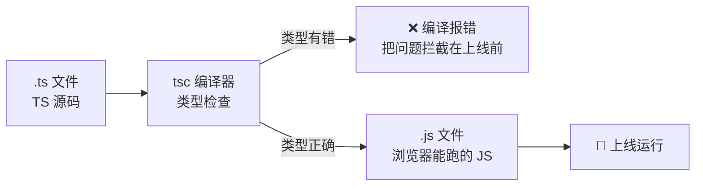
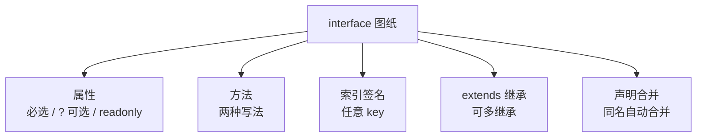
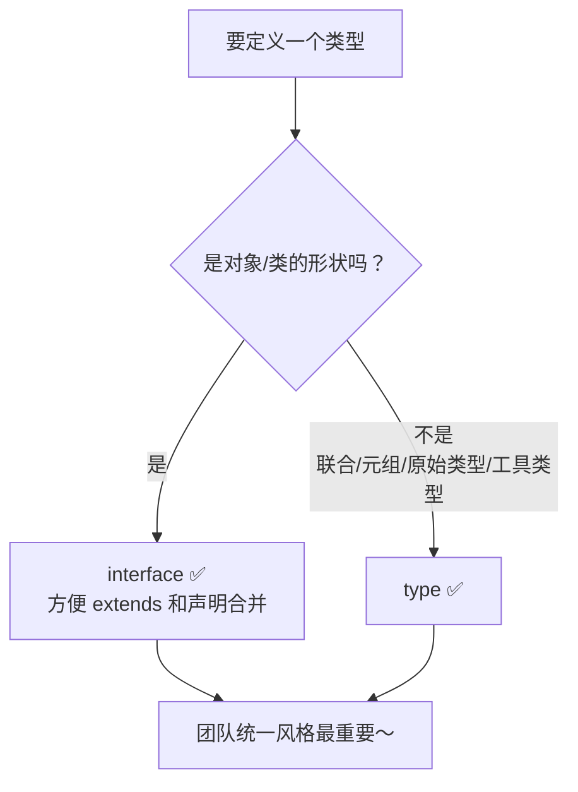
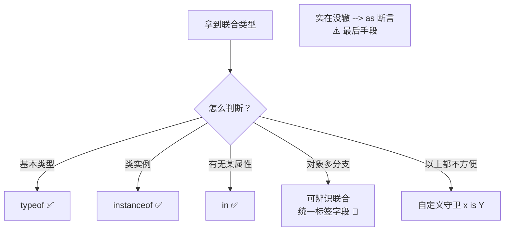
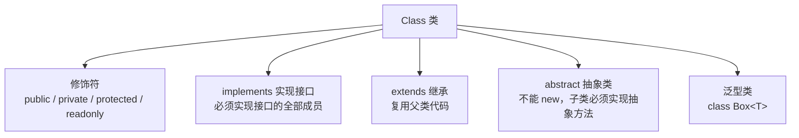
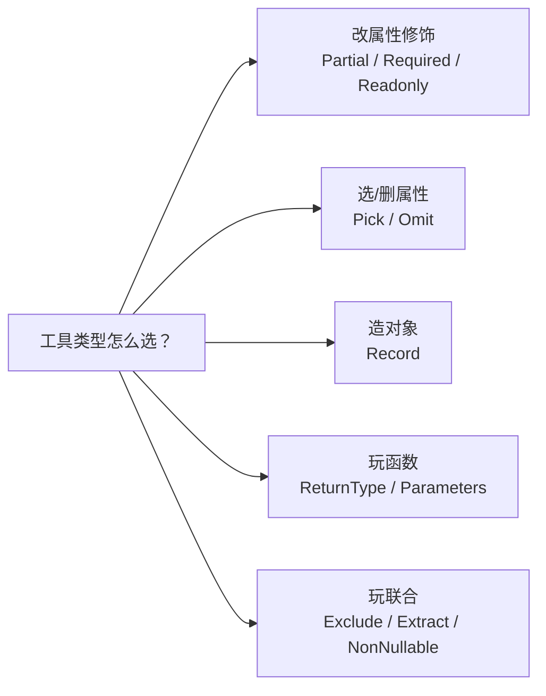

# 📘 TypeScript 学习笔记 —— 给 JS 穿上盔甲 ⚔️

> 嘿嘿～欢迎来到 TypeScript 的小课堂！🎀
> JS 是"裸奔"的灵活胖子，TS 就是给它穿上**类型盔甲**的战士！
> 跟着敲一遍，保证你看报错不再心慌！(๑•̀ㅂ•́)و✧

---

## 📚 目录

| 章节 | 内容 | 难度 |
| --- | --- | --- |
| 一 | TypeScript 是什么？ | ⭐ |
| 二 | 环境搭建与初体验 | ⭐ |
| 三 | 基础类型全家福 | ⭐⭐ |
| 四 | 数组、元组与枚举 | ⭐⭐ |
| 五 | 接口 Interface | ⭐⭐ |
| 六 | 类型别名 type 与联合/交叉类型 | ⭐⭐ |
| 七 | 类型收窄与类型守卫 | ⭐⭐⭐ |
| 八 | 函数类型 | ⭐⭐ |
| 九 | 类 Class（修饰符 + 抽象类） | ⭐⭐⭐ |
| 十 | 泛型 —— 万金油登场 🌟 | ⭐⭐⭐⭐ |
| 十一 | 内置工具类型 | ⭐⭐⭐ |
| 十二 | 高级类型（keyof/typeof/映射/条件） | ⭐⭐⭐⭐ |
| 十三 | tsconfig.json 常用配置 | ⭐⭐ |
| 十四 | 面试高频考点速览 | 🔥 |

---

## 一、TypeScript 是什么？🤔

**TypeScript = JavaScript + 类型系统**，由微软爸爸开发，是 JS 的**超集**（JS 有的它都有，还送一堆新玩具 🎁）

### 1.1 一句话理解

> 🎀 JS 里变量是个"百变怪"：今天是数字、明天变字符串都不管你；
> TS 给每个变量发一张**身份卡**：说好是数字就必须是数字，写错直接**编译报错**提醒你！

```js
// 😫 JavaScript：错了也一声不吭，上线才发现
function add(a, b) {
  return a + b;
}
add(1, '2'); // '12'？？？？字符串拼接了！

// ✅ TypeScript：写代码时就报错
function add(a: number, b: number): number {
  return a + b;
}
add(1, '2'); // ❌ 报错：'string' 不能传给 'number'
```

### 1.2 JS vs TS 对比表

| 维度 | JavaScript | TypeScript |
| --- | --- | --- |
| 类型检查 | ❌ 运行时才知道错 | ✅ 写代码时就报错（静态检查） |
| 类型注解 | 无 | `: number` 等 |
| 面向对象 | 原型 + class 语法糖 | 完整的接口/抽象类/泛型 |
| 代码提示 | 弱 | 超强 💪（IDE 全自动补全） |
| 浏览器认识吗 | ✅ 直接跑 | ❌ 要先**编译**成 JS |
| 大型项目协作 | 容易翻车 | 重构稳如老狗 🐶 |

### 1.3 编译流程



> 💡 浏览器和 Node 都不认识 TS，所以 TS 必须**编译（转译）**成 JS 才能运行～
> 实际项目中 Vite/Webpack 会自动帮你做这件事，写代码时几乎无感！

---

## 二、环境搭建与初体验 🛠️

### 2.1 安装与手动编译

```bash
# 全局安装 TypeScript 编译器
npm install -g typescript

# 查看版本
tsc -v

# 手动编译：把 hello.ts 编译成 hello.js
tsc hello.ts

# 监听模式：文件一保存就自动重新编译
tsc hello.ts --watch
```

### 2.2 初始化项目配置

```bash
tsc --init   # 生成 tsconfig.json 配置文件
```

### 2.3 真实项目的玩法

```bash
# Vue3 项目直接选 TS 模板
npm create vue@latest

# React 项目
npm create vite@latest my-app -- --template react-ts
```

> 💡 脚手架会自动配好编译流程，**你只管写 .ts 文件**，保存即检查，启动即编译～

---

## 三、基础类型全家福 👨‍👩‍👧‍👦

### 3.1 基本类型注解

语法：`变量名: 类型 = 值`，冒号后面的就是"身份卡"～

```ts
let name: string = '小甜';
let age: number = 18;
let isGirl: boolean = true;
let u: undefined = undefined;
let n: null = null;

// 大写开头的 Number/String 是 JS 的包装对象类型，别用错啦 ⚠️
```

### 3.2 类型推断：TS 其实很聪明 🧠

```ts
// 初始赋值后，TS 自动推断类型，不用手写注解
let count = 10;        // 推断为 number
count = 'hello';       // ❌ 报错！不能把 string 赋给 number

// 建议口诀：能推断就不写，函数参数/返回值必须写 🎀
function greet(name: string): string {
  return `hi ${name}`;
}
```

### 3.3 特殊类型：any / unknown / never / void

```ts
// 😈 any：放弃检查，随便造（ emergencies only！）
let a: any = 1;
a = 'str'; a.foo();   // 都不报错（危险！失去了 TS 的意义）

// 😇 unknown：安全的 any —— 什么都能装，但用之前必须检查类型
let b: unknown = 'hello';
b.length;              // ❌ 报错！unknown 不能直接用
if (typeof b === 'string') {
  b.length;            // ✅ 检查过后就能用了
}

// 🕳️ never：永远不可能有值（函数永远走不到终点/抛错）
function fail(): never {
  throw new Error('炸了');
}

// 📭 void：函数没有返回值
function log(msg: string): void {
  console.log(msg);
}
```

### 3.4 对象类型

```ts
// 一行写法
let point: { x: number; y: number } = { x: 1, y: 2 };

// ? 表示可选属性
let user: { name: string; age?: number } = { name: '小甜' };

// readonly 表示只读
let config: { readonly id: number } = { id: 1 };
config.id = 2; // ❌ 报错！只读不许改
```

### 3.5 三大特殊类型对比表（必考！）

| 类型 | 含义 | 能赋任意值？ | 能直接用？ |
| --- | --- | --- | --- |
| `any` | 放弃类型检查 | ✅ | ✅（危险 😈） |
| `unknown` | 安全的 any | ✅ | ❌ 必须先收窄 |
| `never` | 永不存在的值 | ❌ 谁都不能赋给它 | - |

---

## 四、数组、元组与枚举 📦

### 4.1 数组的两种写法

```ts
let nums: number[] = [1, 2, 3];        // 推荐写法 ✨
let strs: Array<string> = ['a', 'b'];  // 泛型写法

// 联合类型数组：既能装数字又能装字符串
let mixed: (number | string)[] = [1, 'a', 2];
```

### 4.2 元组 Tuple：定长定类型的数组

> 🎀 普通数组是"弹性手链"，元组是"格子固定的首饰盒"——每个格子放什么都是规定好的！

```ts
// 规定：第 0 位必须是 string，第 1 位必须是 number
let position: [string, number] = ['北京', 116];

position[0] = '上海';   // ✅
position[0] = 123;      // ❌ 报错！第 0 位只能 string
position.push('x');     // ⚠️ 长度超标会报错（push 有坑，少用）

// 实战：excel 行数据、经纬度坐标、useState 返回值就是元组！
// const [count, setCount] = useState(0);  // [number, 函数]
```

### 4.3 枚举 Enum：给一组常量起名字 🏷️

```ts
enum Status {
  Loading,   // 0（自动从 0 开始编号）
  Success,   // 1
  Error,     // 2
}

// 数字枚举：可以反向查
Status.Success;      // 1
Status[1];           // 'Success'

// 字符串枚举：更常用（可读性好，打印日志一目了然）
enum Direction {
  Up = 'UP',
  Down = 'DOWN',
}

// const enum：编译时直接内联成值，零运行时开销（性能最好）
const enum Color { Red, Green }

if (res.status === Status.Loading) {
  console.log('加载中...');
}
```

> 💡 新趋势：很多项目直接用 `const` + 联合类型代替枚举，两种都要认识哦～

```ts
// 枚举的"平替"写法
const STATUS = {
  Loading: 'loading',
  Success: 'success',
} as const;
type Status = typeof STATUS[keyof typeof STATUS]; // 'loading' | 'success'
```

---

## 五、接口 Interface —— 给对象画图纸 📐

### 5.1 基本用法

```ts
// 接口 = 对象的"图纸"，规定了必须有啥
interface User {
  name: string;
  age: number;
  hobby?: string;          // ? 可选属性
  readonly id: number;     // readonly 只读
}

// 按图纸"施工"
const user: User = {
  id: 1,
  name: '小甜',
  age: 18,
};
user.id = 2; // ❌ 报错！只读
```

### 5.2 方法和函数类型

```ts
interface Animal {
  name: string;
  // 方法写法1：属性 + 函数类型
  eat: ( food: string ) => void;
  // 方法写法2：直接声明（两种等价）
  sleep(hours: number): void;
}

// 专门的函数接口
interface Calculate {
  (a: number, b: number): number;
}
const add: Calculate = (a, b) => a + b;
```

### 5.3 索引签名：任意数量的属性

```ts
interface AnyObj {
  [key: string]: number;  // key 是 string，value 必须是 number
}
const scores: AnyObj = { math: 95, english: 98 };

// 实战：限制"至少有 name，其他随意"
interface Base {
  name: string;
  [key: string]: unknown;
}
```

### 5.4 接口继承 extends

```ts
interface Person {
  name: string;
  age: number;
}

// Student 继承 Person 的全部"家产"
interface Student extends Person {
  school: string;
}

const s: Student = { name: '小美', age: 18, school: '清华' };

// 多继承也行（class 做不到，接口可以！）
interface TA extends Person, Student {}
```

### 5.5 接口自动合并（声明合并）

```ts
// 同名接口会自动合并（第三方库扩展常用）
interface Window {
  __MY_CONFIG__: string;   // 给全局 Window 加自定义属性
}
```



---

## 六、类型别名 type 与联合/交叉类型 🔗

### 6.1 类型别名 type

```ts
// type 可以给任何类型起外号
type ID = number | string;
type Point = { x: number; y: number };
type Handler = (data: string) => void;

// 接口能干的它也能干
type User = {
  name: string;
  age?: number;
};
```

### 6.2 联合类型 `|`：多选一

```ts
type Status = 'loading' | 'success' | 'error';

let s: Status = 'loading';
s = 'success';
s = 'pending';  // ❌ 报错！只能是三个中的一个

// 联合类型的"公共能力"才能用
let val: string | number = 'hi';
val.toString();  // ✅ 两者都有
val.toUpperCase(); // ❌ 报错！number 没有这个方法
```

### 6.3 字面量类型：精确到值

```ts
// 值本身也是一种类型！
let dir: 'up' = 'up';
dir = 'down';  // ❌ 只能是 'up'

// 常量组合成"枚举平替"
type ButtonType = 'primary' | 'danger' | 'ghost';

// as const：让数组/对象变成只读字面量
const colors = ['red', 'green'] as const;
// 类型变成 readonly ['red', 'green']（不再是 string[]）
```

### 6.4 交叉类型 `&`：合体！

```ts
type Name = { name: string };
type Age = { age: number };
type Person = Name & Age;  // 两个都要满足

const p: Person = { name: '小甜', age: 18 }; // 缺一个都报错

// ⚠️ 同名冲突：类型直接变成 never
type A = { id: number };
type B = { id: string };
type C = A & B;  // id: number & string = never 😱
```

### 6.5 interface vs type 对比表（必考！）

| 维度 | interface | type |
| --- | --- | --- |
| 描述对象/函数 | ✅ | ✅ |
| 继承/扩展 | `extends`（可多继承） | `&` 交叉组合 |
| 声明合并 | ✅ 同名自动合并 | ❌ 同名报错 |
| 描述联合/元组/字面量 | ❌ | ✅ |
| 映射类型/条件类型 | ❌ | ✅ |
| 使用建议 | 描述对象结构、给库扩展 | 联合、工具类型、字面量 |



---

## 七、类型收窄与类型守卫 🔍

联合类型取值前，TS 要求你先"证明"它是什么类型——这个过程叫**收窄（Narrowing）**～

### 7.1 typeof 收窄

```ts
function printId(id: number | string) {
  if (typeof id === 'string') {
    console.log(id.toUpperCase()); // 这里 TS 确定是 string ✅
  } else {
    console.log(id + 1);           // 这里确定是 number ✅
  }
}
```

### 7.2 instanceof / in 收窄

```ts
// instanceof：判断是不是某个类的实例
function format(x: Date | string) {
  if (x instanceof Date) {
    x.getFullYear();  // ✅ Date
  } else {
    x.toUpperCase();  // ✅ string
  }
}

// in：判断有没有某个属性
interface Bird { fly: () => void }
interface Fish { swim: () => void }

function move(animal: Bird | Fish) {
  if ('fly' in animal) {
    animal.fly();    // ✅ 有 fly 属性 → 是 Bird
  } else {
    animal.swim();
  }
}
```

### 7.3 可辨识联合（超常用！）🌟

> 🎀 给每个类型加一个"身份证字段"（字面量标签），判断标签就知道是谁～

```ts
interface Loading { status: 'loading' }
interface Success { status: 'success'; data: string[] }
interface Failed  { status: 'error'; message: string }

type Result = Loading | Success | Failed;

function render(res: Result) {
  switch (res.status) {      // 用标签字段收窄！
    case 'loading':
      return '转圈圈中...';  // ✅ 这里只有 Loading
    case 'success':
      return res.data.join(',');  // ✅ 可以访问 data
    case 'error':
      return res.message;         // ✅ 可以访问 message
  }
}
```

### 7.4 自定义类型守卫 is

```ts
function isFish(animal: Bird | Fish): animal is Fish {
  return 'swim' in animal;   // 返回 true 时，TS 认定参数是 Fish
}

if (isFish(pet)) {
  pet.swim();  // ✅ TS 知道这是 Fish 了
}
```

### 7.5 类型断言 as（慎用！）

```ts
// 断言 = "听我的，我确定它是这个类型"（你说错了运行时照样炸 ⚠️）
const input = document.getElementById('main') as HTMLInputElement;
input.value = 'hello';

// 双重断言（更暴力，几乎别用）
const x = 'str' as unknown as number;
```



---

## 八、函数类型 🈸

### 8.1 完整的函数类型

```ts
// 参数类型 + 返回值类型
function add(a: number, b: number): number {
  return a + b;
}

// 可选参数（必须在最后！）
function greet(name: string, greeting?: string): string {
  return `${greeting ?? '你好'}，${name}`;
}

// 默认值（有默认值就自动推断类型，不用写 ?）
function pow(n: number, times = 2): number {
  return n ** times;
}

// 剩余参数
function sum(...nums: number[]): number {
  return nums.reduce((a, b) => a + b, 0);
}
```

### 8.2 函数重载：一个名字多种参数

```ts
// 根据参数不同，返回不同类型
function makeDate(timestamp: number): Date;          // 重载签名1
function makeDate(y: number, m: number, d: number): Date; // 重载签名2
function makeDate(a: number, b?: number, c?: number): Date { // 实现签名
  return b !== undefined ? new Date(a, b, c) : new Date(a);
}

makeDate(1700000000000); // ✅ 走签名1
makeDate(2024, 0, 1);    // ✅ 走签名2
makeDate(2024, 0);       // ❌ 两个签名都不匹配
```

---

## 九、类 Class —— 修饰符大升级 🏫

### 9.1 访问修饰符四兄弟

```ts
class Student {
  public name: string;        // 公开（默认），谁都能访问
  private money: number = 100;  // 私有：只有类自己能访问
  protected family: string;   // 受保护：类 + 子类能访问
  readonly id: number;        // 只读：初始化后不能改

  constructor(name: string, family: string, id: number) {
    this.name = name;
    this.family = family;
    this.id = id;
  }

  // 参数属性简写：修饰符写到构造参数里，自动创建+赋值 ✨
  // constructor(public name: string) {}  ← 等价于上面三行
}

const s = new Student('小美', '王家', 1);
console.log(s.name);    // ✅
console.log(s.money);   // ❌ 报错！private
console.log(s.family);  // ❌ 报错！protected（子类里可以）
```

### 9.2 修饰符可见范围表

| 修饰符 | 类内部 | 子类 | 类外部 |
| --- | --- | --- | --- |
| `public`（默认） | ✅ | ✅ | ✅ |
| `protected` | ✅ | ✅ | ❌ |
| `private` | ✅ | ❌ | ❌ |
| `#field`（原生私有） | ✅ | ❌ | ❌ |
| `readonly` | 读 ✅ 写 ❌ | 读 ✅ 写 ❌ | 看 public/private |

### 9.3 implements 实现接口

```ts
interface Comparable {
  compareTo(other: Student): number;
}

class Student implements Comparable {
  constructor(public score: number) {}
  compareTo(other: Student): number {
    return this.score - other.score;
  }
}
```

### 9.4 抽象类 abstract：半成品图纸

> 🎀 抽象类是"半成品"：规定了"必须有这些方法"，但**不能直接 new**，必须由子类做完剩下的活～

```ts
abstract class Shape {
  constructor(public name: string) {}

  // 抽象方法：只定义形状，不写实现
  abstract area(): number;

  // 普通方法：可以有实现
  describe() {
    console.log(`我是${this.name}，面积是 ${this.area()}`);
  }
}

class Circle extends Shape {
  constructor(public r: number) {
    super('圆形');
  }
  area(): number {           // 子类必须实现抽象方法
    return Math.PI * this.r ** 2;
  }
}

const c = new Circle(2);
c.describe();          // 我是圆形，面积是 12.56...
const s = new Shape(); // ❌ 报错！抽象类不能实例化
```

### 9.5 类相关概念图



---

## 十、泛型 —— 万金油登场 🌟（重点！）

### 10.1 为什么需要泛型？

```ts
// 😫 没有 id 的函数：any 会丢失类型检查
function firstAny(arr: any[]): any {
  return arr[0];
}
const x = firstAny(['a', 'b']);
x.toUpperCase(); // 不报错，但如果数组是数字，运行时炸 💥

// ✅ 泛型：类型像"参数"一样传进去，调用时才确定
function first<T>(arr: T[]): T {
  return arr[0];
}
const s = first(['a', 'b']);   // T 被推断为 string
s.toUpperCase();               // ✅ 有类型提示！
const n = first([1, 2, 3]);    // T 变成 number
```

> 🎀 理解技巧：**普通函数传"值"，泛型传"类型"**！
> `T` 就是个占位符（Type 的缩写），像函数参数一样，调用时才填空～

### 10.2 泛型的显式指定与命名规范

```ts
function identity<T>(value: T): T {
  return value;
}

identity<string>('hi');   // 显式指定 T = string
identity(123);            // 自动推断 T = number ✅ 推荐

// 命名约定
// T   → Type 类型
// K, V → Key/Value 键值对
// E   → Element 元素
// R   → Return 返回值
```

### 10.3 泛型接口与泛型类

```ts
// 泛型接口（API 响应结构超常用！）
interface ApiResponse<T> {
  code: number;
  message: string;
  data: T;
}

const res: ApiResponse<string[]> = {
  code: 200,
  message: 'ok',
  data: ['a', 'b'],   // data 必须是 string[]
};

// 泛型类
class Box<T> {
  constructor(private item: T) {}
  getItem(): T {
    return this.item;
  }
}
const box = new Box<number>(42);
```

### 10.4 泛型约束 extends：给 T 立规矩

```ts
// 不约束的话，T 啥都可能，不能乱访问属性
interface HasLength {
  length: number;
}

// 约束 T 必须有 length 属性
function logLength<T extends HasLength>(item: T): T {
  console.log(item.length);  // ✅ 安全访问
  return item;
}

logLength('hello');  // ✅ string 有 length
logLength([1, 2]);   // ✅ 数组有 length
logLength(123);      // ❌ 报错！number 没有 length

// keyof 约束：只能传对象的某个真实 key
function getVal<O, K extends keyof O>(obj: O, key: K): O[K] {
  return obj[key];
}
getVal({ name: '小甜', age: 18 }, 'name'); // ✅ 返回 string 类型
getVal({ name: '小甜', age: 18 }, 'xxx');  // ❌ 报错！没这个 key
```

### 10.5 泛型默认值

```ts
interface Response<T = any> {
  code: number;
  data: T;
}
const r: Response = { code: 200, data: 'x' };        // T 默认 any
const r2: Response<string> = { code: 200, data: 'x' }; // 也可指定
```

### 10.6 泛型工作原理图

```mermaid
flowchart LR
    A[调用 first&lt;string&gt;] --> B[T = string<br/>类型占位符被填充]
    B --> C[参数：string[]<br/>返回：string]
    D[调用 first&lt;number&gt;] --> E[T = number]
    E --> F[参数：number[]<br/>返回：number]
    G[同一份代码 ✨<br/>多种类型复用 + 保留类型检查]
```

---

## 十一、内置工具类型 🧰（TS 送的免费外卖）

`TypeScript` 内置的一批类型"加工机器"，输入一个类型，输出新类型～

### 11.1 常用工具类型速查表

| 工具类型 | 作用 | 记忆 |
| --- | --- | --- |
| `Partial<T>` | 所有属性变可选 | 部分（Part） |
| `Required<T>` | 所有属性变必选 | 全都要 |
| `Readonly<T>` | 所有属性变只读 | 只许看 |
| `Pick<T, K>` | 挑选部分属性 | 挑（Pick）水果 🍒 |
| `Omit<T, K>` | 去掉部分属性 | 删（Omit） |
| `Record<K, V>` | 生成 key→value 的对象类型 | 字典 📖 |
| `ReturnType<F>` | 拿到函数返回值类型 | Return 的 Type |
| `Parameters<F>` | 拿到函数参数类型（元组） | - |
| `Exclude<U, T>` | 从联合类型中排除 | 排除 |
| `Extract<U, T>` | 从联合类型中提取 | 提取 |
| `NonNullable<T>` | 去掉 null/undefined | 非空 |

### 11.2 代码示例

```ts
interface User {
  id: number;
  name: string;
  age: number;
}

// Partial：更新表单时常用（只改部分字段）
type UserPartial = Partial<User>;
// { id?: number; name?: string; age?: number }

// Pick：只挑 id 和 name
type UserBrief = Pick<User, 'id' | 'name'>;

// Omit：去掉 id（新建用户时还没有 id）
type NewUser = Omit<User, 'id'>;

// Readonly：配置对象不许改
type ReadonlyUser = Readonly<User>;

// Record：批量描述同构对象
type Scores = Record<'math' | 'english', number>;
// { math: number; english: number }

const scoreMap: Record<string, number> = { math: 95 };

// ReturnType / Parameters：复用函数的类型信息
function getUser() {
  return { name: '小甜', tags: ['a'] };
}
type User = ReturnType<typeof getUser>;
// { name: string; tags: string[] } ✅ 自动提取，不用手写！

// Exclude / Extract：操作联合类型
type T1 = Exclude<'a' | 'b' | 'c', 'a'>;  // 'b' | 'c'
type T2 = Extract<'a' | 'b' | 'c', 'a' | 'b'>; // 'a' | 'b'
```

### 11.3 使用场景对照



---

## 十二、高级类型 —— 类型体操入门 🤸

### 12.1 keyof / typeof：类型的"反射"

```ts
// keyof：拿到对象类型的所有 key，组成联合类型
interface User { id: number; name: string; age: number }
type UserKeys = keyof User;  // 'id' | 'name' | 'age'

// typeof：从"值"反查"类型"（真实项目超常用！）
const config = {
  host: 'localhost',
  port: 3306,
};
type Config = typeof config;  // { host: string; port: number }

// 组合技：限制参数只能是 config 里存在的 key
function update(key: keyof typeof config, val: any) {}
update('host', 'x');  // ✅
update('foo', 1);     // ❌ 报错！
```

### 12.2 索引访问类型：`类型['key']`

```ts
interface User { name: string; age: number }

type NameType = User['name'];   // string
type AgeType = User['age'];     // number
type Values = User[keyof User]; // string | number（所有值类型）
```

### 12.3 映射类型：批量加工属性

```ts
// 把 T 的每个属性都变成可选 —— 自己实现一个 Partial！
type MyPartial<T> = {
  [K in keyof T]?: T[K];    // 遍历每个 key，加个 ?
};

// 把所有属性变成 getter 名字
type Getters<T> = {
  [K in keyof T as `get${Capitalize<K & string>}`]: () => T[K];
};

interface Person { name: string; age: number }
type PersonGetters = Getters<Person>;
// { getName: () => string; getAge: () => number }
```

### 12.4 条件类型：类型世界的三元表达式

```ts
// 语法：A extends B ? 真类型 : 假类型
type IsString<T> = T extends string ? '是字符串' : '不是字符串';

type A = IsString<'hi'>;   // '是字符串'
type B = IsString<123>;    // '不是字符串'

// 实战经典：拆数组拿元素类型
type Flatten<T> = T extends Array<infer Item> ? Item : T;
type C = Flatten<string[]>;  // string ✅

// infer：在条件里"声明一个类型变量"用来接住推断结果
type UnpackPromise<T> = T extends Promise<infer Value> ? Value : T;
type D = UnpackPromise<Promise<number>>;  // number（拿到 Promise 里的类型！）
```

### 12.5 模板字面量类型

```ts
// 字符串也能玩类型！
type Direction = 'top' | 'bottom';
type Margin = `margin-${Direction}`;
// 'margin-top' | 'margin-bottom'

// 事件名约束
type EventName = `on${'Click' | 'Change'}`;
// 'onClick' | 'onChange'
```

### 12.6 类型体操全家福

```mermaid
flowchart TD
    A[类型体操] --> B[keyof / typeof<br/>取 key / 反查类型]
    A --> C[索引访问<br/>T['key']]
    A --> D[映射类型<br/>in keyof 遍历加工]
    A --> E[条件类型<br/>extends ? :]
    A --> F[infer<br/>接住推断的类型]
    A --> G[模板字面量<br/>拼字符串类型]
    E -.配合.-> F
    B -.配合.-> D
```

---

## 十三、tsconfig.json 常用配置 ⚙️

```jsonc
{
  "compilerOptions": {
    // 基础
    "target": "ES2020",           // 编译成哪个版本的 JS
    "module": "ESNext",           // 模块规范
    "outDir": "./dist",           // 编译输出目录
    "rootDir": "./src",           // 源码目录
    "strict": true,               // 🌟 严格模式全家桶（必开！）

    // 严格模式包含这些（了解）
    // "noImplicitAny": true,         // 禁止隐式 any
    // "strictNullChecks": true,      // null/undefined 要显式处理
    // "strictFunctionTypes": true,   // 严格函数类型检查

    // 模块解析
    "moduleResolution": "bundler", // 现代打包器解析方式
    "baseUrl": "./",               // 路径别名基准
    "paths": {
      "@/*": ["src/*"]            // 🌟 @ 别名，import 不用写 ../../../
    },

    // 其他实用
    "esModuleInterop": true,       // 更好地兼容 CommonJS
    "skipLibCheck": true,          // 跳过三方库检查（提速）
    "forceConsistentCasingInFileNames": true
  },
  "include": ["src/**/*"],        // 只编译 src 下的文件
  "exclude": ["node_modules", "dist"]
}
```

> 💡 新项目建议直接 `"strict": true`，一步到位开启全部严格检查，少踩坑！

### 常见报错速查 🚑

| 报错信息 | 原因 | 解决 |
| --- | --- | --- |
| `Type 'x' is not assignable to type 'y'` | 类型不匹配 | 检查注解或数据 |
| `Property 'x' does not exist` | 属性不存在 | 用可选链 `?.` 或收窄 |
| `Object is possibly 'undefined'` | 可能是 undefined | 判空 / `!` / `??` |
| `... is possibly 'null'` | 同上 | 同上 |
| 隐式 any 报错 | 没写类型且推不出来 | 补类型注解 |

---

## 十四、面试高频考点速览 🔥

| 考点 | 一句话答案 |
| --- | --- |
| TS 是什么 | JS 超集 = JS + 静态类型系统，需编译成 JS 运行 |
| any vs unknown | 都能装任意值；unknown 使用前必须收窄，更安全 |
| interface vs type | interface 可声明合并/extends；type 支持联合、映射、条件类型 |
| never 的用途 | 永不返回的函数；穷尽检查；任何类型都不能赋给它 |
| 枚举 vs const 对象 | 枚举有反向映射；const 对象 + as const 零运行时开销 |
| 类型收窄手段 | typeof / instanceof / in / 可辨识联合 / `x is Y` 守卫 |
| 泛型的作用 | 类型参数化：一份逻辑多种类型复用且保留类型检查 |
| keyof + extends 约束 | 限制泛型只能是对象的合法 key，实现类型安全取值 |
| Partial 原理 | 映射类型 `[K in keyof T]?: T[K]` 批量加 `?` |
| abstract vs interface | 抽象类可含实现、不能实例化；接口纯描述形状 |
| private vs # | TS 编译期检查（可被绕过）；`#` 是 JS 原生运行时私有 |

---

## 🎁 结语：知识地图

```mermaid
flowchart TD
    TS[📘 TypeScript 知识体系] --> A[基础<br/>类型注解 / 推断 / any·unknown·never]
    TS --> B[结构类型<br/>interface / type / 联合 & 交叉]
    TS --> C[类型安全<br/>收窄 / 守卫 / 断言]
    TS --> D[面向对象<br/>修饰符 / 抽象类 / implements]
    TS --> E[泛型 ⭐<br/>函数·接口·类 / extends 约束]
    TS --> F[类型体操<br/>keyof / 映射 / 条件 / infer / 工具类型]
    E --> E1[工具类型 Partial·Pick·Omit...]
    F --> F1[先会"用"再会"造" 🏋️]
```

> 🎁 恭喜通关 TypeScript！学习路线建议：
> ① 先把**基础类型 + interface/type + 泛型**用熟（日常开发 90% 场景）
> ② 再看**工具类型怎么用**，遇到重复类型就想到它们
> ③ 最后挑战**类型体操**（能自己实现 Partial 就很棒啦 💪）
> ④ 直接开个 Vite + TS 项目实战，进步最快！(๑•̀ㅂ•́)و✧
