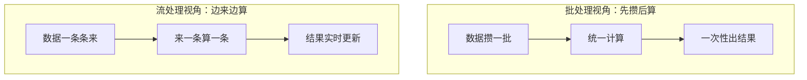
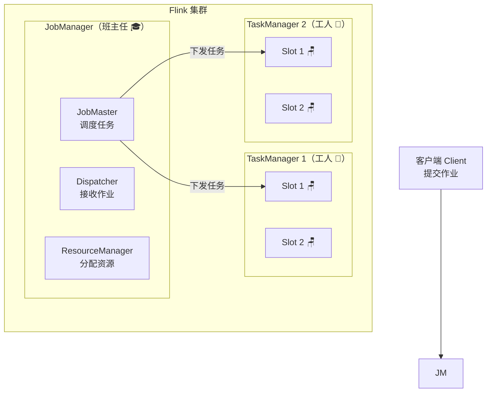
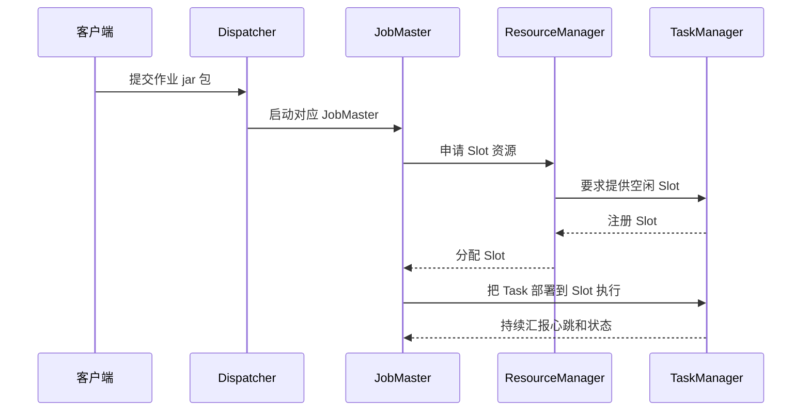
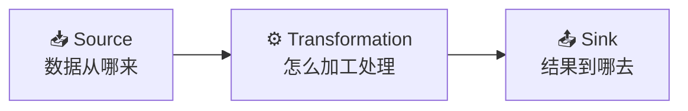
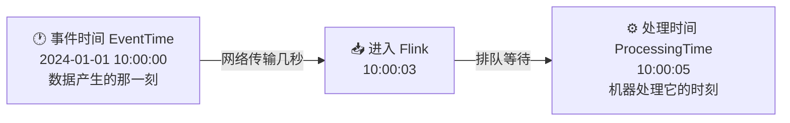
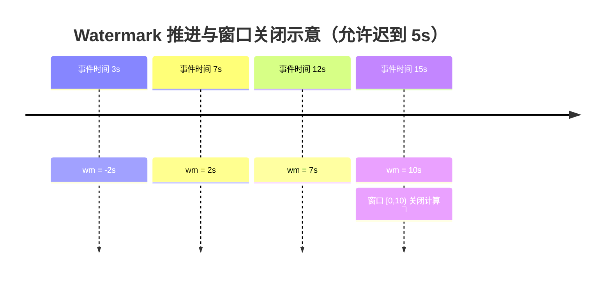
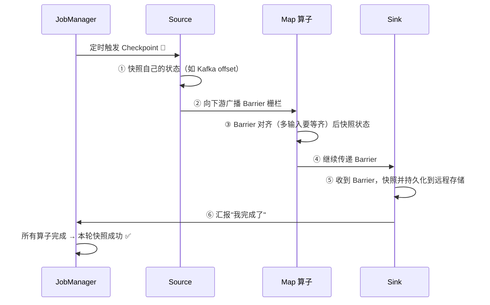
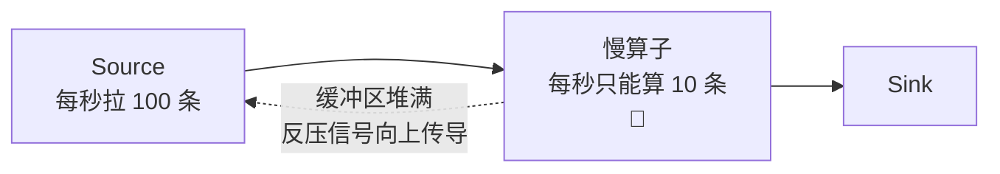
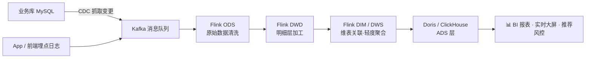
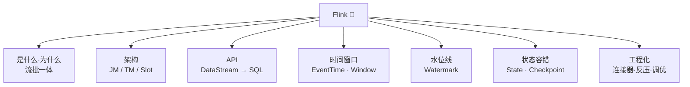

# 🌊 Flink 学习笔记

> 一句话介绍：**Flink 是一个开源的分布式流处理引擎**，专门用来对付"源源不断流过来的数据"，能做到毫秒级延迟、精确一次计算，是实时计算领域的顶流明星～✨
>
> 📌 本笔记以 **Flink 1.17+ 版本 API** 为准

---

## 📖 开篇：学习路线总览


| 章节 | 内容 | 难度 |
|------|------|------|
| 一 ~ 二 | Flink 是什么、和 Spark 比强在哪 | ⭐ |
| 三 ~ 五 | 架构、API 分层、WordCount 上手 | ⭐⭐ |
| 六 ~ 八 | 时间语义、窗口、Watermark（重难点！）| ⭐⭐⭐⭐ |
| 九 ~ 十 | 状态管理、Checkpoint 容错（面试必考！）| ⭐⭐⭐⭐ |
| 十一 ~ 十三 | SQL、连接器、反压调优 | ⭐⭐⭐ |

---

## 一、Flink 是什么？🤔

### 1.1 一句话定义

Flink 是一个**分布式、高性能、高可用、可精确一次（Exactly Once）**的开源**流处理**框架。

- 处理**无界数据流**（源源不断，没有尽头，比如订单流、日志流）是它的看家本领 💪
- 也能处理**有界数据流**（固定一批数据，比如一个历史文件）——也就是批处理

### 1.2 Flink 的看家本领 ✨

| 特性 | 通俗解释 |
|------|----------|
| 🚀 低延迟 | 毫秒级出结果，来一条算一条 |
| 🎯 高吞吐 | 每秒能处理上亿条数据 |
| 💯 Exactly Once | 故障恢复后结果不多不少刚刚好，不丢也不重 |
| ⏰ 事件时间支持 | 数据乱序、迟到都不怕，按"事件真正发生的时间"算 |
| 🔗 流批一体 | 一套代码同时搞定实时和离线 |

### 1.3 流批一体：流才是"世界观" 🌍

Flink 的设计哲学很特别：**在 Flink 眼里，万物皆流**～



> 💡 **小贴士**：Flink 认为"批"只是"流"的特例（有界流），而 Spark 认为流是微批的批。所以 Flink 做实时更纯粹，延迟更低哦～

---

## 二、为什么需要 Flink？🆚

### 2.1 Flink vs Spark vs Storm

| 对比项 | Flink | Spark Streaming | Storm |
|--------|-------|-----------------|-------|
| 计算模型 | **真·流处理**（逐条） | 微批（攒一小批） | 逐条 |
| 延迟 | **毫秒级** ⚡ | 秒级 | 毫秒级 |
| 吞吐量 | **非常高** ⚡ | 高 | 较低 |
| 事件时间支持 | ✅ 完善 | ✅ | ❌ 弱 |
| Exactly Once | ✅ 端到端 | ✅（内部） | ❌ |
| 状态管理 | ✅ 强大丰富 | ✅ | ❌ 弱 |
| 流批一体 | ✅ | ✅（但要换 API） | ❌ |
| SQL 支持 | ✅ 强大 | ✅ | ❌ |

**总结陈词** 🎀：Storm 太老了、吞吐低；Spark Streaming 延迟高；**Flink 低延迟 + 高吞吐 + 完美的事件时间语义**，所以成了实时计算的首选～

### 2.2 典型使用场景 🎯

- 🔔 实时监控告警：服务器指标异常，1 秒内报警
- 🛒 实时推荐："猜你喜欢"边逛边推
- 📊 实时数仓大屏：双十一实时成交额
- 🕵️ 实时风控：欺诈交易拦截

---

## 三、Flink 运行时架构 🏗️

### 3.1 核心组件（用班级来打比方 🎒）

| 组件 | 角色 | 通俗理解 |
|------|------|----------|
| **JobManager** | 管理节点 | 🎓 班主任：布置任务、盯进度 |
| ├─ Dispatcher | 接收作业 | 前台老师：接收作业并启动 JobMaster |
| ├─ JobMaster | 管单个作业 | 各科老师：负责自己这门课的任务调度 |
| └─ ResourceManager | 管资源 | 教务处：分配教室（Slot） |
| **TaskManager** | 工作节点 | 👷 干活的工人：真正执行计算 |
| **Slot** | 资源单位 | 🪑 工位：TM 里的一块计算资源（内存） |
| **Task** | 执行单元 | 🧵 线程：一个算子子任务就是一个 Task |



### 3.2 任务提交流程（重点！面试常考 📝）



### 3.3 并行度 & Slot & 算子链

- **并行度（Parallelism）**：一个算子同时用几个线程一起算。并行度 = 4 就是 4 个工人同时干同一件事 🏃🏃🏃🏃
- **Slot 共享**：同一个作业的不同算子可以共享一个 Slot（默认行为），所以**作业需要的 Slot 数 = 最高并行度**
- **算子链（Operator Chain）**：相邻且满足条件的算子串在一起变成一个 Task，减少线程切换和网络传输，性能 up up！📈

```java
// 设置全局并行度
env.setParallelism(4);

// 单个算子设置并行度
DataStream<String> result = stream.map(...).setParallelism(2);

// 禁用算子链 / 开始新链
stream.map(...).startNewChain();
```

---

## 四、Flink API 分层 🍰

层次越高越省心，层次越低越灵活～

| 层级 | API | 特点 | 适合场景 |
|------|-----|------|----------|
| 🥇 最上层 | **SQL / Table API** | 声明式，写 SQL 就行 | 简单统计、数仓开发 |
| 🥈 中间层 | **DataStream API**（核心） | 流式处理，功能全面 | 绝大多数业务开发 |
| 🥉 底层 | **ProcessFunction** | 能摸到时间和状态，最灵活 | 复杂逻辑、自定义处理 |

---

## 五、入门实战：WordCount 👩‍💻

经典入门程序——统计每个单词出现的次数～

### 5.1 完整代码（DataStream 版）

```java
public class WordCount {
    public static void main(String[] args) throws Exception {
        // 1️⃣ 创建执行环境
        StreamExecutionEnvironment env = StreamExecutionEnvironment.getExecutionEnvironment();
        env.setParallelism(1);

        // 2️⃣ 读取数据源（监听本地 7777 端口）
        DataStreamSource<String> lineStream = env.socketTextStream("localhost", 7777);

        // 3️⃣ 转换：拆分单词 -> 组成 (单词, 1)
        SingleOutputStreamOperator<Tuple2<String, Long>> wordAndOne = lineStream
                .flatMap((String line, Collector<String> out) -> {
                    // "hello flink" -> "hello"、"flink"
                    for (String word : line.split(" ")) {
                        out.collect(word);
                    }
                }).returns(Types.STRING)   // Lambda 需要显式声明类型哦
                .map(word -> Tuple2.of(word, 1L))
                .returns(Types.TUPLE(Types.STRING, Types.LONG));

        // 4️⃣ 分组聚合：按单词分组，对第 2 个位置累加
        wordAndOne
                .keyBy(value -> value.f0)  // 按单词分组（逻辑分区）
                .sum(1)                    // 对位置 1 累加求和
                .print();

        // 5️⃣ 触发执行（流处理必备，不写程序不会跑哦！）
        env.execute();
    }
}
```

### 5.2 Flink 程序的固定套路



| 步骤 | 说明 | 常用组件 |
|------|------|----------|
| Source 数据源 | 读取数据 | Kafka、Socket、文件、JDBC、自定义 |
| Transformation 转换 | 加工计算 | map、flatMap、filter、keyBy、reduce、聚合、join |
| Sink 输出 | 写出结果 | Kafka、MySQL、Redis、文件、print |

### 5.3 常用转换算子速查 🧰

| 算子 | 作用 | 例子 |
|------|------|------|
| `map` | 一进一出 | `"abc" -> 3`（算长度） |
| `flatMap` | 一进多出（可拆可空） | 一句话拆成多个单词 |
| `filter` | 过滤 | 只保留偶数 |
| `keyBy` | 逻辑分区（按 key 分组） | 按用户 id 分组 |
| `reduce` | 滚动聚合 | 累计求和 |
| `union` / `connect` | 合并流 | 多个流接在一起 |

---

## 六、时间语义 ⏰（重难点开始啦！）

### 6.1 三种时间

数据从产生到被处理，会经历不同的"时间视角"：



| 时间语义 | 定义 | 特点 |
|----------|------|------|
| **事件时间** EventTime | 数据**真正发生**的时间（手机上/设备上记录的） | ✅ 最准确，不受网络延迟影响；需要 Watermark 配合 |
| **处理时间** ProcessingTime | 机器**处理这条数据**时的时间 | 简单、延迟最小；但结果不准确（乱序时会算错） |

### 6.2 为什么需要事件时间？🚨

想象一下：用户 10:00:00 下单，但因为网络卡了 3 秒，数据 10:00:03 才到 Flink。

- 用处理时间算 → 这单被算进 10:00:03 的统计 ❌
- 用事件时间算 → 这单属于 10:00:00 的统计 ✅

> 🎀 **结论**：数据会乱序、会迟到，但"事件真正发生的时间"是不会变的！所以对准确性要求高的场景（实时成交额、风控），一定要用**事件时间**～

---

## 七、窗口 Window 🪟

流数据是无限的，总不能一直算下去吧？所以要"切窗口"——把无限流切成一段段有限的"小盒子"，逐盒统计📦

### 7.1 四种窗口一览

```mermaid
flowchart TB
    W["窗口 Window 🪟"] --> T["滚动窗口 Tumbling<br/>首尾相接，不重叠<br/>像铺地砖"]
    W --> S["滑动窗口 Sliding<br/>可重叠，数据会被算多次<br/>像推拉窗"]
    W --> SS["会话窗口 Session<br/>超过一段"不活跃时间"就切一刀<br/>像聊天记录分组"]
    W --> G["全局窗口 Global<br/>不切，自定义触发条件才出结果"]
```

| 窗口类型 | 切法 | 典型场景 |
|----------|------|----------|
| 滚动窗口 | 固定长度，无缝拼接 | 每分钟/每小时的销量 |
| 滑动窗口 | 固定长度 + 固定步长往前滑 | "最近 5 分钟"每 1 分钟算一次 |
| 会话窗口 | 数据间断超时自动切分 | 用户一次浏览会话的行为分析 |

> 💡 **滚动 vs 滑动一句话**：窗口长度 10s、滑动步长 5s → 每 5 秒出一个"最近 10 秒"的结果，两条窗口之间有一半数据重叠～

### 7.2 代码示例

```java
// 滚动窗口：每 10 秒统计一次
stream
    .keyBy(data -> data.user)
    .window(TumblingEventTimeWindows.of(Time.seconds(10)))
    .aggregate(new AvgAgg());

// 滑动窗口：窗口 10 秒，每 5 秒滑动一次
stream
    .keyBy(data -> data.user)
    .window(SlidingEventTimeWindows.of(Time.seconds(10), Time.seconds(5)))
    .aggregate(new SumAgg());

// 会话窗口：数据间断超过 5 秒就切一刀
stream
    .keyBy(data -> data.user)
    .window(EventTimeSessionWindows.withGap(Time.seconds(5)))
    .process(new MyProcessWindowFunction());
```

### 7.3 窗口函数：谁来计算？

| 类型 | 代表 | 特点 | 适合 |
|------|------|------|------|
| 增量聚合 | `aggregate()` / `reduce()` | 每来一条算一条，窗口关闭时输出最终值，**省内存** ⭐ | 求和、计数、均值 |
| 全窗口函数 | `process()` | 攒齐整个窗口的数据再一起算，**能拿到窗口信息**（起止时间等） | 拿 TopN、需要窗口元数据 |

> 🎀 **最佳实践**：两者可以组合使用！`aggregate(增量聚合函数, 全窗口函数)`——增量算中间结果，窗口关闭时带上窗口信息输出，又快又全～✨

### 7.4 窗口的生命周期 📋

1. **创建**：第一条属于该窗口的数据到达时创建
2. **触发计算**：Watermark（水位线）推进到 `窗口结束时间` 时触发
3. **销毁**：计算完成后窗口和状态被清理

> 敲黑板！👉 窗口关闭靠的是 **Watermark**，不是"物理上过了一段时间"，所以下一章非常重要哦～

---

## 八、Watermark 水位线 💧（灵魂章节！）

### 8.1 解决什么问题？

用事件时间 + 窗口有个大麻烦：**数据乱序**！比如窗口 [0s, 10s) 已经算完了，结果时间戳为 6s 的数据才慢悠悠赶来……

窗口该等多久才能关门？总不能一直等吧？😴

**Watermark 就是给窗口定一个"关门时间表"**：

> 当 Watermark 推进到窗口结束时间，窗口就关闭，之后的数据统统算"迟到"（可以另行补救）。

### 8.2 核心规则（必背！📝）

```
Watermark = 观察到的最大事件时间 - 允许的延迟时间
```

特性：
1. Watermark 是一条**特殊的标记**，混在数据流里跟着往前流
2. **单调递增**（只升不降）
3. Watermark 推进到哪，就代表"这之前的数据都到齐了"（的一种承诺 🤝）
4. **多输入流场景取最小值**（两条支流，短板决定水位 🪣）

### 8.3 举个例子 🌰（延迟设为 5 秒）

| 数据到达顺序 | 事件时间 | 当前最大事件时间 | Watermark = 最大 - 5s |
|:---:|:---:|:---:|:---:|
| 第 1 条 | 3s | 3s | **-2s** |
| 第 2 条 | 7s | 7s | **2s** |
| 第 3 条 | 1s（迟到的） | 7s（不变） | **2s** |
| 第 4 条 | 12s | 12s | **7s** |

- Watermark 到 **10s** 时，窗口 [0s, 10s) 关闭并计算 ✅
- 之后才到的属于 [0s, 10s) 的数据 → 迟到数据



### 8.4 代码示例

```java
DataStream<Event> stream = env.addSource(new ClickSource())
        // 分配时间戳和 Watermark
        .assignTimestampsAndWatermarks(
                // 允许 5 秒的乱序延迟
                WatermarkStrategy.<Event>forBoundedOutOfOrderness(Duration.ofSeconds(5))
                        // 从数据里提取事件时间（毫秒）
                        .withTimestampAssigner((event, ts) -> event.timestamp)
        );
```

### 8.5 迟到数据的三级补救 🛟

| 层级 | 手段 | 说明 |
|------|------|------|
| 1️⃣ | Watermark 延迟时间 | 尽量等到（兜底大部分人） |
| 2️⃣ | `.allowedLateness(Time.seconds(3))` | 窗口关闭后再等 3 秒，迟到数据**触发重新计算** |
| 3️⃣ | `.sideOutputLateData(lateTag)` | 实在太晚的数据丢进**侧输出流**，人工另行处理 |

> 🎀 记住哦：**Watermark 的时间延迟设得越长，结果越准确，但实时性越差**——准确性和时效性的权衡，要根据业务选平衡点～

---

## 九、状态 State 📦

### 9.1 为什么需要状态？

流计算不是"阅后即焚"，很多时候要**记住之前发生过的事**：
- 统计单词次数 → 得记住"hello 已经出现几次了"
- 检测连续登录失败 → 得记住"上次登录是否失败"

这些需要"记住的东西"就是**状态**，Flink 把它单独管理起来，还带自动容错哦～

### 9.2 两大类状态

| 类型 | 归属 | 通俗理解 | 典型用法 |
|------|------|----------|----------|
| **Keyed State** 键控状态 | 跟着每个 key 走 | 每个用户一个专属小账本📒 | `keyBy` 之后用 |
| **Operator State** 算子状态 | 跟着算子实例走 | 整个算子共享一个大账本 | Kafka 消费 offset 等 |

**Keyed State 的五种"账本格式"** 📔：

| 状态类型 | 存储结构 | 场景 |
|----------|----------|------|
| `ValueState` | 单值 | 记录某个用户当前积分 |
| `ListState` | 列表 | 记录最近 N 次浏览的商品 |
| `MapState` | 键值对 | 记录购物车（商品 → 数量） |
| `ReducingState` | 聚合值（来一条就合一条） | 累计求和 |
| `AggregatingState` | 聚合值（可聚合任意类型） | 计算平均值 |

```java
// 使用示例：ValueState 记录用户上次访问时间
public class MyProcessFunction extends KeyedProcessFunction<String, Event, String> {
    // 声明状态
    private ValueState<Long> lastTsState;

    @Override
    public void open(Configuration parameters) {
        // 在 open 生命周期里初始化状态
        lastTsState = getRuntimeContext().getState(
                new ValueStateDescriptor<>("last-ts", Types.LONG));
    }

    @Override
    public void processElement(Event value, Context ctx, Collector<String> out) throws Exception {
        Long lastTs = lastTsState.value();   // 读取状态
        lastTsState.update(value.timestamp); // 更新状态
        // ... 业务逻辑
    }
}
```

### 9.3 状态后端（状态存在哪？）

| 后端 | 存储位置 | 特点 | 适用 |
|------|----------|------|------|
| `HashMapStateBackend` | JVM 内存堆上 | 快，但受内存限制 | 状态小的作业 |
| `EmbeddedRocksDBStateBackend` | 本地 RocksDB（磁盘 KV 数据库） | 状态可超过内存、支持增量快照，但读写要序列化（稍慢） | 状态超大的作业 ⭐ |

```java
// 配置 RocksDB 状态后端 + 增量 Checkpoint
env.setStateBackend(new EmbeddedRocksDBStateBackend());
env.getCheckpointConfig().enableIncrementalCheckpointing(true);
```

---

## 十、容错机制：Checkpoint 💾（面试必考！）

### 10.1 Checkpoint 是什么？

**分布式快照**——定时给所有算子的状态拍个"集体照"📸 存到远程（HDFS/S3）。程序崩了？没关系，从最近的照片恢复，接着算！

- 底层基于 **Chandy-Lamport 分布式快照算法**
- 核心道具：**Barrier（屏障）**——一种特殊标记，插入数据流中随数据流动

### 10.2 快照过程（Barrier 对齐）



> 💡 **Barrier 对齐**：某个算子有两个输入时，必须等两边的 Barrier 都到齐才做快照，保证同一份数据不多不少——这正是 Exactly Once 的秘诀！

### 10.3 语义保证

| 语义 | 含义 | 代价 |
|------|------|------|
| **At Most Once** 至多一次 | 可能丢数据 | 最快但不可靠 |
| **At Least Once** 至少一次 | 不丢，但可能重复 | Barrier 不对齐，稍快 |
| **Exactly Once** 精确一次 | 不丢不重 ✅ | Barrier 对齐，默认推荐 |

> 🎀 划重点：Flink 内部的 Exactly Once 只管自己内部，想**端到端精确一次**还需要：Source 可重放（如 Kafka）+ Sink 事务支持（如 Kafka 事务、两阶段提交 2PC）～

### 10.4 代码配置

```java
// 每 60 秒做一次 Checkpoint，精确一次语义
env.enableCheckpointing(60000, CheckpointingMode.EXACTLY_ONCE);

env.getCheckpointConfig()
    .setCheckpointTimeout(60000)                 // 超时时间
    .setMinPauseBetweenCheckpoints(30000)        // 两次之间的最小间隔
    .setCheckpointStorage("hdfs:///flink/ckpt")  // 存储位置
    .setExternalizedCheckpointCleanup(
            CheckpointConfig.ExternalizedCheckpointCleanup.RETAIN_ON_CANCELLATION);

// 从指定 Checkpoint 恢复
StreamExecutionEnvironment env = StreamExecutionEnvironment.getExecutionEnvironment();
env.setRestartStrategy(RestartStrategies.fixedDelayRestart(3, Time.seconds(10)));
```

### 10.5 Checkpoint vs Savepoint

| 对比 | Checkpoint | Savepoint |
|------|------------|-----------|
| 触发方式 | 自动定时 🤖 | 手动触发 ✋ |
| 主要目的 | 故障自动恢复 | 升级、迁移、A/B 测试 |
| 格式 | 轻量，可能不严格兼容 | 标准格式，跨版本兼容性好 |
| 命令 | 自动 | `flink savepoint <jobId>` |

---

## 十一、Flink SQL / Table API 🪄

声明式开发：**写 SQL 就能做实时计算**！业务同学狂喜 😍

### 11.1 建表 + 查询一条龙

```sql
-- 1️⃣ 创建 Kafka 数据源表
CREATE TABLE orders (
    user_id BIGINT,
    amount  DOUBLE,
    ts      AS TO_TIMESTAMP(FROM_UNIXTIME(order_time / 1000)),
    WATERMARK FOR ts AS ts - INTERVAL '5' SECOND   -- 水位线也能 SQL 里写！
) WITH (
    'connector' = 'kafka',
    'topic' = 'orders',
    'properties.bootstrap.servers' = 'localhost:9092',
    'properties.group.id' = 'my-group',
    'scan.startup.mode' = 'latest-offset',
    'format' = 'json'
);

-- 2️⃣ 每 5 秒统计一次各用户消费总额（滚动窗口）
SELECT
    user_id,
    SUM(amount)          AS total_amount,
    TUMBLE_END(ts, INTERVAL '5' SECOND) AS win_end
FROM orders
GROUP BY user_id, TUMBLE(ts, INTERVAL '5' SECOND);
```

### 11.2 常用窗口函数（SQL 版）

| 语法 | 对应窗口 |
|------|----------|
| `TUMBLE(ts, INTERVAL '5' SECOND)` | 滚动窗口 |
| `HOP(ts, INTERVAL '5' SECOND, INTERVAL '10' SECOND)` | 滑动窗口（步长5s，窗口10s） |
| `SESSION(ts, INTERVAL '10' SECOND)` | 会话窗口 |
| `OVER (PARTITION BY ... ORDER BY ts ...)` | Over 窗口（TopN 神器） |

### 11.3 核心概念：动态表 & 回撤流

> 🎀 流是无穷的，SQL 怎么查询"无限"的表呢？
>
> Flink 的答案是**动态表（Dynamic Table）**：把流映射成一张会不断增长的表；查询它得到的结果表也会不断变化，把变化输出出去就是"回撤流"（Retract Stream）——
>
> 简单说：**上游来了新数据，之前发过的结果可能要"收回重发"**，下游要能处理这种"改口"才行哦～（比如 `+U(10)` 更新、`-D` 撤回）

---

## 十二、常用连接器 Connector 🔌

### 12.1 Kafka（最常用，必会！）

```java
// ✅ Source：从 Kafka 读
KafkaSource<String> source = KafkaSource.<String>builder()
        .setBootstrapServers("localhost:9092")
        .setTopics("clicks")
        .setGroupId("my-group")
        .setStartingOffsets(OffsetsInitializer.latest())
        .setValueOnlyDeserializer(new SimpleStringSchema())
        .build();

DataStream<String> stream = env.fromSource(
        source, WatermarkStrategy.noWatermarks(), "kafka-source");

// ✅ Sink：往 Kafka 写
KafkaSink<String> sink = KafkaSink.<String>builder()
        .setBootstrapServers("localhost:9092")
        .setRecordSerializer(KafkaRecordSerializationSchema.builder()
                .setTopic("result")
                .setValueSerializationSchema(new SimpleStringSchema())
                .build())
        // 至少一次；配事务可实现端到端精确一次
        .setDeliveryGuarantee(DeliveryGuarantee.AT_LEAST_ONCE)
        .build();

stream.sinkTo(sink);
```

### 12.2 其他常见连接器

| 连接器 | 用途 |
|--------|------|
| JDBC | 读写 MySQL、PostgreSQL 等 |
| Redis | 缓存维表、写结果 |
| Elasticsearch | 写检索结果 |
| CDC（`flink-connector-mysql-cdc`） | 直接抓数据库变更（实时同步神器 🚀） |
| Pulsar / Kinesis | 消息队列 |

---

## 十三、反压 Backpressure 与调优 🚦

### 13.1 反压是什么？

下游处理太慢，数据在上游缓冲区里越堆越多，压力像波浪一样**逆着数据流向上游传导**——这就是反压 😤



**好处**：反压其实是 Flink 的自我保护机制（避免 OOM 被撑死）
**坏处**：说明有瓶颈，数据延迟飙升 ⚠️

### 13.2 排查思路 🔍

1. Flink Web UI → 找到**红色（BackPressured）**的算子
2. 常见原因：
   - 下游外部系统慢（写 MySQL 太慢、Kafka 分区不足）
   - 算子逻辑重（正则、频繁 GC）
   - 数据倾斜（个别 key 数据量爆炸 💥）
   - 并行度设置不合理

### 13.3 调优清单 ✅

| 手段 | 说明 |
|------|------|
| 提高并行度 | 让更多工人一起干（先确认不是倾斜问题） |
| 解决数据倾斜 | key 加盐打散、两阶段聚合（局部聚合 + 全局聚合） |
| 换 RocksDB + 增量 Checkpoint | 大状态作业必备 |
| 异步 IO 查维表 | `AsyncFunction` 并发查外部库，别傻等 |
| 对象重用 | `env.getConfig().enableObjectReuse()` 减少序列化 |
| 合理的 Watermark 延迟 | 别为了极端准确把延迟设太大 |

---

## 十四、典型应用：实时数仓 🏢

用 Flink 搭建的实时链路长这样（面试聊架构必备～）：



---

## 十五、面试高频考点速查 🎯

| 问题 | 答题要点 |
|------|----------|
| Flink 和 Spark 的区别？ | 真流 vs 微批；毫秒 vs 秒级延迟；事件时间更完善；流批一体 |
| 说下 Flink 架构？ | JobManager（Dispatcher/JobMaster/RM）+ TaskManager + Slot；提交流程 |
| Watermark 是什么？ | 最大事件时间 - 延迟；单调递增；多流取最小；推进到窗口结束时间触发计算 |
| 数据迟到了怎么办？ | 三板斧：Watermark 延迟 → allowedLateness → 侧输出流 |
| Checkpoint 原理？ | Chandy-Lamport 快照；Barrier 对齐；持久化到远程；故障时从快照恢复 |
| Exactly Once 怎么保证？ | 内部：Barrier 对齐；端到端：可重放 Source + 事务 Sink（2PC） |
| Keyed State 和 Operator State 区别？ | 按 key 隔离 vs 按算子实例共享；Keyed 有五种类型 |
| Checkpoint 和 Savepoint 区别？ | 自动 vs 手动；恢复用 vs 升级迁移用；兼容性不同 |
| 反压怎么排查处理？ | Web UI 定位红色算子 → 查外部依赖/倾斜/并行度 |
| 数据倾斜怎么解决？ | 加盐打散、两阶段聚合（LocalKeyBy） |

---

## 十六、结语 🌸

Flink 的知识树就是这样的：



> 🎀 学习建议：
> 1. 先把 **时间语义 + 窗口 + Watermark** 这条主线吃透（Flink 的灵魂！）
> 2. 再搞懂 **State + Checkpoint**（生产环境和面试的重灾区）
> 3. 最后用 **Kafka + Flink SQL** 撸一个小项目（比如实时词频统计、实时大屏），肌肉记忆就形成啦～
>
> 坚持就是胜利，冲鸭！💪(๑•̀ㅂ•́)و✧
