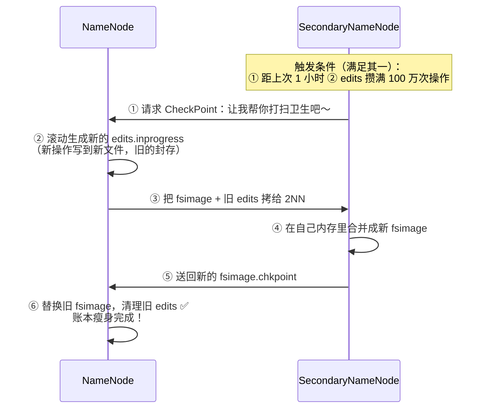
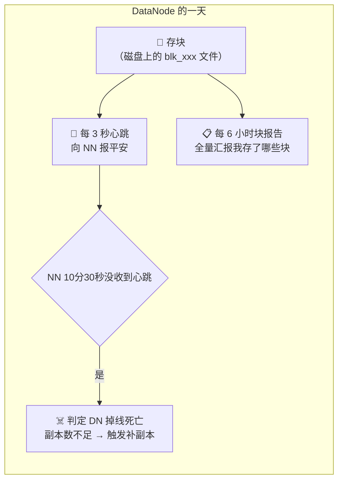
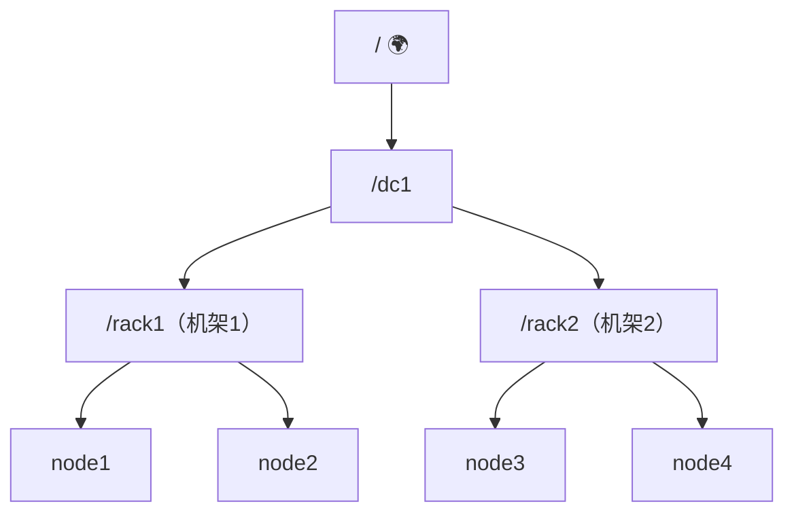
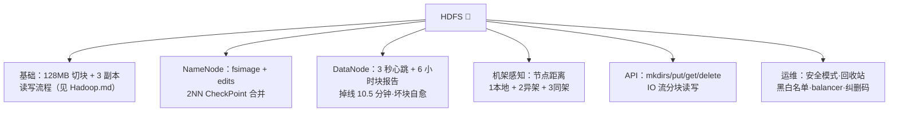

# 📁 HDFS 深度学习笔记

> 一句话介绍：**HDFS（Hadoop Distributed File System）= 一个"多台机器拼起来的超大硬盘"**，专门存大文件、不怕机器坏、一次写入多次读取～
>
> 📌 本篇是 **HDFS 专项深入版**：基础架构篇见 [Hadoop.md](./Hadoop.md) 第三章，本篇聚焦 **NameNode 元数据、DataNode 管理、机架感知、Java API、运维急救包** 等进阶内容～
>
> 🎯 适合：已经看过 Hadoop 基础篇，想把 HDFS 吃得更透的同学！

---

## 📖 开篇：学习路线总览


| 章节 | 内容 | 难度 |
|------|------|------|
| 一 | HDFS 一图流回顾 | ⭐ |
| 二 | NameNode：元数据的一生（面试高频！）| ⭐⭐⭐⭐ |
| 三 | DataNode：数据块的一生 | ⭐⭐⭐ |
| 四 | 节点距离 & 副本放置（机架感知）| ⭐⭐⭐ |
| 五 | Java API 实战 | ⭐⭐ |
| 六 | 运维急救包：安全模式/回收站/扩缩容/纠删码 | ⭐⭐⭐ |

---

## 一、一分钟回顾 HDFS 🍵

```mermaid
flowchart TB
    F["大文件 video.mp4 (300MB)"] -->|"切块 Block 128MB"| B1["blk_1 (128MB)"]
    F --> B2["blk_2 (128MB)"]
    F --> B3["blk_3 (44MB)"]
    B1 --> R["每块 3 副本<br/>分散在不同 DataNode 🛡️"]
    B2 --> R
    B3 --> R
    NN["📜 NameNode：只记"哪块在哪"的账本<br/>（元数据，在内存）"]
    DN["🏠 DataNode：真正存块的仓库管理员"]
```

| 关键词 | 记住这一句 |
|--------|-----------|
| Block 块 | 默认 **128MB**，太大太小都不好 |
| 副本 | 默认 **3 份**，坏一台机器不丢数据 |
| NameNode | 管账本（元数据），不碰真实数据 |
| DataNode | 存数据 + 每 **3 秒**心跳汇报"我还活着" |

---

## 二、NameNode 深挖：元数据的一生 📜（面试高频！）

### 2.1 NN 里到底存了什么？

> 🎀 NameNode 的内存里放着一张**目录树**，树上每个文件/文件夹是一个 **INode**，每个文件还挂着自己的**块列表 + 每个块存在哪些 DN 上**～

| 元数据类型 | 举例 | 特点 |
|-----------|------|------|
| 自身属性 | 文件名、权限、修改时间 | 修改频率低 |
| 块信息 | 文件 → 块列表 → DN 列表 | **DN 汇报动态更新**（块报告）|

> ⚠️ 注意：**块 → DN 的映射不在磁盘上**！因为 DN 挂了/加了都会变，靠 DN 的"块报告（默认每 6 小时全量 + 实时增量上报）"在内存里重建～

### 2.2 fsimage 和 edits：账本的两层设计 💡

**痛点**：元数据在内存，断电就没了 😱；而且每次增删改都直接写磁盘 fsimage，太慢了！

**HDFS 的方案（很像 Redis 的 RDB + AOF 哦～）**：

| 文件 | 作用 | 类比 |
|------|------|------|
| `fsimage` | 全量快照：某一时刻的完整账本 | 📸 照片 |
| `edits` | 追加日志：快照之后的每次增删改 | 🎬 录像 |

NN 启动时 = **fsimage（加载） + edits（回放）** = 恢复最新账本 ✅

### 2.3 SecondaryNameNode 的 CheckPoint 合并流程 🧹

edits 会越滚越大，回放越来越慢 → **2NN 定期帮 NN 合并瘦身**：



> ⚠️ **再强调一遍（经典坑）**：2NN **不是** NN 的热备！它只是定期"打扫"的保洁阿姨 🧹。NN 想要真正的备份 → 上 **HA（主备 NameNode）**！

### 2.4 实用工具：查看 fsimage / edits 🛠️

```bash
# 查看（二进制文件不能直接 cat，要用官方工具转成 XML）
hdfs oiv -p XML -i fsimage_0000000000000000012 -o /tmp/fsimage.xml
hdfs oev -p XML -i edits_inprogress_0000000000000000023 -o /tmp/edits.xml
```

| 工具 | 看什么 |
|------|--------|
| `oiv`（offline image viewer） | fsimage：目录树、每个文件的块信息 |
| `oev`（offline edits viewer） | edits：每一步操作（OP_ADD、OP_RENAME、OP_SET_PERMISSION…）|

### 2.5 相关参数（调优会问 💡）

| 参数 | 默认值 | 说明 |
|------|--------|------|
| `dfs.namenode.checkpoint.period` | 3600s | CheckPoint 间隔 |
| `dfs.namenode.checkpoint.txns` | 100 万 | edits 攒满多少次操作触发 |
| `dfs.namenode.name.dir` | —— | fsimage 存储目录（可配多目录实现隔离备份）|

---

## 三、DataNode：数据块的一生 🏠

### 3.1 DN 的工作日常



**掉线时限怎么算的？**（面试可能追问 🤔）

```
2 × (dfs.namenode.heartbeat.recheck-interval 默认 5 分钟 + 10 × 心跳 3 秒)
= 2 × (300 + 30) = 630 秒 = 10 分 30 秒
```

### 3.2 数据完整性：块坏了吗？🔍

- DN **读块时算校验和（CRC）**，写块时生成校验和
- 若读到的块校验不匹配 → 判定**坏块** → 向别的副本要一份**修复**
- NN 发现某块副本数不足 → 自动让某个 DN **补拷贝**，始终保持 3 份 🛡️

### 3.3 集群扩容 / 缩容（服役 & 退役）🚪

**➕ 添加新节点（超简单）**：

```bash
# 1. 新机器装好 Hadoop，配好 SSH 免密
# 2. 在新机器上只启动 DataNode
hdfs --daemon start datanode
yarn --daemon start nodemanager
# 3. 数据不均衡？跑一下均衡器（threshold 越小越均匀，默认 10%）
start-balancer.sh -threshold 10
```

**➖ 退役旧节点（不能直接关机！数据会丢副本！）**：

| 步骤 | 操作 |
|------|------|
| ① 配置白名单 | `dfs.hosts` = worker 白名单列表（在名单内才允许连 NN）|
| ② 配置黑名单 | `dfs.hosts.exclude` = 要退役的节点列表 |
| ③ 刷新 | `hdfs dfsadmin -refreshNodes` |
| ④ 效果 | 黑名单节点进入 **DECOMMISSIONING**：NN 让它把块**搬给别人**，搬完变 **DECOMMISSIONED** |
| ⑤ 收尾 | 关闭该节点进程，从 workers 文件删除 |

> 🎀 一句话：**上线一键启动，下线先"交接工作"再走人**～

---

## 四、节点距离 & 副本放置（机架感知）🧭

### 4.1 节点距离：怎么算"远近"？

> 距离 = 两个节点到**最近共同祖先**的**距离之和**（数经过的"台阶"数）



| 两台节点 | 计算过程 | 距离 |
|----------|----------|:---:|
| node1 vs node2 | 共同祖先是 rack1：1+1 | **2**（同机架）|
| node1 vs node3 | 共同祖先是 dc1：2+2 | **4**（跨机架）|
| node1 vs node1 | 自己 | **0** |

### 4.2 写数据的副本存放策略（默认 3 副本）📦

| 副本 | 放哪 | 为什么 |
|------|------|--------|
| 第 1 份 | **客户端所在节点**（客户端在集群外则随机挑一台不太忙/不太满的）| 就近写入，最快 ⚡ |
| 第 2 份 | 与第 1 份**不同机架**的随机节点 | 防止整个机架断电 😨 |
| 第 3 份 | 与第 2 份**同机架**的另一台节点 | 折中：既有多样性，又不跨机架传两次 |

> 🎀 **取舍的艺术**：全放同机架 → 快但机架炸了全没；全放不同机架 → 安全但网络开销大。HDFS 选择了"2 份一伙 + 1 份异地"的平衡方案～

---

## 五、Java API 实战 👩‍💻

### 5.1 环境准备 & 获取文件系统

```java
public class HdfsClient {
    public static FileSystem getFs() throws Exception {
        URI uri = new URI("hdfs://hadoop102:8020");   // NN 的 rpc 地址（3.x 是 8020）
        Configuration conf = new Configuration();
        String user = "atguigu";
        return FileSystem.get(uri, conf, user);
    }
}
```

### 5.2 常用操作全家桶 🧰

```java
FileSystem fs = getFs();

// ① 创建目录（递归，幂等）
fs.mkdirs(new Path("/xiyouji/huaguoshan"));

// ② 上传：本地 → HDFS（delSrc=是否删源文件, overwrite=是否覆盖）
fs.copyFromLocalFile(false, true,
        new Path("d:/sunwukong.txt"), new Path("/xiyouji/huaguoshan"));

// ③ 下载：HDFS → 本地（useRawLocalFileSystem=是否开启本地校验）
fs.copyToLocalFile(false, new Path("/xiyouji/huaguoshan/sunwukong.txt"),
        new Path("d:/"), false);

// ④ 删除（recursive=true 才能删文件夹）
fs.delete(new Path("/xiyouji"), true);

// ⑤ 改名 / 移动
fs.rename(new Path("/a.txt"), new Path("/b.txt"));

// ⑥ 查看文件详情：名字、权限、长度、块信息、副本、所在位置
RemoteIterator<LocatedFileStatus> files = fs.listFiles(new Path("/"), true);
while (files.hasNext()) {
    LocatedFileStatus f = files.next();
    System.out.println(f.getPath() + " " + f.getLen() + " " + f.getReplication());
    BlockLocation[] blks = f.getBlockLocations();  // 每个块在哪些 DN 上
    for (BlockLocation blk : blks) {
        System.out.println("  块偏移:" + blk.getOffset()
                + " 在:" + Arrays.toString(blk.getHosts()));
    }
}

// ⑦ 判断是文件还是文件夹
FileStatus[] statuses = fs.listStatus(new Path("/"));
for (FileStatus s : statuses) {
    System.out.println((s.isFile() ? "📄 " : "📁 ") + s.getPath().getName());
}

fs.close();
```

### 5.3 IO 流方式读写（更底层，面试加分 ✨）

```java
// 用 IO 流实现：把本地文件"边读边写"到 HDFS（大文件可控性强）
FSDataOutputStream out = fs.create(new Path("/bigfile.zip"));
FileInputStream in = new FileInputStream("d:/bigfile.zip");
IOUtils.copyBytes(in, out, 1024, true);   // 1KB 缓冲，最后自动关流

// 分块读取：seek 定位到某位置（模拟下载分片/断点续传）
FSDataInputStream in = fs.open(new Path("/input/hadoop.tar.gz"));
in.seek(128 * 1024 * 1024);   // 跳到第 2 块的位置
FileOutputStream out = new FileOutputStream("d:/part2");
IOUtils.copyBytes(in, out, 1024, true);
```

> 💡 **小贴士**：`copyFromLocalFile` 是"成品 API"，IO 流方式是"手动挡"——理解了手动挡，分片下载、断点续传的原理就懂啦～

### 5.4 参数优先级（一个小坑 🕳️）

代码里设置 > `ClassPath` 下的配置文件 > 服务器上的配置文件：

```java
// 代码里临时改副本数，优先级最高
conf.set("dfs.replication", "2");
```

---

## 六、运维急救包 🚑

### 6.1 安全模式 SafeMode 🛡️

NN 启动时先"半营业"：只读不写，等 DN 的块报告凑齐（可达副本 / 期望副本 ≥ 阈值，默认 **0.999**）才自动退出～

```bash
hdfs dfsadmin -safemode get    # 查看状态
hdfs dfsadmin -safemode enter  # 手动进入（维护时用）
hdfs dfsadmin -safemode leave  # 手动退出
```

> ⚠️ 报错 **"Name node is in safe mode"** 就是它啦！一般等一会儿就好；总退不出去多半是丢了太多副本（比如暴力下线过节点）～

### 6.2 回收站 Trash 🗑️

```bash
# 默认 0（直接删，不进回收站！）想开启去 core-site.xml 配：
# fs.trash.interval = 1440   （保留 1440 分钟 = 1 天）

hdfs dfs -rm /a.txt            # 配置开启后：移入回收站
hdfs dfs -mv /.Trash/Current/a.txt /   # 反悔：捞回来！
hdfs dfs -expunge              # 清空回收站
```

### 6.3 常见报错排查表 🔧

| 报错/现象 | 原因 | 急救 |
|-----------|------|------|
| `Name node is in safe mode` | NN 启动中 / 副本缺失过多 | 等待；排查丢失副本原因；`safemode leave` 临时解 |
| 上传报 `Could only be replicated to 0 nodes` | 可用 DN 数 < 副本数 | 检查 DN 存活、磁盘是否写满、防火墙 |
| DN 全部离线但 NN 判定慢 | 掉线时限 10.5 分钟 | 调 `heartbeat.recheck-interval`，别手滑调太小 |
| Web UI 显示 DataNodes 少了 | 白名单没包含新节点 | 检查 `dfs.hosts` + `-refreshNodes` |
| 集群数据忽多忽少不均 | 新旧节点磁盘占用差异大 | `start-balancer.sh -threshold 10` |
| 小文件太多 NN 内存告急 | 每个小文件占元数据 | HAR 归档 / SequenceFile 合并 / 纠删码 |

### 6.4 Hadoop 3.x 新特性：纠删码 EC 🧮

> 传统 3 副本 = **3 倍存储成本** 💸；纠删码（Erasure Coding）= 用"数学冗余"代替"整份拷贝"：

| 方案 | 存储 | 容错 | 适合 |
|------|------|------|------|
| 3 副本 | 300%（1TB 数据占 3TB） | 坏 2 台不丢 | 热数据、频繁读 ⚡ |
| 纠删码 RS(6,3) | 150%（6 份数据 + 3 份校验） | 坏 3 块可恢复 | **冷数据**（不常访问的归档）✅ |

```bash
# 3.x 为目录启用纠删码策略
hdfs ec -addPolicies -policyFile ec-policy.xml
hdfs ec -setPolicy -path /colddata -policy RS-6-3-1024k
```

---

## 七、面试高频考点速查 🎯

| 问题 | 答题要点 |
|------|----------|
| fsimage 和 edits 区别？ | 全量快照 vs 追加日志；NN 启动 = fsimage + 回放 edits |
| 2NN 的工作流程？ | 触发（1h/100万次）→ NN 滚动 edits → 拷给 2NN 合并 → 送回替换 |
| 2NN 是 NN 备份吗？ | ❌！只是合并元数据减负；真备份要上 HA |
| 块位置信息为什么不落盘？ | DN 动态上下线，靠块报告在内存中重建 |
| DN 掉线判定时间？ | 2 × (recheck 300s + 10 × 3s) = **10 分 30 秒** |
| 坏块怎么处理？ | 校验和检测 → 从其他副本复制修复 → 补足副本数 |
| 节点距离怎么算？ | 到最近共同祖先的距离之和；同机架 2、跨机架 4 |
| 副本放置策略？ | 第 1 份客户端本机 → 第 2 份异机架 → 第 3 份同第二机架 |
| 怎么退役节点？ | 黑名单 + `-refreshNodes` → DECOMMISSIONING 交接数据 → 退出 |
| 安全模式是什么？ | 启动时只读保护，块报告达标（0.999）自动退出 |
| 怎么省存储成本？ | 冷数据用纠删码（RS-6-3 只要 150% 存储）|
| HDFS 怎么保证数据不丢？ | 3 副本 + 校验和 + 心跳掉线检测 + 自动补副本（多层保险 🛡️）|

---

## 八、结语 🌸

HDFS 的知识树收好啦：



> 🎀 学习建议：
> 1. **fsimage/edits/2NN 这条元数据线**是 HDFS 面试的"送分题"，把 2NN 流程图背下来～
> 2. 掉线时限 **10 分 30 秒** 的计算公式要会推，追问率很高哦！
> 3. Java API 里重点体会 **IO 流 + seek 的分块读**，这是理解分布式文件读取的钥匙 🔑
>
> 存储搞定（HDFS）→ 计算搞定（MapReduce/Spark/Flink）→ 大数据三件套就集齐啦，冲鸭！💪(๑•̀ㅂ•́)و✧
