# 🐘 Hadoop 学习笔记

> 一句话介绍：**Hadoop 是大数据的"开山鼻祖"**，一个允许用普通廉价服务器存储和计算海量数据的分布式系统平台。它解决两个核心问题：**海量数据存哪（HDFS）+ 海量数据怎么算（MapReduce + YARN）**✨
>
> 📌 本笔记以 **Hadoop 3.x** 为主，涉及 2.x 差异会特别标注～

---

## 📖 开篇：学习路线总览


| 章节 | 内容 | 难度 |
|------|------|------|
| 一 ~ 二 | 大数据为什么难、Hadoop 三大件 | ⭐ |
| 三 | HDFS 原理 + 读写流程（面试必考！）| ⭐⭐⭐⭐ |
| 四 | MapReduce + Shuffle（重难点！）| ⭐⭐⭐⭐ |
| 五 | YARN 架构与提交流程（面试必考！）| ⭐⭐⭐⭐ |
| 六 ~ 八 | HA 高可用、常用命令、生态圈 | ⭐⭐⭐ |

---

## 一、为什么需要 Hadoop？🤔

### 1.1 数据大到一台机器装不下了！

一家公司每天产生几十 TB 的日志，问题就来了：

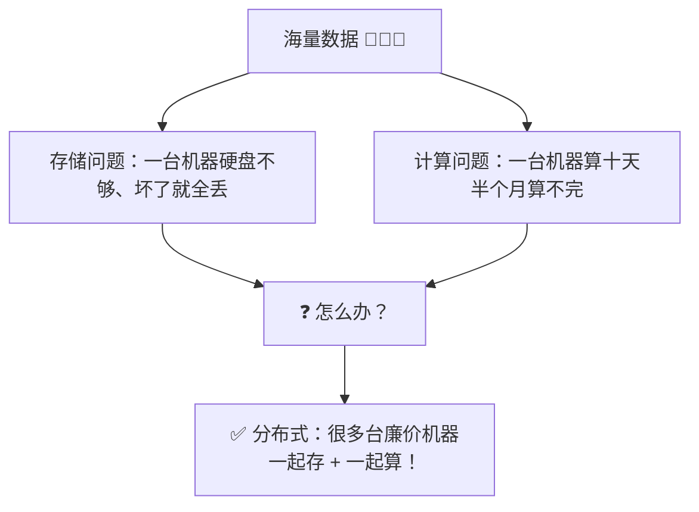

> 🎀 **核心思想一句话**：既然一台机器搞不定，那就把数据**切碎了分给一堆便宜机器**，让它们各存一点、各算一点，最后把结果汇总～这就是"分而治之"！

| 方案 | 说明 | 缺点 |
|------|------|------|
| 垂直扩展 | 换更牛的服务器（内存加满、CPU 拉满） | 贵 💸、有物理上限、单点故障 |
| **水平扩展** ⭐ | 加更多普通机器 | 需要分布式系统协调 → Hadoop 登场！ |

### 1.2 Hadoop 三大组件（铁三角 📐）

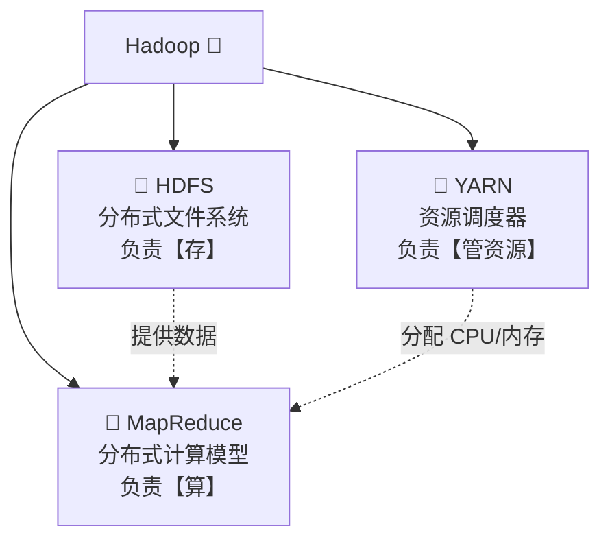

| 组件 | 全称 | 一句话职责 | 通俗理解 |
|------|------|-----------|----------|
| **HDFS** | Hadoop Distributed File System | 海量数据分布式存储 | 🏦 大仓库 |
| **MapReduce** | —— | 海量数据分布式计算 | 👷 分工干活的流程 |
| **YARN** | Yet Another Resource Negotiator | 集群资源统一调度 | 🎓 包工头/物业 |

---

## 二、Hadoop 全景认知 🗺️

### 2.1 发展小历史 📜

| 时间 | 大事记 |
|------|--------|
| 2003~2004 | Google 发表三篇论文：GFS、MapReduce、BigTable（"三驾马车"） |
| 2006 | Doug Cutting 基于 GFS/MapReduce 论文做出开源版 → **Hadoop 诞生** |
| 2011 | Hadoop 1.x：HDFS + MapReduce（计算调度耦合在一起，问题多多） |
| 2012 | Hadoop 2.x：**引入 YARN**，计算与资源分离（里程碑！），支持 HA |
| 2017 | Hadoop 3.x：端口变更、纠删码、支持多 NameNode |

### 2.2 HDFS、YARN、MapReduce 的关系

> 🎀 打个比方：开一家大餐厅 🍽️
> - **HDFS** = 仓库（食材都放这里）
> - **YARN** = 排班经理（决定谁用几个灶台）
> - **MapReduce** = 一套做菜流程（切菜 → 炒菜 → 摆盘）
>
> 现在 MapReduce 已经被 Spark/Flink 取代了，但 **HDFS 和 YARN 依然是很多集群的"水电煤"基础设施**～

---

## 三、HDFS：分布式文件系统 📁（重头戏！）

### 3.1 设计思路：切块 + 复制 ✂️

一个 1TB 的大文件怎么存到 100 台机器上？

1. **切块（Block）**：文件被切成固定大小的块，默认 **128MB**/块（老版本 64MB）
2. **多副本**：每块默认存 **3 份**，分散在不同机器甚至不同机架上 🛡️

| 设计点 | 值 | 为什么 |
|--------|-----|--------|
| 块大小 | 128MB | 太小 → 元数据爆炸；太大 → 传输时间太长、Map 任务太少 |
| 副本数 | 3（2.x）/ 3（3.x 可配） | 机器坏了也不丢数据（1 份本机、1 份同机架、1 份跨机架）|

> 💡 **副本放置策略（机架感知）**：第 1 份写在本机（或写入节点），第 2 份放在**不同机架**的节点，第 3 份放在第 2 份**相同机架**的另一个节点——兼顾容灾和网络开销～

### 3.2 HDFS 架构：主从结构 🏰

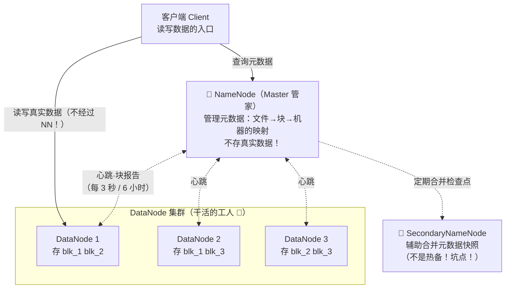

| 角色 | 职责 | 关键点 |
|------|------|--------|
| **NameNode（NN）** | 管元数据（目录树、每个块在哪台机器）、响应客户端请求 | 元数据放**内存**里；单点问题 → 需要 HA |
| **DataNode（DN）** | 存真实数据块；定时向 NN 发心跳、块报告 | 数据在磁盘上 |
| **SecondaryNameNode（2NN）** | 定期把 NN 的 fsimage + edits 合并成新快照 | ⚠️ **不是 NameNode 的备份**！只是"保洁阿姨"帮忙打扫 |

**NN 元数据的两个文件** 📝：

| 文件 | 内容 | 特点 |
|------|------|------|
| `fsimage` | 元数据的**完整快照** | 启动时加载到内存 |
| `edits` | 增量**操作日志**（追加写） | 断电不丢；越滚越大 → 2NN 定期来合并瘦身 |

### 3.3 HDFS 写数据流程（面试必考！🔥）

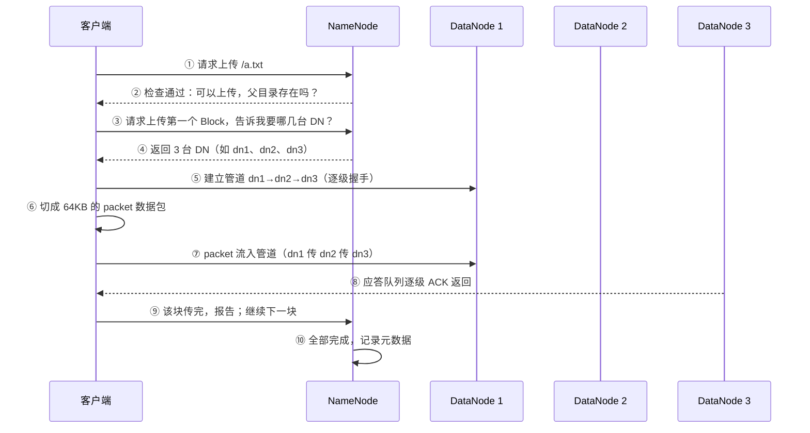

> 💡 **记住三个细节**：
> 1. 数据传输用的是 **pipeline 管道**，一条龙向后传，不是客户端发 3 遍
> 2. 客户端和 DN 之间以 **64KB 的 packet** 为单位流动
> 3. 传完一块，客户端向 NN 汇报，再请求下一块的位置

### 3.4 HDFS 读数据流程 📖

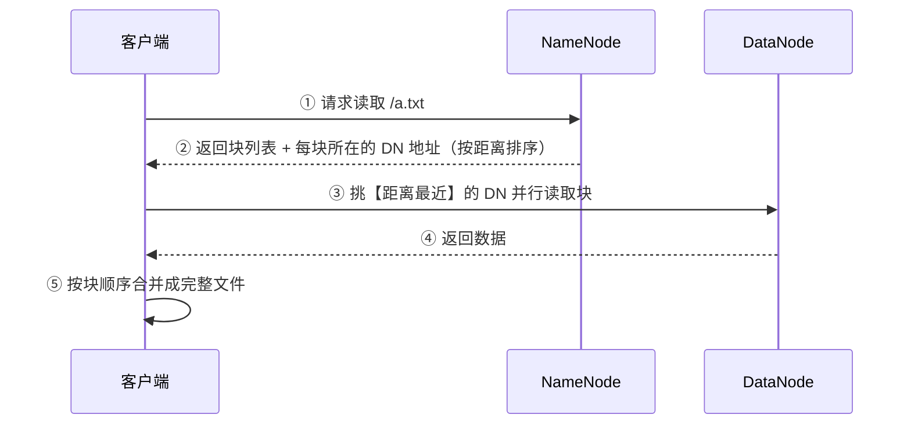

> 🎀 **就近原则**：HDFS 会计算"拓扑距离"，优先从**同一节点 > 同机架 > 跨机架**的 DN 读数据，省带宽又快～

### 3.5 常用 Shell 命令 🧰

```bash
# 上传：-put / -copyFromLocal（本地 → HDFS）
hdfs dfs -put ./word.txt /input

# 下载：-get / -copyToLocal（HDFS → 本地）
hdfs dfs -get /input/word.txt ./

# 追加一个文件到已有文件末尾
hdfs dfs -appendToFile ./b.txt /input/word.txt

# 查看
hdfs dfs -ls /input            # 列目录
hdfs dfs -cat /input/word.txt  # 看内容
hdfs dfs -du -h /              # 看空间占用

# 创建/删除/移动
hdfs dfs -mkdir /output
hdfs dfs -rm -r /output
hdfs dfs -mv /input/a.txt /output/

# 设置副本数
hdfs dfs -setrep 2 /input/word.txt
```

### 3.6 HDFS 优缺点 & 小文件问题 ⚠️

| ✅ 优点 | ❌ 缺点 |
|--------|--------|
| 高容错（多副本，自动故障转移） | 不适合**低延迟**访问（毫秒级请用 HBase/Redis） |
| 适合**大文件**存储 | **大量小文件**是灾难：每个文件都占 NN 内存元数据，128MB 的块存 1KB 文件也占 1 份元数据 |
| 可跑在廉价机器上 | 不支持**并发写**、不支持**随机修改**（只能追加） |

> 💡 **小文件治理**：合并成 SequenceFile / HAR 归档 / 升级到支持纠删码的 3.x；上游源头控制（Kafka 攒批写入）～

---

## 四、MapReduce：分布式计算模型 🧮

### 4.1 核心思想：分而治之 ✂️➕

> 🎀 把"数 1 亿本书里的错别字"分给 100 个人：
> - **Map 阶段**：每人分一小堆书，各自数出"错字 → 次数"
> - **Reduce 阶段**：把所有人结果**汇总合并**
>
> 就这么朴素！这就是 MapReduce～

### 4.2 完整流程（8 个步骤，面试高频 🔥）

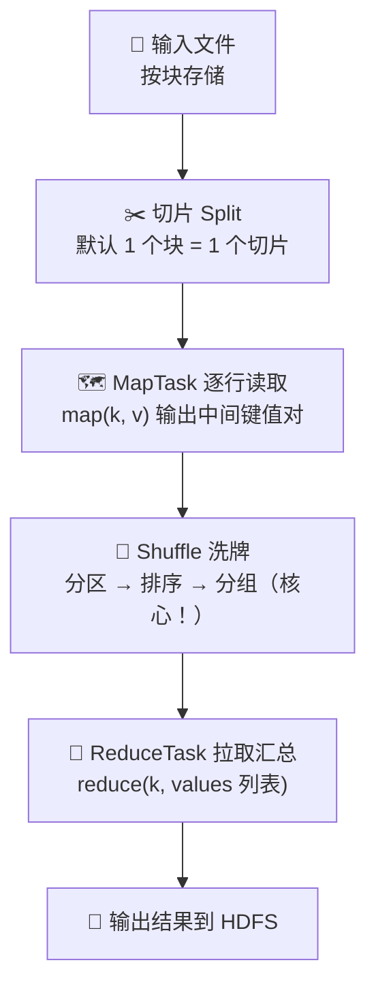

### 4.3 Shuffle 详解（最难点，啃下来就赢了 💪）

**Shuffle = 从 Map 输出到 Reduce 输入之间的所有数据搬运过程**：

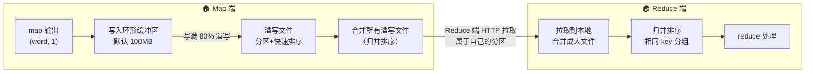

| 步骤 | 做了什么 | 细节 |
|------|----------|------|
| ① 收集 | map 输出写**环形缓冲区** | 默认 100MB，写满 **80%** 开始溢写（留 20% 继续写）|
| ② 溢写 | 线程把缓冲区数据写临时文件 | 写前先**分区（Partition）+ 排序（快排）** |
| ③ 合并 | 多个溢写文件 merge 成一个 | **归并排序**；可插 Combiner 预聚合 |
| ④ 拉取 | Reduce 从各 MapTask **下载自己分区**的数据 | HTTP 拉取 |
| ⑤ 归并 | 合并 + 排序 + **按 key 分组** | 相同 key 的 value 变成一个迭代器给 reduce |

> 💡 **Combiner（可选）**：Map 端的"小 Reduce"，先本地预聚合，减少传输量（如先本地 sum）。注意：**求平均数不能用**（局部平均 ≠ 全局平均）！
>
> 💡 **分区（Partitioner）**：默认 `hash(key) % reduceNum`，决定一条数据去哪个 ReduceTask；自定义分区可以实现"不同结果写不同文件"。

### 4.4 WordCount 经典代码 👩‍💻

```java
public class WcMapper extends Mapper<LongWritable, Text, Text, IntWritable> {
    private Text outK = new Text();
    private IntWritable outV = new IntWritable(1);

    @Override
    protected void map(LongWritable key, Text value, Context context) {
        // key: 行偏移量  value: 一行文本 "hello flink hello hadoop"
        for (String word : value.toString().split(" ")) {
            outK.set(word);          // 输出 (word, 1)
            context.write(outK, outV);
        }
    }
}

public class WcReducer extends Reducer<Text, IntWritable, Text, IntWritable> {
    @Override
    protected void reduce(Text key, Iterable<IntWritable> values, Context context) {
        // key: 单词  values: [1, 1, 1, ...]（相同 key 自动分组好啦）
        int sum = 0;
        for (IntWritable v : values) sum += v.get();
        context.write(key, new IntWritable(sum));
    }
}

public class WcDriver {
    public static void main(String[] args) throws Exception {
        Job job = Job.getInstance(new Configuration());
        job.setJarByClass(WcDriver.class);
        job.setMapperClass(WcMapper.class);
        job.setReducerClass(WcReducer.class);
        job.setMapOutputKeyClass(Text.class);
        job.setMapOutputValueClass(IntWritable.class);
        job.setOutputKeyClass(Text.class);
        job.setOutputValueClass(IntWritable.class);
        FileInputFormat.setInputPaths(job, new Path("/input"));
        FileOutputFormat.setOutputPath(job, new Path("/output"));
        System.exit(job.waitForCompletion(true) ? 0 : 1);
    }
}
```

> 🎀 注意 Hadoop 有自己的序列化体系 **Writable**（`Text`≈String、`LongWritable`≈Long…），比 Java 原生序列化**轻量得多**（网络传输省流量）～

### 4.5 为什么 MapReduce 慢？🐢

| 原因 | 说明 |
|------|------|
| 频繁磁盘 IO | 每个阶段结果都落盘（Shuffle 中间结果写磁盘） |
| 任务启动开销 | 每个任务都要启动 JVM 进程 |
| 编程模型死板 | 只有 map 和 reduce，复杂逻辑要串很多个 MR 作业 |

> 🎀 所以 Spark（内存计算 + 丰富算子）和 Flink（真流式）后来居上，但 **Shuffle 思想是通用的**，Spark/Flink 里都有各自的 Shuffle！

---

## 五、YARN：资源调度大师 🚦（面试必考！）

### 5.1 为什么要有 YARN？

Hadoop 1.x 里资源管理和计算耦合在 MapReduce 中，想跑别的计算框架就打架 😫
→ Hadoop 2.x 把**资源管理抽出来**做成独立系统 = **YARN**，从此 Spark/Flink 都能跑在 YARN 上，集群资源统一管理～

### 5.2 YARN 架构（一主多从 + 每应用一管家）

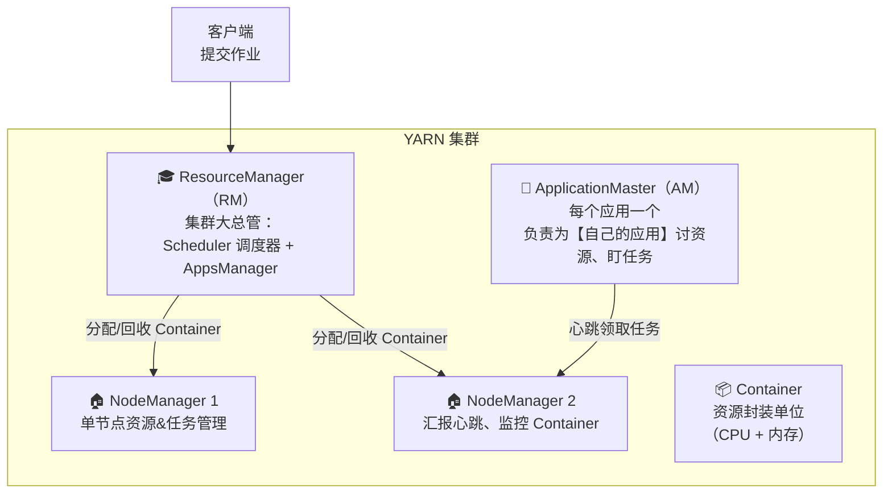

| 组件 | 职责 | 通俗理解 |
|------|------|----------|
| **ResourceManager** | 全局资源调度、启动 AM | 🎓 大总管（只管分资源，不管具体任务） |
| **NodeManager** | 单节点资源和容器管理，定时汇报 | 🏠 楼栋管家 |
| **ApplicationMaster** | 为单个应用申请资源、切分任务、监控容错 | 👔 每个应用专属包工头 |
| **Container** | CPU + 内存的封装，任务的运行载体 | 📦 一个工位 |

### 5.3 YARN 作业提交流程（必背！🔥）

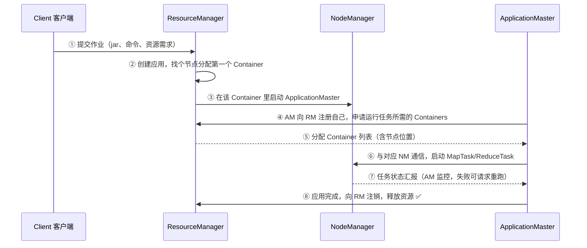

> 💡 **本质理解**：RM 只负责"发工位"，AM 拿到工位后自己安排工人（Task）上岗干活并盯梢——资源与任务管理解耦，这就是 YARN 的优雅之处～

---

## 六、HDFS 高可用 HA 与联邦 👑

### 6.1 NameNode 单点问题

NN 挂了 → 整个 HDFS 瘫痪（元数据在它内存里）😱
（注意：2NN 只是合并元数据的，**顶不了班**！）

### 6.2 HA 解决方案：主备 NameNode + ZooKeeper

```mermaid
flowchart TB
    subgraph HA["HDFS HA 集群"]
        NN1["👑 Active NameNode<br/>（干活中）"]
        NN2["💤 Standby NameNode<br/>（热备，随时接班）"]
        JN["📚 JournalNodes（3 台以上，奇数）<br/>共享 edits 编辑日志"]
        ZK["🐧 ZooKeeper 集群<br/>选主裁判"]
    end

    NN1 -->|"写入 edits"| JN
    NN2 <-.|"实时同步 edits（保证元数据一致）"| JN
    ZK1["ZKFC ①：盯着 NN1 的心跳"] --> ZK
    ZK2["ZKFC ②：盯着 NN2 的心跳"] --> ZK
    ZK -. "NN1 挂了？选举 NN2 接班！" .-> NN2
```

| 组件 | 作用 |
|------|------|
| **Standby NN** | 热备；实时从 JournalNode 同步 edits，合并到自己的 fsimage |
| **JournalNode（JN）** | 共享存储集群（2N+1 台，**过半写成功**才算成功） |
| **ZKFC（故障转移控制器）** | 每个 NN 配一个；健康监测 + 借助 ZooKeeper **选主**，防脑裂 |
| **脑裂防范** | 同一时刻只允许一个 Active（ fencing 隔离旧主，如关掉其 ssh 端口）|

### 6.3 联邦 Federation（了解即可）

> 元数据太多、一台 NN 扛不住？→ 多个 NN **分管不同目录**（如 /user 归 NN1，/data 归 NN2），各管一摊，都叫 Active。NameNode 水平扩展方案～

---

## 七、集群部署形态 & 常用端口 🔧

### 7.1 常用 Web UI 端口（3.x，记得和 2.x 区分！）

| 服务 | Hadoop 3.x | Hadoop 2.x |
|------|-----------|------------|
| NameNode Web UI | **9870** | 50070 |
| DataNode Web UI | 9864 | 50075 |
| SecondaryNameNode | 9868 | 50090 |
| ResourceManager Web UI | **8088** | 8088 |
| 历史服务器 | 19888 | 19888 |

### 7.2 关键配置文件

| 文件 | 配什么 |
|------|--------|
| `core-site.xml` | NN 地址、临时目录（`fs.defaultFS`） |
| `hdfs-site.xml` | 副本数、NN/DN 数据目录、HA 配置 |
| `yarn-site.xml` | RM 地址、shuffle、资源分配 |
| `mapred-site.xml` | 计算框架指向 YARN（`mapreduce.framework.name=yarn`） |
| `workers` | 从节点主机名列表 |

### 7.3 常用启动命令

```bash
start-dfs.sh     # 启动 HDFS（NN + DN + 2NN）
start-yarn.sh    # 启动 YARN（RM + NM）
mapred --daemon start historyserver   # 历史服务器
jps               # 查看进程：NameNode / DataNode / SecondaryNameNode / ResourceManager / NodeManager
```

---

## 八、Hadoop 生态圈 🌍

Hadoop 是地基，上面长出了整个大数据生态：

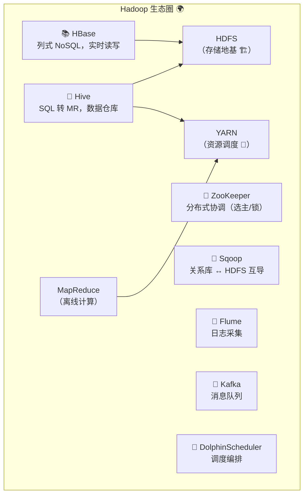

| 组件 | 一句话 |
|------|--------|
| Hive | 写 SQL 自动翻译成 MR/Spark，数仓神器 🐝 |
| HBase | 基于 HDFS 的分布式 KV 数据库，支持实时随机读写 |
| ZooKeeper | 分布式"协调员"：选主、分布式锁、配置中心 |
| Sqoop / DataX | 数据搬运工（RDBMS ↔ 大数据集群） |
| Flume | 日志采集管道 |
| Kafka | 高吞吐消息队列（Flink 好搭档～） |

---

## 九、面试高频考点速查 🎯

| 问题 | 答题要点 |
|------|----------|
| HDFS 读写流程？ | 写：NN 检查 → 要 DN 列表 → pipeline 管道 → packet 传输 → ACK；读：NN 给块位置 → 就近并行读 → 合并 |
| NameNode 和 DataNode 区别？ | NN 管元数据（内存）；DN 存真实块（磁盘）+ 心跳汇报 |
| SecondaryNameNode 是热备吗？ | ❌ 不是！只负责定期合并 fsimage + edits 给 NN 减负 |
| HDFS 为什么不适合小文件？ | 每个小文件占 NN 一份元数据（约 150 字节内存），海量小文件撑爆 NN |
| 副本放置策略？ | 1 本机 + 1 不同机架 + 1 同第二机架，兼顾容灾与带宽 |
| MapReduce 流程 / Shuffle 做了什么？ | 环形缓冲区(100M/80%) → 溢写(分区+排序) → merge → Reduce 拉取 → 归并分组 |
| Combiner 能算平均数吗？ | ❌ 不能，只适合"满足结合律"的聚合（sum/count/max） |
| YARN 的组件和提交流程？ | RM/NM/AM/Container；Client→RM→启动 AM→AM 申请资源→NM 起任务→完成注销 |
| HA 怎么实现的？ | Active/Standby NN + JournalNode 共享 edits + ZKFC 借 ZooKeeper 选主 |
| Hadoop 为什么慢？ | 磁盘 IO 频繁 + JVM 启动开销 + 编程模型不灵活 → 被 Spark/Flink 取代 |
| 2.x 和 3.x 区别？ | 端口 50070→9870；Java 8→8/11；支持纠删码省存储；多 NN 联邦增强 |

---

## 十、结语 🌸

Hadoop 的知识树收好啦：

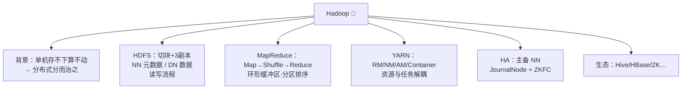

> 🎀 学习建议：
> 1. **HDFS 读写流程 + YARN 提交流程**是面试出现率 TOP 级的题，务必画图讲清楚！
> 2. **Shuffle** 过程多看几遍环形缓冲区 → 溢写 → 合并的链路，这是分布式计算的通用思想
> 3. MapReduce 现在很少直接写了，但它的"分而治之 + Shuffle"思想活在 Spark/Flink 里，值得吃透～
>
> 学完 Hadoop 再回头看 Flink，你会发现它们都在回答同一个问题：**数据怎么切、怎么算、怎么容错**！冲鸭 💪(๑•̀ㅂ•́)و✧
