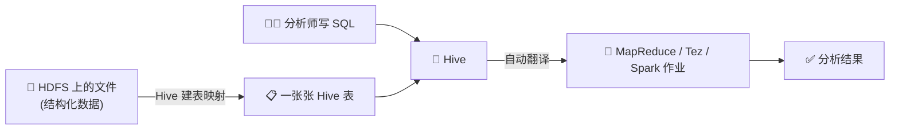
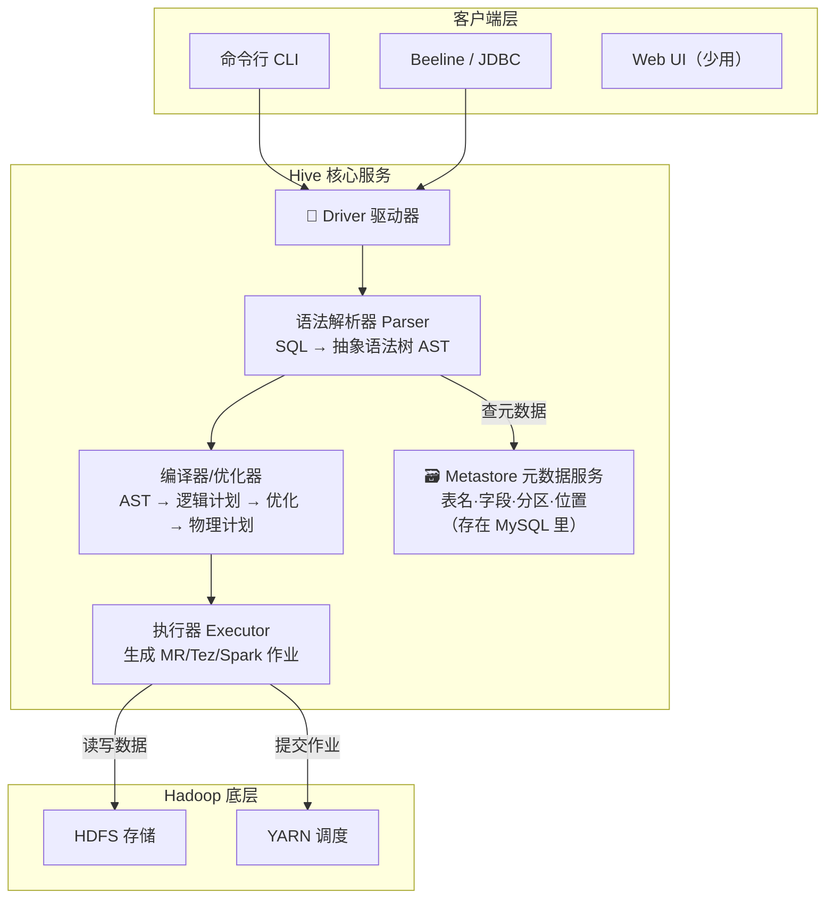
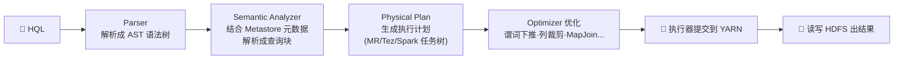
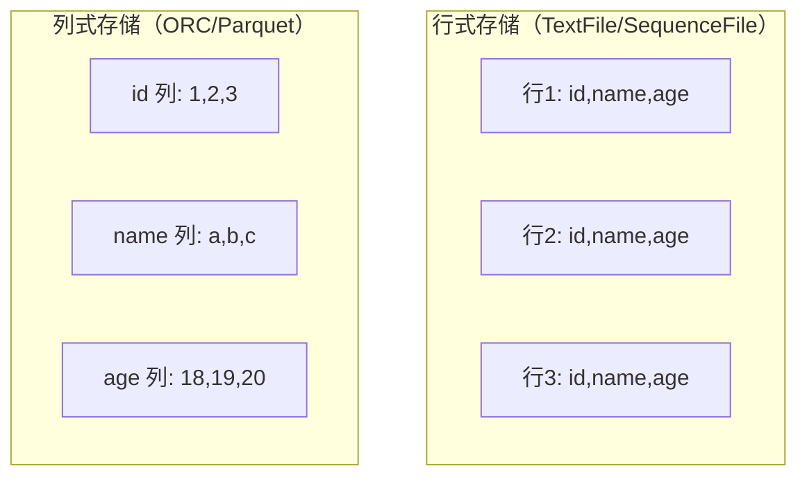
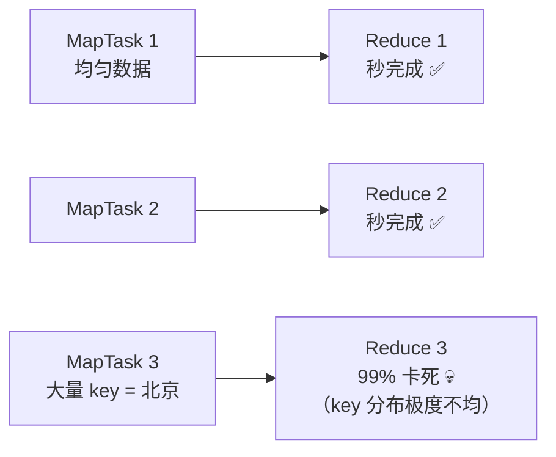
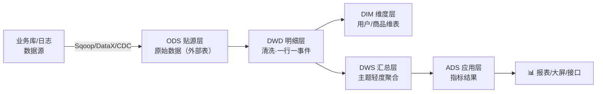
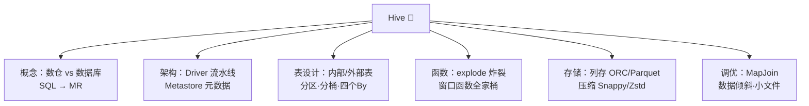

# 🐝 Hive 学习笔记

> 一句话介绍：**Hive = 会把 SQL 自动翻译成 MapReduce/Spark 的大数据仓库**。不会写 Java 也能分析 HDFS 上的海量数据——写 SQL 就够了，对数据分析师超级友好！✨
>
> 📌 学习前置：先了解 Hadoop（见 [Hadoop.md](./Hadoop.md)）会更丝滑哦～

---

## 📖 开篇：学习路线总览


| 章节 | 内容 | 难度 |
|------|------|------|
| 一 | 数据库 vs 数仓、Hive 是什么 | ⭐ |
| 二 | 架构图、SQL → MR 执行流程（面试高频）| ⭐⭐⭐ |
| 三 | 库/表/分区/分桶、内部表 vs 外部表（必考！）| ⭐⭐⭐⭐ |
| 四 | 常用函数 + 窗口函数（重难点！）| ⭐⭐⭐⭐ |
| 五 | 行存 vs 列存、ORC/Parquet、压缩 | ⭐⭐⭐ |
| 六 | 数据倾斜等调优（面试必考！）| ⭐⭐⭐⭐ |

---

## 一、先搞懂：数据仓库 vs 数据库 🏗️

### 1.1 OLTP vs OLAP

| 对比 | 数据库（MySQL）| 数据仓库（Hive）|
|------|---------------|-----------------|
| 面向 | **业务 transactions**（OLTP）| **分析 analytics**（OLAP）|
| 干什么 | 增删改查，一次几行 | 海量数据分析，一次扫全表 |
| 数据量 | MB ~ GB | GB ~ PB 💥 |
| 延迟 | 毫秒级 | 分钟级（慢，但在能忍的范围）|
| 更新 | 频繁增删改 | **基本只写不改**（append）|

> 🎀 打个比方：数据库是**收银台**（每笔交易快进快出），数据仓库是**财务分析室**（把所有账单汇总起来算报表）～

### 1.2 Hive 是什么？

**基于 Hadoop 的数据仓库工具**：把存在 HDFS 上的结构化数据文件，映射成一张张表，然后提供类 SQL（HQL）去查询分析。



| ✅ 优点 | ❌ 缺点 |
|--------|--------|
| 类 SQL，学习成本低 | 查询延迟高（不适合实时）|
| 免写 MapReduce，处理海量数据 | 不支持行级更新/删除（老版本；本质适合追加）|
| 良好的容错性（跑在 Hadoop 上）| 调优成本、小文件/倾斜问题 |

---

## 二、Hive 架构与执行流程 🏛️

### 2.1 核心组件



| 组件 | 职责 | 通俗理解 |
|------|------|----------|
| **Client** | 提交 SQL | 点菜的客人 🙋 |
| **Driver（解析/编译/优化/执行）** | SQL → MR 作业 | 后厨流水线 👨‍🍳 |
| **Metastore** | 存元数据（表结构、分区、HDFS 路径），底层是关系库 | 菜谱档案柜 🗃️ |
| **Hadoop** | 干实际的存储与计算 | 灶台和仓库 🔥 |

### 2.2 一条 SQL 的奇幻漂流（面试高频 🔥）



> 💡 **为什么"建表后查不到数据"多半是元数据/路径问题**：Hive 表 = 元数据（在 MySQL）+ 数据（在 HDFS）。表和数据的"映射关系"就靠 Metastore 维系，断电丢元数据 = 表结构全没，所以 Metastore 一般配 MySQL + 备份～

### 2.3 Metastore 三种部署模式

| 模式 | 元数据位置 | 适用 |
|------|-----------|------|
| 内嵌模式 | 自带 Derby 库 | 只能单会话，测试玩玩 |
| 本地模式 | 外部 MySQL，Metastore 与服务同进程 | 小规模 |
| **远程模式** ⭐ | 独立 Metastore 服务 + MySQL | 生产标配（多客户端共享）|

---

## 三、表设计：内外部表 · 分区 · 分桶 📋（核心！）

### 3.1 数据组织层级


### 3.2 内部表 vs 外部表（必考！🔥）

```sql
-- 内部表（管理表）
CREATE TABLE student_internal (
    id INT, name STRING
) ROW FORMAT DELIMITED FIELDS TERMINATED BY ',';

-- 外部表：加 EXTERNAL + LOCATION 指向已存在的数据
CREATE EXTERNAL TABLE student_external (
    id INT, name STRING
) ROW FORMAT DELIMITED FIELDS TERMINATED BY ','
LOCATION '/data/student';   -- HDFS 上已有数据的目录
```

| 对比 | 内部表（MANAGED）| 外部表（EXTERNAL）|
|------|------------------|-------------------|
| 数据生命周期 | Hive **全权管理** | 数据归外部（业务方）管 |
| `DROP TABLE` 时 | **元数据 + HDFS 数据一起删** 💥 | **只删元数据，数据保留** ✅ |
| 适用 | 中间表、临时表、结果表 | **原始数据/共享数据**（生产推荐）|

> 🎀 一句话记忆：**内部表 = 自有房产（拆表连家当一起搬走）；外部表 = 租的房子（退租只删合同，东西还在）**～
>
> ⚠️ 生产规范：**ODS 原始层一律外部表**，防止误删原始数据；分析中间结果可用内部表～

### 3.3 分区表：给数据分文件夹 📂

```sql
-- 建分区表：按天分区
CREATE TABLE logs (
    uid STRING, action STRING
) PARTITIONED BY (dt STRING)
ROW FORMAT DELIMITED FIELDS TERMINATED BY ',';

-- 静态分区插入
INSERT INTO TABLE logs PARTITION (dt = '2026-10-01')
VALUES ('u1', 'click');

-- 动态分区插入（常用！）开启动态分区
SET hive.exec.dynamic.partition.mode = nonstrict;
INSERT INTO TABLE logs PARTITION (dt)
SELECT uid, action, dt FROM tmp_logs;   -- 分区字段放最后！

-- 查询：只扫一个分区目录，避免全表扫描 ⚡
SELECT * FROM logs WHERE dt = '2026-10-01';
```

| 分区方式 | 说明 |
|----------|------|
| 静态分区 | 手动指定 `PARTITION (dt='xxx')`，稳妥但费手 |
| 动态分区 | 由 SELECT 字段值自动分区，注意 `nonstrict` 模式 |

> 💡 **为什么分区能提速**：分区 = HDFS 上的**子目录**。`WHERE dt='xxx'` 会直接定位到那个目录，其他目录根本不碰（分区裁剪），数据量一下子小了 N 倍！

### 3.4 分桶表：给数据分文件 🪣

```sql
-- 按 uid 哈希分成 4 个桶文件
CREATE TABLE logs_bucketed (
    uid STRING, action STRING
) CLUSTERED BY (uid) INTO 4 BUCKETS;
```

| 对比 | 分区 Partition | 分桶 Bucket |
|------|---------------|-------------|
| 切分方式 | **字段值**（按目录）| **哈希取模**（按文件）|
| 物理形态 | HDFS 目录 | 一个目录下的多个文件 |
| 是否要知道值 | 要（WHERE dt=xxx）| 不用（哈希自动路由）|
| 典型用途 | 按时间过滤 | 抽样、**Join 数据倾斜优化**、提高 join 效率 |

> 💡 分区解决"**读得少**"（裁剪目录），分桶解决"**找得准**"（相同 key 永远在同一文件）～

### 3.5 四个 By 的区别（经典面试题 🎯）

| 语法 | 作用 | 备注 |
|------|------|------|
| `ORDER BY` | **全局**排序，只有一个 ReduceTask | 数据量大时慢到怀疑人生 🐢 |
| `SORT BY` | 每个 **Reduce 内部**排序，不保证全局有序 | 大数据集分而排序 |
| `DISTRIBUTE BY` | 控制**分发**规则（哪个数据去哪个 reduce）| 类似自定义分区 |
| `CLUSTER BY` | = `DISTRIBUTE BY x SORT BY x`（同字段且升序）| 简写，不能指定降序 |

```sql
-- 全局排序限制放开
SET hive.mapred.mode = nonstrict;

-- 分发 + 区内排序（字段不同时必须分开写）
SELECT * FROM emp DISTRIBUTE BY deptno SORT BY sal DESC;
```

---

## 四、函数全家桶 🧮

### 4.1 常用内置函数速查

| 类别 | 函数 | 例子 |
|------|------|------|
| 字符串 | `split` / `concat` / `concat_ws` | `concat_ws('-', 'a', 'b') → a-b` |
| 字符串 | `substr(s, start, len)` | `substr('hello', 2, 3) → ell` |
| 字符串 | `upper` / `lower` / `length` / `trim` | |
| 正则 | `like` / `rlike` | `rlike '^\\d+$'` 匹配纯数字 |
| JSON | `get_json_object(json, '$.key')` | 取 JSON 字段 |
| 时间 | `unix_timestamp()` / `from_unixtime()` | 时间戳 ↔ 字符串 |
| 时间 | `date_format` / `datediff` / `date_add` | `datediff('2026-10-01','2026-09-01')` |
| 判空 | `nvl(x, 0)` / `coalesce(a, b, c)` | 第一个非空值 |
| 条件 | `if(条件, a, b)` / `CASE WHEN` | |
| 类型 | `cast(x AS INT)` | |
| 集合 | `size` / `array_contains` / `explode` ⭐ | 炸裂函数！ |

```sql
-- explode 行转列（一列炸成多行）
SELECT movie, category
FROM movie_info
LATERAL VIEW explode(split(category, ',')) t AS category;
```

### 4.2 窗口函数（开窗函数）⭐⭐⭐⭐（重难点！）

> 🎀 **一句话理解**：普通聚合函数一聚合"多行变一行"；窗口函数是"**每行都保留，还能顺便看看周围数据**"——给每行开一扇观察世界的小窗户 🪟

**语法骨架**：`函数() OVER (PARTITION BY ... ORDER BY ... 窗口子句)`


**① 聚合 + 开窗（累计/移动计算）**

```sql
SELECT
    name, dt, amount,
    SUM(amount) OVER (PARTITION BY name ORDER BY dt) AS total,        -- 累计求和
    SUM(amount) OVER (PARTITION BY name ORDER BY dt
        ROWS BETWEEN 2 PRECEDING AND CURRENT ROW) AS recent_3,       -- 最近3行
    AVG(amount) OVER (PARTITION BY name) AS user_avg                 -- 组内均值（全部行）
FROM orders;
```

| 常用窗口子句 | 含义 |
|--------------|------|
| `ROWS BETWEEN 2 PRECEDING AND CURRENT ROW` | 前 2 行到当前行 |
| `ROWS BETWEEN UNBOUNDED PRECEDING AND CURRENT ROW` | 从头到当前（默认带 ORDER BY 时）|
| `ROWS BETWEEN CURRENT ROW AND UNBOUNDED FOLLOWING` | 当前行到结尾 |

**② 排名函数（区别是考题！📝）**

```sql
SELECT
    name, score,
    ROW_NUMBER() OVER (ORDER BY score DESC) AS rn1,  -- 1,2,3,4（严格连续，并列也分先后）
    RANK()       OVER (ORDER BY score DESC) AS rn2,  -- 1,2,2,4（并列同名次，跳号）
    DENSE_RANK() OVER (ORDER BY score DESC) AS rn3,  -- 1,2,2,3（并列不跳号）
    NTILE(2)     OVER (ORDER BY score DESC) AS nt    -- 分2组（top 50% 标记神器）
FROM students;
```

| 函数 | 并列时 | 例子（分数 90,90,80）|
|------|--------|---------------------|
| `ROW_NUMBER()` | 强行区分 | 1, 2, 3 |
| `RANK()` | 并列同名次，**跳号** | 1, 1, **3** |
| `DENSE_RANK()` | 并列同名次，**不跳号** | 1, 1, **2** |

**③ 偏移函数**

```sql
SELECT
    name, dt, amount,
    LAG(amount, 1)  OVER (PARTITION BY name ORDER BY dt) AS prev,  -- 上一行的值
    LEAD(amount, 1) OVER (PARTITION BY name ORDER BY dt) AS next_, -- 下一行的值
    FIRST_VALUE(dt) OVER (PARTITION BY name ORDER BY dt) AS first_day
FROM orders;
-- 经典用途：LAG 算环比/连续登录天数、LEAD 看下一次行为
```

### 4.3 自定义函数 UDF

| 类型 | 输入 → 输出 | 例子 |
|------|------------|------|
| **UDF** | 一进一出 | 自定义加密、脱敏 |
| **UDTF** | 一进多出 | 自定义行转列 |
| **UDAF** | 多进一出 | 自定义聚合 |

```java
// UDF 三步走：继承 GenericUDF → 实现方法 → 打包注册
public class MyUpper extends UDF {          // 简单版：继承 UDF
    public Text evaluate(Text input) {
        return new Text(input.toString().toUpperCase());
    }
}
```

---

## 五、文件格式与压缩 📦

### 5.1 行存储 vs 列存储



| 对比 | 行存储 | 列存储 ⭐ |
|------|--------|----------|
| 查几列时 | 也得读整行（浪费 IO）| **只读需要的列**（大宽表提速神器）|
| 压缩率 | 一般 | **更高**（同列数据类型一致）|
| 插入/整行读 | 快 | 慢一点 |
| 适合 | OLTP / 整行读写 | **分析查询（OLAP）** ✅ |

| 格式 | 说明 |
|------|------|
| `TextFile` | 默认格式，文本行，兼容性最好但**最大最慢** |
| `SequenceFile` | 二进制 KV，带压缩 |
| **`ORC`** ⭐ | 列存 + 索引 + 统计信息，Hive 生态首选，压缩率高 |
| **`Parquet`** ⭐ | 列存，Spark 生态首选 |

### 5.2 压缩搭配推荐

| 场景 | 推荐 |
|------|------|
| 数仓中间结果 | Snappy（快，CPU 换 IO，划算 ⚡）|
| 冷数据归档 | Gzip / Zstd（压得狠，不可分割要注意）|
| 表存储 | ORC + Zstd/Snappy |

```sql
CREATE TABLE orders (
    id BIGINT, amount DECIMAL(10,2)
) STORED AS ORC                 -- 列式存储
TBLPROPERTIES ('orc.compress' = 'SNAPPY');  -- 内置压缩
```

---

## 六、Hive 调优 🚀（面试必考！）

### 6.1 基础提速三板斧

```sql
-- ① Fetch 抓取：简单查询不转 MR，直接读文件
SET hive.fetch.task.conversion = more;   -- 全局查找/字段查找/limit 都免 MR

-- ② 本地模式：小数据在本地跑，不惊动集群
SET hive.exec.mode.local.auto = true;
SET hive.exec.mode.local.auto.inputbytes.max = 134217728;  -- 128MB 以下走本地

-- ③ MapJoin：小表装进内存，在 Map 端直接完成 join
SET hive.auto.convert.join = true;
SET hive.auto.convert.join.noconditionaltask.size = 10485760; -- 小表阈值 10MB
```

### 6.2 数据倾斜（重中之重 🔥）

**现象**：某个 ReduceTask 跑到 99% 卡住不动，其他早完事了 🐢⏳



| 倾斜场景 | 解决方案 |
|----------|----------|
| **大表 Join 小表** | MapJoin（小表广播到内存）⭐ |
| **大表 Join 大表**（空 key 多）| 空 key 过滤掉 / 加随机串打散到多个 reduce |
| **group by 某个 key 超多** | ① 两阶段聚合：`hive.map.aggr=true` 局部聚合 ② 加盐打散：key 拼随机数先局部聚合，再全局聚合 |
| **count(distinct xx)** | 改写成 `group by` 再 count（多一个 job 但更均衡）|

```sql
-- 加盐打散示例：热点 key 加随机前缀
SELECT SUBSTR(salted_key, 2) AS key, SUM(cnt) AS total
FROM (
    SELECT CONCAT(CAST(FLOOR(RAND() * 10) AS STRING), key) AS salted_key, COUNT(*) AS cnt
    FROM big_table GROUP BY CONCAT(CAST(FLOOR(RAND() * 10) AS STRING), key)
) t
GROUP BY SUBSTR(salted_key, 2);
```

### 6.3 小文件问题

| 危害 | 治理 |
|------|------|
| NN 元数据压力大；MapTask 启动比干活还久 | ① 建表时 `ALTER TABLE t CONCATENATE`（ORC 合并）<br>② reduce 数固定 `hive.exec.reducers.bytes.per.reducer`<br>③ 上游攒批写入 |

### 6.4 其他实用参数

| 参数 | 作用 |
|------|------|
| `hive.exec.parallel = true` | 开启作业并行执行（无依赖的 stage 同时跑）|
| `hive.strict.checks.*` | 严格模式：无分区过滤/笛卡尔积/无限 order by 直接报错拦住 |
| `hive.groupby.skewindata = true` | 两阶段聚合防倾斜 |

---

## 七、Hive 在数仓中的位置 🏢



> 🎀 分层 = 洗衣流水线：脏衣服（ODS）→ 分类搓洗（DWD）→ 按人叠好（DWS）→ 装袋出门（ADS）。每层职责单一，出问题好回溯，公共逻辑可复用～

---

## 八、面试高频考点速查 🎯

| 问题 | 答题要点 |
|------|----------|
| Hive 是什么？和数据库区别？ | 数仓工具，SQL→MR；OLAP 分析、延迟高、不支持行级更新 |
| 内部表 vs 外部表？ | drop 时内部表删数据+元数据，外部表只删元数据；ODS 用外部表 |
| Hive SQL 执行流程？ | SQL→AST→语义分析（查 Metastore）→逻辑/物理计划→优化→MR 作业 |
| 分区和分桶的区别？ | 分区=目录（按值裁剪）；分桶=哈希分文件（抽样/join 提速） |
| 四个 by 的区别？ | order by 全局排序；sort by 区内排序；distribute by 分发；cluster by=后两者同字段 |
| 窗口函数了解吗？ | 聚合开窗（累计/滑动）、排名（row_number/rank/dense_rank）、偏移（lag/lead） |
| row_number/rank/dense_rank 区别？ | 严格 1,2,3 / 并列跳号 1,1,3 / 并列不跳号 1,1,2 |
| 行存和列存区别？ | 列存只读所需列、压缩率高，适合 OLAP（ORC/Parquet） |
| 数据倾斜怎么处理？ | MapJoin 小表广播；空 key 过滤；加盐两阶段聚合；count distinct 改 group by |
| 小文件太多怎么办？ | ORC concatenate 合并；控制 reduce 数；上游攒批 |
| Hive 为什么慢？怎么提速？ | 底层 MR 落盘；Fetch/本地模式/MapJoin/并行执行/换 Tez/Spark 引擎 |
| UDF 了解吗？ | UDF 一进一出、UDTF 一进多出（explode）、UDAF 多进一出 |

---

## 九、结语 🌸

Hive 的知识树收好啦：



> 🎀 学习建议：
> 1. **内外部表 + 分区分桶**先吃透，这是建表设计的基本功～
> 2. **窗口函数**多上手练（排名/累计/lag），数据分析 80% 的 SQL 都离不开它！
> 3. **数据倾斜**是 Hive 面试的压轴题，把"MapJoin / 空key / 加盐两阶段聚合"三板斧讲清楚就赢啦～
>
> Hive 学完，数仓的"存（HDFS）+ 算（Hive SQL）"就齐了，接下来可以去征服 Spark/HBase 啦，冲鸭！💪(๑•̀ㅂ•́)و✧
