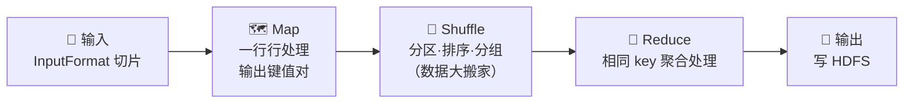
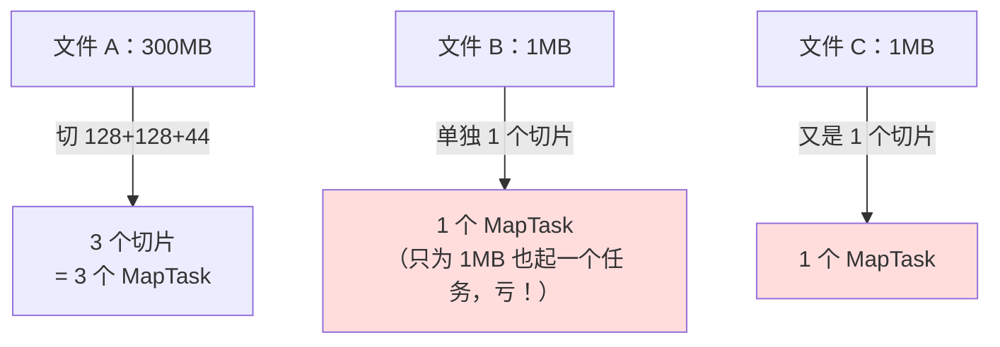
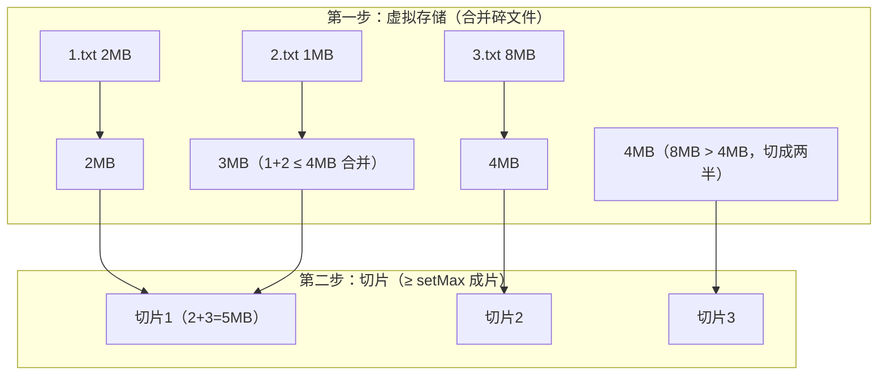
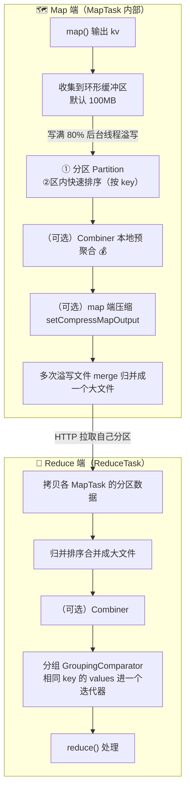
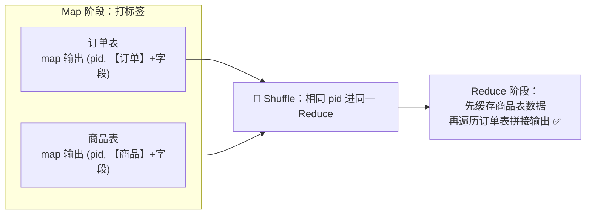
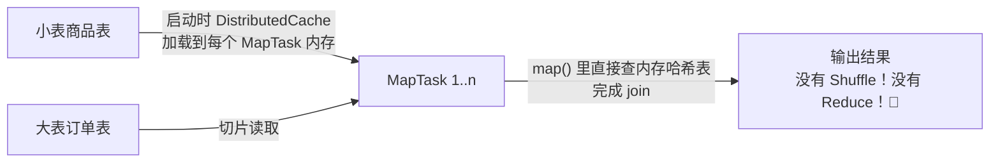
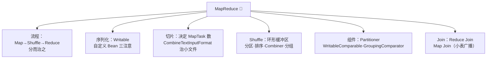

# 🧮 MapReduce 深度学习笔记

> 一句话介绍：**MapReduce = 分布式计算的"祖师爷"编程模型**——把大任务切成小块（Map 各自算）再汇总（Reduce 合并算）。虽然现在被 Spark/Flink 取代，但它的 **分而治之 + Shuffle 思想**活在所有计算引擎里！✨
>
> 📌 本篇是 **MapReduce 专项深入版**：入门概念和 WordCount 见 [Hadoop.md](./Hadoop.md) 第四章，本篇聚焦 **序列化、切片机制、Shuffle 细节、自定义组件、Join 应用** 等进阶内容～

---

## 📖 开篇：学习路线总览


| 章节 | 内容 | 难度 |
|------|------|------|
| 一 | MapReduce 流程一图流回顾 | ⭐ |
| 二 | Hadoop 序列化 + 自定义 Bean | ⭐⭐⭐ |
| 三 | 切片机制（MapTask 并行度，面试高频！）| ⭐⭐⭐⭐ |
| 四 | Shuffle 深挖：分区/排序/分组/Combiner | ⭐⭐⭐⭐⭐ |
| 五 | 自定义组件：Partitioner / 排序 / 分组 | ⭐⭐⭐⭐ |
| 六 | Join 方案对比 + 面试速查 | ⭐⭐⭐⭐ |

---

## 一、流程一图流回顾 🍵



| 阶段 | 干什么 | 谁来干 |
|------|--------|--------|
| Input | 切片、按行读 | **MapTask**（并行度 = 切片数）|
| Map | 业务加工，输出 kv | 我们写的 `map()` |
| Shuffle | 搬运整理数据 | **框架自动做**（重点理解！）|
| Reduce | 汇总计算 | 我们写的 `reduce()` |
| Output | 写结果文件（part-r-000xx）| 框架 |

> 🎀 记忆口诀：**Map 分身干活，Shuffle 搬砖整理，Reduce 收尾汇总**～

---

## 二、Hadoop 序列化：Writable 📦

### 2.1 为什么不用 Java 原生序列化？

Java 序列化又**胖**（带类信息、校验等一堆头）又**慢**，网络传输太浪费 💸
→ Hadoop 自研 **Writable**：精简、快速，专为网络传输而生～

| Java 类型 | Hadoop Writable 类型 |
|-----------|---------------------|
| `String` | `Text` |
| `int` | `IntWritable` |
| `long` | `LongWritable` |
| `float` | `FloatWritable` |
| `double` | `DoubleWritable` |
| `boolean` | `BooleanWritable` |

### 2.2 自定义序列化 Bean（流量统计案例 📊）

**需求**：统计每个手机号的总上行流量、总下行流量、总流量～

```java
// ① 实现 Writable 接口（相当于一个可序列化的 Bean）
public class FlowBean implements Writable {
    private long upFlow;      // 上行流量
    private long downFlow;    // 下行流量
    private long sumFlow;     // 总流量

    // ② 反序列化时需要反射调用空参构造器！必须保留
    public FlowBean() {}

    // ③ 序列化方法：把字段按顺序写出去
    @Override
    public void write(DataOutput out) throws IOException {
        out.writeLong(upFlow);
        out.writeLong(downFlow);
        out.writeLong(sumFlow);
    }

    // ④ 反序列化方法：按【相同顺序】读回来！
    @Override
    public void readFields(DataInput in) throws IOException {
        upFlow = in.readLong();
        downFlow = in.readLong();
        sumFlow = in.readLong();
    }

    public void setSumFlow() { this.sumFlow = upFlow + downFlow; }
    // getter / setter 省略...
}
```

```java
public class FlowMapper extends Mapper<LongWritable, Text, Text, FlowBean> {
    @Override
    protected void map(LongWritable key, Text value, Context context) throws IOException, InterruptedException {
        // 一行：手机号 上行 下行 ...
        String[] fields = value.toString().split("\t");
        String phone = fields[0];
        FlowBean bean = new FlowBean();
        bean.setUpFlow(Long.parseLong(fields[1]));
        bean.setDownFlow(Long.parseLong(fields[2]));
        bean.setSumFlow();
        context.write(new Text(phone), bean);
    }
}

public class FlowReducer extends Reducer<Text, FlowBean, Text, FlowBean> {
    @Override
    protected void reduce(Text key, Iterable<FlowBean> values, Context context) {
        long up = 0, down = 0;
        // 同一手机号的多条记录累加
        for (FlowBean v : values) {
            up += v.getUpFlow();
            down += v.getDownFlow();
        }
        FlowBean out = new FlowBean(up, down);   // 构造器里 setSumFlow
        context.write(key, out);
    }
}
```

> ⚠️ **三个坑**：① 必须有空参构造；② `write` 和 `readFields` 字段**顺序必须一致**；③ 想当 key 输出排序要用 `WritableComparable`（见第五章）～

---

## 三、切片机制：MapTask 并行度 🍕（面试高频！）

### 3.1 核心结论

```
MapTask 并行度 = 切片（Split）数量
切片 ≠ 切块（Block）：切片是"逻辑划分"（只是计划），切块是"物理存储"
```

### 3.2 FileInputFormat 默认切片规则

| 规则 | 说明 |
|------|------|
| 按文件**逐个**切 | 不会跨文件合并切片！10 个小文件 = 10 个切片 ⚠️ |
| 切片大小 = `Math.min(块大小, 目标大小)` | 默认就是 **128MB**（和块对齐，数据本地化读取）|
| 剩余 > 1.1 倍才切 | 防止产生"太小的尾片"，浪费一个 MapTask |



> 🎀 **小文件灾难**：100 个 1MB 小文件 = 100 个 MapTask，启动开销比计算还久！→ 用 **CombineTextInputFormat** 救场～

### 3.3 小文件优化：CombineTextInputFormat

```java
job.setInputFormatClass(CombineTextInputFormat.class);
// 4MB：期望合并后每个切片处理 4MB 数据（不设则所有文件合成一片！）
CombineTextInputFormat.setMaxInputSplitSize(job, 4194304);
```



> 💡 逻辑：先"**虚拟存储**"把碎文件按 `setMaxInputSplitSize` 攒成块，再按大小重新切片——**3 个小文件从 3 个 MapTask 优化到合理数量** ⚡

### 3.4 常见 InputFormat 一览

| InputFormat | 切片/读取方式 |
|-------------|--------------|
| `TextInputFormat`（默认）| 按行读，key=行偏移量，value=一行内容 |
| `KeyValueTextInputFormat` | 每行按分隔符切第一列当 key ⭐（join 常用）|
| `NLineInputFormat` | 每 N 行一个切片（数据抽样）|
| `CombineTextInputFormat` | 小文件合并切片 ⭐ |
| 自定义 InputFormat | 读 MySQL、二进制等特殊输入 |

### 3.5 ReduceTask 并行度

```java
job.setNumReduceTasks(3);   // 默认 1，手动指定
```

> ⚠️ 注意：**分区数 ≠ ReduceTask 数时**：分区数 < 任务数 → 会有空输出文件；分区数 > 任务数 → **直接报错**！

---

## 四、Shuffle 深挖 🌊（灵魂中的灵魂！）

### 4.1 完整大图（含 Combiner 与压缩）



### 4.2 环形缓冲区：为什么是环？🔄

> 🎀 一个数组**首尾相接当环用**：一边顺序写入 kv 数据，一边从"最老"的位置开始排序溢写——**读写同时进行不打架**，内存利用率拉满！
>
> - 默认大小 `100MB`（`mapreduce.task.io.sort.mb`）
> - 写到 `80%` 就触发溢写（`io.sort.spill.percent = 0.8`），剩下 20% 继续写，无缝衔接～

### 4.3 排序：MR 的隐藏灵魂 📊

> 很多人不知道：**MapReduce 框架在 Shuffle 过程中自动排序**！数据到 reduce 手里时，**key 已经有序**了～

| 排序类型 | 实现 |
|----------|------|
| **部分排序** | 每个 reduce 输出文件内部有序（默认行为）|
| **全排序** | 只用 1 个 ReduceTask（大数据量慎用🐢）；或自定义分区让区间有序 |
| **二次排序**（辅助排序）| key 相同时按 value 排序 → `GroupingComparator` |
| 自定义排序 | key 实现 `WritableComparable` 接口 |

### 4.4 Combiner：省流量神器 💰

```java
// 继承 Reducer，逻辑和 reduce 一模一样
public class WcCombiner extends Reducer<Text, IntWritable, Text, IntWritable> {
    @Override
    protected void reduce(Text key, Iterable<IntWritable> values, Context context) {
        int sum = 0;
        for (IntWritable v : values) sum += v.get();
        context.write(key, new IntWritable(sum));  // map 端先把 (word,1,1,1) 合成 (word,3)
    }
}

// 注册
job.setCombinerClass(WcCombiner.class);
```

| 适用 ✅ | 不适用 ❌ |
|--------|----------|
| 求和、计数、最大值（满足结合律）| **求平均数**（局部平均 ≠ 全局平均，会算错！）|
| 减少网络传输量 | 业务上不能合并的逻辑 |

---

## 五、自定义组件实战 🛠️

### 5.1 自定义分区：按省份分文件 🗂️

**需求**：流量统计结果按手机号归属省，输出到不同文件（part-r-0=广东…）～

```java
public class ProvincePartitioner extends Partitioner<Text, FlowBean> {
    @Override
    public int getPartition(Text key, FlowBean value, int numPartitions) {
        String phone = key.toString();
        int prefix = Integer.parseInt(phone.substring(0, 3));
        if (prefix >= 136 && prefix <= 139) return 0;   // 广东 → 分区0
        else if (prefix >= 150 && prefix <= 159) return 1; // 上海 → 分区1
        else return 2;                                    // 其他 → 分区2
    }
}

// 注册（注意：分区数要和 ReduceTask 数一致！）
job.setPartitionerClass(ProvincePartitioner.class);
job.setNumReduceTasks(3);
```

### 5.2 自定义排序：按总流量倒序 📈

```java
// FlowBean 改实现 WritableComparable：既能序列化又能比较排序！
public class FlowBean implements WritableComparable<FlowBean> {
    private long upFlow, downFlow, sumFlow;

    @Override
    public int compareTo(FlowBean o) {
        // 总流量倒序：他减我（大 → -1 → 排前面）
        return Long.compare(o.sumFlow, this.sumFlow);
    }
    // write / readFields 同第二章...
}
```

> 💡 妙用：把 FlowBean 当 **key** 输出，Shuffle 就会自动按它排序（比如 TopN 流量排行）～

### 5.3 分组比较器：每个订单取最贵的商品 🏆

**需求**：一堆订单（order_001, 商品A, 价格），每个订单只留价格最高的一条～

```java
// 只按【订单号】分组（哪怕 key 是整个 OrderBean）
public class OrderGroupingComparator extends WritableComparator {
    public OrderGroupingComparator() {
        super(OrderBean.class, true);
    }

    @Override
    public int compare(WritableComparable a, WritableComparable b) {
        OrderBean x = (OrderBean) a, y = (OrderBean) b;
        return x.getOrderId().compareTo(y.getOrderId());  // 订单号相同 = 同一组！
    }
}

// 注册后，reduce 每次收到的一组 values 就是"同一订单的所有商品"
job.setGroupingComparatorClass(OrderGroupingComparator.class);
```

> 🎀 **排序 + 分组配合**：key 排序时"订单号升序 + 价格降序"，分组只认订单号 → 每组第一条就是最贵的！这就是传说中的**二次排序**套路～

---

## 六、Join 应用：Reduce Join vs Map Join 🤝

### 6.1 Reduce Join（通用但易倾斜）



**缺点**：所有拼接压力集中在 Reduce 端，热点 key（爆款商品）→ **数据倾斜** 💀

### 6.2 Map Join（小表场景王者 ⭐）



```java
// Driver 端：把小表加入分布式缓存
job.addCacheFile(new URI("/input/pd.txt"));
job.setNumReduceTasks(0);   // 不需要 reduce！

// Mapper 端：setup() 里把小表读进 HashMap
public class JoinMapper extends Mapper<LongWritable, Text, Text, Text> {
    Map<String, String> pdMap = new HashMap<>();

    @Override
    protected void setup(Context context) throws IOException {
        URI[] files = context.getCacheFiles();        // 拿到缓存的小表
        BufferedReader br = new BufferedReader(
                new FileReader(new File(files[0].getPath())));
        String line;
        while ((line = br.readLine()) != null) {
            String[] f = line.split("\t");
            pdMap.put(f[0], f[1]);                    // pid → pname
        }
    }

    @Override
    protected void map(LongWritable key, Text value, Context context) {
        // 直接内存拼接，秒出结果
        String[] f = value.toString().split("\t");
        context.write(new Text(f[1]), new Text(pdMap.getOrDefault(f[1], "") + "\t" + f[2]));
    }
}
```

| 对比 | Reduce Join | Map Join |
|------|-------------|----------|
| 思路 | Reduce 端按 key 汇合拼接 | 小表广播到 Map 端内存直接拼 |
| Shuffle | 有（压力大）| **无** 🚀 |
| 倾斜风险 | 高 | 无 |
| 适用 | 两张大表 | **一大一小**（小表能进内存）|

> 💡 Hive 的 `hive.auto.convert.join=true`（自动 MapJoin）底层就是这套思想！Flink 的 broadcast state 也是～**一个思想，处处开花** 🌸

---

## 七、面试高频考点速查 🎯

| 问题 | 答题要点 |
|------|----------|
| MapTask 并行度由什么决定？ | 切片数；切片默认 128MB 按文件独立切，剩 1.1 倍内并入 |
| Block 和 Split 的区别？ | Block=物理存储切块；Split=逻辑计算划分（默认对齐 128MB）|
| 小文件太多怎么办？ | CombineTextInputFormat（虚拟存储+重切片）；上游合并 |
| Shuffle 完整过程？ | 环形缓冲区(100M/80%) → 溢写(分区+排序) → Combiner → merge → Reduce HTTP 拉取 → 归并 → 分组 |
| 为什么用环形缓冲区？ | 首尾相接，写入和溢写同时进行，内存无缝利用 |
| MR 排序发生在哪里？ | 溢写快排 + merge 归并 + reduce 端归并；到 reduce 时 key 已有序 |
| Combiner 使用注意？ | 满足结合律可用（sum/count/max）；**求平均不能用** |
| 分区和 ReduceTask 数关系？ | 分区>任务数报错；分区<任务数出空文件 |
| 自定义 Bean 要注意什么？ | 空参构造、write/readFields 顺序一致、当 key 需 WritableComparable |
| 二次排序怎么做？ | key 排序（多字段 compareTo）+ GroupingComparator 只按第一字段分组 |
| Reduce Join 和 Map Join？ | 前者通用易倾斜；后者小表广播进 map 内存，无 shuffle |
| MR 为什么被取代？ | 磁盘 IO 频繁 + JVM 启动开销 + 编程模型不灵活 |

---

## 八、结语 🌸

MapReduce 的知识树收好啦：



> 🎀 学习建议：
> 1. **Shuffle 流程**务必倒背如流——Spark/Flink 面试也会变着花样问它！
> 2. **切片机制**（128MB / 1.1 倍 / 小文件优化）是 MR 面试的常青题～
> 3. 把**流量统计**案例亲手敲一遍：自定义 Bean + 分区 + 排序 + 分组全用上了，一套连招打完，MR 就毕业啦～
>
> MR 学完，Hadoop 全家桶（HDFS + YARN + MR）就集齐了！接下来向 Spark 发起进攻吧，冲鸭！💪(๑•̀ㅂ•́)و✧
