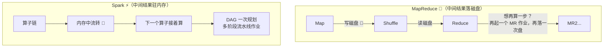
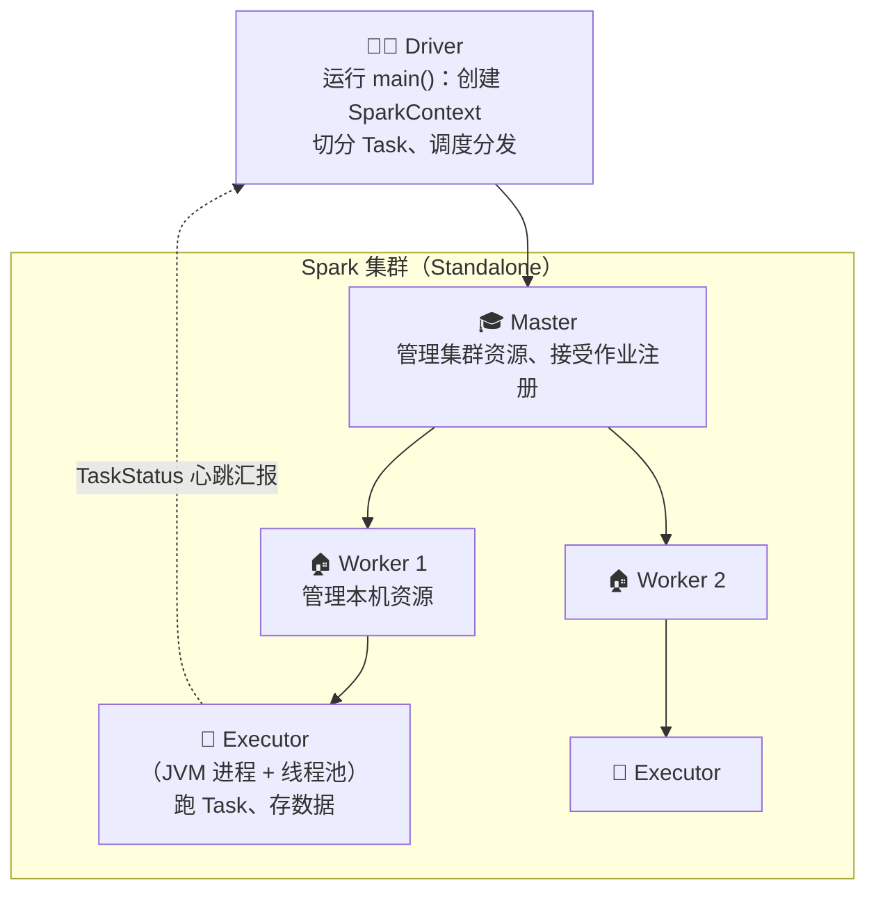
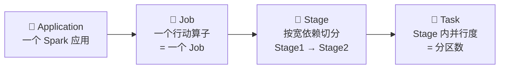
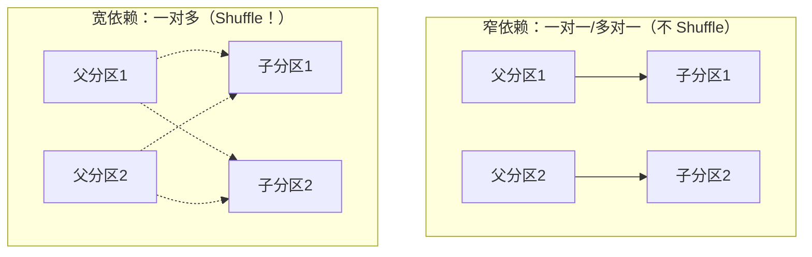
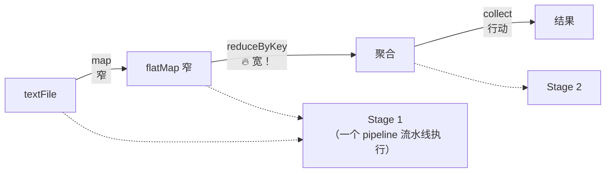
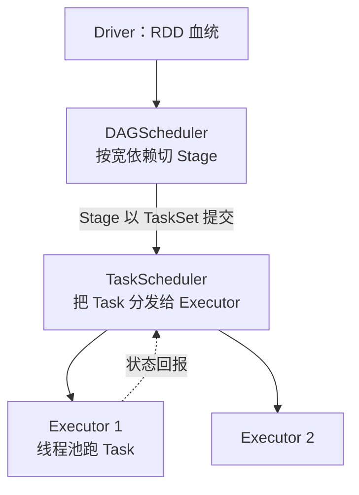
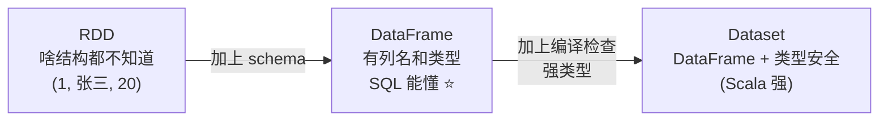
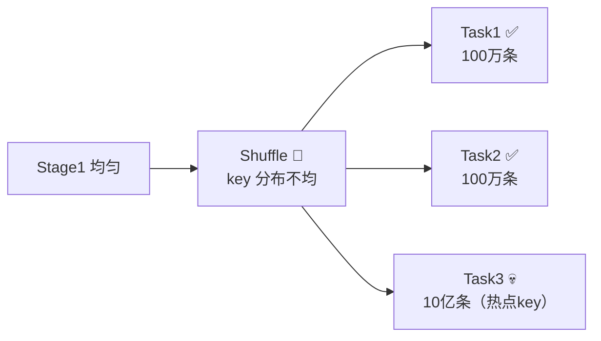
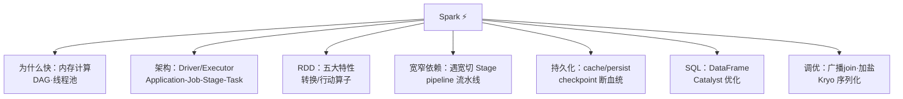

# ⚡ Spark 学习笔记

> 一句话介绍：**Spark = 基于内存的分布式计算引擎**——把中间结果放内存里反复用，比 MapReduce 快 10~100 倍！统一的引擎同时支持离线（SQL）、流式（微批）、机器学习和图计算～✨
>
> 📌 学习前置：了解 [Hadoop.md](./Hadoop.md)（尤其 MapReduce）和 [Flink.md](./Flink.md) 对比着学更香哦～代码以 **Scala** 为主（Spark 亲儿子语言），PySpark 语法几乎一样～

---

## 📖 开篇：学习路线总览


| 章节 | 内容 | 难度 |
|------|------|------|
| 一 | Spark vs MapReduce（必考！）| ⭐ |
| 二 | 运行架构、Job/Stage/Task 层级 | ⭐⭐⭐ |
| 三 | RDD 五大特性 + 常用算子 | ⭐⭐⭐⭐ |
| 四 | 宽窄依赖 + Stage 划分（必考！）| ⭐⭐⭐⭐⭐ |
| 五 | cache / persist / checkpoint | ⭐⭐⭐ |
| 六 | Spark SQL：DataFrame/Dataset | ⭐⭐⭐ |
| 七 | 调优 + 数据倾斜（必考！）| ⭐⭐⭐⭐ |

---

## 一、Spark 是什么？为什么快？🚀

### 1.1 vs MapReduce：快在哪？



| 提速点 | 说明 |
|--------|------|
| 🧠 **内存计算** | 中间结果不落磁盘（HDFS），反复利用超快 |
| 🗺️ **DAG 执行引擎** | 把整个计算画成有向无环图统一优化，不像 MR 一个作业一个作业串 |
| 🧵 **线程级任务** | Executor 里跑线程池（MR 每个任务开一个 JVM 进程，启动贵）|
| 💾 **容错灵活** | 血统（Lineage）+ 检查点，不依赖磁盘副本 |

### 1.2 Spark vs Flink（面试爱问 🤔）

| 对比 | Spark | Flink |
|------|-------|-------|
| 世界观 | **批为主**，流=微批（攒一小段再算）| **流为主**，批=有界流 |
| 实时性 | 秒级（Structured Streaming 可到百毫秒）| **毫秒级** ⚡ |
| 生态 | SQL/MLlib/GraphX 全家桶更早成熟 | 流处理生态更强 |
| 场景 | 离线数仓、ML 主力 | 实时计算主力 |

> 🎀 一句话：**离线/机器学习选 Spark，纯实时选 Flink**，很多公司两个都用～

### 1.3 Spark 模块全家桶 🧩

| 模块 | 干什么 | 现状 |
|------|--------|------|
| **Spark Core** | RDD 核心 API、调度（地基 🏗️）| 核心 |
| **Spark SQL** | 结构化数据处理（DataFrame/SQL）| ⭐ 最常用 |
| **Spark Streaming** | 微批流处理（DStream）| 逐渐被 Structured Streaming 取代 |
| **MLlib** | 机器学习库 | 用得少了（跑 Python 生态的多）|
| **GraphX** | 图计算 | 小众 |

---

## 二、Spark 运行架构 🏛️

### 2.1 核心角色（Standalone 模式）



| 角色 | 职责 | 通俗理解 |
|------|------|----------|
| **Driver** | 解析代码 → 构建 DAG → 切分 Stage/Task → 分发给 Executor | 包工头：画图纸派活 🧑‍✈️ |
| **Master** | 管理集群资源（Standalone 才有；跑 YARN 时换成 RM）| 物业经理 |
| **Worker** | 管理单机资源，启动 Executor | 楼栋管家 |
| **Executor** | JVM 进程，线程池跑 Task + BlockManager 存数据 | 干活的工人 👷 |

### 2.2 四个层级：Application → Job → Stage → Task 📦



| 层级 | 对应 | 数量关系 |
|------|------|----------|
| Application | 一个 SparkContext/应用 | 1 |
| Job | **每个行动算子**触发一个 | 有 N 个 action = N 个 Job |
| Stage | 宽依赖边界切分 | Stage 数 = 宽依赖数 + 1 |
| Task | Stage × 分区数 | 最小执行单元（线程）|

### 2.3 优雅退出小坑 💡

> ⏰ **local 模式必写**：代码结尾要留足够时间（`Thread.sleep(5000)`）或用 `spark-shell` 交互式跑，否则 Job 还没提交程序就退出了～

---

## 三、RDD：Spark 的灵魂 🧬

### 3.1 RDD 是什么？

**RDD（Resilient Distributed Dataset）弹性分布式数据集**——一个**不可变、可分区、可并行计算**的元素集合～

| "弹性"体现在 | 说明 |
|--------------|------|
| 存储弹性 | 内存放得下放内存，放不下溢写磁盘 💾 |
| 容错弹性 | 血统（Lineage）记住了"怎么来的"，坏了重算即可 |
| 计算弹性 | 分区数可变（repartition）|
| 分片弹性 | 优先在优势节点本地化计算（移动计算而非数据）|

**RDD 五大特性（必背！📝）**：

| # | 特性 | 含义 |
|---|------|------|
| 1 | 一组分区列表 | 数据的基本组成单位（类似切西瓜 🍉）|
| 2 | 作用在每个分区上的函数 | 算子逻辑作用在分区上 |
| 3 | 一组依赖（血统）| RDD 之间的父子关系，容错靠它 |
| 4 | （可选）分区器 | KV 型 RDD 的分区策略（Hash 等）|
| 5 | （可选）优先位置列表 | 移动计算不移动数据（数据本地化）|

### 3.2 创建 RDD 的三种方式

```scala
val sparkConf = new SparkConf().setMaster("local[*]").setAppName("First")
val sc = new SparkContext(sparkConf)

// ① 从集合（内存）创建
val rdd1 = sc.makeRDD(List(1, 2, 3, 4))
val rdd2 = sc.parallelize(List(1, 2, 3, 4))   // makeRDD 的别名

// ② 从外部存储（文件）创建
val rdd3 = sc.textFile("data/words.txt")      // HDFS/本地路径都行

// ③ 从其他 RDD 转换而来（最常见！）
val rdd4 = rdd1.map(_ * 2)
```

### 3.3 两类算子：转换 vs 行动（必考！🔥）

| 类型 | 特点 | 执行时机 | 例子 |
|------|------|----------|------|
| **转换算子** Transformation | 生成新 RDD，**不触发计算** | 懒执行 😴 | map、filter、flatMap、reduceByKey… |
| **行动算子** Action | 触发真正计算，返回结果或写盘 | 立即执行 ⚡ | collect、count、first、saveAsTextFile… |

> 🎀 **懒执行的好处**：等代码全部写完，一次性看懂"全局计算图"（DAG）再优化——就像厨师等菜齐了再决定先炒哪盘，避免无效劳动～

### 3.4 常用算子速查 🧰

**Value 型：**

| 算子 | 作用 | 例子 |
|------|------|------|
| `map` | 一进一出 | `List(1,2,3).map(_*2)` → 2,4,6 |
| `mapPartitions` | 以**分区**为单位 map | 效率高（如建数据库连接放分区级别）；但可能 OOM |
| `mapPartitionsWithIndex` | 带分区号 | 调试数据分布 |
| `flatMap` | 一进多出（压扁）| 一行拆多个单词 |
| `glom` | 分区变数组 | 看 each 分区里有啥 |
| `groupBy` | 按函数分组 | `groupBy(_%2)` 奇偶分组 |
| `filter` | 过滤 | 只留偶数 |
| `sample` | 抽样 | `sample(withReplacement, fraction)` |
| `distinct` | 去重 | |
| `coalesce` / `repartition` | 缩/调分区数 | repartition=coalesce(shuffle=true) |

**KV 型（隐式转换后可用）：**

| 算子 | 作用 | 备注 |
|------|------|------|
| `reduceByKey` | 按 key 聚合，**先分区内预聚合** ⭐ | 省网络，类似 MR 的 Combiner！ |
| `groupByKey` | 只分组不聚合 | 全量 Shuffle，慎用 😨 |
| `aggregateByKey` / `combineByKey` | 分区内/分区间分别定义逻辑 | 最灵活 |
| `foldByKey` | aggregateByKey 的简化版 | |
| `sortByKey` | 按 key 排序 | |
| `join` | 关联 | 会触发 shuffle |
| `cogroup` | 分组汇总再处理 | |

> ⚠️ **经典对比（面试爱考）**：`reduceByKey` = 分区内先聚合再 shuffle（省流量）；`groupByKey` = 原样 shuffle 到一起再算（费流量易倾斜）。**能用 reduceByKey 就别 groupByKey！**

### 3.5 行动算子

```scala
rdd.collect()          // 收集到 Driver 端数组（大数据量会爆 Driver，慎用！）
rdd.count()            // 计数
rdd.first() / rdd.take(3)   // 第一条 / 前 3 条
rdd.reduce(_ + _)      // 两两聚合
rdd.saveAsTextFile("out")  // 写 HDFS/本地
rdd.foreach(println)   // 分布式遍历（在 Executor 打印）
```

> ⚠️ 坑点：`foreach(println)` 在 **Executor** 打印（乱序）；`collect().foreach(println)` 才是在 **Driver** 有序打印～

---

## 四、宽窄依赖与 Stage 划分 🌊（必考中的必考！）

### 4.1 什么是依赖？

RDD 通过转换算子生成"父子关系"，这条链就叫**血统（Lineage）**——容错的底气：数据丢了沿血统重算就行 ♻️

| 依赖类型 | 定义 | 例子 |
|----------|------|------|
| **窄依赖** Narrow | 父 RDD 的**每个分区**最多被**一个**子分区使用 | map、filter、flatMap、union |
| **宽依赖** Wide / Shuffle | 父 RDD 的**一个分区**可能被**多个**子分区使用 | groupByKey、reduceByKey、join（非同源）|



### 4.2 Stage 划分规则

> 🎀 **以宽依赖为刀，切 Stage！** 遇到宽依赖就切开，前后各成一个 Stage——



```
Stage 划分 = 宽依赖数 + 1
每个 Stage 内部的窄依赖算子 → 打包成一个流水线（pipeline）一次性执行
```

**为什么要切 Stage？** 宽依赖需要 Shuffle（分区重分布），必须**等前面全部算完**才能继续；窄依赖可以边读边算流水线执行 ⚡

### 4.3 DAGScheduler & TaskScheduler



---

## 五、持久化：cache / persist / checkpoint 💾

同一个 RDD 被用多次（比如一个 Job 里两处用到），默认会**重复计算**！→ 持久化救场：

```scala
val rdd = sc.textFile("big.txt").flatMap(_.split(" ")).map((_, 1)).cache()   // cache = persist(MEMORY_ONLY)

rdd.reduceByKey(_ + _).collect()      // 第一次触发计算 → 结果存内存
rdd.countByKey()                      // 第二次直接用缓存，不再重算 ⚡
```

| 方式 | 存哪 | 特点 |
|------|------|------|
| `cache()` | 内存 | = persist(MEMORY_ONLY)，简单常用 |
| `persist(level)` | 内存/磁盘/序列化可选 | 级别丰富（MEMORY_AND_DISK 最稳）|
| `checkpoint()` | **HDFS**（可靠外存）| 切断血统！Job 结束也不删，容错最强 |

> 🎀 **最佳实践**：`persist(MEMORY_AND_DISK)` + `checkpoint()` 一起用——内存快、HDFS 稳，两个保险 🛡️。区别记忆：**cache 是缓存（临时、job 完就没），checkpoint 是存档（可靠、可断血统）**～

---

## 六、Spark SQL 🪄（现在的主流用法！）

### 6.1 三兄弟：RDD → DataFrame → Dataset



| 对比 | RDD | DataFrame | Dataset |
|------|-----|-----------|---------|
| 结构信息 | ❌ 无 | ✅ 有 schema | ✅ schema + 类型 |
| 优化 | 手动 | **Catalyst 自动优化** ⭐ | Catalyst |
| 编译检查 | 无 | 运行时 | 编译期 |
| API 风格 | 函数式 | SQL-like | 混合 |

### 6.2 快速上手（WordCount SQL 版）

```scala
val spark = SparkSession.builder()
    .appName("wc").master("local[*]").getOrCreate()

val df = spark.read.json("data/user.json")

// DSL 风格
df.select($"name", $"age" + 1).filter($"age" > 18).show()

// SQL 风格
df.createOrReplaceTempView("user")
spark.sql("SELECT name, age FROM user WHERE age > 18 ORDER BY age DESC").show()
```

### 6.3 自定义函数 UDF

```scala
spark.udf.register("addPrefix", (name: String) => "用户_" + name)
spark.sql("SELECT addPrefix(name) FROM user").show()
```

> 💡 Spark SQL 的杀手锏是 **Catalyst 优化器**：谓词下推、列裁剪……写 SQL 它帮你优化，配合 Tungsten 内存管理（堆外内存 + 代码生成），性能强劲 💪

---

## 七、Spark 调优与数据倾斜 🚀（面试必考！）

### 7.1 数据倾斜（和 Hive 一个病根 😷）

**现象**：个别 Task 跑到 99% 卡死，其他早早完事 / 个别 Task OOM～



| 解决方案 | 适用 | 说明 |
|----------|------|------|
| 过滤热点 key | key 无用 | 直接 where 掉 |
| 提高 shuffle 并行度 | 一般倾斜 | shuffle 分区数调大：`spark.sql.shuffle.partitions`（默认200）|
| **两阶段聚合（加盐）** ⭐ | groupBy 倾斜 | key 加随机前缀局部聚合 → 去前缀全局聚合（同 Hive 套路）|
| **Broadcast Join（Map Join）** ⭐ | 大小表 join | `broadcast(小表df)` 广播到 Executor 内存，无 shuffle！|
| 盐表扩容 join | 大大表倾斜 | 小表扩 N 倍 + 大表加盐，N 对 N 化解 1 对多 |

```scala
// Broadcast Join 一行搞定
import org.apache.spark.sql.functions._
val result = bigDF.join(broadcast(smallDF), "key")
```

### 7.2 常用调优参数速查

| 参数 | 建议 | 作用 |
|------|------|------|
| `spark.sql.shuffle.partitions` | 并行度≈总 CPU 核数 2~3 倍 | shuffle 后分区数（默认 200）|
| `spark.executor.memory` | 按数据量 | Executor 堆内存 |
| `spark.serializer` | KryoSerializer ⭐ | 比 Java 序列化快且小 |
| `spark.default.parallelism` | = 总核数 | RDD 默认并行度 |
| `spark.storage.memoryFraction` | 0.6→按需 | 持久化内存占比 |

### 7.3 开发习惯调优 ✅

- 能用 `reduceByKey` 就不用 `groupByKey`
- 复用 RDD 记得 `cache`；不用了 `unpersist` 释放
- 广播大变量：`sc.broadcast(大map)` 避免每个 Task 带一份
- 避免频繁 `collect()` 到 Driver
- mapPartitions 里做重资源初始化（数据库连接）

---

## 八、Spark Streaming（了解即可 📻）

```scala
val ssc = new StreamingContext(sc, Seconds(5))   // 每 5 秒一个"微批"
val lines = ssc.socketTextStream("localhost", 9999)
val result = lines.flatMap(_.split(" ")).map((_, 1)).reduceByKey(_ + _)
result.print()
ssc.start()
ssc.awaitTermination()
```

| 概念 | 说明 |
|------|------|
| DStream | 一连串 RDD 的封装（按时间切批）|
| 微批 | 攒 5 秒数据当一个"小批"处理 |
| 现状 | 新项目建议用 **Structured Streaming**（连续处理模型，更接近真流式）|

> 🎀 至此闭环了：**Spark 微批（攒一撮再算） vs Flink 逐条（来一条算一条）**，两套哲学都懂，面试聊流批不再慌～

---

## 九、面试高频考点速查 🎯

| 问题 | 答题要点 |
|------|----------|
| Spark 为什么比 MR 快？ | 内存计算 + DAG 统一优化 + 线程级任务 + 懒执行全局规划 |
| RDD 是什么？五大特性？ | 弹性分布式数据集；分区列表/分区函数/依赖/分区器/优先位置 |
| 转换算子和行动算子区别？ | 转换懒执行不触发计算；行动触发 Job（collect/count…）|
| 宽窄依赖？为什么要划分 Stage？ | 宽=一分区对多分区（shuffle）；遇宽切 Stage，窄依赖 pipeline 执行 |
| Job/Stage/Task 关系？ | action→Job；宽依赖切 Stage；Stage×分区数=Task |
| reduceByKey 和 groupByKey 区别？ | reduceByKey 分区内预聚合省 shuffle；groupByKey 全量 shuffle |
| cache 和 checkpoint 区别？ | cache 临时内存、保留血统；checkpoint 存 HDFS、切断血统 |
| RDD/DataFrame/Dataset 区别？ | 无结构→有schema→强类型；DF 有 Catalyst 优化 |
| 数据倾斜怎么解决？ | 广播 join、加盐两阶段聚合、提高并行度、过滤热点 |
| map 和 mapPartitions 区别？ | 逐条 vs 分区级；后者省资源但可能 OOM |
| Spark 提交流程？ | 代码→RDD 血统→DAG 切 Stage→TaskSet→Executor 执行 |
| Spark 和 Flink 区别？ | 微批 vs 真流；秒级 vs 毫秒级；离线/ML vs 实时 |

---

## 十、结语 🌸

Spark 的知识树收好啦：



> 🎀 学习建议：
> 1. **宽窄依赖 + Stage 划分**是 Spark 面试的钉子户，把"切西瓜"那两张图记牢！
> 2. 算子部分动手跑 `spark-shell`，尤其体会 `reduceByKey` 的预聚合（MR 的 Combiner 灵魂在 Spark 复活！）～
> 3. 调优三板斧：**广播 Join、加盐聚合、调并行度**——和 Hive 打通着记，一套思路两边得分！
>
> 至此大数据笔记集齐：Hadoop → HDFS → MapReduce → Hive → Spark → Flink 🎉 从地基到离线再到实时，全链路毕业！坚持复盘，冲鸭！💪(๑•̀ㅂ•́)و✧
