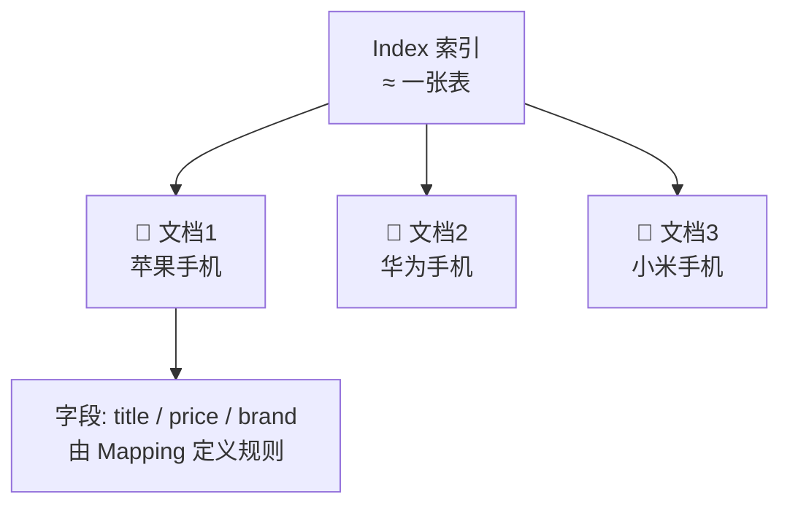
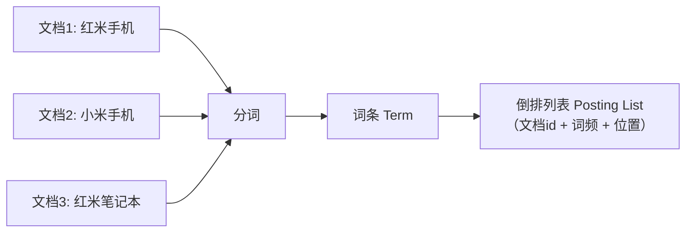
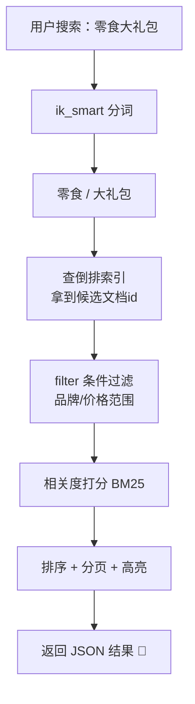
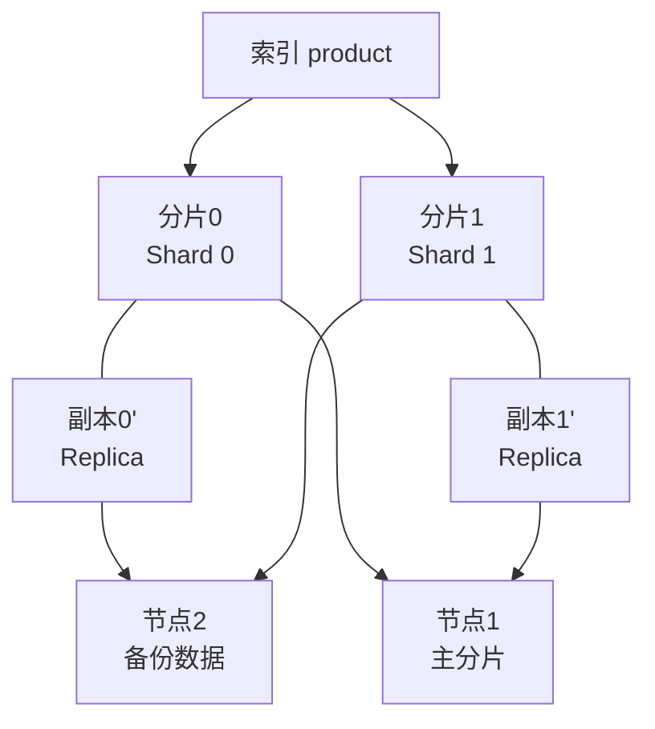
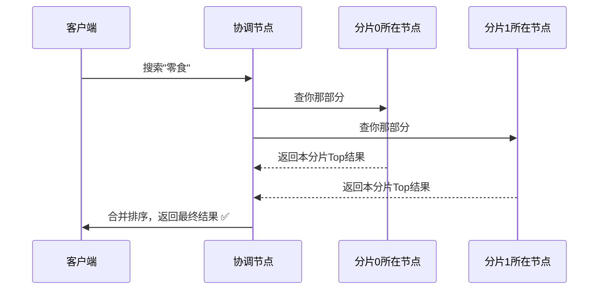
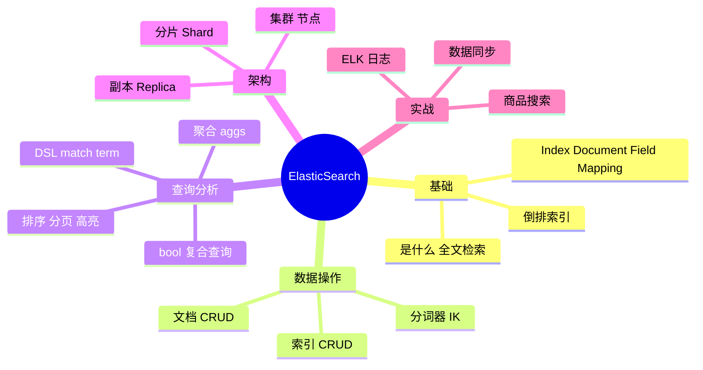

# 🌸 ElasticSearch 学习笔记 —— 搜啥都秒出的全文检索神器

> 嘿嘿～学完 MySQL 和 Redis 这对 CP，这节课来认识搜索引擎界的顶流——ElasticSearch！为什么在淘宝搜"连衣裙"眨眼出几万条结果？答案就在这份笔记里～ 🔍✨

---

## 📖 目录

1. [初识 ElasticSearch：它到底是啥？](#一初识-elasticsearch它到底是啥)
2. [核心概念：用 MySQL 的思路秒懂 ES](#二核心概念用-mysql-的思路秒懂-es)
3. [安装与 Kibana 使用](#三安装与-kibana-使用)
4. [倒排索引：ES 快的灵魂](#四倒排索引es-快的灵魂)
5. [分词器：把句子拆成词](#五分词器把句子拆成词)
6. [索引库操作（建表）](#六索引库操作建表)
7. [文档操作（增删改查）](#七文档操作增删改查)
8. [DSL 查询：重头戏！](#八dsl-查询重头戏)
9. [聚合分析：ES 的"GROUP BY"](#九聚合分析es-的group-by)
10. [集群与分片架构](#十集群与分片架构)
11. [ES vs MySQL vs Redis 三足鼎立](#十一es-vs-mysql-vs-redis-三足鼎立)
12. [经典应用场景](#十二经典应用场景)
13. [避坑与优化小贴士](#十三避坑与优化小贴士)
14. [总结与面试高频题](#十四总结与面试高频题)

---

## 一、初识 ElasticSearch：它到底是啥？

### 1.1 用大白话说 ES

想象你有一本 1000 页的书 📖，想找"倒排索引"出现在哪几页：

- **MySQL 的找法（正排）**：从第 1 页翻到第 1000 页，每页都看看有没有这个词……翻到眼瞎 😵
- **ES 的找法（倒排）**：直接翻到书最后的**索引页**——"倒排索引 → 第 5、23、107 页"，一步到位！🎯

**ElasticSearch（简称 ES）就是一个基于倒排索引、专为搜索而生的分布式搜索引擎。**

它的底层是开源库 **Lucene**，ES 把 Lucene 包装成了开箱即用、天生分布式的样子～

### 1.2 ES 的特点

- 🔍 **全文检索**：像百度一样按"相关性"搜内容，还支持分词、高亮
- ⚡ **近实时（NRT）**：写入后约 1 秒就能搜到，快到没朋友
- 📈 **天然分布式**：数据自动分片、多副本，扩容像搭积木
- 📊 **聚合分析**：不只是搜索，还能做统计（类似超级版 GROUP BY）
- 🌊 **RESTful API**：所有操作都是发 HTTP 请求，JSON 来 JSON 去

### 1.3 什么时候用它？

| 需求 | 用 ES 吗？ |
| --- | --- |
| 商品/文章全文搜索、搜索框自动补全 | ✅ 主场！ |
| 海量日志收集分析（ELK） | ✅ 主场！ |
| 数据统计报表（多维聚合） | ✅ 很合适 |
| 存钱、记账、强事务 | ❌ 找 MySQL |
| 高频读的临时缓存 | ❌ 找 Redis |

> 🎀 记住：ES 是"搜索 + 分析"专家，**不是用来替代数据库的**——事务弱、不擅长频繁更新，各司其职才最美～

---

## 二、核心概念：用 MySQL 的思路秒懂 ES

学过 MySQL 的你，套这张表就懂了一大半！

| ES 概念 | MySQL 类比 | 说明 |
| --- | --- | --- |
| Index 索引 | Database/Table | 数据的集合（7.0 后相当于"表"） |
| Document 文档 | Row 行 | 一条数据，JSON 格式 📄 |
| Field 字段 | Column 列 | 文档里的属性 |
| Mapping 映射 | Schema 表结构 | 字段的类型、是否分词等规则 |
| DSL 查询语句 | SQL | ES 的查询语言（JSON 格式） |

一条文档长这样（它就是 JSON！）：

```json
{
  "id": 1,
  "title": "三只松鼠零食大礼包",
  "price": 89.9,
  "brand": "三只松鼠",
  "sold": 100000
}
```



---

## 三、安装与 Kibana 使用

### 3.1 安装

```bash
# Docker 一行流（ES + Kibana 是好搭档）
docker run -d --name es -p 9200:9200 -e discovery.type=single-node elasticsearch:8.11.0

# Kibana：ES 的可视化控制台
docker run -d --name kibana -p 5601:5601 -e ELASTICSEARCH_HOSTS=http://es:9200 kibana:8.11.0
```

| 组件 | 端口 | 作用 |
| --- | --- | --- |
| ElasticSearch | 9200 | 服务本体，HTTP API |
| Kibana | 5601 | 可视化界面 + Dev Tools（写 DSL 神器）|

### 3.2 Kibana Dev Tools：学习必备

浏览器打开 `http://localhost:5601`，左侧菜单找到 **Dev Tools**，就能愉快地敲 DSL 了～

```json
// 测试 ES 活着没
GET /
```

> 💡 用 Postman / curl 直接发 HTTP 请求也完全 OK，本质都是 RESTful～比如 `curl localhost:9200/_search?q=手机`

---

## 四、倒排索引：ES 快的灵魂

### 4.1 正排 vs 倒排

**正排索引（MySQL 那样）**：文档 id → 内容。想知道内容很方便，想知道"哪个文档包含某词"只能全表扫 😩

**倒排索引（ES）**：**词语 → 文档 id 列表**。搜哪个词，直接查表拿列表！⚡

### 4.2 倒排索引怎么建出来的？



分词后得到这样一张表：

| 词条 Term | 出现在哪些文档 |
| --- | --- |
| 红米 | 文档1、文档3 |
| 手机 | 文档1、文档2 |
| 小米 | 文档2 |
| 笔记本 | 文档3 |

现在搜"手机" → 直接命中文档1、文档2 → 再按相关性打分排序 → 返回！全程没有扫描全表 🚀

### 4.3 倒排索引的组成

| 部分 | 说明 |
| --- | --- |
| Term Dictionary 词条字典 | 所有不重复的词，像字典的部首目录 |
| Term Index 词条索引 | 字典的索引的索引（FST 结构，放内存，快速定位词条）|
| Posting List 倒排列表 | 每个词条对应的文档 id 集合（还带词频、位置，支持高亮）|

> 🎀 一句话：**正排是"人找词"，倒排是"词找人"**——ES 就是靠"词找人"这一招吃遍天的！

---

## 五、分词器：把句子拆成词

### 5.1 分词是啥？

搜索前要先把长句子拆成一个个词：

- `"三只松鼠零食大礼包"` → `三只松鼠` `零食` `大礼包`
- 拆词的质量，直接决定搜索的准确度！

### 5.2 内置分词器的问题

ES 自带的 **standard** 分词器对中文是**逐字切分**：

```json
POST /_analyze
{
  "analyzer": "standard",
  "text": "三只松鼠零食大礼包"
}
// 结果：三 / 只 / 松 / 鼠 / 零 / 食 ...  ← 一个字一个字切，没法用！😱
```

### 5.3 IK 中文分词器（必装！）

```json
POST /_analyze
{
  "analyzer": "ik_smart",
  "text": "三只松鼠零食大礼包"
}
// 结果：三只松鼠 / 零食 / 大礼包 ✅ 终于像人话了！
```

| 模式 | 特点 |
| --- | --- |
| ik_smart | 智能切分，词最少（建索引用，省空间） |
| ik_max_word | 穷举切分，词最多（搜索框输入用，召回高） |

> 💡 常见玩法：**索引用 ik_max_word（拆得细，多建索引），搜索用 ik_smart（查得准）**，双剑合璧～ 新词不够用还能扩充 IK 词典哦！

---

## 六、索引库操作（建表）

### 6.1 Mapping：定字段规则

```json
PUT /product
{
  "settings": {
    "number_of_shards": 1,      // 分片数
    "number_of_replicas": 1     // 副本数
  },
  "mappings": {
    "properties": {
      "title":    { "type": "text", "analyzer": "ik_max_word", "search_analyzer": "ik_smart" },
      "brand":    { "type": "keyword" },
      "price":    { "type": "double" },
      "sold":     { "type": "integer" },
      "createdAt":{ "type": "date" },
      "desc":     { "type": "text", "index": false }
    }
  }
}
```

### 6.2 两种超重要的字段类型（易混！）

| 类型 | 会分词吗 | 搜索方式 | 适用 |
| --- | --- | --- | --- |
| **text** | ✅ 分词 | 按词模糊匹配，参与相关性打分 | 标题、正文、描述 |
| **keyword** | ❌ 整体一个词 | 精确匹配 / 排序 / 聚合 | 品牌、手机号、状态、标签 |

> ⚠️ 经典坑：把品牌名设成 text，搜"华为"连"华"都能搜出来；要精确匹配请用 keyword！

### 6.3 常用索引操作

```json
// 查看索引
GET /product

// 查看所有索引（像 SHOW DATABASES）
GET /_cat/indices?v

// 删除索引
DELETE /product
```

> 💡 ES 的 Mapping **不能修改已有字段类型**（倒排索引结构已定），只能新增字段——所以要改就得删了重建（数据先备份哦）！

---

## 七、文档操作（增删改查）

### 7.1 增（新增文档）

```json
// 指定 id 新增
POST /product/_doc/1
{
  "title": "三只松鼠零食大礼包",
  "brand": "三只松鼠",
  "price": 89.9,
  "sold": 100000
}

// 随机 id 新增（自带一串乱码 id）
POST /product/_doc
{ "title": "红米手机", "brand": "小米", "price": 1999, "sold": 50000 }
```

### 7.2 查 / 改 / 删

```json
// 查单条（主键查询，最快）
GET /product/_doc/1

// 全量更新（整个文档替换）
PUT /product/_doc/1
{ "title": "三只松鼠大礼包（新）", "brand": "三只松鼠", "price": 79.9, "sold": 120000 }

// 局部更新（只改 price）✅ 常用
POST /product/_update/1
{ "doc": { "price": 69.9 } }

// 删除
DELETE /product/_doc/1
```

| 操作 | MySQL 类比 | ES 写法 |
| --- | --- | --- |
| 新增 | INSERT | POST /索引/_doc/id |
| 主键查询 | SELECT ... WHERE id= | GET /索引/_doc/id |
| 全量更新 | UPDATE（整行） | PUT /索引/_doc/id |
| 局部更新 | UPDATE（部分列） | POST /索引/_update/id + doc |
| 删除 | DELETE | DELETE /索引/_doc/id |

---

## 八、DSL 查询：重头戏！

DSL（Domain Specific Language）就是 ES 的"SQL"，全都是 JSON～ 查询语法分两大类：

| 分类 | 特点 | 典型 |
| --- | --- | --- |
| Query 查询（matches） | 参与打分、算相关性 | match 全文检索 |
| Filter 过滤（filters） | 不打分、只判断 YES/NO、**可缓存更快** | term、range |

### 8.1 match_all & match：最基础

```json
// 查全部
GET /product/_search
{ "query": { "match_all": {} } }

// 全文检索：标题包含"零食"或"大礼包"的（会先分词再查）
GET /product/_search
{
  "query": { "match": { "title": "零食大礼包" } }
}
```

### 8.2 term & keyword：精确匹配

```json
// 精确匹配品牌（keyword 字段用 term！）
GET /product/_search
{
  "query": { "term": { "brand": { "value": "小米" } } }
}
```

| | match | term |
| --- | --- | --- |
| 会分词吗 | ✅ 查询词先分词 | ❌ 整体精确匹配 |
| 用在 | text 字段 | keyword / 数字 / 日期 |

### 8.3 bool 复合查询：组装你的查询乐高 🧩

```json
GET /product/_search
{
  "query": {
    "bool": {
      "must": [                          // AND：必须满足，参与打分
        { "match": { "title": "手机" } }
      ],
      "filter": [                        // 过滤：不打分，可缓存（快！）
        { "term":  { "brand": "小米" } },
        { "range": { "price": { "gte": 1000, "lte": 3000 } } }
      ],
      "must_not": [                      // NOT：必须不满足
        { "term": { "brand": "苹果" } }
      ],
      "should": [                        // OR：满足加分，不满足也行
        { "match": { "title": "红米" } }
      ]
    }
  }
}
```

| 子句 | 逻辑 | 打分？ | 一句话 |
| --- | --- | --- | --- |
| must | AND | ✅ | 必须都满足 |
| filter | AND | ❌（快） | 必须满足，只管筛选不管打分 |
| must_not | NOT | ❌ | 必须都不满足 |
| should | OR | ✅ | 满足了加分，锦上添花 |

> 🎀 经验法则：**要算相关性的用 must/match，纯筛条件的（范围、状态、分类）全丢 filter**，又快又省～

### 8.4 排序 & 分页

```json
GET /product/_search
{
  "query": { "match_all": {} },
  "from": 0, "size": 10,                     // 分页：跳过0条取10条
  "sort": [
    { "sold": "desc" },                       // 销量降序
    { "price": "asc" }                        // 销量相同按价格升序
  ]
}
```

### 8.5 高亮：搜索词变色 ✨

```json
GET /product/_search
{
  "query": { "match": { "title": "零食" } },
  "highlight": {
    "fields": { "title": {} },               // 对 title 字段高亮
    "pre_tags": ["<em>"],                    // 前缀标签（默认就是 em）
    "post_tags": ["</em>"]
  }
}
// 结果里 title 会被包上标签：三只松鼠<em>零食</em>大礼包
// 前端拿到后渲染成红色/加粗，就是熟悉的搜索效果啦～
```

### 8.6 一次查多个（ids / multi_match / match_phrase）

```json
// 按 id 批量查
{ "query": { "ids": { "values": ["1", "2", "3"] } } }

// 多字段检索：标题或描述里找
{ "query": { "multi_match": { "query": "零食", "fields": ["title", "desc"] } } }

// 短语匹配：要求词按顺序紧挨着（"红米手机"不会匹配"手机红米"）
{ "query": { "match_phrase": { "title": "红米手机" } } }
```

### 8.7 查询流程总览



---

## 九、聚合分析：ES 的"GROUP BY"

聚合（aggs）能做统计分析，比 SQL 的 GROUP BY 更强大～

```json
// 桶聚合：按品牌分组，统计每个品牌的数量和平均价格
GET /product/_search
{
  "size": 0,                                  // 不要原始文档，只要统计结果
  "aggs": {
    "brand_group": {
      "terms": { "field": "brand" },          // 按 brand 分桶
      "aggs": {
        "avg_price": { "avg": { "field": "price" } }   // 桶内再算平均价
      }
    }
  }
}
```

| 聚合类型 | 功能 | SQL 类比 |
| --- | --- | --- |
| terms 桶聚合 | 按字段分组统计 | GROUP BY + COUNT |
| avg / sum / max / min | 平均/求和/最大/最小 | AVG / SUM / MAX / MIN |
| stats | 一口气返回 count/min/max/avg/sum | 多函数全家桶 |
| range 范围桶 | 按区间分桶（0-100，100-500…） | CASE WHEN 分段 |
| date_histogram | 按日期间隔分桶（每天/每月） | 按时间分组 |
| nested 嵌套 | 桶里套桶，多层分析 | 多级 GROUP BY |

> 💡 **指标聚合**（avg/sum）出数字，**桶聚合**（terms/range）出分组——桶里还能继续套聚合，套娃式分析！

---

## 十、集群与分片架构

### 10.1 为什么天生分布式？

数据量太大，一台机器存不下、也怕它宕机 → ES 把索引切成多份分散存，每份还有备份～



### 10.2 核心概念

| 概念 | 说明 |
| --- | --- |
| 分片 Shard | 索引的"切片"，每片是一个完整的 Lucene 索引 |
| 副本 Replica | 分片的备份（主分片挂了，副本顶上）|
| 节点 Node | 一台运行 ES 的服务器 |
| 主节点 Master | 管理集群元数据（建索引、分片分配），不管文档读写 |
| 协调节点 | 接收请求、汇总结果的节点（每个节点都能当）|

### 10.3 一次查询的旅程



> 💡 分片数**建索引时定死不能改**（路由靠它），规划时按数据量估好；副本数倒是能随时调～

---

## 十一、ES vs MySQL vs Redis 三足鼎立

学了仨，来张总决表镇楼！🏆

| 对比项 | MySQL 📊 | Redis ⚡ | ES 🔍 |
| --- | --- | --- | --- |
| 定位 | 关系型数据库 | 内存 KV 缓存 | 分布式搜索引擎 |
| 数据结构 | 表 | 键值对 | JSON 文档 |
| 检索方式 | SQL，条件/JOIN | 按 key 直取 | 倒排索引全文检索 |
| 全文搜索 | LIKE（弱，走不了索引）| ❌ 不支持 | ✅ 专业级，带打分高亮 |
| 事务 | ✅ 强 ACID | 弱 | ❌ 不支持 |
| 写入性能 | 中 | 极快 | 较慢（建索引有开销）|
| 查询实时性 | 实时 | 实时 | 近实时（约1秒）|
| 典型用途 | 核心业务数据 | 缓存/计数/锁 | 搜索/日志分析 |

**黄金组合套路（电商为例）：**

```mermaid
flowchart LR
    U[用户搜索连衣裙] --> R[(Redis<br>缓存热点结果)]
    R --|没有| E[(ElasticSearch<br>全文检索+打分排序)]
    M[(MySQL<br>存订单/库存等核心数据)] --|数据变更同步| E
    E --> U
```

> 🎀 口诀：**MySQL 存底账，Redis 提速度，ES 管搜索**——三剑客各显神通！

---

## 十二、经典应用场景

| 场景 | 怎么用 |
| --- | --- |
| 🛒 电商商品搜索 | 商品数据同步到 ES，标题 text + 品牌 keyword，match + filter 组合查 |
| 📝 百科/站内搜索 | 全文检索 + 高亮 + 相关性排序 |
| 📊 日志分析（ELK） | Logstash 收日志 → ES 存储 → Kibana 可视化 |
| 👥 用户画像筛选 | bool 组合条件、聚合统计 |
| 🚨 监控告警 | 日志聚合，错误数超阈值就报警 |
| 🗺️ 地理搜索 | geo_point 类型，附近的人/店 |
| 💡 搜索自动补全 | completion suggester，输入联想 |
| 📈 舆情/销量看板 | date_histogram 按天分桶 + 指标聚合 |

**数据怎么从 MySQL 进 ES？（常见两招）**

1. **同步调用**：改完数据库顺手写 ES（简单，但耦合高）
2. **异步监听**：监听 binlog（用 canal）/ MQ 消息，变化后更新 ES ✅ 推荐

---

## 十三、避坑与优化小贴士

### 13.1 新手常见坑 ⚠️

| 坑 | 后果 | 正确姿势 |
| --- | --- | --- |
| 中文不用 IK 分词 | 搜不准，逐字匹配 | 装 IK，text 字段指定 analyzer |
| 该精确的字段用 text | 搜"华为"出"华" | 品牌/状态用 keyword |
| 用 ES 存核心账务数据 | 没事务，出事故 | 核心数据进 MySQL |
| 深分页 from 太大 | 占内存，查询巨慢 | 用 search_after 游标分页 |
| 频繁局部更新文档 | 每次都是重建索引，开销大 | 批量 bulk 操作 |
| 分片数随手设超大 | 小数据多分片，纯属浪费 | 按 GB 级规划（单分片 10~50GB）|

### 13.2 优化清单 ✅

- [ ] 搜索条件里，**纯筛选条件放 filter**（可缓存、不打分）
- [ ] 写入用 **_bulk 批量接口**，别一条条塞
- [ ] 不需要检索的字段设 `"index": false`，省空间
- [ ] 大文本字段考虑关闭 source 或设 index: false
- [ ] 深分页改用 **search_after**（配合 PIT）
- [ ] 预排序：查询频繁的排序字段加 `"doc_values"` 默认就有，别用 text 排序
- [ ] 写多读少场景可调 `refresh_interval` 放宽（默认 1s）

---

## 十四、总结与面试高频题

### 14.1 知识地图



### 14.2 面试官最爱问 Top 题 🎯

| 问题 | 答题要点 |
| --- | --- |
| 倒排索引是什么？ | 词 → 文档id 列表；Term Dictionary + Term Index + Posting List；先分词再建 |
| ES 为什么快？ | 倒排索引 + Term Index 在内存（FST）+ 分片并行查询 + 列存 doc_values |
| text 和 keyword 区别？ | text 分词参与打分（搜索）；keyword 整体精确（过滤/排序/聚合） |
| match 和 term 区别？ | match 先分词再查；term 精确匹配不分词 |
| must 和 filter 区别？ | 都要满足；must 打分，filter 不打分但可缓存更快 |
| ES 和 MySQL 怎么选/配合？ | MySQL 核心存储 + binlog/MQ 同步到 ES 做搜索 |
| 深分页怎么优化？ | from+size 有上限（默认1万），改 search_after 游标 |
| 集群里分片和副本的作用？ | 分片横向扩容，副本高可用；分片数建后不可改 |
| ES 支持事务吗？ | ❌ 不支持，只保证单文档操作原子性 |

### 14.3 学习建议路线 🗺️

1. **第一站**：Docker 起 ES + Kibana，把索引/文档 CRUD 敲熟
2. **第二站**：装 IK 分词器，玩转 match/term/bool 查询和高亮
3. **第三站**：聚合分析 + search_after 分页，做出像样的搜索页
4. **第四站**：理解倒排索引和分片副本，架构心里有数
5. **终点站**：搭一套 MySQL → canal/MQ → ES 数据同步 + 商品搜索实战 🌟

---

> 🌈 ES 通关达成！至此数据库三巨头 MySQL / Redis / ES 全部集齐～你已经有了"存储 + 缓存 + 搜索"的完整武器库，可以召唤神龙做项目啦！继续加油鸭！ヾ(≧▽≦*)o 💪✨
