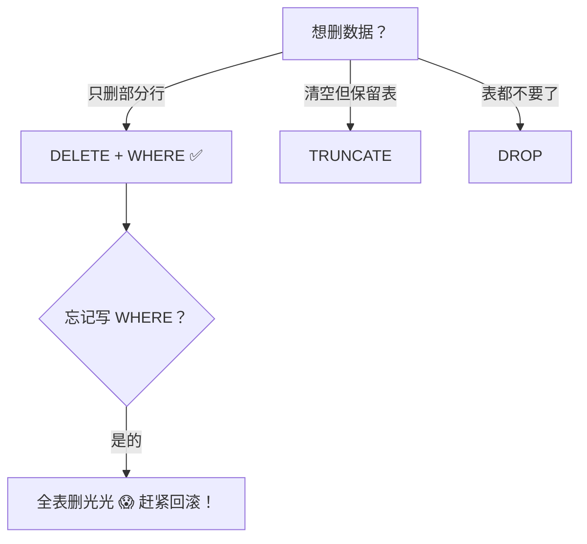
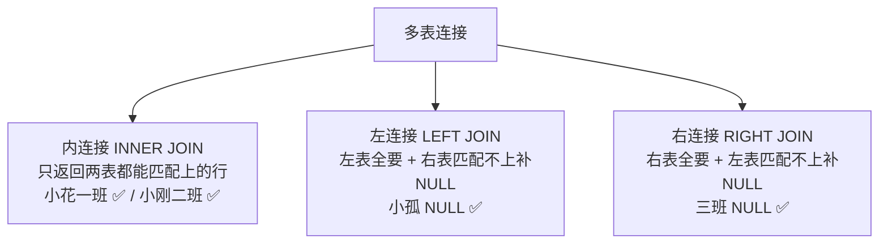
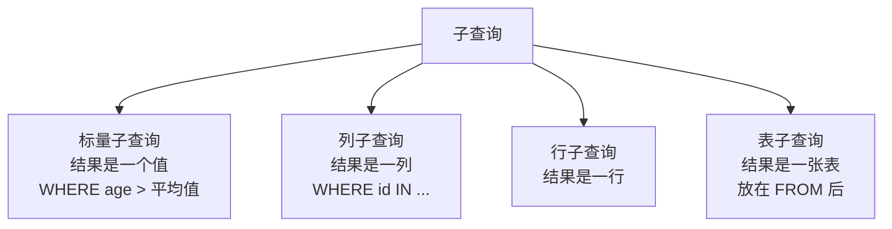
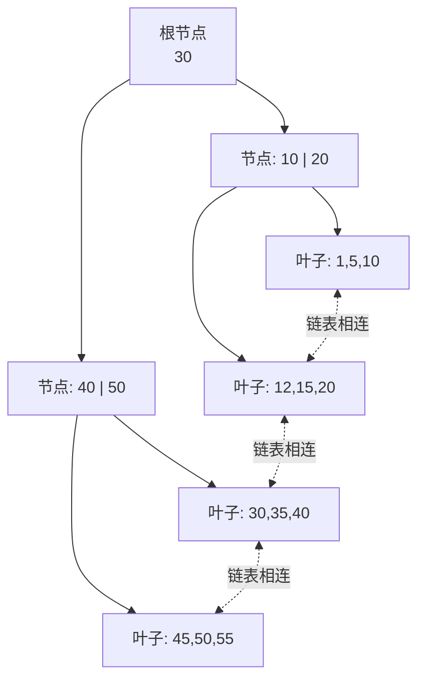
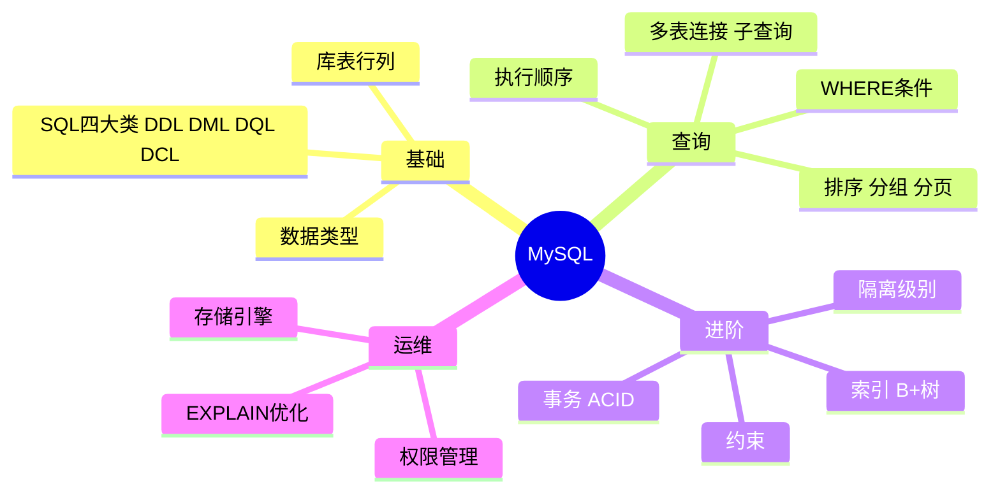

# 🌸 MySQL 学习笔记 —— 从零开始的数据魔法之旅

> 嘿嘿～欢迎来到 MySQL 的魔法世界！这份笔记会用最直白的大白话，带你把 MySQL 从入门到入土（不是，是到精通！💪✨）

---

## 📖 目录

1. [初识 MySQL：它到底是啥？](#一初识-mysql它到底是啥)
2. [安装与连接](#二安装与连接)
3. [核心概念：库、表、行、列](#三核心概念库表行列)
4. [SQL 语言的四大门派](#四sql-语言的四大门派)
5. [数据库与表的操作（DDL）](#五数据库与表的操作ddl)
6. [数据的增删改（DML）](#六数据的增删改dml)
7. [数据查询（DQL）—— 重头戏！](#七数据查询dql--重头戏)
8. [多表查询与子查询](#八多表查询与子查询)
9. [常用函数宝典](#九常用函数宝典)
10. [约束：给数据上保险](#十约束给数据上保险)
11. [索引：查询提速神器](#十一索引查询提速神器)
12. [事务：要么都做，要么都不做](#十二事务要么都做要么都不做)
13. [存储引擎](#十三存储引擎)
14. [用户与权限管理（DCL）](#十四用户与权限管理dcl)
15. [性能优化小贴士](#十五性能优化小贴士)
16. [总结与面试高频题](#十六总结与面试高频题)

---

## 一、初识 MySQL：它到底是啥？

### 1.1 用大白话说数据库

想象你开了一家奶茶店 🧋：

- 客户信息、订单、库存……总不能全记在小本本上吧？
- **数据库（Database）就是那个超级能装的电子账本**！
- 而 **MySQL 就是管理这个账本的"管家软件"**，是世界上最流行的开源关系型数据库之一～

### 1.2 关系型 vs 非关系型

| 对比项 | 关系型数据库（MySQL）📈 | 非关系型数据库（Redis/MongoDB）☁️ |
| --- | --- | --- |
| 数据结构 | 表格（行+列），像 Excel | 键值对 / 文档 / 图等 |
| 适合场景 | 数据之间有**关系**、要保证一致性 | 高并发读写、灵活结构 |
| 查询能力 | SQL，强大到飞起 | 各有各的招 |
| 事务支持 | ✅ 支持 ACID | 一般较弱 |

> 💡 小贴士：MySQL 是**关系型**数据库——数据存在一张张"表"里，表和表之间还能"拉关系"，这就是"关系型"名字的由来哦～

### 1.3 MySQL 的三大优点

- 🆓 **开源免费**：不花钱，社区还超级活跃
- ⚡ **够快够稳**：中小型项目的顶梁柱
- 🌍 **生态好**：Java、Python、PHP……几乎所有语言都能无缝对接

---

## 二、安装与连接

### 2.1 安装方式

| 方式 | 适合人群 | 说明 |
| --- | --- | --- |
| 官方安装包 | 新手小白 🌱 | 图形界面点点点，最直观 |
| Docker | 玩容器的同学 🐳 | 一行命令搞定，干净不污染系统 |
| 集成环境（phpStudy 等） | 懒人福音 😴 | 一键全家桶 |

Docker 党的一行命令（超省心！）：

```bash
docker run -d --name mysql -p 3306:3306 -e MYSQL_ROOT_PASSWORD=123456 mysql:8.0
```

### 2.2 连接 MySQL

**命令行连接：**

```bash
mysql -u root -p
# -u 指定用户名，-p 会提示你输密码（输入时不会显示，别慌，是正常的哦～）
```

**图形化工具（推荐给怕黑框框的同学）：**

- Navicat（功能全，但收费 💰）
- DBeaver（免费开源，真香 ✅）
- DataGrip / VS Code 插件


---

## 三、核心概念：库、表、行、列

用 Excel 来类比，秒懂！📊

| MySQL 术语 | Excel 类比 | 说明 |
| --- | --- | --- |
| 数据库 Database | 整个 Excel 文件 | 一栋楼 🏢 |
| 表 Table | 工作表 Sheet | 楼里的一间房 |
| 行 Row / 记录 Record | 一行数据 | 一个学生/一份订单 |
| 列 Column / 字段 Field | 一列 | 数据的某个属性（姓名、年龄） |

举个例子，一张 `student` 表长这样：

| id | name | age | gender | class_id |
| -- | ---- | --- | ------ | -------- |
| 1 | 小花 | 18 | 女 | 1 |
| 2 | 小明 | 19 | 男 | 1 |
| 3 | 小刚 | 20 | 男 | 2 |

- 每一行 = 一个学生的完整信息
- 每一列 = 学生的一种属性
- `class_id` 还能关联到班级表 → 这就是"关系"！🔗

---

## 四、SQL 语言的四大门派

SQL（Structured Query Language，结构化查询语言）就是和 MySQL 管家"对话"的语言～按照功能分成四大类：

```mermaid
flowchart TD
    SQL[SQL 语句] --> DDL[DDL 定义语言<br>CREATE / DROP / ALTER<br>管"房子"怎么盖]
    SQL --> DML[DML 操作语言<br>INSERT / UPDATE / DELETE<br>管"住户"进出]
    SQL --> DQL[DQL 查询语言<br>SELECT<br>查户口本！]
    SQL --> DCL[DCL 控制语言<br>GRANT / REVOKE<br>谁有钥匙谁没钥匙]
```

| 分类 | 全称 | 常用命令 | 干嘛的 |
| --- | --- | --- | --- |
| DDL | Data Definition Language | CREATE、DROP、ALTER | 定义结构（库、表） |
| DML | Data Manipulation Language | INSERT、UPDATE、DELETE | 操作数据 |
| DQL | Data Query Language | SELECT | 查询数据 |
| DCL | Data Control Language | GRANT、REVOKE | 控制权限 |

> 🎀 记忆口诀：**DDL 盖房，DML 搬家具，DQL 找东西，DCL 发钥匙**！

---

## 五、数据库与表的操作（DDL）

### 5.1 数据库的增删改查

```sql
-- 创建数据库（指定字符集，防止中文乱码！）
CREATE DATABASE IF NOT EXISTS shop DEFAULT CHARSET utf8mb4;

-- 查看所有数据库
SHOW DATABASES;

-- 使用（切换到）某个数据库 —— 后续操作都在它里面进行
USE shop;

-- 删除数据库（危险操作，删库跑路警告！🚨）
DROP DATABASE IF EXISTS shop;
```

### 5.2 常用数据类型速查表

选对类型，省空间又高效～

| 类型 | 大小 | 说明 | 示例 |
| --- | --- | --- | --- |
| INT | 4 字节 | 整数 | 年龄、数量 |
| BIGINT | 8 字节 | 大整数 | 订单号、雪花 ID |
| FLOAT / DOUBLE | 4/8 字节 | 浮点数（有精度误差） | 科学计算 |
| DECIMAL(M,D) | 变长 | **精确小数，钱就用它！** 💰 | DECIMAL(10,2) |
| CHAR(n) | 固定长度 | 定长字符串，不足补空格 | 手机号、身份证 |
| VARCHAR(n) | 变长长度 | 变长字符串，用多少占多少 | 姓名、地址 |
| DATE | 3 字节 | 日期 | 2026-10-02 |
| DATETIME | 8 字节 | 日期+时间 | 2026-10-02 10:30:00 |
| TIMESTAMP | 4 字节 | 时间戳（带时区转换） | 记录创建时间 |

> ⚠️ 涉及**金额**千万别用 FLOAT/DOUBLE！它们有精度误差，0.1 + 0.2 ≠ 0.3 的经典惨案就是这么来的，请用 `DECIMAL`！

### 5.3 表的创建与修改

```sql
-- 创建学生表
CREATE TABLE student (
    id        INT PRIMARY KEY AUTO_INCREMENT COMMENT '学号，自增',
    name      VARCHAR(50) NOT NULL COMMENT '姓名',
    age       INT COMMENT '年龄',
    gender    CHAR(1) DEFAULT '男' COMMENT '性别',
    class_id  INT COMMENT '班级ID',
    created_at DATETIME DEFAULT CURRENT_TIMESTAMP COMMENT '创建时间'
) COMMENT '学生表';

-- 查看表结构
DESC student;

-- 修改表名
ALTER TABLE student RENAME TO students;

-- 添加列
ALTER TABLE students ADD COLUMN phone VARCHAR(11);

-- 修改列类型
ALTER TABLE students MODIFY COLUMN age SMALLINT;

-- 修改列名和类型
ALTER TABLE students CHANGE COLUMN gender sex CHAR(1);

-- 删除列
ALTER TABLE students DROP COLUMN phone;

-- 删除表（结构+数据全没了，慎用！）
DROP TABLE IF EXISTS students;
```


---

## 六、数据的增删改（DML）

### 6.1 INSERT：插入数据

```sql
-- 方式1：指定列插入（推荐！清晰不易错）
INSERT INTO student (name, age, gender, class_id)
VALUES ('小花', 18, '女', 1);

-- 方式2：批量插入（效率更高，日常开发必备）
INSERT INTO student (name, age, gender, class_id) VALUES
('小明', 19, '男', 1),
('小刚', 20, '男', 2),
('小红', 18, '女', 2);
```

### 6.2 UPDATE：更新数据

```sql
-- 把 id 为 1 的学生年龄改成 19
UPDATE student SET age = 19 WHERE id = 1;

-- 同时改多个字段
UPDATE student SET age = 20, gender = '女' WHERE id = 2;
```

> 🚨 **血泪警告**：UPDATE 不写 WHERE 条件 = **全表所有行都被改**！执行前先 SELECT 确认范围，这是保命符！

### 6.3 DELETE：删除数据

```sql
-- 删除指定行
DELETE FROM student WHERE id = 3;

-- 删除全表数据（一行一行删，可回滚）
DELETE FROM student;

-- 清空全表（重建表，速度快，不可回滚，自增ID归零）
TRUNCATE TABLE student;
```

### 6.4 DELETE vs TRUNCATE vs DROP

| 对比项 | DELETE | TRUNCATE | DROP |
| --- | --- | --- | --- |
| 类型 | DML | DDL | DDL |
| 删什么 | 行数据（可带 WHERE） | 全部行数据 | 整张表（结构+数据） |
| 可否回滚 | ✅ 可以 | ❌ 不可以 | ❌ 不可以 |
| 速度 | 慢（逐行删） | 快 | 快 |
| 自增 ID | 保留计数 | 归零 | 表都没了 |
| 触发器 | 触发 | 不触发 | 不触发 |



---

## 七、数据查询（DQL）—— 重头戏！

查询是日常工作中用得最多的，90% 的 SQL 都是 SELECT～认真学哦！✨

### 7.1 基本查询

```sql
-- 查询所有列（* 是通配符，生产环境建议写明列名，更快更清晰）
SELECT * FROM student;

-- 查询指定列
SELECT name, age FROM student;

-- 起别名（AS 可以省略）
SELECT name AS '姓名', age AS '年龄' FROM student;

-- 去重（比如想知道班里有哪些不同的年龄）
SELECT DISTINCT age FROM student;
```

### 7.2 条件查询 WHERE

```sql
-- 比较运算符：=  >  <  >=  <=  <>(!=)
SELECT * FROM student WHERE age >= 18;

-- 逻辑运算：AND 与 / OR 或 / NOT 非
SELECT * FROM student WHERE age > 18 AND gender = '女';

-- 范围：BETWEEN...AND（闭区间，两头都包含）
SELECT * FROM student WHERE age BETWEEN 18 AND 20;

-- 集合：IN / NOT IN
SELECT * FROM student WHERE class_id IN (1, 2);

-- 模糊查询：LIKE（% 任意多个字符，_ 单个字符）
SELECT * FROM student WHERE name LIKE '小%';   -- 小开头的
SELECT * FROM student WHERE name LIKE '_红';   -- 两个字且以红结尾

-- 空值判断：不能用 = null，必须用 IS NULL！
SELECT * FROM student WHERE class_id IS NULL;
SELECT * FROM student WHERE class_id IS NOT NULL;
```

常用条件运算符一览表：

| 运算符 | 功能 | 示例 |
| --- | --- | --- |
| = / <> | 等于 / 不等于 | `age = 18` |
| > / >= / < / <= | 大小比较 | `age > 18` |
| BETWEEN..AND | 范围（闭区间） | `age BETWEEN 18 AND 25` |
| IN(...) | 在集合中 | `id IN (1,2,3)` |
| LIKE | 模糊匹配 | `name LIKE '张%'` |
| IS NULL | 判断为空 | `email IS NULL` |

### 7.3 排序 ORDER BY

```sql
-- 按年龄升序（ASC 默认可省略）
SELECT * FROM student ORDER BY age ASC;

-- 按年龄降序
SELECT * FROM student ORDER BY age DESC;

-- 多字段排序：先按年龄降序，年龄相同再按姓名升序
SELECT * FROM student ORDER BY age DESC, name ASC;
```

### 7.4 聚合函数：把多行变成一个值

| 函数 | 功能 | 备注 |
| --- | --- | --- |
| COUNT(*) | 统计行数 | COUNT(字段) 会忽略 NULL |
| SUM(字段) | 求和 | 数值型 |
| AVG(字段) | 平均值 | 数值型 |
| MAX(字段) | 最大值 | |
| MIN(字段) | 最小值 | |

```sql
SELECT COUNT(*) AS '总人数',
       AVG(age)  AS '平均年龄',
       MAX(age)  AS '最大年龄',
       MIN(age)  AS '最小年龄'
FROM student;
```

> 💡 聚合函数会**忽略 NULL 值**，统计总数记得用 `COUNT(*)` 而不是 `COUNT(某字段)` 哦～

### 7.5 分组 GROUP BY + HAVING

```sql
-- 统计每个班的人数和平均年龄
SELECT class_id, COUNT(*) AS '人数', AVG(age) AS '平均年龄'
FROM student
GROUP BY class_id;

-- 分组后再筛选：只看人数超过 2 人的班（WHERE 之后执行，所以要写 HAVING）
SELECT class_id, COUNT(*) AS '人数'
FROM student
GROUP BY class_id
HAVING COUNT(*) > 2;
```

**WHERE 和 HAVING 的区别**（面试常问！）：

| 对比项 | WHERE | HAVING |
| --- | --- | --- |
| 执行时机 | 分组**前**过滤 | 分组**后**过滤 |
| 能否用聚合函数 | ❌ 不能 | ✅ 能 |
| 针对对象 | 原始行 | 分组后的结果 |

### 7.6 分页 LIMIT

```sql
-- LIMIT 起始索引, 每页条数
-- 第 1 页（每页 10 条）：起始索引 = (页码-1) * 每页条数
SELECT * FROM student LIMIT 0, 10;   -- 第1页
SELECT * FROM student LIMIT 10, 10;  -- 第2页
SELECT * FROM student LIMIT 20, 10;  -- 第3页
```

### 7.7 ⭐ SQL 执行顺序（超重点！）

写 SQL 的顺序 ≠ 执行顺序，这个必须刻进 DNA 里！


| 顺序 | 关键字 | 干嘛 |
| --- | --- | --- |
| 1 | FROM | 先找到表 |
| 2 | WHERE | 过滤行 |
| 3 | GROUP BY | 分组 |
| 4 | HAVING | 过滤组 |
| 5 | SELECT | 选择列 |
| 6 | ORDER BY | 排序 |
| 7 | LIMIT | 分页 |

> 🎀 这也解释了为啥 WHERE 里不能写聚合函数——它执行的时候还没分组呢，巧妇难为无米之炊呀～

---

## 八、多表查询与子查询

真实项目里数据分散在多张表，比如"学生表"和"班级表"，怎么合起来看？这就是多表查询！

### 8.1 先准备两张表

**班级表 class：**

| id | class_name |
| -- | ---------- |
| 1 | 一班 |
| 2 | 二班 |
| 3 | 三班 |

**学生表 student：**

| id | name | class_id |
| -- | ---- | -------- |
| 1 | 小花 | 1 |
| 2 | 小明 | 1 |
| 3 | 小刚 | 2 |
| 4 | 小孤 | NULL（没分班） |

### 8.2 内连接 INNER JOIN：只留"两情相悦"的

```sql
-- 查学生及其所在班级（没有班级的学生、没有学生的班级都不会出现）
SELECT s.name, c.class_name
FROM student s
INNER JOIN class c ON s.class_id = c.id;
```

### 8.3 外连接：主表全保留

```sql
-- 左外连接：左表全保留，右表没匹配上就填 NULL
-- 小孤没有班级，但也会出现，班级显示 NULL
SELECT s.name, c.class_name
FROM student s
LEFT JOIN class c ON s.class_id = c.id;

-- 右外连接：右表全保留
SELECT s.name, c.class_name
FROM student s
RIGHT JOIN class c ON s.class_id = c.id;
```

三种连接一张图看懂（Venn 图脑补一下）：



| 连接类型 | 结果特点 | 一句话记忆 |
| --- | --- | --- |
| INNER JOIN | 只留交集 | 两情相悦才在一起 💕 |
| LEFT JOIN | 左表全保留 | 左表是老大，全都要 |
| RIGHT JOIN | 右表全保留 | 右表是老大 |
| FULL JOIN | 两边全保留 | MySQL 不支持！用 UNION 模拟 |

### 8.4 自连接：自己跟自己连

经典场景：员工表里存"上级ID"，查每个人的领导是谁～

```sql
-- 员工表 emp：id, name, manager_id（领导也是员工，也在这个表里）
SELECT e.name AS '员工', m.name AS '领导'
FROM emp e
LEFT JOIN emp m ON e.manager_id = m.id;
```

### 8.5 子查询：查询套查询

```sql
-- 查比平均年龄大的学生（先算平均值，再拿去当条件）
SELECT * FROM student
WHERE age > (SELECT AVG(age) FROM student);

-- 子查询出现在 FROM 中（当临时表用）
SELECT t.class_id, t.cnt
FROM (SELECT class_id, COUNT(*) AS cnt FROM student GROUP BY class_id) t
WHERE t.cnt > 1;

-- EXISTS 写法：存在则真
SELECT * FROM class c
WHERE EXISTS (SELECT 1 FROM student s WHERE s.class_id = c.id);
```



---

## 九、常用函数宝典

### 9.1 字符串函数

| 函数 | 功能 | 示例结果 |
| --- | --- | --- |
| CONCAT(s1,s2,...) | 拼接字符串 | CONCAT('Hello',' MySQL') → Hello MySQL |
| UPPER(s) / LOWER(s) | 转大写 / 小写 | UPPER('abc') → ABC |
| LENGTH(s) | 字符串长度（字节） | LENGTH('你好') → 6（utf8 中文3字节） |
| TRIM(s) | 去掉首尾空格 | TRIM(' hi ') → hi |
| SUBSTRING(s,start,len) | 截取子串 | SUBSTRING('abcdef',2,3) → bcd |
| REPLACE(s,a,b) | 替换 | REPLACE('aaa','a','b') → bbb |
| LPAD(s,n,pad) | 左填充到 n 位 | LPAD('5',3,'0') → 005 |

### 9.2 数值函数

| 函数 | 功能 | 示例结果 |
| --- | --- | --- |
| CEIL(x) | 向上取整 | CEIL(1.1) → 2 |
| FLOOR(x) | 向下取整 | FLOOR(1.9) → 1 |
| MOD(a,b) | 取模（求余） | MOD(10,3) → 1 |
| RAND() | 随机数 0~1 | |
| ROUND(x,d) | 四舍五入保留 d 位 | ROUND(3.1415,2) → 3.14 |

### 9.3 日期函数

| 函数 | 功能 | 示例结果 |
| --- | --- | --- |
| NOW() | 当前日期时间 | 2026-10-02 10:30:00 |
| CURDATE() | 当前日期 | 2026-10-02 |
| CURTIME() | 当前时间 | 10:30:00 |
| YEAR/MONTH/DAY(d) | 提取年月日 | YEAR(NOW()) → 2026 |
| DATE_ADD(d, INTERVAL n 单位) | 日期加减 | DATE_ADD(NOW(), INTERVAL 7 DAY) |
| DATEDIFF(d1,d2) | 相差天数 | DATEDIFF('2026-10-02','2026-10-01') → 1 |
| DATE_FORMAT(d,fmt) | 格式化 | DATE_FORMAT(NOW(),'%Y年%m月') |

### 9.4 流程控制函数

```sql
-- IF：二选一
SELECT name, IF(age >= 18, '成年', '未成年') AS '状态' FROM student;

-- IFNULL：为空就给默认值（超常用！）
SELECT name, IFNULL(class_id, '未分班') FROM student;

-- CASE WHEN：多分支，相当于代码里的 switch
SELECT name,
    CASE
        WHEN age < 18 THEN '未成年'
        WHEN age < 60 THEN '青年'
        ELSE '老年'
    END AS '年龄段'
FROM student;
```

---

## 十、约束：给数据上保险

约束就是给表定规矩，不符合规矩的数据直接拒收！🛡️

| 约束 | 关键字 | 作用 | 备注 |
| --- | --- | --- | --- |
| 主键 | PRIMARY KEY | 唯一标识一行 | 一张表只能有一个 |
| 自增 | AUTO_INCREMENT | 自动+1 | 配合主键使用 |
| 非空 | NOT NULL | 不许为空 | |
| 唯一 | UNIQUE | 不许重复 | 允许多个 NULL |
| 默认 | DEFAULT | 没传值就用默认 | |
| 检查 | CHECK | 自定义规则 | MySQL 8.0.16+ 才真正生效 |
| 外键 | FOREIGN KEY | 关联另一张表 | 保证数据一致性 |

```sql
CREATE TABLE orders (
    id INT PRIMARY KEY AUTO_INCREMENT,
    order_no VARCHAR(32) NOT NULL UNIQUE COMMENT '订单号不许重复',
    amount DECIMAL(10,2) NOT NULL,
    status TINYINT DEFAULT 0 COMMENT '默认待支付',
    user_id INT,
    CONSTRAINT fk_user FOREIGN KEY (user_id) REFERENCES user(id)
);

-- 建表后追加外键（实际开发中互联网公司大多"逻辑外键"，靠代码维护）
ALTER TABLE orders ADD CONSTRAINT fk_user FOREIGN KEY (user_id) REFERENCES user(id);
```

> 🎀 主键 vs 唯一键：主键 = 唯一 + 非空 + 一表一个；唯一键只是不重复，可以有多个，也允许 NULL～

---

## 十一、索引：查询提速神器

### 11.1 索引是什么？

**索引就像书的目录** 📑——想找"MySQL 优化"那一章，不用从第一页翻到最后一页，直接看目录跳过去！

没有索引 → 全表扫描，一行行找（慢得像蜗牛 🐌）
有索引 → B+ 树查找，几步就定位（快得像火箭 🚀）

### 11.2 B+ 树长啥样（面试必考）

MySQL（InnoDB）默认用 B+ 树存索引：

- 非叶子节点只存"路标"（索引值），不存数据
- **叶子节点存数据，且叶子之间用链表串起来**（范围查询快！）



比如查 15：从根 30 → 15 < 30 走左边 → 15 在 10~20 之间 → 到叶子节点精准命中！只走了 3 步～

### 11.3 索引的优缺点

| 优点 ✅ | 缺点 ❌ |
| --- | --- |
| 大幅提升查询速度 | 占磁盘空间 |
| 加速排序和分组 | 降低增删改速度（每次改数据都要维护索引） |

### 11.4 索引的操作与分类

```sql
-- 创建索引
CREATE INDEX idx_name ON student(name);

-- 查看索引
SHOW INDEX FROM student;

-- 删除索引
DROP INDEX idx_name ON student;
```

| 索引类型 | 说明 |
| --- | --- |
| 主键索引 | 主键自动创建，聚簇索引 |
| 唯一索引 | 唯一约束自动创建 |
| 常规索引 | 手动创建，提速用 |
| 联合索引 | 多列组成一个索引，遵循**最左前缀原则** |
| 全文索引 | 全文搜索（一般用 ES 代替） |

### 11.5 索引失效的坑（白背锅警告 ⚠️）

```sql
-- ❌ 对索引列用函数或运算
SELECT * FROM student WHERE LEFT(name,1) = '小';
SELECT * FROM student WHERE id + 1 = 2;

-- ❌ 模糊查询以 % 开头
SELECT * FROM student WHERE name LIKE '%花';

-- ✅ 这样才走索引
SELECT * FROM student WHERE name LIKE '小%';

-- ❌ 隐式类型转换（phone 是 VARCHAR 却传数字）
SELECT * FROM student WHERE phone = 13800001111;

-- ❌ OR 两边有一边没索引
-- ❌ 违反联合索引最左前缀原则
```

---

## 十二、事务：要么都做，要么都不做

### 12.1 经典例子：转账

小明给小红转 100 块 💸：

1. 小明账户 -100
2. 小红账户 +100

如果第 1 步成功、第 2 步服务器炸了……小明的钱凭空消失？！😱
**事务**就是来解决这个问题的：把这两步绑在一起，要么全成功，要么全撤销！

```mermaid
sequenceDiagram
    participant C as 客户端
    participant D as MySQL
    C->>D: BEGIN;（开启事务）
    C->>D: UPDATE 小明 -100
    C->>D: UPDATE 小红 +100
    alt 一切正常
        C->>D: COMMIT;（提交，生效！）
        D-->>C: ✅ 转账成功
    else 中途出错
        C->>D: ROLLBACK;（回滚，当无事发生）
        D-->>C: ↩️ 恢复原样
    end
```

### 12.2 事务操作

```sql
-- 方式1
BEGIN;   -- 或 START TRANSACTION
UPDATE account SET money = money - 100 WHERE name = '小明';
UPDATE account SET money = money + 100 WHERE name = '小红';
COMMIT;  -- 提交。不想提交就 ROLLBACK;

-- 方式2：设置自动提交（默认是 ON）
SET autocommit = 0;  -- 关掉后每条语句都要手动 COMMIT
```

### 12.3 ACID 四大特性（必背！）

| 特性 | 英文 | 含义 | 大白话 |
| --- | --- | --- | --- |
| 原子性 | Atomicity | 事务是最小单位，不可拆分 | 要么全做要么全不做 |
| 一致性 | Consistency | 事务前后数据总量守恒 | 转账前后总额不变 |
| 隔离性 | Isolation | 事务之间互不干扰 | 各玩各的 |
| 持久性 | Durability | 提交后永久生效 | 泼出去的水收不回 |

### 12.4 并发问题与隔离级别

多个事务同时操作同一条数据会闹出什么幺蛾子？

| 问题 | 现象 |
| --- | --- |
| 脏读 | 读到了别人**还没提交**的数据（万一回滚了呢？） |
| 不可重复读 | 同一事务内两次读同一行，结果不一样（被别人 UPDATE 了） |
| 幻读 | 两次读同一范围，行数变了（被别人 INSERT/DELETE 了） |

四个隔离级别（从松到严）：

| 隔离级别 | 脏读 | 不可重复读 | 幻读 |
| --- | --- | --- | --- |
| READ UNCOMMITTED 读未提交 | 😱 会 | 😱 会 | 😱 会 |
| READ COMMITTED 读已提交 | ✅ 防 | 😱 会 | 😱 会 |
| **REPEATABLE READ 可重复读（MySQL 默认）** | ✅ 防 | ✅ 防 | 基本防* |
| SERIALIZABLE 串行化 | ✅ 防 | ✅ 防 | ✅ 防（但性能差） |

```sql
-- 查看 / 设置隔离级别
SELECT @@transaction_isolation;
SET SESSION TRANSACTION ISOLATION LEVEL READ COMMITTED;
```

> 💡 \* InnoDB 在默认的 RR 级别下通过 MVCC + 间隙锁（Next-Key Lock）在很大程度上解决了幻读，这是面试加分点哦～

---

## 十三、存储引擎

存储引擎 = 数据在磁盘上怎么存、怎么读的"发动机"。

```sql
-- 查看 MySQL 支持的引擎
SHOW ENGINES;

-- 建表时指定引擎（不指定就用默认的 InnoDB）
CREATE TABLE t (id INT) ENGINE=InnoDB;
```

**InnoDB vs MyISAM 对比（高频面试题）：**

| 对比项 | InnoDB ✅（默认） | MyISAM |
| --- | --- | --- |
| 事务 | ✅ 支持 | ❌ 不支持 |
| 行级锁 | ✅ 支持（并发强） | 只有表锁 |
| 外键 | ✅ 支持 | ❌ 不支持 |
| 性能 | 增删改更强 | 查询密集场景稍快 |
| 安全性 | 崩溃后可恢复 | 容易丢数据 |
| 适用场景 | 绝大多数业务 | 只读统计类（已逐渐边缘化） |

> 🎀 结论一句话：**无脑 InnoDB 就对了！**（MySQL 5.5 之后默认就是它）

---

## 十四、用户与权限管理（DCL）

```sql
-- 创建用户：用户名@主机地址，% 表示任意主机都能连
CREATE USER 'xiaohua'@'%' IDENTIFIED BY '123456';

-- 修改密码
ALTER USER 'xiaohua'@'%' IDENTIFIED WITH mysql_native_password BY 'newpass';

-- 授权：给 xiaohua 对 shop 库所有表的所有权限
GRANT ALL ON shop.* TO 'xiaohua'@'%';

-- 只给查询权限（更安全，推荐按需分配！）
GRANT SELECT ON shop.student TO 'xiaohua'@'%';

-- 撤销权限
REVOKE ALL ON shop.* FROM 'xiaohua'@'%';

-- 删除用户
DROP USER 'xiaohua'@'%';

-- 刷新权限
FLUSH PRIVILEGES;
```

| 常用权限 | 说明 |
| --- | --- |
| ALL / ALL PRIVILEGES | 全部权限 |
| SELECT / INSERT / UPDATE / DELETE | 增删改查 |
| CREATE / DROP | 建库建表 / 删除 |
| USAGE | 无权限（只能登录） |

---

## 十五、性能优化小贴士

### 15.1 慢查询定位：EXPLAIN

在 SELECT 前面加个 EXPLAIN，就能看到 MySQL 的"执行计划"：

```sql
EXPLAIN SELECT * FROM student WHERE name = '小花';
```

重点看这几列：

| 列 | 关注点 |
| --- | --- |
| type | 访问类型：`system > const > eq_ref > ref > range > index > ALL`，**ALL 是全表扫描，要警惕！** ⚠️ |
| key | 实际用到的索引，NULL 说明没走索引 |
| rows | 预估扫描行数，越少越好 |
| Extra | `Using index` 覆盖索引（好）；`Using filesort` 额外排序（坏） |

### 15.2 SQL 优化清单 ✅

- [ ] 避免 `SELECT *`，用到哪列查哪列
- [ ] WHERE 条件让索引生效（别用函数、别隐式转换、别 `%` 开头）
- [ ] 大表分页优化：深分页用"游标"（记住上一页最大 id）
- [ ] 联合索引遵守**最左前缀原则**
- [ ] 小表驱动大表：`IN` 适合大表在外，`EXISTS` 适合小表在外
- [ ] 批量插入用一条 INSERT 多 VALUES，别循环单条插
- [ ] 大事务拆小事务，别长时间占用锁

```sql
-- 深分页优化示例：LIMIT 100万 起步很慢
SELECT * FROM student LIMIT 1000000, 10;          -- 🐌 慢
SELECT * FROM student WHERE id > 1000000 LIMIT 10; -- 🚀 快（利用主键游标）
```

---

## 十六、总结与面试高频题

### 16.1 知识地图回顾



### 16.2 面试官最爱问的 Top 题 🎯

| 问题 | 答题要点 |
| --- | --- |
| 事务的 ACID？ | 原子/一致/隔离/持久 + 转账例子 |
| MySQL 默认隔离级别？ | 可重复读 RR，InnoDB 用 MVCC+间隙锁解决幻读 |
| 索引为什么用 B+ 树？ | 矮胖树高低、叶子链表利于范围查询、磁盘 IO 少 |
| 聚簇索引和非聚簇索引？ | 聚簇：叶子存整行数据（主键）；非聚簇：叶子存主键值（回表） |
| 什么时候索引失效？ | 函数/运算、%开头、隐式转换、OR、违反最左前缀 |
| CHAR 和 VARCHAR 区别？ | 定长 vs 变长；CHAR 尾部空格会被去掉 |
| DELETE / TRUNCATE / DROP？ | 回滚、速度、删除范围三连对比 |
| InnoDB 和 MyISAM？ | 事务、行锁、外键、恢复能力 |

### 16.3 学习建议路线 🗺️

1. **第一站**：把 DDL / DML / DQL 写熟 → 能建表能查数
2. **第二站**：多表连接 + 子查询 → 能应付 80% 业务 SQL
3. **第三站**：索引 + 事务 → 面试拦路虎，逐个击破
4. **第四站**：EXPLAIN + 慢 SQL 优化 → 迈向进阶之路
5. **终点站（新手村外）**：MVCC、锁机制、主从复制、分库分表 🌟

---

> 🌈 恭喜你把这份笔记看完啦！SQL 是练出来的不是背出来的，赶紧开个 MySQL 敲一敲吧～遇到报错别慌，报错信息才是最好的老师！一起加油鸭～ (ง •_•)ง 💪✨
