# 🌸 Redis 学习笔记 —— 快到飞起的内存小钢炮

> 嘿嘿～上节课学完 MySQL 这个"稳重管家"，这节课来认识它的黄金搭档——Redis！一个把数据放在内存里、快到眨眼就完事的NoSQL 数据库 💨✨

---

## 📖 目录

1. [初识 Redis：它到底是啥？](#一初识-redis它到底是啥)
2. [安装与连接](#二安装与连接)
3. [键值对的世界：Redis 数据结构总览](#三键值对的世界redis-数据结构总览)
4. [通用命令（Key 操作）](#四通用命令key-操作)
5. [五大基础数据类型详解](#五五大基础数据类型详解)
6. [三种特殊数据类型](#六三种特殊数据类型)
7. [持久化：内存数据可不能说没就没](#七持久化内存数据可不能说没就没)
8. [过期删除与内存淘汰](#八过期删除与内存淘汰)
9. [事务与 Lua 脚本](#九事务与-lua-脚本)
10. [高可用三件套：主从、哨兵、集群](#十高可用三件套主从哨兵集群)
11. [缓存三大灾难：穿透、击穿、雪崩](#十一缓存三大灾难穿透击穿雪崩)
12. [缓存与数据库一致性](#十二缓存与数据库一致性)
13. [分布式锁](#十三分布式锁)
14. [经典应用场景](#十四经典应用场景)
15. [总结与面试高频题](#十五总结与面试高频题)

---

## 一、初识 Redis：它到底是啥？

### 1.1 用大白话说 Redis

想象你的奶茶店 🧋 有一本厚厚的菜单总账（MySQL），每查一次都要翻半天～

于是你把**最受欢迎的 20 款奶茶写在门口小黑板上**，客人一抬眼就看到——这块小黑板就是 **Redis**！

- 数据放**内存**里 → 读写快到飞起（10万+ QPS 轻轻松松）
- 数据是**键值对（key-value）**结构 → 存取简单直接

### 1.2 Redis vs MySQL

| 对比项 | MySQL 📊 | Redis ⚡ |
| --- | --- | --- |
| 存储位置 | 磁盘 | 内存（+ 可持久化到磁盘） |
| 数据结构 | 表（行+列） | 键值对，值支持多种结构 |
| 速度 | 相对慢（磁盘 IO） | 极快（内存操作） |
| 事务 | 强（ACID） | 弱（不支持回滚） |
| 容量 | 大（TB 级） | 受内存限制（GB 级） |
| 定位 | 持久存储的"大仓库" | 缓存 + 高速读写的"小黑板" |

> 🎀 一句话：**MySQL 管存钱，Redis 管零钱**！两者配合 = 王牌组合 💯

### 1.3 Redis 的特点

- ⚡ **快**：纯内存操作 + 单线程无锁竞争 + IO 多路复用
- 📦 **结构丰富**：String、Hash、List、Set、ZSet……总有一款适合你的业务
- 💾 **可持久化**：断电重启数据不全丢
- 🌟 **功能多**：过期时间、发布订阅、Lua 脚本、分布式锁……卷王实锤

### 1.4 为什么单线程还这么快？（面试必问）

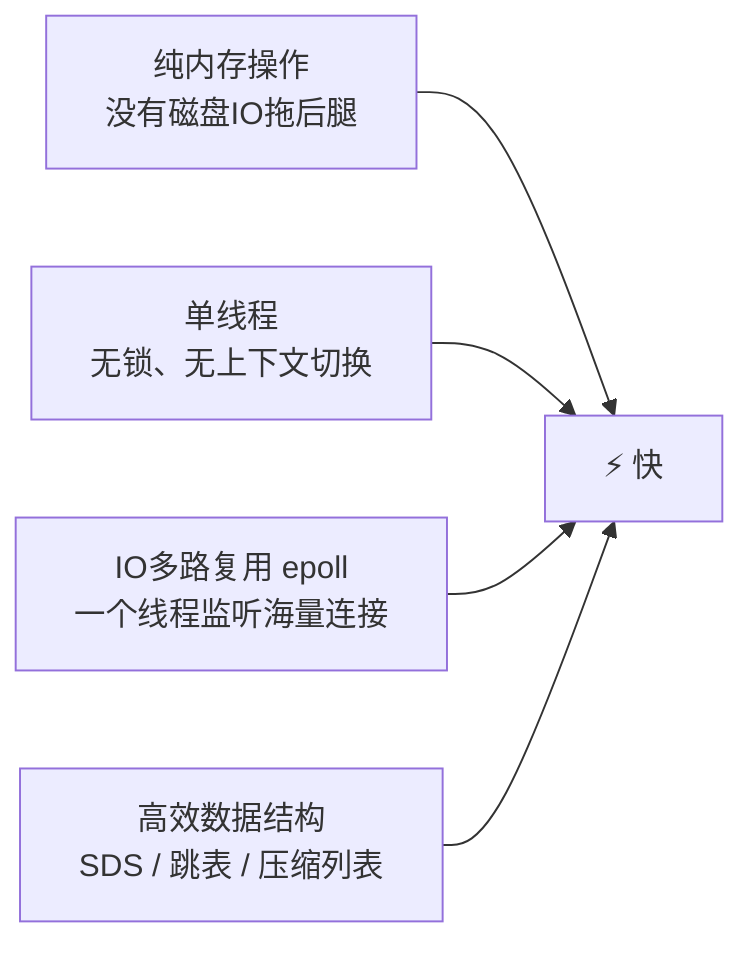

> 💡 注意：Redis 6.0 引入了多线程处理**网络 IO**，但**命令执行依然是单线程**，所以"单线程快"这个结论依然成立哦～

---

## 二、安装与连接

### 2.1 安装

| 方式 | 说明 |
| --- | --- |
| Linux 源码编译 | 生产环境标准姿势 |
| Docker | 一行命令，真香 🐳 |
| Windows 版 | 官方不出，用社区版或 WSL |

```bash
# Docker 一行搞定
docker run -d --name redis -p 6379:6379 redis:7

# Linux 源码安装（三连击）
make && make install
redis-server /etc/redis.conf   # 启动服务
```

### 2.2 连接

```bash
# 自带命令行客户端连接（默认端口 6379）
redis-cli
redis-cli -h 192.168.1.100 -p 6379 -a 密码

# 测一下通不通
127.0.0.1:6379> ping
PONG   # 服务器回了 PONG，说明活着！🏓
```

图形化工具推荐：**Another Redis Desktop Manager**（免费开源 ✅）、RedisInsight（官方出品）。

---

## 三、键值对的世界：Redis 数据结构总览

Redis 里所有的数据都是 `key : value`，**key 永远是字符串**，value 才是花样所在～

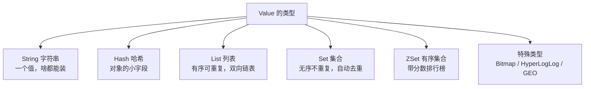

| 类型 | 一句话理解 | 典型场景 |
| --- | --- | --- |
| String | 万能背包 🎒 | 缓存、计数器、分布式锁 |
| Hash | 对象收纳盒 🗂️ | 存用户信息、购物车 |
| List | 排队通道 🚶🚶🚶 | 消息队列、最新列表 |
| Set | 去重大袋子 🎁 | 标签、共同好友、抽奖 |
| ZSet | 排行榜 🏆 | 销量排名、热度榜 |

---

## 四、通用命令（Key 操作）

不管 value 是啥类型，对 key 的操作都是通用的：

```bash
SET name xiaohua        # 设置 key
GET name                # 读取 key
DEL name                # 删除 key
EXISTS name             # 判断存在（1存在 0不存在）
EXPIRE name 10          # 给 key 设置 10 秒过期
TTL name                # 看剩余存活时间（-1永不过期，-2已不存在）
TYPE name               # 看 value 类型
KEYS *                  # 查所有 key（生产环境禁止！会阻塞）⚠️
SCAN 0 MATCH user:* COUNT 100   # 安全的渐进式遍历 ✅
```

| 命令 | 功能 | 备注 |
| --- | --- | --- |
| KEYS pattern | 匹配所有 key | ⚠️ 数据多会卡死，用 SCAN 代替 |
| EXPIRE key s | 设置过期秒数 | 到点自动删除 |
| PERSIST key | 移除过期时间 | 变成永久 |
| RENAME key newkey | 重命名 | |
| INCR / DECR key | 自增 / 自减 | 原子操作，计数器神器 |

---

## 五、五大基础数据类型详解

### 5.1 String 字符串 🎒

最简单的类型，但最多才多艺：字符串、数字、甚至序列化后的 JSON 都能存（最大 512MB）。

```bash
# 基本 增删改查
SET hero "zhangsan"
GET hero
SET hero "lisi"          # 直接覆盖
SETNX hero "wangwu"      # 不存在才设置（NX = Not eXists）→ 分布式锁的基础！
MSET k1 v1 k2 v2         # 批量设置
MGET k1 k2               # 批量获取
APPEND hero "!"           # 追加

# 当数字用（原子操作，高并发计数就靠它！）
SET count 0
INCR count               # 1
INCR count               # 2
INCRBY count 10          # 12
DECR count               # 11

# 设置过期时间一步到位
SET code 123456 EX 60    # 验证码，60秒后自动消失～
```

**典型应用：**

- 📄 页面缓存（存 JSON）
- 🔢 计数器（阅读量、点赞数）
- 🔢 验证码 / Token（带过期）
- 🔒 分布式锁

### 5.2 Hash 哈希 🗂️

String 是"一整个值"，Hash 是"值里面又分小字段"——特别适合存**对象**！

```bash
# 存一个用户对象
HSET user:1 name xiaohua age 18 gender female
HGET user:1 name              # xiaohua
HMGET user:1 name age         # 批量取
HGETALL user:1                # 取全部字段
HDEL user:1 gender            # 删除某个字段
HEXISTS user:1 age            # 判断字段存在

# 购物车经典操作
HINCRBY cart:1001 goods:5001 1    # 商品5001数量+1
HINCRBY cart:1001 goods:5001 -1   # 数量-1
```

| 对比 | String 存 JSON | Hash 存对象 |
| --- | --- | --- |
| 改一个字段 | 取出整个 JSON → 改 → 存回 😩 | HSET 一步到位 ✅ |
| 网络传输 | 整个对象来回跑 | 只传变化的字段 |
| 适合场景 | 整存整取 | 频繁改局部字段 |

### 5.3 List 列表 🚶

**双向链表**结构：两头都能进出，有序、可重复。

```bash
LPUSH queue a b c       # 左边塞（结果顺序：c b a）
RPUSH queue d           # 右边塞（c b a d）
LRANGE queue 0 -1       # 看全部（0到-1表示从头到尾）
LPOP queue              # 左边弹出一个
RPOP queue              # 右边弹出一个
LLEN queue              # 长度
BLPOP queue 10          # 没数据就阻塞等10秒 → 简易消息队列！
```

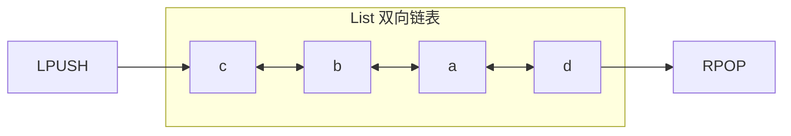

**典型应用：** 消息队列（LPUSH + BRPOP）、朋友圈最新动态列表（LPUSH + LRANGE 取前 N 条）。

### 5.4 Set 集合 🎁

**无序、不重复**，天生自带去重 buff，还支持集合运算（交并差）！

```bash
SADD tags redis mysql redis    # 自动去重 → 只有 redis、mysql
SMEMBERS tags                  # 看全部成员
SISMEMBER tags redis           # 判断是否在集合中（1在 0不在）
SREM tags mysql                # 删除成员
SCARD tags                     # 成员数量

# 集合运算（社交场景神器！）
SINTER set1 set2               # 交集 → 共同好友 👫
SUNION set1 set2               # 并集 → 所有好友
SDIFF set1 set2                # 差集 → 我关注但对方没关注
SRANDMEMBER tags 3             # 随机抽3个 → 抽奖！🎉
SPOP tags                      # 随机弹出并删除
```

**典型应用：** 点赞收藏去重、共同好友、标签、抽奖、抽奖池。

### 5.5 ZSet 有序集合 🏆

在 Set 的基础上，每个成员带一个 **score（分数）**，自动按分数排序——**排行榜专业户**！

```bash
ZADD rank 100 xiaoming 200 xiaohua 150 xiaogang
ZRANGE rank 0 -1 WITHSCORES       # 按分数升序查全部
ZREVRANGE rank 0 2 WITHSCORES     # 降序取前3名 → 领奖台！🥇🥈🥉
ZSCORE rank xiaohua               # 查某人分数
ZRANK rank xiaohua                # 查排名（升序第几）
ZINCRBY rank 50 xiaogang          # 加50分
ZRANGEBYSCORE rank 100 200        # 查分数在100~200之间的
```

**典型应用：** 游戏排行榜、商品销量榜、热度榜、延时队列（score 存时间戳）。

---

## 六、三种特殊数据类型

| 类型 | 一句话理解 | 典型场景 |
| --- | --- | --- |
| Bitmap 位图 | 一串 0/1 的格子，超省空间 | 签到、活跃用户统计 |
| HyperLogLog | 牺牲一点点精度换超省内存的计数器（误差 0.81%） | UV 统计 |
| GEO 地理坐标 | 存经纬度、算距离、找附近 | 附近的人、附近的店 📍 |

```bash
# Bitmap：每签到一个格子记1，一个月只要31个比特！
SETBIT sign:1001:202610 1 1      # 用户1001，2026年10月，2号签到
GETBIT sign:1001:202610 1        # 查这天签了没
BITCOUNT sign:1001:202610        # 本月签到总天数

# HyperLogLog：百万级UV也只占约12KB！
PFADD uv:20261002 user1 user2 user3
PFCOUNT uv:20261002              # 统计独立访客数

# GEO：附近的奶茶店
GEOADD shops 116.40 39.90 "shop:1" 116.41 39.91 "shop:2"
GEODIST shops "shop:1" "shop:2" km      # 两店距离（公里）
GEOSEARCH shops FROMLONLAT 116.40 39.90 BYRADIUS 3 km ASC  # 3公里内由近到远
```

---

## 七、持久化：内存数据可不能说没就没

Redis 数据在内存里，重启/断电不就全没了？！别慌，Redis 有两套持久化方案 💾

### 7.1 RDB（快照）

**定时把内存数据整体拍照存成二进制文件（dump.rdb）** 📸

```bash
# redis.conf 配置：900秒内至少改了1个key就自动快照
save 900 1
save 300 10
save 60 10000

# 手动触发
SAVE      # 阻塞式（生产别用，会卡住所有请求）
BGSAVE   # fork 子进程后台做，不阻塞 ✅
```

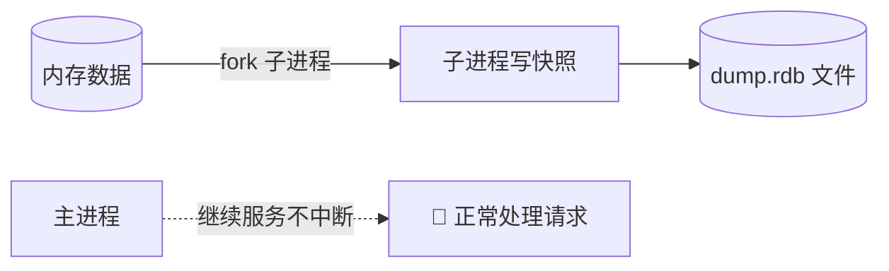

### 7.2 AOF（日志追加）

**把每条写命令都记到日志文件里**，重启时重放一遍日志恢复数据 📝

```bash
appendonly yes                    # 开启 AOF
appendfsync always                # 每条命令都刷盘 → 最安全最慢
appendfsync everysec              # 每秒刷一次 → 默认，最多丢1秒 ⭐
appendfsync no                    # 让操作系统决定 → 最快最不安全
```

AOF 文件越写越大怎么办？→ **AOF 重写**：把一堆冗余命令合并成最简形式（比如 100 次 INCR 直接写成一条 SET 100）。

### 7.3 RDB vs AOF 怎么选？

| 对比项 | RDB 📸 | AOF 📝 |
| --- | --- | --- |
| 记录内容 | 某时刻的完整数据快照 | 每条写命令 |
| 文件大小 | 小（压缩二进制） | 大（文本命令） |
| 恢复速度 | 快 | 慢（逐条重放） |
| 数据安全性 | 可能丢上次快照后的数据 | 最多丢1秒 |
| 性能影响 | fork 时有瞬时开销 | 持续小幅开销 |

> 🎀 实战结论：**两个都开**！Redis 4.0 之后还支持**混合持久化**（AOF 重写时先写 RDB 格式快照再追加命令），兼得两家优点，生产环境推荐～

---

## 八、过期删除与内存淘汰

### 8.1 过期 key 怎么删？

Redis 不是定闹钟精准删除，而是两招配合：

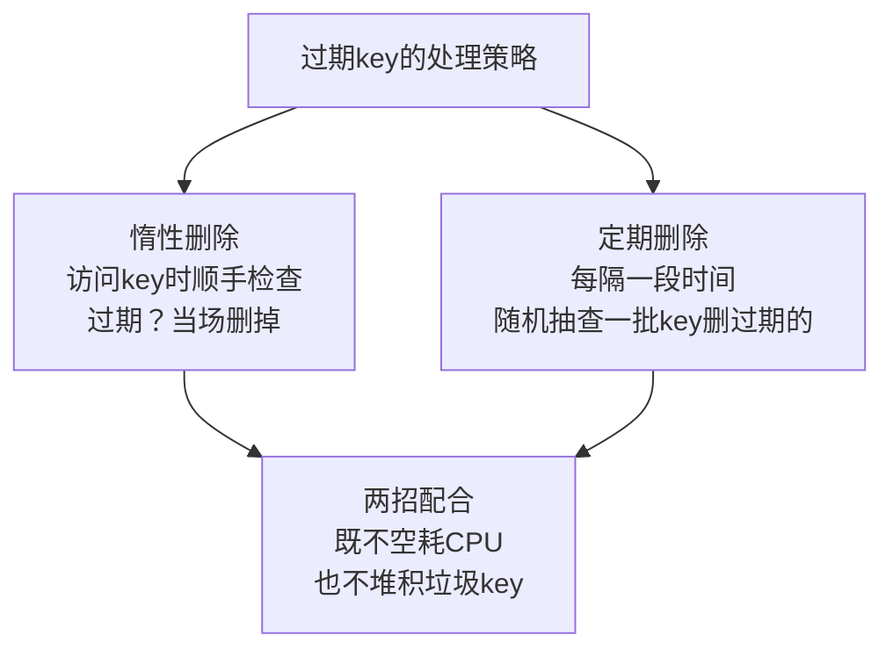

### 8.2 内存满了怎么办？→ 淘汰策略

内存达到 `maxmemory` 上限时，按配置的淘汰策略腾地方：

| 策略 | 含义 |
| --- | --- |
| noeviction（默认） | 不淘汰，写入直接报错 😱 |
| allkeys-lru | 所有key中，淘汰最久没用的 ⭐ 最常用 |
| allkeys-lfu | 所有key中，淘汰使用次数最少的（4.0+） |
| volatile-lru | 只在设置了过期时间的key里淘汰最久没用的 |
| volatile-ttl | 淘汰剩余存活时间最短的 |
| volatile-random | 在有过期时间的key里随机淘汰 |
| allkeys-random | 所有key里随机淘汰 |

> 💡 缓存场景一般选 **allkeys-lru** 或 **allkeys-lfu**，把"最没人理的"数据请出去～

---

## 九、事务与 Lua 脚本

### 9.1 Redis 事务

```bash
MULTI        # 开启事务，后面的命令进入队列
INCR count
INCR count
EXEC         # 一起执行！
```

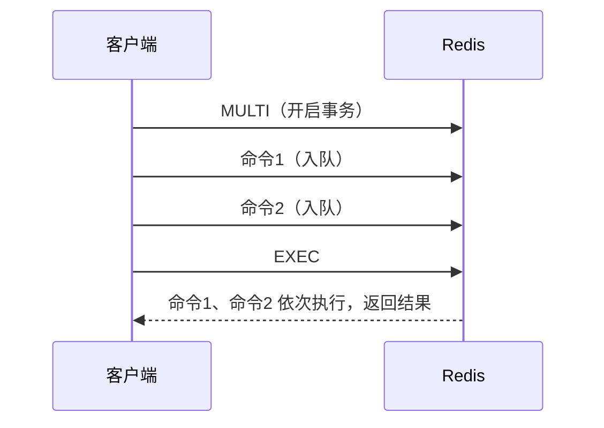

**但注意！Redis 事务和 MySQL 很不一样**（面试爱考）：

| 对比项 | MySQL 事务 | Redis 事务 |
| --- | --- | --- |
| 原子性 | ✅ 全成功或全回滚 | ❌ 不保证！入队时报错的命令不执行；执行中某条失败，其他照样跑 |
| 隔离性 | ✅ 有隔离级别 | ✅ 单线程，天然串行 |
| 回滚 | ✅ 支持 | ❌ 不支持回滚 |

### 9.2 Lua 脚本：真正的"原子大招"

想要多条命令**不可分割**地执行？用 Lua 脚本！整个脚本作为一个整体执行，中间不会被别的命令插队～

```bash
# 例子：判断库存够就扣减（原子完成，不怕并发插队）
EVAL "local stock = redis.call('GET', KEYS[1])
      if tonumber(stock) > 0 then
          return redis.call('DECR', KEYS[1])
      else
          return -1
      end" 1 stock:5001
```

---

## 十、高可用三件套：主从、哨兵、集群

单机 Redis 挂了怎么办？数据量太大一台放不下怎么办？→ 上高可用架构！🏰

### 10.1 主从复制

一主多从：主库写，从库读，数据自动同步（读写分离 + 数据备份）。

```bash
# 在从库上执行，认主库当老大
REPLICAOF 192.168.1.100 6379
```

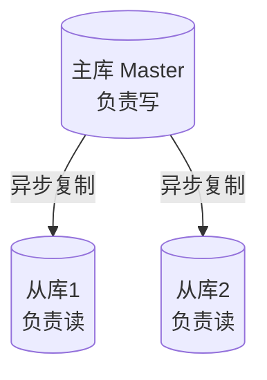

> ⚠️ 主从复制是**异步**的：主库挂掉的瞬间，还没同步的数据可能丢失；主库挂了也需要**人工**切换，太麻烦 → 请出哨兵！

### 10.2 哨兵 Sentinel ⛑️

哨兵 = 24 小时值班的"监工"：盯着主库，发现它挂了就**自动**从从库里选一个提拔成新主库。

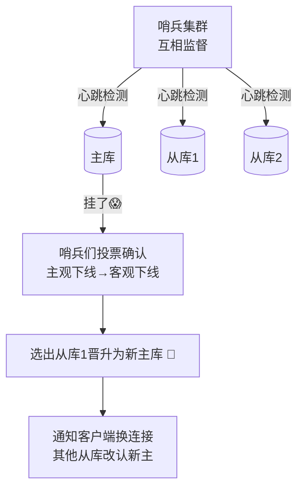

### 10.3 集群 Cluster 🌐

哨兵解决了"高可用"，但单机内存上限问题还在 → **Cluster 分片**登场！

- 共 **16384 个哈希槽**，按槽把数据分到多个主库上
- key 算 CRC16 哈希后对 16384 取模 → 落到某个槽 → 槽在哪个节点，数据就在哪

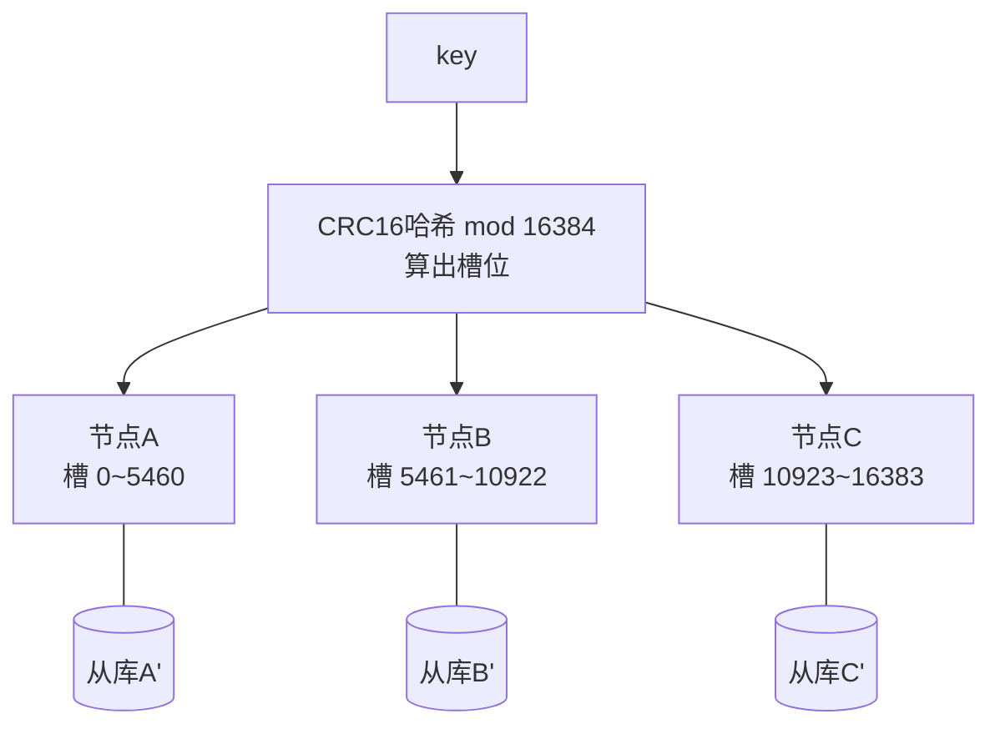

| 方案 | 解决的问题 | 一句话 |
| --- | --- | --- |
| 主从复制 | 读并发、数据备份 | 一主多从，读写分离 |
| 哨兵 | 主库宕机需人工切换 | 自动故障转移 ⛑️ |
| 集群 | 单机内存上限 | 数据分片，横向扩容 🌐 |

---

## 十一、缓存三大灾难：穿透、击穿、雪崩

缓存用不好会出三大事故，面试必问！背熟这三张"病历卡" 🏥

### 11.1 缓存穿透 🕳️

**查一个根本不存在的数据** → 缓存没有 → 全打到数据库 → 恶意攻击者疯狂查不存在的 id，数据库被冲爆！

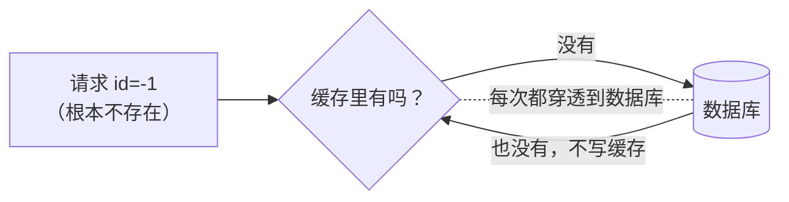

**药方 💊：**

1. **缓存空值**：查不到也存一个空值（短过期时间，如 60 秒）
2. **布隆过滤器**：请求先过布隆过滤器，"肯定不存在"的直接拒绝，不放行去查库

### 11.2 缓存击穿 🎯

某个**热点 key 过期的瞬间**，海量并发同时涌向数据库——像人群挤爆刚开门的店！

**药方 💊：**

1. **互斥锁**：只放一个请求去查库重建缓存，其他人等一会儿再读缓存
2. **逻辑过期**：key 不设真过期，值里存过期时间，发现"过期"就异步重建

### 11.3 缓存雪崩 ❄️

**一大片 key 同一时刻集体过期**（或 Redis 整个宕机）→ 请求洪峰全砸向数据库 → 系统雪崩式垮掉！

**药方 💊：**

1. 过期时间**加随机值**，别让它们同生共死
2. Redis **集群高可用**，别让 Redis 自己挂掉
3. 服务端**限流降级**，保住数据库最后防线

| 灾难 | 触发原因 | 核心解法 |
| --- | --- | --- |
| 穿透 🕳️ | 查**不存在**的数据 | 缓存空值 / 布隆过滤器 |
| 击穿 🎯 | **热点** key 过期瞬间 | 互斥锁 / 逻辑过期 |
| 雪崩 ❄️ | **大批** key 同时过期或 Redis 宕机 | 随机过期 / 集群 / 限流降级 |

---

## 十二、缓存与数据库一致性

缓存和数据库是两份数据，改的时候怎么保证一致？主流方案是 **Cache Aside**：

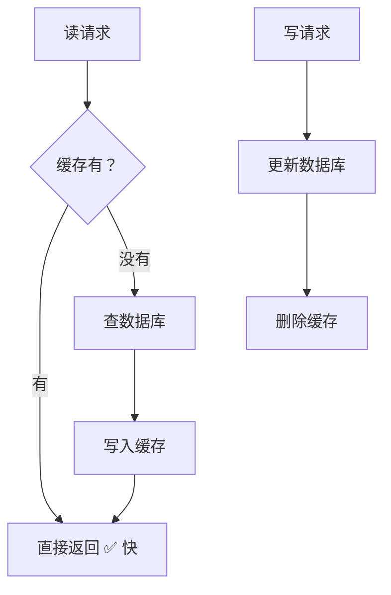

**核心口诀：读 → 优先缓存，没有就回源并填充；写 → 先更新数据库，再删除缓存（不是更新缓存！）**

| 方案 | 说明 | 评价 |
| --- | --- | --- |
| 先更新 DB，再更新缓存 | 并发写时旧值可能覆盖新值 | ❌ 不推荐 |
| 先更新 DB，再**删除**缓存 | 下次读时再回源填充（懒加载） | ⭐ 主流方案 |
| 延迟双删 | 删缓存 → 等500ms再删一次 | 兜底加强版 |
| 订阅 binlog | 用 canal 监听 MySQL 变更刷缓存 | 解耦，架构稍复杂 |

> 💡 为什么是"删缓存"而不是"改缓存"？——懒加载思想：没人读就懒得更新，下次读的时候现查现填，既省资源又避免并发写乱序～

---

## 十三、分布式锁

单机有 synchronized，多台服务器共用的锁就得放在 Redis 里——**大家共用一把锁** 🔐

```bash
# 加锁：SETNX + 过期时间 必须一条命令完成（原子性！）
SET lock:order 1001 NX EX 10

# 释放锁：不能直接 DEL！要先确认是自己的锁 → 用 Lua 保证原子
EVAL "if redis.call('GET', KEYS[1]) == ARGV[1]
      then return redis.call('DEL', KEYS[1])
      else return 0 end" 1 lock:order 1001
```

**自己写锁容易踩的坑：**

| 坑 | 场景 | 解法 |
| --- | --- | --- |
| 忘设过期时间 | 拿锁的服务挂了，锁永远不释放 😱 | SET 时必须带 EX |
| 加锁没设原子 | 先 SETNX 再 EXPIRE，中间挂了也死锁 | 用 `SET key val NX EX` 一条命令 |
| 删了别人的锁 | 业务超时锁过期，别人拿到锁，你回头把它 DEL 了 | value 存唯一标识，Lua 先比对再删 |
| 锁过期业务没做完 | 业务还没跑完锁没了 | 看门狗续期（Redisson） |

> 🎀 生产环境别手搓，直接用 **Redisson**（看门狗自动续期、可重入），成熟又稳～

---

## 十四、经典应用场景

| 场景 | 用到的类型 | 关键命令 |
| --- | --- | --- |
| 热点数据缓存 💧 | String | SET ... EX / GET |
| 点赞 / 收藏去重 | Set | SADD / SREM / SISMEMBER |
| 排行榜 🏆 | ZSet | ZINCRBY / ZREVRANGE |
| 计数器（阅读量） | String | INCR |
| 购物车 🛒 | Hash | HINCRBY / HDEL |
| 签到日历 📅 | Bitmap | SETBIT / BITCOUNT |
| UV 统计 | HyperLogLog | PFADD / PFCOUNT |
| 附近的人 📍 | GEO | GEOADD / GEOSEARCH |
| 简易消息队列 | List / Stream | LPUSH+BRPOP / XADD |
| 验证码 / Token | String | SET code xx EX 60 |
| 分布式锁 | String + Lua | SET NX EX |
| 秒杀库存扣减 | Lua 脚本 | 原子判断+扣减 |

**秒杀小例子（Lua 保证不超卖）：**

```lua
-- stock:5001 预热好库存，用户来了先过脚本这道原子闸门
local stock = tonumber(redis.call('GET', KEYS[1]))
if stock and stock > 0 then
    redis.call('DECR', KEYS[1])
    return 1      -- 抢购成功
end
return 0          -- 售罄
```

---

## 十五、总结与面试高频题

### 15.1 知识地图

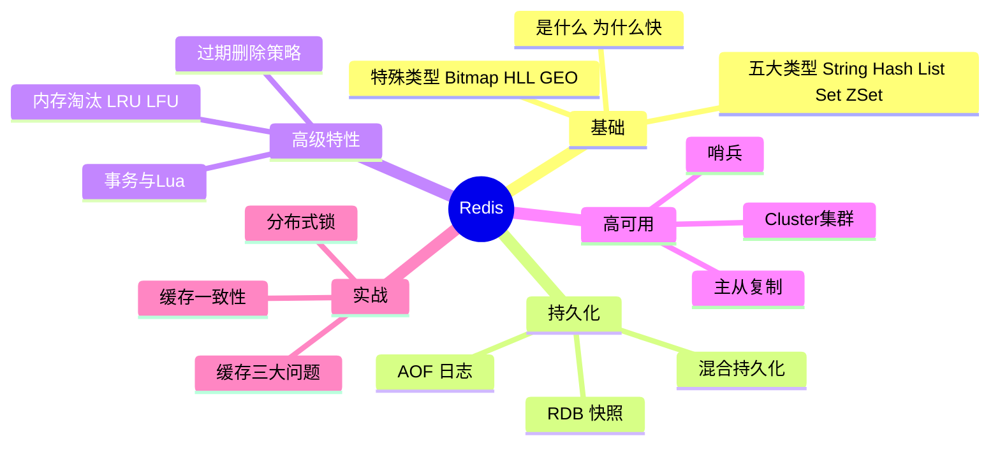

### 15.2 面试官最爱问 Top 题 🎯

| 问题 | 答题要点 |
| --- | --- |
| Redis 为什么快？ | 纯内存 + 单线程无锁 + IO多路复用 + 高效数据结构 |
| Redis 单线程为什么还快？ | 瓶颈不在CPU而在内存和网络，单线程避免锁和切换开销 |
| 五种数据类型及应用场景？ | String缓存计数 / Hash对象 / List队列 / Set去重交并差 / ZSet排行榜 |
| RDB 和 AOF 区别？ | 快照vs日志、文件大小、恢复速度、数据安全性、混合持久化 |
| 缓存穿透/击穿/雪崩？ | 不存在数据 / 热点key过期 / 大批key同时过期；各自解法 |
| 怎么保证缓存一致性？ | Cache Aside：先更新DB再删除缓存，可延迟双删/binlog订阅 |
| 分布式锁怎么实现？ | SET NX EX + 唯一value + Lua释放；生产用Redisson |
| 过期删除策略？ | 惰性删除 + 定期删除配合 |
| 内存淘汰策略？ | 默认noeviction，缓存常用allkeys-lru / allkeys-lfu |
| 主从/哨兵/集群的区别？ | 读写分离 / 自动故障转移 / 分片扩容 |

### 15.3 学习建议路线 🗺️

1. **第一站**：装一个 Redis，五大类型的命令全部敲一遍
2. **第二站**：用 Redis 做一个点赞、排行榜、购物车小功能
3. **第三站**：理解持久化 + 过期策略，知道数据怎么"活下去"
4. **第四站**：主从、哨兵、集群，架构思维起飞
5. **终点站**：缓存三灾 + 分布式锁 + 秒杀实战，面试横着走 🌟

---

> 🌈 又一课通关啦！MySQL + Redis 这对 CP 你都拿下了，后端世界的大门已经打开～记得多动手敲命令，指头记住了才算真学会！冲鸭！ᕙ(⇀‸↼‶)ᕗ 💪✨
