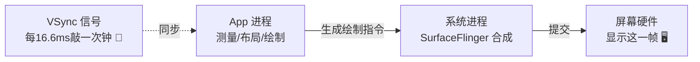
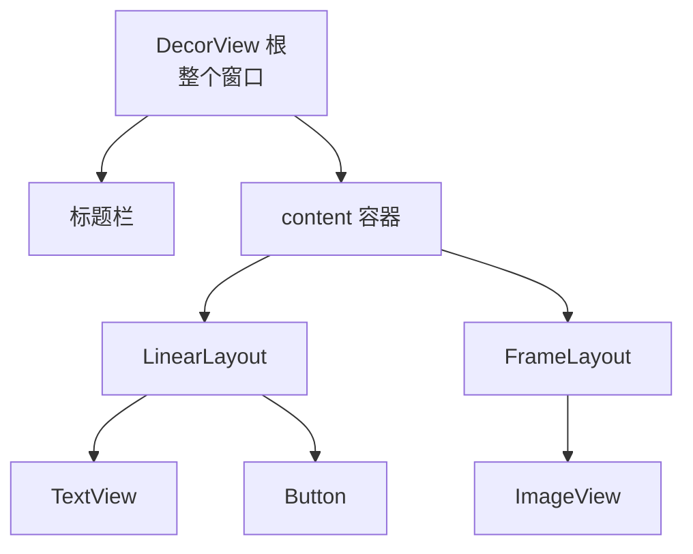
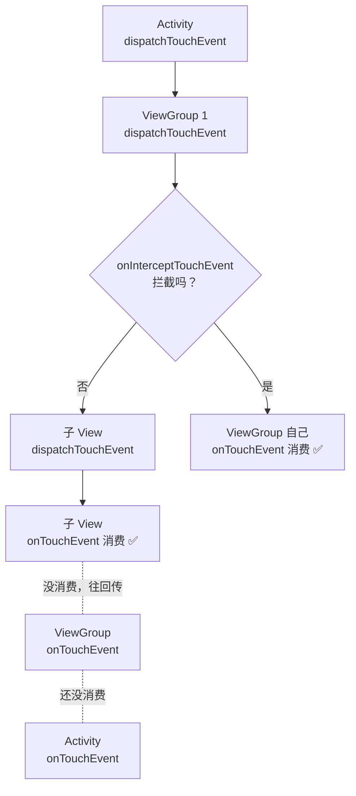
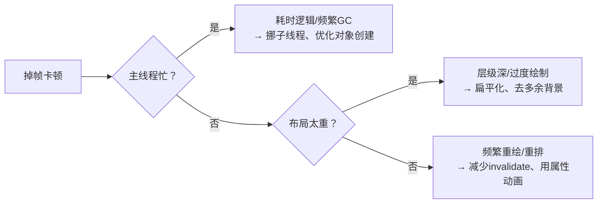
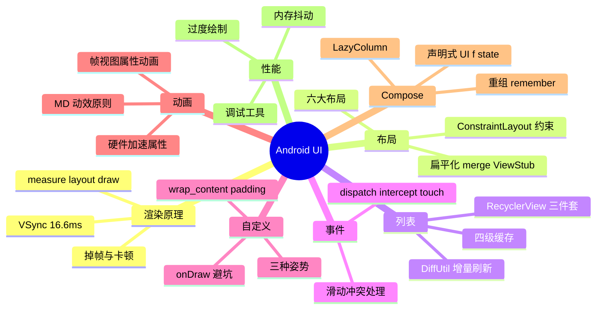

# 🌸 Android-UI 学习笔记 —— 从像素到页面的渲染之旅

> 嘿嘿～上一篇《Android》里 UI 只开了个小灶，这次专门深挖！View 是怎么画出来的？点击事件怎么分发？为什么 Compose 是未来？UI 工程师的进阶之路一篇打通 🎨🤖✨

---

## 📖 目录

1. [UI 渲染全景：一帧的诞生](#一ui-渲染全景一帧的诞生)
2. [View 体系：树形结构与绘制三步曲](#二view-体系树形结构与绘制三步曲)
3. [六大布局详解](#三六大布局详解)
4. [ConstraintLayout：约束的艺术](#四constraintlayout约束的艺术)
5. [RecyclerView 深入：列表的一切](#五recyclerview-深入列表的一切)
6. [事件分发机制（必考！）](#六事件分发机制必考)
7. [自定义 View：三段式入门](#七自定义-view三段式入门)
8. [动画全家桶](#八动画全家桶)
9. [Material Design：谷歌的审美体系](#九material-design谷歌的审美体系)
10. [Jetpack Compose：声明式新大陆](#十jetpack-compose声明式新大陆)
11. [UI 性能优化：告别卡顿](#十一ui-性能优化告别卡顿)
12. [总结与面试高频题](#十二总结与面试高频题)

---

## 一、UI 渲染全景：一帧的诞生

### 1.1 屏幕为什么"会动"？

屏幕每秒刷新 **60 次（60Hz）**≈ 每 **16.6ms** 要画完一帧。画不完 → 这一帧"跳票"→ 掉帧 → 用户感觉**卡顿** 🥴



| 概念 | 大白话 |
| --- | --- |
| VSync | 垂直同步信号：每 16.6ms "敲钟"，大家统一节奏开工 |
| 掉帧 | 一帧超过 16.6ms 没画完，画面"跳了一下" |
| 60Hz/120Hz | 每秒画 60/120 帧，越高越丝滑 |

> 🎀 性能优化的一切目标：**在两次敲钟之间（16.6ms）把活干完**——后面所有优化都围绕这句话！

---

## 二、View 体系：树形结构与绘制三步曲

### 2.1 View 树：界面是一棵树 🌳

整个界面 = 一棵 View 树（叶子是控件，树枝是容器）：



- **View**：叶子节点（Button、TextView）
- **ViewGroup**：树枝节点，既是 View 又能装娃（LinearLayout…）
- `setContentView()` 其实是把你的布局挂到 DecorView 的 content 里

### 2.2 绘制三步曲（必背！）

每个 View 从根到叶走三遍流程：

| 步骤 | 干什么 | 谁先谁后 |
| --- | --- | --- |
| **measure 测量** | 问每个 View "你想多大？" | 父→子（父问子）|
| **layout 布局** | 定位置："你站这" | 父→子 |
| **draw 绘制** | 真画出来 | 父→子 |

```kotlin
// 对应的回调（自定义 View 时可重写）
override fun onMeasure(widthMeasureSpec: Int, heightMeasureSpec: Int)
override fun onLayout(changed: Boolean, l: Int, t: Int, r: Int, b: Int)   // 仅 ViewGroup
override fun onDraw(canvas: Canvas)
```

> 💡 为什么 measure 走两遍？父容器先"预估"一遍，子 View 的结果可能反过来影响父的尺寸，再"确认"一遍——wrap_content 时不时触发 measure 二次流～

---

## 三、六大布局详解

| 布局 | 排列逻辑 | 一句话点评 |
| --- | --- | --- |
| **LinearLayout** 线性 | 横/竖依次排 | 简单可靠，嵌套多了性能差 |
| **FrameLayout** 帧 | 左上角叠罗汉 | 放占位/单个控件，Fragment 容器标配 |
| **RelativeLayout** 相对 | 相对父/兄弟定位 | 老时代主力，已被约束布局接班 |
| **ConstraintLayout** 约束 ⭐ | 约束方程求解 | **现代主流**，扁平高效 |
| GridLayout 网格 | 行×列 | 表格类场景 |
| CoordinatorLayout 协同 | 协调子 View 联动 | 折叠Toolbar/底部弹板的幕后大佬 |

### 3.1 LinearLayout 的 weight 陷阱

```xml
<!-- 三个按钮按 1:1:2 分屏幕 -->
<Button android:layout_weight="1" android:layout_width="0dp" ... />
```

> ⚠️ 用 weight 时宽/高必须写 `0dp`——写 wrap_content 会先量一遍再分一遍，白白浪费一次 measure！

### 3.2 布局层级为什么越扁越好？

每多一层 ViewGroup = 多一次 measure/layout/draw 全家桶 → 嵌套五层的"千层饼" 🫓 直接吃掉你的 16.6ms！

| 优化 | 手段 |
| --- | --- |
| 扁平化 | 多层嵌套 → 一个 ConstraintLayout |
| 合并 | `<merge>` 标签减一层 include |
| 懒加载 | ViewStub：要用时再填充 |
| 包含复用 | `<include>` 抽公共布局 |

---

## 四、ConstraintLayout：约束的艺术

像"拽橡皮筋"一样把控件钉在界面上 🎯：

```xml
<!-- 居中一个按钮 -->
<Button
    app:layout_constraintLeft_toLeftOf="parent"     <!-- 左边拴住父容器左边 -->
    app:layout_constraintRight_toRightOf="parent"   <!-- 右边拴住父容器右边 -->
    app:layout_constraintTop_toTopOf="parent"
    app:layout_constraintBottom_toBottomOf="parent" />
<!-- 左右都被拴住 + 无 bias = 水平居中！ -->
```

| 神器 | 作用 |
| --- | --- |
| `layout_constraintBias` | 拴住后偏向哪边（0.3 = 偏左 30%）|
| `layout_constraintDimensionRatio` | 宽高比（16:9 图片神器）|
| **Guideline** 辅助线 | 画看不见的参考线来对齐 |
| **Barrier** 屏障 | 以一组 View 的边缘为参照 |
| **Chain** 链 | 一串 View 互相拴成链，均匀分布 |
| Flow | 流式布局（自动换行的"链条"）|

> 🎀 记忆法：ConstraintLayout 的每个控件都是"**风筝**"——至少要两根线（横向+纵向）才不会乱飞！

---

## 五、RecyclerView 深入：列表的一切

### 5.1 全家福

三件套 + 缓存四层 = 列表之王 👑

```kotlin
// 多类型列表：重写 getItemViewType
override fun getItemViewType(position: Int) =
    if (data[position].isHeader) TYPE_HEADER else TYPE_NORMAL

// DiffUtil：只刷新变化的那几条（性能核弹 💥）
val diff = DiffUtil.calculateDiff(MyDiffCallback(oldList, newList))
diff.dispatchUpdatesTo(adapter)     // 增量刷新，不闪屏！

// 配合 ListAdapter 更省心
class UserAdapter : ListAdapter<User, VH>(DIFF) { ... }
```

### 5.2 四级缓存

| 缓存 | 存什么 | 复用度 |
| --- | --- | --- |
| Scrap | 屏幕内临时摘下的 | 直接还回去 |
| **Cache** | 刚划出屏幕的 | 按 position 命中，免绑定 |
| ViewCacheExtension | 自定义 | 少用 |
| **RecycledViewPool** | 按 viewType 回收 | 跨列表共享（Tab 页多个列表神器）|

### 5.3 常用 LayoutManager

| Manager | 排法 | 场景 |
| --- | --- | --- |
| LinearLayoutManager | 线性（横/竖）| 普通信息流 |
| GridLayoutManager | 网格 | 相册、商品墙 |
| StaggeredGridLayoutManager | 瀑布流 | 小红书式不定高卡片 🌊 |

> 💡 瀑布流坑点：item 高度变化会"跳舞"——图片要先占位（固定宽高比）再加载，防抖动！

---

## 六、事件分发机制（必考！）

### 6.1 三剑客与三步流程

手指点屏幕，事件像**传圣旨**一样从根传下来 📜：



| 方法 | 谁有 | 作用 |
| --- | --- | --- |
| `dispatchTouchEvent` | 都有 | 分发：问自己/儿子谁来处理 |
| `onInterceptTouchEvent` | 仅 ViewGroup | 拦截：这事件我要不要截下来 |
| `onTouchEvent` | 都有 | 消费：真正处理触摸 |

**口诀：递归下发，不消费则回传。** 伪代码：

```java
boolean dispatch(View view, Event e) {
    if (view 是 ViewGroup && !view.onInterceptTouchEvent(e)) {
        for (child : children) {          // 先问儿子
            if (dispatch(child, e)) return true;
        }
    }
    return view.onTouchEvent(e);          // 儿子不要才自己处理
}
```

### 6.2 经典场景

| 场景 | 原理 |
| --- | --- |
| 列表里嵌套滑动的轮播图 | 外层 ViewGroup 用 onInterceptTouchEvent 抢事件 |
| 子 View 想抢回事件 | 子 View 调 `requestDisallowInterceptTouchEvent(true)` |
| 点击和滑动冲突 | 按"滑动手势检测"决定谁拦截（内部解决法/外部解决法）|

> 🎀 面试杀手锏：**View 一旦消费了 ACTION_DOWN，后续 MOVE/UP 默认都归它**——这就是"先到先得"的触摸法则！

---

## 七、自定义 View：三段式入门

### 7.1 三种姿势

| 姿势 | 适用 |
| --- | --- |
| 组合现有控件 | 最简单：几个控件拼一起（标题栏）|
| 继承 View 重写 onDraw | 完全自绘：圆形进度条、图表 |
| 继承 ViewGroup | 自定义容器：流式标签布局 |

### 7.2 完全自绘示例：圆形进度条

```kotlin
class CircleProgressView @JvmOverloads constructor(
    context: Context, attrs: AttributeSet? = null
) : View(context, attrs) {

    var progress = 0f
        set(value) { field = value; invalidate() }   // 数据变了→请求重绘

    private val paint = Paint().apply {
        style = Paint.Style.STROKE
        strokeWidth = 20f
        isAntiAlias = true                           // 抗锯齿，边缘丝滑
    }

    override fun onDraw(canvas: Canvas) {            // 每帧调用
        // 1. 画底环
        canvas.drawCircle(width/2f, height/2f, radius, bgPaint)
        // 2. 按进度画弧
        canvas.drawArc(rect, -90f, 360f * progress, false, paint)
    }
}
```

### 7.3 自定义 View 避坑清单

- [ ] 处理 **wrap_content**（不重写 onMeasure 时 wrap=match_parent！）
- [ ] 处理 **padding**（onDraw 里自己算进去，默认不生效）
- [ ] onDraw 里**别 new 对象**（每帧执行，疯狂产生垃圾）
- [ ] `invalidate()` 主线程重绘 / `postInvalidate()` 子线程
- [ ] 动画频繁 → 用硬件加速属性动画而不是连续 invalidate

---

## 八、动画全家桶

| 类型 | 原理 | 特点 | 现状 |
| --- | --- | --- | --- |
| 帧动画 | 图片逐张播 | 像 GIF | 少量用 |
| 视图动画 | 只动"影子"（位置假象）| 轻量但点击区域不跟 | 渐退 |
| **属性动画** ⭐ | 真改属性值 | 万物皆可动 | **主流** ✅ |

```kotlin
// 视图动画：控件"看起来"移走了，点它还得去原地 🤡
translateAnim.start()

// 属性动画：真·移动，对象属性真的变了
ObjectAnimator.ofFloat(button, "translationX", 0f, 300f)
    .apply { duration = 500; start() }

// AnimatorSet 组合拳：旋转+缩放+渐变同时来
AnimatorSet().apply {
    playTogether(
        ObjectAnimator.ofFloat(img, "rotation", 0f, 360f),
        ObjectAnimator.ofFloat(img, "scaleX", 1f, 1.5f)
    )
    start()
}

// ValueAnimator：自己算值自己用（自定义进度条神器）
ValueAnimator.ofFloat(0f, 1f).apply {
    addUpdateListener { anim -> view.alpha = anim.animatedValue as Float }
    start()
}
```

> 💡 硬件加速彩蛋：`translationX/Y、alpha、rotation、scaleX/Y` 这几个属性走 GPU 加速，动画最丝滑——能用它们就别用自定义属性！

---

## 九、Material Design：谷歌的审美体系

Google 的官方设计语言，让 App 长得"像个正经安卓应用" 📐：

| 组件 | 作用 |
| --- | --- |
| MaterialToolbar | 现代顶栏（支持折叠联动）|
| FloatingActionButton FAB | 悬浮按钮 🟠 |
| Snackbar | 底部轻提示（可带按钮）|
| BottomSheet | 底部弹板（地图"更多"面板）|
| TabLayout + ViewPager2 | 页签滑动 |
| TextInputLayout | 带浮动标签的输入框 |
| Chip | 小标签（筛选/选择）|
| CardView | 卡片容器 |

**动效四原则（MD3 精髓）：**

| 原则 | 大白话 |
| --- | --- |
| 有意义的过渡 | 页面切换讲"从哪来、到哪去" |
| 响应式反馈 | 按钮按下有水波纹，操作有回应 💧 |
| 连续性 | 元素飞过去，而不是凭空消失出现 |
| 拟真 | 加速减速像物理世界，不生硬 |

---

## 十、Jetpack Compose：声明式新大陆

### 10.1 命令式 vs 声明式

| XML 命令式 | Compose 声明式 |
| --- | --- |
| 找到控件 `findViewById` | 不找控件，直接写 |
| 手动 `tv.text = "新值"` | 数据变了 UI **自动**跟着变 |
| 状态和 UI 同步靠人肉 | 框架替你同步 ✨ |

```kotlin
@Composable
fun Counter() {
    var count by remember { mutableStateOf(0) }    // 状态

    Column(horizontalAlignment = Alignment.CenterHorizontally) {
        Text("点了 $count 次")                      // 读状态
        Button(onClick = { count++ }) {            // 改状态
            Text("点我 +1")
        }
    }
    // count 一变，这个函数重新执行（重组），Text 自动显示新值！
}
```

### 10.2 核心概念

| 概念 | 干啥 |
| --- | --- |
| `@Composable` | 标记"这是可组合函数"（一个 UI 块）|
| **State 状态** | `mutableStateOf` 记住数据，变了就刷新 |
| `remember` | 重组间记住数据（不然每次都归零）|
| **重组 Recomposition** | 状态变化 → 只重新执行受影响的函数 |
| Modifier | 修饰器链：`Modifier.padding(8.dp).background(Color.Red)` |
| Slot API | 内容当参数传（`Button { Text() }`）|

### 10.3 经典列表

```kotlin
@Composable
fun UserList(users: List<User>) {
    LazyColumn {                          // = RecyclerView（自动复用）
        items(users, key = { it.id }) { user ->
            UserCard(user)
        }
    }
}
```

> 🎀 一句话总结 Compose：**UI = f(state)** —— 界面是状态的函数，你只管改状态，剩下交给框架！配套思想：**唯一可信数据源 + 单向数据流（状态向下、事件向上）**～

---

## 十一、UI 性能优化：告别卡顿

### 11.1 卡顿排查思路



### 11.2 优化兵器谱

| 问题 | 兵器 |
| --- | --- |
| 过度绘制（同一像素画N遍）| 移除多余 background；开发者选项"调试 GPU 过度绘制"看色块 🔴 |
| 布局层级深 | Layout Inspector 检查；ConstraintLayout 扁平化 |
| 主线程耗时 | Systrace / Perfetto 定位；StrictMode 抓主线程 IO |
| 内存抖动（疯狂 GC）| onDraw 别 new；对象池复用 |
| 图片过大 | 加载时降采样（Glide 自动）；WebP 格式 |
| 频繁通知 UI 变化 | DiffUtil 增量刷新；防抖节流 |
| 预加载 | RecyclerView `setHasFixedSize`、prefetch |

> 💡 调试工具全家桶：**Layout Inspector**（看层级）、**GPU 过度绘制**（看色块）、**Systrace/Perfetto**（看帧耗时）、**Choreographer**（数帧率）～

---

## 十二、总结与面试高频题

### 12.1 知识地图



### 12.2 面试官最爱问 Top 题 🎯

| 问题 | 答题要点 |
| --- | --- |
| View 绘制流程？ | measure（父问子要多大）→ layout（定位）→ draw（绘制）；对应回调可重写 |
| measure 为什么可能走两遍？ | 父先预估、子结果影响父尺寸时二次确认（wrap_content）|
| 事件分发流程？ | dispatchTouchEvent → onInterceptTouchEvent（仅VG）→ onTouchEvent；递归下发不消费则回传 |
| 事件冲突怎么解？ | 外部拦截法（父 onIntercept 按手势决定）/内部拦截法（子 requestDisallow）|
| RecyclerView 缓存层级？ | Scrap→Cache→Extension→Pool 四级；Pool 按 viewType 可跨列表共享 |
| DiffUtil 的作用？ | 计算新旧列表差异，增量刷新变化的 item，避免全量 notifyDataSetChanged |
| 属性动画和视图动画区别？ | 真改属性 vs 只动影子；点击区域跟不跟着走 |
| 自定义 View 注意什么？ | wrap_content、padding、onDraw 别 new 对象 |
| Compose 为什么重组？ | 状态驱动：UI=f(state)，状态变了重新执行受影响的 Composable |
| remember 的作用？ | 重组之间记住数据，否则每次重新初始化 |
| 什么是过度绘制？ | 同一像素被画多次；去多余背景、扁平化；GPU 调试色块检测 |
| LayoutManager 有哪些？ | Linear/Grid/StaggeredGrid（瀑布流）|
| weight 用法注意？ | 对应方向尺寸写 0dp，否则 measure 两遍浪费性能 |

### 12.3 学习建议路线 🗺️

1. **第一站**：Layout Inspector 看自己 App 的 View 树，数一数层级
2. **第二站**：把一个多层嵌套布局重写成 ConstraintLayout，对比层级数
3. **第三站**：手写自定义圆形进度条（过一遍 onMeasure/onDraw 全流程）
4. **第四站**：写 Demo 打 Log 跟踪事件分发，验证"递归下发、不消费回传"
5. **第五站**：用 Compose 复刻一个现有页面，体会"改状态=改 UI"
6. **终点站**：开 GPU 过度绘制 + Perfetto，亲手优化一个卡顿列表 🌟

---

> 🌈 Android-UI 通关！现在你眼中的界面不再是一堆控件，而是一棵会呼吸的 View 树：VSync 敲钟 → 测量 → 布局 → 绘制 → 一帧诞生～从约束布局到事件分发，从属性动画到 Compose，UI 内功大成！移动分区二连达成，下一个知识点继续召唤我！(๑•̀ㅂ•́)و✧🎨💪
