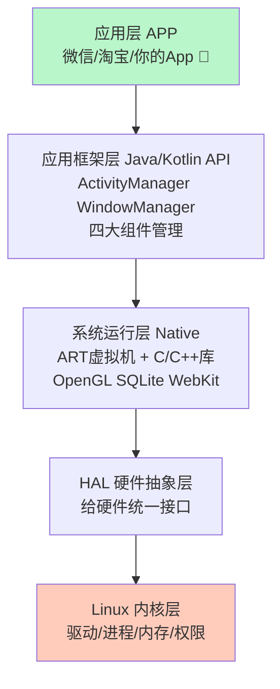
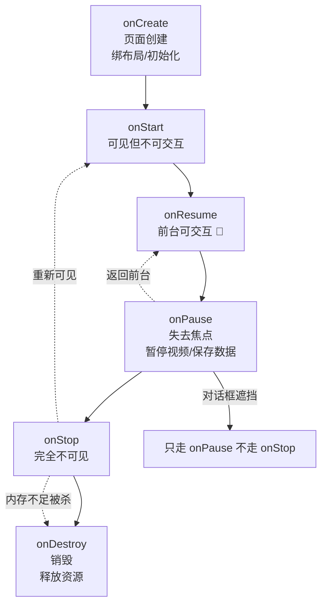
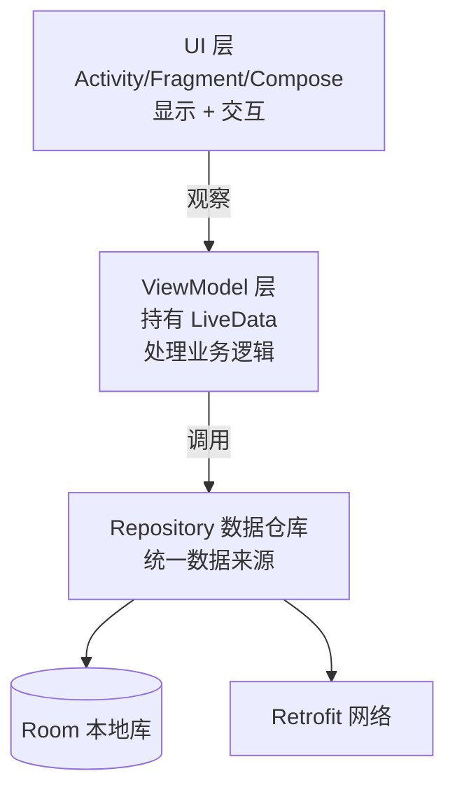
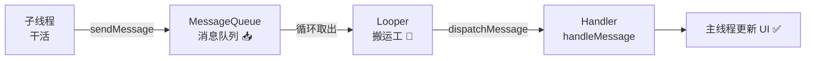
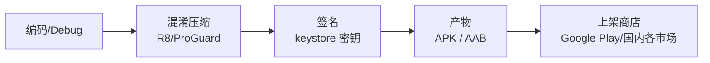
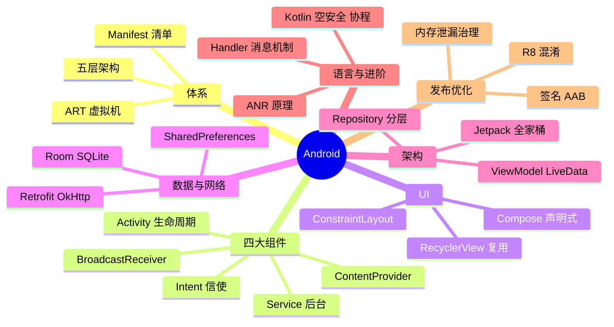

# 🌸 Android 学习笔记 —— 小绿机器人的开发世界

> 嘿嘿～数据库五连、网络七连通关后，新的图鉴分区【移动】开启！Android 占据全球七成手机市场，一起来拆解它的系统架构、四大组件和现代开发套路 🤖💚✨

---

## 📖 目录

1. [初识 Android：它到底是啥？](#一初识-android它到底是啥)
2. [系统架构：五层洋葱模型](#二系统架构五层洋葱模型)
3. [开发环境与项目结构](#三开发环境与项目结构)
4. [四大组件：App 世界的水火土风](#四四大组件app-世界的水火土风)
5. [Activity 生命周期（必考！）](#五activity-生命周期必考)
6. [UI 开发：布局与常用控件](#六ui-开发布局与常用控件)
7. [数据存储方案](#七数据存储方案)
8. [网络请求：Retrofit 三件套](#八网络请求retrofit-三件套)
9. [Jetpack：官方全家桶](#九jetpack官方全家桶)
10. [Kotlin vs Java](#十kotlin-vs-java)
11. [进阶必备：Handler 消息机制与 ANR](#十一进阶必备handler-消息机制与-anr)
12. [打包发布与性能优化](#十二打包发布与性能优化)
13. [总结与面试高频题](#十三总结与面试高频题)

---

## 一、初识 Android：它到底是啥？

### 1.1 用大白话说 Android

- Google 主导的**开源移动操作系统**（基于 Linux 内核），2008 年首发
- 手机、平板、电视、手表、车机……万物皆可 Android 📱📺⌚🚗
- 开发语言：早期 Java，现在 **Kotlin 官方钦定**（2017 起）

### 1.2 版本演进小史

| 里程碑 | 意义 |
| --- | --- |
| 4.x | 智能机普及时代 |
| 5.0 | Material Design 设计语言、ART 替换 Dalvik |
| 7.0 | 官方支持 Kotlin 前夜、多窗口 |
| **10** | 暗黑模式、手势导航 |
| 12 | Material You 主题随壁纸变色 🎨 |
| 14/15+ | 折叠屏优化、AI 特性 |

> 🎀 记不住版本号没关系，面试考的是**机制和组件**，不是年表！

---

## 二、系统架构：五层洋葱模型

Android 系统像一颗洋葱 🧅，从里到外一层层包着：



| 层 | 干啥的 | 开发者接触度 |
| --- | --- | --- |
| 应用层 | 各种 App | ✅ 天天写 |
| 应用框架层 | 四大组件、UI、通知等 API | ✅ 天天调 |
| 系统运行层 | ART 虚拟机 + C/C++ 原生库 | 偶尔碰（NDK）|
| HAL | 屏蔽硬件差异 | 系统开发才碰 |
| Linux 内核 | 驱动与资源调度 | 系统开发才碰 |

> 💡 和 JVM 的关系：每个 App 跑在自己的 **ART 虚拟机**进程里——所以一个 App 崩了不会拖死别人（沙箱隔离）🔒

---

## 三、开发环境与项目结构

### 3.1 环境

- **Android Studio**：官方 IDE（基于 IntelliJ），装它就完事
- **Gradle**：构建工具（依赖管理、多渠道打包全靠它）
- 模拟器或真机（推荐真机，模拟器吃内存 🍜）

### 3.2 项目结构一图流

```
MyApp/
├── app/                    # 主模块
│   ├── src/main/
│   │   ├── java/           # Kotlin/Java 代码
│   │   ├── res/            # 资源
│   │   │   ├── layout/     #   布局 XML
│   │   │   ├── values/     #   字符串/颜色/主题
│   │   │   ├── drawable/   #   图片
│   │   │   └── mipmap/     #   图标
│   │   └── AndroidManifest.xml  # 应用清单（核心！）
│   └── build.gradle.kts    # 模块级构建脚本
├── build.gradle.kts        # 项目级构建脚本
└── settings.gradle.kts     # 项目设置
```

**AndroidManifest.xml——App 的户口本 📇：**

```xml
<manifest>
    <!-- 权限声明 -->
    <uses-permission android:name="android.permission.INTERNET" />

    <application>
        <!-- 四大组件都要在这里注册！ -->
        <activity android:name=".MainActivity">
            <intent-filter>   <!-- 启动入口 -->
                <action android:name="android.intent.action.MAIN" />
                <category android:name="android.intent.category.LAUNCHER" />
            </intent-filter>
        </activity>
    </application>
</manifest>
```

---

## 四、四大组件：App 世界的水火土风

| 组件 | 一句话 | 类比 |
| --- | --- | --- |
| **Activity** | 一个屏幕页面 🖼️ | 舞台的一幕戏 |
| **Service** | 后台长期任务（无界面）⚙️ | 幕后工作人员 |
| **BroadcastReceiver** | 接收系统/全局广播 📡 | 广播喇叭的听众 |
| **ContentProvider** | 跨 App 共享数据 🔄 | 对外开放的图书馆 |

### 4.1 Activity：页面担当

```kotlin
class MainActivity : AppCompatActivity() {
    override fun onCreate(savedInstanceState: Bundle?) {
        super.onCreate(savedInstanceState)
        setContentView(R.layout.activity_main)  // 绑定布局
    }
}
```

### 4.2 Service：后台担当

```kotlin
class MusicService : Service() {
    override fun onBind(intent: Intent): IBinder? = null

    override fun onStartCommand(intent: Intent, flags: Int, startId: Int): Int {
        // 播放音乐等长期任务
        return START_STICKY   // 被杀后尝试重建
    }
}
```

> ⚠️ 注意：**后台不等于新线程**！Service 默认还是跑在主线程——耗时操作照样要开子线程，不然 ANR（后面讲）！

### 4.3 BroadcastReceiver：广播担当

```kotlin
// 接收系统开机广播（举例）
class BootReceiver : BroadcastReceiver() {
    override fun onReceive(context: Context, intent: Intent) {
        if (intent.action == Intent.ACTION_BOOT_COMPLETED) {
            // 开机了，干点啥
        }
    }
}
```

### 4.4 ContentProvider：数据共享担当

```kotlin
// 读取系统通讯录（需权限）
val cursor = contentResolver.query(
    ContactsContract.Contacts.CONTENT_URI, null, null, null, null)
```

### 4.5 灵魂配角：Intent

四大组件之间的"信使" ✉️：

```kotlin
// 显式 Intent：指名道姓跳转
startActivity(Intent(this, DetailActivity::class.java))

// 隐式 Intent：说需求让系统找人来
startActivity(Intent(Intent.ACTION_VIEW, Uri.parse("https://baidu.com")))

// 传数据
intent.putExtra("userId", 10086)
```

---

## 五、Activity 生命周期（必考！）



**七姑妈八姨婆速记表：**

| 回调 | 时机 | 该干什么 |
| --- | --- | --- |
| onCreate | 创建 | 绑布局、初始化 |
| onStart | 可见 | 刷新界面数据 |
| onResume | 前台 | 恢复播放/动画 |
| onPause | 失焦 | 暂停播放、保存轻量数据 |
| onStop | 不可见 | 释放重资源 |
| onRestart | 从 Stop 回来 | 重新加载数据 |
| onDestroy | 销毁 | 释放一切、反注册监听 |

**经典场景分析（面试爱考）：**

| 场景 | 回调顺序 |
| --- | --- |
| 首次打开 | onCreate → onStart → onResume |
| 跳转新页面 | 旧：onPause → 新：onCreate/onStart/onResume → 旧：onStop |
| 弹半透明对话框 | 只走 onPause（仍部分可见）|
| 横竖屏切换（默认）| 销毁重建：onPause → onStop → onDestroy → onCreate → … |
| 按 Home 键返回 | onPause → onStop →（回来）onRestart → onStart → onResume |

> 🎀 横竖屏切换销毁重建的应对：`onSaveInstanceState()` 存数据 → `onCreate` 里 `savedInstanceState` 取回；或 manifest 里锁方向 `screenOrientation="portrait"`～

---

## 六、UI 开发：布局与常用控件

### 6.1 布局选择

| 布局 | 特点 | 现状 |
| --- | --- | --- |
| LinearLayout 线性 | 一行/一列排 | 简单场景还在用 |
| RelativeLayout 相对 | 相对父/兄弟定位 | 渐退 |
| **ConstraintLayout 约束** ⭐ | 拖拽连线、扁平高效 | **主流** ✅ |
| FrameLayout 帧 | 叠罗汉 | 放单个控件 |
| Jetpack Compose | 声明式 UI（Kotlin 写界面）| **未来主流** 🚀 |

> 💡 命令式（XML）vs 声明式（Compose）：XML 是"告诉机器每步怎么做"，Compose 是"描述界面长啥样，数据变了自动刷新"——和前端 React/Vue 一个思路！

### 6.2 常用控件

```xml
<TextView android:id="@+id/tvName" ... />      <!-- 文本 -->
<EditText ... />                               <!-- 输入框 -->
<Button android:text="点我" ... />             <!-- 按钮 -->
<ImageView ... />                              <!-- 图片 -->
<CheckBox /> <Switch />                        <!-- 选择 -->
<RecyclerView ... />                           <!-- 列表之王 👑 -->
```

### 6.3 RecyclerView：列表之王

三件套：**Adapter（适配数据）+ LayoutManager（排法）+ ViewHolder（复用 itemView）**

```kotlin
recyclerView.layoutManager = LinearLayoutManager(this)
recyclerView.adapter = object : RecyclerView.Adapter<MyVH>() {
    override fun onCreateViewHolder(parent: ViewGroup, viewType: Int) = MyVH(...)
    override fun getItemCount() = list.size
    override fun onBindViewHolder(holder: MyVH, position: Int) {
        holder.tv.text = list[position]        // 只绑定可见项
    }
}
```

> 💡 复用机制：屏幕上 8 个 item 只创建 8 个 ViewHolder，滚动时**重复利用**划走的格子填新数据——所以列表 10000 条也不卡 ✨

---

## 七、数据存储方案

| 方案 | 存什么 | 特点 |
| --- | --- | --- |
| **SharedPreferences** | 键值对（设置项）| 轻量、同步小数据 |
| 文件存储 | 大文件/缓存 | 内部/外部存储 |
| SQLite / **Room** ⭐ | 结构化数据 | 关系型（Room 是官方 ORM）|
| DataStore | 键值/协议缓冲 | SP 的现代替代品 🚀 |
| ContentProvider | 跨 App 共享 | 四大组件之一 |

```kotlin
// SharedPreferences：记住用户设置
val sp = getSharedPreferences("config", MODE_PRIVATE)
sp.edit().putString("theme", "dark").apply()   // apply 异步落盘 ✅
val theme = sp.getString("theme", "light")

// Room：官方 ORM（三件套）
@Entity data class User(@PrimaryKey val id: Int, val name: String)
@Dao interface UserDao {
    @Query("SELECT * FROM User") suspend fun getAll(): List<User>
    @Insert suspend fun insert(user: User)
}
@Database(entities = [User::class], version = 1)
abstract class AppDb : RoomDatabase() { abstract fun userDao(): UserDao }
```

> 🎀 和之前学的数据库知识联动：Room 底层就是 SQLite（手机内置的 MySQL 堂弟），注解只是帮你省掉手写 SQL 的样板代码～

---

## 八、网络请求：Retrofit 三件套

现代 Android 网络请求标准姿势：**OkHttp（底层传输）+ Retrofit（接口化封装）+ Gson/Moshi（JSON 解析）**

```kotlin
// ① 定义接口（Retrofit 把接口变成实现）
interface ApiService {
    @GET("users/{id}")
    suspend fun getUser(@Path("id") id: Int): User

    @POST("login")
    suspend fun login(@Body body: LoginReq): LoginResp
}

// ② 构建 Retrofit 实例
val api = Retrofit.Builder()
    .baseUrl("https://api.example.com/")
    .addConverterFactory(GsonConverterFactory.create())
    .client(OkHttpClient.Builder()
        .addInterceptor(HttpLoggingInterceptor())   // 日志拦截器
        .connectTimeout(10, TimeUnit.SECONDS)
        .build())
    .build()
    .create(ApiService::class.java)

// ③ 协程里调用（主线程安全）
lifecycleScope.launch {
    val user = api.getUser(10086)      // 挂起，不卡 UI
    textView.text = user.name
}
```

> 💡 Android 4.4 起主线程禁止网络请求（NetworkOnMainThreadException）——网络必须子线程/协程，这是和后端开发最大的习惯差异之一！

---

## 九、Jetpack：官方全家桶

Google 官方架构组件库，专治各种生命周期疑难杂症 🧰：

| 组件 | 治什么病 |
| --- | --- |
| **ViewModel** | 旋转屏幕数据丢失（数据活过配置变更）|
| **LiveData** | 数据变了 UI 自动刷新（可感知生命周期）|
| Lifecycle | 让普通类能监听 Activity 生命周期 |
| Room | 手写 SQLite 样板代码 |
| Navigation | Fragment 跳转管理 |
| WorkManager | 后台任务即使 App 被杀也要执行 |
| Paging | 分页加载大列表 |
| Hilt | 依赖注入 DI |

**ViewModel + LiveData 经典配合：**

```kotlin
class UserViewModel : ViewModel() {
    private val _user = MutableLiveData<User>()
    val user: LiveData<User> = _user

    fun load() {
        viewModelScope.launch {
            _user.value = api.getUser(1)     // 子线程拿数据
        }
    }
}

// Activity 里：数据变了自动刷新 UI，且不用担心内存泄漏
viewModel.user.observe(this) { user ->
    textView.text = user.name    // 页面销毁自动停止观察 ✅
}
```

**官方推荐架构分层：**



---

## 十、Kotlin vs Java

| 对比 | Java | Kotlin ⭐ |
| --- | --- | --- |
| 空安全 | NPE 随处埋雷 💣 | 类型系统自带可空标记 `?` |
| 冗余 | getter/setter 满屏 | `data class` 一行搞定 |
| Lambda | 啰嗦 | 简洁丝滑 |
| 协程 | 无（线程池硬扛） | **coroutine 轻量级并发** ✨ |
| 互操作 | - | 和 Java 100% 互通，可混写 |
| 现状 | 大量存量代码 | **官方钦定首选** |

```kotlin
// 空安全：编译期就拦住 NPE
var name: String = "小花"
var nick: String? = null            // 问号 = 允许为空
println(nick?.length)               // 安全调用：null 就返回 null，不崩
println(nick?.length ?: 0)          // 猫王运算符：null 就给默认值

// data class：一行顶 Java 几十行
data class User(val id: Int, val name: String)

// 协程：异步写得像同步
lifecycleScope.launch {
    val user = api.getUser(1)       // 网络请求
    val orders = api.getOrders(user.id)  // 顺序依赖，也不嵌套回调！
}
```

---

## 十一、进阶必备：Handler 消息机制与 ANR

### 11.1 为什么主线程不能做耗时操作？

主线程 = UI 线程，负责绘制界面。你把网络/大文件塞给它 → 界面卡住不动 → 用户点了没反应 → 系统 5 秒没响应就弹 "**ANR**（Application Not Responding）" 弹窗 💀

### 11.2 Handler 消息机制：线程间传纸条 📝



| 角色 | 职责 |
| --- | --- |
| Message | 纸条本体 |
| Handler | 发纸条 + 收纸条处理 |
| MessageQueue | 消息排队（按时间）|
| Looper | 死循环取纸条分发给 Handler |

> 💡 主线程的 Looper 在 App 启动时就转起来了——**这就是为什么主线程能一直处理消息却不会"退出"**，也是 ANR 检测的根基（消息处理超时）～

```kotlin
// 现代姿势：协程（底层还是这套机制）
lifecycleScope.launch(Dispatchers.IO) {      // IO 线程干活
    val data = loadData()
    withContext(Dispatchers.Main) {          // 切回主线程
        textView.text = data                 // 更新 UI ✅
    }
}
```

---

## 十二、打包发布与性能优化

### 12.1 从代码到上架



| 概念 | 说明 |
| --- | --- |
| APK | 安卓安装包（zip 魔改）|
| AAB | Google Play 新格式，按设备动态下发 |
| 签名 | 用 keystore 给包盖章，保证身份与升级连续性（**密钥丢了=没法更新 App** ⚠️）|
| 混淆 | R8 压缩+改名，防反编译、减体积 |

### 12.2 性能优化速查

| 问题 | 手段 |
| --- | --- |
| 启动慢 ⏱️ | 延迟初始化、懒加载、启动框架 |
| 界面卡顿 | 减少主线程耗时、RecyclerView 复用、约束布局扁平化 |
| 内存泄漏 | static 持 Context、未取消监听 → LeakCanary 检测 |
| 包体积 | 图片压缩 WebP、按 ABI 分包、混淆 |
| 耗电 | 减少唤醒、JobScheduler/WorkManager 合并任务 |

---

## 十三、总结与面试高频题

### 13.1 知识地图



### 13.2 面试官最爱问 Top 题 🎯

| 问题 | 答题要点 |
| --- | --- |
| Activity 生命周期？ | 七回调+场景题（跳转/对话框/横竖屏，见第五章表格）|
| Activity 启动模式？ | standard（新开）/singleTop（栈顶复用）/singleTask（栈内复用清上方）/singleInstance（独占新栈）|
| 四大组件？ | Activity 页面/Service 后台/BroadcastReceiver 广播/ContentProvider 共享 |
| Service 里有子线程吗？ | 没有！默认主线程，耗时操作仍需开线程 |
| Handler 原理？ | Message → MessageQueue 排队 → Looper 循环分发 → Handler 处理 |
| ANR 是什么？怎么避免？ | 主线程 5s（广播 10s）无响应；耗时操作挪子线程/协程 |
| RecyclerView 为什么流畅？ | ViewHolder 复用机制，只创建屏幕可见数量 |
| ViewModel 作用？ | 数据在配置变更（旋转屏）后存活；配合 LiveData 解耦 UI |
| LiveData 和普通回调区别？ | 生命周期感知，页面销毁自动停止通知，不泄漏 |
| SP 的 apply 和 commit 区别？ | apply 异步落盘无返回值（推荐）；commit 同步阻塞有返回值 |
| Kotlin 相比 Java 优势？ | 空安全/data class/协程/互操作 |
| APK 签名的作用？ | 身份唯一性、防篡改、升级校验；keystore 丢失无法再更新 |
| 内存泄漏常见原因？ | static 持 Activity、内部类 Handler、未注销监听/协程 |

### 13.3 学习建议路线 🗺️

1. **第一站**：装 Android Studio，跑通 Hello World + 玩转模拟器
2. **第二站**：四大组件挨个写 Demo，Activity 生命周期打 Log 亲眼看
3. **第三站**：RecyclerView 列表 + Retrofit 请求真实接口，做个"新闻 App"
4. **第四站**：上 Jetpack（ViewModel/LiveData/Room），用官方架构重写项目
5. **第五站**：学 Compose 声明式 UI + 协程进阶
6. **终点站**：性能优化（LeakCanary/启动时长）、看 AOSP 源码级原理 🌟

---

> 🌈 Android 通关！移动分区首杀达成 🤖💚 从五层洋葱到四大组件，从 Handler 传纸条到协程丝滑异步——配合你已有的网络（App 里调接口）和数据库（Room/SQLite）知识，全栈版图再下一城！下一个知识点继续召唤我！(๑•̀ㅂ•́)و✧💪
