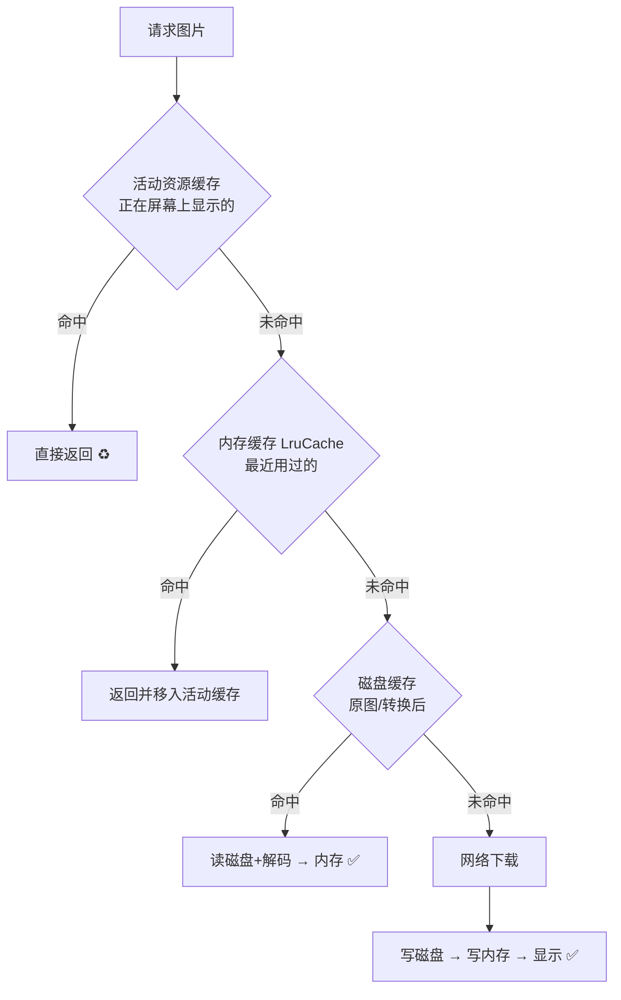
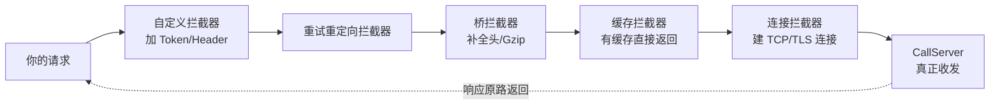
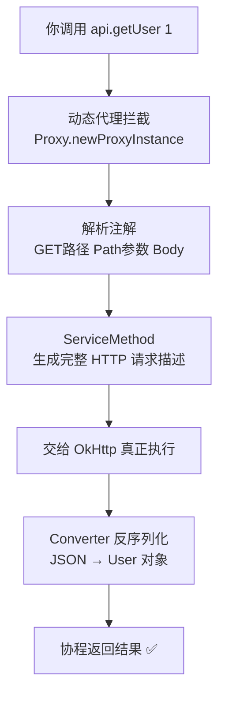
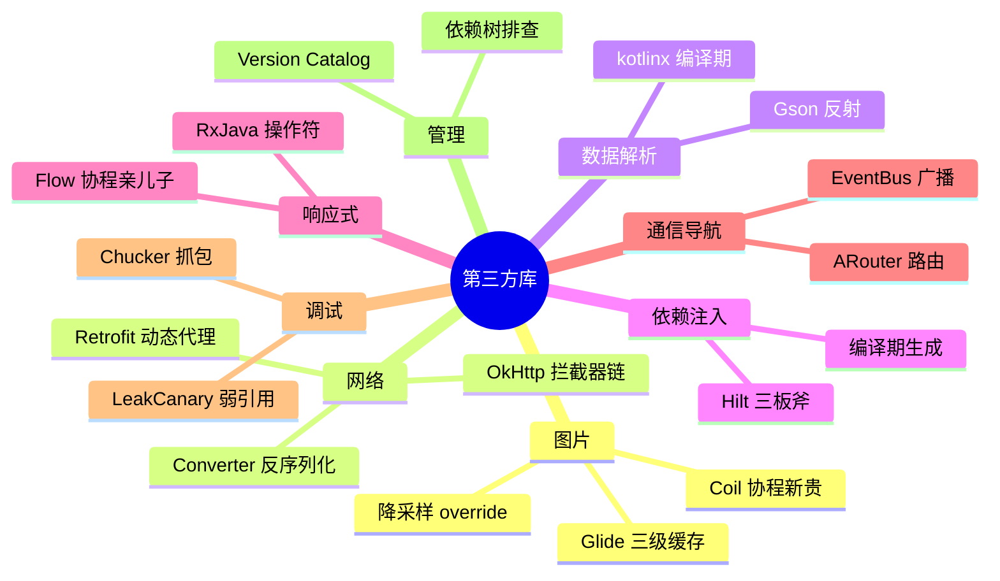

# 🌸 Android 第三方库学习笔记 —— 站在轮子上的开发艺术

> 嘿嘿～会造轮子的大佬值得敬佩，会用轮子的我们也要懂轮子原理！这篇盘点 Android 开发的主流第三方库：图片加载、网络、DI、响应式……面试问"Glide 缓存机制"、"Retrofit 原理"时再也不会大脑空白 🔧🤖✨

---

## 📖 目录

1. [为什么要用第三方库？](#一为什么要用第三方库)
2. [图片加载：Glide 三连](#二图片加载glide-三连)
3. [网络请求：OkHttp 拦截器艺术](#三网络请求okhttp-拦截器艺术)
4. [Retrofit 原理：接口的黑魔法](#四retrofit-原理接口的黑魔法)
5. [JSON 解析：Gson 与新贵们](#五json-解析gson-与新贵们)
6. [依赖注入：Hilt 上位史](#六依赖注入hilt-上位史)
7. [响应式：RxJava 与 Kotlin Flow 之争](#七响应式rxjava-与-kotlin-flow-之争)
8. [事件总线与路由](#八事件总线与路由)
9. [调试工具三剑客](#九调试工具三剑客)
10. [选型心法与依赖管理](#十选型心法与依赖管理)
11. [总结与面试高频题](#十一总结与面试高频题)

---

## 一、为什么要用第三方库？

### 1.1 一个真实场景

加载一张网络头像，自己写要考虑：

- 开线程请求 → 别忘了切回主线程更新 UI
- 内存缓存 → 滑回来别再下载一次
- 磁盘缓存 → 断网还能看
- 图片降采样 → 4000×3000 的图塞进 100dp 的圆框？OOM 警告 💥
- 列表复用错位 → 图 13 显示在图 7 的位置 🤡
- 生命周期 → 页面销毁了还在加载？泄漏！

Glide 一行全搞定：

```kotlin
Glide.with(this).load(url).into(imageView)
```

### 1.2 第三方库的本质

| 价值 | 说明 |
| --- | --- |
| 别踩坑 | 踩过的坑都替你填好了 |
| 稳定性 | 千万级 App 验证过 |
| 效率 | 把时间花在业务上 ⏱️ |
| **但要懂原理** | 出问题能排查、面试能聊、避免误用 💡 |

> 🎀 学习心法：**先会用 → 再懂原理 → 最后看源码**——直接看源码容易劝退，先用出感情再深入～

---

## 二、图片加载：Glide 三连

### 2.1 基本用法

```kotlin
Glide.with(context)
    .load("https://xx.com/avatar.jpg")   // 支持_url/本地/资源id/URI
    .placeholder(R.drawable.loading)      // 占位图
    .error(R.drawable.error)              // 失败图
    .circleCrop()                         // 圆形裁剪
    .override(200, 200)                   // 降采样到目标尺寸
    .into(imageView)

// with() 会绑定生命周期——页面销毁自动取消加载 ✅
```

### 2.2 核心机制：三级缓存（必考！）



| 缓存 | 存的是 | 速度 | 系统紧张时 |
| --- | --- | --- | --- |
| 活动资源 | 正在显示的弱引用 | 最快 | 随时可回收 |
| 内存缓存 LruCache | 最近使用的 | 很快 | 可被回收 |
| 磁盘缓存 | 原图+处理后图 | 中等 | 保留 |

### 2.3 图片库三国杀

| 对比 | Glide ⭐ | Coil | Picasso |
| --- | --- | --- | --- |
| 出品 | Bump（现 Google 系）| Coil 团队（官方推荐）| Square |
| 语言 | Java（Kotlin 可用）| **纯 Kotlin + 协程** | Java |
| 体积 | 大 | 小 | 小 |
| 功能 | 全家桶（GIF/视频帧）| 够用 | 基础 |
| 推荐场景 | 存量/复杂需求 | **新 Compose 项目首选** | 老项目 |

> 💡 Glide 大小估算：`override()` 按控件尺寸降采样是防 OOM 的核心——**图片大小 ≠ 显示大小**，4000px 塞 100dp 是内存大户！

---

## 三、网络请求：OkHttp 拦截器艺术

### 3.1 OkHttp 是什么

Retrofit 的"发动机"：真正干连接、发请求、收响应的底层库 🚂

```kotlin
val client = OkHttpClient.Builder()
    .connectTimeout(10, TimeUnit.SECONDS)
    .addInterceptor(HttpLoggingInterceptor())          // 应用拦截器
    .addNetworkInterceptor(CacheInterceptor())         // 网络拦截器
    .build()

val request = Request.Builder()
    .url("https://api.example.com/users")
    .header("Authorization", "Bearer $token")
    .build()

client.newCall(request).enqueue(object : Callback {    // 异步
    override fun onResponse(call: Call, resp: Response) { /* 子线程 */ }
    override fun onFailure(call: Call, e: IOException) { }
})
```

### 3.2 拦截器链：责任链模式（必考！）



| 拦截器类型 | 时机 | 典型用途 |
| --- | --- | --- |
| 应用拦截器 addInterceptor | 最先执行 | 加 Token、打日志、加密 |
| 网络拦截器 addNetworkInterceptor | 连接前后 | 缓存策略、真实网络层统计 |

```kotlin
// 经典应用：自动给请求加 Token
class TokenInterceptor : Interceptor {
    override fun intercept(chain: Interceptor.Chain): Response {
        val req = chain.request().newBuilder()
            .header("Authorization", "Bearer ${getToken()}")
            .build()
        return chain.proceed(req)        // 放行给下一个拦截器
    }
}
```

> 🎀 责任链模式：请求像流水线一样穿过每个拦截器，每个拦截器都能**加工请求或直接拦截返回**——和计算机网络篇的"分层处理"异曲同工！

---

## 四、Retrofit 原理：接口的黑魔法

### 4.1 用法回顾

```kotlin
interface UserApi {
    @GET("users/{id}")
    suspend fun getUser(@Path("id") id: Int): User
}
```

明明只写了个 interface，谁实现了它？——**动态代理** 🪄

### 4.2 原理拆解



一句话原理：**Retrofit = 注解的翻译官 + OkHttp 的外包装**。它不发网络请求（OkHttp 干的），只负责把"Kotlin 接口调用"翻译成"HTTP 描述"。

### 4.3 常用注解速查

| 注解 | 用在哪 |
| --- | --- |
| @GET @POST @PUT @DELETE | 方法：请求方式 |
| @Path | 路径替换 `{id}` |
| @Query | URL 参数 `?page=1` |
| @Body | 请求体（JSON）|
| @Header @Headers | 请求头 |
| @Multipart @Part | 文件上传 |
| @FormUrlEncoded @Field | 表单提交 |

---

## 五、JSON 解析：Gson 与新贵们

| 库 | 特点 | 现状 |
| --- | --- | --- |
| Gson | Google 出品、反射实现、老牌 | 存量主流 |
| Moshi | Square、Kotlin 友好 | 增长中 |
| **kotlinx.serialization** | 官方、**编译期生成代码** | Kotlin 新项目首选 ⭐ |
| FastJson | 阿里 | 安全漏洞频发，不推荐 ⚠️ |

```kotlin
// Gson
val user = Gson().fromJson(json, User::class.java)
val json = Gson().toJson(user)

// kotlinx.serialization（无反射、更快）
@Serializable
data class User(val id: Int, val name: String)
val user = Json.decodeFromString<User>(json)
```

> 💡 反射 vs 编译期生成：反射运行时"偷看"类结构（慢+混淆易翻车）；编译期生成提前写好解析代码（快+混淆安全）——kotlinx.serialization 的性能优势来源！

---

## 六、依赖注入：Hilt 上位史

### 6.1 什么是依赖注入（DI）？

不自己 new 依赖，而是"别人递给你"🎁：

```kotlin
// ❌ 紧耦合：自己造依赖
class OrderViewModel {
    private val repo = OrderRepository(RemoteDataSource(), LocalDataSource())
}

// ✅ 依赖注入：构造时别人递进来
class OrderViewModel(
    private val repo: OrderRepository   // 好递手
) { ... }
```

| 好处 | 说明 |
| --- | --- |
| 解耦 | 换实现不用改代码（测试换 FakeRepo）|
| 易测 | 单测直接传 mock 对象 |
| 单例管理 | 框架保证"只造一个" |

### 6.2 DI 框架进化史

| 时代 | 框架 | 特点 |
| --- | --- | --- |
| 手工时代 | 自己写 Factory | 啰嗦 |
| 编译期 | **Dagger2** | 强大但学习曲线地狱 😵 |
| 运行时 | Koin | 纯 Kotlin、简单、无编译检查 |
| 现代主流 | **Hilt** ⭐ | Dagger 的官方简化版，Jetpack 亲儿子 |

### 6.3 Hilt 三板斧

```kotlin
// ① 告诉 App 用 Hilt
@HiltAndroidApp
class MyApp : Application()

// ② 提供依赖：怎么造
@Module
@InstallIn(SingletonComponent::class)
object AppModule {
    @Provides @Singleton
    fun provideUserApi(): UserApi = Retrofit.Builder()
        .baseUrl("https://api.example.com/")
        .build().create(UserApi::class.java)
}

// ③ 注入使用：伸手要
@HiltViewModel
class UserViewModel @Inject constructor(
    private val api: UserApi          // Hilt 自动递进来 ✅
) : ViewModel()
```

> 🎀 原理一句话：**编译期生成"装配代码"**（Dagger 家族血统），运行时按依赖图把对象递给你——没有反射，性能棒棒！

---

## 七、响应式：RxJava 与 Kotlin Flow 之争

### 7.1 响应式思想

数据像"水流" 🚰，下游订阅接收——而不是"等结果回来"：

```
被观察者（水管出数据）→ 操作符（过滤/变换/线程切换）→ 观察者（收数据处理）
```

### 7.2 RxJava 经典三连

```kotlin
Observable.create { emitter ->          // 上游：发数据
    emitter.onNext(1); emitter.onNext(2); emitter.onComplete()
}
    .subscribeOn(Schedulers.io())       // 上游在 IO 线程
    .map { it * 10 }                    // 变换
    .observeOn(AndroidSchedulers.mainThread())  // 下游回主线程
    .subscribe { value -> show(value) } // 收到：10, 20
```

### 7.3 Kotlin Flow：官方挑战者

```kotlin
flow {
    emit(queryUsers())                  // 上游
}.flowOn(Dispatchers.IO)                // 上游线程
 .map { it.filter { active } }
 .collect { users -> render(users) }    // 下游（协程里调用）
```

| 对比 | RxJava | Kotlin Flow ⭐ |
| --- | --- | --- |
| 依赖 | 额外引入 | Kotlin 原生自带 |
| 与协程 | 不兼容（自己管理线程）| **协程亲儿子**，结构化并发 |
| 学习曲线 | 陡（操作符海量）| 平缓（就是挂起函数序列）|
| 背压 | 策略繁多 | Buffer/Conflate 简化 |
| 现状 | 存量项目大量 | **新项目主流** ✅ |

> 💡 新项目选型：简单场景 **Flow**，复杂流控/成熟生态才考虑 RxJava——就像 Java 和 Kotlin 的关系～

---

## 八、事件总线与路由

### 8.1 事件总线：EventBus

组件间解耦通信的"广播电台" 📡：

```kotlin
// 定义事件
data class LoginEvent(val userId: Int)

// 订阅（如 Activity）
@Subscribe(threadMode = ThreadMode.MAIN)
fun onLogin(event: LoginEvent) { updateUI(event) }
override fun onStart() { EventBus.getDefault().register(this) }
override fun onStop() { EventBus.getDefault().unregister(this) }

// 发布（如任意地方）
EventBus.getDefault().post(LoginEvent(10086))
```

> ⚠️ 滥用警告：事件满天飞 → 调试时根本不知道谁发了消息 → "事件地狱" 😵 现代替代：**共享 ViewModel / Flow（SharedFlow）** 优先！

### 8.2 组件化路由：ARouter

组件化后模块互相不可见，跳转靠路由表（类比前端 URL 路由）：

```kotlin
// 目标页注册路径
@Route(path = "/user/detail")
class UserDetailActivity : AppCompatActivity()

// 任意模块跳转
ARouter.getInstance().build("/user/detail")
    .withLong("userId", 10086)
    .navigation()
```

---

## 九、调试工具三剑客

| 工具 | 干啥的 | 用法 |
| --- | --- | --- |
| **LeakCanary** 🐤 | 内存泄漏自动检测 | 加依赖即可，debug 包自动弹通知 |
| **Chucker** | 抓 HTTP 请求（手机上的 Charles）| 加依赖，通知栏看请求响应 |
| **Stetho / Flipper** | 网络库、布局、数据库调试 | Chrome 调试器 inspect |

```gradle
// 一行集成 LeakCanary，debug 环境自动生效
debugImplementation 'com.squareup.leakcanary:leakcanary-android:2.x'
```

> 🎀 LeakCanary 原理彩蛋：监听 Activity 销毁 → 弱引用观察 → GC 后还活着 = 泄漏 → 自动 dump 堆栈分析出引用链——用" WeakReference + ReferenceQueue"的经典组合！

---

## 十、选型心法与依赖管理

### 10.1 选型五问 🤔

1. **活跃度**：多久没更新了？Issue 堆成山了吗？
2. **社区**：Star 数、搜索引擎搜得到答案吗？
3. **官方性**：Google/Jetpack 推荐吗？（Hilt、Flow、Coil 加分）
4. **体积**：为一个功能引入 2MB 划算吗？
5. **可控性**：API 设计合理吗？出问题能自己排查吗？

### 10.2 版本目录（Version Catalog）管理依赖

```toml
# gradle/libs.versions.toml —— 统一管理版本号
[versions]
glide = "4.16.0"
retrofit = "2.11.0"

[libraries]
glide = { module = "com.github.bumptech.glide:glide", version.ref = "glide" }
retrofit = { module = "com.squareup.retrofit2:retrofit", version.ref = "retrofit" }
```

```kotlin
// 模块里引用（告别到处写版本号）
implementation(libs.glide)
implementation(libs.retrofit)
```

### 10.3 依赖冲突排查

```bash
# 打印依赖树，看谁引入了冲突版本
./gradlew app:dependencies

# 强制统一版本
implementation("xxx") { exclude group: "冲突组" }
```

---

## 十一、总结与面试高频题

### 11.1 知识地图



### 11.2 面试官最爱问 Top 题 🎯

| 问题 | 答题要点 |
| --- | --- |
| Glide 缓存机制？ | 活动资源（弱引用）→ 内存 LruCache → 磁盘 → 网络，逐级读取逐级回填 |
| Glide 怎么防 OOM？ | 按控件尺寸降采样 override + 弱引用活动缓存 + 生命周期绑定自动取消 |
| Glide with() 绑定生命周期原理？ | 往 Activity 加无 UI Fragment 监听销毁，销毁时取消请求（同 GlideRequestManager）|
| Retrofit 原理？ | 动态代理拦截接口调用 → 解析注解生成请求 → 交 OkHttp 执行 → Converter 反序列化 |
| OkHttp 拦截器原理？ | 责任链模式，请求依次穿过应用/桥/缓存/连接拦截器，可加工可拦截 |
| 应用拦截器和网络拦截器区别？ | 执行时机：前者最先且只跑一次；后者贴近网络层，重定向/缓存命中时行为不同 |
| Gson 和 kotlinx.serialization 区别？ | 反射（运行时、混淆需规则）vs 编译期生成（快、混淆友好）|
| Hilt/Dagger 原理？ | 编译期注解处理器生成装配代码，构建依赖图注入，无运行时反射 |
| RxJava 和 Flow 怎么选？ | 新项目 Flow（协程原生、结构化并发）；存量/复杂流控 RxJava |
| EventBus 优缺点？ | 解耦广播但难追踪；现代用共享 ViewModel/Flow 替代 |
| LeakCanary 原理？ | 监听组件销毁 + 弱引用观察 + GC 后仍存活判定泄漏 + 自动 dump 引用链 |
| 热门图片库对比？ | Glide 全家桶 vs Coil 纯 Kotlin 协程（Compose 首选）vs Picasso 轻量基础 |

### 11.3 学习建议路线 🗺️

1. **第一站**：项目里把 Glide 三级缓存流程对着流程图走一遍（开日志验证缓存命中）
2. **第二站**：给 OkHttp 写一个"自动加 Token + 401 刷新重试"拦截器
3. **第三站**：Debug 断点进 Retrofit 的 `InvocationHandler`，亲眼看动态代理
4. **第四站**：新 Demo 用 Hilt + Flow 重写网络层，体会 DI 和响应式
5. **第五站**：装 LeakCanary，故意写一个泄漏（static 持 Activity），看它报警 🐤
6. **终点站**：读 Glide 缓存模块 / OkHttp 拦截器链源码，画自己的流程图 🌟

---

> 🌈 Android 第三方库通关！从此你简历上的"熟练使用 Glide/Retrofit/OkHttp/Hilt"每个词都能讲出原理：三级缓存、责任链、动态代理、编译期生成……用轮子也懂造轮子，才是轮子的完全体！移动分区三连达成，下一个知识点继续召唤我！(๑•̀ㅂ•́)و✧🔧💪
