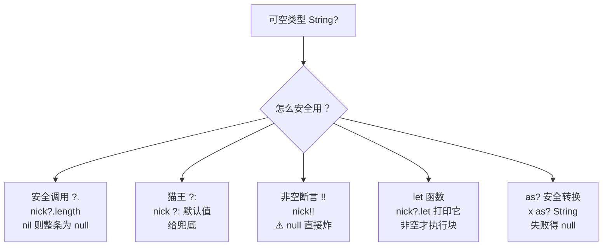
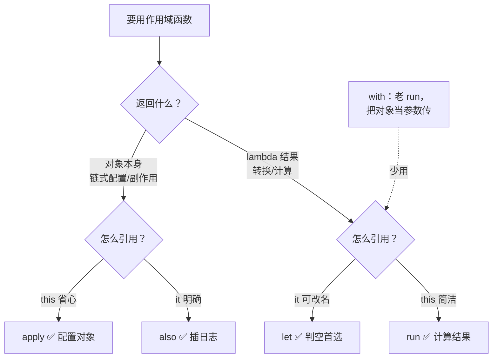
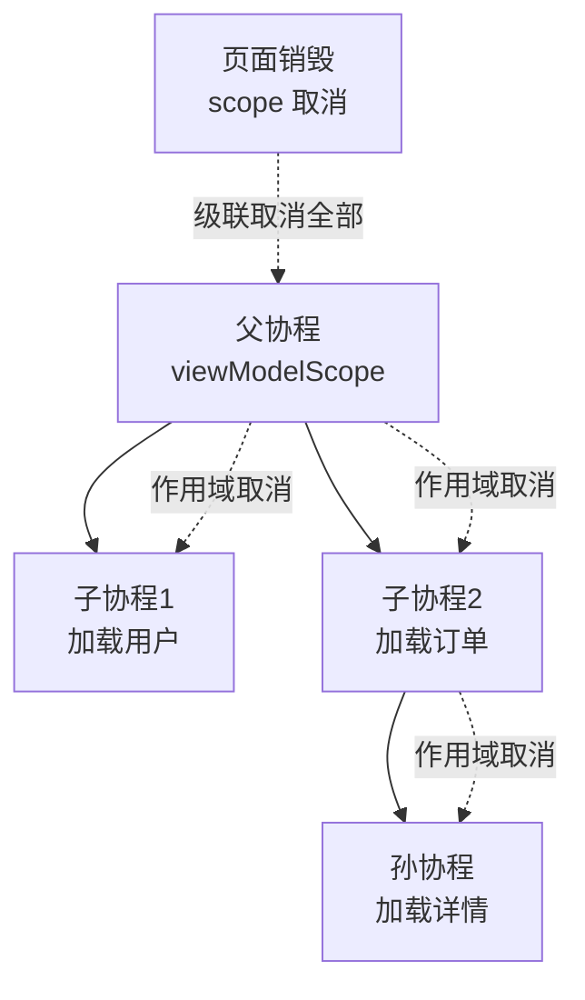
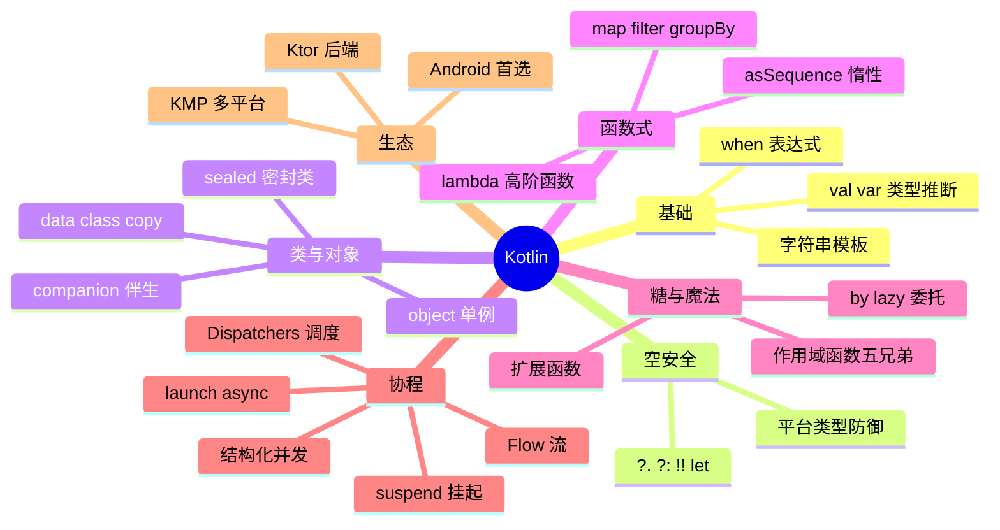

# 🌸 Kotlin 学习笔记 —— JVM 上的优雅革命

> 嘿嘿～Android 篇和 Swift 篇里 Kotlin 都当过配角，这次正式单独立传！JetBrains 出品、Google 钦定、JetBrains 全家桶御用——一门让你回不去 Java 的语言 🤖✨（好消息：和 Java 100% 互通，随时混着写～）

---

## 📖 目录

1. [初识 Kotlin：它是谁？](#一初识-kotlin它是谁)
2. [基础语法：val / var 与类型系统](#二基础语法val--var-与类型系统)
3. [控制流：if 是表达式、when 王者](#三控制流if-是表达式when-王者)
4. [空安全（重点！）](#四空安全重点)
5. [函数：优雅一万种方式](#五函数优雅一万种方式)
6. [类与对象：全家福](#六类与对象全家福)
7. [继承、接口与密封类](#七继承接口与密封类)
8. [函数式编程：集合操作符](#八函数式编程集合操作符)
9. [作用域函数五兄弟（重点！）](#九作用域函数五兄弟重点)
10. [扩展函数与属性委托](#十扩展函数与属性委托)
11. [协程（重点！）](#十一协程重点)
12. [Kotlin vs Java vs Swift 三国对照](#十二kotlin-vs-java-vs-swift-三国对照)
13. [总结与面试高频题](#十三总结与面试高频题)

---

## 一、初识 Kotlin：它是谁？

### 1.1 基本信息

- JetBrains 2011 年发布、2016 年 1.0 正式版（IntelliJ IDEA 同厂 🏭）
- **2017 年 Google 钦定为 Android 官方首选语言**
- 跑在 **JVM** 上 → 和 Java 无缝互调（你调我我调你）
- 用武之地：Android 📱、后端（Ktor/Spring）🛠️、多平台 KMP（iOS/桌面/Web）🌍、Gradle 构建脚本

### 1.2 设计哲学

| 痛点（Java）| Kotlin 的解药 |
| --- | --- |
| NullPointerException 满天飞 💥 | **类型系统级空安全** |
| getter/setter 样板代码 | **data class 一行搞定** |
| 匿名内部类啰嗦 | **lambda 丝滑** |
| 回调地狱 | **协程：异步写成同步样** |
| 万物皆可继承 | **默认 final，显式 open** |

> 🎀 学习路线建议：有 Java 基础 → 直接看差异点学得飞快；没基础 → Kotlin 反而比 Java 更适合入门（语法更简洁）！

---

## 二、基础语法：val / var 与类型系统

```kotlin
// val = 不可变（final），var = 可变
val name = "小花"        // 类型推断 String，只能赋值一次
var score = 95
score = 100              // ✅
// name = "小明"         // ❌ 编译错误

// 显式类型标注
var age: Int = 18

// Kotlin 一切皆对象（没有 int/Integer 之分！）
val max = Int.MAX_VALUE
val c: Char = 'A'
val flag: Boolean = true

// 数值转换必须显式
val a: Long = 100
val b: Int = a.toInt()          // 不能隐式窄化

// 字符串模板
val msg = "我是$name，明年${age + 1}岁"
val multi = """
    三引号多行字符串
    缩进可以 trimIndent() 处理
""".trimIndent()
```

**val 引用可变性的小区分（面试细节题）：**

```kotlin
val list = mutableListOf(1, 2)
list.add(3)        // ✅ 引用不变，内容可变
// list = mutableListOf()  // ❌ 引用本身不可重新指向
```

> 🎀 风格心法：**永远 val 优先**——编译器逼你想清楚"这东西要不要变"，代码更可预测！

---

## 三、控制流：if 是表达式、when 王者

```kotlin
// if 是表达式（有返回值）→ 三元运算符不需要了
val max = if (a > b) a else b

// when：switch 的完全体
val desc = when (score) {
    100 -> "满分！"
    in 90..99 -> "优秀"          // 区间判断
    in 60..89 -> "及格"
    else -> "再接再厉"
}

// when 不带参数：代替 if-else 链（更清晰）
val type = when {
    score >= 90 -> "A"
    score >= 60 -> "B"
    else -> "C"
}

// when 还能匹配类型（智能转换）
fun whatIs(x: Any) = when (x) {
    is Int -> "整数 ${x + 1}"     // x 自动被当作 Int
    is String -> "字符串 ${x.length}"
    else -> "不知道"
}

// for 循环与区间
for (i in 1..5) print(i)          // 12345
for (i in 1 until 5) print(i)     // 1234
for (i in 10 downTo 1 step 2) print(i)  // 108642
repeat(3) { print("哈") }        // 哈哈哈
```

| Kotlin | Java 对照 |
| --- | --- |
| `if (a>b) a else b` | `a > b ? a : b` |
| `when { }` | `switch / if-else if` |
| `in 1..5` | `i >= 1 && i <= 5` |
| `for (i in list)` | `for (int i : arr)` |

---

## 四、空安全（重点！）

### 4.1 类型系统分两种

```kotlin
var name: String = "小花"      // 非空类型：永远不能是 null
var nick: String? = null       // 可空类型：问号结尾

// nick.length                  // ❌ 编译错误：可能为 null
```

### 4.2 空安全操作符全家福



```kotlin
// ?. 安全调用：链式穿透
val city = user?.address?.city          // 任一环 null → 整条 null

// ?: 猫王运算符（Elvis）：兜底
val display = nick ?: "未设置"

// !! 非空断言：我确信非空（null 就 NPE，慎用！）
val len = nick!!.length                // 💣

// let：非空才执行
nick?.let { println("昵称长度 ${it.length}") }

// 结合使用：优雅判空赋值
val name2 = nick ?: return             // 为空就早退（Swift guard 的感觉）
```

### 4.3 平台类型（Java 互操作坑）

Java 的变量没有空安全标注 → Kotlin 视为"平台类型 `String!`"（不知道空不空）：

```java
// Java 代码
public String getName() { return null; }
```

```kotlin
val n = javaObj.name       // 类型是 String! （平台类型）
println(n.length)          // 💥 编译不报错，运行 NPE！
// 防御姿势：接的时候标上 ?
val safe: String? = javaObj.name
println(safe?.length)      // ✅ null 安全
```

> 🎀 面试金句：Kotlin 的空安全是**编译期检查**，但对 Java 来的"平台类型"不设防——**边界处（调 Java/反序列化）手动标注可空**是老兵的习惯！

---

## 五、函数：优雅一万种方式

```kotlin
// 基本函数：fun 关键字，Unit=无返回值（可省略）
fun add(a: Int, b: Int): Int {
    return a + b
}

// 单表达式函数：直接用 = 
fun add2(a: Int, b: Int) = a + b

// 默认参数 + 命名参数（告别方法重载爆炸）
fun greet(name: String, greeting: String = "你好", punct: String = "!") =
    "$greeting, $name$punct"

greet("小花")
greet("小明", punct = "~~~")            // 想改哪个点名哪个

// 可变参数 vararg
fun sum(vararg nums: Int) = nums.sum()
sum(1, 2, 3, 4)                        // 10

// 顶层函数：不用塞进类里（文件里直接写）
// 工具函数终于不用写 Utils 类和 static 了！✨
```

| Java 写法 | Kotlin 写法 |
| --- | --- |
| 方法重载好几个 | 默认参数 + 命名参数一个搞定 |
| static 工具方法 | 顶层函数 |
| void | Unit（可省）|

---

## 六、类与对象：全家福

### 6.1 主构造器 + data class

```kotlin
// 常规类：主构造器直接跟在类名后
class Person(val name: String, var age: Int) {
    // init 块：主构造器逻辑写这里
    init { println("$name 出生了") }

    // 次构造器（少用）
    constructor(name: String) : this(name, 0)
}

// data class：数据类一行顶 Java 几十行
// 自动生成 equals/hashCode/toString/copy/解构
data class User(val id: Int, val name: String, val vip: Boolean = false)

val u1 = User(1, "小花")
val u2 = u1.copy(vip = true)           // 复制并改字段（不可变利器！）
val (id, name) = u1                     // 解构声明
println("$id $name ${u2}")              // User(id=1, name=小花, vip=true)
```

### 6.2 object：单身贵族

```kotlin
// object = 单例（饿汉式），一行替代 Java 的双检锁模板
object AppConfig {
    var theme = "dark"
    fun init() { println("初始化") }
}
AppConfig.init()                        // 直接用类名调

// object 表达式 = 匿名内部类
button.setOnClickListener(object : View.OnClickListener {
    override fun onClick(v: View) { println("点了") }
})

// companion object：类里的"静态"伴生
class UserRepo {
    companion object {
        fun create(): UserRepo = UserRepo()
    }
}
val repo = UserRepo.create()
```

| Java | Kotlin |
| --- | --- |
| 单例模式模板代码 | `object XXX {}` |
| static 方法 | `companion object` / 顶层函数 |
| 匿名内部类 | `object : 接口 {}`（或 lambda）|

---

## 七、继承、接口与密封类

```kotlin
// 默认 final 不可继承！要继承必须标 open
open class Animal(val name: String) {
    open fun sound() = "..."            // 可被重写的方法也要 open
}

class Dog(name: String) : Animal(name) {
    override fun sound() = "汪汪"        // override 方法默认 open（想封闭加 final）
}

// 接口：可以有默认实现
interface Flyable {
    fun fly() = "飞起来"                 // 默认实现
    val speed: Int                       // 抽象属性
}

// 密封类 sealed：有限的子类层级（when 配合食用最佳！）
sealed class Result {
    data class Success(val data: String) : Result()
    data class Error(val msg: String) : Result()
    object Loading : Result()
}

// when 处理密封类：不需要 else（编译器知道就这几种！）
fun show(r: Result) = when (r) {
    is Result.Success -> "✅ ${r.data}"
    is Result.Error   -> "❌ ${r.msg}"
    Result.Loading    -> "⏳ 加载中"
}
// 好处：以后加新子类，漏处理的分支编译期就报错 🛡️
```

> 🎀 密封类 = "受控的继承"：子类必须在**同一文件**、数量有限、when 穷尽检查——网络请求结果、UI 状态机的最佳载体！和 Swift 的 enum 关联值是同一个思想～

---

## 八、函数式编程：集合操作符

```kotlin
data class Student(val name: String, val score: Int)

val students = listOf(
    Student("小花", 95), Student("小明", 66),
    Student("小红", 88), Student("小刚", 45)
)

val result = students
    .filter { it.score >= 60 }           // 过滤及格的
    .sortedByDescending { it.score }     // 按分数降序
    .map { "${it.name}:${it.score}" }    // 变换成字符串
    .take(2)                             // 取前两名
println(result)                          // [小花:95, 小红:88]
```

**操作符速查表：**

| 操作符 | 作用 | SQL/JS 类比 |
| --- | --- | --- |
| map | 逐个变换 | SELECT 表达式 |
| filter | 过滤 | WHERE |
| sortedBy | 排序 | ORDER BY |
| groupBy | 分组 | GROUP BY |
| associateBy | 转成 Map（键→对象）| - |
| find / firstOrNull | 找第一个 | LIMIT 1 |
| any / all / none | 存在/全部判断 | EXISTS |
| sumOf / maxOf | 聚合 | SUM / MAX |
| flatMap | 拍平嵌套 | - |
| zip | 两条列表配对 | - |

```kotlin
// 集合可变性：只读接口 List vs 可变 MutableList
val ro: List<Int> = listOf(1, 2)          // 只读
val rw: MutableList<Int> = mutableListOf(1, 2)
rw.add(3)

// 惰性序列：大数据量时用 asSequence 避免中间集合
(1..1_000_000).asSequence()
    .filter { it % 2 == 0 }
    .map { it * 2 }
    .take(5)
    .toList()                              // 只算到够用为止 ⚡
```

---

## 九、作用域函数五兄弟（重点！）

Kotlin 最有辨识度的语法糖——在对象上下文里执行一段代码 🍬：

```kotlin
// Person 配置：五种姿势
val p1 = Person("小花").apply {
    age = 18                              // this 直接用
    vip = true
}                                         // apply 返回对象本身

val len = p1.let { it.name.length }        // let 返回块结果

val text = with(p1) { "$name $age 岁" }    // with 不是扩展

val p2 = p1.also { println("创建了 $it") } // also 返回对象本身（干副作用）

val info = p1.run { "$name（$age）" }      // run 返回块结果
```

**记忆矩阵（必背！）：**

| 函数 | 引用对象 | 返回值 | 使用场景 |
| --- | --- | --- | --- |
| **let** | it | **lambda 结果** | 判空执行 / 转换值 |
| **run** | this | **lambda 结果** | 计算属性/组合结果 |
| **with** | this | **lambda 结果** | 同 run（非扩展，传对象）|
| **apply** | this | **对象本身** | 对象配置（Builder 替代品）|
| **also** | it | **对象本身** | 链式插入副作用（打日志）|



> 🎀 最常用组合拳：**`?.let {}` 判空** + **`apply {}` 建对象配置**——这两招覆盖 80% 场景，其他三个看得懂就行～

---

## 十、扩展函数与属性委托

### 10.1 扩展函数：无痛加方法

```kotlin
// 给 String 加扩展（不用继承、不用改源码！）
fun String.shout(): String = this.uppercase() + "!!!"
fun Int.isEven() = this % 2 == 0

"hello".shout()              // HELLO!!!
4.isEven()                   // true

// 扩展也能用在可空类型上（统一判空）
fun String?.orDefault() = this ?: "空空如也"
null.orDefault()             // 空空如也 ✅
```

> 💡 原理：编译成静态方法（第一个参数是接收者）——**没有真的修改类**，所以 Java 里看到的调用是 `StringUtils.shout("hello")`～

### 10.2 委托属性：by 的魔法

```kotlin
// by lazy：第一次访问才初始化，之后缓存（线程安全默认）
val db by lazy { connectDatabase() }     // 用到才连接 ✨

// observable：属性变化时回调
var theme by Delegates.observable("light") { _, old, new ->
    println("主题从 $old 改成 $new")
}

// by map：用 Map 当属性容器（JSON 解析神器）
class User(map: Map<String, Any>) {
    val name: String by map
    val age: Int by map
}
val u = User(mapOf("name" to "小花", "age" to 18))

// 委托给另一个类：类委托（装饰器模式一行搞定）
interface Repo { fun get(): List<Int> }
class RemoteRepo : Repo { override fun get() = listOf(1) }
class CachedRepo(r: Repo) : Repo by r   // 自动转发所有方法！
```

---

## 十一、协程（重点！）

### 11.1 为什么需要协程？

线程贵（每条 ~1MB 栈），回调乱（嵌套地狱）→ 协程：**轻量级"用户态线程"**（一条线程跑万个协程），**用同步的写法干异步的事**：

```kotlin
// ❌ 回调地狱
api.getUser { user ->
    api.getOrders(user.id) { orders ->
        api.getDetail(orders[0]) { detail ->
            show(detail)                     // 三层套娃 😵
        }
    }
}

// ✅ 协程：像写同步一样
lifecycleScope.launch {
    val user = api.getUser()                 // 挂起，不阻塞线程
    val orders = api.getOrders(user.id)
    val detail = api.getDetail(orders[0])
    show(detail)                             // 顺序逻辑，一目了然 ✨
}
```

### 11.2 核心概念

| 概念 | 是什么 | 类比 |
| --- | --- | --- |
| suspend 挂起函数 | 可暂停可恢复的函数 | 游戏存档读档 💾 |
| CoroutineScope | 协程的生命周期管辖 | 户口本 |
| launch | 启动协程"发射后不管" | 派小弟干活 |
| async/await | 启动并**拿返回值** | 派小弟带回战利品 |
| Dispatchers | 协程跑在哪种线程 | 工作分配到哪个车间 |
| 结构化并发 | 父取消→子全取消 | 一荣俱荣一损俱损 |

```kotlin
// 作用域与调度器
lifecycleScope.launch(Dispatchers.Main) {     // 主线程协程
    val user = withContext(Dispatchers.IO) {  // 切到 IO 干重活
        api.getUser()                         // 挂起函数
    }                                         // 自动切回 Main
    textView.text = user.name                 // 安全更新 UI ✅
}

// 并发三连：async 一起跑，await 集合结果
coroutineScope {
    val userDeferred = async { api.getUser() }
    val bannerDeferred = async { api.getBanners() }
    val adDeferred = async { api.getAds() }
    // 三个请求并发执行，总耗时 = 最慢的那个 ⚡
    render(userDeferred.await(), bannerDeferred.await(), adDeferred.await())
}
```

### 11.3 结构化并发（协程的杀手锏）



> 🎀 对比 Java 线程：Thread 启了就管不住（泄漏+手动 interrupt）→ 协程**跟着作用域生、跟着作用域死**——页面销毁自动取消所有请求，妈妈再也不担心内存泄漏！

### 11.4 Flow 简介

协程版的"数据流"（响应式）：冷流、可操作符、可取消：

```kotlin
fun usersFlow(): Flow<List<User>> = flow {
    emit(api.getUsers())                    // 上游发射
}.flowOn(Dispatchers.IO)                    // 上游在 IO

viewModelScope.launch {
    usersFlow()
        .catch { e -> emit(emptyList()) }   // 异常兜底
        .collect { users -> render(users) } // 下游收集
}
```

---

## 十二、Kotlin vs Java vs Swift 三国对照

| 特性 | Kotlin | Java | Swift |
| --- | --- | --- | --- |
| 不可变/可变 | val / var | final / 变量 | let / var |
| 空安全 | `String?` + `?.` `?:` | ❌ 无（NPE 重灾区）| `String?` + `?.` `??` |
| 数据类 | `data class` | record（16+）/手写 | `struct` |
| 模式匹配 | when | switch（贫弱）| switch（强）|
| 扩展 | `fun X.ext()` | ❌ | extension |
| 单例 | `object` | 枚举/双检锁模板 | static let 共享 |
| 接口默认实现 | ✅ | ✅（8+）| ✅（协议扩展更强）|
| 异步 | **协程** | 线程池/CompletableFuture | async/await + Actor |
| 默认继承性 | final（open 解锁）| 默认可继承 | 默认不可继承 |
| 平台 | JVM 全平台 | JVM | Apple 系 |

> 🎀 三国杀口诀：**Java 是老国王（存量）、Kotlin 是 JVM 新王（现代）、Swift 是苹果园领主**——三者的现代特性（空安全/表达式/if-let）惊人趋同，说明语言设计殊途同归！

---

## 十三、总结与面试高频题

### 13.1 知识地图



### 13.2 面试官最爱问 Top 题 🎯

| 问题 | 答题要点 |
| --- | --- |
| val 和 var 区别？ | 只读引用 vs 可变引用；val 引用不变但对象内容可变 |
| Kotlin 空安全原理？ | 类型系统区分可空；?. 安全调用、?: 兜底、!! 断言（NPE）、let 判空 |
| 什么是平台类型？ | Java 互操作无空标注的 `String!`，边界处手动标 ? 防御 |
| data class 自动生成什么？ | equals/hashCode/toString/copy + 解构；注意主构造器至少一个 val/var 参数 |
| object 和 companion object 区别？ | object 是类级单例；companion 是类内伴生（伪静态），可实现接口 |
| 密封类和枚举区别？ | 枚举=同类型有限实例；密封=有限子类类型（各自可携带不同数据）|
| 作用域函数怎么选？ | 返回对象本身：apply(this)/also(it)；返回结果：run(this)/let(it)；with 传参版 |
| 扩展函数原理？ | 编译为静态方法+接收者参数，非真修改类；不能访问私有成员 |
| by lazy 原理？ | 首次访问加锁初始化并缓存（默认 SYNCHRONIZED 线程安全）|
| 协程比线程好在哪？ | 轻量（MB→KB 级）、挂起不阻塞线程、结构化并发自动取消 |
| suspend 函数本质？ | 编译成带 Continuation 的状态机，挂起点处保存恢复 |
| launch 和 async 区别？ | 发射后不管 vs 返回 Deferred 可 await 取值；async 异常默认不传播需 await |
| Dispatchers 怎么选？ | Main 更新 UI / IO 磁盘网络 / Default CPU 密集 / Unconfined 不推荐 |
| Flow 冷流和热流？ | Flow 冷（有订阅者才发射）；SharedFlow/StateFlow 热（共享发送）|

### 13.3 学习建议路线 🗺️

1. **第一站**：play.kotlinlang.org 跑通本篇所有代码（浏览器即开即用）
2. **第二站**：把空安全操作符、作用域函数五兄弟敲到形成肌肉记忆
3. **第三站**：写一个纯 Kotlin 版"学生管理"（data class + when + 集合操作符）
4. **第四站**：用协程 + Flow 重写一个回调式网络请求，体会"同步的写法异步的效率"
5. **第五站**：和 Swift 篇第十二章对照表互查一遍，双端语法彻底打通
6. **终点站**：读官方 Kotlin Koans / 深入协程状态机原理 🌟

---

> 🌈 Kotlin 通关！移动分区五连全集齐：Android → Android-UI → 第三方库 → Swift → **Kotlin**！现在你手里有 JVM 新王 + 苹果园领主双语言，双端通吃不是梦～下一个知识点继续召唤我！(๑•̀ㅂ•́)و✧🤖🎉
