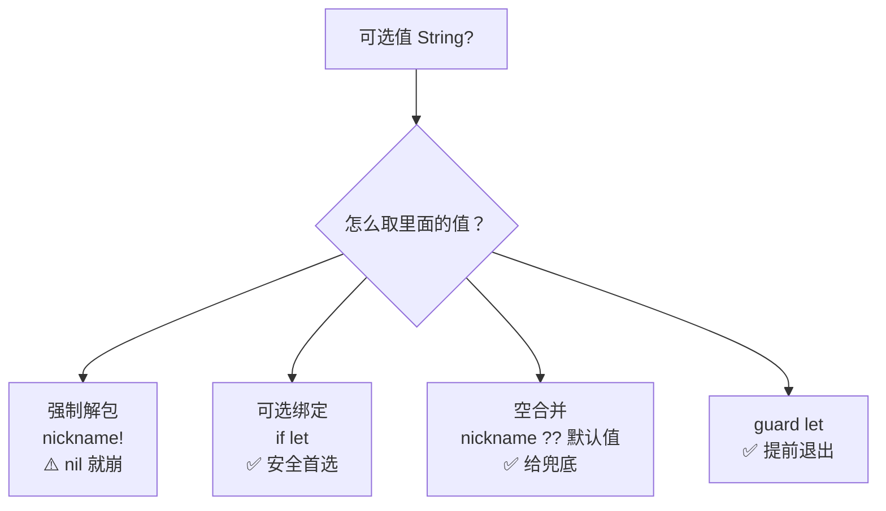
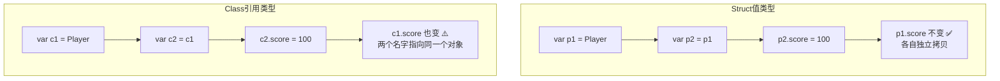
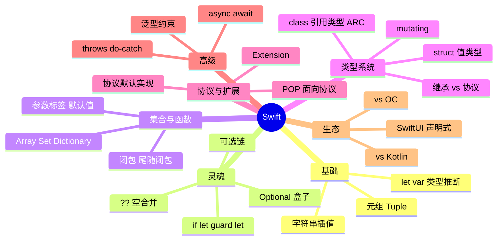

# 🌸 Swift 学习笔记 —— 苹果园里的现代语言

> 嘿嘿～移动分区新篇章！学完安卓的 Kotlin，来会会苹果家的 Swift——同样是现代语言，同样有空安全和简洁语法，两相对照学得飞快 🍎✨（放心，没 Mac 也能先学语法，Playground 在线就能跑～）

---

## 📖 目录

1. [初识 Swift：它是谁？](#一初识-swift它是谁)
2. [变量、常量与类型推断](#二变量常量与类型推断)
3. [基本类型：字符串与元组](#三基本类型字符串与元组)
4. [可选类型：Swift 的灵魂（重点！）](#四可选类型swift-的灵魂重点)
5. [控制流：if / switch / guard](#五控制流if--switch--guard)
6. [集合三剑客：Array / Set / Dictionary](#六集合三剑客array--set--dictionary)
7. [函数：一等公民](#七函数一等公民)
8. [闭包：会跑的代码块](#八闭包会跑的代码块)
9. [类与结构体：值类型 vs 引用类型（重点！）](#九类与结构体值类型-vs-引用类型重点)
10. [属性、协议与扩展](#十属性协议与扩展)
11. [错误处理与泛型](#十一错误处理与泛型)
12. [Swift vs Kotlin：镜像兄弟](#十二swift-vs-kotlin镜像兄弟)
13. [SwiftUI 一瞥与学习路线](#十三swiftui-一瞥与学习路线)
14. [总结与面试高频题](#十四总结与面试高频题)

---

## 一、初识 Swift：它是谁？

### 1.1 基本信息

- Apple 2014 年发布的**开源**编程语言（WWDC 惊喜发布 🎁）
- 接替 Objective-C 成为 iOS/macOS/watchOS 开发**官方首选**
- 设计理念：**安全（编译期抓错误）、快速（性能比肩 C）、现代（表达式语法）**
- 作者 Chris Lattner 也是 LLVM 之父——编译器界的梦之队作品

### 1.2 Swift vs Objective-C

| 对比 | Objective-C | Swift ⭐ |
| --- | --- | --- |
| 语法 | 方括号消息 `[obj method:param]` | 点语法、现代简洁 |
| 空安全 | 无（nil 随便调，运行时崩）| **Optional 强制处理** ✅ |
| 类型推断 | 无 | `let x = 10` 自动推断 |
| 值类型 | 基本引用类型 | **struct 枚举皆是值类型** |
| 脚本/Playground | 无 | 有（像记事本一样即时跑）|
| 现状 | 存量老项目 | **新项目首选** ✅ |

### 1.3 没有 Mac 能学吗？

能！

- **在线 Playground**：swiftfiddle.com / IBM Swift Sandbox 类网站，浏览器直接跑
- Windows/Linux：官方工具链可装（编译运行 CLI 程序）
- 想做 App 再上 Mac + Xcode（iOS 开发硬门槛，写代码本身零门槛）

---

## 二、变量、常量与类型推断

```swift
// let = 常量（不可改），var = 变量（可改）
let name = "小花"          // 类型推断为 String，且不可再改
var score = 95             // 可修改
score = 100                // ✅
// name = "小明"           // ❌ 编译错误：let 不可改

// 类型标注（通常可省略）
var age: Int = 18
var height: Double = 165.5
var isHappy: Bool = true

// Swift 是强类型语言：不同类型不能偷偷转换
// let sum = score + height          // ❌ Int + Double 不行
let sum = Double(score) + height     // ✅ 显式转换
```

> 🎀 编码风格心法：**能用 let 就不用 var**——不可变数据更安全，编译器还能优化！这叫"默认不可变"哲学～

---

## 三、基本类型：字符串与元组

### 3.1 字符串

```swift
var greeting = "Hello"
greeting += ", Swift"               // 拼接

// 插值 \(变量)——比 Java 的 + 舒服多了
let msg = "我是\(name)，今年\(age)岁"

// 多行字符串（三个引号）
let poem = """
床前明月光，
疑是地上霜。
"""

// 字符串是值类型！赋值即拷贝
var a = "hello"
var b = a
b += " world"
print(a)      // "hello" —— a 不受影响 ✅
```

### 3.2 元组 Tuple：打包快递 📦

```swift
// 把多个值打包成一个复合值
let httpStatus = (404, "Not Found")

// 解包取值
let (code, message) = httpStatus
print(code)                          // 404

// 命名元组（更好用）
let user = (name: "小花", age: 18)
print(user.name)                     // "小花"

// 函数返回多个值的神器
func minMax(_ arr: [Int]) -> (min: Int, max: Int) {
    return (arr.min()!, arr.max()!)
}
```

---

## 四、可选类型：Swift 的灵魂（重点！）

### 4.1 为什么需要 Optional？

现实世界充满"可能没有"：查用户可能查不到、字符串转数字可能失败。Java 里这是 `null`，一不小心 `NullPointerException` 炸全屏 💥

Swift 的解法：**类型系统层面区分"一定有值"和"可能有值"**：

```swift
var name: String = "小花"       // 一定有值，永远非空
var nickname: String? = nil      // 可选类型：可能有值可能是 nil

// nickname 的类型是 Optional<String>，它是个"盒子" 📦
// 盒子里可能装着 String，也可能是空的
```

### 4.2 解包四式（必考！）



```swift
// ① 强制解包（!）：nil 时运行时崩溃，少用！
let len = nickname!.count          // 💣 赌它不是 nil

// ② 可选绑定（if let）：安全取出，有值才进分支
if let n = nickname {
    print("昵称是 \(n)")            // n 在这里已是 String 非空
} else {
    print("没有昵称")
}

// ③ 空合并运算符（??）：给默认值
let display = nickname ?? "未设置"

// ④ guard let：提前退出，解包作用域延续到函数外
func greet(_ name: String?) {
    guard let name = name else {
        print("无名氏"); return      // 没值就早退
    }
    print("你好 \(name)")            // 后续直接用 name ✅
}

// ⑤ 可选链（?.）：链式调用，任一环 nil 整条返回 nil
let city = user?.address?.city      // 和 Kotlin 的 ?. 一模一样！
```

> 🎀 一句话总结：**Optional 是个盒子，解包前必须检查**——把 Java 运行时才炸的 NPE 提前到编译期就报错，这就是 Swift 的"安全"招牌！

---

## 五、控制流：if / switch / guard

### 5.1 if 与区间

```swift
// if 条件必须是 Bool（不能像 C 用 0/1）
if score >= 90 { print("优秀") } else if score >= 60 { print("及格") }

// 区间运算符
for i in 1...5 { print(i) }        // 闭区间 1,2,3,4,5
for i in 1..<5 { print(i) }        // 半开区间 1,2,3,4
```

### 5.2 switch：强大到离谱

```swift
let point = (1, 1)
switch point {
case (0, 0):
    print("原点")
case (_, 0):                        // _ 通配：忽略某值
    print("x 轴上")
case let (x, y) where x == y:       // 值绑定 + where 条件！
    print("对角线上 \(x),\(y)")
case (let x, let y):                // 值绑定
    print("坐标 (\(x), \(y))")
}

// 还能 switch 字符串、区间、枚举
switch age {
case 0...6:  print("学龄前")
case 7...17: print("学生")
default:     print("成年人")
}
```

| Swift switch 特性 | 说明 |
| --- | --- |
| **必须穷尽** | 漏分支编译不过（可 default 兜底）|
| 不写 break | 分支自动互斥，不会穿透到下一个 case |
| 值绑定 | `case let (x, y)` 提取匹配值 |
| where | 附加条件 |
| 模式匹配 | 元组、区间、可选值都能匹配 |

### 5.3 guard：守卫语句

```swift
func checkVip(user: User?) {
    guard let user = user else { return }        // 不满足就早退
    guard user.vip else { return }
    // 走到这里，user 和 vip 都已确认 ✅
    showVipPage(user)
    // 优点：避免 if 嵌套金字塔 📐
}
```

---

## 六、集合三剑客：Array / Set / Dictionary

```swift
// Array 数组（有序可重复）
var todos: [String] = ["学习", "吃饭", "睡觉"]
todos.append("打游戏")
todos[0] = "学 Swift"
if let i = todos.firstIndex(of: "吃饭") { todos.remove(at: i) }

// Dictionary 字典（键值对）
var scores: [String: Int] = ["小花": 95, "小明": 88]
scores["小红"] = 100                    // 添加/更新
if let s = scores["小花"] { print(s) }   // 取值返回可选！
scores["小明"] = nil                    // 删除

// Set 集合（无序不重复）——数学集合运算神器
let a: Set = [1, 2, 3, 4]
let b: Set = [3, 4, 5, 6]
a.intersection(b)      // 交集 {3, 4}
a.union(b)             // 并集 {1,2,3,4,5,6}
a.subtracting(b)       // 差集 {1, 2}
```

| 对比 | Array | Dictionary | Set |
| --- | --- | --- | --- |
| 有序 | ✅ | ❌ | ❌ |
| 重复 | ✅ | 键不重复 | ❌ |
| 取值 | 下标越界崩 | 返回可选 ✅ | contains 判断 |
| 场景 | 列表 | 映射查表 | 去重/交并差 |

> 💡 集合也都是**值类型**（struct 实现）——赋值/传参是拷贝，修改互不影响（编译器有写时复制 Copy-on-Write 优化，性能不慌 ✅）

---

## 七、函数：一等公民

```swift
// 基本形态：参数标签 + 参数名
func greet(name: String, with prefix: String) -> String {
    return "\(prefix), \(name)!"
}
greet(name: "小花", with: "你好")        // 调用时带标签

// _ 省略标签
func add(_ a: Int, _ b: Int) -> Int { a + b }
add(3, 5)

// 默认参数值
func makeCoffee(sugar: Int = 1) -> String { "咖啡加\(sugar)块糖" }
makeCoffee()                            // 用默认值
makeCoffee(sugar: 2)

// 可变参数
func sum(_ numbers: Int...) -> Int { numbers.reduce(0, +) }
sum(1, 2, 3, 4)                         // 10

// 函数是类型：可以赋值、传参、返回（高阶函数）
let operation: (Int, Int) -> Int = add
let doubled = { (x: Int) in x * 2 }     // 这就是闭包了！
```

> 🎀 参数标签设计哲学：调用处读起来像**一句英语**——`greet(name: "小花", with: "你好")` 比 `greet("小花", "你好")` 可读性拉满～

---

## 八、闭包：会跑的代码块

```swift
// 完整形态
let add = { (a: Int, b: Int) -> Int in
    return a + b
}
add(3, 5)

// 排序实战：sort(by:) 接收闭包
let names = ["Charlie", "alice", "Bob"]
let sorted = names.sorted { $0.lowercased() < $1.lowercased() }
// $0、$1 = 第一个、第二个参数（缩写）
// 尾随闭包：闭包是最后一个参数时可写在括号外

// 经典三连：map / filter / reduce
let nums = [1, 2, 3, 4, 5]
nums.map { $0 * 2 }              // [2,4,6,8,10] 变换
nums.filter { $0 % 2 == 0 }      // [2,4] 过滤
nums.reduce(0, +)                // 15 聚合
```

**闭包缩写进化史（看懂老代码必备）：**

```swift
nums.map({ (n: Int) -> Int in return n * 2 })   // 完整
nums.map({ n in n * 2 })                        // 省类型省return
nums.map({ $0 * 2 })                            // $0 缩写
nums.map { $0 * 2 }                             // 尾随闭包 ✨
```

> 💡 逃逸闭包 @escaping：闭包在函数返回后才执行（如网络回调）要标记——和网络请求的异步回调场景绑定，面试爱问！

---

## 九、类与结构体：值类型 vs 引用类型（重点！）

### 9.1 定义长得像双胞胎

```swift
// 结构体 struct（值类型）
struct PlayerStruct {
    var name: String
    var score: Int = 0
}

// 类 class（引用类型）
class PlayerClass {
    var name: String
    var score: Int = 0
    init(name: String) {           // 类要自己写构造器
        self.name = name
    }
}
```

### 9.2 核心区别：拷贝 vs 共享



| 对比 | struct 值类型 | class 引用类型 |
| --- | --- | --- |
| 赋值/传参 | **拷贝**一份 | 传**引用**（共享同一对象）|
| 继承 | ❌ 不能 | ✅ 能 |
| 构造器 | 自动生成成员构造器 | 要自己写 init |
| 引用计数 ARC | ❌ 无 | ✅ 有（内存管理）|
| mutating | 改自身属性需标记 | 随便改 |
| String/Array/Dictionary | 全是 struct | - |

### 9.3 什么时候用谁？

| 场景 | 选择 |
| --- | --- |
| 纯数据模型（坐标、尺寸、用户信息）| **struct** ✅ |
| 需要继承、生命周期、共享状态 | class |
| SwiftUI 的 View | struct（Apple 力推值语义）|
| 网络模型 JSON 转 Model | struct |

> 🎀 面试金句：**Swift 官方建议"默认 struct，需要引用语义才用 class"**——值语义无共享状态 bug、线程安全友好，这是和 Java/Kotlin 最大的思想差异！

---

## 十、属性、协议与扩展

### 10.1 属性三形态

```swift
struct Circle {
    var radius: Double                  // ① 存储属性

    var area: Double {                  // ② 计算属性：由别的算出来
        .pi * radius * radius
    }

    var diameter: Double = 10 {
        willSet { print("将变为 \(newValue)") }   // ③ 属性观察者
        didSet  { print("从 \(oldValue) 变来") }
    }
}
```

### 10.2 协议 Protocol：Swift 的接口（但更强）

```swift
protocol Flyable {
    var speed: Int { get }              // 属性要求
    func fly() -> String                // 方法要求
}

struct Bird: Flyable {
    var speed = 100
    func fly() -> String { "展翅高飞" }
}

// 协议可以作为类型使用（多态）✨
let flyers: [Flyable] = [Bird(), Superman()]
for f in flyers { print(f.fly()) }

// 协议扩展：给协议提供默认实现（面向协议编程核心！）
extension Flyable {
    func fly() -> String { "以\(speed)速度飞" }   // 所有实现者白拿
    func describe() -> String { "我是会飞的" }    // 甚至加新方法
}
```

### 10.3 扩展 Extension：无痛加功能

```swift
// 给已有类型（哪怕是系统的）加方法
extension String {
    var isEmoji: Bool { contains { $0.isEmoji } }
    func shout() -> String { uppercased() + "!!!" }
}
"hello".shout()      // "HELLO!!!"
```

> 💡 **面向协议编程（POP）**：Swift 用"协议 + 扩展"替代大部分继承场景——比 class 继承更灵活、更解耦，Apple 全家（SwiftUI 标准库）都这么玩！

---

## 十一、错误处理与泛型

### 11.1 错误处理：throws / do-catch

```swift
// ① 定义错误（遵循 Error 协议的枚举）
enum VendingError: Error {
    case outOfStock
    case insufficientFunds(need: Int)
}

// ② 抛错函数
func buy(price: Int, coins: Int) throws -> String {
    if coins < price { throw VendingError.insufficientFunds(need: price - coins) }
    return "买到啦"
}

// ③ 处理：do-catch / try? / try!
do {
    let item = try buy(price: 5, coins: 3)
    print(item)
} catch VendingError.insufficientFunds(let need) {
    print("还差 \(need) 块钱")
} catch {
    print("其他错误：\(error)")
}

let result = try? buy(price: 5, coins: 3)   // 失败得 nil（可选）
let must = try! buy(price: 5, coins: 10)     // 赌必成功，失败崩 ⚠️
```

### 11.2 泛型

```swift
// 占位类型 T：写一次，适配所有类型
func swapTwoValues<T>(_ a: inout T, _ b: inout T) {
    (a, b) = (b, a)
}
var x = 1, y = 2
swapTwoValues(&x, &y)              // Int ✅
var s1 = "A", s2 = "B"
swapTwoValues(&s1, &s2)            // String ✅

// 泛型约束：T 必须遵守 Equatable
func findIndex<T: Equatable>(of value: T, in arr: [T]) -> Int? {
    for (i, item) in arr.enumerated() where item == value { return i }
    return nil
}
```

---

## 十二、Swift vs Kotlin：镜像兄弟

学完 Android 篇的 Kotlin 再看 Swift，处处神似 👯：

| 特性 | Swift | Kotlin |
| --- | --- | --- |
| 常量/变量 | `let` / `var` | `val` / `var` |
| 可空标记 | `String?` | `String?` |
| 安全调用 | `a?.b` | `a?.b` |
| 强制解包 | `a!` | `a!!` |
| 空合并 | `a ?? b` | `a ?: b` |
| 安全解包 | `if let` / `guard let` | `let a = a ?: return` |
| 字符串插值 | `"\(name)"` | `"${name}"` |
| 区间 | `1...5` / `1..<5` | `1..5` / `1 until 5` |
| 函数声明 | `func f(a: Int) -> Int` | `fun f(a: Int): Int` |
| 无参括号 | `func f()` | `fun f()` |
| 尾随闭包 | `sort { $0 > $1 }` | `let { }` / `it` |
| 数据类 | `struct` 自动构造 | `data class` |
| 协程/异步 | async/await、Actor | coroutine、Flow |

差异也要记 👀：

| 差异点 | Swift | Kotlin |
| --- | --- | --- |
| 默认类型语义 | **struct 值类型优先** | class 引用类型为主 |
| 接口 | protocol（可默认实现）| interface + 默认方法 |
| 分号 | 完全不要 | 可有可无 |
| 平台 | Apple 全家 + 跨平台 | JVM/Android + 多平台 |

> 🎀 会 Kotlin 的人学 Swift ≈ 半价！反过来也一样——**双端通吃的移动开发 = 1.5 倍身价** 💰

---

## 十三、SwiftUI 一瞥与学习路线

### 13.1 SwiftUI：声明式 UI（和 Compose 撞脸）

```swift
import SwiftUI

struct CounterView: View {
    @State private var count = 0          // 状态

    var body: some View {                 // UI = f(state)
        VStack(spacing: 12) {
            Text("点了 \(count) 次")
                .font(.title)
            Button("点我 +1") { count += 1 }
                .buttonStyle(.borderedProminent)
        }
    }
}
// count 一变 → body 重新计算 → 界面自动更新
// 和 Jetpack Compose 一个思想，连 API 长得都像！
```

| SwiftUI | Jetpack Compose | 含义 |
| --- | --- | --- |
| `@State` | `remember { mutableStateOf }` | 本地状态 |
| `@Binding` | 传 state + lambda | 双向绑定 |
| `@Observable/@ObservedObject` | ViewModel + State | 共享状态 |
| `VStack/HStack/ZStack` | `Column/Row/Box` | 布局 |
| `List` | `LazyColumn` | 列表 |
| `some View` | `@Composable` | UI 函数标记 |

### 13.2 学习路线 🗺️

1. **第一站**：swiftfiddle.com 跑通本篇所有代码（零环境成本）
2. **第二站**：把解包四式、map/filter/reduce 敲熟练
3. **第三站**：写一个 struct 版"学生成绩管理"（练值类型+协议）
4. **第四站**：装 Xcode → SwiftUI 做个计数器/待办清单 App
5. **第五站**：网络请求（async/await + Codable 解 JSON）做天气 App
6. **终点站**：学并发（async/await、Actor）、读官方 Language Guide 🌟

---

## 十四、总结与面试高频题

### 14.1 知识地图



### 14.2 面试官最爱问 Top 题 🎯

| 问题 | 答题要点 |
| --- | --- |
| Optional 本质？ | 枚举 Optional<T>（some/none 两 case），编译期强制处理空值 |
| 解包方式有哪些？ | 强制 !（崩）、if let / guard let（安全）、??（兜底）、可选链 ?.（传播 nil）|
| if let 和 guard let 区别？ | if let 作用域限于分支；guard let 早退后续可用，减少嵌套 |
| struct 和 class 区别？ | 值拷贝 vs 引用共享；无/有继承；无/有 ARC；Swift 默认推荐 struct |
| 什么是值语义/写时复制？ | 赋值即拷贝但底层 COW 共享内存，修改时才真正复制，安全又高效 |
| mutating 关键字？ | struct 方法要修改自身属性必须标记（self 是 let）|
| 协议能实现默认方法吗？ | 能！extension 协议提供默认实现（POP 核心）|
| Swift 错误处理机制？ | throws 函数 + do-catch 捕获；try? 转可选；try! 强制 |
| 闭包和函数关系？ | 闭包是匿名函数+捕获上下文；函数是一等公民 |
| @escaping 是什么？ | 逃逸闭包：函数返回后才执行（异步回调），需显式标记 |
| Swift 和 OC 怎么互调？ | 混编桥接（Bridging Header / 自动生成接口），@objc 暴露给 OC |
| SwiftUI 核心思想？ | 声明式：UI = f(state)，@State 变化自动重算 body |
| weak/unowned 解决什么？ | 闭包强引用循环 → 内存泄漏；weak 可为 nil，unowned 假设非 nil |

### 14.3 和 Kotlin 对照学习法 ✨

- 每学一个 Swift 特性 → 想想 Kotlin 对应写法（本篇第十二章的表打印贴墙上 📌）
- 注意思想差异：**Swift struct 值优先 vs Kotlin class 引用为主**
- 双端对比着写一遍计数器 App（Compose vs SwiftUI），理解瞬间深三倍

---

> 🌈 Swift 通关！从此苹果园和机器人庄园自由切换：let/var 对 val/var、guard let 对 ?:return、protocol 对 interface……移动分区四连达成，双端技能树点亮一半！下一个知识点继续召唤我！(๑•̀ㅂ•́)و✧🍎💪
