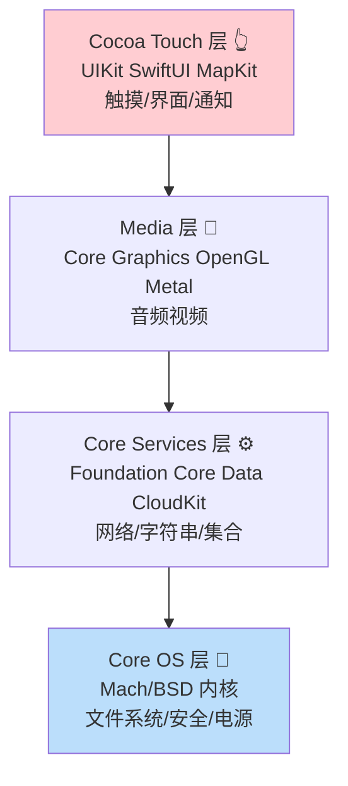
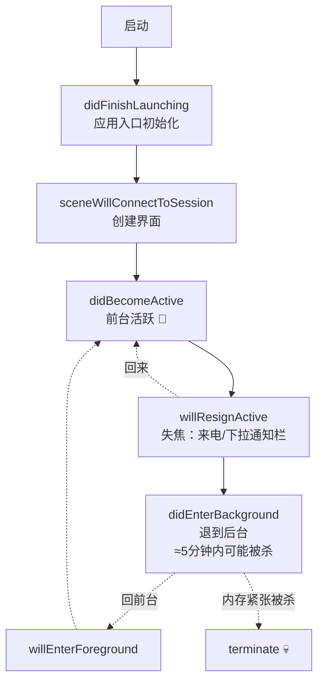
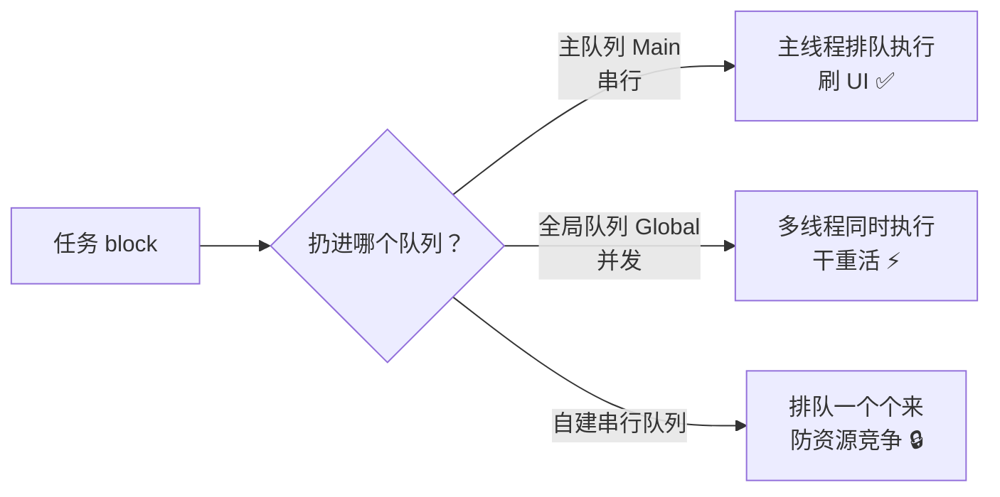
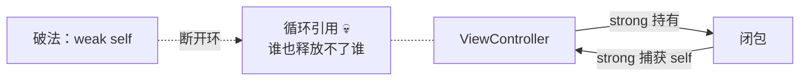
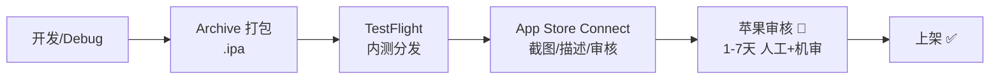
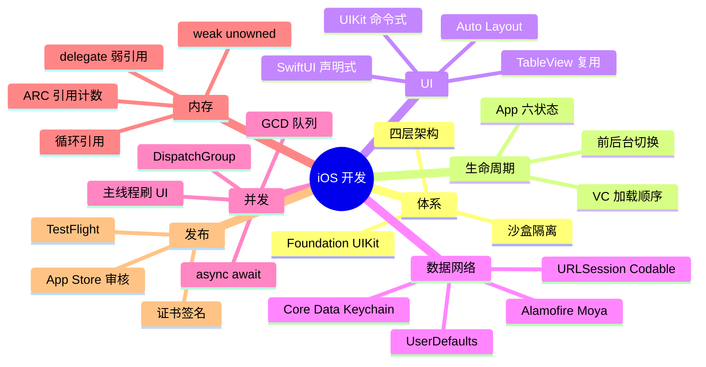

# 🌸 iOS 学习笔记 —— 苹果生态的开发之旅

> 嘿嘿～Swift 篇学了语言，这篇看平台！iOS 是苹果的封闭王国：自成体系的架构、UIKit/SwiftUI 两代 UI、GCD 多线程、ARC 内存管理……和 Android 篇对照着学，两端的坑一次认清 🍎📱✨

---

## 📖 目录

1. [初识 iOS：封闭但精致的王国](#一初识-ios封闭但精致的王国)
2. [系统架构：四层蛋糕](#二系统架构四层蛋糕)
3. [开发环境与项目结构](#三开发环境与项目结构)
4. [应用生命周期（必考！）](#四应用生命周期必考)
5. [UIViewController：页面担当](#五uiviewcontroller页面担当)
6. [UI 开发：UIKit 与 SwiftUI 之争](#六ui-开发uikit-与-swiftui-之争)
7. [列表三剑客：UITableView / UICollectionView](#七列表三剑客uitableview--uicollectionview)
8. [数据存储方案](#八数据存储方案)
9. [网络请求：URLSession 与 Alamofire](#九网络请求urlsession-与-alamofire)
10. [多线程：GCD 大法（重点！）](#十多线程gcd-大法重点)
11. [内存管理：ARC 与循环引用（重点！）](#十一内存管理arc-与循环引用重点)
12. [架构模式与打包发布](#十二架构模式与打包发布)
13. [总结与面试高频题](#十三总结与面试高频题)

---

## 一、初识 iOS：封闭但精致的王国

### 1.1 基本信息

- Apple 2007 年随初代 iPhone 发布的移动操作系统
- **封闭生态**：系统+硬件+开发工具+商店全由苹果掌控 🍎
- 开发语言：Swift（现代首选）/ Objective-C（存量）
- 开发工具：**Xcode**（只能在 Mac 上跑！硬门槛）

### 1.2 iOS vs Android 全方位对照

| 对比 | iOS 🍎 | Android 🤖 |
| --- | --- | --- |
| 出品 | Apple（闭源）| Google 主导（开源 AOSP）|
| 开发语言 | Swift / OC | Kotlin / Java |
| IDE | Xcode（仅 Mac）| Android Studio（跨平台）|
| UI 框架 | SwiftUI（新）/ UIKit（老）| Compose（新）/ View 体系（老）|
| 页面组件 | UIViewController | Activity |
| 列表 | UITableView / List | RecyclerView / LazyColumn |
| 事件总线 | NotificationCenter | BroadcastReceiver |
| 持久化 | UserDefaults / Core Data | SharedPreferences / Room |
| 内存管理 | ARC 引用计数 | GC 垃圾回收（ART）|
| 多线程 | GCD / OperationQueue | Handler / 协程 |
| 发布 | App Store（审核严）| 各大应用市场 |
| 机型适配 | 少而统一 | 碎片化 |
| 模拟器 | 快（同一架构虚拟化）| 慢点（全模拟）|

> 🎀 学过 Android 再看 iOS ≈ 照镜子：概念几乎一一对应，只是名字换了！所以笔记里大量放对照表，学一送一～

---

## 二、系统架构：四层蛋糕

iOS 系统自上而下四层，**上层可调用下层，反之不行**（和 Android 洋葱模型同思路）：



| 层 | 干啥的 | 开发者接触度 |
| --- | --- | --- |
| Cocoa Touch | 界面、触摸、通知 | ✅ 天天用 |
| Media | 图形图像音视频 | 常用（图片处理）|
| Core Services | Foundation 基础库、网络、存储 | ✅ 天天用 |
| Core OS | 内核、安全、电源 | 系统级才碰 |

**日常开发两大核心框架：**

| 框架 | 提供什么 |
| --- | --- |
| **Foundation** | NSObject、String/Array、URLSession、通知中心 |
| **UIKit** | UIView、UIViewController、UITableView、触摸事件 |

> 💡 命名规则彩蛋：**NS 前缀**（NSString/NSArray）= NextStep 遗产，乔布斯老公司的遗产化石 🦕；Swift 版已去 NS 化（String/Array）～

---

## 三、开发环境与项目结构

### 3.1 Xcode 必知

- App Store 免费下载（仅 macOS）
- 集成全家桶：代码编辑 + 界面设计（Storyboard）+ 模拟器 + 调试 + 打包 + Instruments 性能分析
- **Playground**：即写即跑的练功房（学 Swift 语法神器的）

### 3.2 项目结构

```
MyApp/
├── MyApp.xcodeproj        # 工程文件（类似 build.gradle 的角色）
├── MyApp/
│   ├── AppDelegate.swift      # 应用入口与生命周期
│   ├── SceneDelegate.swift    # 场景管理（多窗口时代）
│   ├── ContentView.swift      # SwiftUI 首页
│   ├── Assets.xcassets        # 资源目录（图片/颜色）
│   └── Info.plist             # 应用清单（权限声明！）
├── MyAppTests/                # 单元测试
└── MyAppUITests/              # UI 测试
```

**Info.plist = iOS 版 Manifest 📇：**

```xml
<!-- 权限必须写"用途说明"，否则闪退！ -->
<key>NSCameraUsageDescription</key>
<string>需要相机用于扫描二维码</string>
<key>NSPhotoLibraryUsageDescription</key>
<string>需要相册用于保存图片</string>
```

### 3.3 苹果特色的证书体系（劝退第一关 💀）

| 概念 | 作用 |
| --- | --- |
| Apple ID | 开发者账号（个人 $99/年）|
| Certificate 证书 | 证明"你是你"（开发/发布两种）|
| Bundle ID | App 唯一身份证（com.xx.app）|
| Provisioning Profile | 证书+设备+ID 的打包许可 |
| 真机调试 | 需要开发者账号注册设备 |

> 🎀 个人学习免费（Xcode 签个人证书真机调试 7 天有效期）；上架才要 $99/年——这也是 iOS 开发的"门票"经济学～

---

## 四、应用生命周期（必考！）



| 回调 | 时机 | 该干什么 |
| --- | --- | --- |
| didFinishLaunching | App 启动 | 全局初始化、SDK 注册 |
| willResignActive | 失焦 | 暂停游戏/动画 |
| didEnterBackground | 进后台 | **保存数据、释放资源、开启后台任务** |
| willEnterForeground | 将回前台 | 恢复界面 |
| didBecomeActive | 活跃 | 恢复交互 |
| terminate | 终止 | 最后清理（不保证调用）|

**UIViewController 的生命周期（页面级）：**

```kotlin
// 加载流程：有严格的顺序
viewDidLoad        // 视图加载完成（只调一次）→ 一次型初始化
viewWillAppear     // 将要显示 → 每次出现都调
viewDidAppear      // 已显示 → 开始动画/定时器
viewWillDisappear  // 将要消失 → 暂停
viewDidDisappear   // 已消失 → 停止定时器/通知
```

> 🎀 对照 Android：`viewDidLoad` ≈ `onCreate`（一次性）、`viewWillAppear` ≈ `onStart`、`viewDidAppear` ≈ `onResume`——连"成对出现"的规律都一样！

---

## 五、UIViewController：页面担当

iOS 的"Activity"，管理一屏内容与跳转：

```swift
// 纯代码创建页面
class HomeViewController: UIViewController {
    override func viewDidLoad() {
        super.viewDidLoad()
        view.backgroundColor = .systemBackground
        // 加子视图
        let label = UILabel()
        label.text = "你好 iOS"
        view.addSubview(label)
    }
}

// 页面跳转：导航控制器（推入栈，像叠盘子 🍽️）
navigationController?.pushViewController(DetailViewController(), animated: true)
navigationController?.popViewController(animated: true)      // 返回

// 模态弹出（盖在上面）
present(LoginViewController(), animated: true)

// 页面间传值
// ① 属性注入（顺传）
let vc = DetailViewController()
vc.productId = 10086
// ② 闭包/代理回调（逆传）
vc.onSelect = { [weak self] item in self?.update(item) }
```

| 导航方式 | 特点 | 场景 |
| --- | --- | --- |
| NavigationController push/pop | 栈结构、带返回栏 | 主流页面流 |
| present/dismiss | 模态盖屏 | 登录、弹窗 |
| UITabBarController | 底部页签 | 主界面框架 |

---

## 六、UI 开发：UIKit 与 SwiftUI 之争

### 6.1 两代 UI 框架

| 对比 | UIKit（1998 血统）| SwiftUI（2019）⭐ |
| --- | --- | --- |
| 范式 | 命令式（手动刷新）| **声明式（UI=f(state)）** |
| 构建 | 代码 / Storyboard 拖拽 | 纯代码描述 |
| 数据同步 | 手动（delegate 回调刷新）| 自动（状态驱动）|
| 版本要求 | 全版本 | iOS 13+ |
| 现状 | 存量巨大 | **新项目首选** ✅ |

### 6.2 UIKit 基础三件套

```swift
// 视图树：UIView 可嵌套（类似 View/ViewGroup）
let container = UIView()
let button = UIButton(type: .system)
button.setTitle("点我", for: .normal)
button.addTarget(self, action: #selector(tapped), for: .touchUpInside)
container.addSubview(button)               // 添加子视图

// Auto Layout 约束（对标 ConstraintLayout）
button.translatesAutoresizingMaskIntoConstraints = false
NSLayoutConstraint.activate([
    button.centerXAnchor.constraint(equalTo: view.centerXAnchor),
    button.centerYAnchor.constraint(equalTo: view.centerYAnchor)
])
```

### 6.3 SwiftUI 速览（详见 Swift 篇）

```swift
struct HomeView: View {
    @State private var items: [String] = []

    var body: some View {
        NavigationStack {
            List(items) { item in Text(item) }      // = UITableView
            .navigationTitle("首页")
        }
    }
}
```

> 💡 现实策略：**新模块 SwiftUI、老代码 UIKit，混编共存**（UIViewRepresentable 互相包装）——大厂的主流姿势！

---

## 七、列表三剑客：UITableView / UICollectionView

```swift
// UITableView：代理+数据源双协议（对标 RecyclerView.Adapter）
class ListVC: UIViewController, UITableViewDataSource, UITableViewDelegate {
    var data = ["小花", "小明", "小红"]

    func tableView(_ tv: UITableView, numberOfRowsInSection s: Int) -> Int {
        data.count                                    // 多少行
    }
    func tableView(_ tv: UITableView, cellForRowAt path: IndexPath) -> UITableViewCell {
        let cell = tv.dequeueReusableCell(withIdentifier: "cell", for: path)
        cell.textLabel?.text = data[path.row]          // 复用单元格填充数据
        return cell
    }
}
// dequeueReusableCell 就是"复用机制"——和 RecyclerView 一个思想，只造屏幕可见的格子 ♻️
```

| 组件 | 布局 | 对标 Android |
| --- | --- | --- |
| UITableView | 单列列表 | RecyclerView + Linear |
| UICollectionView | 网格/自定义流 | RecyclerView + Grid/瀑布流 |
| SwiftUI List/LazyVGrid | 声明式 | Compose LazyColumn/Grid |

**UICollectionView 时代进化：**

- iOS 13 前：要配 UICollectionViewFlowLayout，麻烦到哭 😭
- **iOS 13+：Compositional Layout + Diffable DataSource**——声明式布局 + 自动 diff 增量刷新（对标 DiffUtil）

---

## 八、数据存储方案

| 方案 | 存什么 | 对标 Android |
| --- | --- | --- |
| **UserDefaults** | 键值对（设置项）| SharedPreferences |
| 文件沙盒 | Documents/Cache 目录文件 | 内部存储 |
| **Core Data** | 对象图关系数据库 | Room |
| SwiftData（新）| 现代 ORM（SwiftUI 亲儿子）| Room + Flow |
| **Keychain** | 密码/Token（加密安全）| EncryptedSharedPreferences |
| SQLite 直用 | 结构化数据 | SQLite |

```swift
// UserDefaults：一行读写
UserDefaults.standard.set("dark", forKey: "theme")
let theme = UserDefaults.standard.string(forKey: "theme") ?? "light"

// Keychain：存敏感信息（密码学加密，卸载重装还在！）
// 一般封装 KeychainAccess 等库使用

// 沙盒目录
let docs = FileManager.default.urls(for: .documentDirectory, in: .userDomainMask)[0]
// App 只能访问自己的沙盒 → 天然隔离，没有 Android 那种权限申请一堆 🎉
```

> 🎀 彩蛋对比：iOS 沙盒天然隔离（访问相册等少数场景才申请权限），Android 是"权限申请制"——**苹果管得严，谷歌问得勤**～

---

## 九、网络请求：URLSession 与 Alamofire

### 9.1 系统自带：URLSession

```swift
// 现代 async/await 写法（iOS 15+）
struct User: Codable {            // Codable = 可序列化
    let id: Int
    let name: String
}

Task {
    let (data, _) = try await URLSession.shared
        .data(from: URL(string: "https://api.example.com/users/1")!)
    let user = try JSONDecoder().decode(User.self, from: data)
    print(user.name)
}

// Codable 编码 POST
var req = URLRequest(url: url)
req.httpMethod = "POST"
req.setValue("application/json", forHTTPHeaderField: "Content-Type")
req.httpBody = try JSONEncoder().encode(NewUser(name: "小花"))
```

### 9.2 第三方增强：Alamofire

对标 OkHttp/Retrofit 的存在（**AFNetworking 的 Swift 续作**）：

```swift
AF.request("https://api.example.com/users")
    .validate()                        // 自动校验状态码
    .responseDecodable(of: [User].self) { response in
        switch response.result {
        case .success(let users): print(users)
        case .failure(let error): print(error)
        }
    }
```

| iOS 阵营 | Android 阵营 | 干啥 |
| --- | --- | --- |
| URLSession | HttpURLConnection | 底层传输 |
| Alamofire | OkHttp | 增强封装 |
| Moya | Retrofit | 接口化再封装 |

---

## 十、多线程：GCD 大法（重点！）

### 10.1 线程模型

- **主线程（Main Queue）**：UI 渲染专用，卡 0.几秒就掉帧（和 Android ANR 类似但更早暴露）
- 子线程：干活用

### 10.2 GCD（Grand Central Dispatch）

苹果的 C 级并发框架，队列+任务两元素：



```swift
// 后台干活，回主线程刷 UI（最经典套路）
DispatchQueue.global(qos: .userInitiated).async {
    let image = downloadAndProcess()           // 子线程：重活
    DispatchQueue.main.async {
        imageView.image = image                // 主线程：刷 UI ✅
    }
}

// asyncAfter 延迟
DispatchQueue.main.asyncAfter(deadline: .now() + 2) {
    showBanner()
}

// 延迟执行若干次的防抖/节流
// dispatchGroup：等一堆任务全部完成
let group = DispatchGroup()
group.enter(); fetchUser { group.leave() }
group.enter(); fetchOrders { group.leave() }
group.notify(queue: .main) { renderAll() }     // 全部完成统一刷新 ⚡
```

| QoS 优先级 | 场景 |
| --- | --- |
| .userInteractive | 动画等即时交互 |
| .userInitiated | 用户点击触发（点开详情加载）|
| .utility | 长任务（下载）|
| .background | 后台同步（预取）|

### 10.3 现代写法：async/await

```swift
// GCD 嵌套 → 结构化并发（对标 Kotlin 协程！）
async let user = fetchUser()       // 并发开跑
async let orders = fetchOrders()
let (u, o) = try await (user, orders)   // 一起等结果 ⚡
```

> 🎀 GCD 是 C 时代的智慧，async/await 是 Swift 的现代皮肤——**面试 GCD 必考（串行/并发、主队列、死锁），新代码 async 优先**！

---

## 十一、内存管理：ARC 与循环引用（重点！）

### 11.1 ARC 自动引用计数

iOS **没有 GC**（垃圾回收），用的是编译期插入的引用计数：

| 动作 | 计数 |
| --- | --- |
| 强引用指向对象 | +1 |
| 引用置 nil / 持有者销毁 | -1 |
| **计数归 0** | 立即销毁 💨（不等 GC 周期）|

> 💡 对比 Android：GC 是"定期大扫除"（有停顿），ARC 是"人走灯灭"（确定性释放）——所以 iOS 内存回收更即时，但要小心循环引用！

### 11.2 循环引用：内存泄漏之源



```swift
// ❌ 经典泄漏：闭包强持有 self，self 强持有闭包
class ProfileVC: UIViewController {
    var onLoad: (() -> Void)?
    override func viewDidLoad() {
        onLoad = { self.updateUI() }        // 闭包捕获 self（强引用）
    }   // self → onLoad 闭包 → self：循环 💀 VC 永远不释放！
}

// ✅ 破法：weak 引用（自动置 nil）
onLoad = { [weak self] in
    self?.updateUI()                        // weak 可选链
}

// ✅ 或 unowned（确定非 nil 时用，风险高些）
onLoad = { [unowned self] in self.updateUI() }

// delegate 经典规则：一律 weak！
weak var delegate: SomeProtocol?
```

| 关键字 | 引用强度 | 置 nil | 适用 |
| --- | --- | --- | --- |
| strong（默认）| 强 +1 | 否 | 普通持有 |
| **weak** | 弱 +0 | **自动置 nil** | delegate、闭包捕获 ⭐ |
| unowned | 弱 +0 | 否（访问崩）| 生命周期绑定（view 与 controller）|

> 🎀 面试金句：**ARC 管不了循环引用**——两个对象互相 strong 拉着手，计数永不归零。weak 就是"松开手"，让一方先走 🤝→👋

---

## 十二、架构模式与打包发布

### 12.1 iOS 架构演进

| 模式 | 思想 | 现状 |
| --- | --- | --- |
| **MVC**（Apple 官方套路）| Controller 粘合一切 | 容易胖成 Massive View Controller 🐷 |
| **MVVM** | ViewModel 抽逻辑 + 绑定 | 主流 ✅ |
| VIPER / TCA | 更细分/函数式 | 大厂尝鲜 |

```swift
// MVVM + SwiftUI 组合（现代标准姿势）
class UserViewModel: ObservableObject {
    @Published var user: User?              // 发布者：变了通知 UI
    func load() {
        Task { user = try await api.getUser() }
    }
}
struct UserView: View {
    @StateObject var vm = UserViewModel()   // 持有 VM
    var body: some View {
        Text(vm.user?.name ?? "加载中")
            .onAppear { vm.load() }
    }
}
```

### 12.2 从代码到 App Store



| 概念 | 说明 |
| --- | --- |
| .ipa | iOS 安装包（对应 .apk）|
| TestFlight | 官方内测平台（10000 内测员）|
| 审核 | 严出名：私有 API、支付绕过 IAP、崩溃都会被拒 ❌ |
| 上架周期 | 首次 1-7 天，更新快些 |

---

## 十三、总结与面试高频题

### 13.1 知识地图



### 13.2 面试官最爱问 Top 题 🎯

| 问题 | 答题要点 |
| --- | --- |
| App 生命周期回调顺序？ | 启动 didFinishLaunching → willResignActive（失焦）→ didEnterBackground；回前台反向 |
| viewDidLoad 和 viewWillAppear 区别？ | 前者仅一次（初始化）；后者每次显示都调（刷新数据）|
| UIKit 和 SwiftUI 区别？ | 命令式手动刷新 vs 声明式状态驱动；新旧混编策略 |
| UITableView 复用机制？ | dequeueReusableCellWithIdentifier 重出屏幕格子复用填充；register 注册 |
| GCD 串行队列和并发队列？ | 串行排队执行；并发同时多任务；主队列=特殊串行 |
| 主队列和主线程关系？ | 主队列绑定主线程；UI 必须主线程更新 |
| GCD 死锁场景？ | 主队列 sync 向主队列派发任务（互相等）；死锁=同步+同队列 |
| ARC 原理？ | 编译期插入 retain/release，计数归零立即释放；无 GC 停顿 |
| 什么是循环引用？ | 互相 strong 计数不归零；闭包捕获 self 是高发区 |
| weak 和 unowned？ | 都不 +1；weak 自动置 nil（可选）；unowned 假设存活（释放后访问崩）|
| delegate 为什么用 weak？ | 防止 delegate 循环持有（双方 strong 互持泄漏）|
| iOS 怎么做持久化？ | UserDefaults 键值 / Core Data 对象图 / Keychain 加密 / 沙盒文件 |
| App 后台能干什么？ | ≈5 分钟后台任务、后台音频/定位/VOIP 白名单；其余挂起 |
| iOS 和 Android 区别？ | 闭源 vs 开源、ARC vs GC、审核 vs 多市场、沙盒 vs 权限申请 |

### 13.3 学习建议路线 🗺️

1. **第一站**：Swift 篇语法过关（playground 练熟 Optional 和闭包）
2. **第二站**：Xcode 新建 SwiftUI 项目，跑通"列表 + 详情 + 网络请求"
3. **第三站**：学 UIKit 基础（读懂存量代码必备：VC 生命周期 + TableView）
4. **第四站**：GCD/async 刷子线程任务，weak self 治循环引用
5. **第五站**：做完整 App（导航 + MVVM + UserDefaults + 网络层）
6. **终点站**：真机调试 + TestFlight 内测走一遍发布流程 🌟

---

> 🌈 iOS 通关！移动分区六连大满贯：Android → Android-UI → 第三方库 → Swift → Kotlin → **iOS**！🍎 现在你双端概念互通：Activity↔ViewController、RecyclerView↔TableView、协程↔GCD/async、Room↔Core Data……无论面试还是实战，双端视角都是降维打击！下一个知识点继续召唤我！(๑•̀ㅂ•́)و✧📱🎉
