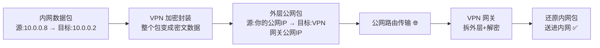
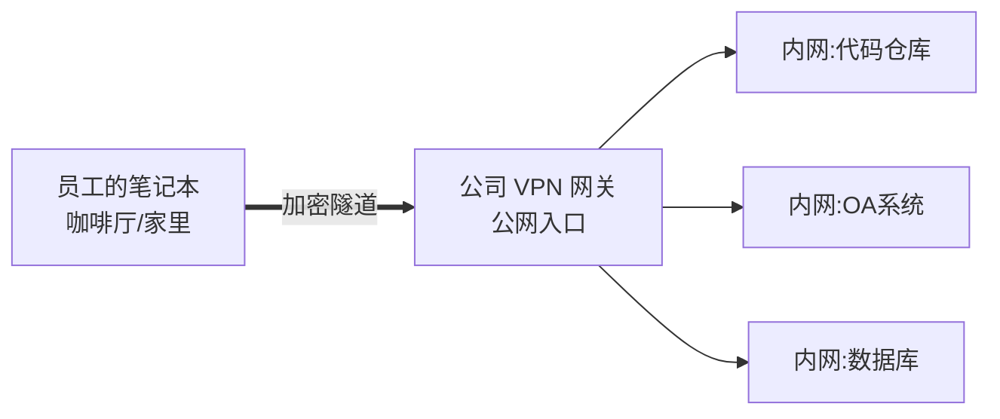
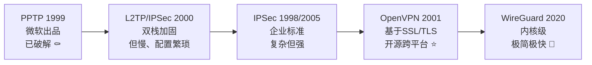
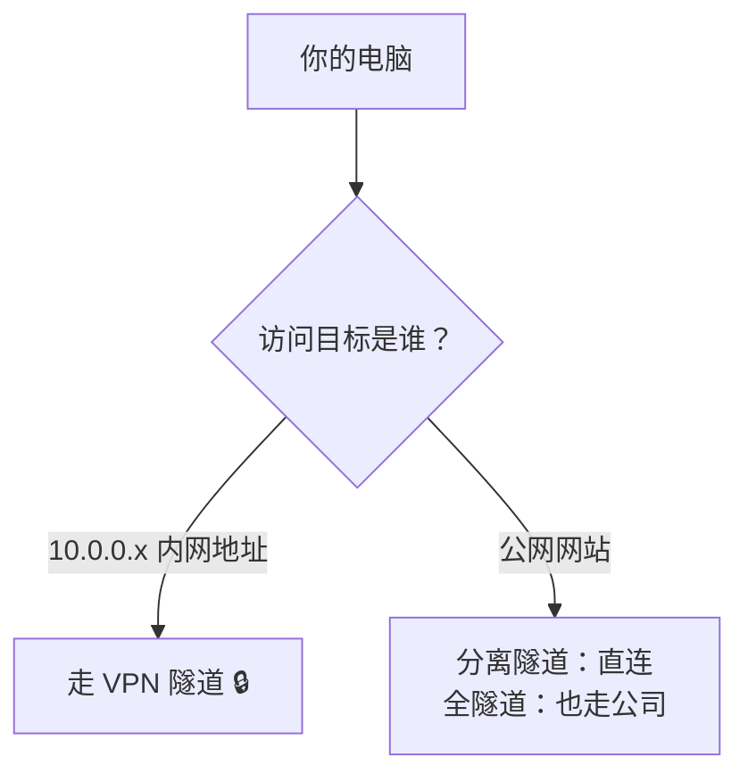
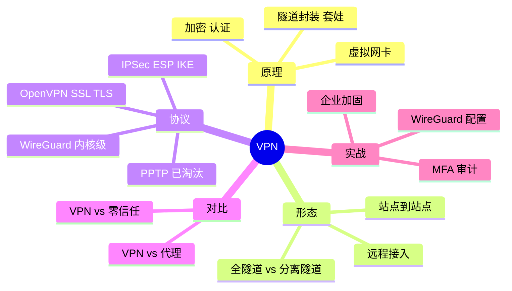

# 🌸 VPN 学习笔记 —— 网络世界的加密隧道

> 嘿嘿～网络系列快集齐啦！这次来学 VPN——把你在世界任何角落的设备，用一条"加密隧道"安全接进公司内网的技术 🚇✨ 远程办公、分公司互联全靠它～

---

## 📖 目录

1. [初识 VPN：它到底是啥？](#一初识-vpn它到底是啥)
2. [核心原理：隧道 + 加密 + 封装](#二核心原理隧道--加密--封装)
3. [两大使用形态：远程接入与站点互联](#三两大使用形态远程接入与站点互联)
4. [协议演进史：从 PPTP 到 WireGuard](#四协议演进史从-pptp-到-wireguard)
5. [主流协议详解](#五主流协议详解)
6. [全隧道 vs 分离隧道](#六全隧道-vs-分离隧道)
7. [VPN vs 代理：傻傻分不清楚](#七vpn-vs-代理傻傻分不清楚)
8. [动手搭建：WireGuard 快速上手](#八动手搭建wireguard-快速上手)
9. [企业级方案与安全要点](#九企业级方案与安全要点)
10. [总结与面试高频题](#十总结与面试高频题)

---

## 一、初识 VPN：它到底是啥？

### 1.1 用大白话说 VPN

**VPN = Virtual Private Network 虚拟专用网络**

想象你人在咖啡厅 ☕，要访问公司内网的代码仓库：

- 直接连？公网传输 = 明信片裸奔，内网还根本不对外开放 🙅
- 用 VPN？就像从咖啡厅到公司**挖了一条专属加密隧道** 🚇——数据在隧道里全加密，出口直接落在公司内网，仿佛你人就坐在工位上！

### 1.2 VPN 解决的三个问题

| 问题 | VPN 的答案 |
| --- | --- |
| 公网传输被窃听 🔍 | **加密**——隧道里全是密文 |
| 内网不对公网开放 🏰 | **虚拟组网**——像局域网一样互访 |
| 身份伪造 🎭 | **认证**——只有持证书/账号的能进隧道 |

> 🎀 关键词拆解：**Virtual**（不是真拉根网线，是用公网"虚拟"出来的）、**Private**（加密+认证，私密专用）、**Network**（组起来就是一个网）

### 1.3 合法使用场景

| 场景 | 说明 |
| --- | --- |
| 远程办公 🏠 | 员工在家安全访问公司内网系统 |
| 分公司互联 🏢 | 总部与各地分部内网打通 |
| 云上云下互联 ☁️ | IDC 机房与云 VPC 组成大内网 |
| 运维跳板 | 安全管理分散在各地的服务器 |

---

## 二、核心原理：隧道 + 加密 + 封装

### 2.1 隧道技术：套娃传输

VPN 最核心的思想——**把一个完整的数据包，塞进另一个数据包里传输**：



- **封装**：原包整体作为"货物"塞进新包（套娃 🪆）
- **加密**：货物用 AES 等算法锁起来
- 中间经过的路由器**只看外层地址**，根本不知道里面装了啥

### 2.2 一条 VPN 隧道的必备组件

| 组件 | 作用 |
| --- | --- |
| 隧道协议 | 定义"怎么封装、怎么握手"（如 WireGuard/OpenVPN）|
| 加密算法 | 保护隧道内数据（AES-256、ChaCha20）|
| 认证方式 | 确认双方身份（预共享密钥 PSK / 证书 / 账号）|
| 虚拟网卡 | 本地多出一块"tun/wg"虚拟网卡，进隧道的流量从它走 |

> 💡 装好 VPN 后 `ipconfig` / `ifconfig` 会多出一个虚拟网卡——它就是隧道的"入口检票口" 🎫

---

## 三、两大使用形态：远程接入与站点互联

### 3.1 远程接入 VPN（Remote Access）

**人 → 网络**：单个设备安全接入公司内网（打工人日常）👨‍💻



### 3.2 站点到站点 VPN（Site-to-Site）

**网 → 网**：两个固定网络互联（分公司场景）🏢↔️🏢

```mermaid
flowchart LR
    subgraph 总部内网
    A[10.0.0.0/24]
    end
    A --- G1[总部网关]
    G1 ==隧道:公网== G2[分部网关]
    G2 --- subgraph 分部内网
    B[10.1.0.0/24]
    end
```

| 对比 | 远程接入 | 站点到站点 |
| --- | --- | --- |
| 连接对象 | 单设备 ↔ 网络 | 网络 ↔ 网络 |
| 谁发起 | 客户端软件/APP | 两端网关自动保活 |
| 认证 | 账号/证书 | 预共享密钥/证书 |
| 典型场景 | 居家办公 | 分部互联、云专线备份 |

---

## 四、协议演进史：从 PPTP 到 WireGuard



| 协议 | 年代 | 安全性 | 速度 | 配置难度 | 现状 |
| --- | --- | --- | --- | --- | --- |
| PPTP | 1999 | ❌ 已被破解 | 快 | 极简 | 淘汰 ⚰️ |
| L2TP/IPSec | 2000 | ✅ | 慢（双层封装）| 繁琐 | 老设备兼容用 |
| IPSec | 1998 | ✅✅ | 快 | **地狱级复杂** 😵 | 企业/网关主流 |
| OpenVPN | 2001 | ✅✅ | 中等（用户态）| 中等 | 开源事实标准 ⭐ |
| SSL VPN | - | ✅✅ | 中 | 简单（浏览器即可）| 商业设备标配 |
| **WireGuard** | 2020 | ✅✅ 现代加密 | **最快**（内核态）| **极简**（几行配置）| 新宠 🚀 |

> 🎀 趋势一句话：**从"能连就行"到"又快又安全又好配"**——老协议陆续退休，WireGuard 一统江湖进行中～

---

## 五、主流协议详解

### 5.1 IPSec：企业级老大哥

一套**协议组合**（不是单个协议），分两大模式：

| 组件 | 干啥的 |
| --- | --- |
| AH | 只验证完整性（防篡改），不加密 |
| **ESP** ⭐ | 加密+验证，主力 |
| IKE | 握手协商密钥（用到了前篇的 DH 密钥交换！）|

| 模式 | 封装方式 | 用途 |
| --- | --- | --- |
| 传输模式 | 只加密 payload，原 IP 头保留 | 端到端两台主机直连 |
| **隧道模式** ⭐ | 整个原包全封装+新 IP 头 | 网关到网关（最常见）|

> 💡 IPSec 就是"加密界的组装机"——协商（IKE）+ 加密（ESP）+ 认证，各模块可插拔，所以配置参数多到眼花 😵‍💫

### 5.2 OpenVPN：开源实力派

- 基于 **SSL/TLS**（就是 HTTPS 那套！），走 TCP/UDP 443 端口
- 证书认证 + OpenSSL 加密库，安全久经考验
- 用户态实现 → 跨平台丝滑（Windows/Mac/Linux/手机全覆盖）
- 缺点：用户态性能有天花板

### 5.3 WireGuard：新生代卷王 🚀

- **代码量仅 4000 行**（OpenVPN 超过 10 万行）——审计容易，bug 无处藏
- 跑在** Linux 内核**里 → 性能起飞
- 加密套件固定死一套现代组合（Curve25519 + ChaCha20 + Poly1305）→ 不用纠结选什么，杜绝"弱算法配置"
- 配置极简：一个 `[Interface]` + 一个 `[Peer]` 就完事

### 5.4 SSL VPN（商业方案）

企业防火墙/网关自带的功能：浏览器打开网页就能连（免装客户端），配合企业账号认证（LDAP/双因素）——员工体验最好，按人头收费 💰

---

## 六、全隧道 vs 分离隧道

连上 VPN 后，**哪些流量走隧道**是个设计决策：

| 模式 | 流量走向 | 优缺点 |
| --- | --- | --- |
| 全隧道 Full Tunnel | **所有流量**都进隧道经公司出口 | ✅ 公司统一管控/审计 ❌ 看视频也绕公司，慢 |
| 分离隧道 Split Tunnel | **只有访问内网的流量**进隧道，其他直连 | ✅ 快、省公司带宽 ❌ 终端直连公网有暴露面 |



> 💡 判断规则通常就是路由表：`10.0.0.0/8 → 走 wg0 网卡`，`0.0.0.0/0 → 走 wg0` 就是全隧道～

---

## 七、VPN vs 代理：傻傻分不清楚

| 对比 | VPN | 代理 Proxy |
| --- | --- | --- |
| 层级 | 网络层/传输层，**虚拟网卡级**接管 | 应用层，需应用单独配置 |
| 加密 | ✅ 整条隧道加密 | HTTP 代理不加密；HTTPS 代理仅 TLS 段 |
| 全局性 | 系统全局生效 | 通常按应用生效（浏览器/终端单独配）|
| 用途 | 安全组网、远程接入 | 突破访问限制、抓包、负载分发 |
| 典型代表 | WireGuard、OpenVPN | Nginx、Squid、HTTP/SOCKS5 |

一句话：**VPN 造"整条加密公路"，代理只是"帮你跑腿的快递员"** 🛣️ vs 🏃

> 🎀 还有个常被问的：SOCKS5 代理是传输层通用代理（不加密），想加密得叠 TLS——它和 VPN 的本质区别就是"有没有整条隧道化的加密组网"～

---

## 八、动手搭建：WireGuard 快速上手

体验最快的方式——Linux 两台机器（或 Docker）配 WireGuard：

### 8.1 服务端（公网机器）

```ini
# /etc/wireguard/wg0.conf
[Interface]
Address = 10.100.0.1/24          # 隧道内服务端地址
ListenPort = 51820
PrivateKey = <服务端私钥>

[Peer]                            # 每个客户端一个 Peer
PublicKey = <客户端公钥>
AllowedIPs = 10.100.0.2/32        # 该客户端的隧道IP
```

### 8.2 客户端

```ini
[Interface]
Address = 10.100.0.2/24
PrivateKey = <客户端私钥>

[Peer]
PublicKey = <服务端公钥>
Endpoint = 服务端公网IP:51820
AllowedIPs = 10.100.0.0/24, 192.168.1.0/24   # 哪些目标走隧道（分离隧道）
# AllowedIPs = 0.0.0.0/0                     # 全隧道写法
```

### 8.3 启动与验证

```bash
# 生成密钥对（两端各自执行）
wg genkey | tee privatekey | wg pubkey > publickey

# 启动/停止
wg-quick up wg0
wg-quick down wg0

# 查看隧道状态（握手、流量统计）
wg show

# ping 隧道对端，通了就是成了！
ping 10.100.0.1
```

> 💡 `AllowedIPs` 一字段两用途：**本端路由表**（哪些目标走隧道）+ **对端白名单**（这个 Peer 允许用哪些源 IP）——WireGuard 的极简哲学全在这一行 😮

---

## 九、企业级方案与安全要点

### 9.1 企业 VPN 架构常见组成

| 组件 | 职责 |
| --- | --- |
| VPN 网关/防火墙 | 隧道终结点，公网入口 |
| 认证系统 | LDAP/AD 账号 + 双因素认证 MFA |
| 准入控制 NAC | 检查终端健康（补丁、杀毒）才放行 |
| 审计日志 | 谁在什么时间从哪个 IP 连入 |
| 网络分段 | VPN 用户只进指定 DMZ/业务区，不给全内网 |

### 9.2 安全加固清单 ✅

- [ ] **强制 MFA**（双因素）：光密码不够，撞库一撞一个准
- [ ] 协议选新不选旧：WireGuard/OpenVPN，**禁用 PPTP**
- [ ] 最小访问范围：按角色分 VLAN，别给整个 /16
- [ ] 及时吊销：离职当天删账号收证书
- [ ] VPN 网关本身打补丁（历史 CVE 不少，Pulse/Fortinet 都翻过车 🔔）
- [ ] 全链路日志 + 异常登录告警（凌晨三点国外 IP 连入 = 红灯 🚨）
- [ ] 隧道内流量也做监控（防"进了内网随便逛"）

### 9.3 云时代的新形态

| 形态 | 说明 |
| --- | --- |
| 云 VPN 网关 | 阿里云/腾讯云自带 IPsec/SSL VPN 网关，控制台点一点 |
| 对等连接 VPC Peering | 云内 VPC 互通，比 VPN 更稳（但跨云还得 VPN/专线）|
| 零信任 ZTNA 🔥 | 新趋势：不建大隧道，按"人+设备+应用"逐次授权——VPN 的进化形态 |

---

## 十、总结与面试高频题

### 10.1 知识地图



### 10.2 面试官最爱问 Top 题 🎯

| 问题 | 答题要点 |
| --- | --- |
| VPN 的原理？ | 隧道封装（原包套新包）+ 加密传输 + 认证接入；虚拟网卡接管路由 |
| VPN 和代理的区别？ | 网络层全局加密隧道 vs 应用层转发；安全性/作用范围不同 |
| 常见 VPN 协议？ | PPTP(淘汰)/L2TP-IPSec/IPSec/OpenVPN(SSL)/WireGuard |
| 为什么 PPTP 被淘汰？ | 加密算法（MS-CHAPv2/RC4）已被破解，可被中间人攻击 |
| IPSec 两种模式？ | 传输模式（只保 payload，主机直连）vs 隧道模式（整包封装，网关互联）|
| WireGuard 为什么快？ | 内核态实现 + 现代加密套件 + 代码极简（4000行）|
| OpenVPN 基于什么？ | SSL/TLS，证书认证，可走 443 端口穿透防火墙 |
| 什么是分离隧道？ | 仅内网流量进隧道，公网流量直连；省带宽但管控弱 |
| VPN 怎么做认证？ | 预共享密钥 PSK / 证书 / 账号+MFA 双因素 |
| VPN 网关安全加固？ | MFA、禁旧协议、最小网段、及时吊销、日志告警、补丁 |
| IKE 的作用？ | 自动协商 IPSec 安全关联（SA），底层用 DH 密钥交换 |
| 什么是零信任 ZTNA？ | 不再"连上内网全放行"，按人+设备+应用持续验证授权 |

### 10.3 学习建议路线 🗺️

1. **第一站**：理解隧道封装原理（对着套娃图看一遍）
2. **第二站**：两台虚拟机搭 WireGuard 打通，体会 AllowedIPs 的路由魔法
3. **第三站**：了解 IPSec 的 IKE 协商流程（串联密码学那篇的 DH！）
4. **第四站**：用 tcpdump 抓隧道流量，验证"外面看到的都是密文" 🔍
5. **终点站**：研究企业 VPN 架构与零信任演进，格局打开 🌟

---

> 🌈 VPN 通关！网络系列第七篇到手：一条加密隧道 = 封装 + 加密 + 认证，从此"人在天涯，网在身边"～配合密码学（隧道里的加密）和计算机网络（路由与封装），整个知识网彻底闭环！下一个知识点继续召唤我！(๑•̀ㅂ•́)و✧🚇💪
