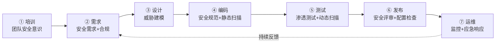
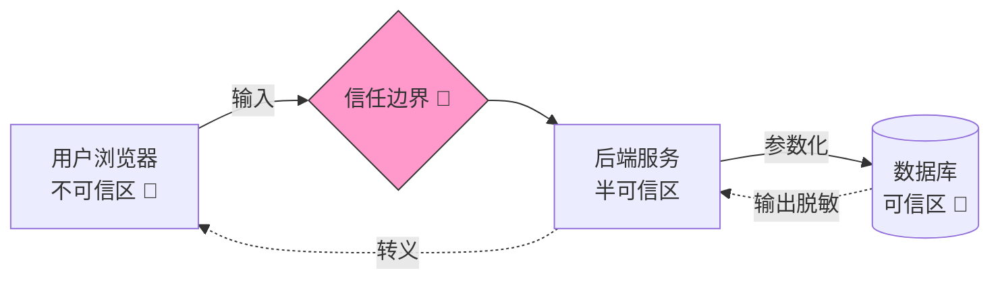
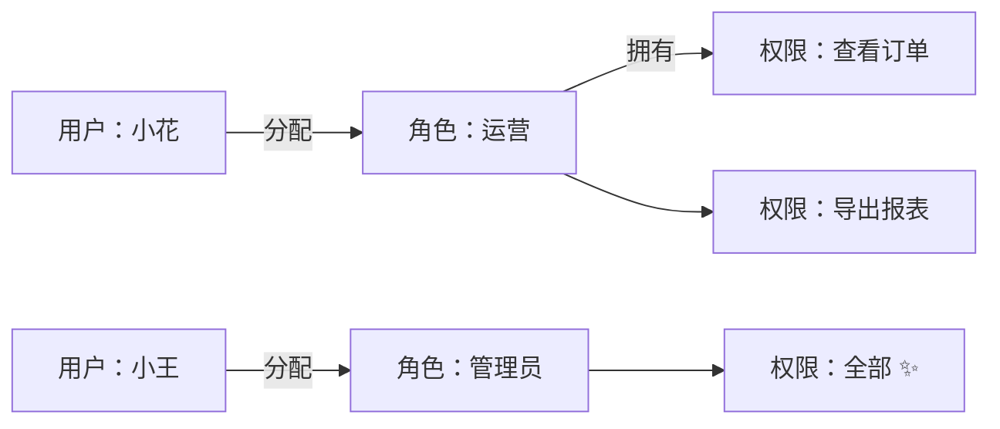
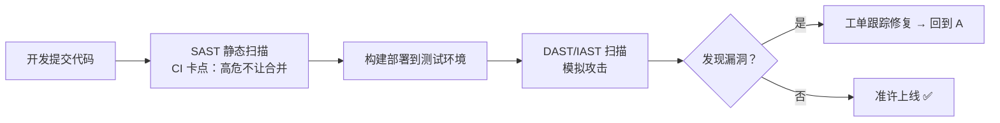
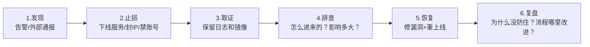
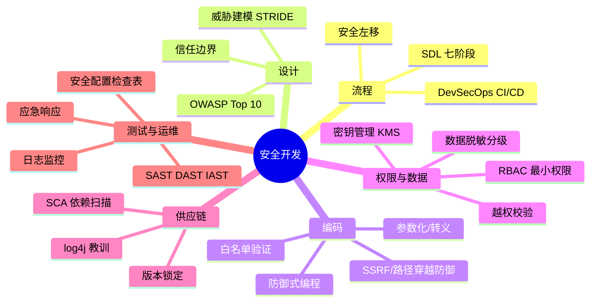

# 🌸 安全开发学习笔记 —— 把安全织进代码的每个针脚

> 嘿嘿～上一篇《网络安全》看了黑客的十八般武艺，这篇轮到**开发者视角**：怎么从需求、编码、测试到上线运维，把安全做成习惯？ SDL、威胁建模、安全编码、依赖治理一套带走 🧵🛡️✨

---

## 📖 目录

1. [初识安全开发：安全是流程不是补丁](#一初识安全开发安全是流程不是补丁)
2. [SDL 安全开发生命周期](#二sdl-安全开发生命周期)
3. [威胁建模：上线前先"自黑"一轮](#三威胁建模上线前先自黑一轮)
4. [OWASP Top 10：Web 安全必修榜](#四owasp-top-10web-安全必修榜)
5. [安全编码实战：把漏洞写死在摇篮里](#五安全编码实战把漏洞写死在摇篮里)
6. [权限设计：RBAC 与最小权限](#六权限设计rbac-与最小权限)
7. [密钥与敏感信息管理](#七密钥与敏感信息管理)
8. [依赖安全：别让第三方库背刺你](#八依赖安全别让第三方库背刺你)
9. [安全测试三兄弟：SAST / DAST / IAST](#九安全测试三兄弟sast--dast--iast)
10. [安全配置与上线检查](#十安全配置与上线检查)
11. [日志、监控与应急响应](#十一日志监控与应急响应)
12. [总结与面试高频题](#十二总结与面试高频题)

---

## 一、初识安全开发：安全是流程不是补丁

### 1.1 两种开发姿势对比

| 野路子 ❌ | 安全开发 ✅ |
| --- | --- |
| 先上线，被黑了再补洞 🩹 | 需求阶段就考虑威胁 |
| 安全是安全部门的事 | 安全是每个开发的事 |
| 上线前扫一眼 | 每个环节都有安全关卡 |
| 出事两眼一抹黑 | 有日志、有预案、能溯源 |

### 1.2 核心思想

- **安全左移**（Shift Left）：修复成本 = 需求阶段 1 块钱 → 上线后 100 块钱 💸，越早越省
- **默认安全**：默认配置就是最安全的（密码必须复杂、接口默认鉴权）
- **纵深防御**：前端校验 + 后端校验 + 数据库权限 + WAF，层层设卡
- **不信任原则**：用户的输入、第三方的依赖、网络的传输，统统不可信

---

## 二、SDL 安全开发生命周期

微软提出的开发安全流程模板，把安全揉进开发每一步 🔄



| 阶段 | 要做的事 | 产出 |
| --- | --- | --- |
| 需求 | 收集安全需求、确认合规（等保/GDPR） | 安全需求清单 |
| 设计 | 威胁建模、攻击面分析 | 威胁模型文档 |
| 编码 | 安全编码规范、Code Review、SAST 扫描 | 无高危漏洞代码 |
| 测试 | DAST 渗透、 fuzz 测试 | 漏洞报告 |
| 发布 | 上线检查表、配置审计 | 检查通过记录 |
| 运维 | 监控告警、应急演练、补丁更新 | 应急预案 |

> 🎀 DevSecOps 加料版：把安全工具直接嵌进 CI/CD 流水线——提交代码自动扫描，有高危漏洞直接**卡住不让合并**，想不注意安全都难 😤

---

## 三、威胁建模：上线前先"自黑"一轮

设计阶段换上黑客脑子问自己：**"这系统哪里会被打？"**

### 3.1 四个灵魂拷问

1. 我在做什么系统？（画数据流图，标出数据怎么流动）
2. 哪里会出问题？（找信任边界、入口点）
3. 打击这些点的方法？（STRIDE 逐项过）
4. 我打算怎么办？（防御措施 → 验证）

### 3.2 STRIDE 六连问（必背！）

| 字母 | 威胁 | 违反的 CIA | 问自己 |
| --- | --- | --- | --- |
| **S**poofing | 冒充身份 | 认证 | 谁能假装成别人？ |
| **T**ampering | 篡改数据 | 完整性 | 数据哪里可能被改？ |
| **R**epudiation | 抵赖 | 不可抵赖 | 用户否认操作怎么办？ |
| **I**nformation Disclosure | 信息泄露 | 机密性 | 哪里会漏敏感数据？ |
| **D**enial of Service | 拒绝服务 | 可用性 | 哪里能被打瘫？ |
| **E**levation of Privilege | 提权 | 授权 | 普通用户怎么变管理员？ |

### 3.3 信任边界：数据过"关卡"就要重新验证



> 💡 每跨一次边界，数据都要重新验证/转义——浏览器传来的、微服务之间传的、甚至自己另一个模块传的！

---

## 四、OWASP Top 10：Web 安全必修榜

全球 Web 安全风向标，每年面试必考 📋（2021 版）：

| 排名 | 风险 | 一句话 | 核心防御 |
| --- | --- | --- | --- |
| A01 | 失效的访问控制 | 越权横行 | 每接口校验角色+归属 |
| A02 | 加密机制失效 | 明文/弱算法 | HTTPS + TLS1.2+ + BCrypt |
| A03 | 注入 | SQL/命令/XSS | 参数化 + 转义 |
| A04 | 不安全设计 | 设计就没考虑安全 | 威胁建模 |
| A05 | 安全配置错误 | 默认密码/目录列表 | 加固清单 + IaC 审计 |
| A06 | 易受攻击的组件 | 旧框架带漏洞 | SCA 扫描 + 及时升级 |
| A07 | 身份认证失败 | 弱密码/会话固定 | 限流 + MFA + 重置会话 |
| A08 | 完整性失败 | 更新包被篡改 | 签名校验 + 锁定版本 |
| A09 | 日志与监控失效 | 被黑了都不知道 | 全链路日志 + 告警 |
| A10 | SSRF | 服务器被诱骗访问内网 | URL 白名单 + 禁内网 IP |

> 🎀 SSRF 补一句：用户让你服务器去请求一个 URL（如"加载这个图片"），他填 `http://127.0.0.1:6379` 就摸到内网 Redis 了——必须校验目标地址！

---

## 五、安全编码实战：把漏洞写死在摇篮里

### 5.1 输入验证：白名单优先

```java
// ❌ 黑名单思路：堵不完的
if (!username.contains("script")) { ... }

// ✅ 白名单思路：只放行合法格式
if (!username.matches("^[a-zA-Z0-9_]{3,20}$")) {
    throw new IllegalArgumentException("用户名不合法");
}

// ✅ 数值范围校验
int page = Integer.parseInt(pageStr);
if (page < 1 || page > 1000) throw new BizException("页码非法");
```

**验证三原则：**

| 原则 | 说明 |
| --- | --- |
| 服务端验证 | 前端验证只是体验，**后端才是防线**（F12 就能绕过前端）|
| 白名单 | 只允许已知合法的，比黑名单可靠 |
| 尽早失败 | 入口处统一校验，不合法直接拒 |

### 5.2 各场景安全写法速查

```java
// SQL：参数化（防注入）
userMapper.selectByName(name);          // MyBatis #{}

// 命令执行：禁止拼接（防命令注入）
Runtime.getRuntime().exec("ping " + ip);            // ❌ ip 填 ;rm -rf 就完了
// ✅ 白名单校验 ip 格式后再执行，或用参数化 API

// 反序列化：别反序列化不可信数据（log4j/第三方组件重灾区）
ObjectInputStream.readObject();         // ⚠️ 数据源必须可信

// 文件路径：防路径穿越 ../../etc/passwd
File f = new File(baseDir, filename);
if (!f.getCanonicalPath().startsWith(baseDir)) {   // ✅ 校验最终路径没跑出目录
    throw new SecurityException("非法路径");
}

// SSRF：URL 白名单
if (!ALLOWED_HOSTS.contains(new URL(target).getHost())) {
    throw new SecurityException("禁止访问该地址");
}
```

### 5.3 输出编码：按上下文转义

| 输出到哪里 | 编码方式 |
| --- | --- |
| HTML 主体 | HTML 实体转义 `&lt;` |
| HTML 属性 | 属性转义 + 强制引号 |
| JS 代码里 | JSON encode / 禁止直接拼 |
| URL 参数 | URL encode |
| SQL | 参数化（不是转义！）|

### 5.4 防御性编程小心机

- 数组/集合访问前判空、判长度
- 大数据量接口**强制分页**（防一次拉爆）
- 深拷贝不可信对象，别让外部引用改内部状态
- 并发场景：共享资源加锁，防竞态条件产生的逻辑漏洞

---

## 六、权限设计：RBAC 与最小权限

### 6.1 RBAC：基于角色的访问控制

最通用的权限模型——用户不直接拥有权限，而是**套角色模板** 👥



| 模型 | 思路 | 适用 |
| --- | --- | --- |
| ACL | 直接给用户配权限列表 | 小系统 |
| **RBAC** ⭐ | 用户→角色→权限 | 绝大多数系统 |
| ABAC | 按属性动态判断（部门+时间+IP） | 复杂细粒度（审批流）|

### 6.2 落地要点

```java
// 接口层：注解声明需要什么角色
@PreAuthorize("hasRole('ADMIN')")
@DeleteMapping("/user/{id}")
public Result deleteUser(@PathVariable Long id) { ... }

// 数据层：光有角色不够，还要校验数据归属（防水平越权！）
Order order = orderMapper.selectByIdAndUserId(id, currentUserId);
if (order == null) throw new NotFoundException();  // 不是你的就当不存在
```

| 检查 | 问题 |
| --- | --- |
| 认证了吗？ | 没登录别想进来 |
| 是什么角色？ | 普通用户别碰管理接口（垂直越权）|
| 数据是你的吗？ | 改 id 也看不到别人数据（水平越权）|
| 权限够吗？ | 最小权限：只给刚好够用的 |

---

## 七、密钥与敏感信息管理

### 7.1 作死写法博物馆 ⚠️

```java
// ❌ 硬编码在代码里：进了 git 就永远留在历史里，删都删不干净
String AK = "LTAI5tXxxxxxxx";
String DB_PWD = "admin123";
```

- 代码提交 = 密钥公开（内部员工、离职员工、仓库泄露全能看到）
- 换个环境（测试/生产）还得改代码重新编译 😩

### 7.2 正确姿势

```yaml
# ✅ 环境变量 / 配置中心（Nacos/Apollo）注入
spring:
  datasource:
    password: ${DB_PASSWORD}
```

| 层级 | 方案 |
| --- | --- |
| 基础 | 环境变量、.env（**必须进 .gitignore**）|
| 进阶 | 配置中心 + 加密存储 |
| 专业 | KMS/Vault 密钥管理服务：按需取用、自动轮换、全程审计 |
| 兜底 | git 历史泄露了？立即**作废并轮换密钥**（光删代码没用！）|

### 7.3 敏感数据分级处理

| 数据 | 存储 | 展示 | 日志 |
| --- | --- | --- | --- |
| 密码 | BCrypt 哈希 | 永不回显 | 永不打日志 |
| 手机号/身份证 | 加密存储 | `138****5678` 脱敏 | 脱敏后记 |
| 银行卡 | 加密 + 独立库 | 只显后四位 | 禁止记录 |
| Token/密钥 | 内存/安全存储 | - | 禁止记录 |

---

## 八、依赖安全：别让第三方库背刺你

### 8.1 供应链攻击：防不胜防

你的应用 = 自己 20% 代码 + 第三方 80% 代码 📦，依赖有洞 = 你有洞！

| 惨案 | 教训 |
| --- | --- |
| log4j2 (2021) | JNDI 注入 RCE，全球震动，熬夜升级 🔥 |
| Fastjson 系列 | 反序列化 RCE 屡修屡爆 |
| npm 左垫事件 | 一个 11 行的小包删库，全前端崩 |

### 8.2 防御姿势

1. **SCA 依赖扫描**：工具自动检查依赖的已知漏洞（CVE）

| 工具 | 语言生态 |
| --- | --- |
| OWASP Dependency-Check | 通用/Java |
| Snyk / DependaBot | 全家桶 + 自动提 PR |
| npm audit / pip-audit | 前端 / Python |

2. **锁定版本**：`package-lock.json` / `pom.xml` 固定版本号，升级是**主动行为**
3. **最小依赖**：11 行代码自己写，别引入一个包（减小攻击面）
4. **及时更新**：订阅安全公告，高危漏洞 48 小时内响应
5. **私有仓库代理**：内网 Nexus/私服统一缓存，防止"包被偷偷替换"

```bash
# 检查项目依赖漏洞
npm audit              # 前端
pip-audit              # Python
mvn org.owasp:dependency-check-maven:check   # Java
```

---

## 九、安全测试三兄弟：SAST / DAST / IAST

| 对比 | SAST 静态 | DAST 动态 | IAST 交互式 |
| --- | --- | --- | --- |
| 测什么 | **源代码** | **运行中的系统** | 运行时插桩 |
| 阶段 | 编码期 | 测试期 | 测试期 |
| 要不要跑起来 | ❌ 只读代码 | ✅ 黑盒发请求 | ✅ 跟着流量走 |
| 优点 | 早发现、能定位到代码行 | 贴近真实攻击 | 误报低、可定位 |
| 缺点 | 误报多 | 发现晚、不知道代码哪行 | 要装 agent |
| 工具 | SonarQube、Checkmarx | OWASP ZAP、Burp Suite | 悬镜、Contrast |



> 🎀 还有个"模糊测试 Fuzz"：自动生成海量乱码/畸形输入喂给程序，看它崩不崩——崩溃的地方往往藏着洞 💣

---

## 十、安全配置与上线检查

### 10.1 常见配置翻车现场

| 翻车 | 后果 | 正确姿势 |
| --- | --- | --- |
| 服务用 root 跑 | 被入侵=全机器沦陷 | 专用低权限账号 |
| 默认密码 admin/123456 | 一猜就进 | 首次强制改密 |
| Swagger/Druid 监控裸奔 | 接口结构全泄露 | 生产环境关闭或加鉴权 |
| 目录列表开启 | 文件全裸 | `autoindex off` |
| 调试报错直接返回 | 堆栈泄密 | 统一错误页 + 日志记录 |
| CORS 配 `*` 还带凭证 | 任何网站能读你数据 | 明确白名单域名 |
| Docker 容器特权模式 | 逃逸拿宿主机 | 最小能力 + 只读文件系统 |

### 10.2 上线前安全检查表（摘录）✅

- [ ] 全站 HTTPS（HTTP 强制跳转）
- [ ] 所有接口默认鉴权（新接口不忘 `@PreAuthorize`）
- [ ] 生产配置关闭：调试端点、Swagger、测试账号
- [ ] 密码策略 + 登录限流生效
- [ ] 敏感字段脱敏（存储 + 展示 + 日志）
- [ ] 依赖扫描无高危
- [ ] 服务器 SSH 禁密码登录、安全组最小开放
- [ ] 数据备份 + 恢复演练过
- [ ] 日志接监控、告警有人值班

### 10.3 安全响应头全家桶

```
Strict-Transport-Security: max-age=31536000     # 强制 HTTPS
X-Content-Type-Options: nosniff                 # 禁止嗅探文件类型
X-Frame-Options: DENY                           # 防点击劫持
Content-Security-Policy: script-src 'self'      # CSP 脚本白名单
Set-Cookie: xxx; HttpOnly; Secure; SameSite=Lax # Cookie 三件套
```

---

## 十一、日志、监控与应急响应

被黑不可怕，**被黑了还不知道**才可怕 😱

### 11.1 安全日志记什么？

```java
log.info("用户登录 userId={}, ip={}, ua={}", userId, ip, userAgent);
log.warn("登录失败次数过多 userId={}, ip={}", userId, ip);      // 可疑！
log.warn("越权访问尝试 userId={}, targetOrderId={}", userId, orderId); // 可疑！
```

| 必记事件 | 注意 |
| --- | --- |
| 登录/登出/改密 | 带上 IP、时间、设备 |
| 敏感操作（转账/删除） | 操作前后状态 |
| 权限校验失败 | 越权尝试的信号 |
| 异常与拒绝 | 限流触发、非法参数 |

**日志红线：** 密码、Token、完整银行卡/身份证**永远不打日志**！

### 11.2 监控告警

- 登录失败率突增 → 可能撞库
- 单 IP 请求量暴增 → 可能 CC 攻击/爬虫
- 异常 SQL / 大量 500 → 可能注入探测成功
- 告警要**能叫醒人**（电话/短信），且值班有响应

### 11.3 应急响应六步曲 🚨



> 🎀 记住顺序：**先止血，再破案**——别一头扎进分析让攻击者继续搞破坏！

---

## 十二、总结与面试高频题

### 12.1 知识地图



### 12.2 面试官最爱问 Top 题 🎯

| 问题 | 答题要点 |
| --- | --- |
| 什么是 SDL / 安全左移？ | 安全融入开发全流程；越早修复成本越低（1:100）|
| 威胁建模怎么做？ | 数据流图→找信任边界→STRIDE 六连问→定防御措施 |
| STRIDE 是什么？ | 冒充/篡改/抵赖/泄露/拒绝服务/提权，对应 CIA+ |
| OWASP Top 10 举几个？ | 访问控制失效、注入、加密失效、SSRF、安全配置错误… |
| 前端校验了后端还要吗？ | 必须！前端可绕过（F12/Postman），后端才是防线 |
| RBAC 是什么？ | 用户→角色→权限，解耦好管理；落地要配数据归属校验 |
| 密钥怎么管理？ | 禁止硬编码；环境变量/配置中心/KMS；泄露立即轮换 |
| 依赖漏洞怎么防？ | SCA 扫描 + 版本锁定 + 最小依赖 + 及时升级（log4j 案例）|
| SAST 和 DAST 区别？ | 静态扫代码（早、误报多）vs 动态黑盒打请求（真实、发现晚）|
| 上线前安全检查哪些？ | HTTPS/鉴权/关调试/脱敏/依赖扫描/备份演练 |
| 发现被入侵第一步？ | 止损（下线/封禁）→ 取证 → 排查 → 恢复 → 复盘 |
| 怎么防 SSRF？ | URL 白名单 + 禁内网/回环地址 + 限制协议端口 |

### 12.3 学习建议路线 🗺️

1. **第一站**：背熟 STRIDE + OWASP Top 10，建立"威胁词汇表"
2. **第二站**：给自己项目做一次威胁建模，画出信任边界
3. **第三站**：把本文编码示例逐条改进自己的项目（参数化/白名单/脱敏）
4. **第四站**：给项目接上 SonarQube + 依赖扫描，体验 CI 卡点
5. **终点站**：写一份团队安全 checklist + 应急预案，从写好代码到守护系统 🌟

---

> 🌈 安全开发通关！记住灵魂三连：**不信任任何输入、最小权限、纵深防御**——加上 SDL 流程和 DevSecOps 工具链，你就是团队里"让黑客头疼"的那种开发！配合前两篇网络笔记，网络三部曲圆满收官～继续冲鸭！(๑•̀ㅂ•́)و✧🛡️💪
