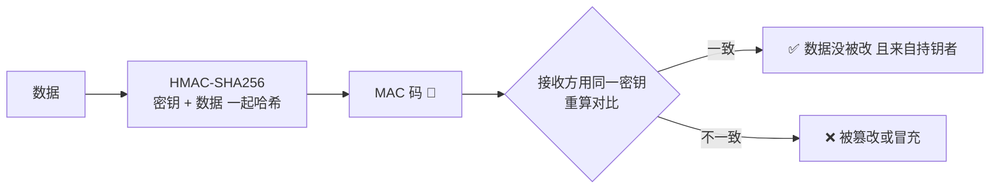
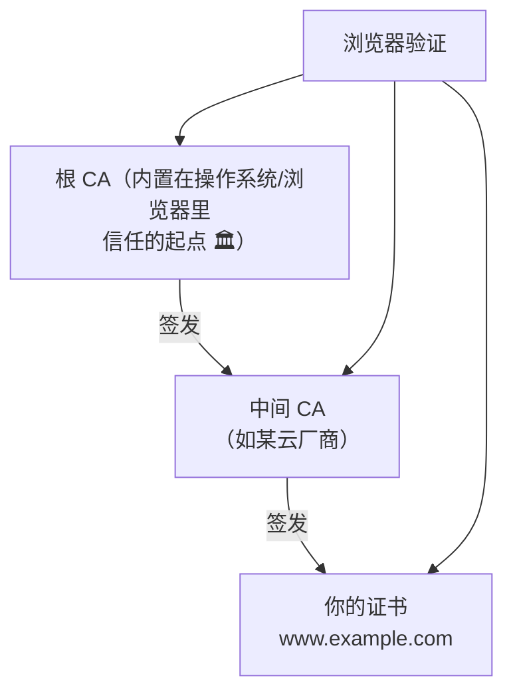
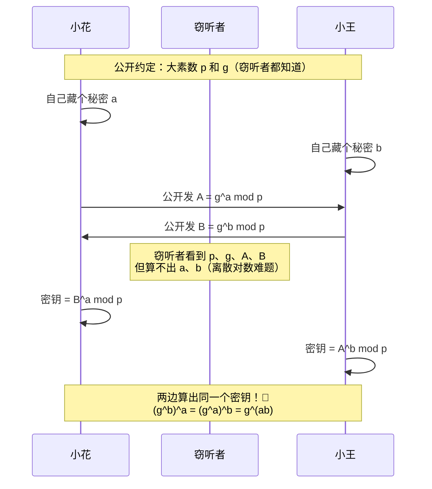
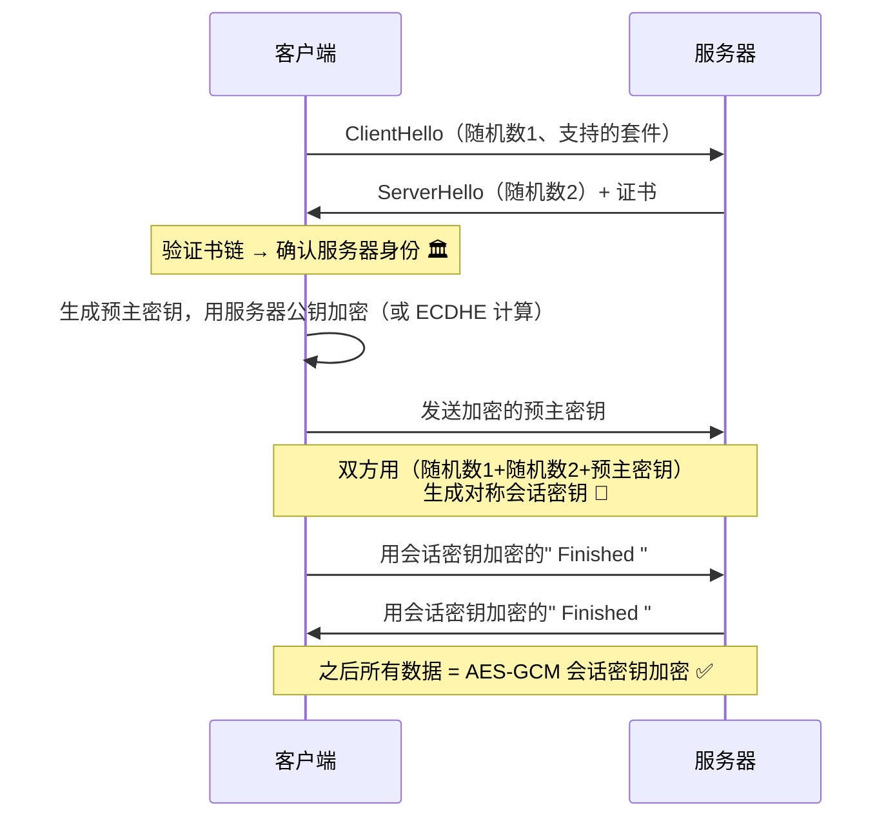
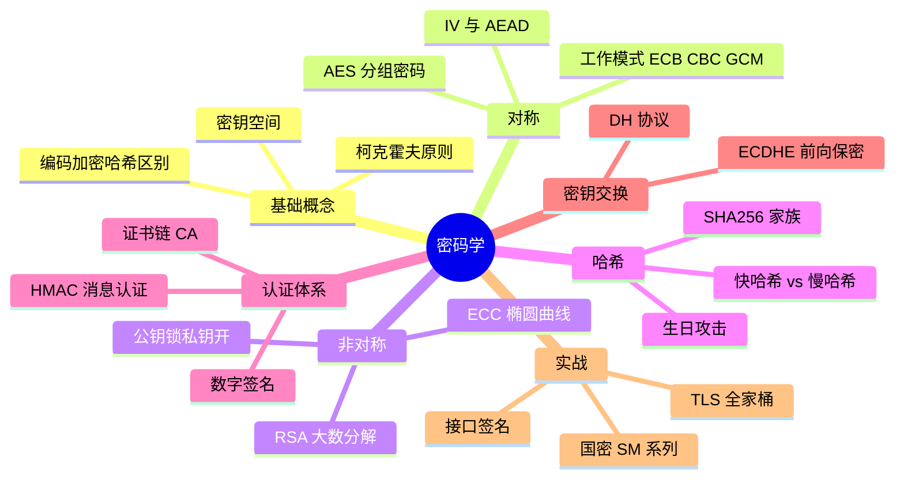

# 🌸 密码学学习笔记 —— 从凯撒密码到数字证书的魔法

> 嘿嘿～前几篇笔记里加密总是客串出场（HTTPS、JWT、BCrypt……），这次主角登场！对称/非对称/哈希的深层原理、AES 工作模式、RSA 的数学小心机、数字证书链，一篇全拆开讲明白 🔐✨

---

## 📖 目录

1. [初识密码学：把秘密变成天书](#一初识密码学把秘密变成天书)
2. [分清楚：编码、加密、哈希](#二分清楚编码加密哈希)
3. [对称加密：AES 与工作模式](#三对称加密aes-与工作模式)
4. [非对称加密：RSA 与 ECC](#四非对称加密rsa-与-ecc)
5. [哈希函数：单向绞肉机的深挖](#五哈希函数单向绞肉机的深挖)
6. [消息认证码：HMAC](#六消息认证码hmac)
7. [数字签名与证书：信任的链条](#七数字签名与证书信任的链条)
8. [密钥交换：DH 与前向保密](#八密钥交换dh-与前向保密)
9. [综合运用：TLS 握手中的全家桶](#九综合运用tls-握手中的全家桶)
10. [国密算法：中国的加密标准](#十国密算法中国的加密标准)
11. [常见误区与面试高频题](#十一常见误区与面试高频题)

---

## 一、初识密码学：把秘密变成天书

### 1.1 从凯撒密码说起

两千年前的凯撒大帝打仗传令：每个字母往后挪 3 位 🏛️

```
明文：  H  E  L  L  O
密文：  K  H  O  O  R      （每个字母 +3）
```

- 移位数 3 就是"**密钥**"，知道钥匙就能还原
- 但只有 25 种移法，暴力试完就破——**密钥空间太小**是古典密码的死穴 💀

### 1.2 现代密码学的基石思想

**柯克霍夫原则**（19 世纪就悟了）：

> 系统的安全性必须只依赖于**密钥的保密**，而不是算法的保密。

| 现代密码 ✅ | 藏密钥，算法全公开 | AES 人人都知道怎么算，没钥匙照样解不开 |
| --- | --- | --- |
| 安全靠隐藏 ⚠️ | 藏算法（"我自研加密"）| 算法一旦泄露全完，且没经过全世界检验 |

> 🎀 一句话：**公开算法 + 保密密钥 = 好；保密算法 + "相信我" = 危！**

### 1.3 密码学三大金刚

| 金刚 | 能不能还原 | 解决什么问题 |
| --- | --- | --- |
| 对称加密 | ✅（同一把钥匙） | 机密性——防偷看 |
| 非对称加密 | ✅（公钥锁私钥开） | 机密性 + 密钥交换 |
| 哈希 | ❌ 单向 | 完整性——防篡改 |

---

## 二、分清楚：编码、加密、哈希

这三个天天被混淆，先一刀切开 🔪

| 对比 | 编码 Base64 | 加密 AES | 哈希 SHA-256 |
| --- | --- | --- | --- |
| 目的 | **方便传输**（文本表示二进制）| **保密** | **校验** |
| 需要密钥 | ❌ | ✅ | ❌ |
| 可逆 | ✅ 谁都能解 | ✅ 有钥匙才能解 | ❌ 谁都不能解 |
| 安全性 | **零**！ | 有 | 有 |

```text
"你好" → Base64 → "5L2g5aW9" → 任何人一秒还原（它不是加密！）
"你好" → AES    → "x8Jk2..." → 没钥匙谁也还原不了
"你好" → SHA256 → "670d..."  → 连自己也还原不了
```

> ⚠️ 高频翻车：把 Base64 当"加密"存密码、JWT Payload 用 Base64 就以为没人看得到——**Base64 是明文换了个马甲**！🕸️

**常用编码一览：**

| 编码 | 场景 |
| --- | --- |
| Base64 | 二进制→文本（邮件附件、JWT、Data URI）|
| Base58 | 比特币地址（去掉易混淆的 0/O、I/l）|
| URL 编码 | 特殊字符进 URL（`%20` = 空格）|
| Hex | 二进制→十六进制（哈希值展示）|

---

## 三、对称加密：AES 与工作模式

### 3.1 AES：当今对称之王

- 密钥长度：128 / 192 / **256 位**（越长越安全，128 已够用）
- 分组密码：**一次只能加密 16 字节**的"块"，大文件要切成块排队处理
- 数学核心：多轮"字节替换 + 行移位 + 列混淆 + 轮密钥异或"（洗牌洗到亲妈不认 🃏）

| 历史 | 命运 |
| --- | --- |
| DES（1977） | 56 位密钥，1998 年被暴力破解，**退役** ⚰️ |
| 3DES | DES 跑三遍续命，慢，淘汰中 |
| **AES** ⭐ | 2001 年全球选拔冠军，至今无有效攻击 |
| ChaCha20 | 无 AES 硬件加速的手机上更快的备胎（HTTP/3 常用）|

### 3.2 工作模式：块怎么排队很重要！

AES 一次只能啃 16 字节，10MB 文件切成 65 万块——**怎么排队加密**直接决定安全性：

```mermaid
flowchart TD
    subgraph ECB 电码本模式 ❌
    A1[块1] --> B1[独立加密]
    A2[块2] --> B2[独立加密]
    A3[块3] --> B3[独立加密]
    end
    note1[同样的块加密结果相同<br>暴露数据模式！<br>经典图：ECB 加密的企鹅还是企鹅 🐧]
```

| 模式 | 思路 | 安全吗 | 说明 |
| --- | --- | --- | --- |
| ECB | 每块独立加密 | ❌ 弃用 | 相同明文块=相同密文块，泄露模式 |
| CBC | 每块先和上一块密文异或 | ✅ 但要防填充攻击 | 需要 IV，串行慢 |
| CTR | 把计数器加密成"密钥流"异或 | ✅ | 可并行，快 |
| **GCM** ⭐ | CTR + 自带认证标签 | ✅✅ 推荐 | 加密+完整性一步到位（AES-GCM）|

> 💡 两个新词：
> - **IV 初始向量**：让"每次加密结果都不一样"的随机数（同一段话每次密文都不同，防比对）——IV 要随机且每次换！
> - **认证加密 AEAD**：GCM 模式加密的同时生成"标签"，改一个比特都会发现——**加密+防篡改二合一**，现代标配

```python
# 日常开发直接用成熟库，别自己拼！（Python 示例）
from cryptography.hazmat.primitives.ciphers.aead import AESGCM
import os

key = AESGCM.generate_key(bit_length=256)   # 密钥：绝对保密
nonce = os.urandom(12)                       # 随机数：每次必须换
aes = AESGCM(key)
cipher = aes.encrypt(nonce, b"机密消息", None)   # 内含认证标签
plain = aes.decrypt(nonce, cipher, None)          # 被篡改会抛异常 ✅
```

---

## 四、非对称加密：RSA 与 ECC

### 4.1 核心思想

一把钥匙分身成一对 🔑🔑：

- **公钥**（随便发）：加密用 → 锁上容易
- **私钥**（死守着）：解密用 → 只有你能开

数学保证：从公钥**推算不出**私钥（靠的是"大数分解"这类正向容易反向逆天的难题）。

### 4.2 RSA 的数学直觉（不吓人版）

建立在**两个超大质数相乘容易、拆回质数逆天难**之上：

```
p = 61, q = 53（真实是几百位的大质数）
n = p × q = 3233        ← 公开（想拆回 p、q？数字一大宇宙毁灭都算不完）
φ(n) = (p-1)(q-1) = 3120
选 e = 17               ← 公钥 = (e, n)
算 d：e×d mod φ(n) = 1 → d = 2753   ← 私钥 = (d, n)

加密：c = m^e mod n      （m 是明文数字）
解密：m = c^d mod n      ← 数学上恰好还原！
```

| RSA 陷门 | 正向 | 反向 |
| --- | --- | --- |
| 大数分解 | p × q 一瞬间 ✅ | 从 n 拆出 p、q 💀 |
| 离散对数（DH 用） | 3^x mod p 一算就有 | 从结果倒推 x 💀 |

### 4.3 RSA vs ECC

| 对比 | RSA | ECC 椭圆曲线 |
| --- | --- | --- |
| 数学难题 | 大数分解 | 椭圆曲线离散对数 |
| 密钥长度 | 2048/4096 位 | 256 位就顶 RSA 3072 位 |
| 速度 | 加密快、慢于ECC整体 | **更小更快** 🚀 |
| 现状 | 老牌通用，证书还常见 | 移动端/现代 TLS 主流 |

> 🎀 ECC 用"椭圆曲线上的点加法"构造陷门——不用懂曲线长啥样，记住"**更短的密钥、同样的安全**"就够啦～

### 4.4 使用注意

- RSA **只能加密小于密钥长度的数据**（2048 位 ≈ 245 字节）→ 所以从不直接加密大数据
- 正确姿势：**用 RSA 加密一把 AES 密钥，用 AES 加密数据**（信封套信纸 ✉️）
- 私钥文件要设权限 600，别提交 git！

---

## 五、哈希函数：单向绞肉机的深挖

### 5.1 三大特性

| 特性 | 大白话 |
| --- | --- |
| 确定性 | 同样输入永远同样输出 |
| 单向性 | 从指纹**推不出**原文（雪崩效应：改一个字，指纹面目全非）|
| 抗碰撞 | 找不到两个不同的输入有相同指纹（极难）|

### 5.2 算法家谱

| 算法 | 摘要长度 | 现状 |
| --- | --- | --- |
| MD5 | 128 位 | ❌ 已破解（可碰撞），只配算文件秒传 |
| SHA-1 | 160 位 | ❌ 已破解（2017 谷歌实际碰撞）|
| **SHA-256** ⭐ | 256 位 | ✅ 主流（比特币挖矿就是狂算它）|
| SHA-3 | 可变 | ✅ 备胎转正（和 SHA-2 不同结构）|

> 💡 "破解"≠能还原原文！是指**能人为制造碰撞**——攻击者可以伪造一份哈希相同的假合同，所以 MD5 做完整性校验已不可信。

### 5.3 生日攻击：为什么 128 位不够看

23 人的班级就有 50% 概率两人同一天生日 🎂（比直觉高得多！）

同理：哈希空间 2^n，只需约 2^(n/2) 次尝试就能撞出碰撞：

- MD5 只需 2^64 次 → 现代算力可行 → 死刑
- SHA-256 需要 2^128 次 → 宇宙毁灭都算不完 → 安全 ✅

### 5.4 慢哈希：密码存储专用

普通哈希太快，暴力试密码一秒几亿次——密码场景要**故意慢**：

| 用途 | 选哈希 | 原因 |
| --- | --- | --- |
| 文件校验/签名摘要 | SHA-256（越快越好）| 校验一次就完事 |
| **存密码** | BCrypt / Argon2 / PBKDF2（越慢越好）| 让暴力破解慢到破产 🐌 |

> 🎀 记住反常识：**快哈希给文件，慢哈希给密码**！

---

## 六、消息认证码：HMAC

### 6.1 问题：哈希防不住"偷换+

单纯发 `数据 + SHA256(数据)`？攻击者改完数据再算个新哈希一起发，接收方看不出来 🤔

→ 哈希里**掺入只有双方知道的密钥**：



| 对比 | 哈希 | HMAC |
| --- | --- | --- |
| 要密钥 | ❌ | ✅ |
| 防篡改 | ❌（攻击者可重算）| ✅（没密钥算不出）|
| 场景 | 文件校验 | 接口签名、JWT 签名、TLS 记录 |

### 6.2 实战：接口签名

```java
// 客户端：参数按序拼好 + 时间戳 + 密钥 → 算签名一起发
String sign = hmacSha256("amount=100&to=xiaohua&ts=1700000000", SECRET_KEY);

// 服务端：同样算法重算对比
if (!sign.equals(requestSign)) throw new SignException("签名错误");
// 配合时间戳窗口 → 顺便防重放攻击 ✅
```

> 💡 JWT 的第三段签名，本质就是 `HMAC-SHA256(header.payload, 密钥)`！

---

## 七、数字签名与证书：信任的链条

### 7.1 签名 vs 加密（方向反着用）

非对称加密的**反向操作**就是签名 ✍️：

| 操作 | 用什么钥匙 | 作用 |
| --- | --- | --- |
| 加密给别人 | 对方**公钥** | 只有对方能看（机密性）|
| 签名 | 自己**私钥** | 大家都能验，只可能是你签的（不可抵赖 + 完整性）|

```mermaid
flowchart LR
    subgraph 签名方
    A[合同] --> B[SHA256 → 摘要]
    B --> C[私钥加密摘要 = 签名]
    end
    C --> D[合同+签名]
    D --> subgraph 验证方
    E[公钥解签名 → 摘要1] --> F[自己算哈希 → 摘要2]
    F --> G{相等？}
    end
    G -->|是| H[✅ 没被改 + 确实是TA签的]
    G -->|否| I[❌ 拒收]
```

**为什么要"先哈希再签"而不是直接签全文？** —— 签名运算慢，哈希把任意长度压成固定短摘要，签起来飞快 ✨

### 7.2 但公钥怎么证明是真的？

黑客把假公钥塞给你怎么办？→ 引入**权威中介 CA（证书颁发机构）**：

```
证书 = 你的公钥 + 你的身份信息 + 有效期
     + CA 用【CA私钥】给以上内容做的签名
```

### 7.3 证书链：信任的接力棒



| 证书类型 | 验证级别 | 适合 |
| --- | --- | --- |
| DV 域名验证 | 只验"你控制这个域名" | 个人站（免费 Let's Encrypt）|
| OV 组织验证 | 验证公司真实存在 | 企业官网 |
| EV 扩展验证 | 严格尽调，浏览器显示公司名 | 银行金融 |

> 🎀 HTTPS 握手时服务器发证书 → 浏览器逐级验签到内置根证书 → 全链通过才信任。**整条链 = 递归的"我担保它"**！

---

## 八、密钥交换：DH 与前向保密

### 8.1 难题：怎么在不安全 channel 商量密钥？

打电话商量密钥？线路可能被窃听 🕵️ → **Diffie-Hellman 协议**的神来之笔：



> 💡 颜料类比：黄颜料公开混入各自秘密色再交换，双方再混自己的秘密色 → 得到同一种秘密颜色，窃听者拿着两份混合色**调不出**秘密色 🎨

### 8.2 前向保密（PFS）

| 方案 | 私钥泄露后果 |
| --- | --- |
| RSA 密钥交换 | 黑客录了历史流量 + 拿到私钥 → **全部解密** 💀 |
| **ECDHE**（椭圆曲线 DH 临时密钥）⭐ | 每次会话密钥都是临时的、用完就扔 → 历史流量依然安全 ✅ |

> 🎀 这就是为什么现代 TLS 全面换 ECDHE——**今天的私钥泄露，救不了昨天偷录的流量**！TLS 1.3 甚至直接废除了 RSA 密钥交换。

---

## 九、综合运用：TLS 握手中的全家桶

把前面学的全部串起来——HTTPS 建立连接时密码学是这样协同作战的 🎼：



| 密码学武器 | 在 TLS 里的岗位 |
| --- | --- |
| 证书 + 数字签名 | 验证服务器身份（防冒充）|
| ECDHE 密钥交换 | 安全协商会话密钥（+前向保密）|
| 随机数 | 保证每次会话密钥都不同（防重放）|
| AES-GCM 对称加密 | 后续数据加密+完整性（快）|
| HMAC/认证标签 | 每条记录防篡改 |

> 🎀 完美分工：**非对称解决"信任与密钥交换"，对称负责"高效加密"，哈希守好"完整性"**——三大金刚各显神通！

---

## 十、国密算法：中国的加密标准

国家商用密码标准，政务/金融/等保场景会要求使用 🇨🇳：

| 国密 | 对应国际算法 | 用途 |
| --- | --- | --- |
| SM2 | ECC（RSA/ECDHE）| 非对称：签名 + 密钥交换 |
| SM3 | SHA-256 | 哈希摘要 |
| SM4 | AES | 对称分组加密（128 位）|
| SM9 | IBE 身份基加密 | 用身份（如手机号）当公钥 |
| ZUC 祖冲之 | SNOW/流密码 | 4G/5G 通信流加密 |

> 💡 国内项目常见要求：TLS 用国密双证书（签名证书+加密证书），JDK 原生不支持，需要 BouncyCastle 或 国密版 OpenSSL/Tengine 配合～

---

## 十一、常见误区与面试高频题

### 11.1 高频误区红黑榜 ⚠️

| 误区 | 真相 |
| --- | --- |
| "Base64 加密了" | Base64 是编码，0 安全性 |
| "MD5 加盐就绝对安全" | 固定盐可被针对性破解，密码请用 BCrypt 慢哈希 |
| "自研加密算法更安全" | 违反柯克霍夫原则，未经验证=定时炸弹 💣 |
| "HTTPS 很慢" | 现代硬件 + 会话复用，开销个位数毫秒 |
| "哈希能加密数据" | 哈希不可逆，没法"解密"还原 |
| "AES 密钥越长越好" | 128 位已安全，更长更慢收益递减 |
| "RSA 加密一切" | RSA 只适合小块数据，大数据用 AES |
| "用 ECB 模式就行" | ECB 泄露数据模式（企鹅图警告 🐧）|

### 11.2 面试官最爱问 Top 题 🎯

| 问题 | 答题要点 |
| --- | --- |
| 对称 vs 非对称？ | 一把钥匙 vs 公私钥对；快/慢；AES 传数据、RSA 换密钥（混合加密）|
| 为什么 HTTPS 用混合加密？ | 非对称慢但解决密钥交换 → 只传一把 AES 密钥，数据全用对称 |
| AES 的 ECB 为什么不安全？ | 相同明文块→相同密文块，暴露模式（企鹅图）|
| IV 是什么？为什么每次要换？ | 初始向量让相同明文加密出不同密文；固定 IV 可被比对攻击 |
| MD5/SHA-1 为什么被弃用？ | 已能构造碰撞；完整性场景失效（生日攻击 2^64）|
| 哈希和加密区别？ | 哈希单向不可逆做校验；加密可逆做保密 |
| 数字签名过程？ | 私钥签"哈希摘要"，公钥验签；防篡改+防抵赖 |
| 数字证书解决什么问题？ | 公钥分发信任问题；CA 用私钥担保你的公钥；证书链递归验证 |
| HMAC 和哈希区别？ | HMAC 掺密钥，攻击者改了数据也重算不出正确 MAC |
| 什么是前向保密？ | ECDHE 每次会话临时密钥，私钥泄露不影响历史流量 |
| DH 密钥交换原理？ | 公开 g^a、g^b，各自算 g^(ab)，窃听者解离散对数难题无解 |
| TLS 握手用了哪些密码学？ | 证书验签（身份）+ ECDHE（密钥）+ 随机数（防重放）+ AES-GCM（数据）|
| 国密算法知道吗？ | SM2 非对称 / SM3 哈希 / SM4 对称，政务金融常见要求 |

### 11.3 知识地图



### 11.4 学习建议路线 🗺️

1. **第一站**：分清编码/加密/哈希三兄弟（Base64 惨案记住）
2. **第二站**：对称加密 + 工作模式，亲手用 AES-GCM 库加密一段文本
3. **第三站**：RSA 数学直觉 + 签名/证书链，配 openssl 命令自己签一张证书 🔍
4. **第四站**：DH/ECDHE + 前向保密，看懂 TLS 握手每一行
5. **终点站**：了解国密 + 密码存储实战，密码学版图圆满 🌟

```bash
# 自签证书玩玩（本地测试用）
openssl req -x509 -newkey rsa:4096 -keyout key.pem -out cert.pem -days 365 -nodes
```

---

> 🌈 密码学通关！现在回头看 HTTPS、JWT、BCrypt、接口签名，全都变成了"哦～原来是这么回事"——三大金刚（对称/非对称/哈希）+ 两大利器（签名/证书）+ 一条信任链，网络系列四部曲全部集齐！你就是行走的保险柜啦 🔐 继续冲鸭！(๑•̀ㅂ•́)و✧💪
