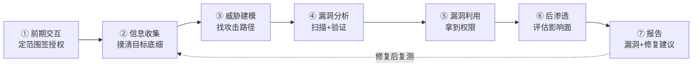
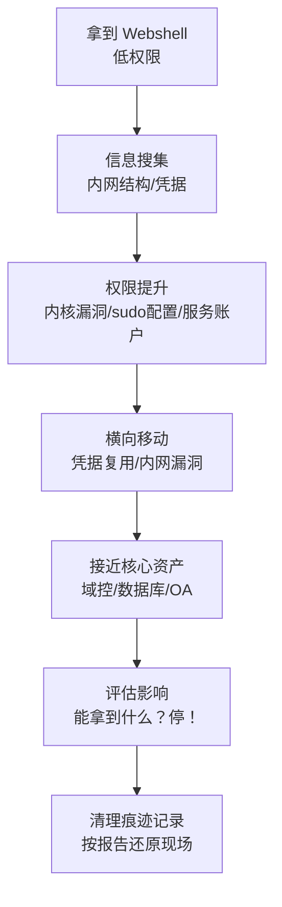
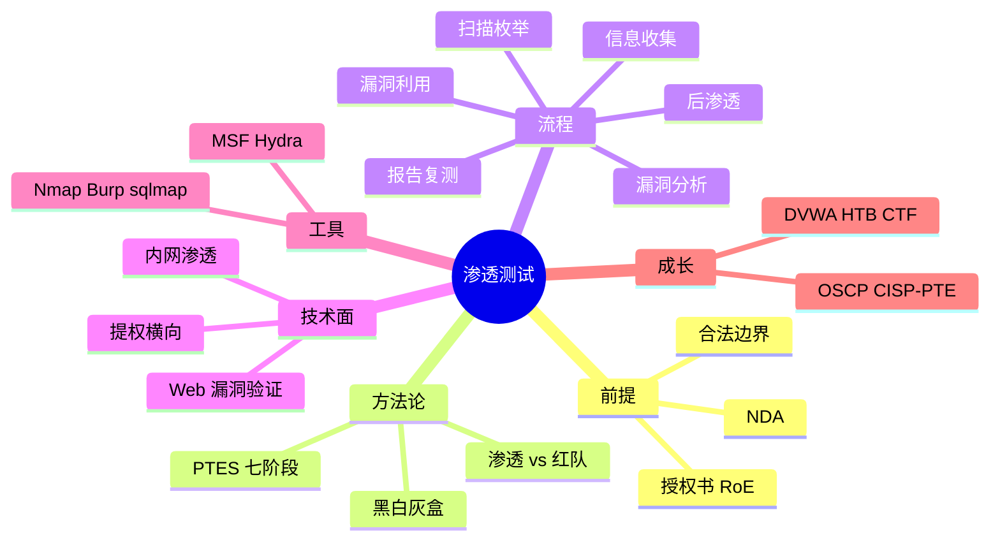

# 🌸 渗透测试学习笔记 —— 戴着白帽子的"合法黑客"

> 嘿嘿～前几篇学了攻击原理和安全开发，这次把它们串成一套**实战方法论**！渗透测试就是"雇人 hack 自己"——签了授权书、圈定范围、找出漏洞、交报告修复，全程合法 🤍🎩 这是安全行业最酷的工种之一，一起来入门～

---

## 📖 目录

1. [初识渗透测试：先说清"合法"两个字](#一初识渗透测试先说清合法两个字)
2. [渗透测试的类型](#二渗透测试的类型)
3. [标准方法论与流程总览](#三标准方法论与流程总览)
4. [第一阶段：信息收集](#四第一阶段信息收集)
5. [第二阶段：扫描与枚举](#五第二阶段扫描与枚举)
6. [第三阶段：漏洞扫描与分析](#六第三阶段漏洞扫描与分析)
7. [第四阶段：漏洞利用](#七第四阶段漏洞利用)
8. [第五阶段：后渗透与权限维持](#八第五阶段后渗透与权限维持)
9. [第六阶段：报告编写（最重要！）](#九第六阶段报告编写最重要)
10. [工具箱速览](#十工具箱速览)
11. [学习路线、靶场与面试高频题](#十一学习路线靶场与面试高频题)

---

## 一、初识渗透测试：先说清"合法"两个字

### 1.1 什么是渗透测试？

**在授权范围内，模拟真实黑客的攻击手法，找出系统漏洞，并给出修复建议** 🎯

| 角色 | 做的事 | 合法性 |
| --- | --- | --- |
| 白帽（渗透测试工程师）| 授权范围内测试 + 交报告 | ✅ 合法 |
| 黑帽 | 未授权入侵牟利 | ❌ 犯法（刑法 285/286 条）|
| 灰帽 | 没授权但"好心"测漏洞 | ⚠️ 照样犯法！ |

### 1.2 开测前必须有的三样东西 📋

1. **授权书（Rules of Engagement）**：白纸黑字，甲方签字
   - 测试范围（哪些域名/IP/系统）
   - 时间窗口（几点到几点）
   - 禁止动作（不许 DDoS、不许删数据、不许社工员工）
2. **保密协议 NDA**：测到的数据不外泄
3. **应急预案**：测试把系统搞挂了怎么办（联系谁、怎么恢复）

> 🎀 记住铁律：**没有授权书的渗透测试 = 非法入侵计算机信息系统罪**，技术再牛也白搭！所有练习请在自己的靶场或众测平台进行 🤍

### 1.3 渗透测试 vs 漏洞扫描 vs 红队

| 对比 | 漏洞扫描 | 渗透测试 | 红队演练 |
| --- | --- | --- | --- |
| 自动化 | 全自动 ⚙️ | 自动+人工 🧠 | 主要人工 |
| 深度 | 广而浅 | 深度利用验证 | 全面对抗（含社工/物理）|
| 目标 | 列出漏洞清单 | 验证漏洞能否真被利用 | 检验企业整体防御体系 |
| 周期 | 小时级 | 天~周 | 数周~数月 |

---

## 二、渗透测试的类型

| 类型 | 测试者知道多少 | 类比 |
| --- | --- | --- |
| 黑盒测试 | **啥都不知道**，只给个域名 | 扮演外部真黑客 🕶️ |
| 白盒测试 | 给源码、架构、账号 | 全知视角审计 📖 |
| 灰盒测试 | 给部分信息（如普通账号） | 模拟内部员工/已入侵者 |

**按目标分：**

- Web 应用渗透（最常见，本篇重点）
- 内网渗透（拿到跳板后横向移动）
- 无线渗透、移动 App、社会工程学、物理渗透

---

## 三、标准方法论与流程总览

业界两大参考：**PTES（渗透测试执行标准）** 七阶段 & **OWASP Testing Guide**（Web 专项）



| 阶段 | 产出 |
| --- | --- |
| 前期交互 | 授权书、测试范围 |
| 信息收集 | 目标资产清单（IP、域名、指纹）|
| 威胁建模 | 可能的攻击路径 |
| 漏洞分析 | 漏洞列表 + 可利用性判断 |
| 漏洞利用 | 利用成功记录（截图/证据）|
| 后渗透 | 影响范围评估 |
| 报告 | 最终交付物（甲方看的就是它！）|

---

## 四、第一阶段：信息收集

> 情报决定打法——**你知道得越多，攻击面就越多** 🔍

### 4.1 被动信息收集（不碰目标）

| 收集啥 | 能查到 | 常用途径 |
| --- | --- | --- |
| Whois | 域名注册人、邮箱 | whois 命令 |
| 子域名 | 隐藏的测试站 | 证书透明日志（crt.sh）、子域名爆破 |
| DNS 记录 | 真实 IP、邮件服务器 | dig / nslookup |
| 历史快照 | 旧页面、泄露的接口 | Wayback Machine |
| 搜索引擎语法 | 后台、报错页、敏感文件 | `site:xx.com inurl:admin`（Google Hacking）|
| 代码泄露 | 密钥、内网地址 | 公开仓库搜索（truffleHog 等）|
| 指纹识别 | 服务器/框架/组件版本 | Wappalyzer、响应头 |

### 4.2 主动信息收集（直接接触目标）

- 端口扫描（下一章细讲）
- 目录/路径爆破：用字典猜 `/admin`、`/backup`、`/.git` 等隐藏路径
- 指纹探测：确认 CMS（WordPress?）、中间件（Tomcat?）版本

```bash
# 目录爆破示例（仅用于授权目标/靶场）
dirsearch -u https://target.com -w common.txt

# whois 查询
whois example.com
```

> 🎀 信息收集占整个渗透 **60% 以上时间**——磨刀不误砍柴工，此处偷懒后面全靠运气！

---

## 五、第二阶段：扫描与枚举

### 5.1 端口扫描：Nmap 大法

```bash
nmap -sV -sC target.com        # 服务版本+默认脚本
nmap -p- target.com            # 全端口 65535 个
nmap -sU --top-ports 100 target.com   # UDP 常见端口
```

| 扫描类型 | 特点 |
| --- | --- |
| TCP 全连接 `-sT` | 完成三次握手，最稳但日志明显 |
| SYN 半开 `-sS` | 只握手两次就跑，隐蔽 ⚡ |
| 服务版本 `-sV` | 探测端口背后跑的软件和版本 |
| 操作系统 `-O` | 猜目标系统 |

### 5.2 服务枚举：看到版本号就查历史漏洞

| 发现 | 下一步 |
| --- | --- |
| 22 SSH | 查版本有无漏洞、试试弱口令 |
| 80/443 Web | 进入 Web 渗透流程 |
| 3306 MySQL | 弱口令、版本漏洞 |
| 6379 Redis | 未授权访问（历史重灾区！）|
| 3389 RDP | 弱口令、BlueKeep |

> 💡 每个开放端口 = 一扇门 🚪，枚举就是搞清"门后面是什么房间、锁是什么牌子"～

---

## 六、第三阶段：漏洞扫描与分析

### 6.1 自动扫描

| 工具 | 定位 |
| --- | --- |
| Nessus / OpenVAS | 主机系统漏洞扫描 |
| AWVS / Xray | Web 应用漏洞扫描 |
| Burp Suite | 手工测试 Web 神器（抓包改包重放）|

### 6.2 漏洞情报：CVE 与评级

- **CVE**：全球漏洞统一编号（如 CVE-2021-44228 = log4shell）
- **CVSS 评分**：0-10 分严重度（≥9.0 严重、7-8 高危、4-6 中危、<4 低危）
- 查询库：NVD、Exploit-DB（看有没有现成 PoC）

### 6.3 人工分析（自动扫不出的才是价值）

自动化工具误报多、逻辑漏洞测不出 → 人工重点：

- **业务逻辑漏洞**：修改金额负数、验证码可爆破、越权
- **权限绕过**：普通用户访问管理接口
- **组合利用**：单个低危串成高危攻击链

---

## 七、第四阶段：漏洞利用

> 授权范围内，验证漏洞"真的能被打穿"💥

### 7.1 Web 高频漏洞的验证思路（复习前几篇）

| 漏洞 | 验证思路 | 对应防御 |
| --- | --- | --- |
| SQL 注入 | 输入单引号看报错 → sqlmap 验证 | 参数化查询 |
| XSS | 提交脚本标签看是否执行 | 输出转义+CSP |
| 越权 | 改请求里的 id 看别人数据 | 归属校验 |
| 文件上传 | 传可执行文件看能否访问 | 白名单+改名 |
| SSRF | 让服务器请求内网地址 | URL 白名单 |
| 弱口令 | 字典爆破登录口 | 限流+锁号 |
| 未授权访问 | 直接访问管理页面/接口 | 默认鉴权 |

```bash
# sqlmap 检测注入点（仅授权目标！）
sqlmap -u "https://target.com/item?id=1" --batch

# Burp Suite：拦截请求 → 改参数（金额/角色/id）→ 重放观察响应
```

### 7.2 利用成功的标准动作

1. **拿到证据**：截图、请求响应包、时间戳
2. **点到为止**：证明能利用即可，**不破坏数据、不扩大战果**
3. **记录路径**：怎么进来的，每一步操作（复测要用）

> ⚠️ 授权书写着"禁止删库、禁止拖库真实数据"——验证时拿 1-2 条脱敏数据证明可读即可，整个库拖走就违法了！

---

## 八、第五阶段：后渗透与权限维持

拿到第一台机器只是开始，要评估**真实影响面**：



| 后渗透动作 | 目的 |
| --- | --- |
| 提权 | www-data → root/system |
| 凭据收集 | 配置文件、历史命令里的密码 |
| 横向移动 | 用拿到的钥匙开内网其他机器 |
| 权限维持 | 留"后门"验证持久性（测试完必须清除并写进报告！）|

> 🎀 后渗透的意义：告诉老板"这个洞不是丢一台机器的事，而是**整个内网都可能沦陷**"——影响评估才是报告的含金量！

---

## 九、第六阶段：报告编写（最重要！）

技术再强，报告写不清 = 白干 📝。甲方付钱买的就是这份文档！

### 9.1 报告结构模板

```
1. 摘要          ← 给老板看：几句话讲清风险总览
2. 测试范围与方法 ← 时间、范围、用了什么手法
3. 风险概览      ← 漏洞统计表 + 风险等级分布图
4. 漏洞详情      ← 每个漏洞一节（核心）
5. 修复建议      ← 按优先级排序（核心）
6. 附录          ← 复现步骤、证据截图
```

### 9.2 单个漏洞怎么写？

| 要素 | 示例 |
| --- | --- |
| 漏洞名称 | 某某系统存在 SQL 注入漏洞 |
| 风险等级 | 高危（CVSS 9.8）|
| 影响版本/位置 | /api/user 接口 username 参数 |
| 漏洞描述 | 参数未参数化导致可注入（原理一句话）|
| 复现步骤 | ①②③ 步骤 + 截图 + 请求包 |
| 危害说明 | 可拖库 → 用户隐私泄露 → 监管处罚 |
| **修复建议** | 使用预编译语句；代码示例；升级组件版本 |
| 复测情况 | 已修复 ✅ / 未修复 ⏳ |

> 💡 写报告心法：**让开发看得懂怎么修，让老板看得懂多严重**——一步复现、一行修复建议都不能少！

---

## 十、工具箱速览

| 阶段 | 工具 | 用途 |
| --- | --- | --- |
| 信息收集 | theHarvester、Maltego、crt.sh | 邮箱/子域名/资产测绘 |
| 扫描 | Nmap、Masscan | 端口与服务 |
| Web 测试 | **Burp Suite** ⭐、Xray | 抓包改包、代理扫描 |
| 注入 | sqlmap | SQL 注入自动化 |
| 爆破 | Hydra、dirsearch | 弱口令、目录 |
| 漏洞利用 | Metasploit | 框架化利用（MSF）|
| 提权辅助 | Linux Exploit Suggester | 找提权漏洞 |
| 报告 | 木头模板/Dradis | 整理输出 |

> 🎀 工具是"剑法"，**原理是内功**——上一篇学的所有漏洞原理，才是看懂工具输出的底气！工具年年换，内功一辈子～

---

## 十一、学习路线、靶场与面试高频题

### 11.1 合法练习地图 🗺️

| 类型 | 推荐 | 特点 |
| --- | --- | --- |
| 在线靶场 | DVWA、Pikachu、sqli-labs | 经典 Web 漏洞专项 |
| 综合平台 | HTB（HackTheBox）、TryHackMe | 国际主流，从易到难 |
| 靶机 | VulnHub | 本地搭建的漏洞虚拟机 |
| 国内众测 | 补天、漏洞盒子、CNVD | 真实授权项目（有平台授权背书）|
| 比赛 | CTF（攻防赛） | 快速进阶的最佳方式 🏆 |

### 11.2 学习路线建议

1. **第一站**：先把《网络安全》《安全开发》两篇的漏洞原理吃透
2. **第二站**：搭 DVWA，把 SQL 注入/XSS/上传每个关卡手工打一遍
3. **第三站**：装 Kali Linux + Burp Suite，习惯抓包改包的工作流
4. **第四站**：TryHackMe 路线 → 打 HTB 简单靶机 → 参加 CTF
5. **第五站**：学内网渗透与域渗透，看《红队蓝军》类实战案例
6. **终点站**：考认证 OSCP（国际硬通货）/ CISP-PTE（国内）→ 求职敲门砖 🌟

### 11.3 知识地图



### 11.4 面试官最爱问 Top 题 🎯

| 问题 | 答题要点 |
| --- | --- |
| 渗透测试流程？ | 授权→信息收集→扫描→利用→后渗透→报告→复测（PTES）|
| 渗透测试和漏洞扫描区别？ | 深度利用验证 vs 广度自动扫描；人工 vs 自动 |
| 讲一次完整渗透经历 | STAR：目标→信息收集发现攻击面→组合利用→影响→报告修复 |
| 信息收集怎么做？ | 被动（whois/子域名/Google语法）+ 主动（端口/目录）|
| Nmap 常用参数？ | -sS 半开、-sV 版本、-p- 全端口、-sC 脚本 |
| 拿到 Webshell 后做什么？ | 提权→内网信息收集→横向→评估影响（强调点到为止）|
| 怎么判断漏洞可利用？ | 版本比对 CVE + PoC 验证 + 实际利用测试（授权内）|
| 高危漏洞举例？ | log4shell、Redis 未授权、Fastjson 反序列化 |
| 报告怎么写？ | 摘要/范围/漏洞详情（复现+危害）/分级修复建议 |
| 越权怎么测？ | 平行改 id 对比响应、垂直测接口角色；两账号对照法 |
| SQL 注入怎么手工判断？ | 单引号报错→布尔/时间盲注差异→sqlmap 验证 |
| 修复建议怎么给？ | 按风险分级排序：技术方案（如参数化）+ 管理建议（如 WAF）|

### 11.5 职业与法律提醒 ⚖️

- 全程**授权范围内**行动，越界一步就是刑法问题（非法侵入计算机信息系统罪）
- 发现非授权目标漏洞 → 走 **CNVD/SRC 平台**提交流程，别自己动手
- 测试数据保密（NDA），朋友圈晒"打穿某站"截图 = 职业生涯自杀 💀
- 简历项目写靶场/众测平台经历，别写"我黑过 XX"（违法且低智）

---

> 🌈 渗透测试通关！网络系列六部曲圆满收官：计算机网络 → 网络安全 → 安全开发 → 密码学 → **渗透测试**～记住白帽子的三件套：**授权书在手、点到为止、报告为王**！想继续深入就冲靶场和 CTF，下一个知识点随时召唤我！(๑•̀ㅂ•́)و✧🤍🎩
