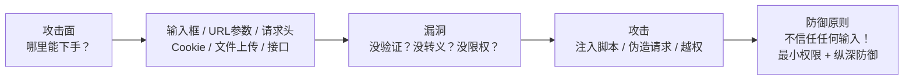
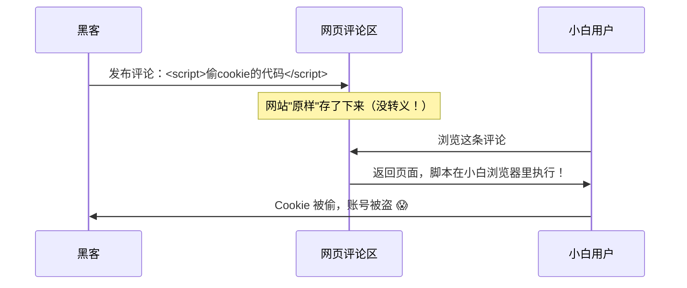
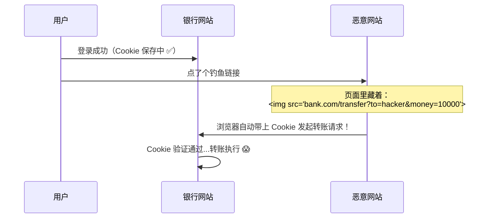
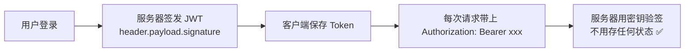
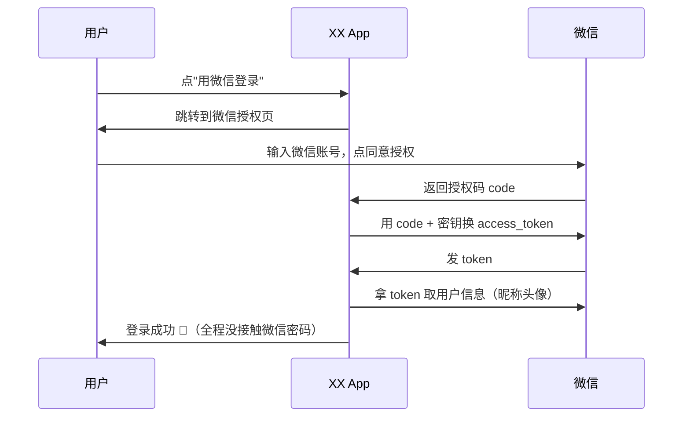
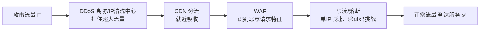
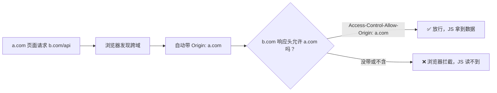
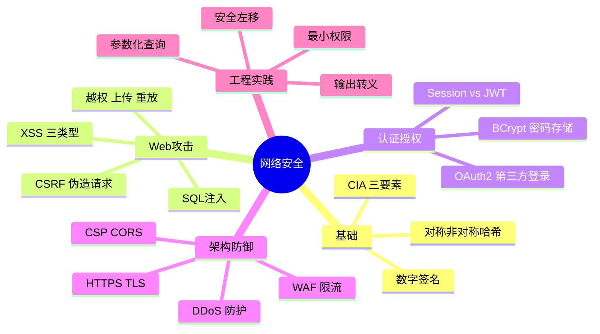

# 🌸 网络安全学习笔记 —— 守护数据的攻防大战

> 嘿嘿～学完网络原理，这节课来看互联网的"黑暗森林"⚔️：黑客怎么攻击？我们怎么防守？这篇笔记站在**防御者**视角，把常见攻击手段和保命套路一次讲透 🛡️✨

---

## 📖 目录

1. [初识网络安全：到底在保护啥？](#一初识网络安全到底在保护啥)
2. [加密三剑客：对称、非对称、哈希](#二加密三剑客对称非对称哈希)
3. [Web 头号杀手：XSS 跨站脚本](#三web-头号杀手xss-跨站脚本)
4. [借刀杀人：CSRF 跨站请求伪造](#四借刀杀人csrf-跨站请求伪造)
5. [数据库噩梦：SQL 注入](#五数据库噩梦sql-注入)
6. [其他常见 Web 攻击图鉴](#六其他常见-web-攻击图鉴)
7. [认证与授权：你是谁、你能干啥](#七认证与授权你是谁你能干啥)
8. [密码存储的正确姿势](#八密码存储的正确姿势)
9. [流量攻击：DDoS 家族](#九流量攻击ddos-家族)
10. [浏览器安全策略：CSP 与 CORS](#十浏览器安全策略csp-与-cors)
11. [API 安全设计清单](#十一api-安全设计清单)
12. [安全开发流程与面试高频题](#十二安全开发流程与面试高频题)

---

## 一、初识网络安全：到底在保护啥？

### 1.1 用大白话说安全

你的网站就像一家银行 🏦，黑客（攻击者）想干的事无非四种：

1. **偷看** —— 偷偷看你的转账记录（窃听）
2. **篡改** —— 把收款金额改小数点（篡改）
3. **冒充** —— 假扮成你去取钱（冒充）
4. **搞瘫** —— 堵住大门让谁都进不来（拒绝服务）

### 1.2 安全三要素：CIA（必背！）

| 要素 | 英文 | 保护的是 | 例子 |
| --- | --- | --- | --- |
| 机密性 | Confidentiality | 数据**不被偷看** | 加密传输、加密存储 |
| 完整性 | Integrity | 数据**不被篡改** | 哈希校验、数字签名 |
| 可用性 | Availability | 服务**不被搞瘫** | 抗 DDoS、灾备 |

> 🎀 记忆：**偷偷看（C）、偷偷改（I）、让你瘫（A）**——三大安全目标，所有攻击都能归类到这里！

### 1.3 攻击者视角 vs 防御者视角



**两条黄金法则（刻烟吸肺）：**

1. **永远不要相信用户的输入**——所有输入都是可疑的，必须验证/过滤/转义 ⚠️
2. **纵深防御**——一层防不住就多层（前端校验+后端校验+数据库权限+WAF 多重保险）

---

## 二、加密三剑客：对称、非对称、哈希

加密是安全的基石，三种技术各司其职 🔑

### 2.1 对称加密：一把钥匙锁和开

- 加密解密**同一把密钥**（AES 最主流）
- ✅ 快，适合**大量数据**
- ❌ 钥匙怎么安全送给对方是个难题

### 2.2 非对称加密：公钥锁、私钥开

- **公钥**随便发（加密用），**私钥**自己藏（解密用）
- ✅ 解决密钥交换难题
- ❌ 慢，只适合短数据（比如传一把对称密钥）

### 2.3 哈希：单向绞肉机

- 把任意数据绞成固定长度"指纹"（MD5、SHA-256）
- **不可逆**：从指纹还原不出原文
- 用途：密码存储、完整性校验、数字签名

| 对比 | 对称加密 AES | 非对称加密 RSA/ECC | 哈希 SHA-256 |
| --- | --- | --- | --- |
| 密钥 | 一把 | 公钥+私钥 | 无 |
| 可逆 | ✅ | ✅ | ❌ 单向 |
| 速度 | 快 ⚡ | 慢 🐢 | 极快 |
| 场景 | 通信加密 | 交换密钥、签名 | 密码、校验 |

### 2.4 数字签名：防篡改 + 防抵赖

```mermaid
flowchart LR
    subgraph 发送方
    A[文档] --> H[算哈希<br>得到摘要]
    H --> S[用私钥加密摘要<br>= 签名]
    end
    S --> R[文档+签名 一起发出]
    R --> subgraph 接收方
    B[用对方公钥解签名<br>得到摘要1] --> C[对文档再算哈希<br>得到摘要2]
    C --> D{摘要1 == 摘要2？}
    end
    D -->|相等| E[✅ 没被改过，且确实是TA发的]
    D -->|不等| F[❌ 被篡改或冒充！]
```

> 🎀 实战组合拳（HTTPS 就是这么干的）：**非对称加密交换密钥 → 对称加密传数据 → 哈希做完整性校验**！

---

## 三、Web 头号杀手：XSS 跨站脚本

### 3.1 原理：把恶意脚本"种"进你的页面

攻击者往网页里注入 JS 脚本，其他用户浏览时脚本执行 → 偷 Cookie、伪造操作 🕷️



### 3.2 三种类型

| 类型 | 注入点 | 特点 |
| --- | --- | --- |
| 存储型 ⭐ | 存进数据库（评论区） | 危害最大，谁看谁中招 |
| 反射型 | URL 参数拼进页面 | 要骗用户点恶意链接 |
| DOM 型 | 前端 JS 自己操作不当 | 不经过服务器，纯前端锅 |

### 3.3 防御姿势

1. **输出转义**（治本）：把 `<script>` 转成 `&lt;script&gt;`，让它变成"显示的文字"而不是"执行的代码"

```javascript
// 前端示例：不要直接 innerHTML 插入用户内容！
element.innerHTML = userInput;        // ❌ 危险！
element.textContent = userInput;      // ✅ 只当纯文本显示
```

2. **CSP 内容安全策略**：告诉浏览器"只准执行白名单里的脚本"
3. **HttpOnly Cookie**：Cookie 设上它，JS 就读不到，偷不走 🍪

```
Set-Cookie: token=abc; HttpOnly; Secure; SameSite=Lax
```

---

## 四、借刀杀人：CSRF 跨站请求伪造

### 4.1 原理：借你的登录态，替你做坏事

用户还登录着银行网站，又偷偷打开了恶意网站 → 恶意网站**冒用用户身份**偷偷发请求 🗡️



### 4.2 XSS vs CSRF（最爱混淆对比！）

| 对比 | XSS | CSRF |
| --- | --- | --- |
| 攻击对象 | **网站的漏洞**，害的是**用户** | **用户的登录态**，害的是**网站** |
| 是否注入脚本 | ✅ 注入并执行 JS | ❌ 不执行脚本，只伪造请求 |
| 是否需要登录 | 不一定 | 必须用户已登录 |
| 核心防御 | 转义输出、CSP | Token 校验、SameSite |

### 4.3 防御姿势

1. **CSRF Token**：服务器发一张"一次性通行证"，每次请求必须带上，恶意网站拿不到它 🎫
2. **SameSite Cookie**：限制 Cookie 只在同站请求中携带（现代浏览器默认 Lax，已挡掉大部分）
3. **验证 Origin / Referer**：检查请求来源是不是自家域名
4. 敏感操作**二次验证**：转账要再输密码/验证码

---

## 五、数据库噩梦：SQL 注入

### 5.1 原理：用户输入变成了 SQL 的一部分

```java
// ❌ 危险写法：字符串拼接 SQL
String sql = "SELECT * FROM users WHERE name = '" + username + "'";
// 用户输入：xiaohua' OR '1'='1
// 拼出来变成：
// SELECT * FROM users WHERE name = 'xiaohua' OR '1'='1'
// '1'='1' 永远为真 → 返回整张表！😱
```

更狠的输入 `'; DROP TABLE users; --` 直接删表跑路 💥

### 5.2 防御姿势（一行治百病）

```java
// ✅ 参数化查询（预编译）：用户输入只是"值"，永远不是"代码"
PreparedStatement ps = conn.prepareStatement(
    "SELECT * FROM users WHERE name = ?");
ps.setString(1, username);   // 输入再毒也只是字符串
```

| 防御手段 | 说明 |
| --- | --- |
| **参数化查询** ⭐ | 治本，输入只当数据不当 SQL |
| ORM 框架 | MyBatis 用 `#{}` 而不是 `${}` |
| 最小权限 | 数据库账号只给必要权限（别用 root 跑业务）|
| 错误信息 | 别把 SQL 报错原样吐给用户（等于送情报）|

> ⚠️ MyBatis 面试细节：`#{}` 是预编译占位符（安全），`${}` 是字符串拼接（危险，仅限表名/排序字段等白名单场景）！

---

## 六、其他常见 Web 攻击图鉴

### 6.1 文件上传漏洞

上传 `shell.php` 伪装成头像 → 服务器执行它 → 直接拿到控制权 🐚

| 防御 | 说明 |
| --- | --- |
| 白名单校验 | 只允许 jpg/png 等后缀（黑名单绕过花活太多）|
| 改文件名 | 重命名为随机名，去掉可执行性 |
| 隔离存储 | 文件存到 OSS/静态服务器，和代码目录分开 |
| 魔数校验 | 看文件头真实类型，别信后缀名 |

### 6.2 越权访问

- **水平越权**：用户 A 改一下 URL 里的 id 就能看用户 B 的订单 `/order/1001` → `/order/1002`
- **垂直越权**：普通用户直接请求管理员接口 `/admin/deleteUser`

```java
// ❌ 只验证登录没验证归属
Order order = orderService.getById(id);           // 谁的订单都能查！
// ✅ 带上当前用户校验归属
Order order = orderService.getByIdAndUserId(id, currentUser.getId());
```

> 🎀 防御核心：**每个接口都问两句——登录了吗？这数据是你的吗？**

### 6.3 点击劫持 Clickjacking

恶意网站把你银行的"转账按钮"透明叠在自己页面上，骗你点击 → 防御：`X-Frame-Options: DENY` 禁止被 iframe 嵌套

### 6.4 会话劫持与固定

- Cookie 被偷（XSS/嗅探）→ 换成你的身份 → 防御：HttpOnly + HTTPS + 登录后**重置 sessionId**

### 6.5 重放攻击

把抓到的合法请求原样再发一遍（比如充值请求发 100 次）→ 防御：**时间戳 + 随机数 nonce + 签名**，服务器识别"过期/重复"请求

### 6.6 敏感信息泄露

报错页面、注释里的账号、接口返回多余字段、git 仓库里的密钥……都是送人头 🙈

---

## 七、认证与授权：你是谁、你能干啥

### 7.1 概念区分（面试常问）

| 概念 | 回答的问题 | 类比 |
| --- | --- | --- |
| 认证 Authentication | **你是谁？** | 刷身份证进门 |
| 授权 Authorization | **你能干什么？** | 只能进自己工位 |

### 7.2 Session 方案

登录 → 服务器存 session → 发给浏览器 sessionId（Cookie）→ 每次请求带上来验证

- ❌ 服务器要存状态，分布式集群要做 session 共享（Redis 集中存）

### 7.3 JWT 方案



JWT 结构（三段用 `.` 连接）：

```
eyJhbGciOiJIUzI1NiJ9   ← Header（算法）
.eyJuid":1,"exp":1700000000}   ← Payload（数据，Base64 可解密，别放敏感信息！）
.SflKxwRJSMeKKF2QT4f...   ← Signature（签名，防篡改）
```

| 对比 | Session | JWT |
| --- | --- | --- |
| 状态存哪 | 服务器 | 客户端（服务端只验签）|
| 分布式友好 | ❌ 要共享 | ✅ 天生无状态 |
| 主动作废 | ✅ 删掉即可 | ❌ 签发后到期前有效（痛点！）|
| 适用 | 传统网页 | 前后端分离、App、微服务 |

### 7.4 OAuth2.0：第三方登录

"用微信登录 XX App" 就是 OAuth2 —— 让微信**证明你是你**，但不把密码给 XX App：



---

## 八、密码存储的正确姿势

### 8.1 花式作死排行榜 ⚠️

| 做法 | 评价 |
| --- | --- |
| 明文存储 | 🚫 拖库=全员裸奔（历史惨案：CSDN 600万明文）|
| MD5 直接哈希 | ❌ 彩虹表一查就破 |
| MD5 加固定盐 | ⚠️ 比裸奔强点，仍可暴力破解 |

### 8.2 正确姿势：慢哈希 + 随机盐

```java
// ✅ BCrypt：自带随机盐 + 故意算得慢 + 成本因子可调
String hash = BCrypt.hashpw(password, BCrypt.gensalt(12));
// 存进数据库的是：$2a$12$xxxxx...
// 验证
BCrypt.checkpw(inputPassword, hash);
```

| 要点 | 说明 |
| --- | --- |
| 随机盐 | 同样密码每次哈希结果都不同，彩虹表失效 |
| 慢哈希 | BCrypt/Argon2/PBKDF2 故意慢，暴力破解成本暴涨 |
| 传输安全 | HTTPS 保证密码在路上不被偷 |

> 🎀 为什么慢反而安全？——正常登录一次慢 100 毫秒没感觉；但黑客暴力试 10 亿个密码就要等十年 😏

---

## 九、流量攻击：DDoS 家族

### 9.1 DoS vs DDoS

- **DoS**：一台电脑疯狂发请求，把服务器打趴
- **DDoS**：** DISTRIBUTED**——控制成千上万肉鸡（僵尸网络）一起上，海啸式攻击 🌊

### 9.2 常见类型

| 类型 | 打哪里 | 例子 |
| --- | --- | --- |
| SYN Flood | TCP 握手 | 伪造大量 SYN 不回 ACK，半连接占满队列 |
| UDP Flood | 带宽 | 海量 UDP 包挤爆出口带宽 |
| HTTP Flood | 应用层 | 僵尸肉鸡狂刷最贵的接口（搜索/验证码）|
| DNS 放大 | 带宽 | 小请求骗 DNS 返回巨大响应，反射放大 |

### 9.3 防御体系（打地鼠式多层防御）



| 层级 | 手段 |
| --- | --- |
| 网络层 | 高防 IP、流量清洗、黑洞路由 |
| 架构层 | CDN、多机房、弹性扩容 |
| 应用层 | 限流（令牌桶）、验证码、人机识别 |
| 协议层 | SYN Cookie 缓解 SYN Flood |

---

## 十、浏览器安全策略：CSP 与 CORS

### 10.1 CSP：内容安全策略

通过响应头告诉浏览器一份"脚本白名单"，非白名单脚本一律不执行：

```
Content-Security-Policy: script-src 'self' https://cdn.example.com
```

→ XSS 即使注入成功，外部脚本也加载不了，伤害大减 ✨

### 10.2 CORS：跨域资源共享（不是攻击，是防御机制！）

**同源策略**：协议+域名+端口都相同才是同源；不同源的 JS 默认**读不到响应**（防的就是 CSRF 那类偷数据）



> 💡 常见误区：CORS 拦截发生在**浏览器端**——请求其实发出去了、服务器也响应了，只是浏览器不给 JS 看结果。所以 CORS 是**保护用户**的机制，不是 bug！服务器配置 `Access-Control-Allow-Origin` 就是在"声明谁可以跨域读我的数据"

---

## 十一、API 安全设计清单

后端同学人手一份的保命清单 ✅

**请求层：**

- [ ] 全站 **HTTPS**，杜绝明文传输
- [ ] 接口**鉴权**：JWT/Session 验证身份
- [ ] **授权校验**：每个接口校验数据归属（防水平越权）
- [ ] 敏感接口**限流**：令牌桶/漏桶，单 IP 单用户限速
- [ ] **防重放**：时间戳 + nonce + 签名

**数据层：**

- [ ] 入参**校验**（类型/长度/格式/范围）
- [ ] SQL 一律**参数化**
- [ ] 输出**脱敏**：手机号 `138****5678`、身份证打码
- [ ] 报错信息不外泄堆栈和 SQL

**其他：**

- [ ] 验证码/风控防撞库（暴力试密码）
- [ ] 登录失败次数锁定 + 异地提醒
- [ ] 密钥不进代码仓库（用配置中心/环境变量/KMS）
- [ ] 依赖组件定期升级（log4j 惨案警示 🔔）
- [ ] 操作日志审计（谁改了什么，能追责）

---

## 十二、安全开发流程与面试高频题

### 12.1 安全新观念

- **安全左移**：越早考虑安全成本越低（需求阶段就考虑，别上线了再补）
- **最小权限原则**：只给刚好够用的权限
- **默认安全**：默认配置就是安全的配置
- **假设失效**：任何一层都可能被突破，所以要纵深防御



### 12.2 面试官最爱问 Top 题 🎯

| 问题 | 答题要点 |
| --- | --- |
| XSS 是什么？怎么防？ | 注入恶意脚本；存储/反射/DOM 三型；输出转义 + CSP + HttpOnly |
| CSRF 是什么？和 XSS 区别？ | 借登录态伪造请求；XSS 是注入脚本执行，CSRF 是伪造请求不执行脚本 |
| CSRF 怎么防？ | CSRF Token + SameSite Cookie + Origin 校验 + 敏感操作二次验证 |
| SQL 注入原理与防御？ | 拼接 SQL 导致输入变代码；参数化查询/预编译；MyBatis #{} vs ${} |
| 对称和非对称加密区别？ | 一把钥匙 vs 公私钥对；快 vs 慢；AES 传数据、RSA 换密钥 |
| HTTPS 怎么保证安全？ | 混合加密（防窃听）+ 哈希（防篡改）+ CA 证书（防冒充） |
| JWT 原理和缺点？ | 三段式签名防篡改、无状态；缺点：无法主动作废、Payload 可解码 |
| 密码怎么存？ | BCrypt/Argon2 慢哈希 + 随机盐；绝不明文/裸 MD5 |
| 什么是越权？怎么防？ | 水平（改id看别人数据）垂直（普通用户调管理接口）；每个接口校验归属+角色 |
| CORS 和 CSRF 什么关系？ | 同源策略/CORS 是浏览器防偷数据的机制；CSRF 恰好绕过它（表单提交不受限）|
| DDoS 怎么防？ | 高防清洗 + CDN 分流 + WAF + 限流 + SYN Cookie |
| GET 有 CSRF 风险吗？ | 有！img 标签能发起 GET 请求且带 Cookie，所以敏感操作别用 GET |

### 12.3 学习建议路线 🗺️

1. **第一站**：吃透 CIA + 加密三剑客，理解 HTTPS 全过程
2. **第二站**：三大 Web 攻击（XSS/CSRF/SQL注入）原理 + 防御，能给别人讲明白
3. **第三站**：认证授权全家桶：Session/JWT/OAuth2，写一个带鉴权的小项目
4. **第四站**：自己搭靶场练习（DVWA 等合法练习平台），眼见为实 🔍
5. **终点站**：API 安全清单 + 安全开发流程，把"防"刻进写代码的肌肉记忆 🌟

> ⚠️ 友情提示：学攻击原理是为了**防御**！一切测试只在自己的靶场/授权环境进行，未授权攻击他人系统是违法行为，会进局子踩缝纫机的哦 🚔

---

> 🌈 网络安全通关！现在你知道黑客的十八般武艺，也拿到了对应的盾牌——"不信任任何输入 + 最小权限 + 纵深防御"三句话保平安～配合网络原理和数据库知识，你已经是个能独当一面的小卫士啦！继续冲鸭！(๑•̀ㅂ•́)و✧🛡️💪
