# 🌸 计算机网络学习笔记 —— 从一根网线到整个互联网

> 嘿嘿～数据库五连击通关后，这次进入网络的世界！为什么敲个网址就能看到页面？数据是怎么跨过千山万水到你屏幕上的？这篇笔记用大白话全讲明白 🌐✨

---

## 📖 目录

1. [初识计算机网络：它到底是啥？](#一初识计算机网络它到底是啥)
2. [分层模型：网络世界的"流水线"](#二分层模型网络世界的流水线)
3. [数据链路层：隔壁邻居怎么传话](#三数据链路层隔壁邻居怎么传话)
4. [网络层：IP 地址与寻路](#四网络层ip-地址与寻路)
5. [传输层：TCP 与 UDP 的爱恨情仇](#五传输层tcp-与-udp-的爱恨情仇)
6. [TCP 三次握手与四次挥手（必考！）](#六tcp-三次握手与四次挥手必考)
7. [TCP 可靠的秘密：滑动窗口与拥塞控制](#七tcp-可靠的秘密滑动窗口与拥塞控制)
8. [应用层：HTTP 与 DNS](#八应用层http-与-dns)
9. [HTTP 版本进化史](#九http-版本进化史)
10. [HTTPS：给数据穿上防弹衣](#十https给数据穿上防弹衣)
11. [面试之王：从输入 URL 到页面展示](#十一面试之王从输入-url-到页面展示)
12. [其他高频概念速览](#十二其他高频概念速览)
13. [总结与面试高频题](#十三总结与面试高频题)

---

## 一、初识计算机网络：它到底是啥？

### 1.1 用大白话说网络

计算机网络 = **很多电脑用线（或 WiFi）连起来，互相传数据** 🖥️↔️🖥️

就像全球快递系统 📦：

- 你写的信（数据）要寄给远方朋友
- 快递站层层分拣、转发（路由器）
- 最后送到朋友手上（对方电脑）
- 整套规则（怎么写地址、怎么分拣）就是**网络协议**

### 1.2 几个必知的基本概念

| 概念 | 大白话 |
| --- | --- |
| 协议 Protocol | 大家约好的"说话规矩"，不按规矩来就听不懂 |
| 带宽 | 路有多宽，每秒最多能跑多少数据（Mbps） |
| 时延 | 数据从 A 到 B 要多久（发送+传播+排队+处理） |
| 局域网 LAN | 一家人内部网（宿舍、公司） |
| 广域网 WAN | 跨城市跨国家的网 |
| Internet 互联网 | 把全世界的网络连成一张大网 |

---

## 二、分层模型：网络世界的"流水线"

### 2.1 为什么要分层？

发快递时你只管写地址，不用操心司机走哪条路——**每层只干自己的事，层与层各司其职**：

- 好处：改动某一层不影响其他层（WiFi 换网线，上层应用无感）
- 每层都给自己的数据**加个信封（头部）**，收到后再一层层拆

### 2.2 OSI 七层 vs TCP/IP 四层

| OSI 七层（理论派 📚） | TCP/IP 四层（实践派 ✅） | 干啥的 | 常见协议 |
| --- | --- | --- | --- |
| 应用层 | 应用层 | 给程序用的功能 | HTTP、DNS、SMTP |
| 表示层 | ↑（合并进应用层）| 编码、加密、压缩 | TLS |
| 会话层 | ↑（合并进应用层）| 建立会话 | - |
| 传输层 | 传输层 | 端到端可靠/快速传输 | TCP、UDP |
| 网络层 | 网络层 | 找地址、选路 | IP、ICMP、ARP* |
| 数据链路层 | 网络接口层 | 相邻设备传帧 | 以太网、MAC |
| 物理层 | ↑（合并）| 比特流过线/光/无线电 | 网线、光纤 |

> 💡 \* ARP 严格说在链路层和网络层之间，面试说"网络层附近"最稳妥～

### 2.3 数据的封装与解封装

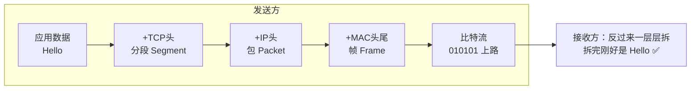

> 🎀 记忆：发快递时一层层**套娃加信封**，收快递时一层层**拆信封**——每层只看自己那层的信封！

---

## 三、数据链路层：隔壁邻居怎么传话

### 3.1 MAC 地址

- 网卡出厂自带的**全球唯一物理地址**（理论上）🔍
- 格式：`AA:BB:CC:DD:EE:FF`（48 位）
- 只在**局域网内部**有效——出了自家门（经过路由器）就换人接力了

| 对比 | MAC 地址 | IP 地址 |
| --- | --- | --- |
| 类比 | 身份证号（终身不变） | 快递收货地址（搬家就换） |
| 层级 | 链路层 | 网络层 |
| 范围 | 局域网内 | 全网路由 |
| 谁分配 | 出厂烧录 | 运营商/DHCP 动态分配 |

### 3.2 ARP：通过 IP 找 MAC

局域网里传帧得知道对方 MAC，但咱只知道 IP → **ARP 广播喊一嗓子**：

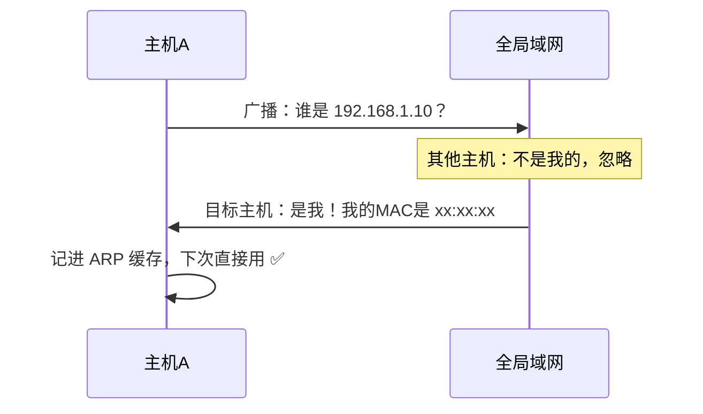

> 💡 交换机（局域网内）按 MAC 转发；路由器（跨网络）按 IP 转发——各看各的"信封"～

---

## 四、网络层：IP 地址与寻路

### 4.1 IP 地址基础

IPv4 地址：`192.168.1.100`（32 位，点分十进制，共约 43 亿个，早就不够用啦）

- **IPv6**：`2001:0db8::1`（128 位，多到给地球上每粒沙子都能分一个 🏖️）

**公网 IP vs 内网 IP：**

| 类型 | 范围示例 | 说明 |
| --- | --- | --- |
| 公网 IP | 运营商分配 | 全球唯一，能上互联网 |
| 内网 IP | 10.x / 172.16-31.x / 192.168.x | 仅局域网内有效，出门要 NAT 转换 |

### 4.2 子网掩码：判断是不是"自己人"

- `192.168.1.100/24`：前 24 位是网络号 → `192.168.1.x` 都是一个小区的
- 发数据前先算：目标和我同网段吗？
  - 同网段 → 直接 ARP 找对方 MAC 送过去
  - 不同网段 → 交给**网关（路由器）**，让它转寄 📮

### 4.3 NAT：让全家用一个公网 IP

家里好几台设备共用一个公网 IP，靠路由器的 **NAT（网络地址转换）** 记账：

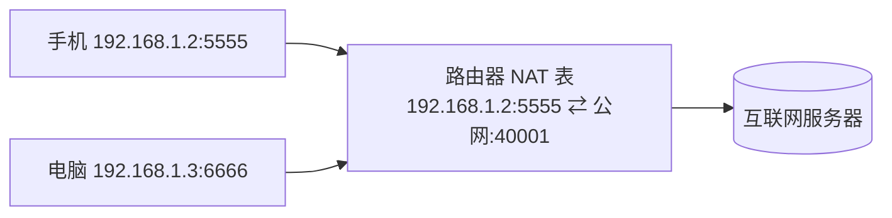

### 4.4 ICMP：网络界的"ping"

- `ping` 命令用的就是 ICMP 协议，测试通不通、测算往返时延 🏓
- `traceroute` 能列出数据经过的每一跳路由器

---

## 五、传输层：TCP 与 UDP 的爱恨情仇

传输层给数据加上**端口号**，让数据找到电脑里的具体程序（电脑=楼，端口=房间号 🚪）

| 对比项 | TCP 📞 | UDP 📮 |
| --- | --- | --- |
| 连接 | 面向连接（先握手） | 无连接（拿了就发） |
| 可靠性 | 可靠（确认+重传+排序） | 尽力而为（丢了就丢了） |
| 速度 | 相对慢 | 快 |
| 头部大小 | 20~60 字节 | 8 字节（超轻） |
| 传输方式 | 字节流 | 数据报 |
| 一对多 | 一对一 | 支持一对多（广播/组播） |
| 场景 | 网页、文件、邮件 | 直播、游戏、DNS、语音 |

> 🎀 类比：TCP 是**打电话**——"喂？听到吗？听到了？好我们说正事"；UDP 是**寄明信片**——写完就扔邮筒，到不到随缘（但快啊！）⚡

**端口号速记：**

| 端口 | 服务 |
| --- | --- |
| 80 | HTTP |
| 443 | HTTPS |
| 22 | SSH |
| 3306 | MySQL |
| 6379 | Redis |
| 5432 | PostgreSQL |
| 9200 | ES |
| 27017 | MongoDB |

---

## 六、TCP 三次握手与四次挥手（必考！）

### 6.1 三次握手：建立连接

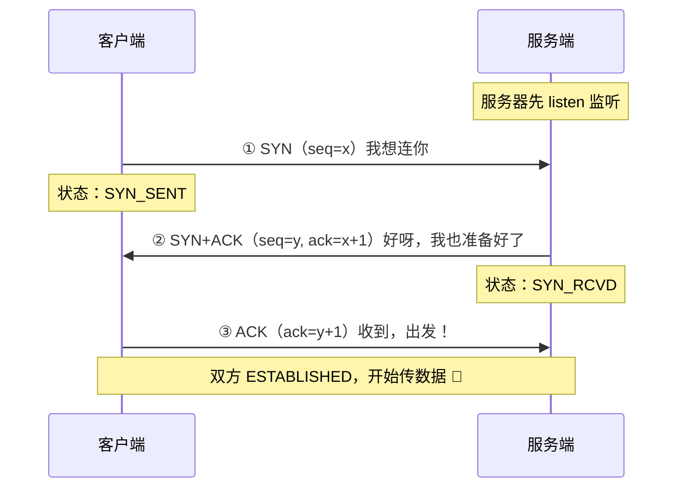

**为什么必须是三次？**

1. **两次不行**：服务器无法确认"客户端能收到我的话"——若旧的重连请求迟到到达，服务器傻等浪费资源
2. **四次没必要**：服务器把 ACK 和 SYN 合一起发，省一步

> 🎀 一句话：三次 = 双方都确认了"我能发、我能收"这两件事，缺一不可！

### 6.2 四次挥手：断开连接

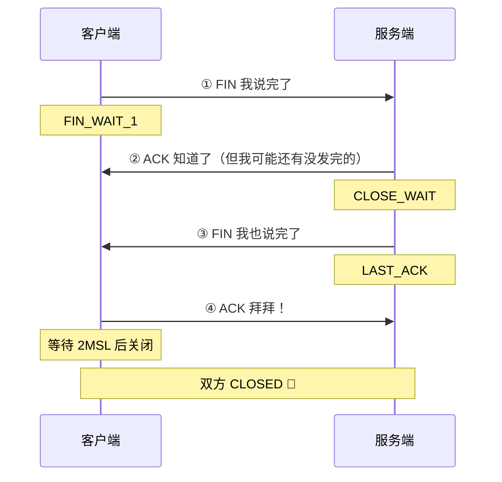

**为什么挥手要四次？**

- 握手时服务器可以把 SYN+ACK **合并**发
- 挥手时收到 FIN 只代表"对方不发了"，**自己可能还有数据没收尾** → ACK 要先单独回，等自己发完再发 FIN → 拆成两步 2+2=4

**为什么最后要等 2MSL？**

1. 确保最后一个 ACK 能送到（丢了对方会重发 FIN，我还能再回）
2. 让旧连接的残余报文在网络里自然死亡，不污染新连接

### 6.3 状态机速查（面试装 X 神器）

| 状态 | 含义 |
| --- | --- |
| LISTEN | 服务端蹲点等连接 |
| SYN_SENT | 客户端发出连接请求，干等回信 |
| SYN_RCVD | 服务端回了 SYN+ACK，等确认 |
| ESTABLISHED | 连接建立，开始干活 💪 |
| FIN_WAIT_1/2 | 主动方等对方回 ACK / 等 FIN |
| CLOSE_WAIT | 被动方收到了 FIN（大量堆积=代码忘了关连接！）|
| TIME_WAIT | 主动关闭方等 2MSL |

---

## 七、TCP 可靠的秘密：滑动窗口与拥塞控制

### 7.1 确认与重传（基础款）

- 每发一段数据，接收方回一个 **ACK 确认号**（"你发到 x 了，我全收到了"）
- 发送方等超时没收到 ACK → **重传** 🔁

### 7.2 滑动窗口：批量发送才快

一个一个发等确认太磨叽 → **窗口**允许一次发一批：

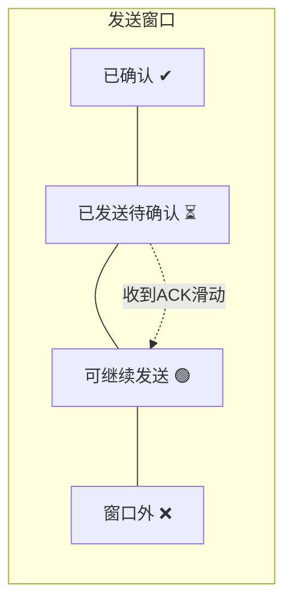

- 接收方在 ACK 里带 **rwnd（接收窗口）**：我还能收多少 → 流量控制
- 窗口随确认不断向右"滑动"，流水线式持续发送 🚀

### 7.3 拥塞控制：别把网络撑爆

网络是公共道路，一下发太多会堵死 → TCP 有四招：

| 阶段 | 拥塞窗口 cwnd 变化 | 类比 |
| --- | --- | --- |
| 慢启动 | 指数增长（1→2→4→8...） | 新手上路，试探着加速 |
| 拥塞避免 | 线性增长（+1 +1 +1） | 到高速了，稳着提速 |
| 拥塞发生 | 立刻暴跌（降到 1 或减半） | 前面堵车，急刹！ |
| 快恢复 | 减半后线性恢复 | 绕开事故点，缓缓再提速 |

> 🎀 真正发送量 = min(接收窗口 rwnd, 拥塞窗口 cwnd)——既看对方"吃不下"（流量控制），也看路"跑不动"（拥塞控制）！

---

## 八、应用层：HTTP 与 DNS

### 8.1 HTTP 基础

HTTP 是**基于 TCP** 的请求-响应协议（客户端问，服务端答）：

```http
POST /api/login HTTP/1.1        ← 请求行：方法 路径 版本
Host: www.example.com           ← 请求头：元信息
Content-Type: application/json

{ "user": "xiaohua", "pwd": "***" }   ← 请求体
```

| 常见方法 | 语义 | 幂等？ |
| --- | --- | --- |
| GET | 查资源 | ✅ |
| POST | 新建/提交 | ❌ |
| PUT | 整体更新 | ✅ |
| DELETE | 删除 | ✅ |
| PATCH | 局部更新 | ❌ |

| 常见状态码 | 含义 |
| --- | --- |
| 200 | 成功 ✅ |
| 301 / 302 | 永久 / 临时重定向 |
| 304 | 缓存还能用，不重新传 |
| 400 | 请求写错了 |
| 401 / 403 | 没登录 / 登录了但没权限 |
| 404 | 找不到资源 😢 |
| 500 | 服务器内部炸了 |
| 502 / 504 | 网关错误 / 网关超时 |

### 8.2 DNS：互联网的电话簿 📖

域名（www.baidu.com）好记，但网络只认 IP → **DNS 负责翻译**：

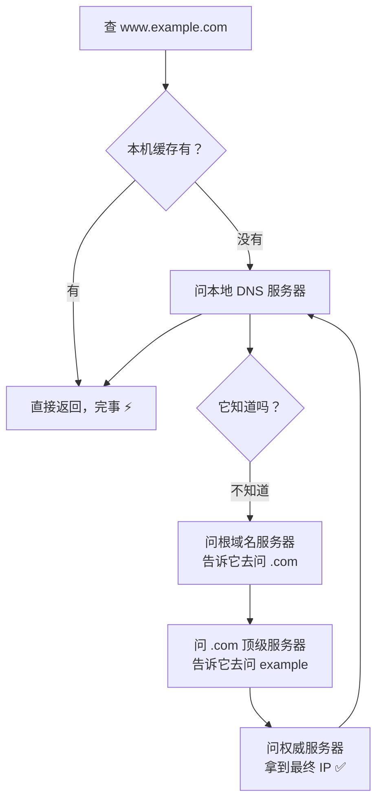

- 缓存无处不在：浏览器 → 系统 → 路由器 → 运营商，层层兜底
- 记录类型：A（域名→IPv4）、AAAA（→IPv6）、CNAME（别名）、MX（邮件）

---

## 九、HTTP 版本进化史

| 版本 | 年代 | 核心改进 | 痛点 |
| --- | --- | --- | --- |
| HTTP/1.0 | 1996 | 每次请求都新建 TCP 连接 | 太浪费 😩 |
| HTTP/1.1 | 1997 | **长连接 keep-alive**、管道化、缓存 | 队头堵塞：一个请求慢，后面全排队 |
| HTTP/2 | 2015 | **二进制分帧、多路复用**（一个连接并发多个请求）、头部压缩、服务器推送 | TCP 层丢包仍会堵所有流 |
| HTTP/3 | 2022 | 底层换 **QUIC（基于 UDP）**，0-RTT 建连，彻底解决队头堵塞 🚀 | 部分老设备支持差 |

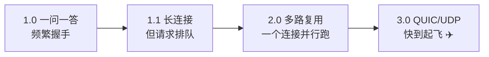

> 🎀 队头堵塞（HOL blocking）：排队打饭时第一个人纠结，后面全卡住。HTTP/2 在应用层解决了，但 TCP 丢包重传还是会堵；HTTP/3 干脆换 UDP 自己实现可靠传输，根治！

---

## 十、HTTPS：给数据穿上防弹衣

HTTP 是**明信片**（中间人都能看）；HTTPS 是**密封保险信**🔒——HTTP + TLS 加密层。

### 10.1 混合加密

- **非对称加密**（RSA/ECDHE）：公钥加密、私钥解密——安全但慢 🐢
- **对称加密**（AES）：同一把钥匙加解密——快但钥匙怎么安全送达？⚡

**聪明方案：用非对称加密安全地交换一把对称密钥，之后通信全用对称加密**——又安全又快！

### 10.2 TLS 握手简化版

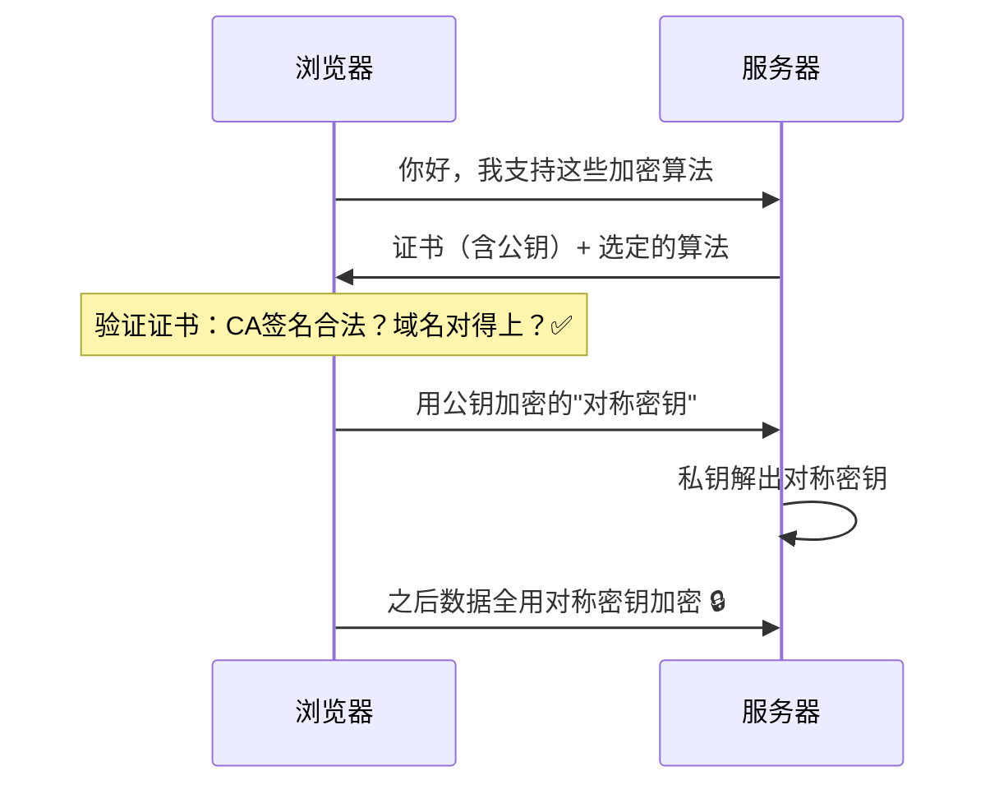

### 10.3 证书与 CA

- 服务器证书 = **由权威机构（CA）签字担保的公钥**，防"中间人冒充服务器"
- 浏览器内置各大 CA 的根证书，逐级验证签名链

**HTTPS 三大保障：**

| 特性 | 靠什么 | 防什么 |
| --- | --- | --- |
| 加密 | 对称+非对称混合 | 偷看（窃听） |
| 完整性 | 哈希摘要 | 篡改 |
| 身份认证 | CA 证书 | 冒充（中间人） |

---

## 十一、面试之王：从输入 URL 到页面展示

**这道题答好了，网络部分直接通关！**（综合前面所有知识）👑

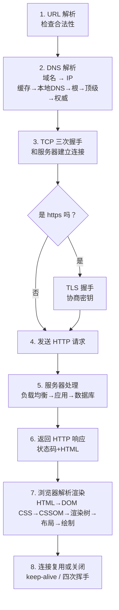

**每一步都能被追问的细节：**

| 步骤 | 可能追问 |
| --- | --- |
| DNS | 解析顺序？A 记录是什么？ |
| 握手 | 为什么三次？SYN 洪水攻击？ |
| HTTPS | 对称非对称区别？证书怎么验证？ |
| 渲染 | 什么是重排（reflow）重绘（repaint）？ |
| 断开 | 为什么四次？TIME_WAIT 为何等 2MSL？ |

---

## 十二、其他高频概念速览

### 12.1 Cookie vs Session vs Token(JWT)

| 方案 | 存哪 | 特点 |
| --- | --- | --- |
| Cookie | 浏览器 | 容量小(4KB)、每次请求自动带上、可设过期 |
| Session | 服务器 | 依赖 Cookie 存 sessionId，服务器压力大、分布式要共享 |
| JWT Token | 客户端保存，服务端只验证 | 无状态、适合分布式；签发后难以主动作废 |

### 12.2 WebSocket：服务器主动说话

HTTP 只能"你问我答"，WebSocket 建立一次连接后**双向随时互发**（聊天、推送、股票行情）：

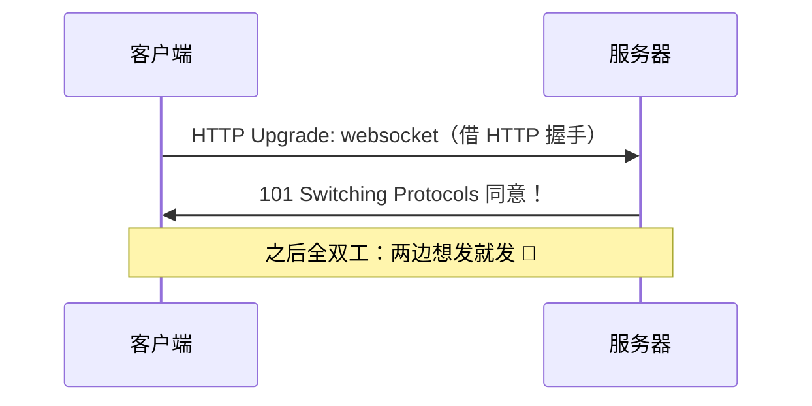

### 12.3 CDN：把快递仓搬到你家隔壁

内容分发网络：把静态资源（图片、视频、JS）复制到全国各节点，用户就近取货，又快又省源站带宽 🚚

### 12.4 代理与负载均衡

| 概念 | 说明 |
| --- | --- |
| 正向代理 | 替**客户端**出头（翻墙、公司出口代理） |
| 反向代理 | 替**服务器**接客（Nginx：负载均衡、缓存、HTTPS 卸载） |
| L4 负载均衡 | 看 IP+端口转发（快） |
| L7 负载均衡 | 看应用内容转发（智能，能按 URL 分流） |

### 12.5 网络安全小抄 🛡️

| 攻击 | 手段 | 防御 |
| --- | --- | --- |
| DDoS | 海量流量打死服务器 | 流量清洗、CDN、限流 |
| XSS | 往页面里注入恶意脚本 | 转义输出、CSP |
| CSRF | 借用户登录态发恶意请求 | CSRF Token、SameSite Cookie |
| SQL 注入 | 拼接 SQL 窃取数据 | 参数化查询 |
| 中间人攻击 | 冒充对方截获数据 | HTTPS 证书校验 |
| SYN 洪水 | 伪造大量半连接耗尽服务器 | SYN Cookie、限流 |

---

## 十三、总结与面试高频题

### 13.1 知识地图

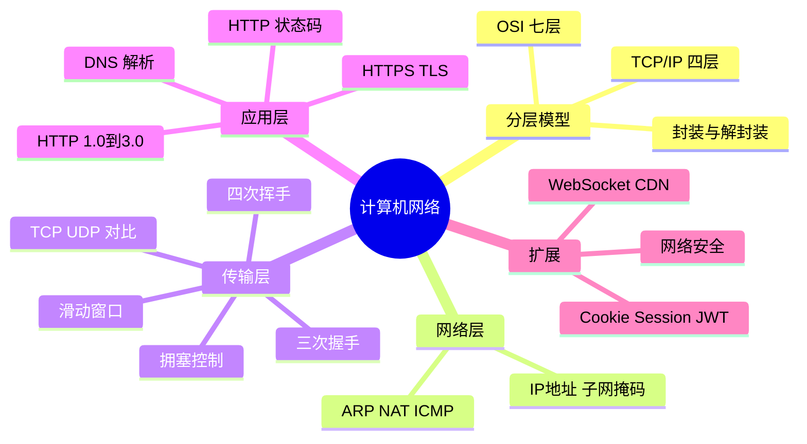

### 13.2 面试官最爱问 Top 题 🎯

| 问题 | 答题要点 |
| --- | --- |
| OSI 七层/TCP-IP 四层？ | 应用-传输-网络-接口；每层职责+代表协议 |
| TCP 和 UDP 区别？ | 连接/可靠/速度/头部/场景，直播用 UDP、文件用 TCP |
| 为什么三次握手？ | 确认双方收发能力；两次服务端无法确认客户端能收 |
| 为什么四次挥手？ | 被动方 ACK 和 FIN 要分开发（可能还有数据没发完） |
| TIME_WAIT 为何 2MSL？ | 保证最后 ACK 送达 + 旧报文自然消亡 |
| 滑动窗口干嘛的？ | 流量控制：批量发送+确认滑动，rwnd 控制节奏 |
| 拥塞控制四阶段？ | 慢启动(指数)→拥塞避免(线性)→快重传→快恢复 |
| HTTP 和 HTTPS 区别？ | 明文 vs TLS 加密；443 端口；混合加密+证书认证 |
| HTTPS 握手过程？ | 非对称交换对称密钥，之后对称加密通信 |
| HTTP/2 改进了啥？ | 二进制分帧、多路复用、头部压缩；HTTP/3 用 QUIC |
| 从输入 URL 到页面显示？ | DNS→握手→TLS→请求→响应→渲染（见第十一章）|
| GET 和 POST 区别？ | 语义/幂等/缓存/参数位置；本质都是 TCP 请求 |

### 13.3 学习建议路线 🗺️

1. **第一站**：把分层模型和"封装套娃"想通，建立全局观
2. **第二站**：TCP/UDP 对比 + 三次握手四次挥手，画图背熟
3. **第三站**：HTTP 方法/状态码/DNS，配合浏览器 F12 抓包验证 🔍
4. **第四站**：HTTPS 握手 + HTTP 版本演进，理解"为什么这么设计"
5. **终点站**："输入 URL 到页面展示"完整讲一遍，网络面试稳如老狗 🌟

> 💡 工具推荐：浏览器 DevTools 的 Network 面板看真实请求、Wireshark 抓包看三次握手、`ping`/`tracert` 感受 ICMP——理论马上落地！

---

> 🌈 计算机网络通关！现在你已经知道每次敲网址背后发生的全部故事——从 DNS 查户口、TCP 三次牵手、TLS 穿盔甲，到 HTML 渲染成页面～配合之前的数据库全家桶，前后端的知识版图越来越完整啦！继续冲鸭！(๑•̀ㅂ•́)و✧💪
