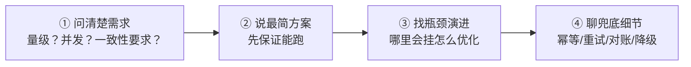
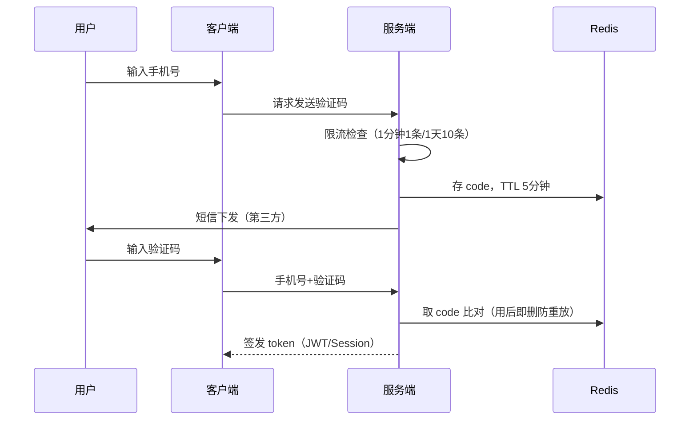
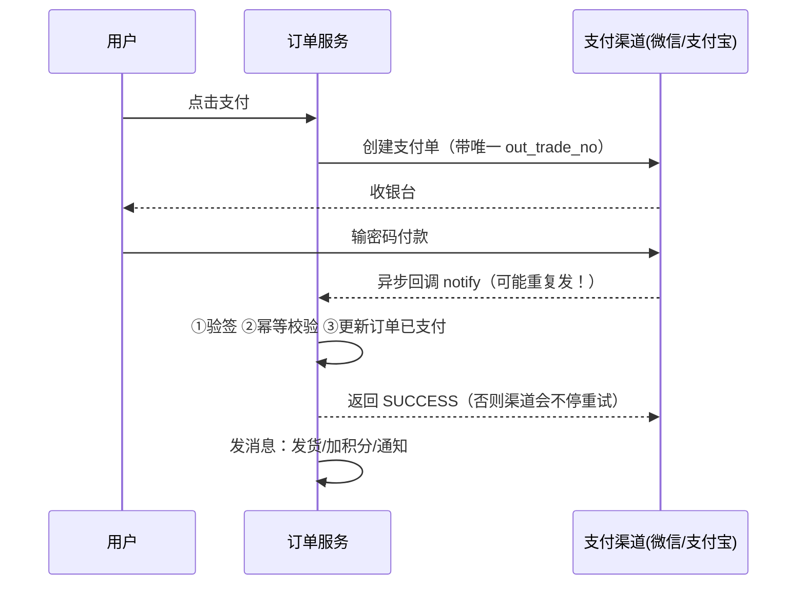
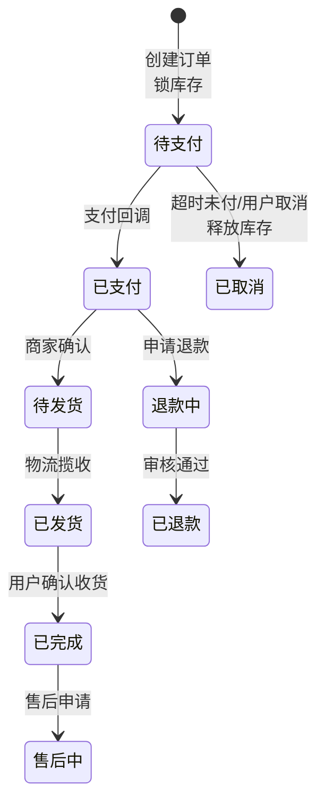
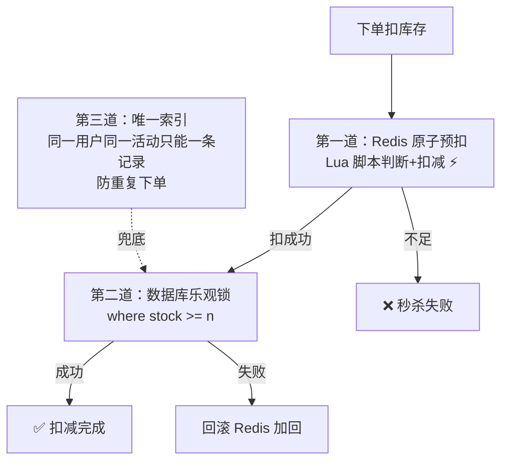
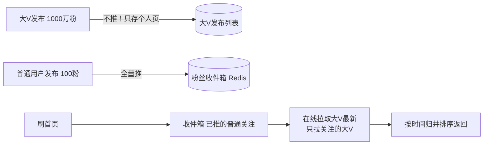
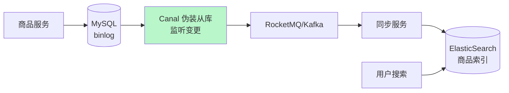
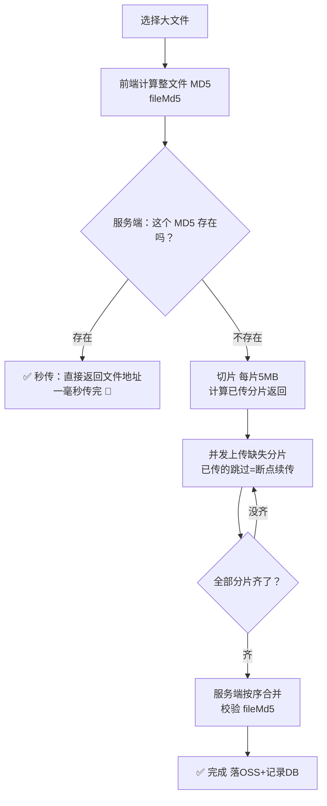
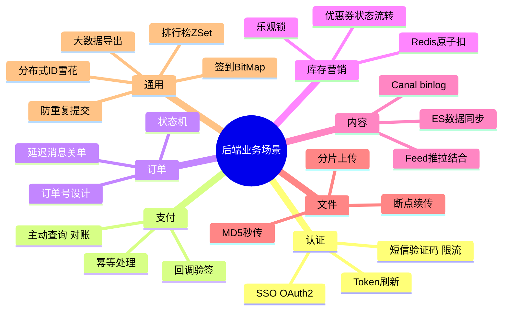

# 🌸 后端业务场景学习笔记 —— 需求来了怎么接

> 嘿嘿～系统设计篇学会了"架骨架"🏗️，这篇学"填血肉"🩸：面试官最爱说"假设你要做一个 XX 功能，怎么设计？"——登录、支付、订单、库存、优惠券、Feed 流……全是真实业务里天天见的场景！套路一通百通～

---

## 📖 目录

1. [场景题通关心法](#一场景题通关心法)
2. [登录认证：短信登录与 SSO](#二登录认证短信登录与-sso)
3. [支付场景：回调对账与幂等](#三支付场景回调对账与幂等)
4. [订单场景：状态机与超时关单](#四订单场景状态机与超时关单)
5. [库存场景：扣减与防超卖](#五库存场景扣减与防超卖)
6. [优惠券场景：防超发与核销](#六优惠券场景防超发与核销)
7. [Feed 流：推拉结合](#七feed-流推拉结合)
8. [搜索场景：数据同步到 ES](#八搜索场景数据同步到-es)
9. [文件场景：分片上传与秒传](#九文件场景分片上传与秒传)
10. [高频小场景合集](#十高频小场景合集)
11. [总结与面试高频题](#十一总结与面试高频题)

---

## 一、场景题通关心法

### 1.1 四步答题法



| 步骤 | 面试话术 |
| --- | --- |
| 反问 | "日活大概多少？峰值 QPS？"（**反问 = 加分项**，显得有经验）|
| 基础版 | "最简单的做法是……" |
| 演进版 | "量大了以后瓶颈在 X，可以用 Y 解决" |
| 细节版 | "这里要考虑幂等/重试/一致性" |

### 1.2 万能三大件

几乎每个场景都逃不开这三个问题：

1. **幂等**：同一请求来多次，结果不变（网络会重试！）
2. **一致性**：钱和数据要对得上（对账兜底）
3. **性能**：热点数据扛不扛得住（缓存/异步）

---

## 二、登录认证：短信登录与 SSO

### 2.1 短信验证码登录流程



**细节防坑清单：**

| 坑 | 防法 |
| --- | --- |
| 验证码被爆破 | **错误 5 次作废** + 发送限流（1/min、10/day）|
| 验证码重放 | 验证成功立即删除 |
| 短信轰炸 | 图形验证码前置 + 同 IP 限流 |
| code 存哪 | Redis `login:code:{phone}`，TTL 5 分钟 |
| 换手机号撞库 | 登录成功才创建用户（注册登录合一）|

### 2.2 Token 无感刷新

```
access_token（2小时，短）+ refresh_token（30天，长）
请求 401 了 → 拿 refresh 换新 access → 重放请求
refresh 也过期 → 重新登录
```

### 2.3 单点登录 SSO

一个公司多系统（官网/App/管理后台），登录一次全通行：

| 方案 | 思路 | 例子 |
| --- | --- | --- |
| 共享 Cookie | 同父域名下共享 sessionId | *.taobao.com |
| **认证中心** | 跳统一登录页换 ticket | CAS、OAuth2 |
| **JWT 跨域** | 各系统用同一密钥验签 | 微服务网关统一鉴权 |

> 🎀 联动：网络安全篇的 OAuth2/JWT 时序图、计算机网络篇的 Cookie——登录态本质是"**证明你是你**"的成本与安全权衡！

---

## 三、支付场景：回调对账与幂等

### 3.1 支付完整流程



### 3.2 三个保命设计

**① 幂等（回调会重复来！）**

```java
public void onPayNotify(NotifyParams p) {
    // 1. 验签防伪造
    if (!verifySign(p)) return;
    // 2. 数据库唯一约束/状态机兜底
    Order order = orderRepo.lockByOrderNo(p.getOutTradeNo());
    if (order.getStatus() != WAIT_PAY) return;   // 已处理过 → 直接返回成功 ✅
    order.markPaid(p.getTransactionId());         // 状态流转：待支付→已支付
    mq.send("order-paid", order);                 // 后续动作异步
}
```

**② 主动查询兜底（回调可能丢！）**

```
定时任务：扫"支付中"超 5 分钟的单 → 调渠道查询接口 → 主动补状态
```

**③ 对账（每天必做）**

```
凌晨拉渠道对账单 vs 自己流水 → 差异表 → 人工/自动处理
（长款：用户付了咱没记；短款：咱记了没到账）
```

> 🎀 支付铁律：**以渠道为准 + 幂等 + 对账兜底**——钱的事没有"应该没问题"，只有"确认没问题" 💰

---

## 四、订单场景：状态机与超时关单

### 4.1 订单状态机



**为什么用状态机？** 状态流转规则集中管理——"已取消"的单不可能变"已支付"，**非法流转代码层面就挡住**：

```java
public void pay(Order o) {
    if (o.getStatus() != WAIT_PAY)          // 状态守卫
        throw new BizException("订单状态不允许支付");
    o.setStatus(PAID); ...
}
```

### 4.2 超时关单（定时任务的进化之路）

| 方案 | 原理 | 问题 |
| --- | --- | --- |
| 定时扫表 | 每分钟扫 `待支付 & 超时` | 扫描延迟+全表压力 😫 |
| **RocketMQ 延迟消息** | 下单发 30 分钟延迟消息，到点消费检查 | 精准、主流 ⭐ |
| Redis 过期监听 | key 过期事件 | 可能丢、不精确 |
| 时间轮 | netty HashedWheelTimer | 大量任务，内存型 |

```java
// MQ 延迟消息版（伪代码）
public void createOrder(Order o) {
    orderRepo.save(o);                       // 待支付
    // 发延迟消息：30分钟后送达
    rocketMQ.sendDelayed("order-timeout-check", o.getOrderNo(), 30, MINUTES);
}

// 消费者：到点检查
public void onTimeoutCheck(String orderNo) {
    Order o = orderRepo.findByNo(orderNo);
    if (o.getStatus() == WAIT_PAY) {         // 还没付
        o.setStatus(CANCELED);               // 取消
        stockService.restore(o);             // 还库存
    }
    // 已支付则忽略 ✅
}
```

### 4.3 订单号设计

```
规则：全局唯一 + 趋势递增 + 不能暴露单量 + 带业务含义
示例：yyyyMMddHHmmss + 2位分库标记 + 机器ID + 序列
20260101123045 01 03 000123
```

> ⚠️ 不要用 UUID 当订单号：无序（B+树页分裂）、太长、无业务含义——用**雪花算法**（见第十章）

---

## 五、库存场景：扣减与防超卖

### 5.1 三级防超卖



```sql
-- 数据库乐观锁：带条件更新，影响行数=0 说明并发没抢到
UPDATE product SET stock = stock - #{n}
WHERE id = #{id} AND stock >= #{n};
```

### 5.2 库存方案对比

| 方案 | 一致性 | 性能 | 复杂度 |
| --- | --- | --- | --- |
| 数据库行锁 for update | 强 | 低（串行）| 简单 |
| **数据库乐观锁** | 强 | 中 | 简单 ⭐ |
| Redis 预扣 + 异步落库 | 最终一致 | **高** ⭐ | 复杂（热点/回滚）|
| Redis + Lua 原子 | 最终一致 | 高 | 中（秒杀标配）|

**Redis+Lua 核心脚本：**

```lua
-- KEYS[1]=库存key, ARGV[1]=扣减数量
local stock = tonumber(redis.call('get', KEYS[1]))
if stock == nil then return -1 end
if stock < tonumber(ARGV[1]) then return 0 end    -- 不足
redis.call('decrby', KEYS[1], ARGV[1])            -- 原子扣
return 1                                          -- 成功
```

### 5.3 预扣后掉单怎么办？

```
Redis 扣了但订单创建失败 → 本地消息表/事务消息保证"回补库存"
对账任务：Redis 库存 vs DB 库存 定时核对，差异告警人工介入
```

---

## 六、优惠券场景：防超发与核销

### 6.1 发券防超发

```
100 万张券，300 万人抢——本质和秒杀库存一模一样：
① Redis 计数器原子扣（Lua：判断余量+扣减）
② 扣成功 → 发号器发唯一券码 → 异步落库
③ 落库失败 → 计数器回滚
④ 兜底：DB 券表总行数唯一约束
```

### 6.2 核销防重复使用

```java
// 券状态机：未使用 → 使用中(锁券) → 已核销
// 下单：把券置为"使用中"（乐观锁抢占）
UPDATE coupon SET status = 'LOCKED', order_no = #{orderNo}
WHERE id = #{id} AND status = 'UNUSED';     -- 抢到才算数
// 支付成功：LOCKED → USED
// 支付取消/超时：LOCKED → UNUSED（还券）
```

### 6.3 高并发抢券架构（秒杀同款）

> 前端按钮置灰 → 网关限流 → Redis 原子扣 → MQ 异步发券 → 用户先收到"抢券排队中"再刷新结果——**同步链路越短越好，重活全部异步**！

---

## 七、Feed 流：推拉结合

微博/朋友圈首页时间线，大 V 千万粉丝怎么设计？

### 7.1 两种基本模式

| 模式 | 发布时 | 读时 | 问题 |
| --- | --- | --- | --- |
| **推模式（fan-out on write）** | 写入所有粉丝收件箱 | 直接读自己收件箱 ⚡ | 大 V 发布瞬间写千万次 💀 |
| **拉模式（fan-out on read）** | 只存自己发布列表 | 读时实时合并关注的人 | 读放大，首页慢 |

### 7.2 推拉结合（主流方案）



| 优化点 | 手段 |
| --- | --- |
| 收件箱存储 | Redis ZSet（score=时间戳）+ 只留最近 N 条 |
| 活跃用户才推 | 7 天不活跃不推，登录时拉 |
| 首页缓存 | 算好放 Redis，增量再合并 |

---

## 八、搜索场景：数据同步到 ES

**业务痛点：** 商品搜索要分词、要聚合统计——MySQL 的 LIKE %xx% 不走索引慢成狗（数据库篇讲过！）

### 8.1 双写一致性方案

| 方案 | 流程 | 问题 |
| --- | --- | --- |
| 同步双写 | 改 DB 同时改 ES | 耦合高，一个失败就不一致 ❌ |
| **MQ 异步** | 改 DB → 发消息 → 消费写 ES | 延迟秒级，**主流** ⭐ |
| **Canal 监听 binlog** | 伪装从库抓变更 → 写 ES | 业务零侵入 ⭐⭐ |
| 定时全量 | 凌晨全量重建索引 | 数据量小时兜底用 |



### 8.2 细节清单

- 消息乱序：同一商品用**版本号/时间戳**比对，旧数据不覆盖新
- 消息丢失：消费失败重试 + 定时对账（DB vs ES 数量核对）
- 首次建索引：凌晨低峰全量导入 + 增量追平

---

## 九、文件场景：分片上传与秒传

上传 2GB 视频，网络抖一下全重来？❌

### 9.1 分片 + 断点续传 + 秒传三件套



**接口设计：**

```
1. POST /file/pre    {fileMd5, fileName, size}  → {uploaded:[1,3,5]} 或 秒传url
2. POST /file/chunk  {fileMd5, index, blob}     → 上传单片（并发）
3. POST /file/merge  {fileMd5, total}           → 合并+校验+入库
```

| 技术点 | 方案 |
| --- | --- |
| 分片状态记录 | Redis Hash：fileMd5 → 已传分片集合 |
| 存储 | 分片临时目录 / 合并后转 OSS（联动文件系统知识）|
| 秒传原理 | 相同 MD5 = 相同文件 → 直接引用 |
| 清理 | 定时删 24h 未完成分片 |

---

## 十、高频小场景合集

### 10.1 分布式 ID：雪花算法

```
64 位 = 1符号 + 41时间戳 + 10机器ID + 12序列
→ 每毫秒 4096 个/机器，趋势递增，不依赖 DB
```

| 方案 | 优点 | 缺点 |
| --- | --- | --- |
| UUID | 简单 | 无序太长（B+树页分裂）|
| 自增主键+步长 | 有序 | 扩容难 |
| **雪花 Snowflake** ⭐ | 有序+高并发 | 时钟回拨问题（美团 Leaf 解决）|
| 号段模式 | DB压力小 | 依赖 DB |

### 10.2 排行榜

```
Redis ZSet（Redis 篇讲过！）：
ZINCRBY rank:20261002 score uid    # 加分
ZREVRANGE rank:20261002 0 9        # Top10
亿级用户只存前 1 万 + 自己排名 ZREVRANK
```

### 10.3 签到

```
Redis BitMap（Redis 篇讲过！）：
SETBIT sign:uid:202610 2 1         # 10月3日签到
BITCOUNT sign:uid:202610           # 本月签到天数
连续签到：BITFIELD 取最近N位逐位判断
一个用户一个月只占 31 bit ≈ 4 字节 🪶
```

### 10.4 附近的人

```
Redis GEO（Redis 篇讲过！）：
GEOADD city 116.4 39.9 uid        # 记录坐标
GEOSEARCH city FROMLONLAT 116.4 39.9 BYRADIUS 3 km
```

### 10.5 防重复提交

```
前端：按钮置灰+loading
后端：Redis setnx token:xxx 1 EX 5 → 存在则拒绝
表单页先领 token，提交带 token，用一次删一次
```

### 10.6 敏感数据脱敏

```
手机号 138****1234 / 身份证 6***********X
展示层脱敏，存储层加密（联动网络安全篇）
```

### 10.7 大表导出报表

```
❌ 一次 SELECT 百万行 → 内存爆炸 + 接口超时
✅ 异步导出：提交任务 → 分页流式查询（游标/ID递增）
  → 逐批写 Excel（EasyExcel 避免OOM）→ 传 OSS → 通知下载链接
```

### 10.8 接口防刷

```
分层：IP限流（Nginx）→ 用户限流（网关令牌桶）→ 业务限流（Redis 计数）
+ 图形验证码 + 风控黑名单
```

---

## 十一、总结与面试高频题

### 11.1 知识地图



### 11.2 面试官最爱问 Top 题 🎯

| 问题 | 答题要点 |
| --- | --- |
| 短信登录怎么设计？ | 限流（1/min 10/day）+Redis 存码 TTL 5min+错误 5 次作废+用后即删；返回 JWT |
| Token 怎么无感刷新？ | 短 access + 长 refresh；401 后拿 refresh 换新重放；refresh 过期重新登录 |
| 支付回调怎么保证幂等？ | 验签+订单状态机判断（非待支付直接返回 SUCCESS）+ DB 唯一约束兜底 |
| 回调丢了怎么办？ | 定时任务扫支付中超时单，主动调渠道查询接口补状态；每日对账 |
| 订单超时自动取消？ | 定时扫表（简单延迟）→ RocketMQ 延迟消息（精准主流）；消费时再校验状态 |
| 订单号为什么不用 UUID？ | 无序导致 B+树页分裂、太长、无业务含义；用雪花（时间+机器+序列，趋势递增）|
| 怎么防超卖？ | 三层：Redis Lua 原子预扣 → DB 乐观锁 `where stock>=n` → 唯一索引防重复下单 |
| Redis 扣完库存订单失败？ | 消息回补库存；对账任务 Redis vs DB 差异告警 |
| 优惠券防超发+重复用？ | 发放=Redis 计数器原子扣；核销=状态机 LOCKED 抢占（乐观锁），取消还券 |
| Feed 流怎么设计？ | 推模式（普通用户全量推收件箱）+拉模式（大V读时拉）结合；Redis ZSet 存收件箱 |
| MySQL 数据怎么同步 ES？ | 同步双写（不一致❌）/MQ 异步（主流）/Canal 监听 binlog（零侵入）；乱序用版本号 |
| 大文件上传怎么做？ | 前端算 MD5 → 秒传命中直接返回 → 分片并发传 → 断点续传查已传分片 → 合并校验 |
| 排行榜怎么实现？ | Redis ZSet：ZINCRBY 加分、ZREVRANGE TopN、ZREVRANK 查自己 |
| 签到怎么省空间？ | BitMap 位图，一月一个 key 一个用户 4 字节；BITCOUNT 统计 |

### 11.3 学习建议路线 🗺️

1. **第一站**：把自己项目每个接口过一遍——哪里没幂等？哪里没兜底？
2. **第二站**：写一个"延迟关单"demo（RocketMQ 延迟消息或时间轮）
3. **第三站**：用 Redis+Lua 实现库存原子扣减，JMeter 并发验证不超卖
4. **第四站**：搭 Canal 或 MQ 双写，把 MySQL 数据同步进 ES
5. **第五站**：实现分片上传三件套（秒传/断点/合并）
6. **终点站**：每个场景画一张时序图存进面试作品集 📁

---

> 🌈 后端业务场景通关！系统设计篇搭骨架 + 本篇填血肉 🩸：登录支付订单库存券、Feed 搜索文件全家桶——场景题的本质是"**幂等 + 一致性 + 异步 + 兜底**"四件套的排列组合！下一个知识点继续召唤我！(๑•̀ㅂ•́)و✧🎯💪
