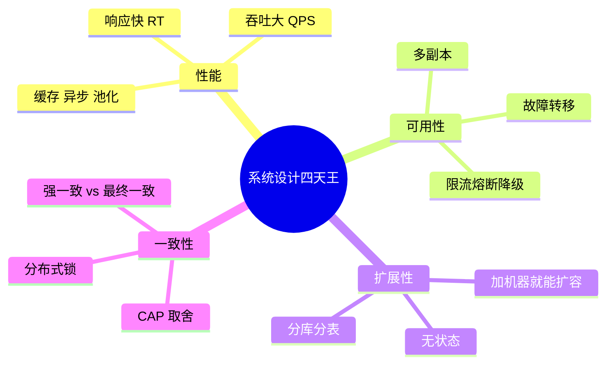
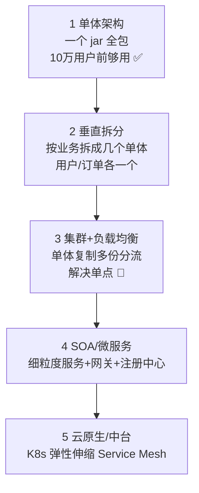
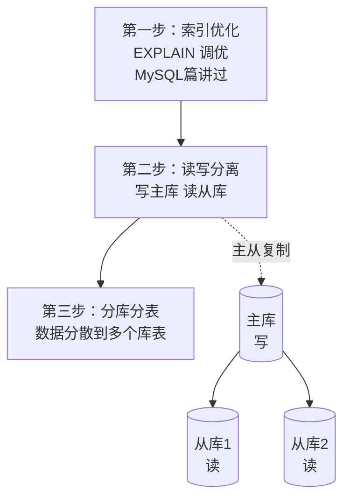
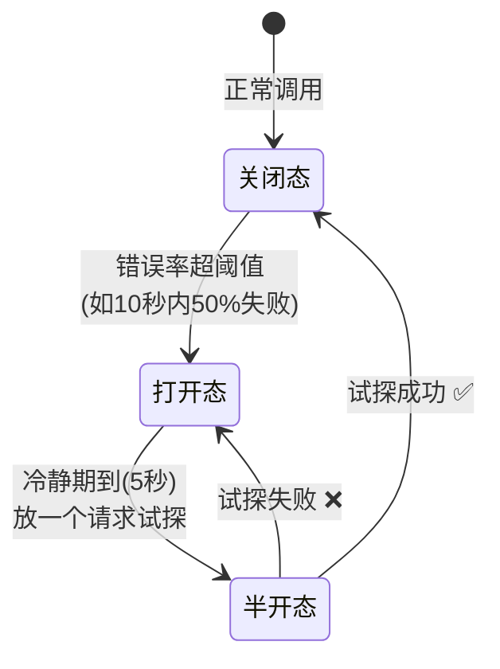
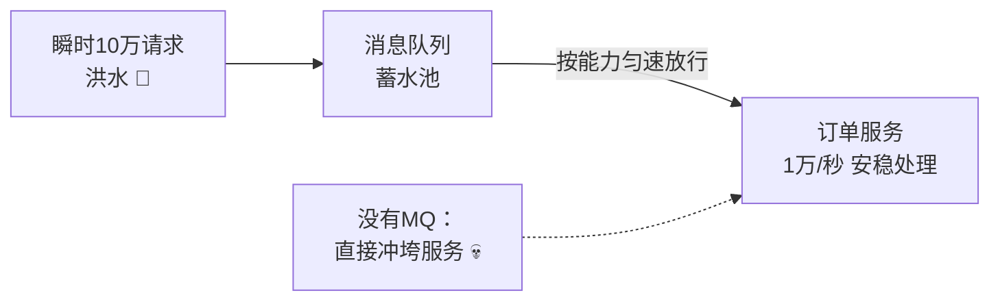
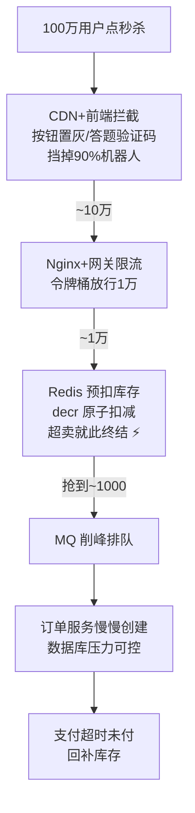
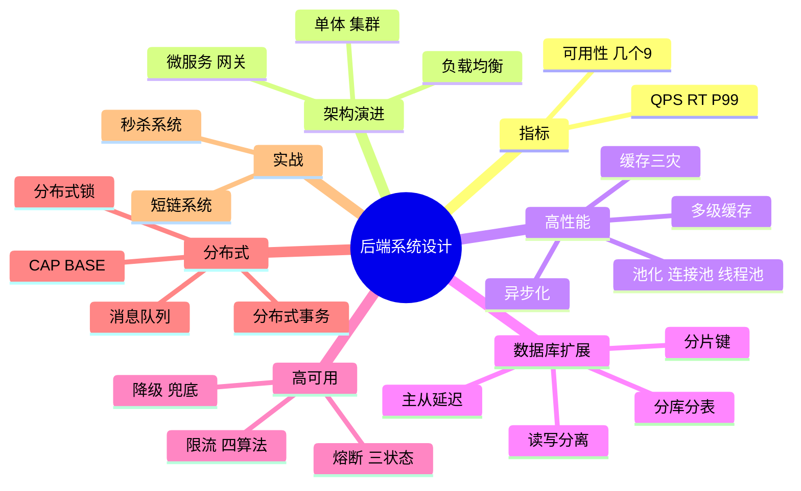

# 🌸 后端系统设计学习笔记 —— 从一个盒子到亿级架构

> 嘿嘿～计科分区收官之作 🏆！这是前面所有知识的大合体：MySQL 的分库分表、Redis 的缓存三灾、网络的负载均衡、操作系统的进程、数据结构的哈希……全都会在这里登场！学会"怎么把一个能跑的 demo 变成扛住百万用户的系统" 💪

---

## 📖 目录

1. [初识系统设计：到底在学什么？](#一初识系统设计到底在学什么)
2. [核心指标：性能与可用性](#二核心指标性能与可用性)
3. [架构演进：从单体到微服务](#三架构演进从单体到微服务)
4. [高性能三板斧：缓存/异步/池化（重点！）](#四高性能三板斧缓存异步池化重点)
5. [负载均衡与水平扩展](#五负载均衡与水平扩展)
6. [数据库扩展：读写分离与分库分表（重点！）](#六数据库扩展读写分离与分库分表重点)
7. [高可用：限流/熔断/降级（重点！）](#七高可用限流熔断降级重点)
8. [分布式理论与一致性问题](#八分布式理论与一致性问题)
9. [消息队列：异步解耦削峰](#九消息队列异步解耦削峰)
10. [经典案例：秒杀系统设计（实战！）](#十经典案例秒杀系统设计实战)
11. [总结与面试高频题](#十一总结与面试高频题)

---

## 一、初识系统设计：到底在学什么？

### 1.1 定义

**系统设计 = 决定"代码之外"的一切**：怎么部署、怎么扛流量、怎么不出错、出了错怎么办。

| 代码写得好 | 系统设计好 |
| --- | --- |
| 算法优雅、无 bug | 100 万用户同时来不崩 |
| 单机跑得欢 | 机器坏了服务还在 |
| 明天能上线 | 三年后还能加功能 |

### 1.2 四大永恒主题



> 🎀 学习心法：**一切设计都是权衡（trade-off）**——没有完美架构，只有"适合当前业务规模"的架构。面试说清"我为什么这么选、牺牲了什么"比背方案更重要！

---

## 二、核心指标：性能与可用性

### 2.1 性能指标（面试必背）

| 指标 | 含义 | 大白话 |
| --- | --- | --- |
| **QPS** | 每秒查询数 | 一秒能接多少单 🛵 |
| **TPS** | 每秒事务数 | 一秒完成多少"整套动作" |
| **RT** | 响应时间 | 用户等多久（P99 比 avg 重要！）|
| 并发数 | 同时在线请求 | 多少人挤门 |
| 吞吐量 | 单位时间处理量 | 传送带运力 |

**P99 的意义：** 100 个请求里最慢那个的时间——**平均值会说谎，P99 才是真话**（99 个快 1 个超时，用户照样骂街 😤）

**经验参考值：**

| 组件 | 数量级 |
| --- | --- |
| 单机 MySQL | ~1000 QPS（普通查询）|
| 单机 Redis | ~10 万 QPS ⚡ |
| Nginx 单机 | ~5 万并发连接 |

### 2.2 可用性指标

```
可用性 = 正常时间 / 总时间
99.9%  → 一年宕机 ≤ 8.76 小时（三个9）
99.99% → 一年宕机 ≤ 52 分钟（四个9）
```

| 做到几个 9 | 靠什么 |
| --- | --- |
| 两个 9 | 别写 bug 🙈 |
| 三个 9 | 主从备份+监控告警 |
| 四个 9 | 多机房+自动故障转移+全链路容灾 |
| 五个 9 | 大厂烧钱级 🤑 |

---

## 三、架构演进：从单体到微服务



| 阶段 | 特点 | 痛点 → 下一阶段 |
| --- | --- | --- |
| 单体 | 开发快、部署简单 | 代码膨胀、一崩全崩 |
| 垂直拆分 | 业务隔离 | 还是单点 |
| 集群+LB | 去单点、可横向扩 | 数据库成瓶颈 |
| 微服务 | 独立部署扩展、技术异构 | 复杂度高（分布式事务/链路追踪）|
| 云原生 | 弹性伸缩、滚动升级 | 运维门槛高 |

**微服务核心组件：**

| 组件 | 干啥 | 代表 |
| --- | --- | --- |
| 网关 Gateway | 统一入口：路由/鉴权/限流 | Nginx、Spring Cloud Gateway |
| 注册中心 | 服务在哪登记查找 | Nacos、Eureka |
| 配置中心 | 集中管理配置 | Nacos、Apollo |
| RPC 框架 | 服务间调用 | Dubbo、Feign(gRPC) |
| 链路追踪 | 查请求经过哪些服务 | SkyWalking、Zipkin |

> 🎀 微服务不是银弹：小公司强行微服务 = 给自行车装飞机引擎 ✈️——**先单体跑通，规模到了再拆**！

---

## 四、高性能三板斧：缓存/异步/池化（重点！）

### 4.1 缓存：哪里慢就垫哪里

**经典多级缓存架构（联动 Redis 篇/Glide 篇/计组 Cache）：**


| 缓存层级 | 速度 | 作用 |
| --- | --- | --- |
| CDN | 就近接入 | 图片/视频/JS |
| 本地缓存 | ~ns | 热点配置（Caffeine）|
| Redis | ~0.1ms | 热点业务数据 |
| MySQL | ~10ms | 持久化真相 |

**缓存三大灾难（Redis 篇详细讲过，复习！）：**

| 灾难 | 现象 | 解药 |
| --- | --- | --- |
| 穿透 | 查不存在的数据，全打到 DB | 缓存空值 / **布隆过滤器** 🔬 |
| 击穿 | 热点 key 过期瞬间打崩 DB | 互斥锁重建 / 热点永不过期 |
| 雪崩 | 大量 key 同时过期 | 过期时间加随机 / 多级缓存 / 熔断 |

### 4.2 异步：慢的操作先记账后处理

```java
// ❌ 同步：下单要等短信、积分、物流全部完成才返回（RT = 全部之和）
public Order create(Order o) {
    saveOrder(o);              // 50ms
    sendSms(o);                // 200ms
    addPoints(o);              // 150ms
    notifyLogistics(o);        // 300ms
    return o;                  // 总共 700ms 😱
}

// ✅ 异步：核心流程完成就返回，其余发消息慢慢干（RT = 50ms ⚡）
public Order create(Order o) {
    saveOrder(o);                        // 核心逻辑
    mq.send("order-created", o);         // 发消息就完事
    return o;                            // 立刻返回
}
// 消费者各自订阅：短信服务、积分服务、物流服务并行消费
```

### 4.3 池化：复用昂贵资源

| 池 | 复用什么 | 联动知识 |
| --- | --- | --- |
| **连接池** | TCP/数据库连接 | 三次握手很贵（计算机网络篇！）|
| **线程池** | 线程 | 创建线程 ~1MB 栈（操作系统篇！）|
| 对象池 | 大对象 | 享元模式（设计模式篇！）|

```java
// 线程池七参数（Java 面试常客）
ExecutorService pool = new ThreadPoolExecutor(
    2,                       // 核心线程数（常驻）
    4,                       // 最大线程数
    60, TimeUnit.SECONDS,    // 临时线程空闲回收时间
    new LinkedBlockingQueue<>(100),  // 任务队列（爆了触发拒绝策略）
    Executors.defaultThreadFactory(),
    new ThreadPoolExecutor.CallerRunsPolicy()  // 拒绝策略
);
```

---

## 五、负载均衡与水平扩展

### 5.1 水平 vs 垂直扩展

| 方式 | 做法 | 天花板 |
| --- | --- | --- |
| 垂直扩展 | 单机加 CPU/内存（升配）| 单机性能有极限 💰 |
| **水平扩展** | 加机器分流（加机器）| 近乎无限 ⭐ |

### 5.2 负载均衡算法

| 算法 | 规则 | 适用 |
| --- | --- | --- |
| 轮询 | 一人一个 | 机器性能相同 |
| 加权轮询 | 强的多干 | 机器性能不一 |
| **最少连接** | 谁闲给谁 | 长连接 |
| IP 哈希 | 同 IP 固定机器 | 要会话粘性 |
| 一致性哈希 | 哈希环顺时针 | **缓存集群**（加节点只迁移部分数据）|

**四层 vs 七层负载均衡（联动计算机网络篇分层）：**

| | 四层 L4 | 七层 L7 |
| --- | --- | --- |
| 工作在 | 传输层 | 应用层 |
| 看到 | IP+端口 | HTTP 路径/Cookie/Header |
| 能做 | 转发 | 按路径路由、改写头、限流 |
| 代表 | LVS | **Nginx** |

### 5.3 无状态：水平扩展的前提

```java
// ❌ 有状态：Session 存在机器内存 → 换台机器登录态丢了
HttpSession session = request.getSession();

// ✅ 无状态：登录态放 Redis/JWT → 请求打到哪台都认 ✨
// JWT 方案（网络安全篇讲过）：令牌自带用户信息，服务端不用存
```

---

## 六、数据库扩展：读写分离与分库分表（重点！）

### 6.1 数据库三部曲



### 6.2 读写分离

- **主库**负责写，**从库**负责读（读写比通常 10:1，读扩容需求大）
- 主从复制：主库写 binlog → 从库拉取重放（MySQL 篇讲过！）
- **主从延迟坑**：写完立刻读可能读到旧数据 → 关键读强制走主库 / 等待复制完成

### 6.3 分库分表（单表超 500 万行考虑）

| 维度 | 分法 | 例子 |
| --- | --- | --- |
| **垂直分库** | 按业务拆库 | 订单库/用户库/商品库 |
| 垂直分表 | 按字段拆表 | 商品表拆出详情大字段表 |
| **水平分库** | 同结构多库，按行分散 | user_id % 4 → 4 个库 |
| 水平分表 | 同库多张表 | order_0 ~ order_99 |

**分片键怎么选？（灵魂问题）**

```java
// 按 user_id 分：同一个用户的订单落同一张表 → "查我的订单"单表搞定 ✅
// 但"商家查所有订单"要扫全部分片 ❌ → 用非分片键查询需异构索引/宽表

// 常见路由算法：
// 1. 哈希取模：user_id % 4   → 均匀，但扩容要迁移数据 💀
// 2. 范围：按时间/ID段       → 好扩，但热点集中（新数据表很忙）
// 3. 一致性哈希              → 扩容只迁移相邻部分 ✅
```

**分库分表带来的新问题：**

| 问题 | 解法 |
| --- | --- |
| 跨库 JOIN | 业务拆分/冗余字段/应用层组装 |
| 跨库事务 | 分布式事务（见第八章）|
| 全局唯一 ID | 雪花算法（第九章联动）|
| 分页排序 | 各分片查 TopN 再合并 |

---

## 七、高可用：限流/熔断/降级（重点！）

系统不可能不出错，**高可用的艺术是"错了也不崩"**：

### 7.1 限流：门口保安限人数 🚧

| 算法 | 原理 | 特点 |
| --- | --- | --- |
| 计数器 | 1 秒内超 N 拒绝 | 简单，临界突刺（1.99s和2.01s翻倍）|
| 滑动窗口 | 细分小格子滚动 | 平滑 ✅ |
| **漏桶** | 恒定速率流出 | 绝对平滑，无法应对突发 |
| **令牌桶** | 恒定发令牌，拿到才过 | 允许突发流量 ⭐（Guava RateLimiter）|

### 7.2 熔断：保险丝跳闸 ⚡

下游挂了还傻傻调用 → 线程全部阻塞 → 拖垮自己（**雪崩效应**）：



### 7.3 三兄弟对比

| 手段 | 干啥 | 类比 |
| --- | --- | --- |
| **限流** | 控制进来多少 | 景区限流 🎫 |
| **熔断** | 下游坏了快速失败 | 保险丝跳闸 ⚡ |
| **降级** | 备胎方案顶上 | 推荐服务挂了→返回热销榜 🏷️ |

**降级示例：**

```java
public List<Product> recommend(long userId) {
    try {
        return recommendService.get(userId);        // 正常走推荐
    } catch (Exception e) {
        return hotProductCache;                      // 降级：返回缓存热销榜
    }
}
```

---

## 八、分布式理论与一致性问题

### 8.1 CAP 定理（必背！）

分布式系统三者最多同时满足两个：

| 字母 | 含义 | 大白话 |
| --- | --- | --- |
| **C** 一致性 | 所有节点数据时刻一致 | 所有柜台账本实时同步 |
| **A** 可用性 | 每个请求都有响应 | 柜台永远营业 |
| **P** 分区容错 | 网络断了系统还活着 | 总部失联分店照开 |

> 💡 **P 必选**（网络故障无法避免）→ 实际是 **CP vs AP 二选一**：
> - **CP**：zookeeper、HBase（为保证一致，拒绝服务一会儿）
> - **AP**：**Eureka、Cassandra**（为保证可用，容忍短暂数据不一致）⭐ 互联网主流

### 8.2 BASE 理论（AP 的补丁）

**Basically Available（基本可用）+ Soft state（软状态）+ Eventually consistent（最终一致）**

> 🎀 大白话：**允许数据短暂不一致，但保证最终会一致**——转账后余额几秒后才更新，用户能接受；但付款成功余额永远没变，用户要报警 🚨

### 8.3 分布式事务方案

| 方案 | 思路 | 适用 |
| --- | --- | --- |
| 2PC/XA | 协调者问所有人"能提交吗"再统一提交 | 强一致，慢且阻塞 |
| **TCC** | Try 预留 → Confirm 确认 / Cancel 回滚 | 高性能要求（要写三个接口）|
| **本地消息表** | 业务+消息同库落表，定时补偿投递 | 简单可靠 ⭐ |
| **MQ 事务消息** | 半消息+回查（RocketMQ）| 解耦异步 |
| 最大努力通知 | 重试+对账 | 跨企业（支付回调）|

### 8.4 分布式锁（Redis 篇的进阶复习）

```bash
# 加锁：NX(不存在才设) + 过期时间(防死锁)
SET lock:order:1001 uniqueValue NX PX 10000

# 释放：必须用 Lua 保证"判断是自己的锁+删除"原子性
if redis.call("get", KEYS[1]) == ARGV[1] then
    return redis.call("del", KEYS[1])
else return 0 end
```

| 坑 | 解药 |
| --- | --- |
| 忘设过期 → 死锁 | `NX PX` 一条命令 |
| 业务没执行完锁过期 | **看门狗续期**（Redisson）|
| 删了别人的锁 | 唯一值 + Lua 原子删 |
| Redis 主从切换锁丢失 | RedLock / ZooKeeper 锁 |

---

## 九、消息队列：异步解耦削峰

### 9.1 MQ 三大使命

| 使命 | 例子 |
| --- | --- |
| **异步** | 下单立刻返回，短信积分慢慢处理（第四章讲过）|
| **解耦** | 订单系统只管发消息，谁要订阅谁接 |
| **削峰** | 秒杀 10 万请求先进队列，系统按 1 万/秒慢慢消化 🌊 |



### 9.2 选型与可靠性

| MQ | 特点 | 场景 |
| --- | --- | --- |
| Kafka | 吞吐之王（百万级）| 日志/大数据 ⭐ |
| RocketMQ | 事务消息、延迟消息 | 电商金融 |
| RabbitMQ | 灵通、低延迟 | 中小业务 |

**消息可靠性三问（面试高频）：**

1. **消息不丢**：生产者确认 + Broker 持久化 + 消费者手动 ACK
2. **不重复**：至少一次投递 → 幂等消费（唯一 ID + 去重表/Redis setnx）
3. **顺序性**：同一 key 路由到同一队列分区

---

## 十、经典案例：秒杀系统设计（实战！）

**面试最爱的压轴题**：100 件商品，100 万人抢，怎么设计？

### 10.1 核心思路：层层过滤，越往后人越少 🫗



### 10.2 关键代码：Redis 原子预扣

```java
public String seckill(long userId, long productId) {
    // 1. 判断是否已抢过（一人一单）：Set 存已购用户
    if (redis.hasKey("bought:" + productId + ":" + userId)) return "已抢过啦";
    // 2. 原子扣库存（Lua 保证 判断+扣减 原子性，防超卖）
    Long stock = redis.eval(DECR_IF_POSITIVE, "stock:" + productId);
    if (stock == null || stock < 0) return "已抢光";
    // 3. 标记已购 + 发消息异步建单
    redis.set("bought:" + productId + ":" + userId, 1);
    mq.send("seckill-order", new OrderMsg(userId, productId));
    return "抢到了！稍后查看订单";
}
```

### 10.3 秒杀设计要点清单

| 环节 | 手段 | 对应章节 |
| --- | --- | --- |
| 流量入口 | CDN、答题、按钮防抖 | 四章-缓存 |
| 网关层 | 限流（令牌桶）、黑名单 | 七章-限流 |
| 库存 | **Redis 原子扣减 + Lua** | Redis 篇 |
| 下单 | **MQ 异步削峰** | 九章-MQ |
| 数据库 | 库存最终扣减、订单分表 | 六章-分表 |
| 兜底 | 降级静态页、熔断 | 七章 |
| 防作弊 | 一人一单（分布式锁/唯一索引）| 八章-分布式锁 |
| 超卖 | 原子操作 + 数据库乐观锁兜底 | 本章 |

---

## 十一、总结与面试高频题

### 11.1 知识地图



### 11.2 面试官最爱问 Top 题 🎯

| 问题 | 答题要点 |
| --- | --- |
| 系统性能怎么优化？ | 分层作答：缓存（多级）→ 异步（MQ）→ 池化 → 数据库（索引/读写分离/分库分表）→ 异构优化 |
| QPS RT P99 是什么？ | 每秒查询/响应时间/99 分位响应；P99 比 avg 真实 |
| 怎么设计一个秒杀？ | 层层过滤：前端拦截→限流→Redis 原子扣库存→MQ 削峰→异步下单；防超卖（Lua）+防重复（一人一单）|
| 缓存穿透/击穿/雪崩？ | 查不存在打穿（空值/布隆）；热点过期（互斥锁）；集体过期（随机 TTL）|
| 读写分离的主从延迟？ | 写后读强制走主库；关键业务等待复制位点；半同步复制 |
| 分库分表怎么做？ | 垂直按业务/水平按行；分片键选高频查询维度；哈希取模/范围/一致性哈希；带来跨库 JOIN/事务/全局 ID 问题 |
| 单表多大考虑分表？ | 经验值 500 万行/2GB；先索引优化再拆（不要过早优化）|
| CAP 怎么理解？ | P 必选；CP（zk）vs AP（Eureka）；互联网多选 AP+最终一致（BASE）|
| 分布式事务方案？ | 2PC（强一致慢）/TCC（性能好侵入强）/本地消息表（简单）/MQ 事务消息 |
| 分布式锁怎么实现？ | Redis SET NX PX+唯一值+Lua 删；Redisson 看门狗续期；强一致用 zk |
| 限流算法有哪些？ | 计数器（突刺）/滑动窗口/漏桶（恒速）/令牌桶（允许突发）|
| 熔断器工作原理？ | 关闭→错误率超阈→打开快速失败→半开试探→恢复 |
| MQ 消息不丢？ | 生产 confirm + Broker 刷盘 + 消费手动 ACK；重复消费靠幂等（唯一 ID）|
| 无状态为什么重要？ | 有状态请求换机器丢会话；无状态+登录态外置（Redis/JWT）才能水平扩展 |
| 微服务一定好吗？ | 不是；小项目单体更快；拆分带来分布式复杂度；按业务规模演进 |

### 11.3 学习建议路线 🗺️

1. **第一站**：给自己的项目加 Redis 缓存 + 连接池，用 JMeter 压测对比 QPS
2. **第二站**：模拟主从复制，亲眼看主从延迟
3. **第三站**：用 Redis+Lua 写一个防超卖的小秒杀 demo
4. **第四站**：引入 MQ 把同步流程改异步，处理好消息幂等
5. **第五站**：画自己项目的完整架构图（网关/服务/缓存/MQ/DB），标注每个组件的生死职责
6. **终点站**：精读《数据结构与算法》...不对，是《大型网站技术架构》《Designing Data-Intensive Applications》🌟

---

> 🌈 后端系统设计通关！**计科分区六连大满贯** 🏆：操作系统 → 软件工程 → 计算机组成原理 → 数据结构与算法 → 设计模式 → **后端系统设计**！至此 25+ 篇笔记织成一张网：每个知识点都在系统里找到位置，每个设计决策都能向下追问到底层原理～下一个知识点继续召唤我！(๑•̀ㅂ•́)و✧🌐💪
