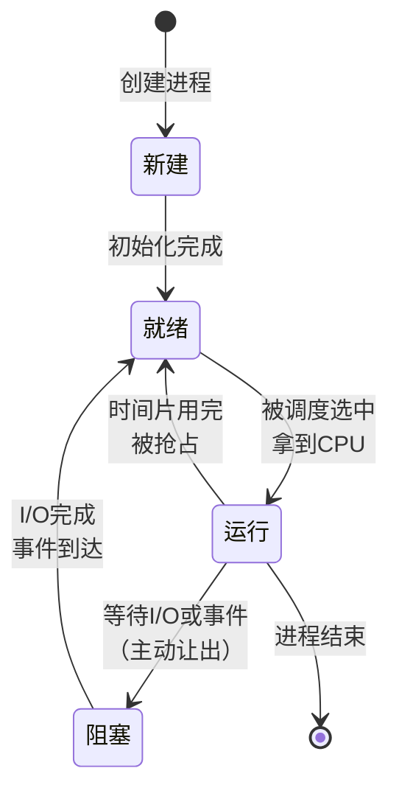
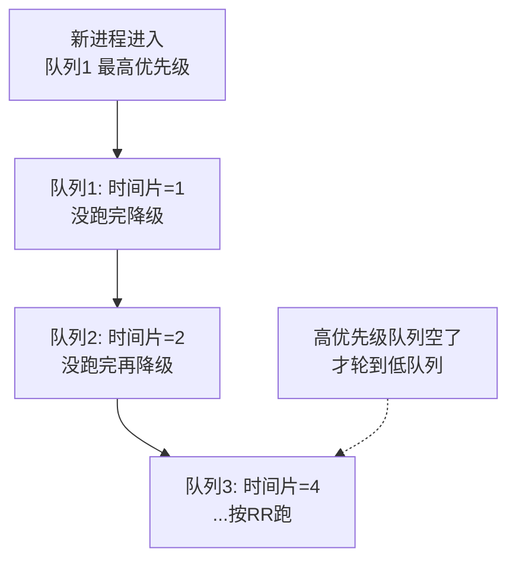
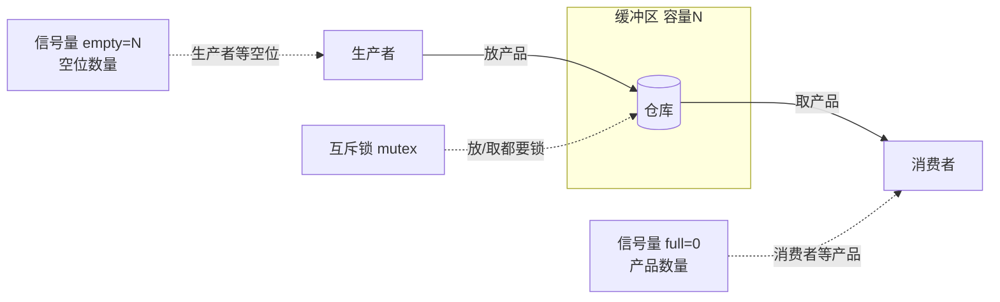
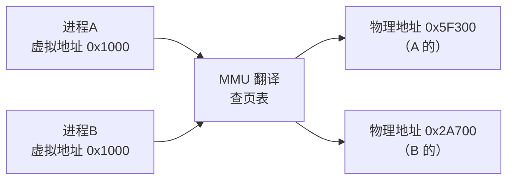
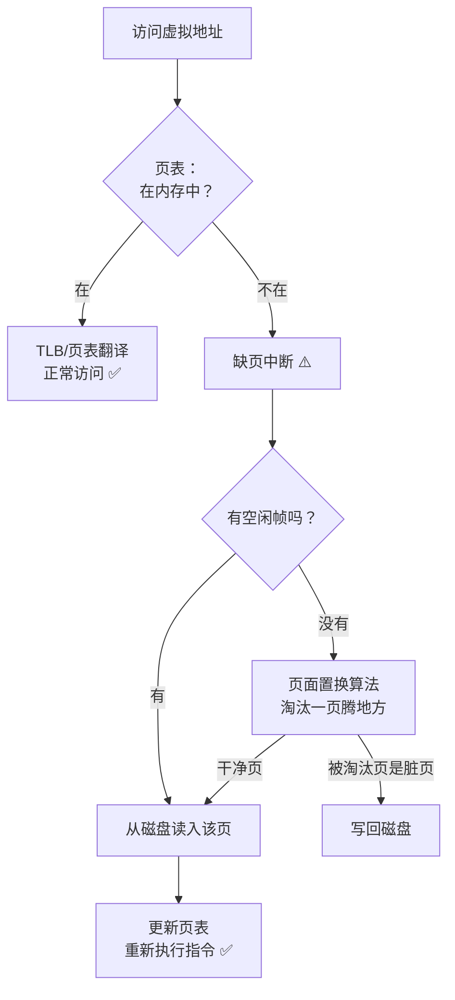
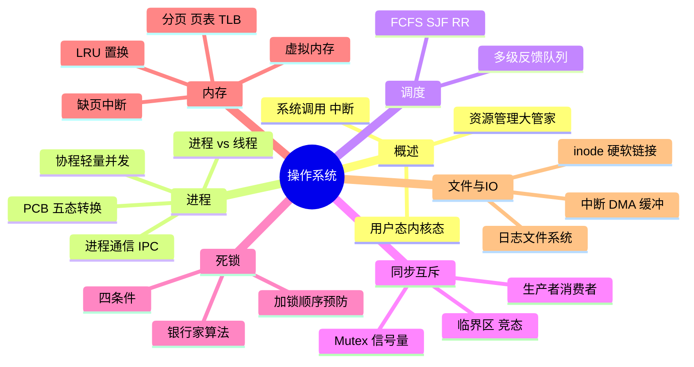

# 🌸 操作系统学习笔记 —— 硬件之上的大管家

> 嘿嘿～新分区【计科】开张！操作系统是夹在硬件和应用之间的"大管家" 🎩：管 CPU（进程）、管内存（虚拟内存）、管硬盘（文件系统）、管外设（I/O）。面试内功第一课，一起来修炼～

---

## 📖 目录

1. [初识操作系统：它是谁？](#一初识操作系统它是谁)
2. [进程管理：CPU 的分身术（重点！）](#二进程管理cpu-的分身术重点)
3. [进程调度算法](#三进程调度算法)
4. [线程与协程](#四线程与协程)
5. [同步与互斥：锁家族（重点！）](#五同步与互斥锁家族重点)
6. [死锁：谁也不放手的僵局（重点！）](#六死锁谁也不放手的僵局重点)
7. [内存管理：从实体到虚拟（重点！）](#七内存管理从实体到虚拟重点)
8. [页面置换算法](#八页面置换算法)
9. [文件系统：硬盘的组织术](#九文件系统硬盘的组织术)
10. [I/O 管理与中断](#十io-管理与中断)
11. [Linux 实战速查](#十一linux-实战速查)
12. [总结与面试高频题](#十二总结与面试高频题)

---

## 一、初识操作系统：它是谁？

### 1.1 用大白话说 OS

电脑一开机，第一个跑起来的"超级程序"就是操作系统。它替所有软件管着硬件：

| 资源 | 管家职能 | 对应模块 |
| --- | --- | --- |
| CPU | 谁下一个用 CPU？用多久？ | 进程管理 |
| 内存 | 每个程序放哪？怎么隔离？ | 内存管理 |
| 硬盘 | 文件怎么存怎么找？ | 文件系统 |
| 外设 | 键盘网卡怎么响应？ | I/O 管理 |

### 1.2 常见操作系统

| 分类 | 代表 |
| --- | --- |
| 桌面 | Windows、macOS、Linux 发行版 |
| 服务器 | **Linux**（绝对主力）、Windows Server |
| 移动 | Android（Linux 内核）、iOS（Darwin/XNU 内核）|
| 嵌入式 | FreeRTOS、VxWorks |

### 1.3 用户态与内核态（重要概念！）

CPU 分两种"工作模式"，像酒店的"大堂"和"后厨" 🏨：

| | 用户态（User）| 内核态（Kernel）|
| --- | --- | --- |
| 谁在跑 | 普通应用 | 操作系统内核 |
| 权限 | 受限（不能直接碰硬件）| 全权（支配一切资源）|
| 类比 | 大堂客人 | 后厨员工 |

**切换时机（Trap 陷入内核）：**

- 系统调用：App 主动请求（读文件、发网络包）📞
- 中断：硬件通知（键盘按下、网卡收到数据）🔔
- 异常：程序出错（除零、缺页）⚠️

> 🎀 为什么这么设计？**安全与稳定**——App 想干坏事（偷读别人内存）？先问过内核再说！这就是为什么"系统调用比函数调用慢"（要切换模式+保存现场）～

---

## 二、进程管理：CPU 的分身术（重点！）

### 2.1 为什么需要进程？

CPU 只有一个（或几个核），但要同时跑微信、浏览器、音乐……怎么办？**时间片轮转**：每个程序用几毫秒 CPU 就换人，快到人类感觉"同时"在跑 ✨

**进程 = 程序的一次执行实例**（程序是菜谱，进程是正在炒的菜 🍳）

### 2.2 PCB：进程的身份证

操作系统用 **PCB（进程控制块）** 记录每个进程的一切：

| PCB 内容 | 说明 |
| --- | --- |
| PID | 进程号（唯一标识）|
| 程序计数器、寄存器 | 执行到哪了（现场）|
| 内存信息 | 代码/数据/栈在哪 |
| 状态 | 就绪/运行/阻塞 |
| 打开的文件 | 资源清单 |

### 2.3 进程五态转换（必背！）



| 状态 | 大白话 |
| --- | --- |
| 新建 | 正在办身份证 |
| **就绪** | 万事俱备，排队等 CPU |
| **运行** | 正在用 CPU 干活 |
| **阻塞** | 等 I/O，CPU 让给别人 |
| 终止 | 干完退休 |

> 💡 最易错题：**阻塞 → 运行？❌ 不存在！** 阻塞完必须先回就绪队列排队，被调度了才能运行！（就像外卖到了不能直接开吃，得先排队取餐 🍱）

### 2.4 进程通信 IPC

进程之间内存隔离（沙盒），想说话得走官方通道：

| 方式 | 特点 | 场景 |
| --- | --- | --- |
| 管道 Pipe | 单向字节流 | 父子进程 `|` |
| 命名管道 FIFO | 双向、无亲缘关系 | 任意进程 |
| 消息队列 | 消息为单位、有格式 | 小数据频繁 |
| **共享内存** | 同一块内存读写、**最快** | 大数据量 ⚡ |
| 信号量 | 传"信号"不传数据 | 同步控制 |
| Socket | 跨网络也能通信 | 分布式/本机 |

> 🎀 共享内存最快（免拷贝），但要配信号量防打架——"共享白板 + 一把门锁" 📋🔒

---

## 三、进程调度算法

| 算法 | 规则 | 优点 | 缺点 |
| --- | --- | --- | --- |
| FCFS 先来先服务 | 排队，谁先来谁先跑 | 简单公平 | 短任务被长任务堵死 |
| SJF 短作业优先 | 谁短谁先 | 平均等待时间最短 | 长任务饿死 😢 |
| RR 时间片轮转 | 每人用固定时间片 | 公平、响应快 | 时间片大小敏感 |
| 优先级调度 | 优先级高的先 | 紧急任务先处理 | 低优先级饿死 |
| **多级反馈队列** ⭐ | 多个队列+动态升降级 | 综合最优 | 实现复杂 |

**多级反馈队列（现代 OS 主流思想）：**



> 💡 精髓：**短任务快速完成（高队列），长任务逐渐让路（降级）**，兼顾响应和吞吐——你手机上点一下立刻响应，后台同步慢慢跑，就是这套思想！

---

## 四、线程与协程

### 4.1 进程 vs 线程（必考！）

| 对比 | 进程 | 线程 |
| --- | --- | --- |
| 本质 | 资源分配单位 | CPU 调度单位 |
| 内存 | 独立地址空间 | **共享所在进程的内存** |
| 切换开销 | 大（换页表、刷缓存）| 小（同进程内换寄存器）|
| 通信 | 要 IPC | 直接读写共享变量（但要锁！）|
| 崩溃影响 | 只崩自己 | 一个线程崩可能带走整个进程 |

**类比：进程 = 工厂 🏭，线程 = 车间工人 👷**——工人共享工厂的仓库（内存），工人之间传东西不用出门，但拿同一个工具要排队（锁）。

### 4.2 协程

用户态的"轻量线程"，切换不用进内核（见 Kotlin 篇协程章）：

| 对比 | 线程 | 协程 |
| --- | --- | --- |
| 调度方 | 内核 | **用户代码/运行时** |
| 切换成本 | 微秒级（进内核）| 纳秒级（用户态）|
| 数量级 | 千级 | **百万级** ✨ |
| 典型 | Java Thread | Kotlin coroutine、Go goroutine |

---

## 五、同步与互斥：锁家族（重点！）

### 5.1 竞态条件：经典的取钱事故

```java
// 两个线程同时执行取钱 100（余额 500）
// ① 线程A 读到余额 500
// ② 线程B 也读到余额 500   ← 灾难开始
// ③ 线程A 算出 400 写回
// ④ 线程B 算出 400 写回   ← 取了两次 100，余额只少 100！💀
```

**临界区**：访问共享资源的代码段——必须**互斥**进入（一次一个）。

### 5.2 锁家族图谱

| 工具 | 原理 | 适用 |
| --- | --- | --- |
| **互斥锁 Mutex** | 加锁才能进临界区 | 保护临界区 ⭐ |
| 自旋锁 | 拿不到就原地空转（忙等）| 短临界区（不睡眠，快）|
| 读写锁 | 读共享、写独占 | 读多写少（缓存）|
| **信号量 Semaphore** | 计数器 + 等待队列 | 控制 N 个名额 |
| 条件变量 | 等条件成立再继续 | 生产者消费者 |

### 5.3 信号量：P/V 操作

荷兰人 Dijkstra 发明（P=等待，V=释放）：

```c
semaphore mutex = 1;     // 互斥信号量：1 把钥匙

P(mutex);                // 拿钥匙（计数-1，0 则排队）
// ... 临界区 ...
V(mutex);                // 还钥匙（计数+1，唤醒等待者）
```

### 5.4 经典案例：生产者-消费者



```c
semaphore empty = N;     // 空位数
semaphore full  = 0;     // 产品数
semaphore mutex = 1;     // 仓库门锁

// 生产者                          // 消费者
while(true) {                      while(true) {
    P(empty);   // 等空位              P(full);    // 等产品
    P(mutex);   // 锁仓库              P(mutex);   // 锁仓库
    放产品;                           取产品;
    V(mutex);   // 开锁                V(mutex);   // 开锁
    V(full);    // 产品+1              V(empty);   // 空位+1
}                                  }
```

> 🎀 顺序陷阱（面试爱考）：**P(empty) 和 P(mutex) 不能颠倒**！先锁仓库再等空位——等的时候抱着锁睡，消费者进不来放不了产品 → **死锁**！

---

## 六、死锁：谁也不放手的僵局（重点！）

### 6.1 什么是死锁？

两个进程各持一个资源，又都想要对方的，谁也不撒手 💀：

```
线程A：拿到 锁1，想要 锁2……
线程B：拿到 锁2，想要 锁1……
→ 互相等待，永久卡死
```

### 6.2 死锁四条件（必背！）

| 条件 | 含义 | 大白话 |
| --- | --- | --- |
| **互斥** | 资源一次只能一人用 | 一把椅子坐一人 |
| **持有并等待** | 拿着资源还要等新资源 | 抱着椅子等桌子 |
| **不可剥夺** | 资源不能被抢走 | 不能从屁股下抽椅子 |
| **循环等待** | 形成环形等待链 | A 等 B、B 等 A |

**四条件缺一不可——破坏任意一个就能防死锁！**

### 6.3 处理策略

| 策略 | 思路 | 例子 |
| --- | --- | --- |
| 预防 | 破坏四条件之一 | **统一加锁顺序**（破坏循环等待）⭐ |
| 避免 | 动态判断分配是否安全 | 银行家算法 |
| 检测+解除 | 放任发生，定期查，杀进程回滚 | 数据库死锁检测 |

**最实用的一招：给锁编号，按序加锁**

```java
// ❌ 各自按自己喜好加锁 → 可能死锁
transfer(A, B): lock(A); lock(B); ...
transfer(B, A): lock(B); lock(A); ...

// ✅ 全局规定：永远先锁编号小的
transfer(A, B): lock(min(A,B)); lock(max(A,B)); ...
// 循环等待被打破，死锁不可能发生 🎉
```

**银行家算法（了解思想）**：放贷前先算"最坏情况下我兜得住吗"，兜得住才放款——分配资源前预演安全性，不安全就拒绝。

> 🎀 实战口诀：**能不用多锁就不用；必须多锁就定顺序；拿不准就加超时**（tryLock 超时放弃重来，等价于"可剥夺"）～

---

## 七、内存管理：从实体到虚拟（重点！）

### 7.1 为什么需要虚拟内存？

直接用物理内存的问题：每个程序写地址 0x100 会打架、程序大小受物理内存限制、进程间没有隔离 💥

**虚拟内存**：每个进程都以为自己独占一整条内存（虚拟地址空间），由 OS + 硬件（MMU）翻译成真实物理地址。



**好处：**

- ✅ 隔离：A 写不到 B 的内存
- ✅ 省内存：程序不必整体加载，用到哪页加载哪页
- ✅ 突破物理限制：4GB 内存能跑要 8GB 的程序（配合磁盘交换）

### 7.2 分页 Paging：内存切块管理

把内存切成固定大小的块：**虚拟页（Page）→ 物理帧（Frame）**，页表记录映射。

| 术语 | 含义 | 大小 |
| --- | --- | --- |
| 页 Page | 虚拟地址空间的块 | 常见 4KB |
| 帧 Frame | 物理内存的块 | 同页大小 |
| 页表 | 页号 → 帧号的映射表 | 每进程一张 |

**地址翻译：** 虚拟地址 =（页号 + 页内偏移）→ 查页表得帧号 → 物理地址

- **多级页表**：页表本身分级省空间（32 位两级、64 位四级）
- **TLB**：页表的"高速缓存"（CPU 内），命中就不用查内存——**没有 TLB 每次访存要多查一次页表，慢一倍**！
- **分段 Segmentation**：按逻辑段切（代码段/数据段，大小不固定）——现代系统用**段页式**或纯分页

### 7.3 缺页中断 Page Fault

访问的页不在内存里 → CPU 触发缺页中断 → 内核从磁盘调入该页 → 更新页表 → 重新执行指令。



> 🎀 妙处：**程序局部性原理**（用过的很快再用、附近的马上要用）让缺页很少发生——虚拟内存才敢"懒加载"。Java/Go 的 GC 卡顿也常和缺页有关，底层是同一套机制！

---

## 八、页面置换算法

内存满了，淘汰谁？**Belady 异常**：FIFO 换更大内存，缺页反而可能更多！

| 算法 | 规则 | 特点 |
| --- | --- | --- |
| OPT 最佳 | 淘汰"最久不会再用"的 | 理论最优，**无法实现**（要预知未来 🔮）|
| FIFO | 先进先出 | 简单，有 Belady 异常 |
| **LRU 最近最少使用** ⭐ | 淘汰最久没用的 | 性能好，**近似 OPT**（看过去推未来）|
| Clock 时钟 | 环形扫描，访问位=0 淘汰 | LRU 的廉价近似 |

**LRU 手算示例（3 个帧，访问序列 7 0 1 2 0 3 0 4）：**

```
访问 7: [7]        缺页
访问 0: [7,0]      缺页
访问 1: [7,0,1]    缺页
访问 2: [0,1,2]    淘汰 7（最久没用）
访问 0: [0,1,2]    命中 ✅（0 变最新）
访问 3: [0,2,3]    淘汰 1
访问 0: [0,2,3]    命中 ✅
访问 4: [0,3,4]    淘汰 2
```

> 💡 前面学过的联动：Redis 内存满的淘汰、Glide 内存缓存、CPU 缓存行——**LRU 是整个计算机体系复用率最高的算法**，必须烂熟于心！

---

## 九、文件系统：硬盘的组织术

### 9.1 文件系统的活儿

| 职能 | 说明 |
| --- | --- |
| 命名组织 | 树形目录、路径 |
| 存储分配 | 文件放哪些磁盘块 |
| 元数据 | 文件大小、权限、时间戳 |
| 可靠性 | 崩溃后不丢数据（日志）|

### 9.2 inode：文件的户口本

Linux 里每个文件一个 **inode**（索引节点）：

```
inode {
    权限、属主、时间戳
    大小
    数据块指针（直接+间接）
}
```

| 易混点 | 说明 |
| --- | --- |
| 文件名 | 存在**目录项**里（目录=文件名→inode 映射表）|
| inode 号 | 文件真正身份（`ls -i` 查看）|
| 硬链接 | 多个文件名指同一 inode（删除一个，数据还在）|
| 软链接 | 存路径的快捷方式（目标删了就悬空）|

### 9.3 常见文件系统

| 文件系统 | 系统 | 特点 |
| --- | --- | --- |
| ext4 | Linux 主流 | 日志型、稳定 |
| XFS / Btrfs | Linux | 大文件/快照 CoW |
| NTFS | Windows | 日志、权限 |
| APFS | Apple | SSD 优化、快照 |
| FAT32 | U 盘 | 兼容性王、单文件 4GB 上限 |

**日志文件系统（journaling）**：写文件前先记日志"我要改这些"再动手——断电后按日志恢复，**防止文件系统半更新损坏**（和数据库的 WAL 是同一个思想！📝）

---

## 十、I/O 管理与中断

### 10.1 中断：硬件的敲门声

CPU 不轮询等设备（浪费），而是设备完事主动"举手"：

```
CPU 发读盘命令 → 继续跑别的进程
磁盘读完了 → 发中断信号 🔔
CPU 暂存当前现场 → 执行中断处理程序 → 恢复现场继续跑
```

### 10.2 I/O 方式进化

| 方式 | CPU 参与度 | 说明 |
| --- | --- | --- |
| 轮询 | 全程盯着 | CPU 浪费严重 ❌ |
| 中断 | 完成时处理一下 | 主流 ✅ |
| **DMA** | 只管开头结尾 | 磁盘↔内存 直接搬，CPU 干别的去 ⚡ |

### 10.3 缓冲区

在内存里给慢设备配"中转仓库"：

- 减少中断次数（攒一批再处理）
- 速度匹配（CPU 快、磁盘慢）
- 例：写日志先入缓冲，批量刷盘（和数据库缓冲池同思路）

---

## 十一、Linux 实战速查

学 OS 最好的实验室就是 Linux 终端 🧪：

| 命令 | 干啥 | 对应 OS 概念 |
| --- | --- | --- |
| `ps aux` / `top` / `htop` | 看进程 | 进程管理 |
| `kill -9 PID` | 杀进程 | 进程控制 |
| `free -h` | 看内存 | 物理内存/交换 |
| `df -h` / `du -sh *` | 磁盘空间 | 文件系统 |
| `ls -i` | 看 inode 号 | inode |
| `uptime` | 负载（1/5/15分钟）| 调度 |
| `vmstat` / `iostat` | 虚拟内存/IO 统计 | 缺页/IO |
| `lsof -i:8080` | 谁占了端口 | 文件与进程 |
| `nice -n 10 cmd` | 调优先级跑 | 优先级调度 |
| `ln 源 链接` / `ln -s` | 硬/软链接 | inode |

```bash
# 实战：找到占 CPU 最高的进程并看它的线程
top                          # 看 %CPU 排序
top -H -p <PID>              # 看该进程的线程
```

---

## 十二、总结与面试高频题

### 12.1 知识地图



### 12.2 面试官最爱问 Top 题 🎯

| 问题 | 答题要点 |
| --- | --- |
| 进程和线程区别？ | 资源分配单位 vs 调度单位；独立地址空间 vs 共享；切换开销大 vs 小；通信 IPC vs 共享变量+锁 |
| 进程有哪些状态？ | 五态：新建/就绪/运行/阻塞/终止；阻塞不能直接到运行 |
| 进程通信方式？ | 管道/消息队列/共享内存（最快）/信号量/Socket |
| 什么是用户态内核态？ | CPU 两种特权级；系统调用/中断/异常触发切换；切换有成本 |
| 线程同步方式？ | 互斥锁、自旋锁、读写锁、信号量、条件变量 |
| 死锁四条件？ | 互斥、持有并等待、不可剥夺、循环等待（缺一不可）|
| 怎么预防死锁？ | 破坏任一条件：统一加锁顺序（破循环等待最常用）、一次性申请（破持有等待）、tryLock 超时（破不可剥夺）|
| 虚拟内存是什么？ | 每进程独立虚拟地址空间，MMU+页表翻译到物理地址；隔离+突破物理限制+按需加载 |
| 什么是缺页中断？ | 访问的页不在内存→中断→从磁盘调入（必要时置换）→重新执行 |
| 页面置换算法？ | OPT（理想）/FIFO（Belady 异常）/LRU（看历史近似未来）/Clock |
| 为什么 TLB 重要？ | 页表缓存，避免每次访存多查一次内存；命中率决定性能 |
| 硬链接软链接区别？ | 硬链=多名字共享 inode；软链=存路径的快捷方式 |
| 协程和线程区别？ | 用户态调度 vs 内核调度；切换成本低百倍；百万并发 |
| select/poll/epoll？ | I/O 多路复用：epoll 事件回调只返回就绪的 fd，O(1) 高并发王者（Nginx/Redis 用）|

### 12.3 学习建议路线 🗺️

1. **第一站**：Linux 跑 `top`/`ps`/`free`，亲眼看进程和内存
2. **第二站**：写一个多线程取钱程序（不加锁 → 加锁），亲眼看竞态
3. **第三站**：手推一遍生产者-消费者的 P/V 顺序，理解死锁陷阱
4. **第四站**：手算 LRU 置换序列（本篇例题换数字练三遍）
5. **第五站**：和前面学的联动——Redis 淘汰（LRU）、数据库 WAL（日志 FS）、协程（用户态调度）
6. **终点站**：读《操作系统导论》（OSTEP）或 MIT 6.S081 课程 🌟

---

> 🌈 操作系统通关！计科分区首杀达成 🎩 现在你眼里的"程序跑起来了"背后是完整的管家体系：进程排队上 CPU、虚拟地址翻译、缺页换页、锁与死锁的博弈……前面学的所有技术（数据库/Redis/移动端）底层全是这套机制！下一个知识点继续召唤我！(๑•̀ㅂ•́)و✧💻💪
