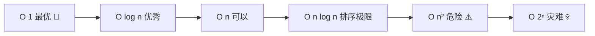
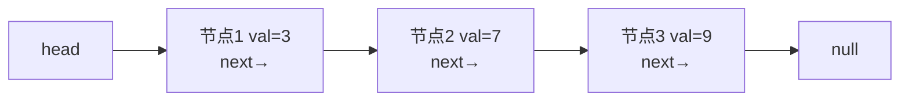
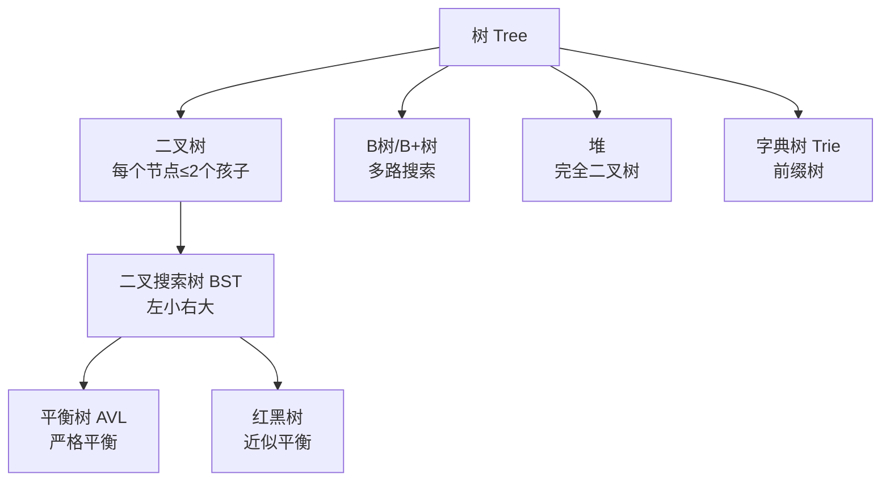
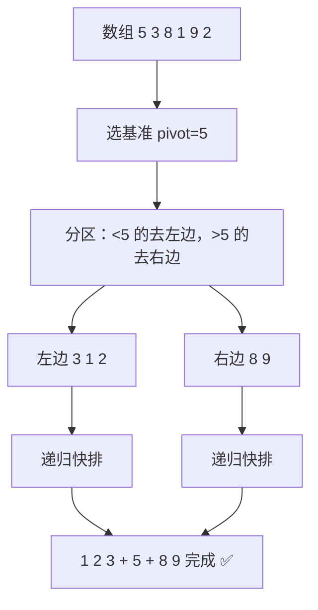
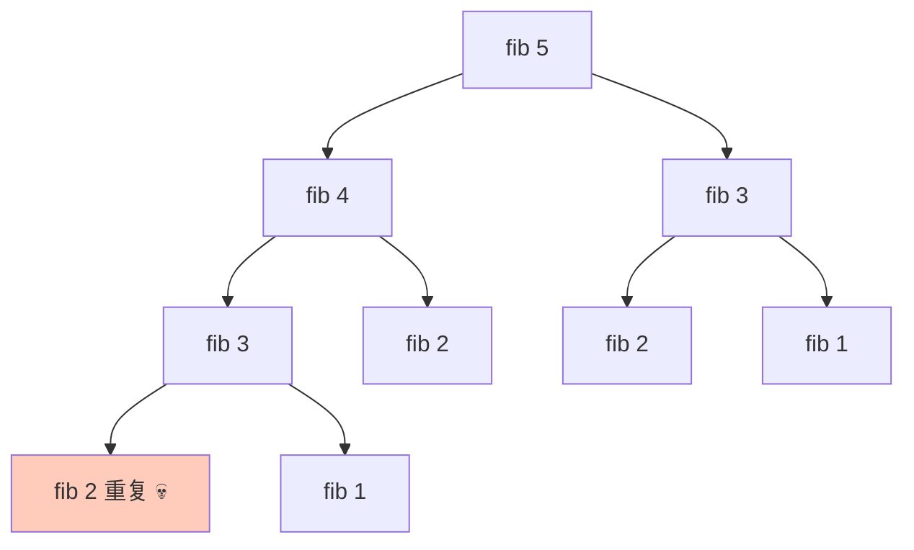
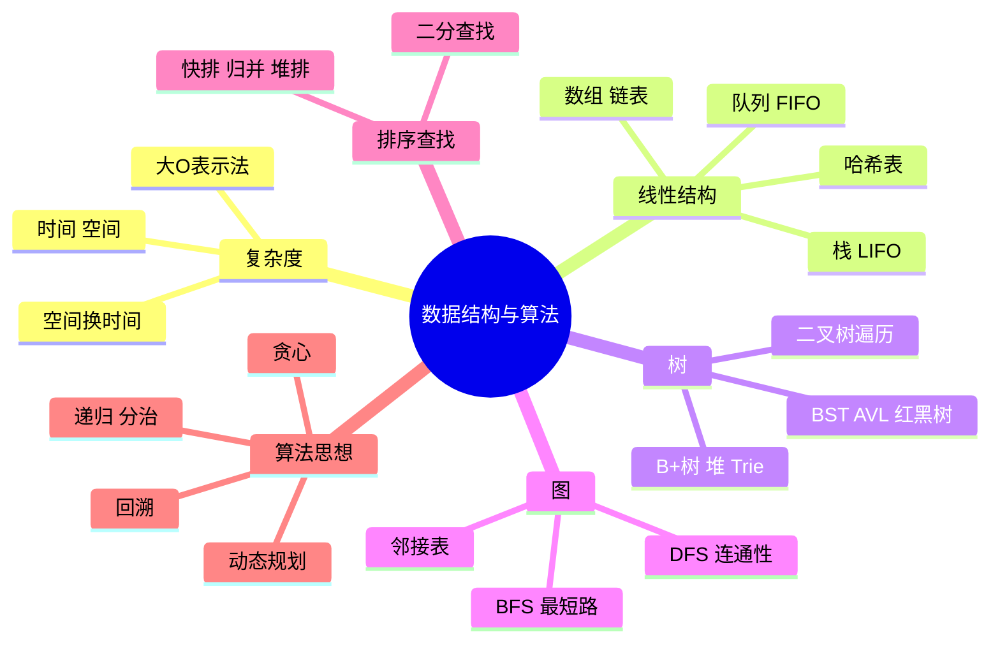

# 🌸 数据结构与算法学习笔记 —— 程序员的内功心法

> 嘿嘿～框架会过时、语言会更替，但**数据结构与算法是永远的内功** 🧘！怎么存（数据结构）+ 怎么算（算法）= 解决问题的方式。示例语言 Java，LeetCode 冲鸭！

---

## 📖 目录

1. [初识：数据结构 + 算法是什么](#一初识数据结构--算法是什么)
2. [复杂度分析（重点！）](#二复杂度分析重点)
3. [线性结构：数组与链表（重点！）](#三线性结构数组与链表重点)
4. [栈与队列](#四栈与队列)
5. [哈希表（重点！）](#五哈希表重点)
6. [树与二叉树（重点！）](#六树与二叉树重点)
7. [堆与优先队列](#七堆与优先队列)
8. [图论入门：BFS 与 DFS](#八图论入门bfs-与-dfs)
9. [查找：二分查找](#九查找二分查找)
10. [十大排序（重点！）](#十十大排序重点)
11. [算法思想五绝：递归分治贪心动规回溯](#十一算法思想五绝递归分治贪心动规回溯)
12. [总结与面试高频题](#十二总结与面试高频题)

---

## 一、初识：数据结构 + 算法是什么

| 概念 | 大白话 | 类比 |
| --- | --- | --- |
| **数据结构** | 数据怎么组织存放 | 书架怎么摆（立放/平放/分类摆）📚 |
| **算法** | 处理数据的步骤 | 怎么最快找到那本书 🔍 |

**同一个问题的不同解法，效率天差地别：**

```
在 10 亿数据中找一个数：
  一个个翻：10 亿次操作 ≈ 十几秒 ⏳
  二分查找：30 次 ≈ 瞬间 ⚡
```

> 🎀 数据结构是"容器"，算法是"操作容器的方法"——先选对容器，算法事半功倍！

---

## 二、复杂度分析（重点！）

### 2.1 大 O 表示法

衡量效率不看秒数（机器差异），看**操作次数随数据量的增长趋势**：

| 大 O | 名称 | n=10亿时 | 类比 |
| --- | --- | --- | --- |
| O(1) | 常数 | 1 次 | 直接报出答案 ✨ |
| O(log n) | 对数 | ~30 次 | 二分 |
| O(n) | 线性 | 10亿次 | 一个个翻 |
| O(n log n) | 线性对数 | ~300亿次 | 快排/归并 |
| O(n²) | 平方 | 天文数字 💀 | 双重循环 |
| O(2ⁿ) | 指数 | 宇宙毁灭 💥 | 暴力枚举子集 |



### 2.2 怎么算？

```java
// O(1)：跟 n 无关
int first = arr[0];

// O(n)：循环 n 次
for (int i = 0; i < n; i++) sum += i;

// O(n²)：循环套循环
for (int i = 0; i < n; i++)
    for (int j = 0; j < n; j++) count++;

// O(log n)：每轮砍一半
while (n > 1) { n = n / 2; }

// O(n log n)：外层 n × 内层 log n
for (int i = 0; i < n; i++) { /* log n 操作 */ }
```

**三条规则：** ① 加法取最大 `O(n²+n)=O(n²)`；② 常数忽略 `O(2n)=O(n)`；③ 递归看调用次数×每次工作量

### 2.3 时间 vs 空间

```java
// 空间换时间：哈希表记一遍，查找 O(1)
Set<Integer> seen = new HashSet<>(List.of(1,2,3));
seen.contains(3);   // O(1)，比 List.contains 的 O(n) 快
```

> 💡 现代开发口诀：**内存便宜时间贵**——缓存/哈希/空间换时间是常态（回忆 Cache、Redis 全是这个哲学）！

---

## 三、线性结构：数组与链表（重点！）

### 3.1 数组 Array

**连续内存**，按下标直达：

```java
int[] arr = new int[5];       // [0,0,0,0,0] 连续内存
arr[2] = 99;                  // 随机访问 O(1)：地址=首地址+2×4字节
```

### 3.2 链表 LinkedList

**散落内存 + 指针串联**（火车车厢 🚃）：

```java
class Node {
    int val;
    Node next;                 // 单链表
    // Node prev;              // 双链表再加一个前指针
}
```



**经典操作——反转链表（面试钉子户）：**

```java
public ListNode reverse(ListNode head) {
    ListNode prev = null, cur = head;
    while (cur != null) {
        ListNode next = cur.next;   // 先存后路
        cur.next = prev;            // 掉头指向前一个
        prev = cur;                 // prev 前进
        cur = next;                 // cur 前进
    }
    return prev;                    // prev 就是新头
}
```

### 3.3 数组 vs 链表（必背！）

| 操作 | 数组 | 链表 |
| --- | --- | --- |
| 随机访问 arr[i] | **O(1)** ⚡ | O(n)（从头找）|
| 头部插入/删除 | O(n)（全体搬家）| **O(1)** ⚡ |
| 尾部插入 | 均摊 O(1)（扩容除外）| O(1)（有尾指针）|
| 中间插入/删除 | O(n) | O(1)（已定位时）|
| 内存 | 连续、缓存友好 | 散落、有指针开销 |
| 场景 | 读多写少、知道下标 | 频繁增删、不知道长度 |

> 🎀 联动：ArrayList 底层数组（查询快）、LinkedList 底层双链表（增删快）——Java 面试经典对比题！

---

## 四、栈与队列

### 4.1 栈 Stack：后进先出 LIFO

**只有一个口的羽毛球筒 🏸**：最后放的最先出。

```java
Deque<Integer> stack = new ArrayDeque<>();
stack.push(1);          // 入栈 [1]
stack.push(2);          // [1,2]
stack.push(3);          // [1,2,3]
stack.pop();            // 弹出 3（最后进的）
stack.peek();           // 看栈顶 2
```

**经典应用：** 函数调用栈（递归原理）、括号匹配、浏览器前进后退、表达式求值、撤销操作 ↩️

```java
// 有效括号：LeetCode 20
public boolean isValid(String s) {
    Deque<Character> stack = new ArrayDeque<>();
    for (char c : s.toCharArray()) {
        if (c == '(') stack.push(')');
        else if (c == '[') stack.push(']');
        else if (c == '{') stack.push('}');
        else if (stack.isEmpty() || stack.pop() != c) return false;
    }
    return stack.isEmpty();
}
```

### 4.2 队列 Queue：先进先出 FIFO

**排队买奶茶 🧋**：先来的先服务。

```java
Queue<Integer> queue = new LinkedList<>();
queue.offer(1);         // 入队（队尾）
queue.offer(2);
queue.poll();           // 出队（队头）→ 1
```

**变种全家福：**

| 变种 | 特点 | 应用 |
| --- | --- | --- |
| 双端队列 Deque | 两头都能进出 | 滑动窗口最大值 |
| 优先队列 PriorityQueue | 按优先级出队（堆实现）| 定时任务、TopK |
| 循环队列 | 环形复用空间 | 缓冲区 |

---

## 五、哈希表（重点！）

### 5.1 原理

**key → 哈希函数 → 下标 → 桶里存值**：用数学换 O(1) 查找！

```mermaid
flowchart LR
    A[key = "小花"] --> B[hash 小花 = 37]
    B --> C[数组下标 37]
    C --> D[(桶：小花→95分)]
    E[查询 get 小花] -.O 1 直达.-> C
```

### 5.2 冲突怎么办？

两个 key 算出同一下标（撞车）：

| 解法 | 思路 | 代表 |
| --- | --- | --- |
| **链地址法** | 同一格子挂链表 | **Java HashMap** ✅ |
| 开放寻址法 | 撞了就找下一个空位 | Python dict、ThreadLocalMap |

### 5.3 HashMap 深入（Java 面试必考）

```java
Map<String, Integer> map = new HashMap<>();
map.put("小花", 95);
map.get("小花");        // 95，O(1)
```

| 问题 | 要点 |
| --- | --- |
| 底层结构？ | **数组 + 链表 + 红黑树**（JDK8+）|
| 为什么链表变红黑树？ | 链表长度 ≥8 且数组 ≥64 时树化，防哈希攻击退化 O(n) → O(log n) |
| 扩容？ | 负载因子 0.75，超了容量×2 并重新分布 |
| 为什么容量是 2 的幂？ | 位运算取模 `hash & (n-1)` 更快 |
| 为什么 key 要重写 hashCode+equals？ | 定位桶靠 hashCode，桶内比对靠 equals——两 个必须一致 |

> 🎀 巨型联动：**Redis 的 dict、数据库的哈希索引、密码学篇的哈希函数、ES 的 term 查询**——哈希思想无处不在，这是计算机界最伟大的"以空间换时间"！

---

## 六、树与二叉树（重点！）

### 6.1 树的家族



| 术语 | 含义 |
| --- | --- |
| 根/叶子 | 顶端节点 / 没有孩子的节点 |
| 深度/高度 | 从根往下数 / 从叶往上数 |
| 度 | 节点的孩子数 |

### 6.2 二叉树遍历（必背！）

```java
class TreeNode {
    int val;
    TreeNode left, right;
}

// 前序：根→左→右（复制树）
void preOrder(TreeNode root) {
    if (root == null) return;
    System.out.println(root.val);   // 根的位置决定叫什么序
    preOrder(root.left);
    preOrder(root.right);
}
// 中序：左→根→右 —— BST 中序遍历 = 升序序列！
// 后序：左→右→根（释放资源、算高度）
// 层序：一层层来（用队列 BFS）
```

```
        5
       / \
      3   8       前序：5 3 1 4 8 7 9
     / \ / \      中序：1 3 4 5 7 8 9  ← 升序！
    1  4 7  9     后序：1 4 3 7 9 8 5
```

### 6.3 二叉搜索树 BST

**左子树 < 根 < 右子树**：查找像二分，平均 O(log n)：

```java
TreeNode insert(TreeNode root, int val) {
    if (root == null) return new TreeNode(val);
    if (val < root.val)      root.left = insert(root.left, val);
    else if (val > root.val) root.right = insert(root.right, val);
    return root;
}
```

**致命缺陷：** 顺序插入 1,2,3,4,5 → 退化成链表，O(n) 💀 → 所以需要**平衡**：

| 树 | 平衡策略 | 场景 |
| --- | --- | --- |
| AVL | 严格平衡（高度差≤1），查询极快 | 查多改少 |
| **红黑树** | 近似平衡（5 条规则），增删旋转少 | **HashMap、TreeMap、Linux 调度** ⭐ |
| **B+ 树** | 多路+叶子链表，矮胖 | **MySQL 索引**（数据库篇讲过！）|

> 🎀 为什么数据库用 B+ 不用红黑树？磁盘按页读——**矮胖树一次 IO 带回更多键**，三层能存千万数据！

---

## 七、堆与优先队列

**堆 = 完全二叉树 + 父亲总比孩子大（大顶堆）或小（小顶堆）** 🏔️：

```
大顶堆示例：          用数组存（下标公式）：
      9              arr[i] 的孩子：
     / \             左 = 2i+1
    7   8            右 = 2i+2
   / \               arr[i] 的父亲：
  3  5               (i-1)/2
```

```java
// Java 优先队列（默认小顶堆）
PriorityQueue<Integer> minHeap = new PriorityQueue<>();
PriorityQueue<Integer> maxHeap = new PriorityQueue<>((a, b) -> b - a);

// TopK 问题：10亿数找最大前100
// 小顶堆维护 100 个数：新数 > 堆顶 → 弹出堆顶塞新数
PriorityQueue<Integer> topK = new PriorityQueue<>(100);
for (int num : billion) {
    if (topK.size() < 100) topK.offer(num);
    else if (num > topK.peek()) { topK.poll(); topK.offer(num); }
}
```

| 操作 | 复杂度 |
| --- | --- |
| 插入/删除堆顶 | O(log n) |
| 取最值（peek）| **O(1)** ⚡ |
| 建堆 | O(n) |

**应用：** TopK 问题、定时任务调度、堆排序、Dijkstra 最短路、合并 K 个有序链表

---

## 八、图论入门：BFS 与 DFS

图 = 节点 + 边（微信好友关系网就是图 🕸️）：

| 概念 | 说明 |
| --- | --- |
| 有向/无向 | 微博关注（有向）/ 微信好友（无向）|
| 有权/无权 | 地图路线有距离（有权）|
| 存储 | 邻接矩阵 O(n²) / **邻接表 O(n+e)** ✅ |

```java
// 邻接表
Map<Integer, List<Integer>> graph = new HashMap<>();
```

### BFS 广度优先：一圈圈扩散 🌊（队列）

```java
// 层层扩散：走迷宫最短步数、社交网络的"度"
public void bfs(Map<Integer, List<Integer>> graph, int start) {
    Queue<Integer> queue = new LinkedList<>();
    Set<Integer> visited = new HashSet<>();
    queue.offer(start);
    visited.add(start);
    while (!queue.isEmpty()) {
        int node = queue.poll();
        for (int next : graph.get(node)) {
            if (visited.add(next)) queue.offer(next);   // 没来过才入队
        }
    }
}
```

### DFS 深度优先：一条道走到黑 🕳️（递归/栈）

```java
public void dfs(Map<Integer, List<Integer>> graph, int node, Set<Integer> visited) {
    visited.add(node);
    for (int next : graph.get(node)) {
        if (!visited.contains(next)) dfs(graph, next, visited);
    }
}
```

| 对比 | BFS | DFS |
| --- | --- | --- |
| 数据结构 | 队列 | 栈/递归 |
| 特点 | 层层扩散 | 一条路走到黑再回头 |
| 找最短路径（无权图）| **✅ 天然最短** | ❌ |
| 场景 | 最短步数、层次遍历 | 全排列、路径搜索、岛屿问题 |

---

## 九、查找：二分查找

**有序数组，每轮砍一半，O(log n)**——10 亿数据 30 次搞定 ⚡：

```java
public int binarySearch(int[] arr, int target) {
    int left = 0, right = arr.length - 1;
    while (left <= right) {
        int mid = left + (right - left) / 2;   // 防溢出写法！
        if (arr[mid] == target)      return mid;
        else if (arr[mid] < target)  left = mid + 1;   // 目标在右半
        else                         right = mid - 1;  // 目标在左半
    }
    return -1;
}
```

**三大细节（错一个就翻车）：**

1. `left <= right` 还是 `<`？看 right 取 `len-1`（闭区间）还是 `len`（左闭右开）
2. `mid = left + (right-left)/2` 防大数溢出
3. 收缩必须 `mid±1`（否则死循环）

**变体（都是二分壳）：** 找第一个等于 target 的、找最后一个 ≤target 的、旋转数组找目标、求平方根

> 💡 二分思想扩展：**MySQL B+ 树索引查找、Redis 跳表（zset）、快排 partition**——"每次砍一半"是算法界最强心法！

---

## 十、十大排序（重点！）

### 10.1 全家福对比表（必背！）

| 排序 | 平均 | 最坏 | 空间 | 稳定 | 一句话 |
| --- | --- | --- | --- | --- | --- |
| 冒泡 | O(n²) | O(n²) | O(1) | ✅ | 相邻交换，大的沉底 🫧 |
| 选择 | O(n²) | O(n²) | O(1) | ❌ | 每轮选最小的放前面 |
| 插入 | O(n²) | O(n²) | O(1) | ✅ | 扑克牌理牌 🃏（小数据王者）|
| **快排** ⭐ | O(n log n) | O(n²) | O(log n) | ❌ | 选基准分区递归 |
| **归并** ⭐ | O(n log n) | O(n log n) | O(n) | ✅ | 对半分、排好再合并 |
| **堆排** ⭐ | O(n log n) | O(n log n) | O(1) | ❌ | 建堆+弹堆顶 |
| 希尔 | O(n^1.3) | O(n²) | O(1) | ❌ | 分组插入排序 |
| 计数 | O(n+k) | O(n+k) | O(k) | ✅ | 数出现次数（小范围整数）|
| 桶 | O(n+k) | O(n²) | O(n+k) | ✅ | 装桶桶内排 |
| 基数 | O(d·n) | O(d·n) | O(n+d) | ✅ | 按位分桶（个十百位）|

### 10.2 冒泡排序（入门款）

```java
public void bubbleSort(int[] arr) {
    for (int i = 0; i < arr.length - 1; i++) {
        boolean swapped = false;
        for (int j = 0; j < arr.length - 1 - i; j++) {
            if (arr[j] > arr[j + 1]) {           // 大的往后沉
                int t = arr[j]; arr[j] = arr[j+1]; arr[j+1] = t;
                swapped = true;
            }
        }
        if (!swapped) break;                     // 一轮没交换 = 已经有序 ✨
    }
}
```

### 10.3 快速排序（面试王者）⚡



```java
public void quickSort(int[] arr, int lo, int hi) {
    if (lo >= hi) return;
    int p = partition(arr, lo, hi);
    quickSort(arr, lo, p - 1);      // 左半
    quickSort(arr, p + 1, hi);      // 右半
}

int partition(int[] arr, int lo, int hi) {
    int pivot = arr[hi];            // 取最后当基准
    int i = lo;                     // i 是"小于区"的边界
    for (int j = lo; j < hi; j++) {
        if (arr[j] < pivot) {       // 小的换到左边
            int t = arr[i]; arr[i] = arr[j]; arr[j] = t;
            i++;
        }
    }
    int t = arr[i]; arr[i] = arr[hi]; arr[hi] = t;  // 基准归位
    return i;                       // 基准的最终位置
}
```

### 10.4 归并排序（稳定的 n log n）

```java
public void mergeSort(int[] arr, int lo, int hi) {
    if (lo >= hi) return;
    int mid = lo + (hi - lo) / 2;
    mergeSort(arr, lo, mid);            // 排左半
    mergeSort(arr, mid + 1, hi);        // 排右半
    merge(arr, lo, mid, hi);            // 合并两个有序数组
}

void merge(int[] arr, int lo, int mid, int hi) {
    int[] tmp = new int[hi - lo + 1];
    int i = lo, j = mid + 1, k = 0;
    while (i <= mid && j <= hi)                 // 双指针取小者
        tmp[k++] = (arr[i] <= arr[j]) ? arr[i++] : arr[j++];
    while (i <= mid)  tmp[k++] = arr[i++];      // 剩余的直接搬
    while (j <= hi)   tmp[k++] = arr[j++];
    System.arraycopy(tmp, 0, arr, lo, tmp.length);
}
```

> 🎀 怎么记？**快排先分区再递归（ top-down），归并先递归再合并（也是 top-down 但合并在外）**；快排不稳定但省空间，归并稳定但费空间；JDK 的 `Arrays.sort()` 对对象用 **TimSort**（优化版归并，要稳定），对基本类型用**双轴快排**（不需要稳定）——全对上了！

---

## 十一、算法思想五绝：递归分治贪心动规回溯

### 11.1 递归 Recursion：函数自己调自己

```java
// 斐波那契：f(n) = f(n-1) + f(n-2)
int fib(int n) {
    if (n <= 1) return n;          // 终止条件（base case）必须有！
    return fib(n - 1) + fib(n - 2);
}
```

**三要素：** ① 终止条件 ② 自己调自己 ③ 规模缩小。缺点：重复计算爆炸（fib(50) 算不动）→ 引出 ↓

### 11.2 分治 Divide & Conquer

**大问题拆独立小问题，各自解决再合并**——快排/归并/二分都是它！

### 11.3 贪心 Greedy：每步选当前最优

```java
// 找零钱：贪心选最大面额（特殊面额下全局最优）
// 例子：36 元 = 25 + 10 + 1
```

不保证全局最优（0-1 背包贪心就错），但简单高效——活动安排、区间调度常用。

### 11.4 动态规划 DP（难点核心！）🧠

**把大问题拆成重叠子问题，记住算过的答案（备忘录），自底向上递推**：



```java
// DP 五步曲解法：
// ① 定义状态：dp[i] = 第 i 个斐波那契数
// ② 转移方程：dp[i] = dp[i-1] + dp[i-2]
// ③ 初始化：dp[0]=0, dp[1]=1
// ④ 遍历顺序：从小到大
// ⑤ 返回：dp[n]
int fib(int n) {
    if (n <= 1) return n;
    int[] dp = new int[n + 1];
    dp[0] = 0; dp[1] = 1;
    for (int i = 2; i <= n; i++) dp[i] = dp[i-1] + dp[i-2];  // 递推，O(n) ✅
    return dp[n];
}
```

**经典 DP 题：** 爬楼梯、背包问题、最长公共子序列 LCS、最长上升子序列 LIS、编辑距离、打家劫舍

### 11.5 回溯 Backtracking：试探 + 撤销

```java
// 全排列：[1,2,3] → 6 种排列
List<List<Integer>> res = new ArrayList<>();

void backtrack(int[] nums, LinkedList<Integer> path, boolean[] used) {
    if (path.size() == nums.length) {          // 收集结果
        res.add(new ArrayList<>(path));
        return;
    }
    for (int i = 0; i < nums.length; i++) {
        if (used[i]) continue;
        path.add(nums[i]); used[i] = true;     // 做选择
        backtrack(nums, path, used);           // 进入下一层
        path.removeLast(); used[i] = false;    // 撤销选择 ⭐（回溯核心）
    }
}
```

**回溯 = DFS + 撤销重试**——全排列、N 皇后、组合总和、子集，套路全是"选择→递归→撤销"。

### 11.6 五绝对比

| 思想 | 核心 | 标志题 |
| --- | --- | --- |
| 递归 | 自顶向下调用 | 树遍历 |
| 分治 | 拆独立子问题合并 | 归并/快排 |
| 贪心 | 每步局部最优 | 跳跃游戏 |
| **动规** | 重叠子问题+备忘录 | 背包/LCS |
| 回溯 | 试错+撤销 | 全排列/N皇后 |

---

## 十二、总结与面试高频题

### 12.1 数据结构选用速查

| 需求 | 首选 |
| --- | --- |
| 按下标随机访问 | 数组 |
| 频繁头尾增删 | 双链表/Deque |
| 快速查找/判重 | **哈希表** O(1) |
| 有序+范围查询 | **B+树**（磁盘）/ 红黑树（内存）/ 跳表（Redis）|
| 后进先出/撤销 | 栈 |
| 先来先服务 | 队列 |
| 取最值/TopK | 堆 |
| 前缀匹配 | Trie |

### 12.2 知识地图



### 12.3 面试官最爱问 Top 题 🎯

| 问题 | 答题要点 |
| --- | --- |
| 数组和链表区别？ | 连续内存 O(1) 随机访问 vs 指针串联 O(1) 增删；ArrayList/LinkedList 底层 |
| HashMap 原理？ | 数组+链表+红黑树；hash 定位、链地址解冲突、负载因子 0.75 扩容×2、树化阈值 8 |
| hashCode 和 equals？ | 先 hash 定桶再 equals 比对；重写必须成对，等价对象 hash 必须相等 |
| 树的三种遍历？ | 前中后序（递归/栈迭代）+层序（队列）；BST 中序=升序 |
| 红黑树和 B+ 树？ | 内存近似平衡（HashMap）vs 磁盘多路矮胖（MySQL 索引，省 IO）|
| 快排过程和复杂度？ | 选基准分区递归；平均 n log n 最坏 n²（有序+首基准）；空间 log n |
| 快排最坏怎么避免？ | 随机选基准/三数取中 |
| 归并和快排怎么选？ | 要稳定+最坏保障选归并（费空间）；平均更快省内存选快排 |
| 堆是什么？ | 完全二叉树+父子有序；PriorityQueue 默认小顶堆；TopK 用堆 O(n log k) |
| 二分注意啥？ | 有序前提；mid 防溢出写法；边界 ≤ 与 mid±1 防死循环 |
| BFS 和 DFS 区别？ | 队列层层扩散（无权图最短路）vs 栈/递归一条道（路径枚举）|
| 什么是动态规划？ | 重叠子问题+最优子结构；状态定义→转移方程→初始化→递推；记忆化=自顶向下DP |
| DP 和贪心区别？ | 贪心每步局部最优不回头；DP 考虑所有子问题取最优 |
| 什么时候用回溯？ | 求所有方案（排列/组合/子集）；选择→递归→撤销三件套 |
| 稳定排序意义？ | 相等元素相对顺序不变；多级排序（先按成绩再按姓名）依赖稳定性 |

### 12.4 学习建议路线 🗺️

1. **第一站**：手写 ArrayList（数组扩容）和链表反转，基础手感 ✍️
2. **第二站**：白板推导快排 partition、归并 merge，理解每行
3. **第三站**：LeetCode Hot 100 按标签刷：双指针→滑动窗口→二叉树→回溯→DP
4. **第四站**：每题先想暴力解，再优化复杂度，说清"怎么从 O(n²) 到 O(n)"
5. **第五站**：串联框架——HashMap 原理、Redis 跳表、MySQL B+ 树全是本篇知识的落地
6. **终点站**：周赛实战 + 《算法（第4版）》/ 代码随想录 🌟

---

> 🌈 数据结构与算法通关！计科分区四连达成 🧘 至此内功外功双修：语言框架是招式（前面 20+ 篇），数据结构算法是内力（本篇）——LeetCode 面试双开花！下一个知识点继续召唤我！(๑•̀ㅂ•́)و✧⚔️💪
