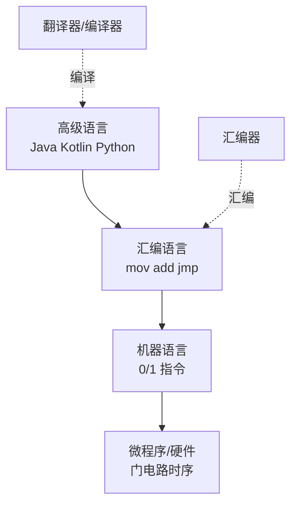
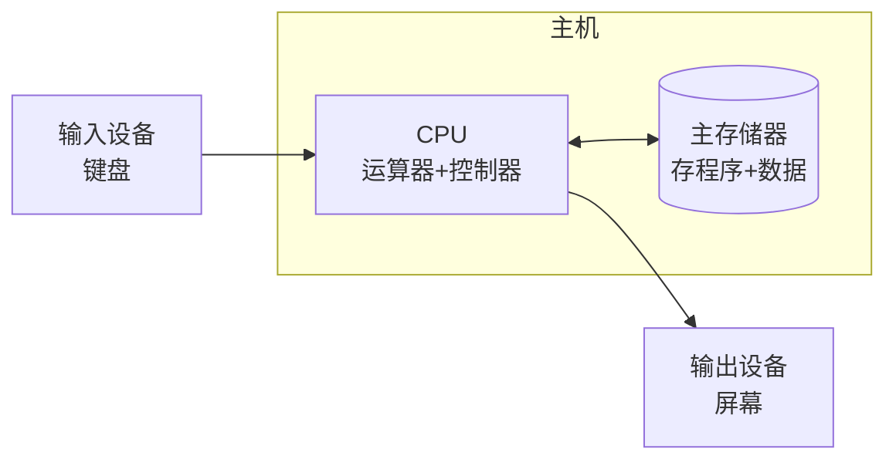
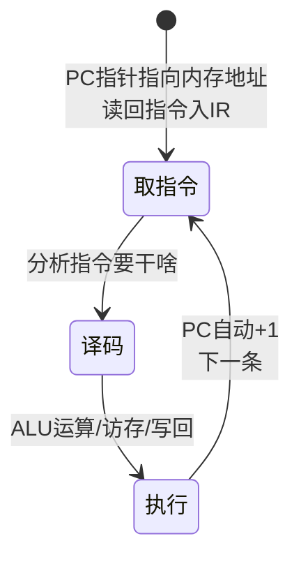
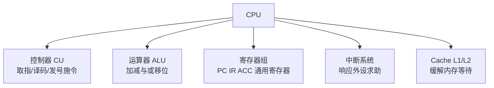
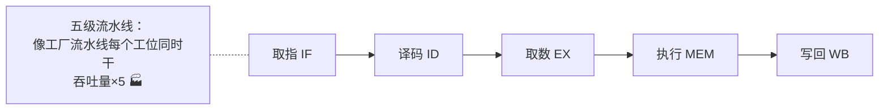
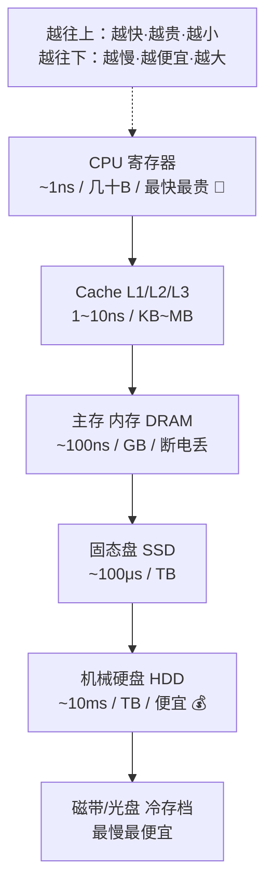
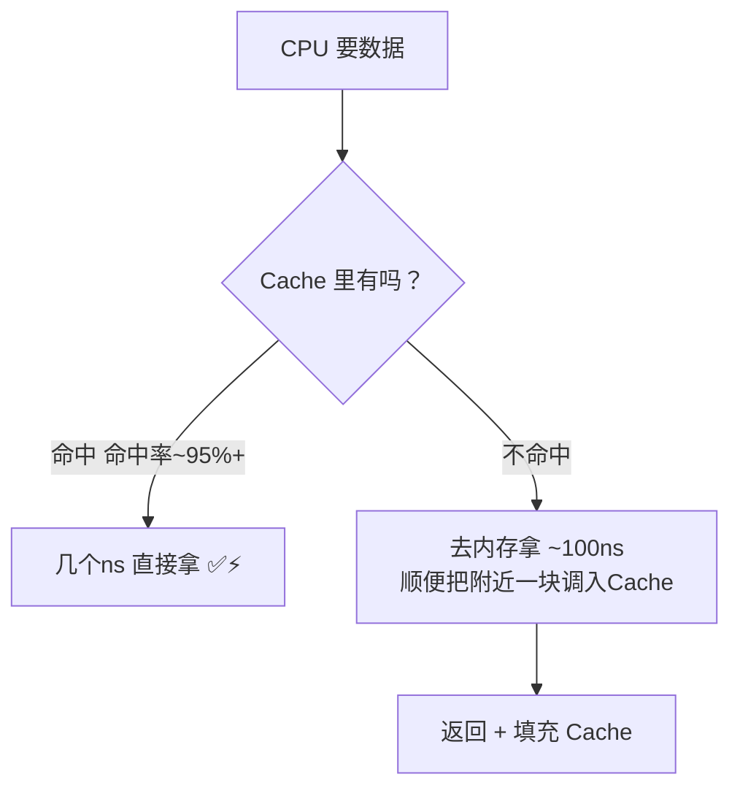
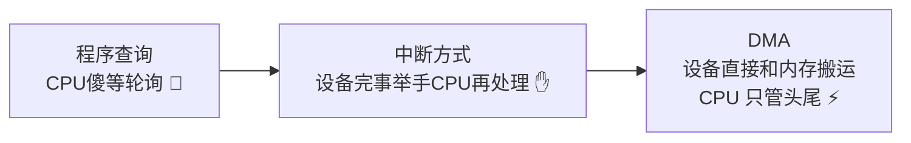
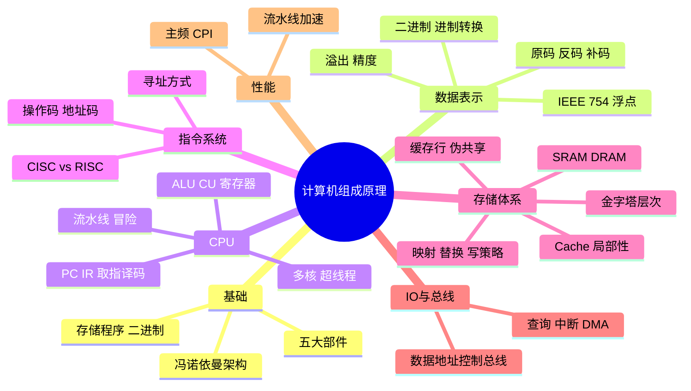

# 🌸 计算机组成原理学习笔记 —— 程序跑起来的物理真相

> 嘿嘿～操作系统篇看了"软件管家"，这次拆开机箱看"硬件员工" 🔧：CPU 怎么算数、内存怎么存数、一条指令怎么被啃完——补码、Cache、冯诺依曼，面试内功第二课！

---

## 📖 目录

1. [初识计组：计算机的家底](#一初识计组计算机的家底)
2. [冯·诺依曼架构（重点！）](#二冯诺依曼架构重点)
3. [数据的表示：二进制与补码（重点！）](#三数据的表示二进制与补码重点)
4. [浮点数与 IEEE 754](#四浮点数与-ieee-754)
5. [CPU：中央大脑解剖](#五cpu中央大脑解剖)
6. [指令系统与执行流程](#六指令系统与执行流程)
7. [存储器层次结构（重点！）](#七存储器层次结构重点)
8. [Cache：缓存的艺术（重点！）](#八cache缓存的艺术重点)
9. [总线与输入输出](#九总线与输入输出)
10. [性能指标与提升](#十性能指标与提升)
11. [总结与面试高频题](#十一总结与面试高频题)

---

## 一、初识计组：计算机的家底

**计算机组成原理 = 研究计算机硬件系统怎么组织、怎么干活** 的学科：

| 五大部件 | 干啥 | 类比工厂 🏭 |
| --- | --- | --- |
| 运算器 ALU | 算数+逻辑运算 | 车间（干活）|
| 控制器 CU | 指挥全机 | 厂长（指挥）|
| 存储器 | 存程序和数据 | 仓库 |
| 输入设备 | 键盘鼠标网卡 | 收货口 |
| 输出设备 | 屏幕打印机网卡 | 发货口 |

（运算器+控制器 = **CPU**；输入输出合称 I/O 设备）

### 计算机的层次结构



> 🎀 你写的每一行 `a + b`，都要层层翻译成 0/1，最终变成电信号在门电路里奔跑 ⚡——计组研究的就是最底下两层的秘密！

---

## 二、冯·诺依曼架构（重点！）

1945 年冯·诺依曼提出的现代计算机蓝图，**今天 99% 的电脑还是这个架构**：



**三大核心思想（必背！）：**

| 思想 | 含义 | 意义 |
| --- | --- | --- |
| **存储程序** | 程序（指令）和数据都以二进制存在存储器 | 换程序不用改电路！ |
| **二进制表示** | 一切皆 0/1 | 硬件容易实现（高低电平）|
| **五部件+顺序执行** | 五大部件、按地址顺序取指执行 | 自动连续计算 |

### 指令执行：取指→译码→执行 循环



| 寄存器 | 作用 |
| --- | --- |
| **PC 程序计数器** | 存"下一条指令的地址"（执行到哪了）|
| **IR 指令寄存器** | 存"当前正在执行的指令" |
| **ACC 累加器** | 运算结果暂存 |
| MAR/MDR | 内存地址/数据寄存器 |

> 💡 彩蛋联动：操作系统的"程序计数器切换现场"（进程切换保存 PC）就是保存这个家伙——**PC 是 CPU 的书签 📖**！

**冯·诺依曼瓶颈**：CPU 越来越快、内存跟不上 → CPU 等内存"挨饿"——所以才有了第八章的 Cache（先埋个伏笔 🎬）！

---

## 三、数据的表示：二进制与补码（重点！）

### 3.1 为什么是二进制？

- 两种状态最稳定（高/低电平，抗干扰）⚡
- 运算规则简单（0+0=0，1+1=10）
- 与逻辑代数（布尔）完美配合

**常用进制速查：**

| 十进制 | 二进制 | 十六进制 | 口诀 |
| --- | --- | --- | --- |
| 2 | 10 | 2 | |
| 8 | 1000 | 8 | |
| 16 | 10000 | 10 | |
| 255 | 1111 1111 | FF | 一个字节全 1 |
| 1024 | — | 400 | 1K=2¹⁰ |

> 💡 速算技巧：2¹⁰=1024（1K）、2²⁰=1M、2³⁰=1G——为什么内存都是 1024 进制？因为地址线是 2 的幂！

### 3.2 原码、反码、补码（必考！）

怎么用二进制表示**负数**？历史演进三部曲（以 8 位为例）：

| 码制 | 规则 | -5 的表示 | 问题 |
| --- | --- | --- | --- |
| **原码** | 最高位符号（1负0正）| `1000 0101` | 有 +0（0000 0000）和 -0（1000 0000）两个零 😵 |
| **反码** | 负数=原码按位取反 | `1111 1010` | 减法还是要拆成符号处理 |
| **补码** | 反码 +1 | `1111 1011` | **零唯一 + 加减法统一 ✅** |

**补码的精髓（模运算思想）：**

```
时钟往前拨 3 小时 = 往后拨 9 小时（模 12）
-3 ≡ +9 (mod 12)

计算机里：a - b = a + (-b 的补码)
5 - 3 = 5 + (-3)的补码
     = 0000 0101 + 1111 1101
     = 1 0000 0010   → 溢出位丢弃 → 0000 0010 = 2 ✅
```

> 🎀 大白话：**补码把减法变成加法，硬件只需要一个加法器**——省钱省事！这就是现代计算机"负数一律补码存储"的原因～

**补码快速转换：**

```
正数：三码合一（原=反=补）
负数：
  原码 → 补码：符号位不变，数值位取反后 +1
  补码 → 原码：同样"取反+1"（可逆操作！）
  技巧：从右往左找到第一个 1，左边全取反
```

**表示范围（n=8 位）：**

| 码制 | 范围 | 零的个数 |
| --- | --- | --- |
| 原码 | -127 ~ +127 | 2 个 |
| 补码 | **-128 ~ +127** | 1 个 |

> ⚠️ 经典坑：8 位补码 -128 没有原码表示！（`1000 0000` 直接定义为 -128）；`Math.abs(-2147483648)` 还是负数——Java 面试常客 💀

### 3.3 溢出判断

```
两个正数相加得负数 / 两个负数相加得正数 → 溢出 ⚠️
例：127 + 1 = 0111 1111 + 0000 0001 = 1000 0000 = -128 💥
```

---

## 四、浮点数与 IEEE 754

### 4.1 小数怎么存？

定点数（小数点固定）浪费空间 → **浮点数**：科学计数法思路！

```
32 位 float = 1 符号位 + 8 指数位 + 23 尾数位
64 位 double = 1 + 11 + 52

值 = (-1)^s × 1.尾数 × 2^(指数-偏移)
（偏移：float 127，double 1023）
```

### 4.2 精度灾难（程序员必踩的坑）

```java
System.out.println(0.1 + 0.2);   // 0.30000000000000004 😱
```

**原因**：0.1 在二进制是**无限循环小数**（像十进制的 1/3），尾数只有 23/52 位，必须截断 → 必然不精确！

**避坑指南：**

| 场景 | 正确姿势 |
| --- | --- |
| 金额 | **整数分存储** / BigDecimal（数据库篇讲过！）|
| 比较浮点 | `Math.abs(a-b) < 1e-9`，别用 `==` |
| 精度需求 | double 优于 float |

> 🎀 联动记忆：MySQL 篇"金额别用 FLOAT/DOUBLE"的惨案、Redis 篇谁都能踩的 0.1+0.2——根子都在 IEEE 754 的截断！

---

## 五、CPU：中央大脑解剖

### 5.1 CPU 的组成



### 5.2 多核与超线程

| 概念 | 原理 | 效果 |
| --- | --- | --- |
| 多核 | 一颗芯片塞多个 CPU 核心 | 真并行（跑多线程）|
| 超线程 HT | 一核伪装两核（共用 ALU、双份寄存器）| 利用空闲时间，+30% 不是翻倍 |
| 大小核（ARM/Intel）| 性能核+能效核 | 手机省电的秘密 📱 |

### 5.3 一条指令的旅程（现代流水线）



**流水线冒险（了解）：**

- **结构冒险**：部件撞车（指令/数据共用一条内存总线）
- **数据冒险**：后一条指令要用前一条的结果（转发技术解决）
- **控制冒险**：跳转指令不知道下一条是谁（分支预测——CPU 也在"猜" 🎲）

---

## 六、指令系统与执行流程

### 6.1 指令的格式

```
指令 = 操作码 OP（干啥） + 地址码 A（对谁干）
例：ADD R1, R2   →  操作码=ADD  地址=(R1, R2)
```

### 6.2 寻址方式：怎么找到操作数

| 寻址 | 含义 | 例子 |
| --- | --- | --- |
| 立即寻址 | 数据直接写在指令里 | `MOV R1, #5` |
| 直接寻址 | 写内存地址 | `MOV R1, [1000]` |
| **寄存器寻址** | 写寄存器号（最快）| `MOV R1, R2` |
| 寄存器间接 | 寄存器里存的是地址 | `MOV R1, [R2]` |
| 基址/变址 | 地址 = 基址 + 偏移 | **数组的访问方式** `a[i]` |

> 💡 联动：C 语言指针 `*p` 就是"寄存器间接寻址"的高级写法！

### 6.3 CISC vs RISC

| 对比 | CISC 复杂指令集 | RISC 精简指令集 |
| --- | --- | --- |
| 代表 | x86（Intel/AMD）| ARM、RISC-V |
| 指令 | 多而杂（几百条）| 少而精（几十条）|
| 长度 | 变长 | **定长**（好流水线）|
| 功耗 | 高 | **低**（手机/笔记本真香）|
| 思路 | 一条指令干多步 | 多条指令各干一步，**频率拉满** |

> 🎀 你手机是 ARM（省电），台式机多是 x86（凶猛）——苹果 M 系列把 ARM 带进桌面，RISC 是未来大势 🌊

---

## 七、存储器层次结构（重点！）

### 7.1 存储金字塔



| 层级 | 容量 | 速度 | 价格 | 断电 |
| --- | --- | --- | --- | --- |
| 寄存器 | 几十字节 | <1ns | 💎💎💎 | 丢 |
| Cache（SRAM）| KB~MB | 1~10ns | 💎💎 | 丢 |
| 内存（DRAM）| GB | ~100ns | 💎 | **丢** ⚠️ |
| SSD | TB | ~100μs | 💵 | 留 |
| HDD | TB | ~10ms | 💵 | 留 |

> 🎀 记忆：**寄存器是"手上的笔"✍️，Cache 是"桌上的书"📚，内存是"书架"，硬盘是"仓库"**——越近越顺手，越远装得越多！

### 7.2 SRAM vs DRAM

| 对比 | SRAM（Cache 用）| DRAM（内存用）|
| --- | --- | --- |
| 原理 | 触发器存位 | 电容存位 |
| 刷新 | 不用 | **要不停刷新**（电容会漏电）|
| 速度 | 快 | 慢 |
| 成本 | 贵（单位容量）| 便宜 |
| 用途 | CPU 内 Cache | 内存条 |

---

## 八、Cache：缓存的艺术（重点！）

### 8.1 为什么有效？局部性原理！

| 局部性 | 含义 | 例子 |
| --- | --- | --- |
| **时间局部性** | 用过的很快再用 | 循环变量 i |
| **空间局部性** | 附近的马上要用 | **数组顺序遍历** |

**Cache 工作流程：**



### 8.2 映射方式：数据放 Cache 哪格？

| 方式 | 规则 | 优缺 |
| --- | --- | --- |
| 直接映射 | 内存块只能放固定格（块号取模）| 简单快，但冲突多 |
| 全相联 | 随便放哪格 | 灵活，但查找贵 |
| **组相联** ⭐ | 先定组（直接映射）组内随便（全相联）| 折中主流（如 2路/4路）|

### 8.3 替换算法与写策略

**替换**（满了淘汰谁）：LRU（最久没用，还记得操作系统篇吗！）、随机、FIFO

**写策略**（改了 Cache 怎么同步内存）：

| 策略 | 做法 | 特点 |
| --- | --- | --- |
| 写直达 Write-Through | 同时写 Cache+内存 | 一致性好，慢 |
| 写回 Write-Back | 只写 Cache，标脏位，淘汰时才回写 | 快，复杂 ✅ |

> 💡 大型联动现场：**操作系统篇的页面置换 LRU、Redis 篇的内存淘汰、Glide 的三级缓存、CPU 的 Cache 替换——全是同一套"局部性+缓存"哲学** 🧠✨

### 8.4 缓存行 Cache Line 与伪共享

- Cache 和内存交换的最小单位：**64 字节**（不是 1 字节！）
- **伪共享**：两个线程各写不同变量，却挤在同一缓存行 → 缓存行反复失效互踢 → 性能暴跌 💥
- 解决：`@Contended` / 字节填充（把变量隔开 64B）

```java
// 经典优化：填充让两个计数器不在同一缓存行
class Padded { 
    public volatile long p1, p2, p3, p4, p5, p6, p7;  // 填充
    public volatile long count;                         // 主角
    public volatile long q1, q2, q3, q4, q5, q6, q7;  // 填充
}
```

---

## 九、总线与输入输出

### 9.1 总线：硬件的高速公路 🛣️

| 总线 | 传什么 |
| --- | --- |
| 数据总线 DB | 数据本身（宽度=一次传多少位，64 位 CPU=64 根）|
| 地址总线 AB | 内存地址（宽度决定寻址范围：32 位最多 4GB！）|
| 控制总线 CB | 读写命令、中断信号 |

> 💡 为什么 32 位系统最多认 4GB 内存？地址总线 32 根 → 2³² = 4G 个地址格！

### 9.2 I/O 控制方式（呼应操作系统篇）



---

## 十、性能指标与提升

### 10.1 看懂 CPU 天梯图的参数

| 指标 | 含义 | 注意 |
| --- | --- | --- |
| 主频 | 时钟每秒振动次数（3GHz=30亿/秒）| **主频高≠快**（还要看架构 IPC）|
| CPI | 每条指令时钟数 | 越小越好 |
| IPS/FLOPS | 每秒指令数/浮点数 | 超算排名用 FLOPS |
| 核心数 | 物理核心 | 看软件是否支持并行 |
| 缓存大小 | L3 几 MB~几十 MB | 游戏性能相关 |

**性能公式：**

```
CPU 时间 = 指令数 × CPI × 时钟周期
提高性能 = 少指令（编译优化）× 降 CPI（流水线）× 提主频（物理极限）
```

### 10.2 提速的现实手段

| 手段 | 原理 |
| --- | --- |
| 流水线 | 重叠执行提吞吐 |
| 多核 | 空间换时间（并行）|
| **Cache** | 局部性白嫖速度 ⭐ |
| 分支预测 | 赌对了不浪费周期 |
| 乱序执行 | 指令重排填满流水线 |

---

## 十一、总结与面试高频题

### 11.1 知识地图



### 11.2 面试官最爱问 Top 题 🎯

| 问题 | 答题要点 |
| --- | --- |
| 冯·诺依曼架构核心？ | 存储程序+二进制+五部件；程序数据同存于存储器、顺序执行；瓶颈在 CPU-内存速度差 |
| 为什么用补码？ | 零唯一、减法变加法（硬件只需加法器）；8位范围 -128~127 |
| 补码怎么算？ | 负数：符号位不变取反+1；补码转原码同样取反+1（可逆）|
| 0.1+0.2≠0.3 为什么？ | 二进制无限循环+尾数截断；解决：整数分/BigDecimal/误差比较 |
| 计算机存储层次？ | 寄存器→Cache→内存→SSD→HDD；越上越快越贵越小；局部性原理支撑 |
| Cache 为什么快？ | SRAM+靠近CPU；局部性原理高命中（95%+）；命中几ns，不命中百ns |
| 时间/空间局部性？ | 刚用的将再用（循环变量）；附近的将用到（顺序数组）|
| LRU 是什么？ | 淘汰最久未使用；页面置换/Cache/Redis 通用 |
| 写直达和写回区别？ | 前者同步写内存（一致慢）；后者脏位延迟回写（快复杂）|
| 中断和 DMA 区别？ | 中断：完成时CPU处理；DMA：全程CPU只管头尾，大数据量神器 |
| CISC 和 RISC？ | x86 指令多变长性能猛 vs ARM 指令精定长省电；移动端 RISC 王者 |
| 32位为什么只认4G内存？ | 地址总线32根→2³²=4G 地址空间 |
| 主频高性能就强吗？ | 还看 CPI/IPC 和架构；性能=指令数×CPI×周期 |
| 什么是伪共享？ | 两变量同缓存行，多核互踢失效；填充隔离64B |

### 11.3 学习建议路线 🗺️

1. **第一站**：手算 5~10 个原/反/补码转换，验证 -128 的特殊性
2. **第二站**：语言里跑 `0.1+0.2`、`Integer.MIN_VALUE` 取反，眼见为实
3. **第三站**：写数组按行/按列遍历的计时对比，感受空间局部性 ⚡
4. **第四站**：画一遍取指→译码→执行流程，标出 PC/IR 的角色
5. **第五站**：串联缓存家族——CPU Cache/Redis/OS 页面置换的 LRU 一致逻辑
6. **终点站**：读《编码》《CSAPP》前几章 或 Coursera Nand2Tetris 🌟

---

> 🌈 计算机组成原理通关！计科分区三连达成 🔧 现在你的知识栈直通物理层：高级语言→操作系统→**硬件组织**→电信号！再配合操作系统篇食用，"程序是怎么跑的"这个终极问题已经全链路打通～下一个知识点继续召唤我！(๑•̀ㅂ•́)و✧⚡💪
