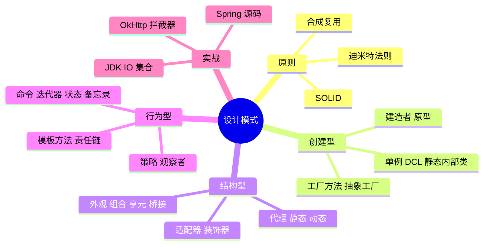

# 🌸 设计模式学习笔记 —— 高手的 23 招武功秘籍

> 嘿嘿～软件工程篇第八章见过设计模式速览表，这次正式开宗立派 🥋！设计模式 = 前人踩坑总结的"标准解法"——学的是套路，练的是"什么时候用哪招"。示例语言 Java，配合 Spring/JDK 源码食用更香～

---

## 📖 目录

1. [初识设计模式：武功秘籍的由来](#一初识设计模式武功秘籍的由来)
2. [设计原则：内功心法](#二设计原则内功心法)
3. [创建型模式（5 招）](#三创建型模式5-招)
4. [结构型模式（7 招）](#四结构型模式7-招)
5. [行为型模式（11 招）](#五行为型模式11-招)
6. [框架源码里的设计模式（联动！）](#六框架源码里的设计模式联动)
7. [总结与面试高频题](#七总结与面试高频题)

---

## 一、初识设计模式：武功秘籍的由来

### 1.1 是什么？

- 1994 年 **GoF（Gang of Four 四人帮）** 出版《设计模式》，收录 **23 种**经典解法
- 模式 = 特定场景下、可复用的解决方案模板
- 不是发明，是**从优秀代码中提炼的套路** 📖

### 1.2 为什么要学？

| 痛点 | 模式怎么救 |
| --- | --- |
| 需求一改，代码大动 | 开闭原则：扩展代替修改 |
| 类和类缠成毛线球 | 解耦：只依赖抽象 |
| 团队沟通费劲 | "这里用策略模式" = 一句话讲清设计 |
| 读不懂框架源码 | Spring/MyBatis 全是模式组合 |

### 1.3 三大类总览

```mermaid
flowchart TD
    A[23 种 GoF 模式] --> B[创建型 5种<br>对象怎么"生"]
    A --> C[结构型 7种<br>对象怎么"组装"]
    A --> D[行为型 11种<br>对象怎么"协作"]
    B --> B1[单例 工厂 抽象工厂<br>建造者 原型]
    C --> C1[适配器 装饰器 代理<br>外观 享元 组合 桥接]
    D --> D1[策略 观察者 模板方法 责任链<br>命令 迭代器 状态 备忘录 等]
```

> 🎀 学习心法：**不为背而背**——先看懂"它解决什么问题"，再记"怎么写"，最后练"哪里能用"。一个模式用错了比不用还糟（过度设计 💀）！

---

## 二、设计原则：内功心法

模式是招式，原则是心法（软件工程篇 SOLID 的完整版）：

| 原则 | 一句话 | 违反的下场 |
| --- | --- | --- |
| 单一职责 SRP | 一个类只干一件事 | God 类改哪崩哪 💥 |
| 开闭原则 OCP | 对扩展开放、对修改关闭 | 每加功能都动老代码 |
| 里氏替换 LSP | 子类能无缝替换父类 | 继承链条毒瘤 |
| 接口隔离 ISP | 接口小而专 | 被迫实现空方法 |
| 依赖倒置 DIP | 依赖抽象不依赖实现 | 换个实现就大手术 |
| **迪米特法则** | 只跟"朋友"说话，别理陌生人 | 类关系网状纠缠 🕸️ |
| **合成复用** | 优先组合，少用继承 | 继承层级爆炸 |

**组合 vs 继承（重要观念！）：**

```java
// ❌ 继承：强耦合，白盒复用（拿到全部）
class Bird { void fly() {...} }
class Penguin extends Bird { }     // 鸵鸟被迫继承 fly() 😅

// ✅ 组合：黑盒复用，灵活装配
class Penguin {
    private final FlyBehavior fly = new CannotFly();   // 有什么能力，装配什么
}
```

---

## 三、创建型模式（5 招）

### 3.1 单例 Singleton ⭐⭐⭐

**一个类全局只有一个实例**（配置中心、连接池、日志对象）。

**① 饿汉式（启动就造，简单线程安全）：**

```java
public class Config {
    private static final Config INSTANCE = new Config();  // 类加载即创建
    private Config() {}                                    // 私有构造防 new
    public static Config getInstance() { return INSTANCE; }
}
```

**② 懒汉式 + 双检锁 DCL（用时才造，面试最爱）：**

```java
public class Config {
    private static volatile Config instance;    // volatile 防指令重排！

    private Config() {}

    public static Config getInstance() {
        if (instance == null) {                 // 第一次检查（免锁提速）
            synchronized (Config.class) {
                if (instance == null) {         // 第二次检查（防重复创建）
                    instance = new Config();
                }
            }
        }
        return instance;
    }
}
```

> ⚠️ 面试追问三连：**为什么两次检查？**（第二次防多线程重复建）**为什么要 volatile？**（`new` 不是原子：分配→初始化→赋值，重排后别的线程拿到半成品）**还有什么写法？**（静态内部类/枚举——天生防反射防序列化，Effective Change 推荐 ✨）

**③ 静态内部类（优雅推荐）：**

```java
public class Config {
    private Config() {}
    private static class Holder {                       // 内部类加载时才实例化
        private static final Config INSTANCE = new Config();
    }
    public static Config getInstance() { return Holder.INSTANCE; }
}
```

### 3.2 工厂模式家族 ⭐⭐

**把 new 的活儿交给工厂**——调用方要产品不给图纸：

```java
// 简单工厂：一个工厂 + if/switch（入门款，不算 GoF）
public class PhoneFactory {
    public static Phone create(String brand) {
        return switch (brand) {
            case "apple" -> new IPhone();
            case "huawei" -> new Huawei();
            default -> throw new IllegalArgumentException();
        };
    }
}

// 工厂方法：一个产品一个工厂（符合开闭原则 ⭐）
interface PhoneFactory { Phone createPhone(); }
class IPhoneFactory implements PhoneFactory {
    public Phone createPhone() { return new IPhone(); }
}
class HuaweiFactory implements PhoneFactory {
    public Phone createPhone() { return new Huawei(); }
}
// 加新产品 = 加一对类，老代码零修改 ✅

// 抽象工厂：一个工厂造一族产品
interface ElectricFactory {          // "苹果全家桶" or "华为全家桶"
    Phone createPhone();
    Watch createWatch();
}
```

| 模式 | 工厂数 | 特点 |
| --- | --- | --- |
| 简单工厂 | 1 | switch 分支，加产品要改工厂 ❌ |
| **工厂方法** | N | 一厂一晶，加产品只加类 ✅ |
| 抽象工厂 | N 族 | 造产品族，加族容易加品种难 |

### 3.3 建造者 Builder ⭐⭐

**一步步组装复杂对象**（参数多、可选参数多时救命）：

```java
User user = User.builder()               // Lombok @Builder
        .name("小花")
        .age(18)
        .vip(true)
        .build();                        // 链式调用，可读性拉满

// JDK 经典：StringBuilder 就是建造者
String s = new StringBuilder().append("a").append("b").toString();
```

### 3.4 原型 Prototype

**克隆已有对象**（而不是重新 new）：`Object.clone()`、深浅拷贝问题。

```java
User copy = user.clone();          // 大对象创建昂贵时用（如初始化复杂）
```

### 3.5 速记表

| 模式 | 一句话 | 场景 |
| --- | --- | --- |
| 单例 | 全局一个 | 配置、连接池 |
| 工厂 | 你要啥我造啥 | 对象创建复杂/需解耦 |
| 抽象工厂 | 造全家桶 | 跨平台 UI 组件 |
| 建造者 | 一步步拼装 | 多参数对象 |
| 原型 | 复制粘贴 | 创建昂贵 |

---

## 四、结构型模式（7 招）

### 4.1 适配器 Adapter ⭐⭐

**转换接口，让不兼容的类合作**（插头转换器 🔌）：

```java
// 旧系统只有 XML 接口，新系统要用 JSON → 中间加个适配器
interface JsonProvider { String getJson(); }

class XmlService { public String getXml() { return "<data/>"; } }

class XmlToJsonAdapter implements JsonProvider {
    private final XmlService xml;
    XmlToJsonAdapter(XmlService xml) { this.xml = xml; }
    public String getJson() {
        return convert(xml.getXml());      // 内部做转换
    }
}
```

### 4.2 装饰器 Decorator ⭐⭐⭐

**不改变原类、动态加功能**（给咖啡加奶加糖 ☕）：

```java
interface Coffee { double cost(); String desc(); }
class SimpleCoffee implements Coffee {
    public double cost() { return 10; }
    public String desc() { return "咖啡"; }
}

// 装饰器：持有一个 Coffee，包一层
class Milk implements Coffee {
    private final Coffee coffee;
    Milk(Coffee coffee) { this.coffee = coffee; }
    public double cost() { return coffee.cost() + 3; }
    public String desc() { return coffee.desc() + "+奶"; }
}

// 自由组合 ✨
Coffee order = new Milk(new SimpleCoffee());      // 咖啡+奶 13
Coffee order2 = new Milk(new Milk(new SimpleCoffee()));  // 双奶 16
```

> 💡 **Java IO 全是装饰器**：`new BufferedInputStream(new FileInputStream(f))` 一层包一层！

### 4.3 代理 Proxy ⭐⭐⭐

**不直接访问目标，经中间人控制**（明星经纪人 🕶️）：

```java
interface UserService { void save(); }

class UserServiceImpl implements UserService {
    public void save() { System.out.println("保存用户"); }
}

// 静态代理：代理类持有目标，前后加逻辑
class UserServiceProxy implements UserService {
    private final UserService target;
    UserServiceProxy(UserService target) { this.target = target; }
    public void save() {
        System.out.println("开启事务");       // 增强逻辑
        target.save();                        // 委托目标
        System.out.println("提交事务");
    }
}

// 动态代理：运行时生成代理类（Spring AOP 的根基！）
UserService proxy = (UserService) Proxy.newProxyInstance(
    loader, new Class[]{UserService.class},
    (p, method, args) -> {
        System.out.println("前置：开启事务");
        Object result = method.invoke(new UserServiceImpl(), args);
        System.out.println("后置：提交事务");
        return result;
    });
```

**代理 vs 装饰器（高频易混！）：**

| | 代理 | 装饰器 |
| --- | --- | --- |
| 意图 | **控制访问**（权限/懒加载/远程）| **增强功能**（加料）|
| 调用方感知 | 不知道目标存在 | 知道在层层包装 |
| 例子 | Spring AOP、经纪人不让你见明星 | Java IO、给咖啡加奶 |

### 4.4 外观 Facade

**给复杂子系统一个简单入口**（一键开机键 ⏻️）：

```java
class ComputerFacade {          // 用户只面对它
    private final Cpu cpu = new Cpu();
    private final Memory mem = new Memory();
    public void start() { cpu.freeze(); mem.check(); cpu.jump(); }  // 内部编排
}
```

### 4.5 组合 Composite

**树形结构，部分-整体统一对待**（文件和文件夹都是"节点" 📁）：

```java
interface Node { long size(); }
class File implements Node { public long size() { return 100; } }
class Folder implements Node {
    List<Node> children = new ArrayList<>();
    public long size() { return children.stream().mapToLong(Node::size).sum(); }
}
```

### 4.6 享元 Flyweight

**共享细粒度对象省内存**——Integer 缓存池、字符串常量池、数据库连接池：

```java
Integer a = 127, b = 127;
System.out.println(a == b);    // true！-128~127 缓存共享
Integer c = 128, d = 128;
System.out.println(c == d);    // false，超出缓存范围 new 了新对象
```

### 4.7 桥接 Bridge

**两个维度独立变化**（形状×颜色，避免类爆炸）：`形状 ← 颜色接口` 组合而非继承。

### 4.8 速记表

| 模式 | 一句话 | 代表应用 |
| --- | --- | --- |
| 适配器 | 转接头 | 日志框架适配 |
| 装饰器 | 层层加料 | Java IO |
| **代理** | 中间人控制 | Spring AOP ⭐ |
| 外观 | 一键入口 | 工具门面类 |
| 组合 | 树形统一 | 文件系统 |
| 享元 | 共享省内存 | Integer 缓存 |
| 桥接 | 两维解耦 | JDBC 驱动 |

---

## 五、行为型模式（11 招）

### 5.1 策略 Strategy ⭐⭐⭐

**算法封装成家族，运行时切换**（支付方式/排序器）：

```java
interface PayStrategy { void pay(double amount); }
class Alipay implements PayStrategy { public void pay(double a) { System.out.println("支付宝:" + a); } }
class WechatPay implements PayStrategy { public void pay(double a) { System.out.println("微信:" + a); } }

class Order {
    private PayStrategy strategy;                      // 持有抽象
    Order(PayStrategy strategy) { this.strategy = strategy; }
    void checkout(double amount) { strategy.pay(amount); }
}

new Order(new Alipay()).checkout(99.9);     // 想换？换个策略对象，Order 不动 ✅
```

> 💡 联动：软件工程篇 SOLID 的 ❌/✅ 支付例子就是它！消灭 if-else 的第一神器。

### 5.2 观察者 Observer ⭐⭐⭐

**一对多依赖：状态一变，全员通知**（公众号订阅 📢）：

```java
interface Observer { void update(String msg); }

class Publisher {                       // 被观察者（主题）
    private final List<Observer> observers = new ArrayList<>();
    public void subscribe(Observer o) { observers.add(o); }
    public void publish(String msg) {
        observers.forEach(o -> o.update(msg));      // 广播
    }
}

class User implements Observer {
    private final String name;
    User(String name) { this.name = name; }
    public void update(String msg) { System.out.println(name + " 收到：" + msg); }
}

Publisher gzh = new Publisher();
gzh.subscribe(new User("小花"));
gzh.subscribe(new User("小明"));
gzh.publish("更新啦！");           // 所有人都收到 ✨
```

**应用：** GUI 事件监听、MQ 消息、Spring 的 `ApplicationEvent`、Redis 发布订阅（数据库篇讲过！）

### 5.3 模板方法 Template Method ⭐⭐

**父类定骨架，子类填空**（做饭流程：洗→切→炒，切什么炒什么子类定）：

```java
abstract class Cook {
    // 模板方法：final 防子类改流程
    public final void cook() {
        wash();
        cut();
        fry();          // 步骤固定
        season();
    }
    private void wash() { System.out.println("洗菜"); }
    private void fry() { System.out.println("下锅炒"); }
    protected abstract void cut();        // 🔑 留给子类的"空"
    void season() {}                       // 钩子：可选覆盖
}
class TomatoEgg extends Cook {
    protected void cut() { System.out.println("切番茄和蛋"); }
    @Override void season() { System.out.println("加点糖"); }
}
```

**应用：** JdbcTemplate、AQS（JUC 并发包的核心！）、Servlet 的 service()。

### 5.4 责任链 Chain of Responsibility ⭐⭐

**请求沿链条传递，谁处理谁拦截**（公司报销审批）：

```java
abstract class Handler {
    protected Handler next;                       // 下一个节点
    public Handler setNext(Handler next) { this.next = next; return next; }
    public abstract void handle(int money);
}

class Leader extends Handler {           // 组长≤1000
    public void handle(int money) {
        if (money <= 1000) System.out.println("组长批了");
        else next.handle(money);         // 处理不了，甩给下一个
    }
}
class Boss extends Handler {             // 老板不设限
    public void handle(int money) { System.out.println("老板批了"); }
}

// 组装链条
Handler chain = new Leader();
chain.setNext(new Boss());
chain.handle(50000);      // 组长→老板 批 ✅
```

**应用：** OkHttp 拦截器（第三方库篇！）、Servlet Filter、Spring Interceptor、Netty Pipeline。

### 5.5 其余 7 招速览

| 模式 | 一句话 | 应用 |
| --- | --- | --- |
| 命令 Command | 请求封装成对象（排队/撤销）| 线程池任务、Runnable |
| 迭代器 Iterator | 统一遍历集合 | `for (T t : list)` |
| 状态 State | 状态变行为跟着变 | 订单状态机、TCP 状态 |
| 备忘录 Memento | 存档读档 💾 | 编辑器撤销、事务回滚 |
| 中介者 Mediator | 星型通信，别全互连 | 聊天室、MVC 的 C |
| 访问者 Visitor | 不改元素类加新操作 | 编译器 AST 处理 |
| 解释器 Interpreter | 定义语法解释执行 | 正则引擎、SQL 解析 |

```java
// 状态模式小例：订单流转（联动订单状态机概念）
interface OrderState { void next(Order o); }
class Paid implements OrderState {
    public void next(Order o) { System.out.println("已付款→发货"); o.state = new Shipped(); }
}
class Shipped implements OrderState {
    public void next(Order o) { System.out.println("已发货→完成"); o.state = new Done(); }
}
```

---

## 六、框架源码里的设计模式（联动！）

| 框架/类库 | 用到的模式 | 对应本篇 |
| --- | --- | --- |
| **Spring** | 单例（默认 Bean 作用域）、**动态代理**（AOP）、模板方法（JdbcTemplate）、观察者（事件）、工厂（BeanFactory）、策略（Resource 加载）| 全明星阵容 🌟 |
| **JDK** | 建造者（StringBuilder）、装饰器（IO 全家）、享元（Integer 缓存）、迭代器（集合）、适配器（InputStreamReader）、命令（Runnable）、原型（clone）| 模式教科书 |
| **MyBatis** | 建造者（SqlSessionFactoryBuilder）、代理（Mapper 接口动态代理）、模板方法、责任链（插件拦截器）| — |
| **OkHttp**（第三方库篇）| **责任链**（拦截器链）、享元（连接池）| — |
| **Glide**（第三方库篇）| 建造者（RequestBuilder）、代理、外观 | — |
| **RecyclerView**（Android-UI 篇）| 观察者（AdapterDataObservable）、享元（ViewHolder 复用）| — |

> 🎀 面试金句：**"读框架源码，一半是在认设计模式"**——会说"Spring AOP 基于动态代理，责任链在 OkHttp 拦截器里"这种话，面试官眼睛会亮 ✨

---

## 七、总结与面试高频题

### 7.1 知识地图



### 7.2 面试官最爱问 Top 题 🎯

| 问题 | 答题要点 |
| --- | --- |
| 单例有几种写法？ | 饿汉（类加载即建）/懒汉 DCL/静态内部类/枚举；各有线程安全性 |
| DCL 为什么要 volatile？ | new 非原子（分配→初始化→赋值），重排会让别的线程拿到未初始化对象 |
| 为什么推荐静态内部类？ | 懒加载（内部类加载才建）+ 类加载机制天然线程安全 + 代码简洁 |
| 工厂方法 vs 简单工厂？ | 前者一厂一晶符合开闭（加产品只加类）；后者 switch 集中（加产品改工厂）|
| 工厂方法 vs 抽象工厂？ | 造单个产品 vs 造产品族；前者加产品容易，后者加族容易 |
| 装饰器和代理区别？ | 装饰器=增强功能（调用方知道在包装）；代理=控制访问（调用方无感）；IO vs AOP |
| 装饰器应用？ | Java IO 流：BufferedInputStream(FileInputStream) 层层包 |
| JDK 动态代理原理？ | 运行时生成 $Proxy0 字节码继承 Proxy 实现接口，方法调用转发 InvocationHandler.invoke |
| JDK 动态代理限制？ | 只能代理接口；代理类要 Spring CGLIB（子类字节码） |
| 策略模式解决什么？ | 消灭 if-else 分支；算法族封装+运行时切换；配工厂/Map 注入更佳 |
| 观察者模式应用？ | 解耦事件源和监听者；GUI 事件、Spring Event、MQ、Redis 发布订阅 |
| 模板方法应用？ | 父类 final 定流程+抽象方法留空；JdbcTemplate、AQS、Servlet |
| 责任链应用？ | 请求沿链传递；OkHttp 拦截器、Filter、Interceptor、Netty Pipeline |
| Spring 用了哪些模式？ | 单例（Bean）、工厂（BeanFactory）、代理（AOP）、模板（JdbcTemplate）、观察者（Event）、策略（实例化）|
| 模式会不会过度设计？ | 会！按需引入，简单场景直写；模式是解药不是补品（YAGNI 原则）|

### 7.3 学习建议路线 🗺️

1. **第一站**：手写单例四种写法，说清每种的线程安全逻辑
2. **第二站**：把项目里最长的 if-else 用策略模式重构（体会"开闭"）
3. **第三站**：写一个动态代理 Demo，打印方法调用（AOP 原理就通了）
4. **第四站**：装饰器练习——自己包一个"带缓冲的 Reader"
5. **第五站**：读 Spring AOP / OkHttp 拦截器源码，认出每个模式
6. **终点站**：重读《Head First 设计模式》+ Refactoring.Guru 网站 🌹

---

> 🌈 设计模式通关！计科分区五连达成 🥋 软件工程篇的"兵法"如今有了"招式库"——原则定方向、模式给解法、源码做印证！写代码时多问一句"这里换策略模式会不会更香"，肌肉记忆就养成了～下一个知识点继续召唤我！(๑•̀ㅂ•́)و✧⚔️💪
