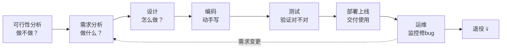
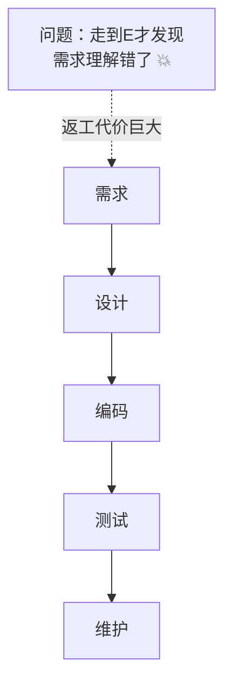
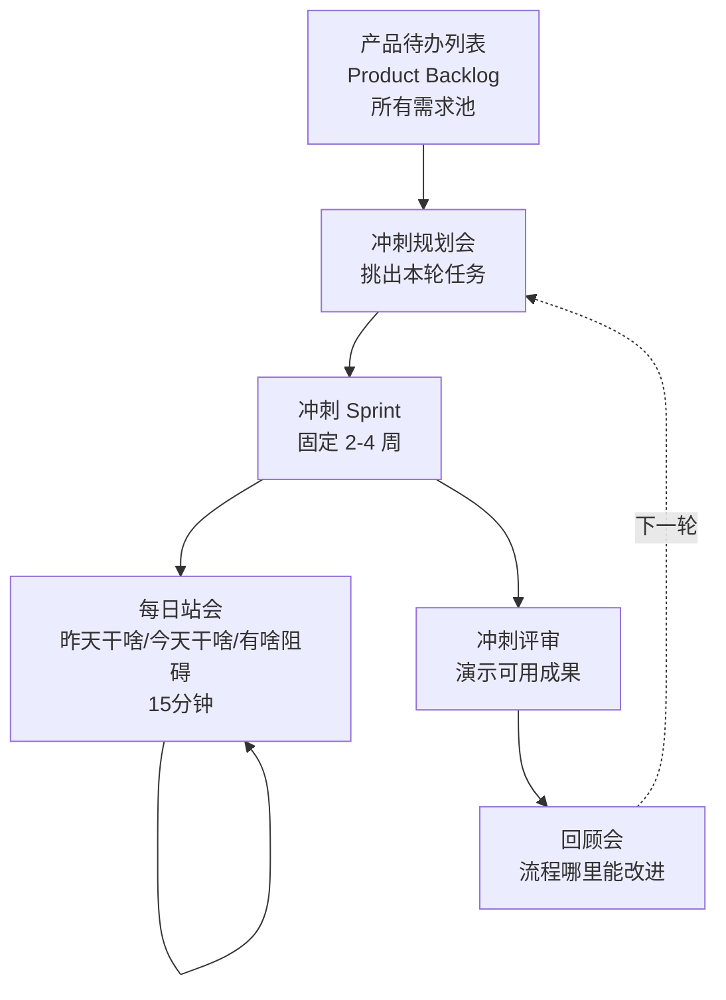
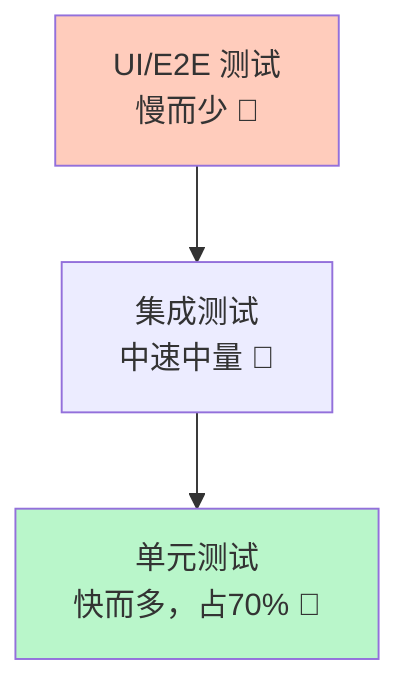
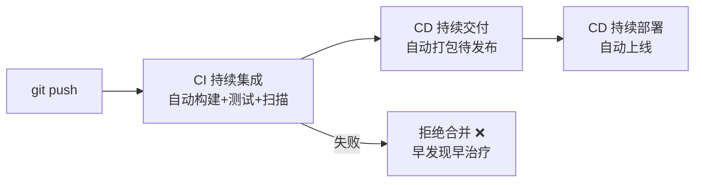
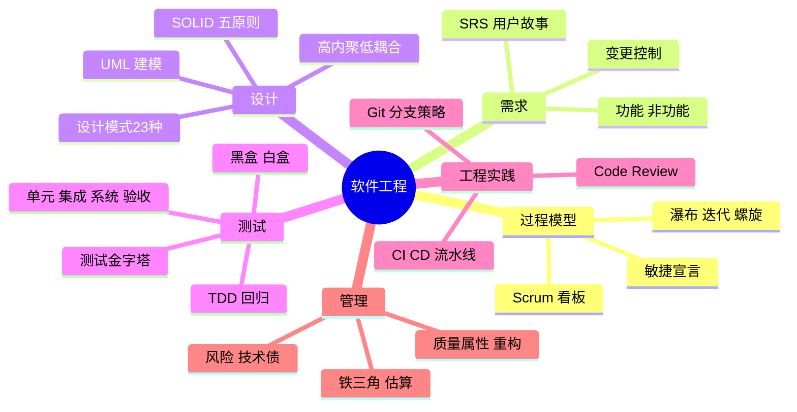

# 🌸 软件工程学习笔记 —— 代码之外的兵法

> 嘿嘿～写代码是"武艺"，软件工程是"兵法" 📜！为什么项目会延期？为什么改一处崩三处？怎么跟产品经理斗智斗勇？这篇讲的是让一群人协作把软件做好的方法论～（前面安全开发篇讲过 SDL，这次看全景！）

---

## 📖 目录

1. [初识软件工程：为什么需要它？](#一初识软件工程为什么需要它)
2. [软件生命周期](#二软件生命周期)
3. [开发模型演进：从瀑布到敏捷（重点！）](#三开发模型演进从瀑布到敏捷重点)
4. [敏捷开发与 Scrum（重点！）](#四敏捷开发与-scrum重点)
5. [需求工程：搞清要做什么](#五需求工程搞清要做什么)
6. [系统设计与模块化](#六系统设计与模块化)
7. [设计原则：SOLID（重点！）](#七设计原则solid重点)
8. [设计模式速览](#八设计模式速览)
9. [UML 建模](#九uml-建模)
10. [软件测试（重点！）](#十软件测试重点)
11. [版本控制与 CI/CD](#十一版本控制与-cicd)
12. [项目管理与质量](#十二项目管理与质量)
13. [总结与面试高频题](#十三总结与面试高频题)

---

## 一、初识软件工程：为什么需要它？

### 1.1 软件危机的故事

上世纪 60 年代，软件越来越复杂，灾难频发 💥：

- 项目延期、预算爆炸（IBM OS/360 耗资 5 亿美元还是一堆 bug）
- 代码像意大利面 🍝，改一处崩三处
- 文档缺失，人走了项目就瘫痪

于是 1968 年 NATO 会议提出 **"软件工程"**：**用工程化方法（规范化、可度量、可管理）开发软件**。

### 1.2 软件工程 = 管理 + 技术

| 维度 | 关心的问题 | 工具/方法 |
| --- | --- | --- |
| 过程 | 按什么流程开发？ | 瀑布/敏捷/Scrum |
| 方法 | 怎么设计怎么写？ | 需求分析/SOLID/设计模式 |
| 管理 | 进度、成本、质量？ | 估算/风险/测试/CI/CD |

> 🎀 一句话：**一个人写小脚本靠灵感，一群人做产品靠工程**——软件工程就是"团队协作的操作系统"！

---

## 二、软件生命周期

软件从出生到退休的全过程：



| 阶段 | 产出物 | 占比真相 |
| --- | --- | --- |
| 需求分析 | 需求文档 SRS | **成本 40%+（最重要！）** |
| 设计 | 架构/详细设计文档 | 20% |
| 编码 | 代码 | 常人以为的 100%，实际 ~20% 😲 |
| 测试 | 测试报告 | 30% |
| 运维 | 持续服务 | 生命周期最长 |

> 💡 经典结论（Boehm）：**需求阶段的错误，到后期修复成本翻 100 倍**——所以"左移"（早发现早解决）是全篇主线！

---

## 三、开发模型演进：从瀑布到敏捷（重点！）

### 3.1 瀑布模型 Waterfall

像瀑布一样一级一级往下流，上一阶段完成才进下一阶段：



| 优点 | 缺点 |
| --- | --- |
| 阶段清晰、文档齐全 | **不适应变化**（需求改=重来）|
| 适合需求稳定项目 | 后期才见成果，风险后置 |

### 3.2 其他经典模型

| 模型 | 思路 | 适用 |
| --- | --- | --- |
| 原型模型 | 先做个粗糙 Demo 确认需求 | 需求模糊 |
| **迭代/增量模型** | 分批交付，每次加一点 | 大项目拆解 |
| 螺旋模型 | 迭代 + **风险分析**驱动 | 大型高风险项目 |
| **敏捷 Agile** ⭐ | 小步快跑拥抱变化 | **互联网主流** ✅ |

### 3.3 瀑布 vs 敏捷

| 对比 | 瀑布 | 敏捷 |
| --- | --- | --- |
| 节奏 | 一次性大交付 | **2周一个小版本** |
| 需求 | 前期锁死 | 拥抱变更 |
| 文档 | 厚重 | 够用就好 |
| 客户 | 需求期+验收期出现 | **全程参与** |
| 风险 | 后置爆发 | 持续暴露 |
| 类比 | 考完期末才出分 | **每周小测验随时纠偏** 📝 |

---

## 四、敏捷开发与 Scrum（重点！）

### 4.1 敏捷宣言（2001，四大价值观）

| 更看重（左）| 而不是（右）|
| --- | --- |
| **个体和互动** | 流程和工具 |
| **可工作的软件** | 详尽的文档 |
| **客户合作** | 合同谈判 |
| **响应变化** | 遵循计划 |

> ⚠️ 注意措辞是"更看重"，右边也有价值——敏捷 ≠ 不写文档不规划！

### 4.2 Scrum：最流行的敏捷框架



| 角色 | 职责 |
| --- | --- |
| Product Owner 产品负责人 | 管需求优先级（Backlog 排序）|
| Scrum Master | 管流程（清障碍，不是领导）|
| 开发团队 | 自组织干活（5-9 人）|

**核心工件：** Product Backlog（需求池）→ Sprint Backlog（本轮任务）→ Increment（可交付增量）

### 4.3 看板 Kanban

另一种敏捷流派：可视化 + 限制在制品：

```
| 待办 | 开发中 | 测试 | 完成 |
|------|--------|------|------|
| 任务A | 任务C(2/3) | 任务D | 任务E |
| 任务B | 任务F(1/3) |      |      |
```

- 看板拉通全流程，**每列限制数量**（如"开发中"最多 3 个）
- 没有固定节奏，持续流动（对比 Scrum 的固定冲刺）

> 🎀 记忆：**Scrum 是"节拍器"（固定冲刺节奏），看板是"传送带"（持续流转）**——很多团队混着用 Scrumban～

---

## 五、需求工程：搞清要做什么

### 5.1 需求的分类

| 类型 | 回答 | 例子 |
| --- | --- | --- |
| 功能需求 | 系统做什么？ | 用户可以购物车结算 |
| 非功能需求 | 做得多好？ | 响应 <500ms、可用性 99.9% |
| 约束 | 限制条件？ | 必须用国产数据库、预算 50 万 |

### 5.2 需求工程流程

```
需求获取（访谈/问卷/观察）
  → 需求分析（建模、理清冲突）
  → 需求规格说明书 SRS（产出台同级文档）
  → 需求评审（各方确认签字）
  → 需求管理（变更控制——防"范围蔓延"）
```

**功能分解：用户故事（敏捷派需求写法）**

```
作为【角色】，我想要【功能】，以便【价值】
例：作为买家，我想要一键付款，以便快速完成购买

验收标准（AC）：
✅ 支持主流支付方式
✅ 支付失败给出明确提示
```

> 💡 面试/实战金句：**"需求是问题的描述，设计是解决方案的描述"**——90% 的返工源于需求没搞清就开写！

---

## 六、系统设计与模块化

### 6.1 两级设计

| 层次 | 干啥 | 产出 |
| --- | --- | --- |
| 概要设计 | 架构、模块划分、接口定义 | 架构图、模块图 |
| 详细设计 | 模块内部逻辑 | 伪代码/流程图 |

### 6.2 模块化：好架构的两大指标

| 指标 | 含义 | 目标 |
| --- | --- | --- |
| **内聚** | 模块内部元素的关联程度 | **高**内聚（一个模块只干一件事）|
| **耦合** | 模块之间的依赖程度 | **低**耦合（改动不牵连别人）|

**内聚从好到坏：** 功能内聚 > 顺序 > 通信 > 时间内聚 > 逻辑 > 巧合内聚
**耦合从好到坏：** 数据耦合 < 标记 < 控制 < 公共 < 内容耦合

> 🎀 通俗版：**高内聚 = 专科医生（专注一门）**，**低耦合 = 不用打听别的科室的事**——医院这么组织，软件也应该这么组织！

### 6.3 架构风格速览

| 风格 | 思路 | 例子 |
| --- | --- | --- |
| 分层架构 | 表现层→业务层→数据层 | 传统 Web 后端 |
| MVC/MVVM | 职责分离 | 前端/iOS |
| 微服务 | 按业务拆独立服务 | 大厂中台 |
| 事件驱动 | 消息触发处理 | 订单系统解耦 |
| C/S、B/S | 客户端-服务器 | 各类 App/网页 |

---

## 七、设计原则：SOLID（重点！）

面向对象设计的五大原则，面试必背 🎯：

| 原则 | 一句话 | 大白话 |
| --- | --- | --- |
| **S** 单一职责 SRP | 一个类只一个变化理由 | 一人一岗，别当全能选手 |
| **O** 开闭原则 OCP | 对扩展开放、对修改关闭 | 加功能靠"新增"不靠"改旧" |
| **L** 里氏替换 LSP | 子类必须能替换父类 | 儿子必须干得了爹的活 |
| **I** 接口隔离 ISP | 接口小而专 | 别逼人实现用不到的方法 |
| **D** 依赖倒置 DIP | 依赖抽象不依赖实现 | 插座标准 vs 焊死电线 |

```java
// ❌ 违反 OCP：加新支付方式要改老代码（风险！）
class PayService {
    public void pay(String type) {
        if (type.equals("alipay")) {...}
        else if (type.equals("wechat")) {...}
        // 每加一种支付就改这里 😫
    }
}

// ✅ 遵守 OCP + DIP：新支付=新类，老代码不动
interface PayChannel { void pay(BigDecimal amount); }
class Alipay implements PayChannel { ... }
class WechatPay implements PayChannel { ... }
class PayService {
    private final PayChannel channel;      // 依赖抽象
    PayService(PayChannel channel) { this.channel = channel; }  // 注入
    public void pay(BigDecimal amount) { channel.pay(amount); }
}
```

**配套原则：**

- **DRY**：Don't Repeat Yourself（别复制粘贴，抽公共）
- **KISS**：Keep It Simple（能简单别复杂）
- **YAGNI**：You Aren't Gonna Need It（别提前设计用不到的）

> 🎀 SOLID 不是教条，是"**改起来不疼**"的经验总结——违反了也能跑，只是每次改需求都要掉层皮 💀

---

## 八、设计模式速览

设计模式 = SOLID 的实战招式（23 种 GoF 模式，这里速览常考款）：

| 类别 | 思想 | 高频模式 | 一句话 |
| --- | --- | --- | --- |
| **创建型** | 对象怎么"生" | 单例 Singleton | 全局只有一个（配置中心）|
| | | 工厂方法 Factory | 你要啥我造啥 |
| | | 建造者 Builder | 一步步组装复杂对象 |
| **结构型** | 对象怎么"组装" | 适配器 Adapter | 插头转换器 🔌 |
| | | 装饰器 Decorator | 给咖啡加奶加糖 ☕ |
| | | 代理 Proxy | 明星经纪人 🕶️ |
| **行为型** | 对象怎么"协作" | 观察者 Observer | 订阅通知（EventBus）|
| | | 策略 Strategy | 算法随时换（支付方式）|
| | | 模板方法 Template | 父类定骨架子类填空 |

```java
// 单例（Kotlin 一行 / Java 双检锁）
object AppConfig { var theme = "dark" }   // Kotlin

// 策略模式 + 简单工厂：支付渠道自由切换
PayService(Alipay()).pay()      // 今天用支付宝
PayService(WechatPay()).pay()   // 明天换微信，别处零改动 ✅
```

> 💡 和前面联动：OkHttp 拦截器=责任链、Retrofit=动态代理+外观、Glide RequestBuilder=建造者——**框架源码全是设计模式的连环画**！

---

## 九、UML 建模

统一建模语言——画给团队看的"工程图纸" 📐：

| 图类型 | 表达什么 | 什么时候用 |
| --- | --- | --- |
| **用例图** | 谁能用系统干什么 | 需求阶段 |
| **类图** | 类+关系（继承/组合/依赖）| 设计阶段 |
| **时序图** | 对象间消息的时间顺序 | 详细设计（API 交互）|
| 活动图 | 业务流程（带分支）| 流程梳理 |
| 状态图 | 对象的状态变迁 | 状态机（订单流转）|

**类图六大关系（由强到弱）：**

```
泛化(继承) ──▷    实现 ┈┈▷
组合(菱形实心)◆── 聚合(菱形空心)◇──
关联(实线) ──     依赖(虚线箭头) ┈┈▶
```

| 关系 | 含义 | 例子 |
| --- | --- | --- |
| 继承 | is-a | 猫 is 动物 |
| 实现 | 实现接口 | 猫实现"叫"接口 |
| 组合 | 强拥有（同生共死）| 人↔心脏 ❤️ |
| 聚合 | 弱拥有（可分离）| 部门↔员工 |
| 关联 | 长期联系 | 学生↔课程 |
| 依赖 | 临时使用 | 方法参数借用 |

> 🎀 本笔记系列一直在用的 **mermaid 时序图/流程图/状态机**就是 UML 思想的落地～会画图 = 会表达设计！

---

## 十、软件测试（重点！）

### 10.1 测试分类

| 按阶段 | 测什么 | 谁测 |
| --- | --- | --- |
| **单元测试** | 单个函数/类 | 开发自己 ✍️ |
| 集成测试 | 模块组装后接口 | 开发/测试 |
| 系统测试 | 整个系统功能+性能 | 测试团队 |
| 验收测试 | 用户视角确认（UAT）| 客户/产品 |

### 10.2 测试金字塔（自动化策略）



> 💡 原则：**越多测试越往下层放**——单元测试毫秒级、易定位；UI 测试脆弱、跑一次几分钟。倒金字塔 = 维护噩梦 💀

### 10.3 黑盒与白盒

| | 黑盒 | 白盒 |
| --- | --- | --- |
| 视角 | 不看代码，只看输入输出 | 研究代码内部逻辑 |
| 方法 | 等价类、边界值 | 语句覆盖、分支覆盖、路径覆盖 |
| 类比 | 开车（不用懂发动机）| 拆开发动机检查 🔧 |

**必背概念：**

- **边界值分析**：bug 爱藏在边界（0、最大值、空集合）
- **回归测试**：改完代码重测老功能（防"修一个坏三个"）
- **冒烟测试**：先测主干流程通不通，不通直接打回 🚬
- **TDD 测试驱动开发**：先写测试再写实现（红→绿→重构）
- **覆盖率**：语句/分支覆盖率高 ≠ 没 bug，但覆盖低 = 测不充分

### 10.4 单元测试实战（JUnit 思想）

```java
@Test
fun 计算折扣_会员打八折() {
    // Given 准备
    val user = User(vip = true)
    // When 执行
    val price = calcPrice(user, 100.0)
    // Then 断言
    assertEquals(80.0, price, 0.01)
}
```

---

## 十一、版本控制与 CI/CD

### 11.1 Git 分支策略

| 策略 | 分支模型 | 适合 |
| --- | --- | --- |
| Git Flow | master/develop/feature/release/hotfix 全家桶 | 版本发布制 |
| **GitHub Flow** | main + feature 分支 + PR | 持续部署的互联网团队 ⭐ |
| Trunk-Based | 都往主干提，特性开关控制 | 大厂高频部署 |

**Pull Request 流程（代码质量的守门员）：**

```
feature 分支开发 → 推远端 → 发 PR →
  CI 自动跑（构建+测试）✅ →
  同事 Code Review 提意见 →
  改完 Approve → 合并 main → 自动部署
```

**Code Review 看什么：** 正确性、可读性、测试、安全、命名——**小 PR（<400行）质量远高于巨型 PR**！

### 11.2 CI/CD 流水线



| 概念 | 全称 | 干啥 |
| --- | --- | --- |
| CI | Continuous Integration | 每次提交自动构建测试 |
| CD | Continuous Delivery | 随时可发布的一键发布 |
| CD | Continuous Deployment | 测试过直接自动上线 |

> 🎀 联动安全开发篇的 DevSecOps：**把安全扫描也塞进流水线**——质量、安全、效率一把抓！

---

## 十二、项目管理与质量

### 12.1 项目管理铁三角

```
        范围（功能）
          /\
         /  \
        /    \
   成本 ⎯⎯⎯⎯ 时间
```

**三者互相牵制：要快+要全+要便宜 = 不可能三角**——产品经理改需求时，记得问"砍哪个？" 😏

### 12.2 估算与风险

| 工具 | 用途 |
| --- | --- |
| 工作分解结构 WBS | 把项目拆成小任务再估时 |
| 甘特图 | 任务时间线排期 |
| 帕金森定律 | 给多少时间就用多少时间——别拍脑袋估期 |
| 风险管理 | 识别→评估（概率×影响）→应对→监控 |
| 技术债务 | 赶工埋下的坑，迟早要还利息 💳 |

### 12.3 软件质量属性

| 属性 | 含义 |
| --- | --- |
| 正确性 | 功能符合需求 |
| 可靠性 | 稳定不崩 |
| 可维护性 | 改起来容易（最被低估！）|
| 可扩展性 | 加功能不费劲 |
| 安全性 | 见网络安全篇 |
| 性能 | 快（数据库篇 EXPLAIN）|

**重构 Refactoring**：不改外部行为，优化内部结构——"让代码越来越容易改"，配合测试保障（先有测试再重构，不然是裸奔 🏃‍♀️）

---

## 十三、总结与面试高频题

### 13.1 知识地图



### 13.2 面试官最爱问 Top 题 🎯

| 问题 | 答题要点 |
| --- | --- |
| 瀑布和敏捷区别？ | 阶段串行大交付 vs 小步快跑拥抱变化；文档驱动 vs 可用软件驱动；风险后置 vs 持续暴露 |
| Scrum 的流程和角色？ | 三角色（PO/SM/团队）+ 三会议（规划/每日站会/评审回顾）+ Sprint 冲刺 |
| 敏捷宣言四条？ | 个体互动>流程工具、可用软件>详尽文档、客户合作>合同谈判、响应变化>遵循计划 |
| 什么是高内聚低耦合？ | 模块内强相关（一事一模块）；模块间弱依赖（改动不牵连）；衡量设计好坏核心指标 |
| SOLID 是什么？ | 单一职责/开闭/里氏替换/接口隔离/依赖倒置——可维护 OO 设计五原则 |
| 开闭原则举例？ | 加支付方式：if-else 改老代码 ❌ vs 新实现类 + 依赖注入 ✅ |
| 常见设计模式？ | 创建（单例/工厂/建造者）、结构（适配器/装饰器/代理）、行为（观察者/策略/模板）|
| 单元测试和集成测试区别？ | 测单个函数（快、隔离、mock 依赖）vs 测模块协作（真实依赖、慢些）|
| 什么是测试金字塔？ | 底层单元测试多（70%）、中层集成、顶层UI少——快而稳的自动化结构 |
| TDD 是什么？ | 测试驱动：先写测试（红）→ 写实现（绿）→ 重构；倒金字塔/只写实现都不是 TDD |
| 什么是回归测试？ | 修改后重测原有功能，防止改 A 坏 B；自动化回归套件是 CI 核心 |
| Git Flow 和 GitHub Flow？ | 前者多分支版本发布制；后者 main+feature+PR，适配持续部署 |
| CI/CD 是什么？ | 持续集成（提交即构建测试）/持续交付（一键发布）/持续部署（自动上线）|
| 什么是技术债务？ | 赶工欠下的设计缺陷；利息=维护成本上升；定期重构还债 |

### 13.3 学习建议路线 🗺️

1. **第一站**：对照本篇检查自己团队流程——用的瀑布还是敏捷？瓶颈在哪？
2. **第二站**：给项目补单元测试，实践 Given-When-Then 写法
3. **第三站**：用 SOLID 重构一个 if-else 满天飞的模块
4. **第四站**：搭一条 GitHub Actions 流水线（push→测试→构建）
5. **第五站**：学画 UML 时序图/类图，把项目核心流程画出来
6. **终点站**：读《代码整洁之道》《敏捷软件开发》🌹

---

> 🌈 软件工程通关！计科分区二连达成 📜 现在你既会"武艺"（前面学的语言框架）又懂"兵法"（流程/设计/测试/协作）——个人英雄主义写小作坊，工程思维才能造大教堂！下一个知识点继续召唤我！(๑•̀ㅂ•́)و✧🏰💪
