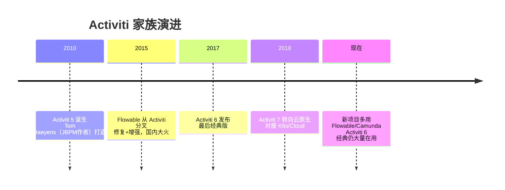
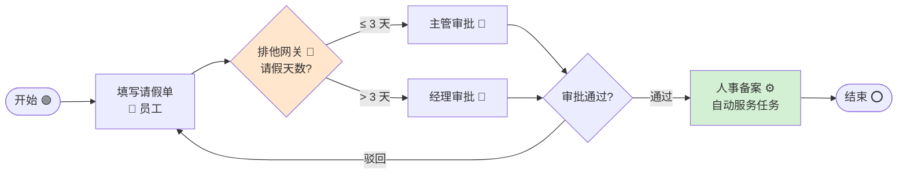
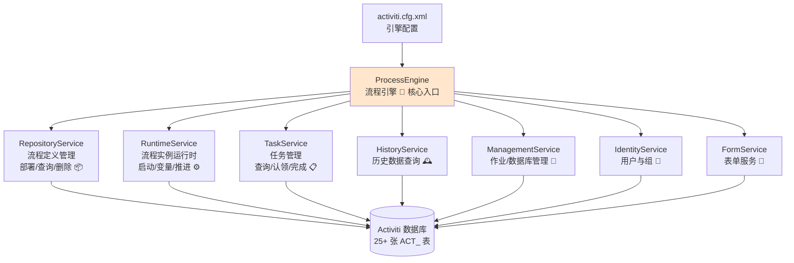
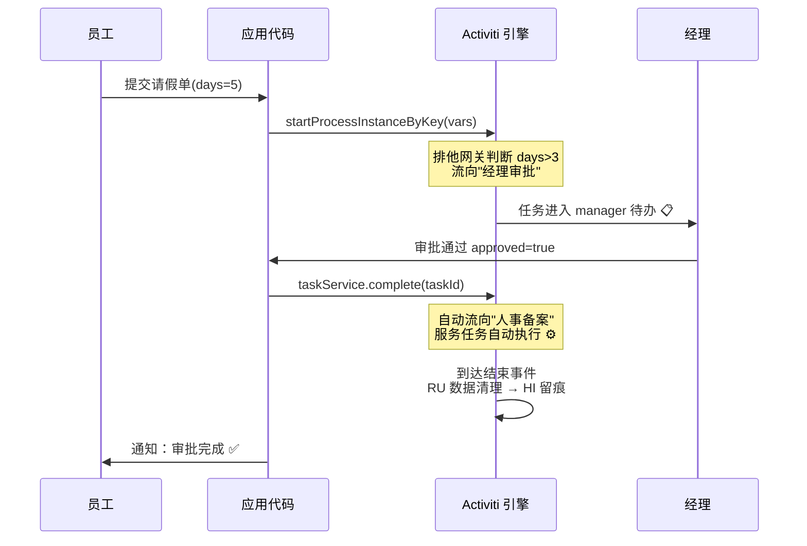
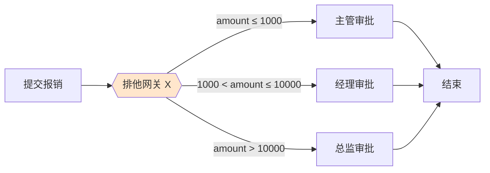
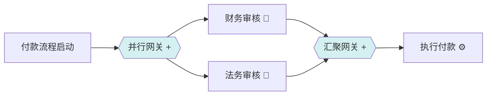
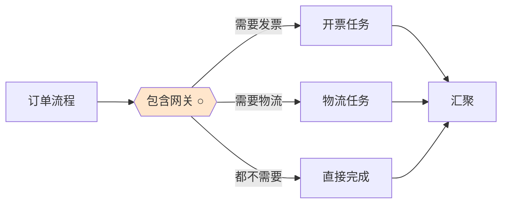
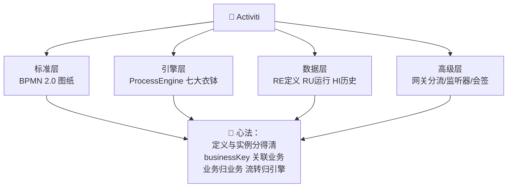

# 🔄 Activiti 工作流框架学习笔记

> 今天要吃透的是审批流自动化神器—— **Activiti** ✨
> 请假要主管批、报销要财务批、下单要风控审……这些"流转"逻辑手写状态机会把人逼疯！Activiti 画张图就把流程管起来～我会用大白话 + 完整 Java 实战带您入门！(≧▽≦)

---

## 📚 目录一览

1. [Activiti 是什么？](#一activiti-是什么)
2. [为什么需要工作流引擎？](#二为什么需要工作流引擎)
3. [BPMN 2.0：流程的"普通话"](#三bpmn-20流程的普通话)
4. [核心架构：引擎与七大衣钵](#四核心架构引擎与七大衣钵)
5. [数据库表命名规则](#五数据库表命名规则)
6. [Spring Boot 快速上手](#六spring-boot-快速上手)
7. [核心 API 实战：请假审批流](#七核心-api-实战请假审批流)
8. [三大网关：流程分岔路口](#八三大网关流程分岔路口)
9. [进阶：监听器/表达式/会签](#九进阶监听器表达式会签)
10. [Activiti vs Flowable vs Camunda](#十activiti-vs-flowable-vs-camunda)
11. [常见坑与最佳实践](#十一常见坑与最佳实践)
12. [总结 & 速查表](#十二总结--速查表)

---

## 一、Activiti 是什么？

### 1.1 一句话解释

> **Activiti = 开源工作流引擎：把"审批/流转"业务画成 BPMN 流程图，引擎负责流程的推进、跳转、挂起、回退、记录——代码只管业务，流转交给引擎。** 🔄

### 1.2 打个比方 🏭

审批流就像**工厂流水线**：
- **手写状态机** = 自己搬着零件在车间之间跑：每个环节写 if/else，谁审批、审批完去哪、被驳回怎么办……全靠代码硬编码，流程一改全得动 😭；
- **Activiti** = 请了个**专业流水线调度员** 🎩：
  - 您画一张流水线图纸（BPMN 流程图）；
  - 调度员按图纸把"单子"（流程实例）一站站传下去；
  - 谁该处理、超时提醒、走哪条岔路（网关）、全过程留痕（历史表），调度员全包！

### 1.3 家族简史 🕰️



> 💡 三个引擎同根同源（都是 BPMN 2.0），核心 API 几乎一致——学会 Activiti，Flowable/Camunda 顺手就会！

---

## 二、为什么需要工作流引擎？

### 2.1 手写审批流的痛 😢

| 痛点 | 场景 |
| --- | --- |
| 🔀 流转逻辑硬编码 | "主管批完给经理、经理批完给财务"写成面条 if/else |
| 📋 流程变更 = 改代码 | 审批链加一个人，发版一次 |
| 🕵️ 无法追溯 | 这单当时谁批的？为什么被驳回？查无实据 |
| ⏰ 缺乏超时/催办 | 单子躺三天没人管 |
| 🔂 驳回/回退复杂 | 驳回到发起人？回退两步？逻辑写到吐血 |
| 👥 会签/或签难做 | "三个总监全票通过"手写并发计数器 |

### 2.2 工作流引擎的答案 ✨

| 能力 | 引擎提供 |
| --- | --- |
| 🎨 流程即图纸 | BPMN 图可视化定义，改流程不改代码 |
| 🚀 自动推进 | 任务完成自动流向下一节点 |
| 🕵️ 全程留痕 | 历史表记录每个节点谁何时处理 |
| 🔀 网关分流 | 排他/并行/包含网关表达业务规则 |
| ⏰ 超时边界 | 定时边界事件自动提醒/跳转 |
| 👥 会签支持 | 多实例任务：N 人投票全过/任过 |

---

## 三、BPMN 2.0：流程的"普通话"

> **BPMN（Business Process Model and Notation）= 业务流程建模标准**：一套全球通用的"流程图语法"，画出来的图引擎直接能跑！

### 3.1 常用元素速查

| 元素 | 图标语义 | 一句话 |
| --- | --- | --- |
| **开始事件** | 绿色圆圈 🟢 | 流程从这里启动 |
| **结束事件** | 红色圆边 ⭕ | 流程到此结束 |
| **用户任务** | 人形图标 👤 | 等人处理（审批） |
| **服务任务** | 齿轮 ⚙️ | 自动执行（调 Java 类/接口） |
| **排他网关** | 菱形+X 🔶 | 多选一：按条件走一条 |
| **并行网关** | 菱形+ ➕ | 全都要：分成几条同时走 |
| **包含网关** | 菱形+○ | 条件满足的分支都走 |
| **顺序流** | 箭头 → | 节点间的传送带 |

### 3.2 一张最经典的请假流程图



这张图保存为 `.bpmn20.xml`（或 `.bpmn`），部署进引擎，流程就能跑起来了！

---

## 四、核心架构：引擎与七大衣钵



| Service | 管什么 | 高频方法 |
| --- | --- | --- |
| **RepositoryService** | 流程定义（图纸） | `createDeployment()部署` / `createProcessDefinitionQuery()` |
| **RuntimeService** ⭐ | 流程实例（单子） | `startProcessInstanceByKey()` / `setVariable()` |
| **TaskService** ⭐ | 任务（待办） | `createTaskQuery()` / `claim()认领` / `complete()完成` |
| **HistoryService** | 历史记录 | `createHistoricProcessInstanceQuery()` |
| **ManagementService** | 作业/定时 | `job 查询` / 表结构操作 |
| **IdentityService** | 用户/组 | 与业务用户体系对接（常自己管） |
| **FormService** | 表单 | 动态表单（现在多前后端分离自管） |

### 两个最易混的概念 ⚠️

| 概念 | 一句话 | 类比 |
| --- | --- | --- |
| **流程定义** ProcessDefinition | 图纸（模板，静态） | 菜谱 📖 |
| **流程实例** ProcessInstance | 按图纸跑起来的一单（动态） | 按菜谱炒的一盘菜 🍳 |

> 一张图纸可以炒出 N 盘菜：请假流程定义部署一次，每个员工的请假单都是一个独立实例，互不干扰！

---

## 五、数据库表命名规则

Activiti 自动建表，前缀看功能（**面试高频**！）：

| 前缀 | 含义 | 常见表 |
| --- | --- | --- |
| **ACT_RE_*** | RE = Repository 流程定义（静态资源） | ACT_RE_DEPLOYMENT（部署记录）<br>ACT_RE_PROCDEF（流程定义） |
| **ACT_RU_*** | RU = Runtime 运行时（实例结束后清除） | ACT_RU_EXECUTION（执行实例）<br>ACT_RU_TASK（当前任务）<br>ACT_RU_VARIABLE（流程变量） |
| **ACT_HI_*** | HI = History 历史（永久留痕） | ACT_HI_PROCINST（历史实例）<br>ACT_HI_TASKINST（历史任务）<br>ACT_HI_ACTINST（历史节点） |
| **ACT_GE_*** | GE = General 通用 | ACT_GE_BYTEARRAY（资源文件） |

> 💡 记忆法：**RE 静态图纸、RU 动态运行、HI 历史档案、GE 通用杂项**。流程走完，RU 表数据删除、HI 表永久保留！

---

## 六、Spring Boot 快速上手

### 6.1 依赖与配置 ☕

```xml
<!-- pom.xml：国内最常用的经典版（7.x 云原生版较重，6.x/兼容版最稳） -->
<dependency>
    <groupId>org.activiti</groupId>
    <artifactId>activiti-spring-boot-starter</artifactId>
    <version>7.1.0.M6</version>
</dependency>
<!-- Spring Boot 2.x + 数据库驱动 + MyBatis/JPA 按需添加 -->
```

```yaml
# application.yml
spring:
  datasource:
    url: jdbc:mysql://localhost:3306/activiti-demo?nullCatalogMeansCurrent=true
    username: root
    password: root

activiti:
  # 自动检查流程文件目录：src/main/resources/processes/*.bpmn20.xml 自动部署
  check-process-definitions: true
  database-schema-update: true      # 自动建表
  history-level: full               # 历史记录级别（full 全记录）
  db-history-used: true
```

### 6.2 引擎注入

```java
// Spring Boot 自动装配，Service 直接注入就能用 ✨
@Service
public class LeaveService {
    @Autowired private RuntimeService runtimeService;
    @Autowired private TaskService taskService;
    @Autowired private HistoryService historyService;
    @Autowired private RepositoryService repositoryService;
}
```

---

## 七、核心 API 实战：请假审批流

按第三章的请假流程图（文件名 `leave-process.bpmn20.xml`，流程 key = `leaveProcess`），完整走一遍：

### 7.1 部署流程定义 📦

```java
// 方式一：classpath 自动部署（starter 默认扫描 processes/ 目录，零代码）

// 方式二：代码手动部署
Deployment deployment = repositoryService.createDeployment()
        .name("请假流程")
        .addClasspathResource("processes/leave-process.bpmn20.xml")
        .deploy();
System.out.println("部署成功，部署ID：" + deployment.getId());
```

### 7.2 启动流程实例（员工提交请假单）🚀

```java
// 携带业务变量：谁请假、请几天、为什么
Map<String, Object> vars = new HashMap<>();
vars.put("applicant", "xiaomei");
vars.put("days", 5);                 // 请 5 天 → 会走"经理审批"分支
vars.put("reason", "回家吃席");

ProcessInstance pi = runtimeService
        .startProcessInstanceByKey("leaveProcess", "LEAVE-2026-001", vars);
// 参数：流程key / 业务主键 businessKey（关联业务表最佳实践⭐）/ 变量
System.out.println("流程实例ID：" + pi.getId());       // 例：2501
```

### 7.3 查询并办理任务 📋

```java
// ① 经理查询自己的待办
List<Task> todoList = taskService.createTaskQuery()
        .taskAssignee("manager_wang")          // 办理人 = 我
        .processDefinitionKey("leaveProcess")  // 限定流程
        .orderByTaskCreateTime().desc()
        .list();
todoList.forEach(t ->
        System.out.println("待办：" + t.getName() + "，任务ID：" + t.getId()));

// ② 审批通过：完成任务并写入审批意见变量
Map<String, Object> auditVars = new HashMap<>();
auditVars.put("approved", true);               // 网关条件要用！

taskService.complete(todoList.get(0).getId(), auditVars);
// complete 一瞬间：任务进历史表 → 流程自动流向下一节点 ✨

// ③ 驳回场景：approved = false，排他网关流回"填写请假单"
```

### 7.4 查询历史 🕰️

```java
// 某个请假单的完整流转历史（谁、何时、在哪个节点）
List<HistoricTaskInstance> hisTasks = historyService
        .createHistoricTaskInstanceQuery()
        .processInstanceBusinessKey("LEAVE-2026-001")
        .orderByHistoricTaskInstanceStartTime().asc()
        .list();
hisTasks.forEach(t -> System.out.printf(
        "节点[%s] 办理人[%s] 开始[%s] 结束[%s]%n",
        t.getName(), t.getAssignee(), t.getStartTime(), t.getEndTime()));

// 流程是否已结束
HistoricProcessInstance hpi = historyService
        .createHistoricProcessInstanceQuery()
        .processInstanceBusinessKey("LEAVE-2026-001")
        .singleResult();
System.out.println("流程状态：" + (hpi.getEndTime() == null ? "进行中" : "已结束"));
```

### 7.5 一次完整流转全景



---

## 八、三大网关：流程分岔路口 🔀

### 8.1 排他网关 ExclusiveGateway（多选一）



BPMN 片段（conditionExpression 用 UEL 表达式）：

```xml
<exclusiveGateway id="amountGateway" name="金额分流"/>
<sequenceFlow sourceRef="amountGateway" targetRef="managerTask">
  <conditionExpression xsi:type="tFormalExpression">
    ${amount > 1000 and amount <= 10000}
  </conditionExpression>
</sequenceFlow>
```

> ⚠️ 条件都不满足时流程会"卡死"报错——**兜底分支**（default 流）别忘了设！

### 8.2 并行网关 ParallelGateway（全都要）



> 💡 分支**全部完成后**才会通过汇聚网关继续往下走；并行分支不需要条件！

### 8.3 包含网关 InclusiveGateway（条件满足的都走）



| 网关 | 选择逻辑 | 条件 | 典型场景 |
| --- | --- | --- | --- |
| **排他 X** | 多选一（互斥） | 必须 | 金额分级审批 |
| **并行 +** | 全部都走 | 不需要 | 财务+法务同时审 |
| **包含 ○** | 满足条件的都走 | 可选 | 按需增加附加任务 |

---

## 九、进阶：监听器/表达式/会签

### 9.1 监听器：流程里的"钩子" 🪝

```java
// 任务监听器：任务被创建/认领/完成时触发
public class ManagerTaskListener implements TaskListener {

    @Override
    public void notify(DelegateTask delegateTask) {
        if ("create".equals(delegateTask.getEventName())) {
            // 动态指定办理人：比如按部门查主管
            String manager = deptService.findManager(
                    (String) delegateTask.getVariable("applicant"));
            delegateTask.setAssignee(manager);
            System.out.println("任务已自动分派给：" + manager);
        }
    }
}
```

```xml
<!-- BPMN 中的配置 -->
<userTask id="managerAudit" name="主管审批">
  <extensionElements>
    <activiti:taskListener event="create"
        class="com.example.listener.ManagerTaskListener"/>
  </extensionElements>
</userTask>
```

| 监听器 | 触发时机 |
| --- | --- |
| **ExecutionListener** | 流程实例/节点/连线 start、end |
| **TaskListener** | 任务 create、assignment、complete、delete |

### 9.2 UEL 表达式速记 📝

| 表达式 | 用途 |
| --- | --- |
| `${days > 3}` | 网关条件（读流程变量） |
| `${approverService.findManager(applicant)}` | 调 Spring Bean 方法（办理人动态计算）⭐ |
| `${deptLeader}` | 直接引用变量当 assignee |
| `${springBeanName.method(params)}` | Bean 注入引擎上下文，随取随用 |

### 9.3 会签（多实例）：N 人投票 🗳️

"三个总监**全部同意**才通过 / **任一同意**即通过"——用**多实例用户任务**：

```xml
<!-- 会签节点：assignee 从集合 users 里逐个取，每个总监一个任务 -->
<userTask id="countersign" name="总监会签">
  <multiInstanceLoopCharacteristics
      isSequential="false"                       <!-- false=并行（同时发任务） -->
      activiti:collection="${directorList}"      <!-- 候选人集合 -->
      activiti:elementVariable="director">
    <!-- 完成条件：全票通过 nrOfCompletedInstances/nrOfInstances -->
    <completionCondition>
      ${nrOfCompletedInstances == nrOfInstances}
    </completionCondition>
  </multiInstanceLoopCharacteristics>
</userTask>

<!-- 或签：任一人完成即过 -->
<!-- completionCondition: ${nrOfCompletedInstances >= 1} -->
```

| 内置变量 | 含义 |
| --- | --- |
| `nrOfInstances` | 总实例数（几位总监） |
| `nrOfActiveInstances` | 当前活跃数 |
| `nrOfCompletedInstances` | 已完成数 |

---

## 十、Activiti vs Flowable vs Camunda

| 对比 | Activiti 6/7 | Flowable ⭐ | Camunda |
| --- | --- | --- | --- |
| 出身 | 老祖宗（2010） | 2016 从 Activiti 分叉 | 2013 从 Activiti 分叉 |
| 活跃度 | 7.x 转云原生较慢 | 国内社区最活跃 🇨🇳 | 国际活跃，文档佳 |
| 性能/稳定性 | 够用 | 持续优化，修了老 Act 的坑 | 高性能，BPMN 引擎标杆 |
| API 兼容 | 基准 | 与 Activiti 高度相似 | 相似但有差异 |
| 学习资料 | 国内教程多 | 国内教程+案例最多 | 英文文档极佳 |
| 建议 | 维护老项目 | 新项目首选 🌟 | 追求性能/国际化选它 |

> 💡 三者 BPMN 标准一致，核心思想完全通用——**学 Activiti 打底，转 Flowable 几乎零成本**！

---

## 十一、常见坑与最佳实践

### 11.1 排雷表 💣

| 坑 | 症状 | 解法 |
| --- | --- | --- |
| MySQL 建表失败 | 启动报表不存在/字符错误 | URL 加 `nullCatalogMeansCurrent=true`（8.x 驱动） |
| 版本混搭 | 启动报 ClassNotFound | 引擎版本严格对齐 Spring Boot 版本 |
| 排他网关无兜底 | 条件都不满足流程卡死 | 设 default 默认分支 |
| 完成任务后流程不动 | 网关条件变量缺失 | complete 时把网关需要的变量全带上 |
| businessKey 不设 | 历史查询关联业务难 | 启动实例必传业务主键 ⭐ |
| 驳回乱跳 | 手动 complete 硬跳节点 | 用 `runtimeService.createChangeActivityStateBuilder()` 官方回退 |
| 引擎表与业务表混查 | 越权改引擎数据 | 引擎表只读查询，业务状态走自己表+businessKey |
| 定时任务不触发 | 时间到了没反应 | 检查 `asyncExecutor` 是否启用（7 默认关） |

### 11.2 最佳实践清单 ✅

1. 📌 **业务数据与流程数据分离**：业务表存单据，引擎表存流转，用 `businessKey` 关联；
2. 📌 审批人动态计算交给**监听器/UEL 调 Bean**，别写死在图里；
3. 📌 流程图版本化管理：`.bpmn20.xml` 放 Git，改流程 = 改图重新部署（新版本号不影响在途实例）；
4. 📌 history-level 用 `full`（审计需求），性能敏感再降级；
5. 📌 待办列表查询用 `taskCandidateOrAssigned` 兼顾候选组；
6. 📌 新项目直接 Flowable 起步，老 Activiti 项目维护好 6.x 版本。

---

## 十二、总结 & 速查表

### 12.1 名词速查 📇

| 名词 | 一句话 |
| --- | --- |
| Activiti | BPMN 2.0 工作流引擎，审批流转自动化 🔄 |
| BPMN 2.0 | 流程建模国际标准（流程的普通话） |
| 流程定义 / 流程实例 | 图纸（菜谱📖）/ 运行的单子（炒好的菜🍳） |
| ProcessEngine | 引擎核心入口，孵化各 Service 🚂 |
| RepositoryService | 管定义：部署/查询 |
| RuntimeService | 管运行：启动/变量 |
| TaskService | 管任务：待办查询/完成 |
| HistoryService | 管历史：全程留痕 🕰️ |
| ACT_RE_/RU_/HI_ | 定义表/运行表/历史表 |
| 排他/并行/包含网关 | 多选一 / 全都要 / 满足都要 🔀 |
| 会签 | 多实例任务：全票或任一通过 🗳️ |
| businessKey | 流程与业务单据的关联键 ⭐ |

### 12.2 API 速查 🛠️

| 动作 | 代码 |
| --- | --- |
| 部署 | `repositoryService.createDeployment().addClasspathResource(...).deploy()` |
| 启动 | `runtimeService.startProcessInstanceByKey(key, businessKey, vars)` |
| 查待办 | `taskService.createTaskQuery().taskAssignee(me).list()` |
| 完成任务 | `taskService.complete(taskId, vars)` |
| 设变量 | `runtimeService.setVariable(executionId, k, v)` |
| 查历史 | `historyService.createHistoricTaskInstanceQuery()...` |
| 回退 | `runtimeService.createChangeActivityStateBuilder()...moveActivityIdTo(...)` |

### 12.3 一图流总结



### 12.4 记住这三句就走不丢 ✨

1. **图纸与单子分开**：ProcessDefinition 是菜谱，ProcessInstance 是菜，一张菜谱炒无限盘；
2. **complete 是发动机**：完成任务的一瞬间，引擎自动推进流程——代码只管调 API，流转细节不用管；
3. **引擎管流转、业务管数据**：审批人/单据在业务表，节点/路径在引擎表，businessKey 是鹊桥 🌉。

> 🎉 恭喜点亮 Activiti 技能树！动手作业：搭一个 Spring Boot + Activiti 项目，画一张"请假 ≤3 天主管批、>3 天经理批、驳回可重填"的流程图，完整跑一遍"提交→待办→通过/驳回→历史查询"四连～学完直接看 Flowable 文档，会发现 API 似曾相识！下次想学 Flowable 实战、规则引擎 Drools 或其他主题，随时喊我哦！(๑•̀ㅂ•́)و✧
