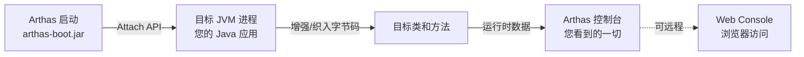
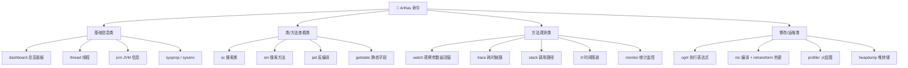
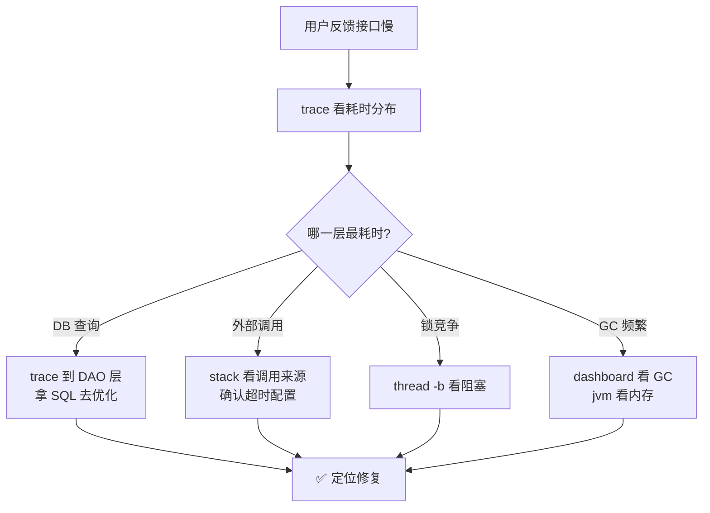
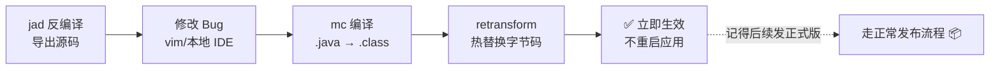
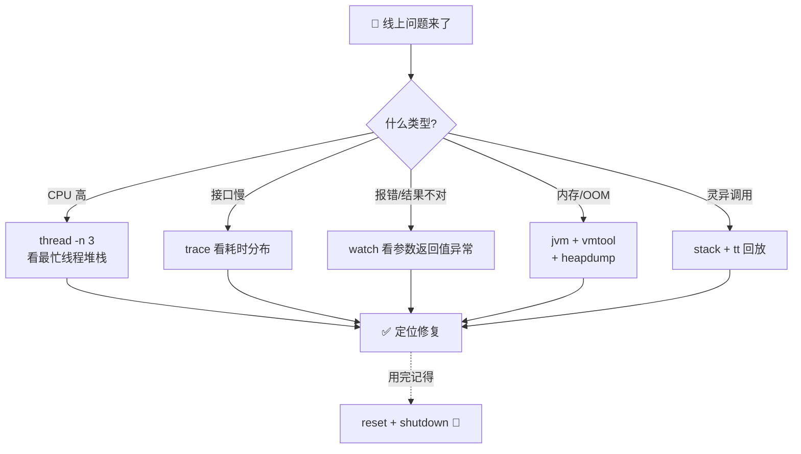

# 🔧 Arthas 学习笔记

> 今天要请出的是阿里开源的 **Java 线上诊断神器——Arthas（阿尔萨斯）** ✨
> 线上出问题又不能断点调试？接口变慢不知道卡在哪？Arthas 直接"附身"到您的 JVM 上，把运行时的一切看得明明白白！我会用大白话 + 实战场景带您轻松驾驭它～(≧▽≦)

---

## 📚 目录一览

1. [Arthas 是什么？](#一arthas-是什么)
2. [为什么需要 Arthas？](#二为什么需要-arthas)
3. [快速上手：安装与启动](#三快速上手安装与启动)
4. [核心命令全景](#四核心命令全景)
5. [基础诊断命令](#五基础诊断命令)
6. [方法执行观测：排查神器](#六方法执行观测排查神器)
7. [经典实战场景](#七经典实战场景)
8. [进阶技巧](#八进阶技巧)
9. [注意事项与最佳实践](#九注意事项与最佳实践)
10. [总结 & 命令速查表](#十总结--命令速查表)

---

## 一、Arthas 是什么？

### 1.1 一句话解释

> **Arthas = 阿里开源的 Java 诊断工具，能"附身"到正在运行的 JVM 上，实时查看类、方法、线程、参数、返回值，甚至热更新代码——全程不用重启应用！** 🩺

### 1.2 打个比方 🕵️

线上应用就像一个"正在飞行中的飞机"✈️：
- 传统排查：等飞机落地（重启/本地复现）再检查，黄花菜都凉了；
- Arthas：直接派一名"随行医生"登机体检 🩺——飞行途中就能测心跳（线程）、验血（参数/返回值）、看体检报告（监控指标），甚至做"微创手术"（热更新代码）！

### 1.3 工作原理



> 💡 关键点：Arthas 通过 JVM 的 **Attach API** 连上目标进程，再用**字节码增强**（Instrumentation API）来"偷看"方法执行，所以不用改一行业务代码～

---

## 二、为什么需要 Arthas？

### 2.1 线上排查的痛 😢

| 痛点 | 传统手段 | 结果 |
| --- | --- | --- |
| 线上不能断点 | 本地反复尝试复现 | 复现不出来 😭 |
| 怀疑代码没部署对 | 翻构建记录、问同事 | 一头雾水 |
| 接口偶发慢 | 看日志猜 | 日志缺关键信息 |
| 想看方法的入参/返回值 | 加日志 → 重新发版 | 折腾一轮，问题可能已消失 |
| CPU/内存飙高 | jstack/jmap 导出再分析 | 文件拉下来几十 MB，分析费劲 |

### 2.2 Arthas 的解药 💊

| 能力 | 对应命令 | 效果 |
| --- | --- | --- |
| 看方法入参/返回值/异常 | `watch` | 不改代码，直接"偷看" 👀 |
| 看方法耗时分布 | `trace` | 一眼看出卡在哪一行 |
| 反编译线上代码 | `jad` | 确认线上跑的到底是不是新代码 |
| 热更新代码 | `jad+mc+retransform` | 不重启修复紧急 Bug |
| 查 CPU 飙高 | `thread -n 3` | 秒出最忙线程堆栈 |
| 排查类加载 | `sc` / `sm` | 类从哪加载、方法签名全知道 |

---

## 三、快速上手：安装与启动

### 3.1 三种安装方式

```bash
# 方式一：arthas-boot 启动器（最常用 ✅）
curl -O https://arthas.aliyun.com/arthas-boot.jar
java -jar arthas-boot.jar

# 方式二：全量安装包（离线环境用）
# 官网下载 zip 解压后执行 ./as.sh 或 java -jar arthas-core.jar

# 方式三：通过包管理器
brew install arthas   # Mac
```

### 3.2 启动与连接

```bash
$ java -jar arthas-boot.jar
# 会列出机器上所有 Java 进程，让您选：
[1]: 12345 com.example.OrderApplication
[2]: 23456 com.example.UserApplication
# 输入 1，回车，附身成功！🎉
```

看到这个大 ASCII LOGO 就是成功啦：

```text
  .   ____          _            __ _ _
 /\\ / ___'_ __ _ _(_)_ __  __ _ \ \ \ \
( ( )\___ | '_ | '_| | '_ \/ _` | \ \ \ \
 \\/  ___)| |_)| | | | | || (_| |  ) ) ) )
  '  |____| .__|_| |_|_| |_\__, | / / / /
 =========|_|==============|___/=/_/_/_/
 :: ARTHAS ::  Java 线上诊断神器
```

### 3.3 退出方式（重要！）

| 命令 | 效果 |
| --- | --- |
| `quit` 或 `exit` | 只退出 Arthas 控制台，增强还留着（下次秒连） |
| `stop` 或 `shutdown` | 彻底关闭：**释放所有增强**，恢复原样 ✅ 生产用完记得 stop！ |

---

## 四、核心命令全景

### 4.1 命令分类地图 🗺️



### 4.2 快速选命令：对症下药表 💊

| 我想知道…… | 用这个 |
| --- | --- |
| 应用整体健康状态 | `dashboard` |
| 哪个线程吃满 CPU / 是否死锁 | `thread -n 3` / `thread -b` |
| 线上跑的代码是不是最新的 | `jad 类名` |
| 某方法的入参/返回值/异常 | `watch` |
| 接口慢，慢在哪个方法哪一行 | `trace` |
| 这个方法被谁调用的 | `stack` |
| 错过现场，想"回放"某次调用 | `tt` |
| 某方法 QPS/成功率/平均耗时 | `monitor` |
| 想看/改一个静态变量的值 | `getstatic` / `ognl` |
| 紧急热修复线上 Bug | `jad + mc + retransform` |
| 整机性能瓶颈在哪 | `profiler start`（火焰图 🔥） |

---

## 五、基础诊断命令

### 5.1 dashboard —— 总览仪表盘 📊

```bash
[arthas@12345]$ dashboard
```

一屏看到：线程概况、内存各区使用、GC 次数与耗时、运行环境。像汽车仪表盘一样直观～

### 5.2 thread —— 线程专家 🧵

```bash
thread                     # 列出所有线程
thread -n 3                # CPU 最忙的 3 个线程（排查 CPU 飙高神器 ⚡）
thread -b                  # 找出阻塞其他线程的"元凶"（死锁排查）
thread 42                  # 查看 42 号线程的堆栈详情
thread --state BLOCKED     # 看所有阻塞状态的线程
```

### 5.3 jvm / sysprop / sysenv —— 环境情报 📋

```bash
jvm                        # JVM 内存/线程/GC/运行参数全貌
sysprop                    # 系统属性（-D 参数）
sysprop java.version       # 只看某一项
sysenv                     # 环境变量
vmoption                   # JVM 选项，还能动态改：
vmoption PrintGC true      # 打开 GC 日志（不用重启！）
```

### 5.4 sc / sm / getstatic —— 类信息三剑客 🔍

```bash
# sc = Search Class：类从哪个 jar 加载的？实现了谁？
sc -d com.example.service.OrderService

# sm = Search Method：列出该类所有方法签名
sm com.example.service.OrderService

# getstatic：直接看静态字段值
getstatic com.example.cache.LocalCache MAX_SIZE
```

---

## 六、方法执行观测：排查神器

先上一段"问题代码"当靶子 🎯，后面都用它演示：

```java
@RestController
public class OrderController {

    @GetMapping("/order/{id}")
    public Order queryOrder(@PathVariable Long id) {
        Order order = loadFromCache(id);   // 1. 先查缓存
        if (order == null) {
            order = loadFromDb(id);        // 2. 缓存没有查 DB
            saveToCache(order);            // 3. 回填缓存
        }
        return order;
    }

    private Order loadFromDb(Long id) {
        try { Thread.sleep(800); }         // ⚠️ 假装 DB 慢查询
        catch (InterruptedException ignored) {}
        return new Order(id, "测试订单");
    }
    // loadFromCache / saveToCache 省略……
}
```

### 6.1 watch —— 偷看方法的参数、返回值、异常 👀

```bash
# 看入参 params、返回值 returnObj、异常 throwExp
watch com.example.controller.OrderController queryOrder '{params, returnObj, throwExp}' -x 2

# 只在抛异常时才打印（条件表达式，超有用！）
watch com.example.controller.OrderController queryOrder '{params, throwExp}' -e

# 只观察 id=100 的请求（按条件过滤，避免刷屏）
watch com.example.controller.OrderController queryOrder returnObj 'params[0]==100'

# 观察方法执行前后对象的变化（-b 前 / -s 后 / -f 结束时）
watch com.example.cache.LocalCache map '@Object@size(target.map)' -b -s
```

输出长这样：

```text
method=com.example.controller.OrderController.queryOrder location=AtExit
ts=2026-09-14 10:20:31; cost=812.45ms
@Object[][@Long[100]]
@Order[id=100, name=测试订单]
```

> 💡 `cost=812ms` 一眼看出这个请求慢，`-x 2` 表示结果展开两层，看得更清楚～

### 6.2 trace —— 慢在哪一行，一目了然 🐢⚡

```bash
trace com.example.controller.OrderController queryOrder
```

输出（自动算出每层耗时占比）：

```text
`---[815ms] com.example.controller.OrderController:queryOrder()
    +---[0.02ms] com.example.controller.OrderController:loadFromCache()
    +---[812ms] com.example.controller.OrderController:loadFromDb()   ← 🎯 元凶在这！
    `---[0.03ms] com.example.controller.OrderController:saveToCache()
```

进阶玩法：

```bash
# 只打印耗时 > 200ms 的调用链
trace *OrderController queryOrder '#cost > 200'

# 追踪多层（默认 1 层，可放开到 3 层看更深的调用）
trace *OrderController queryOrder -n 3 --depth 3
```

### 6.3 stack —— 这方法是谁调用的？🔗

```bash
stack com.example.controller.OrderController queryOrder
# 输出完整调用栈：Controller ← Filter ← Tomcat 线程……
# 适合"这个方法莫名被调用了？"的灵异事件排查 👻
```

### 6.4 tt —— 时间隧道，错过的现场存档回放 ⏰

```bash
tt -t com.example.controller.OrderController queryOrder
# 每次调用都被记录成一条 INDEX，比如 1000

tt -l                                   # 列出所有记录
tt -i 1000                              # 查看第 1000 条详情（参数/返回值/耗时）
tt -i 1000 -p                           # 🔥 回放这次调用！
tt -i 1000 --replay-times 3             # 回放 3 次（压测某个方法）
```

> 💡 **为什么 tt 好用？** 偶现 Bug 抓不到现场？`tt -t` 挂着自动录，等它复现后直接 `-i` 看档案，像看监控录像一样 📹

### 6.5 monitor —— 方法级统计监控 📈

```bash
# 每 10 秒输出一次 queryOrder 的调用次数/成功率/平均耗时
monitor com.example.controller.OrderController queryOrder -c 10
```

---

## 七、经典实战场景

### 7.1 场景一：接口偶发变慢 🐢



### 7.2 场景二：CPU 飙高到 100% 🔥

```bash
# 第一步：找出最忙的线程（ID 也会帮您换算成十六进制）
thread -n 3
# 输出里直接给出线程堆栈，比如死循环在哪个类的哪一行 👇
# "XNIO-1 task-2" Id=42 RUNNABLE (cpu 87.2%)
#     at com.example.task.HotLoopTask.run(HotLoopTask.java:23) ← 🎯
```

### 7.3 场景三：怀疑线上代码没更新 🤔

```bash
# 反编译看看线上真实运行的代码
jad com.example.service.OrderService

# 确认字节码来源
sc -d com.example.service.OrderService | grep classLoaderHash
# 输出里能到 jar 路径 + 修改时间，一眼看出加载的是不是旧包！
```

### 7.4 场景四：线上热更新（紧急止血）🚑

**流程：jad 反编译 → 改代码 → mc 编译 → retransform 替换**

```bash
# 1️⃣ 反编译目标类，把源码存到本地文件
jad --source-only com.example.service.OrderService > /tmp/OrderService.java

# 2️⃣ 在服务器上（或本地）修改 Bug，比如把错误的常量改对
vim /tmp/OrderService.java

# 3️⃣ 用 mc（Memory Compiler）把 .java 编译成 .class
mc /tmp/OrderService.java -d /tmp

# 4️⃣ 热替换进 JVM（必须 hash 一致，即用 jad 时的那个 classloader）
retransform /tmp/com/example/service/OrderService.class

# ✅ 不重启，代码已生效！正式版本还是要走发布流程修复哦～
```



### 7.5 场景五：排查内存泄漏 / OOM 💾

```bash
jvm                                # 先看各代内存与 GC 情况
vmtool --action getInstances --className com.example.cache.LocalCache --limit 10
                                    # 直接看某类活着的实例（数量异常=泄漏嫌疑）
heapdump /tmp/dump.hprof           # 导出堆快照，用 MAT 深入分析
```

### 7.6 场景六：火焰图找整体瓶颈 🔥

```bash
profiler start                      # 开始采样（默认 CPU）
profiler stop --format html         # 停止并输出 flame.html
# 下载 flame.html 用浏览器打开：
# "越宽的横条 = 占用 CPU 越多的调用栈"，一眼锁定热点！
```

---

## 八、进阶技巧

### 8.1 OGNL 表达式：Arthas 的"魔法咒语" 🪄

watch/trace 里的花括号 `{...}` 都是 **OGNL 表达式**，可以写小逻辑：

| 表达式 | 含义 |
| --- | --- |
| `params[0]` | 第一个入参 |
| `returnObj` | 返回值 |
| `throwExp` | 抛出的异常 |
| `target` | 方法所在实例（`target.field` 拿成员变量） |
| `@Object@size(target.map)` | 调用静态方法：Object.size(...) |
| `#cost > 200` | 特殊变量：耗时大于 200ms |
| `'{params, returnObj, #cost}'` | 一次看多个，逗号隔开 |

还能用 `ognl` 命令直接执行表达式（不依赖方法调用）：

```bash
# 直接调用 Spring 容器里的 Bean 方法（应急手动触发！）
ognl -c 1a2b3c4d '@org.springframework.context.support.AbstractApplicationContext@
  getBean(@Class@forName("com.example.OrderService")).refreshCache()'
```

### 8.2 管道与日志

```bash
# 命令结果可以管道过滤
thread | grep BLOCKED
# 保存观测日志到文件（方便留档/发给同事）
watch ... > /tmp/watch.log
```

### 8.3 Web Console：浏览器里的 Arthas 🌐

```bash
# 启动 tunnel server 后，多台机器的 Arthas 都能汇总到浏览器里操作
# 适合公司统一搭建"诊断中台"
```

### 8.4 取消所有增强

```bash
# 忘了删 watch/trace？一条命令全部还原
reset           # 重置所有被增强的类
shutdown        # 彻底退出并还原
```

---

## 九、注意事项与最佳实践

### 9.1 安全红线 🚨

| 事项 | 说明 |
| --- | --- |
| ⚠️ 观测有开销 | watch/trace/monitor 会拖慢被观测方法，**排查完立即取消** |
| ⚠️ 别长期挂增强 | 下班前记得 `reset` + `shutdown`，恢复原状 |
| ⚠️ 热更新是"止血" | retransform 后再发版可能把修复冲掉，**必须尽快走正式发布** |
| 🔐 权限管控 | 生产服务器上 Arthas 能任意执行表达式，等同于"后门"，注意服务器权限 |
| 📋 留痕 | 生产诊断过程建议录屏/存日志，方便复盘 |

### 9.2 使用小技巧 ✨

1. 类名支持通配符：`trace *Controller queryOrder`；
2. `--depth` 控制 trace 深度，先浅后深，别一上来就挖到底；
3. `-n` 限制执行次数：`watch ... -n 5`（执行 5 次自动停，防刷屏）；
4. 高频问题场景可以做成团队 SOP 文档："XX 报警 → 跑这几条命令"；
5. 搭配 IDEA 插件 **Arthas Idea**，右键方法直接生成命令，告别手敲！

---

## 十、总结 & 命令速查表

### 10.1 高频命令速查 📇

| 命令 | 作用 | 高频用法 |
| --- | --- | --- |
| `dashboard` | 总览面板 | 直接敲 |
| `thread -n 3` | 最忙线程 | CPU 飙高排查 ⚡ |
| `thread -b` | 死锁排查 | 找阻塞源头 |
| `sc -d 类名` | 类详情 | 看从哪个 jar 加载 |
| `jad 类名` | 反编译 | 确认线上代码版本 |
| `watch` | 观测参数/返回值/异常 | `{params, returnObj, throwExp}` |
| `trace` | 耗时链路 | `'#cost > 200'` 只看慢请求 |
| `stack` | 调用来源 | 谁调的这个方法？ |
| `tt -t` | 录制调用 | `-i xxx -p` 回放 ⏰ |
| `monitor` | QPS/成功率/耗时 | `-c 10` 每 10 秒统计 |
| `ognl` | 执行表达式 | 手动调 Bean 应急 🪄 |
| `mc + retransform` | 热更新 | 紧急止血 🚑 |
| `profiler` | 火焰图 | `start` / `stop` 🔥 |
| `heapdump` | 堆转储 | 配合 MAT 分析 OOM |

### 10.2 排查决策树



### 10.3 记住这三句就走不丢 ✨

1. **不重启、不改代码**：Arthas 靠字节码增强"附身"JVM，观测一切；
2. **慢用 trace、错用 watch、灵异用 tt**：三板斧覆盖 90% 排查场景；
3. **用完就还**：增强有开销，排查完 `reset` + `shutdown`，做个有始有终的医生 🩺。

> 🎉 恭喜点亮 Arthas 技能树！建议找个测试环境亲手敲一遍 watch + trace + tt 三连，感受"透视 JVM"的快乐～下次想学 JVM 调优、火焰图详解或 MAT 内存分析，随时喊我哦！(๑•̀ㅂ•́)و✧
