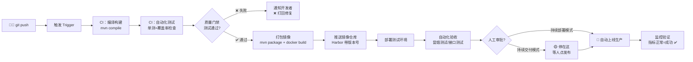
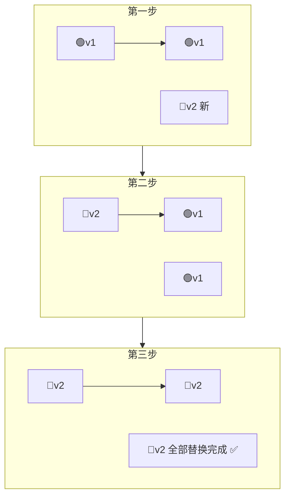
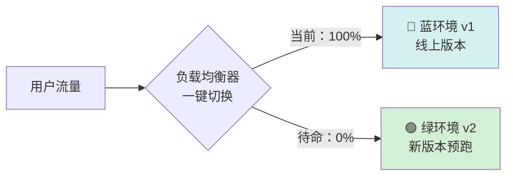
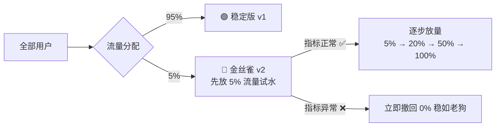
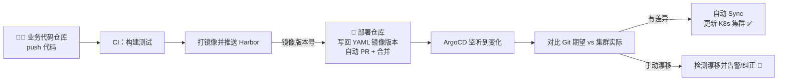
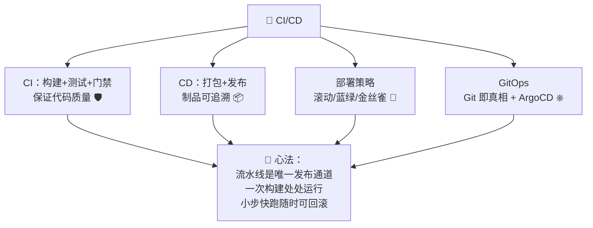

# 🔄 CI/CD 学习笔记

> 今天要解锁的是现代化研发的"自动化流水线"—— **CI/CD（持续集成/持续交付/持续部署）** ✨
> 告别手动打包、FTP 上传、深夜上线！让机器替您干脏活累活，又快又稳地交付代码～我会用大白话 + Java 项目实战带您轻松吃透 (≧▽≦)

---

## 📚 目录一览

1. [CI/CD 是什么？](#一cicd-是什么)
2. [为什么需要 CI/CD？](#二为什么需要-cicd)
3. [核心概念速览](#三核心概念速览)
4. [CI/CD 完整流水线](#四cicd-完整流水线)
5. [主流工具对比与选型](#五主流工具对比与选型)
6. [Jenkins 实战（Jenkinsfile）](#六jenkins-实战jenkinsfile)
7. [GitLab CI 实战（.gitlab-ci.yml）](#七gitlab-ci-实战gitlab-ciyml)
8. [GitHub Actions 实战](#八github-actions-实战)
9. [部署策略：滚动/蓝绿/金丝雀](#九部署策略滚动蓝绿金丝雀)
10. [GitOps 与 ArgoCD](#十gitops-与-argocd)
11. [最佳实践](#十一最佳实践)
12. [总结 & 速查表](#十二总结--速查表)

---

## 一、CI/CD 是什么？

### 1.1 一句话解释

> **CI/CD = 代码从提交到上线的一整套自动化流水线：自动构建、自动测试、自动打包、自动部署。** 🏭

### 1.2 三个概念一张图分清 🍭

```mermaid
graph LR
    A[👨‍💻 提交代码] --> B[CI 持续集成<br>自动构建+测试]
    B --> C[CD 持续交付<br>随时可发布的制品<br>📦 停在"发版按钮"前]
    C -- 手动点击发布 --> D[CD 持续部署<br>全自动上线 🚀]
```

| 缩写 | 全称 | 一句话 | 自动化到哪一步 |
| --- | --- | --- | --- |
| **CI** | 持续集成 Continuous Integration | 一提交就自动编译+测试 | 构建与测试 ✅ |
| **CD** | 持续交付 Continuous Delivery | 测试通过自动打包，**随时可发**，但上线要人点一下 | 打包出制品 📦 |
| **CD** | 持续部署 Continuous Deployment | 全自动一路发到生产，**人都不用点** | 生产上线 🚀 |

> 💡 记忆口诀：**CI 保证"代码是好的"，交付保证"包是随时能发的"，部署保证"机器自己上线"**～

### 1.3 打个比方 🍰

- **手动部署**像手工小作坊：烤好蛋糕（写完代码）→ 自己装盒（打包）→ 骑车送货（上传服务器）→ 一路祈祷别摔（上线拜菩萨 🙏）；
- **CI/CD** 像**现代化蛋糕工厂**：原料进门（代码提交）自动搅拌（构建）、质检（测试）、装盒（打镜像）、冷链配送（部署），全程自动化，出错立即报警停下！

---

## 二、为什么需要 CI/CD？

### 2.1 传统手动发布的痛 😢

| 痛点 | 场景 |
| --- | --- |
| 🐢 又慢又累 | 打包、传服务器、重启，一次发布 1 小时起 |
| 🙏 全靠运气 | "本地是好的呀？"→ 环境不一致，上线翻车 |
| 😱 深夜上线 | 怕影响用户，凌晨 2 点拖着眼皮发版 |
| 🔍 没有回滚 | 出问题只能手忙脚乱再发一版 |
| 🧩 集成地狱 | 大家各写各的，最后一合并几百个冲突 |

### 2.2 CI/CD 带来的改变 ✨

| 收益 | 说明 |
| --- | --- |
| ⚡ 快 | 提交到上线全自动化，分钟级完成 |
| 🛡️ 稳 | 每次变更小步快跑，测试卡关，坏代码进不了主干 |
| 🔙 敢回滚 | 制品带版本号，一条命令回到上一版 |
| 🌙 不熬夜 | 自动化执行，白天点一下就好 |
| 👥 少扯皮 | 流水线是唯一发布通道，过程全留痕 |

---

## 三、核心概念速览

| 概念 | 一句话 | 类比 |
| --- | --- | --- |
| 流水线 Pipeline | 从提交到发布的完整自动化流程 | 工厂整条生产线 🏭 |
| 阶段 Stage | 流水线的一个大环节（构建/测试/部署） | 生产线上的车间 |
| 任务 Job / Step | 阶段里的具体动作 | 车间里的一道工序 |
| 触发器 Trigger | 什么时候启动流水线（push/定时/手动） | 生产线的启动按钮 🔔 |
| Runner / Agent / Executor | 干活的机器（跑命令的进程） | 车间里的工人 🤖 |
| 制品 Artifact | 构建产物（jar 包、Docker 镜像） | 装好箱的成品 📦 |
| 制品仓库 Registry | 存制品的地方 | 成品仓库（Nexus/Harbor） |
| 凭证 Credential | 流水线用的密钥（Git/镜像库/K8s） | 工人的门禁卡 🔑 |
| 环境 Environment | dev / test / staging / prod | 不同的销售渠道 |
| 门禁 Gate | 不达标就不许进入下一阶段 | 质检关卡 🚧 |

---

## 四、CI/CD 完整流水线

以一个 **Java Spring Boot 项目**为例的全景图：



各环节的 Java 技术选型：

| 环节 | 常用工具 |
| --- | --- |
| 构建 | Maven / Gradle |
| 测试 | JUnit 5 + Mockito + Testcontainers |
| 静态检查 | SonarQube（代码味道/漏洞/覆盖率）🧹 |
| 镜像 | Docker / Podman |
| 镜像仓库 | Harbor / Nexus / 云厂商镜像库 |
| 部署 | K8s（kubectl/Helm）+ ArgoCD |
| 通知 | 钉钉/企微/飞书机器人 📢 |

---

## 五、主流工具对比与选型

| 工具 | 特点 | 适合 |
| --- | --- | --- |
| 🤵 Jenkins | 老牌王者，插件生态海量，啥都能接 | 传统企业、复杂自定义流程 |
| 🦊 GitLab CI | 与 GitLab 仓库天然一体，`.gitlab-ci.yml` 简洁 | 已用 GitLab 自建的团队 ✅ |
| 🐙 GitHub Actions | 与 GitHub 深度集成，市场里现成 Action 一堆 | 开源项目、GitHub 用户 ✅ |
| ⎈ ArgoCD | GitOps 神器，监听 Git 自动同步 K8s | 云原生/K8s 团队 ✅ |
| 🐘 TeamCity / Azure Pipelines 等 | 各有生态 | 特定平台用户 |

选型小建议：

| 情况 | 推荐 |
| --- | --- |
| 代码在 GitHub | GitHub Actions |
| 代码在 GitLab 自建 | GitLab CI |
| 遗留系统多、流程奇葩 | Jenkins |
| 全容器化 K8s | GitLab CI/Jenkins 出镜像 + **ArgoCD 部署** |

---

## 六、Jenkins 实战（Jenkinsfile）

Jenkins 用 **声明式流水线**（Declarative Pipeline），配置以 `Jenkinsfile` 存在代码仓库里——**流水线本身也版本化** ✨

```groovy
// Jenkinsfile —— Java Spring Boot 项目完整流水线
pipeline {
    agent any                          // 任意可用的执行节点 🤖

    // 🔑 凭证统一在 Jenkins 里配置，不写明文！
    environment {
        HARBOR_URL   = 'registry.example.com'
        IMAGE_NAME   = "${HARBOR_URL}/order/order-service"
        IMAGE_TAG    = "${env.BUILD_NUMBER}-${env.GIT_COMMIT?.take(7)}"
    }

    stages {
        stage('① 拉取代码') {
            steps {
                checkout scm
            }
        }

        stage('② 编译构建') {
            steps {
                sh 'mvn -B clean compile -DskipTests'
            }
        }

        stage('③ 单元测试') {
            steps {
                sh 'mvn test'
            }
            post {
                always {
                    // 测试报告留档，Jenkins 页面可直接看 📊
                    junit '**/target/surefire-reports/*.xml'
                }
            }
        }

        stage('④ 质量门禁') {
            steps {
                // SonarQube 检查：覆盖率/漏洞不达标，流水线直接失败 🚧
                withSonarQubeEnv('sonar-server') {
                    sh 'mvn sonar:sonar'
                }
            }
        }

        stage('⑤ 打包镜像并推送') {
            steps {
                sh 'mvn -B package -DskipTests'
                sh "docker build -t ${IMAGE_NAME}:${IMAGE_TAG} ."
                withCredentials([usernamePassword(
                        credentialsId: 'harbor-account',
                        usernameVariable: 'HARBOR_USER',
                        passwordVariable: 'HARBOR_PWD')]) {
                    sh 'echo $HARBOR_PWD | docker login $HARBOR_URL -u $HARBOR_USER --password-stdin'
                    sh "docker push ${IMAGE_NAME}:${IMAGE_TAG}"
                }
            }
        }

        stage('⑥ 部署测试环境') {
            steps {
                // 用 sed 把镜像版本替换进 K8s YAML，再 apply（声明式 ✅）
                sh "sed -i 's|IMAGE_PLACEHOLDER|${IMAGE_NAME}:${IMAGE_TAG}|' k8s/deployment.yaml"
                sh 'kubectl apply -f k8s/'
            }
        }

        stage('⑦ 上线生产（需人工确认）') {
            when {
                branch 'main'           // 只有 main 分支才走到这 🛡️
            }
            input {
                message "确认发布 ${IMAGE_TAG} 到生产环境？"
                ok '确认发布'
            }
            steps {
                echo '🚀 发布生产（示例，实际可用 Helm/ArgoCD）'
            }
        }
    }

    post {
        success { echo '🎉 流水线成功！' }
        failure { echo '❌ 流水线失败，快去看看！' }
        always  { echo '清理工作空间…' }
    }
}
```

Jenkins 关键点小结：

| 要素 | 说明 |
| --- | --- |
| `agent` | 在哪台机器/容器里执行 |
| `environment` | 环境变量，`IMAGE_TAG` 用**构建号+commit**，每个包可追溯 🔍 |
| `stage` | 分阶段，页面上一格格点亮很好看 ✨ |
| `when` | 条件执行（如只在 main 分支部署生产） |
| `input` | 人工审批点（持续交付模式的"发版按钮"🟡） |
| `post` | 收尾动作：报告、通知、清理 |

---

## 七、GitLab CI 实战（.gitlab-ci.yml）

GitLab CI 的配置文件放在仓库根目录 `.gitlab-ci.yml`，由 GitLab Runner 执行：

```yaml
# .gitlab-ci.yml —— Java 项目流水线
# 镜像里自带 Maven + JDK17
image: maven:3.9-eclipse-temurin-17

# 全局变量（非敏感的放这，敏感的进 GitLab CI/CD Settings ➜ Variables 🔐）
variables:
  MAVEN_OPTS: "-Dmaven.repo.local=.m2/repository"

# 缓存 Maven 依赖，下次构建快到飞起 ⚡
cache:
  key: maven-repo
  paths:
    - .m2/repository

stages:            # 阶段顺序：按此依次执行
  - build
  - test
  - package
  - deploy

build-job:
  stage: build
  script:
    - mvn -B compile -DskipTests

test-job:
  stage: test
  script:
    - mvn test
  artifacts:                       # 📦 留档测试报告
    reports:
      junit:
        - target/surefire-reports/TEST-*.xml

package-job:
  stage: package
  image: docker:24                 # 这个阶段换 Docker 镜像跑 🐳
  services:
    - docker:24-dind               # 提供 docker build 能力
  script:
    - mvn -B package -DskipTests   # 实际可用多阶段 Dockerfile 一步到位
    - docker build -t $CI_REGISTRY_IMAGE:$CI_COMMIT_SHORT_SHA .
    - docker login -u $CI_REGISTRY_USER -p $CI_REGISTRY_PASSWORD $CI_REGISTRY
    - docker push $CI_REGISTRY_IMAGE:$CI_COMMIT_SHORT_SHA

deploy-test:
  stage: deploy
  environment:                     # 在 GitLab 里登记"环境"一目了然 🌍
    name: test
  script:
    - echo "部署到测试环境：$CI_REGISTRY_IMAGE:$CI_COMMIT_SHORT_SHA"
  only:                            # 只有 test/main 分支才部署
    - test
    - main

deploy-prod:
  stage: deploy
  environment:
    name: production
  script:
    - echo "🚀 上线生产"
  when: manual                     # 🟡 手动点击才执行 = 持续交付模式
  only:
    - main
```

> 💡 内置变量超好用：`$CI_COMMIT_SHORT_SHA`（commit 短哈希做镜像标签）、`$CI_REGISTRY`（GitLab 自带镜像仓库）——版本可追溯到每一次提交！

---

## 八、GitHub Actions 实战

配置放在 `.github/workflows/` 目录，用 **YAML + 现成 Action 组合**：

```yaml
# .github/workflows/ci.yml —— Java 项目 CI
name: Java CI/CD

on:
  push:
    branches: [ main ]        # main 分支 push 时触发
  pull_request:               # PR 时也跑一遍，把好合并关 🛡️

jobs:
  build-and-test:
    runs-on: ubuntu-latest
    steps:
      # ① 拉代码（现成 Action，拿来就用）
      - uses: actions/checkout@v4

      # ② 装 JDK（Action 市场 yyds ✨）
      - name: Set up JDK 17
        uses: actions/setup-java@v4
        with:
          java-version: '17'
          distribution: 'temurin'
          cache: maven          # 自动缓存依赖 ⚡

      # ③ 编译 + 测试
      - name: Build & Test
        run: mvn -B verify

      # ④ 上传测试报告
      - name: Upload reports
        uses: actions/upload-artifact@v4
        if: always()
        with:
          name: test-reports
          path: target/surefire-reports

  docker:
    needs: build-and-test      # 依赖：测试通过才继续 🚧
    if: github.ref == 'refs/heads/main'
    runs-on: ubuntu-latest
    steps:
      - uses: actions/checkout@v4
      - name: Build & Push image
        run: |
          echo "${{ secrets.REGISTRY_PWD }}" | docker login -u ${{ secrets.REGISTRY_USER }} --password-stdin
          docker build -t app:${{ github.sha }} .
          docker push app:${{ github.sha }}
```

| GitHub Actions 要素 | 说明 |
| --- | --- |
| `on` | 触发条件：push / PR / 定时 / 手动 |
| `jobs` / `needs` | 任务与依赖关系，可并行可串行 |
| `steps` / `uses` | 步骤；`uses` 直接引用市场里的现成 Action |
| `secrets` | 敏感信息仓库里加密存，日志自动打码 🔒 |

---

## 九、部署策略：滚动/蓝绿/金丝雀

发布不只是"替换文件"，怎么换很有讲究！以 K8s 部署 Java 服务为例：

### 9.1 三种策略对比

| 策略 | 大白话 | 停机 | 回滚速度 | 资源成本 |
| --- | --- | --- | --- | --- |
| 🔄 滚动发布 Rolling | 新旧交替，逐个替换 | 几乎无 | 中 | 低（+1 个副本） |
| 🔵🟢 蓝绿部署 Blue-Green | 两套环境整组切换 | 无（秒切） | ⚡ 秒回滚 | 高（双倍环境） |
| 🐤 金丝雀发布 Canary | 先放小流量试试水 | 无 | 快 | 中 |

### 9.2 滚动发布（K8s 默认）



### 9.3 蓝绿部署



> 💡 新版本在绿环境充分验证后，负载均衡"啪"地一切——流量全走 v2；出问题再切回蓝，**秒级回滚**！代价是双倍资源 💰

### 9.4 金丝雀发布（灰度发布）



> 名字由来：以前矿工带金丝雀下井探毒气，鸟没事人才敢进 🐤——**先让小部分用户"探路"，出事影响范围极小**。

---

## 十、GitOps 与 ArgoCD

### 10.1 传统 CD vs GitOps

| 对比 | 传统 CD | GitOps ✅ |
| --- | --- | --- |
| 部署动作 | CI 直接 kubectl apply | CI 只**改 Git 仓库**里的镜像版本 |
| 真相来源 | 集群里实际状态（口说无凭） | **Git 仓库 = 期望状态的唯一真相** 📜 |
| 回滚 | 重新跑流水线 | `git revert` 即回滚 |
| 审计 | 翻 CI 日志 | 每次变更都是一次 Git 提交 |
| 漂移修复 | 手动改集群，越改越乱 | ArgoCD 发现"漂移"自动纠正 🔁 |

### 10.2 GitOps 工作流



> 💡 一句话：**CI 管"造包"，GitOps 管"上包"，Git 是唯一的指挥官**～

---

## 十一、最佳实践

### 11.1 流水线设计原则 ✨

| 原则 | 说明 |
| --- | --- |
| 🚀 快速反馈 | 最慢 10 分钟内出结果，缓存依赖（Maven/Docker layer） |
| 🚧 质量门禁 | 测试覆盖率、静态扫描不达标直接挂掉流水线 |
| 🔐 零明文密钥 | 凭证全部走 CI 工具的 secrets/credentials |
| 🏷️ 制品可追溯 | 镜像标签 = 构建号 + commit SHA，能追到代码 |
| 📦 一次构建多处部署 | 同一个镜像走 test → staging → prod，**别每个环境重新 build** |
| 🌿 分支策略配合 | feature 分支跑测试，main 分支才出制品部署 |
| 🟡 生产留人工闸门 | 重要业务用"持续交付"（人工确认），攒够信心再全自动化 |

### 11.2 常见反模式 ⚠️

| 反模式 | 后果 |
| --- | --- |
| 流水线里编译 N 次 | 慢 + 各环境包不一致 |
| 镜像用 `latest` 标签 | 出问题不知道线上是哪版 😱 |
| 密码写在 YAML 里 | 泄露事故预定 🚨 |
| 绕过流水线手动 kubectl | GitOps 状态漂移，越改越乱 |
| 没有回滚预案 | 出事只能干瞪眼 |

---

## 十二、总结 & 速查表

### 12.1 名词速查 📇

| 名词 | 一句话 |
| --- | --- |
| CI 持续集成 | 提交即构建+测试，保证代码是好的 ✅ |
| 持续交付 | 自动打包到"随时可发"，上线前停一下（人工点）🟡 |
| 持续部署 | 全自动一路发到生产 🚀 |
| Pipeline / Stage / Job | 流水线 / 车间 / 工序 |
| Artifact | 构建制品（jar/镜像）📦 |
| Runner / Agent | 干活的机器 🤖 |
| 滚动发布 | 逐个替换，省钱 |
| 蓝绿部署 | 双环境秒切，秒回滚 💸 |
| 金丝雀 | 小流量试水，影响面最小 🐤 |
| GitOps | Git 是唯一真相，ArgoCD 自动同步 |

### 12.2 三大工具配置文件速记 ☕

| 工具 | 配置文件 | 位置 |
| --- | --- | --- |
| Jenkins | `Jenkinsfile`（Groovy DSL） | 仓库根目录 |
| GitLab CI | `.gitlab-ci.yml` | 仓库根目录 |
| GitHub Actions | `ci.yml` | `.github/workflows/` |

### 12.3 一图流总结



### 12.4 记住这三句就走不丢 ✨

1. **CI 保质量，CD 保利索**：测试卡住坏代码，自动化缩短交付路；
2. **一次构建，处处部署**：同一个镜像标签走遍所有环境；
3. **生产发布要"可回滚"**：滚动/蓝绿/金丝雀，本质都是"留后路"的艺术。

> 🎉 恭喜点亮 CI/CD 技能树！建议挑一个自己的小项目接入 GitHub Actions 或 GitLab CI，从"push 自动跑测试"开始，一步步加镜像打包和部署，体验流水线点亮的快乐～下次想学 Jenkins 深入、Helm Charts 或 ArgoCD 实战，随时喊我哦！(๑•̀ㅂ•́)و✧
