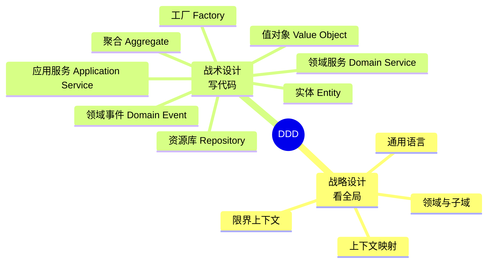
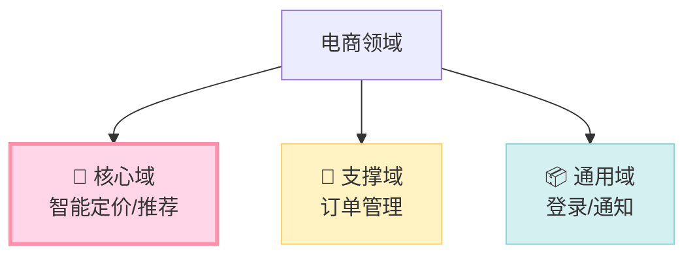
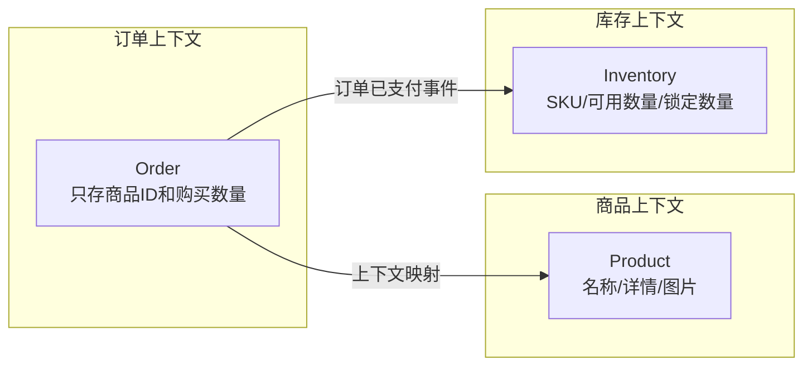
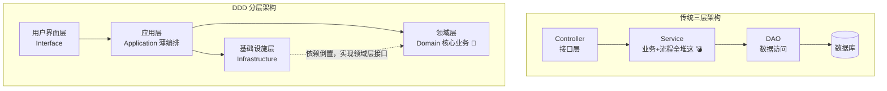
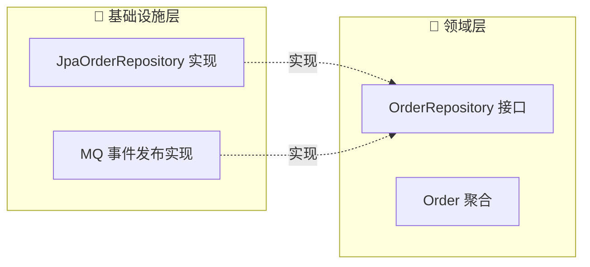
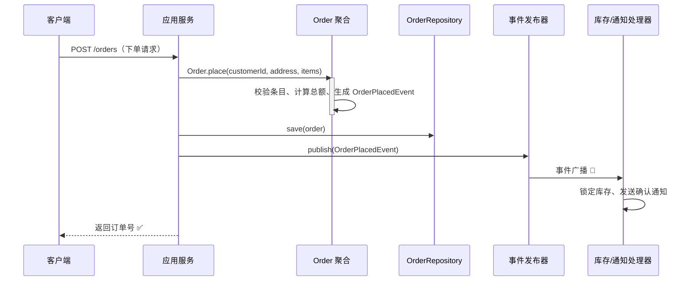
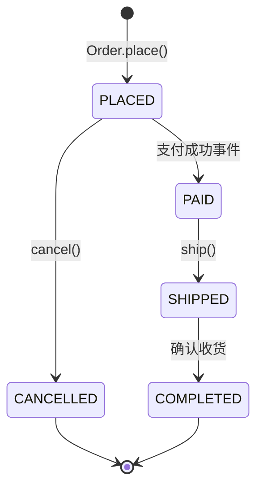
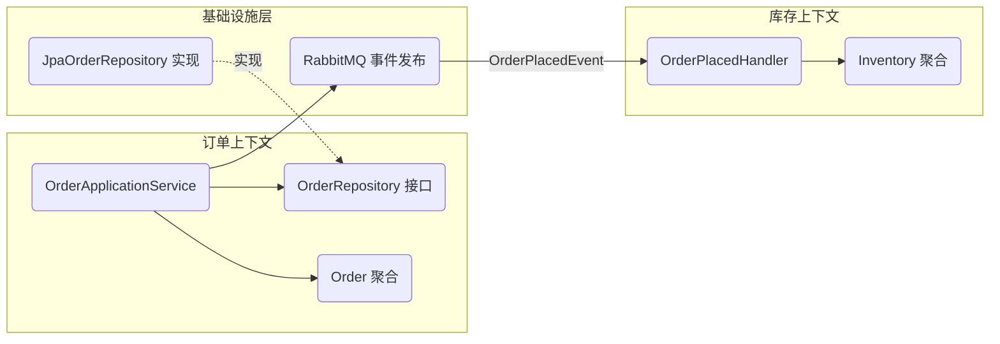
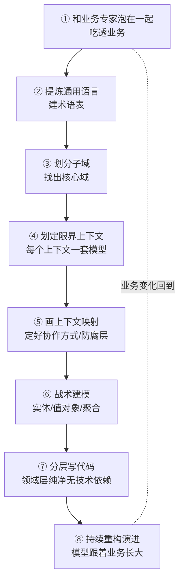
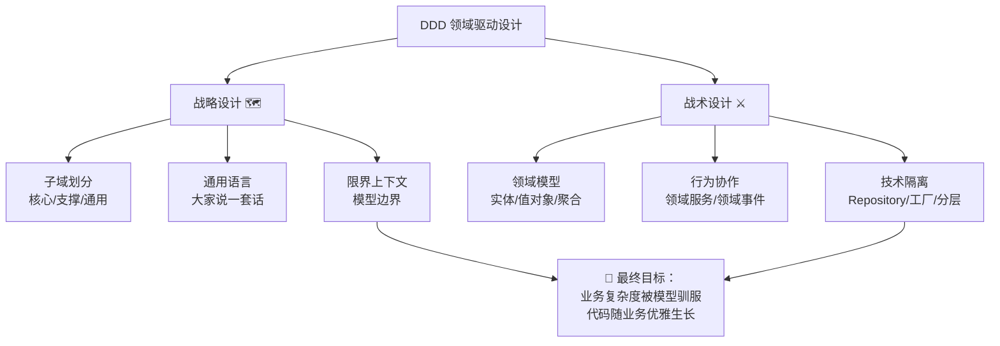

# 🌸 DDD 领域驱动设计 学习笔记

> 咳咳～今天我们要啃的是一块"架构界的老牌硬糖"—— **DDD（Domain-Driven Design，领域驱动设计）** ✨
> 别怕别怕，我会用最直白的大白话 + 贴心的 Java 代码，带您把糖化开吃掉！(≧▽≦)

---

## 📚 目录一览

1. [DDD 是什么？](#一ddd-是什么)
2. [为什么需要 DDD？——传统开发的痛](#二为什么需要-ddd传统开发的痛)
3. [DDD 全景图：战略设计 vs 战术设计](#三ddd-全景图战略设计-vs-战术设计)
4. [战略设计篇](#四战略设计篇看懂业务版图)
5. [战术设计篇](#五战术设计篇搭好代码积木)
6. [DDD 分层架构](#六ddd-分层架构代码怎么摆)
7. [完整实战：电商下单场景](#七完整实战电商下单场景)
8. [落地流程与常见误区](#八落地流程与常见误区)
9. [总结 & 速查表](#九总结--速查表)

---

## 一、DDD 是什么？

### 1.1 一句话解释

> **DDD = 让代码围绕"业务"来设计，而不是围绕"数据库表"来设计。** 🎯

它是由 **Eric Evans** 在 2003 年《Domain-Driven Design: Tackling Complexity in the Heart of Software》一书中提出的软件方法论。

### 1.2 打个比方 🍰

- **传统开发**就像"先修好仓库货架（建表），再往里面塞东西"——数据库是老大，业务逻辑散落一地。
- **DDD 开发**就像"先搞清楚这家店到底卖什么蛋糕（业务领域），再决定怎么摆货架"——业务是老大，代码结构和业务语言保持一致。

### 1.3 核心思想

| 核心思想 | 大白话解释 |
| --- | --- |
| 🗣️ 通用语言 | 业务、产品、开发说"同一套话"，代码里直接体现业务术语 |
| 🧩 业务驱动 | 先理解业务，再写代码；业务边界 = 代码边界 |
| 🏰 分而治之 | 把大系统切成一个个"小王国"（限界上下文），各自治理 |
| 💎 模型沉淀 | 把业务规则沉淀在"领域模型"里，而不是 if-else 满天飞 |

---

## 二、为什么需要 DDD？——传统开发的痛

### 2.1 传统三层架构的"贫血"之痛 😢

先看一段常见的"贫血模型"代码：

```java
// ❌ 贫血模型：只是一个"数据搬运工"，没有任何行为
public class Order {
    private Long id;
    private Long userId;
    private BigDecimal amount;
    private String status;
    // 一堆 getter / setter，没有业务逻辑
}
```

```java
// ❌ 业务逻辑全部堆在 Service 里，Service 越长越肥
public class OrderService {
    public void cancelOrder(Long orderId) {
        Order order = orderDao.findById(orderId);
        if ("SHIPPED".equals(order.getStatus())) {   // 魔法字符串
            throw new RuntimeException("已发货不能取消");
        }
        order.setStatus("CANCELLED");
        orderDao.update(order);
        // 后面还有 800 行各种业务规则…… 💥
    }
}
```

### 2.2 痛点总结表

| 痛点 | 具体表现 |
| --- | --- |
| 🐘 Service 臃肿 | 所有业务逻辑挤在 Service，一个方法几百行 |
| 🧟 贫血模型 | 实体只有 getter/setter，业务规则无处安放 |
| 🔗 强耦合 | 改一张表，牵动 N 个模块 |
| 🌫️ 语言割裂 | 产品说"核销"，代码里却是 `updateStatus(3)` |
| 🧪 难以测试 | 业务逻辑依赖数据库，单测要连 DB，又慢又脆 |

### 2.3 DDD 的解药 💊

| DDD 药方 | 治什么病 |
| --- | --- |
| 充血模型 | 把行为还给实体，Service 瘦身 |
| 限界上下文 | 大泥球拆成小王国，边界清晰 |
| 通用语言 | 代码即业务，看代码像看需求文档 |
| 聚合 | 明确"一致性边界"，改数据不再到处乱来 |

---

## 三、DDD 全景图：战略设计 vs 战术设计

DDD 分两大块，就像打仗先看地图、再排兵布阵 🗺️⚔️：



| 维度 | 战略设计 🗺️ | 战术设计 ⚔️ |
| --- | --- | --- |
| 关注点 | 业务版图、系统边界 | 代码结构、类怎么设计 |
| 参与者 | 架构师 + 业务专家 | 开发人员 |
| 产出 | 子域划分、上下文地图 | 领域模型、代码 |
| 比喻 | 画作战地图 | 造每件武器 |

---

## 四、战略设计篇：看懂业务版图

### 4.1 领域（Domain）与子域（Subdomain）

**领域** = 您要解决的业务问题的集合（比如"电商"）。
**子域** = 把大领域切成的几块（比如"商品、订单、库存、物流"）。

子域分三种，重要程度完全不同哦：

| 子域类型 | 大白话 | 举例（电商系统） | 投入策略 |
| --- | --- | --- | --- |
| 🌟 核心域 | 赚钱的看家本领，和竞争对手拉开差距的地方 | 独家的智能定价、推荐算法 | 最优秀的人 + 最多资源 |
| 🔧 支撑域 | 必须有，但不是竞争力 | 订单管理、售后工单 | 够用就好 |
| 📦 通用域 | 大家都一样，直接买/用现成的 | 登录认证、邮件通知 | 买成熟方案，别自己造轮子 |



### 4.2 通用语言（Ubiquitous Language）🗣️

**一句话：让所有人（产品/开发/测试/运维）都说同一套业务词汇，并且这些词汇直接出现在代码里。**

| 场景 | ❌ 没有通用语言 | ✅ 有通用语言 |
| --- | --- | --- |
| 产品说 | "把这个单子核销掉" | "把这个单子核销掉" |
| 代码写 | `updateStatus(3)` | `order.writeOff()` |
| 类命名 | `TbOrderInfoDTO` | `Order` |
| 方法命名 | `process2()` | `deliver()` / `writeOff()` |

好处：看代码 = 看需求文档，新同学上手超快！🚀

### 4.3 限界上下文（Bounded Context）🏰

**一句话：一个通用语言生效的"边界"。同一个词在不同边界里含义可以不一样！**

> 经典例子："商品"在**商品上下文**里关心名称、详情页；在**库存上下文**里只关心 SKU 和数量；在**物流上下文**里只关心重量和体积。同一个词，三个王国，三套模型～



⚠️ **小提醒**：限界上下文 ≠ 子域！
- 子域是**业务问题**的划分（问题空间）
- 限界上下文是**软件方案**的划分（解决方案空间）
- 理想情况下一个子域对应一个限界上下文，但现实中常有一对多～

### 4.4 上下文映射（Context Map）🤝

不同上下文之间要合作，常见合作模式：

| 模式 | 大白话 |
| --- | --- |
| 防腐层（ACL）防腐剂 💊 | 在两个上下文之间加一个"翻译官"，外部系统变了也不污染自己 |
| 共享内核（Shared Kernel） | 两个上下文共享一小块模型（要谨慎，容易打架） |
| 客户-供应商（Customer-Supplier） | 上游按下游的需求办事 |
| 遵奉者（Conformist） | 下游无条件适配上游的模型 |
| 开放主机服务（OHS） | 上游提供标准协议/接口给所有人用 |

防腐层 Java 示例：

```java
// 🛡️ 防腐层：隔离第三方库存系统，外面怎么变都不怕
public class ThirdPartyInventoryAdapter implements InventoryPort {

    private final ThirdPartyInventoryClient client; // 外部 SDK

    @Override
    public InventoryInfo queryInventory(ProductId productId) {
        // 外部系统的 DTO，长得再奇怪也无所谓～
        ThirdPartyStockDTO dto = client.getStock(productId.value());
        // 翻译官上线：外部模型 → 本上下文的领域模型 🎩
        return new InventoryInfo(productId, dto.getAvailableQty());
    }
}
```

---

## 五、战术设计篇：搭好代码积木

### 5.1 建筑块总览 🧱

| 建筑块 | 一句话 | 类比 |
| --- | --- | --- |
| 实体 Entity | 有唯一身份 ID 的对象，属性可变 | 每个人的身份证号 🪪 |
| 值对象 Value Object | 没有身份、只看属性值，不可变 | 一张 100 元钞票 💴 |
| 聚合 Aggregate | 一组相关对象的一致性边界 | 一个家庭户本 🏠 |
| 聚合根 Aggregate Root | 聚合的"老大"，外部只能找它 | 户主 |
| 领域服务 Domain Service | 放不属于单个实体的业务逻辑 | 社区服务中心 🏢 |
| 领域事件 Domain Event | "某件业务事情发生了"的事实记录 | 广播通知 📢 |
| 资源库 Repository | 聚合的存取入口（面向集合） | 仓库管理员 🏪 |
| 工厂 Factory | 复杂对象的创建逻辑 | 流水线 🏭 |
| 应用服务 Application Service | 编排用例流程，很薄的一层 | 前台接待员 🙋 |

### 5.2 值对象（Value Object）💴

**特征：不可变、无 ID、相等性看属性、可替换。**

```java
import java.math.BigDecimal;
import java.math.RoundingMode;
import java.util.Currency;
import java.util.Objects;

/**
 * 💴 值对象：金额
 * 特点：不可变（final 字段、无 setter）、equals 看属性
 */
public final class Money {

    private final BigDecimal amount;
    private final Currency currency;

    public Money(BigDecimal amount, Currency currency) {
        if (amount == null || currency == null) {
            throw new IllegalArgumentException("金额和币种都不能为空哦～");
        }
        if (amount.signum() < 0) {
            throw new IllegalArgumentException("金额不能是负数呀！");
        }
        this.amount = amount.setScale(2, RoundingMode.HALF_UP);
        this.currency = currency;
    }

    /** 加法：返回"新的"Money，而不是修改自己（不可变！） */
    public Money add(Money other) {
        assertSameCurrency(other);
        return new Money(this.amount.add(other.amount), this.currency);
    }

    public Money multiply(int times) {
        return new Money(this.amount.multiply(BigDecimal.valueOf(times)), this.currency);
    }

    private void assertSameCurrency(Money other) {
        if (!this.currency.equals(other.currency)) {
            throw new IllegalArgumentException("币种不同不能直接相加啦！");
        }
    }

    @Override
    public boolean equals(Object o) {
        if (this == o) return true;
        if (!(o instanceof Money)) return false;
        Money money = (Money) o;
        return amount.compareTo(money.amount) == 0
                && currency.equals(money.currency);
    }

    @Override
    public int hashCode() {
        return Objects.hash(amount, currency);
    }
}
```

> 💡 **怎么选实体还是值对象？**
> 问自己："两个对象所有属性都一样，它们是同一个东西吗？"
> - 是同一个 → 实体（比如两个同名的用户，还是两个人 🪪）
> - 无所谓/可以互换 → 值对象（两张 100 元钞票，哪张都一样 💴）

### 5.3 实体（Entity）🪪

**特征：有唯一标识 ID、属性可变、生命周期内 ID 不变。**

```java
import java.util.Objects;

/**
 * 🪪 实体：订单条目
 * 有 ID（productId 充当标识），相等性看 ID 不看属性
 */
public class OrderItem {

    private final ProductId productId;   // 唯一标识
    private final Money unitPrice;       // 值对象作为属性
    private int quantity;                // 数量可变

    public OrderItem(ProductId productId, Money unitPrice, int quantity) {
        if (quantity <= 0) {
            throw new IllegalArgumentException("购买数量必须大于 0 哦～");
        }
        this.productId = productId;
        this.unitPrice = unitPrice;
        this.quantity = quantity;
    }

    /** ✅ 实体也可以有自己的行为（充血模型） */
    public Money subtotal() {
        return unitPrice.multiply(quantity);
    }

    public void increaseQuantity(int delta) {
        if (delta <= 0) throw new IllegalArgumentException("增量必须为正数呀！");
        this.quantity += delta;
    }

    @Override
    public boolean equals(Object o) {
        if (this == o) return true;
        if (!(o instanceof OrderItem)) return false;
        return productId.equals(((OrderItem) o).productId); // 只看 ID！
    }

    @Override
    public int hashCode() {
        return Objects.hash(productId);
    }
}
```

### 5.4 聚合与聚合根（Aggregate & Aggregate Root）🏰

**一句话：聚合 = 一次业务操作中必须保持一致的"一组对象"；聚合根 = 这组对象的唯一入口，外部想改聚合内部，必须通过聚合根！**

```mermaid
graph TD
    subgraph AGG[🏠 订单聚合（一致性边界）]
        ROOT((Order<br/>聚合根 👑))
        ITEM1[OrderItem 实体]
        ITEM2[OrderItem 实体]
        ADDR[Address 值对象]
        MONEY[Money 值对象]
        ROOT --> ITEM1
        ROOT --> ITEM2
        ROOT --> ADDR
        ROOT --> MONEY
    end

    EXT[外部对象] -- 只能访问聚合根 --> ROOT
    EXT -.❌ 不能绕过根直接摸内部对象.--> ITEM1
```

**聚合设计三原则** ✨

1. **一致性边界内**才放进同一个聚合（强一致）。
2. 聚合要**尽量小**！跨聚合的一致性用**最终一致**（领域事件）解决。
3. 外部只引用**聚合根 ID**，不引用聚合内部对象。

### 5.5 聚合根实战：充血模型的 Order 👑

```java
import java.util.ArrayList;
import java.util.Collections;
import java.util.List;

/**
 * 👑 聚合根：Order
 * 关键规则：修改订单状态/内容的唯一入口就是 Order 自己的方法！
 */
public class Order {

    private OrderId id;                 // 聚合根 ID
    private CustomerId customerId;
    private List<OrderItem> items = new ArrayList<>();
    private Address deliveryAddress;    // 值对象
    private OrderStatus status;         // 枚举，拒绝魔法字符串！
    private Money totalAmount;
    private List<DomainEvent> events = new ArrayList<>(); // 领域事件暂存区

    /** 🏭 工厂方法：创建逻辑收口，保证订单生来合法 */
    public static Order place(CustomerId customerId, Address address, List<OrderItem> items) {
        if (items == null || items.isEmpty()) {
            throw new DomainException("订单至少要有一件商品呀！");
        }
        Order order = new Order();
        order.id = OrderId.newId();
        order.customerId = customerId;
        order.deliveryAddress = address;
        order.items = new ArrayList<>(items);
        order.status = OrderStatus.PLACED;
        order.totalAmount = order.calculateTotal();
        order.events.add(new OrderPlacedEvent(order.id, order.totalAmount));
        return order;
    }

    /** ✅ 业务行为写在实体里：取消订单 */
    public void cancel() {
        if (status == OrderStatus.SHIPPED) {
            throw new DomainException("已发货的订单不能取消啦！(＞﹏＜)");
        }
        if (status == OrderStatus.COMPLETED) {
            throw new DomainException("已完成的订单不能取消哦～");
        }
        this.status = OrderStatus.CANCELLED;
        this.events.add(new OrderCancelledEvent(this.id));
    }

    /** ✅ 业务行为：发货 */
    public void ship() {
        if (status != OrderStatus.PAID) {
            throw new DomainException("只有已支付的订单才能发货呀！");
        }
        this.status = OrderStatus.SHIPPED;
        this.events.add(new OrderShippedEvent(this.id));
    }

    /** 💰 金额计算是领域逻辑，藏在聚合内部 */
    private Money calculateTotal() {
        return items.stream()
                .map(OrderItem::subtotal)
                .reduce(Money.zero("CNY"), Money::add);
    }

    /** 防御性拷贝：外界拿不到内部集合的引用，改不动！🔒 */
    public List<OrderItem> getItems() {
        return Collections.unmodifiableList(items);
    }

    public List<DomainEvent> pullEvents() {
        var pulled = new ArrayList<>(events);
        events.clear();
        return pulled;
    }
    // 其余 getter 省略……
}

/** 🎯 用枚举代替魔法字符串 */
public enum OrderStatus {
    PLACED, PAID, SHIPPED, COMPLETED, CANCELLED
}
```

对比一下贫血 vs 充血，感受差距：

| 对比项 | ❌ 贫血模型 | ✅ 充血模型（DDD） |
| --- | --- | --- |
| 业务逻辑在哪 | 全在 Service | 在实体/值对象里 |
| 改状态方式 | `order.setStatus("xxx")` 随便改 | 只能调 `cancel()`/`ship()` 等业务方法 |
| 规则保护 | 靠 Service 自觉 | 聚合根强制保证，绕不过去 |
| 可读性 | 看 Service 猜业务 | 代码即业务文档 |

### 5.6 领域服务（Domain Service）🏢

**当一段业务逻辑不属于任何一个实体/值对象时**（比如要同时操作两个聚合），就放进领域服务。

```java
/**
 * 🏢 领域服务：转账涉及两个账户聚合，谁都不该"拥有"这段逻辑
 */
public class TransferDomainService {

    public void transfer(Account from, Account to, Money amount) {
        if (!from.hasEnoughBalance(amount)) {
            throw new DomainException("余额不足，转不了哦～");
        }
        from.debit(amount);   // 出账
        to.credit(amount);    // 入账
    }
}
```

> ⚠️ 注意：领域服务 ≠ 应用服务！
> - 领域服务：**纯业务逻辑**，不碰数据库、不管事务
> - 应用服务：**流程编排**，调仓储、管事务，本身几乎不含业务规则

### 5.7 领域事件（Domain Event）📢

**一句话：用过去式记录"业务上已经发生的事"，用于解耦上下文/模块。**

命名规则：**过去式** ✏️ `OrderPlacedEvent`（订单已下单），而不是 `PlaceOrderEvent`。

```java
/** 📢 领域事件：不可变的事实记录 */
public record OrderPlacedEvent(
        OrderId orderId,
        Money totalAmount,
        Instant occurredAt
) implements DomainEvent {

    public OrderPlacedEvent(OrderId orderId, Money totalAmount) {
        this(orderId, totalAmount, Instant.now());
    }
}
```

事件订阅方（比如库存上下文听到"订单已下单"就去锁库存）：

```java
/** 👂 订单上下文的内部监听器：本地事件解耦 */
@Component
public class OrderPlacedHandler {

    private final InventoryPort inventory; // 通过端口访问库存上下文

    @EventListener
    @Transactional  // 同步事件可保持同事务；跨上下文建议走 MQ
    public void on(OrderPlacedEvent event) {
        inventory.lockStock(event.orderId()); // 锁定库存～
    }
}
```

事件传播的两种姿势：

| 方式 | 一致性 | 适用场景 |
| --- | --- | --- |
| 进程内事件（Spring Event 等） | 强一致/同事务 | 同一上下文内部解耦 |
| 消息队列（MQ，事件最终一致） | 最终一致 | 跨上下文、跨服务 |

### 5.8 资源库（Repository）🏪

**一句话：给聚合一个"像集合一样"的存取入口，隔离领域模型和数据库。**

```java
/** 🏪 仓储接口：定义在领域层，只认聚合根！ */
public interface OrderRepository {
    void save(Order order);
    Optional<Order> findById(OrderId id);
    List<Order> findByCustomerId(CustomerId customerId);
}
```

```java
/** 仓储实现：放在基础设施层，领域层完全不知道它是 MySQL 还是内存 💾 */
@Repository
public class JpaOrderRepository implements OrderRepository {

    private final SpringDataOrderDao dao;
    private final OrderMapper mapper; // 领域模型 ↔ PO 互转

    @Override
    public void save(Order order) {
        dao.save(mapper.toPersistence(order));
    }

    @Override
    public Optional<Order> findById(OrderId id) {
        return dao.findById(id.value()).map(mapper::toDomain);
    }

    @Override
    public List<Order> findByCustomerId(CustomerId customerId) {
        return dao.findByCustomerId(customerId.value())
                  .stream()
                  .map(mapper::toDomain)
                  .toList();
    }
}
```

> 💡 **Repository 只面向聚合根！** 不会有 `OrderItemRepository`，因为条目只能跟着 Order 一起存取（一致性由聚合根保证）。

### 5.9 工厂（Factory）🏭

创建逻辑复杂时，把"造对象"收口到工厂（静态工厂方法 / 工厂类），保证对象**生来合法**。前面 `Order.place(...)` 就是典型的静态工厂用法～

```java
/** 🏭 独立工厂类：当创建逻辑跨多个对象、比较复杂时使用 */
public class OrderFactory {

    public static Order fromCart(ShoppingCart cart, Address address) {
        List<OrderItem> items = cart.getItems().stream()
                .map(ci -> new OrderItem(ci.getProductId(), ci.getPrice(), ci.getQty()))
                .toList();
        return Order.place(cart.getCustomerId(), address, items); // 复用聚合根工厂
    }
}
```

### 5.10 应用服务（Application Service）🙋

**一句话：很薄的"前台接待员"，负责编排：取参数 → 调领域对象 → 存仓储 → 发事件。不放业务规则！**

```java
@Service
@RequiredArgsConstructor
public class OrderApplicationService {

    private final OrderRepository orderRepository;
    private final DomainEventPublisher eventPublisher;

    @Transactional
    public OrderId placeOrder(PlaceOrderCmd cmd) {
        // 1️⃣ 组装值对象/参数
        Address address = new Address(cmd.getCity(), cmd.getDetail());
        List<OrderItem> items = cmd.getItems().stream()
                .map(i -> new OrderItem(
                        new ProductId(i.getProductId()),
                        new Money(i.getPrice(), Currency.getInstance("CNY")),
                        i.getQuantity()))
                .toList();

        // 2️⃣ 调用领域模型（业务规则都在里面！）
        Order order = Order.place(new CustomerId(cmd.getCustomerId()), address, items);

        // 3️⃣ 持久化 + 发布事件
        orderRepository.save(order);
        order.pullEvents().forEach(eventPublisher::publish);

        return order.getId();
    }

    @Transactional
    public void cancelOrder(String orderId) {
        Order order = orderRepository.findById(new OrderId(orderId))
                .orElseThrow(() -> new DomainException("订单不存在哦～"));
        order.cancel();                       // 业务规则由聚合根守护 ✅
        orderRepository.save(order);
        order.pullEvents().forEach(eventPublisher::publish);
    }
}
```

---

## 六、DDD 分层架构：代码怎么摆

### 6.1 传统三层 vs DDD 四层



| 层 | 职责 | 放什么 | 不放什么 |
| --- | --- | --- | --- |
| 🖥️ 用户界面层 | 接收/转换请求 | Controller、DTO、装配器 | 业务逻辑 |
| 🙋 应用层 | 用例编排、事务 | ApplicationService、Cmd/Query | 业务规则 |
| 💎 领域层 | **核心业务**（最重要！） | 实体、值对象、聚合、领域服务、领域事件、Repository **接口** | 数据库/HTTP 等技术细节 |
| 🔧 基础设施层 | 技术实现 | Repository 实现、MQ、缓存、第三方 SDK | 业务规则 |

### 6.2 依赖倒置：领域层是"国王"👑

领域层不依赖任何技术细节；反过来，基础设施层**实现**领域层定义的接口：



> 🌟 这就是"依赖倒置"：接口归领域层定，实现放基础设施层。数据库从 MySQL 换成 PostgreSQL？领域层一行都不用动！

---

## 七、完整实战：电商下单场景

### 7.1 场景描述

用户下单 → 扣减库存 → 支付 → 发货。把前面所有积木串起来！🧩

### 7.2 时序图



### 7.3 关键流转状态图



### 7.4 跨上下文协作全景



---

## 八、落地流程与常见误区

### 8.1 DDD 落地八步法 🪜



### 8.2 常见误区排雷表 💣

| 误区 | 纠正 |
| --- | --- |
| ❌ "DDD = 分层架构" | 分层只是战术落地方式之一，DDD 的灵魂是**领域建模与通用语言** |
| ❌ 聚合越大越好 | 聚合要**尽量小**，大聚合 = 高频锁冲突 + 加载慢 |
| ❌ 一个聚合直接改另一个聚合内部 | 只能通过 ID 引用 + 领域事件做最终一致 |
| ❌ Repository 给每个表建一个 | Repository **只面向聚合根** |
| ❌ 什么都塞进领域服务 | 先考虑实体/值对象行为，领域服务是兜底 |
| ❌ 小项目硬上 DDD | 小 CRUD 用 DDD 是"高射炮打蚊子"🦟，适度最可贵 |
| ❌ 引入 DDD 就要微服务 | DDD 先行，单体里也能按限界上下文划模块（模块化单体） |

### 8.3 什么时候适合用 DDD？

| 判断项 | 说明 |
| --- | --- |
| ✅ 业务复杂、规则多 | 业务逻辑是核心资产 |
| ✅ 长期演进的大系统 | 模型能沉淀、能长大 |
| ✅ 有业务专家可合作 | 通用语言需要和专家共建 |
| ❌ 纯 CRUD/小工具 | 上 DDD 反而是负担 |

---

## 九、总结 & 速查表

### 9.1 概念速查表 📇

| 概念 | 一句话记忆 | Java 对应物 |
| --- | --- | --- |
| 通用语言 | 全公司说一套话，代码即业务 | 类名/方法名用业务术语 |
| 限界上下文 | 一个词一个王国的边界 | Maven 模块 / 包 / 微服务 |
| 实体 | 有 ID，看身份 | 有唯一键 + equals 看 ID 的类 |
| 值对象 | 不可变，看数值 | final 字段 + 无 setter 的类 |
| 聚合根 | 一致性边界的守门人 | 包含业务方法的聚合主类 |
| 领域服务 | 俩聚合的合作逻辑 | 无状态的纯业务类 |
| 领域事件 | 已发生的事实，过去式命名 | record / 事件类 |
| 资源库 | 聚合的集合式存取 | 领域层接口 + 基础设施实现 |
| 工厂 | 保证对象生来合法 | 静态工厂方法 / 工厂类 |
| 应用服务 | 薄薄一层流程编排 | @Service + @Transactional |

### 9.2 一图流总结



### 9.3 记住这三句就走不丢 ✨

1. **先懂业务再写代码**：通用语言 + 领域模型是灵魂。
2. **边界就是一切**：子域、上下文、聚合，层层划界。
3. **领域层是宝石，护好它**：业务规则进领域模型，技术细节靠边站（依赖倒置）。

> 🎉 恭喜您把 DDD 的核心地图点亮啦！接下来建议动手把"订单聚合"的 Java 例子敲一遍，肌肉记忆才是真的学会哦～加油！(๑•̀ㅂ•́)و✧
