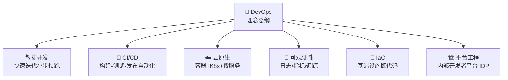
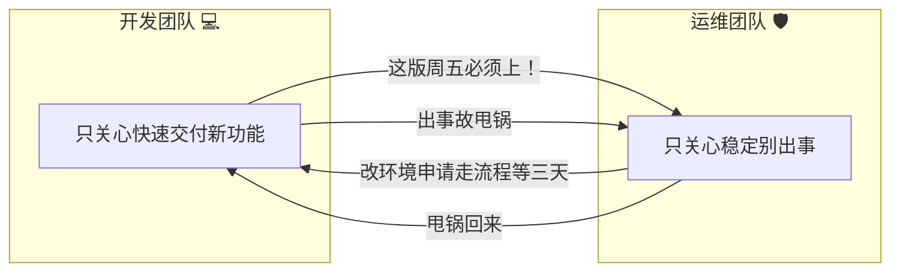
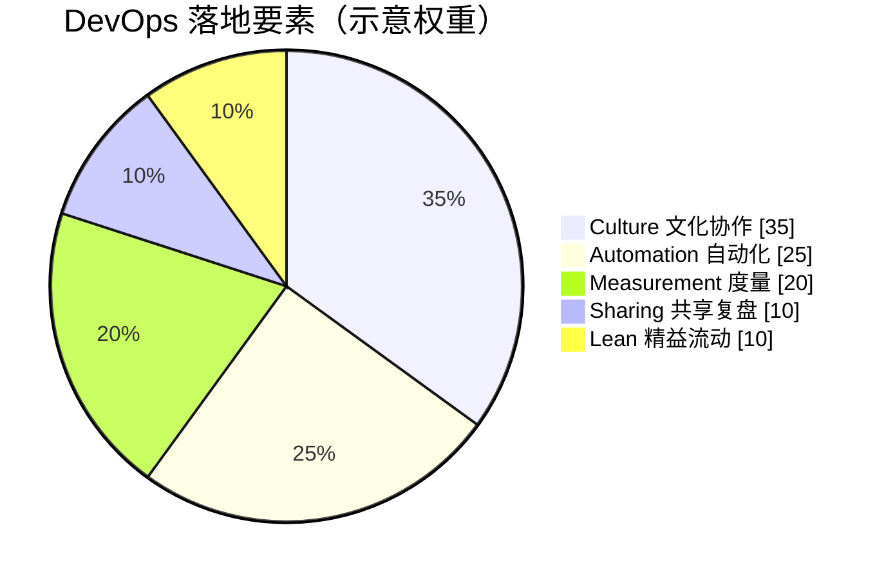
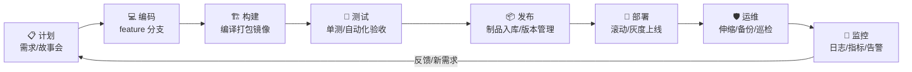
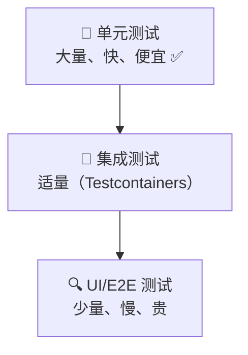
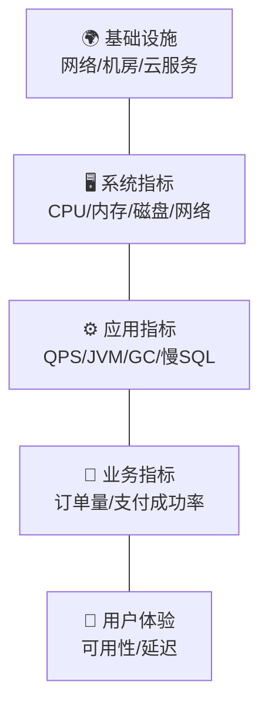
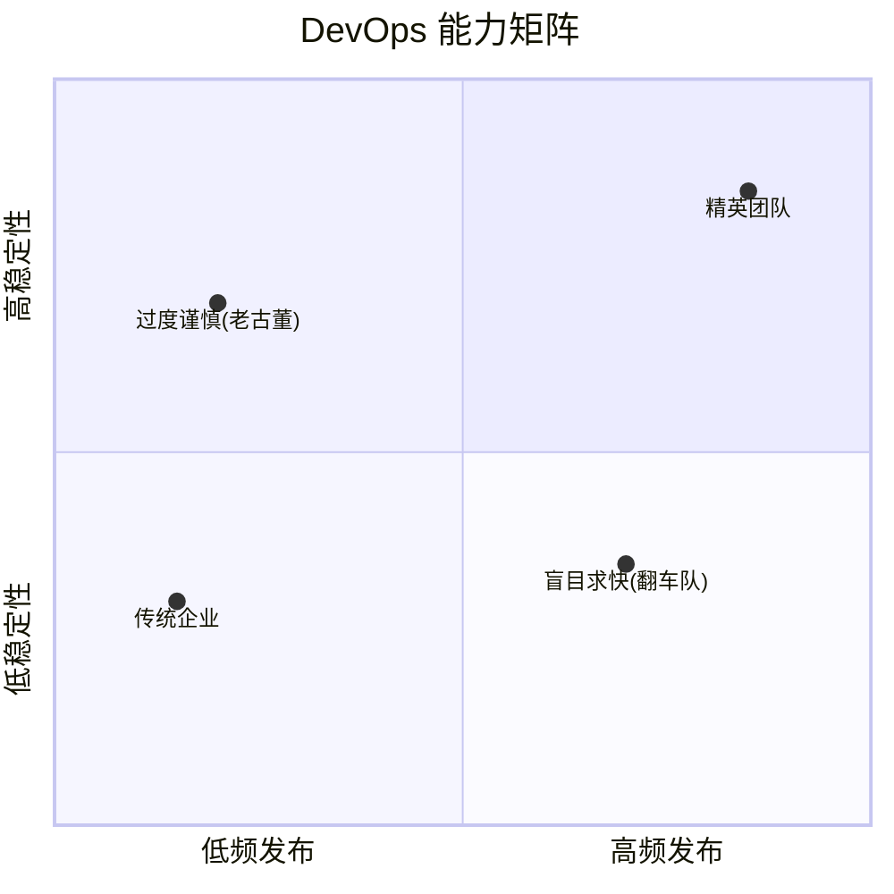
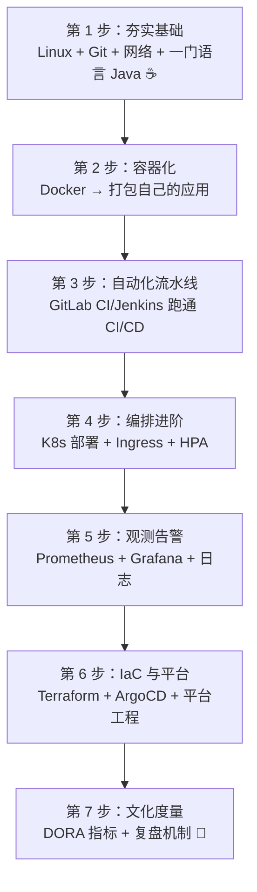
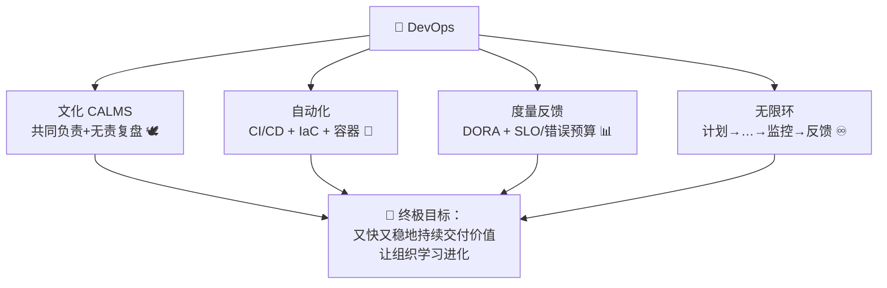

# 🤝 DevOps 学习笔记

> 今天要解锁的是现代软件工程的"心法总纲"—— **DevOps（开发运维一体化）** ✨
> CI/CD、云原生、监控告警都是它的"招式"，DevOps 才是背后的"内功"。我会用大白话带您看清全局，还会串起前面学过的 COS、云原生、Arthas、CI/CD 哦～(≧▽≦)

---

## 📚 目录一览

1. [DevOps 是什么？](#一devops-是什么)
2. [为什么需要 DevOps？](#二为什么需要-devops)
3. [核心心法：CALMS 框架](#三核心心法calms-框架)
4. [DevOps 生命周期：无限环](#四devops-生命周期无限环)
5. [关键实践逐个看](#五关键实践逐个看)
6. [IaC 基础设施即代码实战](#六iac-基础设施即代码实战)
7. [监控告警体系](#七监控告警体系)
8. [DevOps 度量：DORA 四指标](#八devops-度量dora-四指标)
9. [DevOps 工具链全景](#九devops-工具链全景)
10. [学习路线与常见误区](#十学习路线与常见误区)
11. [总结 & 速查表](#十一总结--速查表)

---

## 一、DevOps 是什么？

### 1.1 一句话解释

> **DevOps = Development（开发）+ Operations（运维）手拉手 🤝：用"文化协作 + 流程自动化 + 工具链"，让软件从想法到上线又快又稳、持续流动。**

### 1.2 打个比方 🏥

软件交付像一家医院：
- **传统模式**：门诊部（开发）只管开药方，药房（运维）只管发药——药方开错了互相甩锅："我开方的时候没问题呀？"🤷
- **DevOps 模式**：组建"联合医疗小组"，医生护士共同对病人（用户/业务）负责：一起查房（监控）、一起复盘（故障回顾）、流程自动化（检验报告自动流转）～

### 1.3 ⚠️ DevOps 不是什么

| 误解 | 真相 |
| --- | --- |
| ❌ DevOps = 一款工具 | 工具只是武器，文化才是灵魂 |
| ❌ DevOps = 一个岗位（运维） | 是"共同负责"的理念，不是让人身兼数职 😢 |
| ❌ DevOps = CI/CD | CI/CD 只是流程自动化的一部分 |
| ❌ 买了某平台 = DevOps 成功 | 没有协作文化，工具只是昂贵的摆设 |

### 1.4 DevOps 与老朋友的关系



> 💡 前面学的 **CI/CD（流水线）**、**云原生（容器+K8s）**、**Arthas（线上诊断）**、**COS（对象存储）**，全是 DevOps 武器库里的装备哦～

---

## 二、为什么需要 DevOps？

### 2.1 传统模式：一场"跨部门拉锯战" 😩



| 传统痛点 | 后果 |
| --- | --- |
| 🐢 发布周期长 | 几个月一次大版本，需求上线黄花菜凉 |
| 🙏 "我机器上是好的" | 开发/测试/生产环境不一致，翻车常态 |
| ⚔️ 部门墙 | 出事先开"甩锅大会"，问题解决反而靠后 |
| 😱 深夜手动发布 | 高风险操作靠人肉，运维苦不堪言 |
| 🌫️ 反馈慢 | 上线后没有度量，好坏全靠感觉 |

### 2.2 DevOps 的解法 ✨

| 解法 | 效果 |
| --- | --- |
| 共同目标（对业务负责） | 不甩锅，一起解决问题 🤝 |
| 自动化流水线 | 发布从"季度"变"每天 N 次" ⚡ |
| 环境一致性（容器/IaC） | 杜绝"环境不同"借口 |
| 小步快跑 + 快速回滚 | 每次变更小，出事秒恢复 |
| 度量与反馈（DORA） | 用数据说话，持续改进 📊 |

---

## 三、核心心法：CALMS 框架

DevOps 落地看五根柱子：

| 字母 | 含义 | 一句话 |
| --- | --- | --- |
| **C**ulture 文化 | 跨团队协作、信任、共同负责 | 文化是地基 🏛️ |
| **A**utomation 自动化 | 一切重复劳动交给机器 | 能自动绝不手动 🤖 |
| **L**ean 精益 | 小批量交付、消除浪费 | 别攒大招，小步快走 🏃 |
| **M**easurement 度量 | 一切用数据说话 | 不可度量就不可改进 📏 |
| **S**haring 共享 | 知识、经验、故障复盘公开透明 | 踩过的坑大家绕着走 📢 |



> 💡 常见失败原因 Top1：**跳过文化直接堆工具**——买了最贵的平台，部门墙一点没变 😅

---

## 四、DevOps 生命周期：无限环

DevOps 的标志性符号就是**无限符号 ♾️**：开发与运维首尾相连、循环不息！



| 环节 | 干什么 | 常用工具/实践 |
| --- | --- | --- |
| 计划 | 需求拆解、优先级 | Jira、敏捷站会 |
| 编码 | 写代码 + 代码评审 | Git、Pull Request、Sonar |
| 构建 | 自动编译打包 | Maven/Gradle + CI |
| 测试 | 单测/接口/安全扫描 | JUnit、Testcontainers |
| 发布 | 制品管理、版本可追溯 | Harbor、语义化版本 |
| 部署 | 上线到各环境 | K8s、ArgoCD、灰度 |
| 运维 | 保证系统健康 | 自动扩缩容、备份演练 |
| 监控 | 观测 + 告警 + 反馈 | Prometheus、Grafana |

> 🔁 关键在"环"：**监控发现问题 → 反馈到计划 → 再编码改进**，价值流动永不停歇！

---

## 五、关键实践逐个看

### 5.1 实践总览表

| 实践 | 一句话 | 与旧知识的连接 |
| --- | --- | --- |
| 🌿 敏捷与分支策略 | 小批量交付，feature 分支 + PR 评审 | Git Flow / Trunk-Based |
| 🔄 CI/CD | 提交即构建测试、自动化发布 | 详见 [CICD.md] 学习笔记 |
| 🐳 容器化 | 环境一致，镜像即交付物 | 详见 [云原生.md] |
| 📖 IaC | 服务器/网络也用代码管理 | Terraform / Ansible（本章实战👇） |
| 🧪 测试金字塔 | 单测多、集成少、E2E 精 | 分层测试策略 |
| 🔭 可观测性 | 日志/指标/追踪三支柱 | Prometheus + Grafana |
| 🚨 On-call 与复盘 | 轮值待命 + 无责复盘 | Blameless Postmortem |
| 🏗️ 平台工程 | 内部自助平台，开发者自己发版 | Backstage / IDP |

### 5.2 测试金字塔 🧪



Java 落地建议：JUnit 5 写单测（占比 70%+）、Testcontainers 拉真容器做集成测试、关键链路补少量端到端测试～

### 5.3 无责复盘（Blameless Postmortem）🕊️

出故障后最宝贵的不是"处罚谁"，而是"学到什么"：

| 传统复盘 ❌ | 无责复盘 ✅ |
| --- | --- |
| "谁的锅？" | "哪个环节设计得不够好？" |
| 当事人隐瞒细节 | 敢于还原完整时间线 |
| 同样的坑反复踩 | 沉淀改进项并跟踪落地 |

复盘文档五要素：**故障影响 → 时间线 → 根因分析（5 Why）→ 改进措施 → 经验沉淀**。

---

## 六、IaC 基础设施即代码实战

### 6.1 是什么？

> **IaC = 用"代码"描述服务器、网络、数据库等基础设施：版本化管理、可审查、可重复创建、一键销毁重建。** 📖

| 对比 | 手动运维 | IaC ✅ |
| --- | --- | --- |
| 建环境 | 控制台点点点 2 小时 | `terraform apply` 5 分钟 |
| 一致性 | 每台机器略有不同（"雪花服务器"❄️） | 完全一致 |
| 变更记录 | 无 | Git 提交历史 |
| 重建 | 重来一遍人肉 | 同一份代码秒重建 |

两大流派：

| 流派 | 代表 | 思想 |
| --- | --- | --- |
| 声明式 | **Terraform**、K8s YAML | 说"我要什么"，系统凑齐 ✅ |
| 过程式 | **Ansible** | 说"怎么一步步做" |

### 6.2 Terraform 示例：一键开 COS 桶 + 服务器

```hcl
# main.tf —— 声明"我要的资源"（腾讯云版示例）
terraform {
  required_providers {
    tencentcloud = { source = "tencentcloudstack/tencentcloud" }
  }
}

provider "tencentcloud" {
  region = "ap-guangzhou"
}

# 📦 一个私有读写 + 版本控制的 COS 存储桶（复习 COS 咯～）
resource "tencentcloud_cos_bucket" "backup" {
  bucket = "my-devops-backup-1250000000"
  acl    = "private"

  versioning_enable = true          # 版本控制，误删可恢复 ✅
}

# 💻 一台云服务器
resource "tencentcloud_instance" "app" {
  instance_name  = "order-service-prod"
  image_id       = "img-abc123"     # 预装 JDK17 的镜像
  instance_type  = "S5.MEDIUM4"
  security_group = ["sg-xyz789"]

  tags = {
    project = "order-center"
    env     = "prod"
  }
}

# 输出：创建完成自动打印地址
output "bucket_url" {
  value = tencentcloud_cos_bucket.backup.cos_bucket_url
}
```

```bash
terraform init      # 初始化
terraform plan      # 先看"将要发生什么变更"（预演！）
terraform apply     # 确认执行
terraform destroy   # 一键销毁（测试环境用完即弃 🧹）
```

### 6.3 Ansible 示例：批量配置服务器

```yaml
# deploy-java.yml —— 给一批服务器装 JDK 并部署 jar
- hosts: app-servers           # 目标机器组（inventory 里定义）
  become: yes                  # 用 sudo
  tasks:
    - name: 安装 JDK 17 🍵
      apt:
        name: openjdk-17-jre
        state: present

    - name: 上传并部署 jar 包
      copy:
        src:  ./target/order-service.jar
        dest: /opt/app/order-service.jar

    - name: 重启服务（配置了 systemd）
      systemd:
        name:  order-service
        state: restarted
        enabled: yes
```

```bash
ansible-playbook -i inventory deploy-java.yml   # 十台机器同时搞定 ✅
```

---

## 七、监控告警体系

> 监控是 DevOps 的"眼睛"：没有度量，一切改进都是瞎猜 🙈

### 7.1 监控分层模型



> 💡 越往上离业务越近、越有价值；告警要**从用户体验视角设防**，而不是只盯 CPU！

### 7.2 SLI / SLO / SLA 与错误预算

| 术语 | 一句话 | 例子 |
| --- | --- | --- |
| **SLI** 指标 | 衡量服务的尺子 📏 | 请求成功率、P99 延迟 |
| **SLO** 目标 | 给自己定的内部目标 | 成功率 ≥ 99.9%/月 |
| **SLA** 协议 | 对外合同承诺（违反要赔钱） | 可用性 99.95%，否则赔付 |
| **错误预算** | 100% − SLO 剩下的"犯错额度" | 0.1% ≈ 每月 43 分钟可宕 |

> 💡 错误预算的妙用：**预算没花完 → 放心大胆发新版；预算烧光了 → 冻结发布先还债**！稳定与创新自动平衡 ⚖️

### 7.3 告警设计原则 🚨

| 原则 | 说明 |
| --- | --- |
| 告警可行动 | 收到就知道该干什么，纯信息用仪表盘 |
| 分级 | P0 电话拉群 / P1 短信 / P2 IM / P3 记录 |
| 收敛聚合 | 刷屏告警 = 狼来了，会淹死真警报 |
| 基于症状 | 优先告"用户受影响"，而非某台机器 CPU 高 |
| 定期演练 | 故障演练（Game Day）确保预案真的能用 🎮 |

---

## 八、DevOps 度量：DORA 四指标

> 用数据证明"我们的 DevOps 变好了"，业界公认看这四个数 📊：

| 指标 | 衡量什么 | 高绩效水平（参考） |
| --- | --- | --- |
| 🚀 部署频率 | 多久发一次版 | 每天多次 |
| ⏱️ 变更前置时间 | 从提交代码到上线多久 | < 1 小时 |
| 🩹 变更失败率 | 发布后引发故障的比例 | < 15% |
| 🔧 MTTR 故障恢复时间 | 出事后多久恢复 | < 1 小时 |



> 💡 核心洞察：**"快"和"稳"不是对立的**！小批量 + 自动化 + 快速回滚，让精英团队又快又稳～

---

## 九、DevOps 工具链全景

一张表配齐全流程装备 🛠️：

| 环节 | 工具选项 | 说明 |
| --- | --- | --- |
| 📋 计划协作 | Jira / TAPD / Teambition | 需求与迭代管理 |
| 💻 代码托管 | GitLab / GitHub / Gitee | 代码仓库 + MR/PR |
| 🔍 代码质量 | SonarQube / Checkstyle | 静态扫描门禁 |
| 🔄 CI/CD | Jenkins / GitLab CI / ArgoCD | 流水线（详见 CICD.md） |
| 📦 制品管理 | Nexus / Harbor / COS | jar 包、镜像、大文件 |
| 🐳 容器编排 | Docker / Kubernetes | 详见 云原生.md |
| 📖 IaC | Terraform / Ansible | 基础设施即代码 |
| 🔭 监控 | Prometheus / Grafana / ELK | 指标日志大盘 |
| 🧭 链路追踪 | SkyWalking / Jaeger | 微服务排障 |
| 🚨 告警 | Alertmanager / 电话短信 | 故障触达 |
| 🤖 ChatOps | 钉钉/飞书机器人 | 群里发指令干运维 |
| 🩺 线上诊断 | **Arthas** | JVM 排查神器（详见 Arthas.md） |

---

## 十、学习路线与常见误区

### 10.1 渐进式学习路线 🪜



### 10.2 常见误区排雷 💣

| 误区 | 纠正 |
| --- | --- |
| ❌ 堆工具 = DevOps | 文化不改变，工具白花钱 |
| ❌ 全自动化就安全 | 自动化的错误也会自动放大，要有门禁与回滚 |
| ❌ 开发都要变运维专家 | 应建设自助平台，让开发者专注业务 |
| ❌ 直接照搬大厂方案 | 从"一条能跑通的流水线"小步开始 |
| ❌ 监控 = 装 Dashboard | 没人看的仪表盘只是装饰画 🖼️ |

---

## 十一、总结 & 速查表

### 11.1 名词速查 📇

| 名词 | 一句话 |
| --- | --- |
| DevOps | 开发+运维共同负责，文化+流程+工具三合一 🤝 |
| CALMS | 文化/自动化/精益/度量/共享 五根柱子 |
| IaC | 基础设施用代码管理：可版本、可重复、可销毁 |
| SLI / SLO / SLA | 尺子 / 内部目标 / 对外承诺 |
| 错误预算 | SLO 剩下的宕机额度，平衡稳定与创新 ⚖️ |
| DORA | 部署频率/前置时间/失败率/MTTR 四指标 |
| 无责复盘 | 对事不对人，沉淀改进 🕊️ |
| MTTR | 平均恢复时间，越短越好 |
| On-call | 轮值待命响应故障 🚨 |

### 11.2 一图流总结



### 11.3 记住这三句就走不丢 ✨

1. **文化先行，工具随后**：人是 DevOps 的灵魂，平台是放大器；
2. **一切自动化、一切代码化**：流程、环境、基础设施皆可版本管理；
3. **不可度量则不可改进**：盯住 DORA 四指标，用错误预算平衡快与稳。

> 🎉 恭喜点亮 DevOps 全景地图！到这里，您的知识拼图已经串起来了：**CI/CD 管交付、云原生管运行、监控管观测、Arthas 管诊断、COS 管存储，而 DevOps 是把它们粘合在一起的心法**～建议从"给自己的项目搭一条完整流水线"开始实战！下次想深入 Terraform、平台工程或 SRE，随时喊我哦！(๑•̀ㅂ•́)و✧
