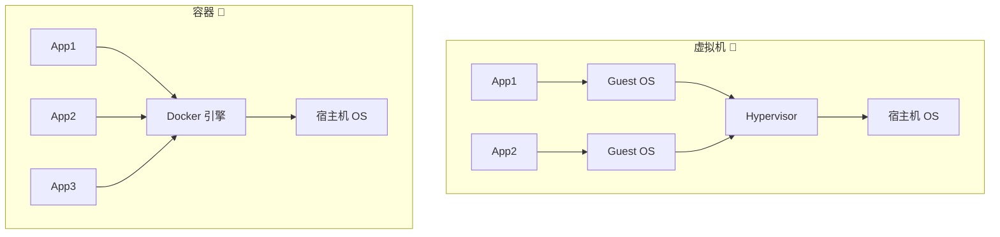
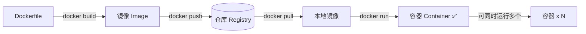
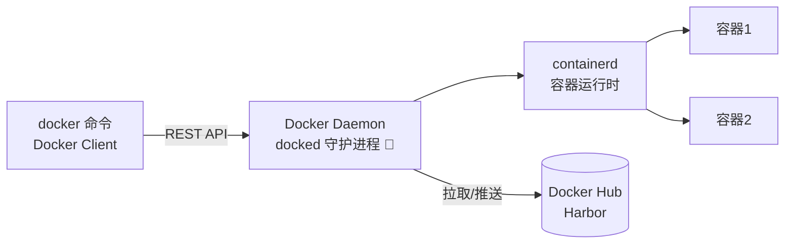
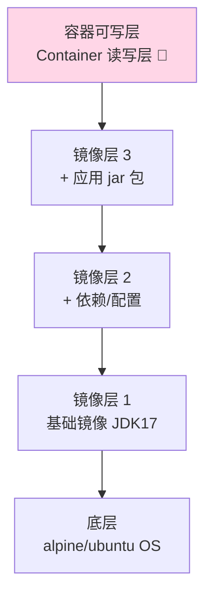
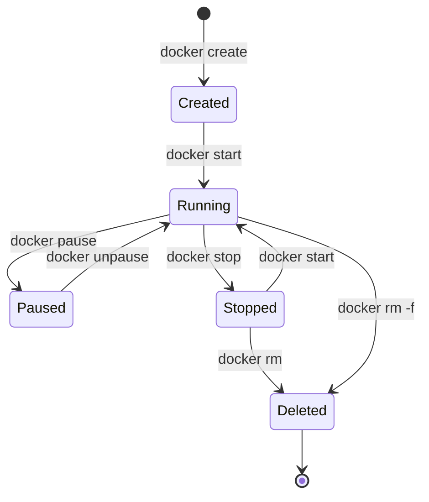
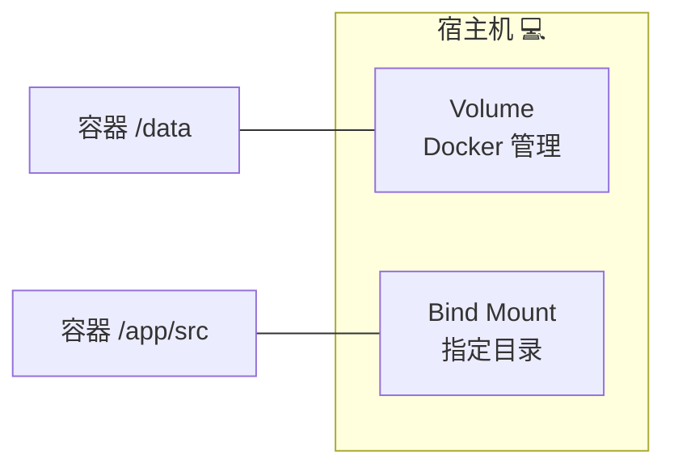
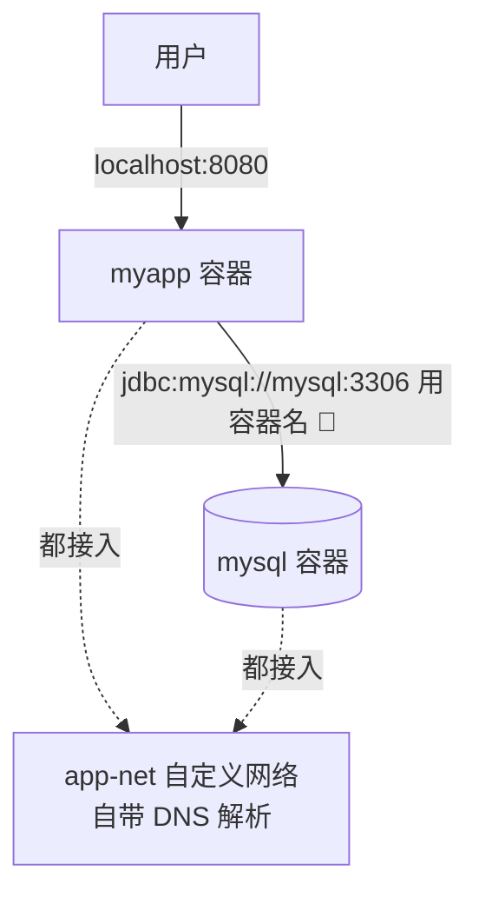
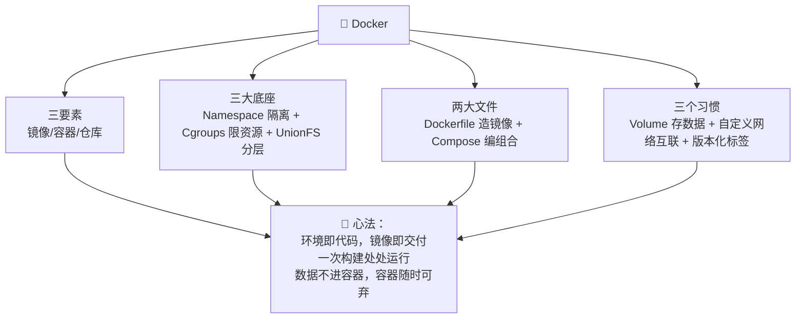

# 🐳 Docker 学习笔记

> 今天要吃透的是容器技术的"顶流"—— **Docker** ✨
> "我本地明明是好的！"这句口头禅，Docker 一招治好！我会用大白话 + Java 项目实战，带您从"会敲命令"到"懂原理会优化"～(≧▽≦)

---

## 📚 目录一览

1. [Docker 是什么？](#一docker-是什么)
2. [核心概念与架构](#二核心概念与架构)
3. [镜像操作命令](#三镜像操作命令)
4. [容器操作命令](#四容器操作命令)
5. [Dockerfile 详解（Java 实战）](#五dockerfile-详解java-实战)
6. [数据持久化：三种挂载](#六数据持久化三种挂载)
7. [Docker 网络](#七docker-网络)
8. [Docker Compose：一键起全家桶](#八docker-compose一键起全家桶)
9. [镜像仓库与推送](#九镜像仓库与推送)
10. [常见坑与最佳实践](#十常见坑与最佳实践)
11. [总结 & 速查表](#十一总结--速查表)

---

## 一、Docker 是什么？

### 1.1 一句话解释

> **Docker = 把"应用 + 依赖环境"打包成一个标准化"集装箱"，在任何装了 Docker 的机器上秒级运行。** 📦

### 1.2 解决什么问题？

| 老大难问题 | Docker 的解法 |
| --- | --- |
| 😩 "我本地是好的" | 环境连同代码一起打包，到哪都一样 |
| 🐢 装环境半天（JDK/MySQL/Redis…） | `docker run` 一条命令启动 |
| 😱 装多版本冲突（Python2/3 打架） | 每个容器独立隔离，互不打架 |
| 🚀 部署慢、扩容难 | 秒级启动、复制粘贴式扩容 |

### 1.3 打个比方 🚢

- 以前运货：什么货都用散装，装卸全靠人肉，货物之间互相磕碰（环境冲突）；
- Docker 后：所有货装进**标准集装箱**——吊车（Docker 引擎）到哪都能卸，箱子之间彼此隔离，想运几个运几个！

### 1.4 容器 vs 虚拟机

| 对比项 | 虚拟机 🐘 | 容器 🐣 |
| --- | --- | --- |
| 虚拟化级别 | 整台电脑（含 Guest OS） | 进程级（共享宿主机内核） |
| 启动速度 | 分钟级 | **秒级** ⚡ |
| 体积 | GB 级 | MB 级 |
| 性能损耗 | 明显 | 接近原生 |
| 隔离强度 | 强（内核级） | 中（进程级，够用） |



---

## 二、核心概念与架构

### 2.1 三大核心：镜像 / 容器 / 仓库

| 概念 | 一句话 | 类比 |
| --- | --- | --- |
| 镜像 Image | 只读模板，含应用+环境 | 蛋糕模具 🍰 |
| 容器 Container | 镜像的运行实例 | 用模具做出的蛋糕 |
| 仓库 Registry | 存镜像的地方 | 模具货架（Docker Hub/Harbor） |



### 2.2 Docker 架构：Client-Server 模式



> 💡 平时敲的 `docker` 命令只是"传话筒"，真正干活的是后台守护进程（daemon），所以守护进程挂了所有命令都会失联哦～

### 2.3 底层原理（Linux 三板斧 🪓）

| 技术 | 作用 | 类比 |
| --- | --- | --- |
| **Namespace** 命名空间 | 隔离视图：让容器有自己的 PID/网络/文件系统 | 每人一个独立单间 🚪 |
| **Cgroups** 控制组 | 限制资源：CPU、内存用量上限 | 房间限电限水 ⚡ |
| **UnionFS** 联合文件系统 | 镜像分层叠加，读写分离 | 透明描图纸叠画 📄 |

### 2.4 镜像分层：Docker 的省钱智慧 💰



| 分层特性 | 好处 |
| --- | --- |
| 层只读 + 共享 | 10 个容器用同一个镜像，磁盘只存一份！ |
| 构建缓存 | 改代码只重建上面几层，快 ⚡ |
| Copy-on-Write | 容器改文件才复制到自己的可写层，互不干扰 |

---

## 三、镜像操作命令

```bash
docker pull mysql:8.0              # 拉镜像（:tag 不写默认 latest，建议写明确版本！）
docker images                      # 列出本地镜像
docker images -q                   # 只看 ID（配合清理）
docker rmi mysql:8.0               # 删除镜像（-f 强删）
docker tag myapp:1.0 registry.example.com/team/myapp:1.0   # 打标签
docker inspect mysql:8.0           # 看镜像详细信息（元数据）
docker history myapp:1.0           # 看镜像每一层怎么构建的（排查镜像大小神器 🔍）
docker save -o app.tar myapp:1.0   # 导出镜像成文件（离线传输）
docker load -i app.tar             # 从文件导入镜像
docker build -t myapp:1.0 .        # 构建镜像（核心！见第五章）
```

---

## 四、容器操作命令

### 4.1 docker run：最重要的命令 ⭐

```bash
docker run -d \
  --name order-service \           # 容器名（好记好管）
  -p 8080:8080 \                   # 端口映射：宿主机:容器
  -e SPRING_PROFILES_ACTIVE=prod \ # 环境变量
  -v /data/logs:/app/logs \        # 目录挂载
  --memory=512m --cpus=0.5 \       # 资源限制
  --restart=always \               # 挂了自动重启
  myapp:1.0                        # 镜像
```

参数速查表：

| 参数 | 作用 |
| --- | --- |
| `-d` | 后台运行（detach） |
| `-p 宿:容` | 端口映射 🚪 |
| `-e K=V` | 环境变量 |
| `-v 宿:容` | 挂载目录/卷 |
| `--name` | 容器命名 |
| `--restart=always` | 开机自启 + 挂了重启 |
| `--rm` | 容器停止后自动删除（临时容器好用） |
| `--memory / --cpus` | 资源限额 |

### 4.2 日常管理命令

```bash
docker ps                        # 运行中的容器（-a 含已停止的）
docker start/stop/restart 名字    # 启停重启
docker logs -f --tail 200 名字    # 追日志（排障必背 🔍）
docker exec -it 名字 sh           # 钻进容器里（exit 退出）
docker stats                     # 实时资源占用（容器版 top）
docker top 名字                  # 看容器内进程
docker cp 名字:/app/logs .        # 容器内外拷文件
docker rm 名字                    # 删容器（运行中需 -f）
docker system df                 # 磁盘占用总览 💾
docker system prune              # 大扫除：清无用容器/网络/悬空镜像 🧹
```

### 4.3 容器生命周期



> 💡 `docker run` = `create` + `start` 二合一！

---

## 五、Dockerfile 详解（Java 实战）

### 5.1 常用指令速查 🧱

| 指令 | 作用 | 示例 |
| --- | --- | --- |
| `FROM` | 基础镜像（必须是第一条） | `FROM eclipse-temurin:17-jre` |
| `WORKDIR` | 工作目录（不存在自动建） | `WORKDIR /app` |
| `COPY` | 拷贝文件进镜像 | `COPY target/app.jar app.jar` |
| `ADD` | COPY 加强版（能解压 tar/URL）——**优先用 COPY** | `ADD app.tar.gz /opt` |
| `RUN` | 构建时执行命令（产生新层） | `RUN apt-get update && apt-get install -y curl` |
| `ENV` | 环境变量（运行时可用） | `ENV TZ=Asia/Shanghai` |
| `ARG` | 构建时变量（仅构建期） | `ARG JAR_FILE=app.jar` |
| `EXPOSE` | 声明端口（仅文档作用，映射靠 -p） | `EXPOSE 8080` |
| `CMD` | 默认启动命令（可被覆盖） | `CMD ["java","-jar","app.jar"]` |
| `ENTRYPOINT` | 入口命令（不易被覆盖） | `ENTRYPOINT ["java","-jar"]` |
| `USER` | 以什么用户运行 | `USER app` |
| `HEALTHCHECK` | 健康检查 | `HEALTHCHECK CMD curl -f http://localhost:8080/actuator/health` |
| `VOLUME` | 声明匿名卷挂载点 | `VOLUME /app/logs` |

### 5.2 CMD vs ENTRYPOINT（必考题 📝）

| 对比 | CMD | ENTRYPOINT |
| --- | --- | --- |
| 语义 | 默认参数/命令 | 固定入口 |
| `docker run 镜像 参数` 时的表现 | **参数整体替换 CMD** | **参数追加到 ENTRYPOINT 后面** |
| 组合用法 | 常给 ENTRYPOINT 当默认参数 | 固定程序 + 可变参数 ✅ |

```dockerfile
# 组合用法：ENTRYPOINT 固定程序，CMD 提供默认参数
ENTRYPOINT ["java", "-jar", "app.jar"]
CMD ["--spring.profiles.active=prod"]
# docker run myapp → 用默认 prod
# docker run myapp --spring.profiles.active=test → 轻松切 test ✨
```

### 5.3 Spring Boot 项目完整实战 ☕

```dockerfile
# ========== 多阶段构建：小镜像的秘诀 ==========
# ---- 阶段一：builder，用完整 Maven 环境编译 ----
FROM maven:3.9-eclipse-temurin-17 AS builder
WORKDIR /build
# 🌟 先只拷 pom 下载依赖：利用层缓存，改代码不用重下依赖！
COPY pom.xml .
RUN mvn dependency:go-offline
COPY src ./src
RUN mvn package -DskipTests

# ---- 阶段二：runtime，只要 JRE 够用 ----
FROM eclipse-temurin:17-jre-alpine
WORKDIR /app

# 安装 curl 给健康检查用，顺手调时区 🕐
RUN apk add --no-cache curl tzdata \
    && cp /usr/share/zoneinfo/Asia/Shanghai /etc/localtime \
    && echo "Asia/Shanghai" > /etc/timezone

# 非 root 用户运行，更安全 🔒
RUN addgroup -S app && adduser -S app -G app
USER app

# 只拷最终 jar（builder 阶段的产物），镜像里不含源码和 Maven 缓存
COPY --from=builder /build/target/*.jar app.jar

ENV JAVA_OPTS="-Xms256m -Xmx512m" \
    TZ=Asia/Shanghai

EXPOSE 8080

HEALTHCHECK --interval=30s --timeout=3s --retries=3 \
  CMD curl -f http://localhost:8080/actuator/health || exit 1

ENTRYPOINT ["sh", "-c", "java $JAVA_OPTS -jar app.jar"]
```

多阶段构建前后对比：

| 方式 | 镜像大小 | 说明 |
| --- | --- | --- |
| 单阶段（Maven 镜像当运行时） | ~800MB+ 🐘 | 带着编译工具和白跑一趟的依赖 |
| 多阶段 + JRE alpine | ~200MB ✨ | 只有 JRE + jar，瘦身 75%！ |

### 5.4 构建缓存原则（快人一步 ⚡）

> **把"变得少的"写前面，"变得勤的"写后面！**

```dockerfile
✅ pom.xml 先拷（依赖几乎不变）→ 下载依赖层被缓存
✅ 源码后拷（天天变）→ 只重编译这一层
❌ 反例：一上来 COPY 全部源码 → 每次改一行代码，依赖全部重下 💔
```

```bash
docker build -t myapp:1.0 .                    # 基础构建
docker build -f docker/Dockerfile -t myapp .   # 指定 Dockerfile 路径
docker build --no-cache -t myapp .             # 强制全量构建（缓存抽风时用）
```

---

## 六、数据持久化：三种挂载

容器"用完即弃"，数据放哪？三种姿势 📦：

| 方式 | 命令样式 | 数据实际位置 | 适合 |
| --- | --- | --- | --- |
| **Volume 卷**（推荐 ⭐） | `-v myvol:/data` | Docker 管理区（/var/lib/docker/volumes） | 数据库数据、正式环境 |
| **Bind Mount 绑定挂载** | `-v /宿主机路径:/data` | 宿主机任意目录 | 开发时挂代码、热更新 |
| **tmpfs** | `--tmpfs /tmp` | 内存 | 临时敏感数据 |



```bash
docker volume create mysql-data        # 创建卷
docker volume ls                       # 列出所有卷
docker volume inspect mysql-data       # 看详情（真实路径）
docker volume rm mysql-data            # 删卷
docker volume prune                    # 清理无用卷 🧹

# MySQL 数据持久化示例：删容器重建，数据还在！
docker run -d --name mysql \
  -e MYSQL_ROOT_PASSWORD=root123 \
  -v mysql-data:/var/lib/mysql \       # 🌟 数据落卷，容器随便删
  -p 3306:3306 mysql:8.0
```

---

## 七、Docker 网络

### 7.1 四种网络模式

| 模式 | 一句话 | 用法 |
| --- | --- | --- |
| **bridge**（默认）🌉 | 容器挂到虚拟网桥 docker0，配 NAT 上网 | `-p` 端口映射对外 |
| **host** 🏠 | 和宿主机共用网络栈，性能最好 | `--network host`（K8s Pod 就近似这种） |
| **none** 🚫 | 没网络，彻底自闭 | 特殊安全场景 |
| **container** 🔗 | 和另一容器共用网络栈 | K8s Pod 内多容器共享网络的基础 |

### 7.2 容器互联：自定义网络 ⭐

> ⚠️ 默认 bridge 里容器**只能靠 IP** 互访；**自定义网络自带 DNS，容器名即域名**！

```bash
docker network create app-net                      # 建网
docker run -d --name mysql --network app-net \
  -e MYSQL_ROOT_PASSWORD=root123 mysql:8.0
docker run -d --name myapp --network app-net \
  -e DB_HOST=mysql myapp:1.0                       # 🎉 直接用容器名 mysql 连库！
```



> 💡 Spring Boot 配置里写 `jdbc:mysql://mysql:3306/app?...` 就能连上，是不是很魔法～（前提：同一自定义网络）

---

## 八、Docker Compose：一键起全家桶

### 8.1 是什么？

> **Compose = 用一个 YAML 文件描述"多容器组合"，一条命令拉起整套环境**（应用 + MySQL + Redis + 网关…）🏠

### 8.2 实战：Java 应用全家桶

```yaml
# docker-compose.yml —— Spring Boot + MySQL + Redis 一键起 🎆
services:
  app:                                  # 我们的 Java 应用
    build: .                            # 当前目录 Dockerfile 构建
    image: order-app:1.0
    container_name: order-app
    ports:
      - "8080:8080"                     # 对外暴露
    environment:
      SPRING_PROFILES_ACTIVE: docker
      DB_HOST: mysql                    # 🎯 直接用服务名（同网络 DNS）
      REDIS_HOST: redis
    depends_on:                         # 依赖顺序：先起 db 再起 app
      mysql:
        condition: service_healthy
      redis:
        condition: service_started
    restart: always
    networks:
      - app-net

  mysql:
    image: mysql:8.0
    container_name: order-mysql
    environment:
      MYSQL_ROOT_PASSWORD: root123
      MYSQL_DATABASE: orders            # 自动建库，贴心～
    volumes:
      - mysql-data:/var/lib/mysql       # 数据持久化
      - ./init.sql:/docker-entrypoint-initdb.d/init.sql   # 首次启动执行初始化 SQL
    healthcheck:                        # 🩺 健康检查，app 等 MySQL 就绪
      test: ["CMD", "mysqladmin", "ping", "-h", "localhost", "-proot123"]
      interval: 5s
      retries: 10
    ports:
      - "3306:3306"
    networks:
      - app-net

  redis:
    image: redis:7-alpine
    container_name: order-redis
    command: redis-server --requirepass redis123
    volumes:
      - redis-data:/data
    networks:
      - app-net

volumes:
  mysql-data:
  redis-data:

networks:
  app-net:
```

### 8.3 Compose 常用命令 🛠️

```bash
docker compose up -d          # 后台拉起全部服务
docker compose ps             # 查看服务状态
docker compose logs -f app    # 追某服务日志
docker compose exec app sh    # 钻进容器
docker compose restart app    # 重启某服务
docker compose down           # 停止并删除容器（卷保留）
docker compose down -v        # 连卷一起删（数据清空警告 ⚠️）
docker compose up -d --build  # 改代码后重新构建并起
```

---

## 九、镜像仓库与推送

### 9.1 仓库选择

| 仓库 | 说明 |
| --- | --- |
| **Docker Hub** | 官方公共仓库（国内拉取可能慢） |
| **Harbor** ⭐ | 企业自建首选：私有 + 权限 + 漏洞扫描 + 镜像签名 |
| 云厂商镜像库 | 腾讯云 TCR/个人版、阿里云 ACR，配合云上部署丝滑 |
| `registry:2` | 官方最简版，本地快速搭一个 |

### 9.2 推送三部曲

```bash
# ① 登录
docker login registry.example.com

# ② 打标签（格式：仓库地址/项目/镜像:版本）
docker tag order-app:1.0 registry.example.com/team/order-app:1.0
docker tag order-app:1.0 registry.example.com/team/order-app:latest

# ③ 推送
docker push registry.example.com/team/order-app:1.0
```

> 💡 团队规范：版本标签用 `语义版本-构建号`（如 `1.2.0-42`），**生产禁用 latest**——出事都不知道线上跑的哪版 😱（详见 CI/CD 笔记的镜像标签策略～）

---

## 十、常见坑与最佳实践

### 10.1 排雷表 💣

| 坑 | 症状 | 解法 |
| --- | --- | --- |
| 容器一启动就退出 | Java 应用秒退 | 前台进程不能是守护化的；看 `docker logs` 找异常 |
| 时区不对 | 日志时间差 8 小时 | `TZ=Asia/Shanghai` + 装 tzdata |
| 端口不通 | 外部访问不了 | 检查 `-p` 映射；容器内 `curl localhost:8080` 自测 |
| 数据消失 | 重建容器 DB 空了 | 用 Volume 挂载持久化！ |
| 磁盘爆满 | 机器卡死 | `docker system df` 查看 + `prune` 清理 |
| 容器名冲突 | name already in use | `docker rm` 旧容器或 `--rm` 用完即删 |
| root 运行 | 安全扫描告警 | Dockerfile 加 `USER app` |
| 镜像越攒越大 | 几百个镜像没删 | 定期清理悬空镜像 `dangling` |

### 10.2 最佳实践清单 ✅

1. 📌 镜像标签固定版本号，生产不用 `latest`；
2. 📌 多阶段构建 + alpine 基础镜像，能瘦则瘦；
3. 📌 利用构建缓存：依赖层写前面，源码层写后面；
4. 📌 用 `.dockerignore` 排除无用文件（target/、.git/、node_modules/）；
5. 📌 非 root 用户 + HEALTHCHECK 健康检查；
6. 📌 敏感配置用环境变量/挂载注入，不打进镜像；
7. 📌 一个容器只干一件事（单进程原则），组合交给 Compose/K8s；
8. 📌 日志输出到 stdout/stderr，交给日志驱动收集（云原生 12-Factor 第 11 条）。

`.dockerignore` 示例：

```text
.git
.idea
target
*.log
node_modules
docker-compose.yml
```

---

## 十一、总结 & 速查表

### 11.1 核心概念速查 📇

| 名词 | 一句话 |
| --- | --- |
| 镜像 | 只读模板 = 应用 + 环境的"集装箱"📦 |
| 容器 | 镜像的运行实例，秒级启停 |
| 仓库 | 镜像的"货架"（Hub/Harbor） |
| Dockerfile | 构建"说明书"，一层层叠出镜像 |
| Volume | 数据持久化的"保险柜" |
| 自定义网络 | 自带 DNS，容器名当域名用 🎯 |
| Compose | 一个 YAML 拉起全家桶 |
| 多阶段构建 | 编译和运行分离，镜像瘦身 75% ✨ |

### 11.2 高频命令地图 🛠️

| 类别 | 命令 |
| --- | --- |
| 生命周期 | `run / start / stop / restart / rm` |
| 查看 | `ps / logs / exec / stats / inspect / top` |
| 镜像 | `build / pull / push / images / rmi / tag / history` |
| 数据 | `volume create/ls/inspect/prune` |
| 网络 | `network create/ls/inspect` |
| 组合 | `compose up -d / ps / logs / down` |
| 清理 | `system df / prune` 🧹 |

### 11.3 一图流总结



### 11.4 记住这三句就走不丢 ✨

1. **镜像是模板，容器是实例**：删容器不心疼，数据在卷里、镜像在仓库里；
2. **分层 + 缓存 = 快**：变得少的写前面，变得勤的写后面；
3. **容器是"一次性"的**：无状态、可替换、可复制——这正是通往 K8s 的思想船票 🎫。

> 🎉 恭喜点亮 Docker 技能树！动手作业：把自己的 Spring Boot 项目写成多阶段 Dockerfile，配一个 Compose（app+mysql+redis），体验"一条命令起全家桶"的快乐～下一步就是 Kubernetes 啦，把今天的容器"集装箱"交给园长统一管理！下次想学 K8s 专题、Harbor 搭建或镜像优化，随时喊我哦！(๑•̀ㅂ•́)و✧
