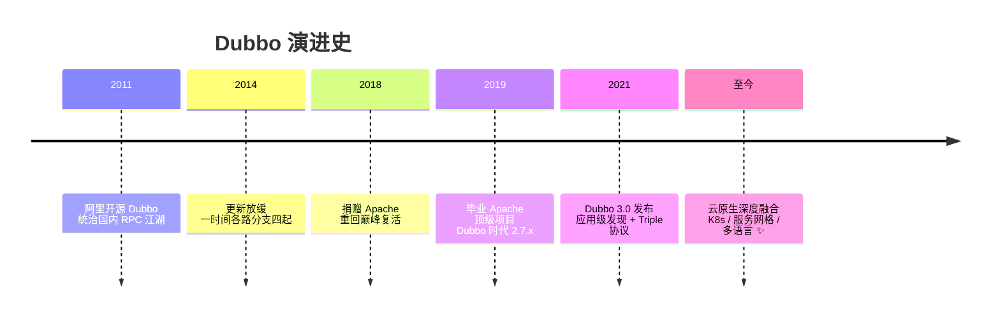
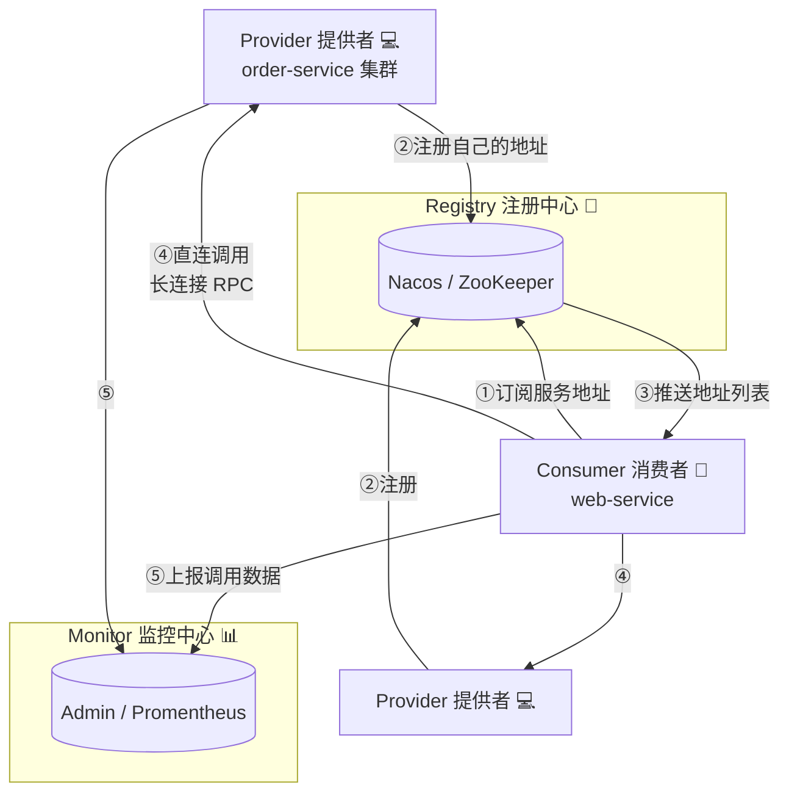
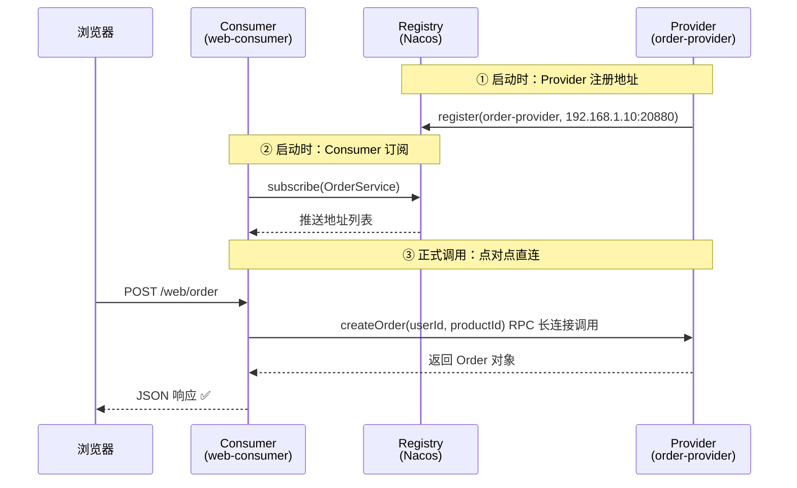
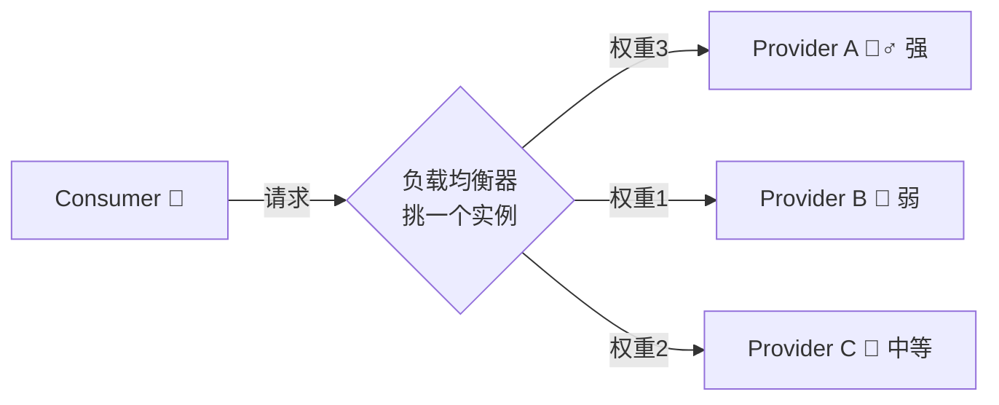
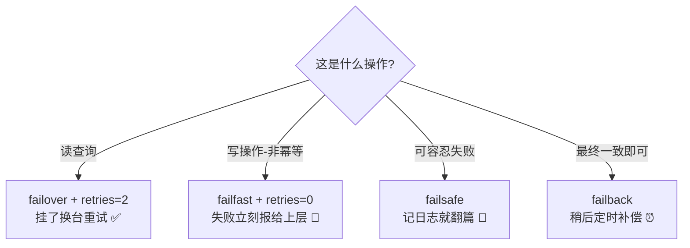
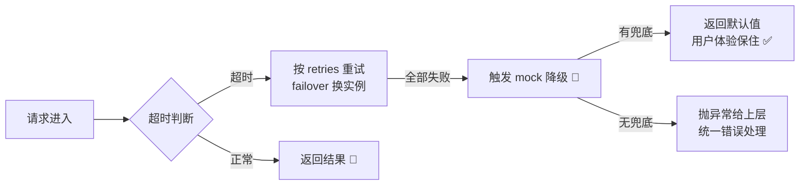
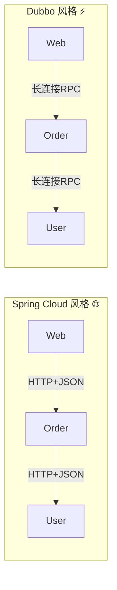
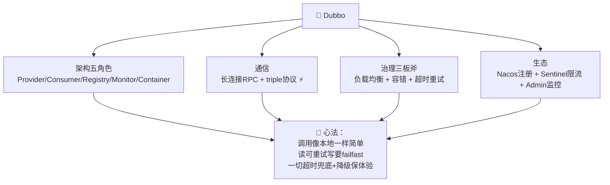

# 🔗 Dubbo 学习笔记

> 今天要请出的是 Java 微服务世界的"老牌战将"—— **Apache Dubbo** ✨
> 服务拆开之后怎么互相"打电话"？Dubbo 就是为高性能 RPC 通信而生的！我会用大白话 + 完整 Java 实战，带您从入门到精通～(≧▽≦)

---

## 📚 目录一览

1. [Dubbo 是什么？](#一dubbo-是什么)
2. [为什么需要 Dubbo？](#二为什么需要-dubbo)
3. [核心架构：五大角色](#三核心架构五大角色)
4. [快速上手：三步跑通 RPC](#四快速上手三步跑通-rpc)
5. [Spring Boot 整合实战](#五spring-boot-整合实战)
6. [核心特性：负载均衡](#六核心特性负载均衡)
7. [核心特性：集群容错](#七核心特性集群容错)
8. [服务治理：超时/重试/降级](#八服务治理超时重试降级)
9. [协议与序列化](#九协议与序列化)
10. [Dubbo 3 新特性](#十dubbo-3-新特性)
11. [Dubbo vs Spring Cloud](#十一dubbo-vs-spring-cloud)
12. [最佳实践与常见坑](#十二最佳实践与常见坑)
13. [总结 & 速查表](#十三总结--速查表)

---

## 一、Dubbo 是什么？

### 1.1 一句话解释

> **Dubbo = Apache 顶级开源的高性能 Java RPC 框架：让一个服务像调本地方法一样，轻松调用另一个机器上的服务，还自带注册中心、负载均衡、容错、监控等一整套服务治理能力。** 🔗

### 1.2 先搞懂 RPC 是什么？

> **RPC（Remote Procedure Call，远程过程调用）**：让"调用远程服务"的代码写起来和"调用本地方法"一模一样，底层网络通信框架全包了～

### 1.3 打个比方 📞

微服务之间的通信就像"点外卖"🍱：
- **没有 RPC**：您得自己知道店在哪（IP:端口）、自己跑去、自己报菜名（拼 HTTP 报文）、自己拿回来解析——累死个人；
- **有 Dubbo**：打开外卖 App（接口定义）搜"黄焖鸡"（服务发现）下单即可，App 自动挑评分高不排队的店（负载均衡），店关门了自动换一家（容错），骑手全程可查（链路监控）！

### 1.4 发展简史 🕰️



---

## 二、为什么需要 Dubbo？

### 2.1 单体拆开后的烦恼 😢

单体按 DDD 拆成微服务后（复习 DDD 笔记～），新问题来了：

| 烦恼 | 说明 |
| --- | --- |
| 📇 服务地址管理 | 上百个服务实例，IP 写死了换一台就全崩 |
| ⚖️ 流量分配 | 10 个实例谁多干谁少干？ |
| 💥 实例挂了 | 消费者还傻傻调用已死的实例 |
| 🐢 性能 | HTTP+JSON 又重又慢 |
| 🔍 治理 | 超时、重试、熔断、灰度……全都自己写？ |

### 2.2 Dubbo 一站式解决 ✨

| 能力 | 一句话 |
| --- | --- |
| 📇 服务注册发现 | 注册中心自动管理地址，实例上下线自动感知 |
| ⚖️ 智能负载均衡 | 内置 5 种策略，流量科学分配 |
| 🛡️ 集群容错 | 挂了自动重试/快速失败/降级 |
| 🚀 高性能通信 | 长连接 + 二进制序列化，性能远超 HTTP+JSON |
| 🔍 可观测 | 调用链、QPS、耗时统计一应俱全 |

---

## 三、核心架构：五大角色



| 角色 | 一句话 | 类比 |
| --- | --- | --- |
| **Provider** 提供者 | 暴露服务的服务方 | 外卖店家 🍱 |
| **Consumer** 消费者 | 调用远程服务的方 | 点餐的您 🛒 |
| **Registry** 注册中心 | 存"谁提供什么服务"的电话簿 | 外卖平台 📇 |
| **Monitor** 监控中心 | 统计调用量、耗时 | 平台数据看板 📊 |
| **Container** 容器 | 服务运行载体（Spring） | 店铺的厨房 🔥 |

> 💡 **关键设计**：注册中心只负责"递电话簿"，**实际调用是消费者直连提供者**（点对点长连接）——所以注册中心短暂宕机也不影响已建立的服务调用，稳！🛡️

---

## 四、快速上手：三步跑通 RPC

经典三模块结构 🏗️：

```text
order-project/
├── order-api/        # ① 接口与模型（双方共享的"菜单"）
├── order-provider/   # ② 服务提供者（实现接口）
└── order-consumer/   # ③ 服务消费者（调用接口）
```

### 第一步：定义公共接口（order-api 模块）📜

```java
// order-api/src/main/java/com/example/api/OrderService.java

/**
 * 📜 服务"菜单"：接口定义在公共 API 模块
 * 提供者实现它，消费者依赖它——这就是"通用语言"的接口版！
 */
public interface OrderService {

    /** 创建订单 */
    Order createOrder(Long userId, String productId, int quantity);

    /** 查询订单 */
    Order getOrder(String orderId);
}
```

```java
// 传输的模型必须实现 Serializable（序列化跨网络传输必备～）
import java.io.Serializable;
import java.math.BigDecimal;

public class Order implements Serializable {
    private static final long serialVersionUID = 1L;

    private String orderId;
    private Long userId;
    private BigDecimal amount;
    private String status;

    // getter / setter 省略……
}
```

### 第二步：服务提供者（order-provider）💻

```xml
<!-- pom.xml 核心依赖（Dubbo 3 + Nacos 注册中心） -->
<dependency>
    <groupId>org.apache.dubbo</groupId>
    <artifactId>dubbo-spring-boot-starter</artifactId>
    <version>3.2.14</version>
</dependency>
<dependency>
    <groupId>com.alibaba.nacos</groupId>
    <artifactId>nacos-client</artifactId>
    <version>2.3.2</version>
</dependency>
```

```java
// 服务实现：@DubboService 把它暴露为远程服务 🌟
@DubboService
public class OrderServiceImpl implements OrderService {

    @Override
    public Order createOrder(Long userId, String productId, int quantity) {
        Order order = new Order();
        order.setOrderId("ORD-" + System.currentTimeMillis());
        order.setUserId(userId);
        order.setStatus("CREATED");
        System.out.println("订单已创建：" + order.getOrderId());
        return order;
    }

    @Override
    public Order getOrder(String orderId) {
        // 假装查库……
        Order order = new Order();
        order.setOrderId(orderId);
        order.setStatus("PAID");
        return order;
    }
}
```

```java
// 启动类：@EnableDubbo 开启 Dubbo 能力
@SpringBootApplication
@EnableDubbo
public class OrderProviderApplication {
    public static void main(String[] args) {
        SpringApplication.run(OrderProviderApplication.class, args);
    }
}
```

```yaml
# application.yml —— 提供者配置
dubbo:
  application:
    name: order-provider          # 应用名
  protocol:
    name: dubbo                   # 通信协议
    port: 20880                   # 服务端口
  registry:
    address: nacos://127.0.0.1:8848   # 📇 注册中心地址（Nacos）

spring:
  application:
    name: order-provider
```

### 第三步：服务消费者（order-consumer）🛒

```java
@RestController
@RequestMapping("/web")
public class OrderController {

    // 🌟 像注入本地 Bean 一样注入远程服务！
    @DubboReference(
        timeout = 3000,                          // 超时 3 秒
        retries = 2,                             // 失败重试 2 次
        loadbalance = "roundrobin"               // 轮询负载均衡
    )
    private OrderService orderService;

    @PostMapping("/order")
    public Order create(@RequestParam Long userId,
                        @RequestParam String productId) {
        // 写法和调本地方法一模一样！底层网络全透明 ✨
        return orderService.createOrder(userId, productId, 1);
    }

    @GetMapping("/order/{id}")
    public Order get(@PathVariable String id) {
        return orderService.getOrder(id);
    }
}
```

```yaml
# application.yml —— 消费者配置
dubbo:
  application:
    name: web-consumer
  registry:
    address: nacos://127.0.0.1:8848   # 去同一个"电话簿"找服务
  consumer:
    check: false                       # 启动时不检查提供者是否在线（开发友好～）
```

一次调用的完整时序 🔍：



---

## 五、Spring Boot 整合实战

上面已经是最主流的 Spring Boot 玩法啦，再补充几个常用配置姿势 💪：

```java
// 方式一：注解参数精细控制（最常用 ✅）
@DubboReference(
    version = "1.0.0",              // 版本号：灰度发布好帮手
    group = "order",                // 分组：隔离同名服务
    timeout = 3000,
    retries = 2,
    loadbalance = "leastactive",    // 最少活跃调用优先
    mock = "return null"            // 降级：全挂了返回 null 兜底
)
private OrderService orderService;

// 方式二：配置文件统一管理（改配置不用改代码）
// application.yml:
// dubbo:
//   consumer:
//     timeout: 3000
//     retries: 2
```

```java
// 方法级精细化治理：@DubboMethod
@DubboReference(methods = {
    @Method(name = "createOrder", timeout = 5000, retries = 0),   // 下单：慢一点没关系但不许重试！（防重复下单！）
    @Method(name = "getOrder",    timeout = 1000, retries = 2)    // 查询：可以重试
})
private OrderService orderService;
```

> ⚠️ **重要心法**：**查询可以重试，写操作慎重重试**！`createOrder` 若超时自动重试，可能重复下单 💸——幂等性必须自己保证（如唯一请求 ID）。

---

## 六、核心特性：负载均衡

当 Provider 有多个实例，Consumer 的请求分给谁？Dubbo 内置 5 种策略 ⚖️：

| 策略 | 名字 | 一句话 | 适合 |
| --- | --- | --- | --- |
| **random**（默认⭐） | 随机 | 按权重随机，调用量越大越均匀 | 通用场景 |
| **roundrobin** | 轮询 | 一个一个排队来，人人有份 | 实例配置相近 |
| **leastactive** | 最少活跃 | 谁手头活少给谁（能者多劳） | 实例性能参差 ✅ |
| **consistenthash** | 一致性哈希 | 相同参数总打同一实例 | 有状态场景（缓存命中） |
| **shortestresponse** | 最短响应 | 谁回得快找谁 | 对延迟敏感 |



```java
// 权重配置：A 机器性能好就多干活
@DubboService(weight = 300)        // 提供者侧设置权重
public class OrderServiceImpl implements OrderService { ... }

// 消费者侧指定策略
@DubboReference(loadbalance = "leastactive")
private OrderService orderService;
```

---

## 七、核心特性：集群容错

调用失败了怎么办？Dubbo 集群容错模式一表看懂 🛡️：

| 模式 | 一句话 | 适合 |
| --- | --- | --- |
| **failover**（默认⭐） | 故障转移：失败自动换一台重试 | **读操作**、幂等写 |
| **failfast** | 快速失败：只调一次，失败立刻报错 | **非幂等写操作**（下单/支付！）|
| **failsafe** | 失败安全：失败忽略只记日志 | 写审计日志等不重要操作 |
| **failback** | 失败自动恢复：失败先记下，定时偷偷重发 | 消息通知 |
| **forking** | 并行调用：同时调 N 台，谁快用谁 | 实时性要求极高的读 |
| **broadcast** | 广播：逐个调所有实例，一台报错就报错 | 刷新所有节点缓存 |

```java
@DubboReference(
    cluster = "failfast",          // 下单接口用 failfast：失败直接报，绝不偷偷重试！
    timeout = 3000, retries = 0
)
private OrderService orderService;
```

容错决策小抄 📝：



---

## 八、服务治理：超时/重试/降级

### 8.1 超时：最重要的兜底参数 ⏱️

```java
// 超时优先级（从高到低，就近覆盖）：
// 方法级 > 接口级(Reference) > 接口级(Service) > 全局配置
@DubboReference(timeout = 3000, methods = {
    @Method(name = "exportReport", timeout = 60000)  // 报表导出单独放宽到 60s
})
private OrderService orderService;
```

> ⚠️ 消费者超时 要 ≥ 提供者实际耗时，否则提供者还在苦干、消费者已判"死刑"还重试，白白浪费资源（雪崩放大器 😱）。

### 8.2 服务降级：给用户一个"台阶" 🛝

依赖的服务全挂了，也别给用户看 500 报错——降级返回兜底数据：

```java
// 方式一：简单 mock，一句配置
@DubboReference(mock = "return default")     // 调不通就返回默认值（null/空对象）
@DubboReference(mock = "force:return null")  // force: 强制不调真服务（压测/屏蔽用）

// 方式二：自定义 Mock 类（名字 = 接口名 + Mock）
@DubboReference(mock = "true")               // 开启自定义降级
private OrderService orderService;

public class OrderServiceMock implements OrderService {
    @Override
    public Order getOrder(String orderId) {
        Order fallback = new Order();        // 🛝 降级：返回缓存兜底/友好提示
        fallback.setStatus("SERVICE_BUSY");
        return fallback;
    }
    // createOrder 降级：提示稍后重试
    @Override
    public Order createOrder(Long u, String p, int q) {
        throw new BizException("下单繁忙，请稍后再试～");
    }
}
```

### 8.3 三件套联动 ⛓️



---

## 九、协议与序列化

### 9.1 通信协议

| 协议 | 特点 | 一句话 |
| --- | --- | --- |
| **dubbo** | 单一长连接、NIO 异步 | 经典默认，小数据高并发王者 ⚡ |
| **triple**（Dubbo 3 主推⭐） | 基于 HTTP/2，兼容 gRPC，流式调用 | 云原生时代新宠，穿越网关无压力 |
| rest | HTTP 风格 | 方便调试/跨语言 |
| grpc | 标准 gRPC | 多语言互通 |

```yaml
dubbo:
  protocol:
    name: triple          # 🌟 新项目建议 triple
    port: 50051
```

### 9.2 序列化方式

| 序列化 | 速度 | 跨语言 | 说明 |
| --- | --- | --- | --- |
| **hessian2**（默认） | 快 ✅ | 部分 | Dubbo 老搭档 |
| **fastjson2** | 快 | ✅ | JSON 系性能代表，国内生态好 |
| **protobuf** | 最快 ⚡ | ✅ | 体积最小，配 triple/gRPC |
| java 原生 | 慢 | ❌ | 又大又慢还不安全，别用 |

> 💡 性能排序大概：protobuf > hessian2 / fastjson2 >> HTTP+JSON。这就是 RPC 比裸 HTTP 快的核心原因之一！

---

## 十、Dubbo 3 新特性

```mermaid
graph TD
    A[Dubbo 3 ✨] --> B[应用级服务发现<br/>注册的是"应用"而非"接口"<br/>注册中心数据量暴降 90%]
    A --> C[Triple 协议<br/>HTTP/2 + gRPC 兼容<br/>流式调用/跨语言/过网关]
    A --> D[云原生融合<br/>K8s Service 发现<br/>Service Mesh 平滑演进]
    A --> E[多语言生态<br/>Java/Go/Rust/Node.js]
```

| 特性 | 解决什么问题 |
| --- | --- |
| 应用级服务发现 | 老版本按"接口"注册，万级接口注册中心扛不住；改成按"应用"注册，极简 🚀 |
| Triple 协议 | 老协议过网关/防火墙麻烦；Triple 走 HTTP/2，云原生环境畅通无阻 |
| 与 Istio 打通 | 可平滑迁移服务网格，业务代码零改动 |

---

## 十一、Dubbo vs Spring Cloud

| 对比项 | Dubbo | Spring Cloud |
| --- | --- | --- |
| 定位 | 高性能 RPC + 轻量治理 | 微服务全家桶（生态大礼包） |
| 通信 | 长连接 + 二进制（快 ⚡） | HTTP REST + JSON（直观） |
| 注册中心 | Nacos / ZooKeeper | Nacos / Eureka / Consul |
| 配置中心 | 可接 Nacos | Nacos / Apollo / Config |
| 网关 | 需另配（Higress/APISIX） | Gateway / Zuul |
| 熔断限流 | 内置/Sentinel | Resilience4j / Sentinel |
| 学习成本 | 中（概念集中） | 中高（组件繁多） |
| 适合 | 高并发内部调用、性能敏感 | 生态完整、快速搭建 |



> 💡 现实常见组合：**Spring Cloud Alibaba + Dubbo**——用 Spring Cloud 的生态（网关/配置），内部通信用 Dubbo 的性能，鱼和熊掌兼得 🐟🥂

---

## 十二、最佳实践与常见坑

### 12.1 排雷表 💣

| 坑 | 后果 | 解法 |
| --- | --- | --- |
| 写操作用默认 failover | 超时重试 → 重复下单 💸 | 非幂等写用 failfast + retries=0 |
| 消费者超时设太短 | 提供者还在跑就被判死 + 重试风暴 | 超时 ≥ P99 耗时，慢接口单独放宽 |
| 模型没实现 Serializable | 序列化报错 | DTO 实现序列化接口（用 hessian 时也建议保留） |
| 接口定义满天飞 | 依赖混乱 | API 模块独立管理、版本化 |
| 大对象传输 | 网络拥塞、调用超时 | 传输精简 DTO；大文件走 COS（见旧笔记～） |
| 启动时 provider 未起 | consumer 启动报错 | `check: false` 或用依赖编排保证顺序 |
| 循环依赖 A↔B | 调用关系成环，维护噩梦 | 拆分服务，单向依赖 |

### 12.2 最佳实践清单 ✅

1. 📌 API 模块独立：接口 + DTO 单独一个工程，双方只依赖它；
2. 📌 **查询与写操作分开配置**容错策略（重试只给幂等操作）；
3. 📌 接口版本化：`version = "1.0.0"`，灰度升级不翻车；
4. 📌 合理超时分级：全局兜底 + 方法级覆盖；
5. 📌 降级兜底优先：核心链路配 mock，别让用户看裸异常；
6. 📌 新项目直接 Dubbo 3 + Triple + Nacos；
7. 📌 配合 Sentinel 做限流熔断、SkyWalking 做链路追踪（见云原生笔记～）。

---

## 十三、总结 & 速查表

### 13.1 核心注解速查 📇

| 注解 | 用在 | 作用 |
| --- | --- | --- |
| `@EnableDubbo` | 启动类 | 开启 Dubbo 能力 |
| `@DubboService` | 提供者实现类 | 暴露为远程服务 |
| `@DubboReference` | 消费者字段 | 注入远程服务代理 |
| `@Method` | Reference 里 | 方法级配置 |
| `@DubboReference(mock=...)` | 消费者字段 | 降级策略 🛝 |

### 13.2 高频配置速查 ⚙️

| 配置 | 作用 | 示例 |
| --- | --- | --- |
| `timeout` | 超时 ms | `timeout = 3000` |
| `retries` | 重试次数 | `retries = 2` |
| `loadbalance` | 负载均衡 | `random/roundrobin/leastactive` |
| `cluster` | 容错模式 | `failover/failfast/failsafe` |
| `version/group` | 版本/分组 | 灰度与隔离 |
| `check=false` | 启动不检查 | 开发环境友好 |
| `mock` | 服务降级 | `return null` / 自定义类 |

### 13.3 一图流总结



### 13.4 记住这三句就走不丢 ✨

1. **注册中心只递电话簿，调用是点对点直连**：所以注册中心抖一下，已建立的调用不慌；
2. **读 failover 可重试，写 failfast 别重试**：幂等性是重试的前提；
3. **超时 + 降级是最后的温柔**：超时防雪崩，mock 保用户体验。

> 🎉 恭喜点亮 Dubbo 技能树！动手作业：把上一节 Docker 学的 Compose 加上 Nacos，再起 provider/consumer 两个容器，跑通第一次 RPC 调用，感受"像调本地方法一样调远程服务"的魔法～下次想学 Nacos、Sentinel 或微服务全链路实战，随时喊我哦！(๑•̀ㅂ•́)و✧
