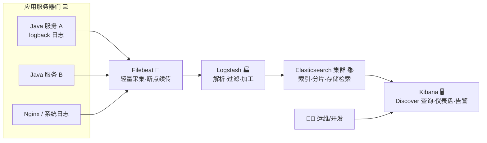
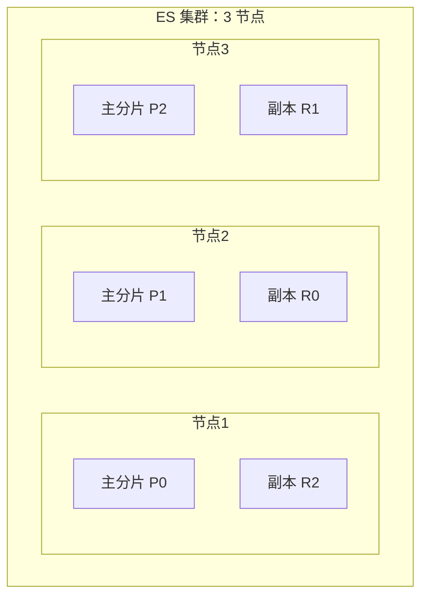
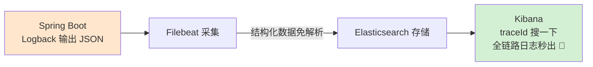
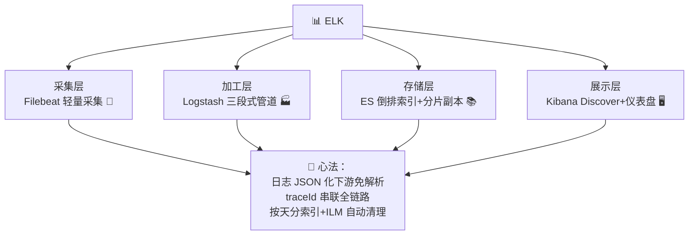

# 📊 ELK 学习笔记

> 今天要吃透的是日志界的"黄金三剑客"—— **ELK（Elasticsearch + Logstash + Kibana）** ✨
> 服务器一多，"上机 grep 日志"就是噩梦的开始！ELK 让所有日志乖乖汇到一处，点几下鼠标就能查个底朝天～我会用大白话 + Java 项目实战带您入门！(≧▽≦)

---

## 📚 目录一览

1. [ELK 是什么？](#一elk-是什么)
2. [为什么需要 ELK？](#二为什么需要-elk)
3. [整体架构：数据流动图](#三整体架构数据流动图)
4. [Elasticsearch 核心](#四elasticsearch-核心)
5. [Elasticsearch 常用操作](#五elasticsearch-常用操作)
6. [Beats：轻量采集器](#六beats轻量采集器)
7. [Logstash：日志加工厂](#七logstash日志加工厂)
8. [Kibana：数据看板](#八kibana数据看板)
9. [Java 项目接入实战](#九java-项目接入实战)
10. [Docker Compose 一键部署](#十docker-compose-一键部署)
11. [常见坑与最佳实践](#十一常见坑与最佳实践)
12. [总结 & 速查表](#十二总结--速查表)

---

## 一、ELK 是什么？

### 1.1 一句话解释

> **ELK = 三件套组合拳：Elasticsearch（存+搜）+ Logstash（采集+加工）+ Kibana（可视化），一套打尽"日志收集、存储、检索、分析"的完整流水线。** 📊

现在官方叫法是 **Elastic Stack**（因为加了 Beats 家族，凑成了四剑客）⚔️：

| 组件 | 角色 | 一句话 |
| --- | --- | --- |
| **E**lasticsearch | 存储与搜索引擎 | 超快全文检索的"图书馆" 📚 |
| **L**ogstash | 数据处理管道 | 日志"加工厂"：收货→清洗→打包 🏭 |
| **K**ibana | 可视化界面 | 点点鼠标看日志的"驾驶舱" 🖥️ |
| **B**eats | 轻量采集器 | 驻扎在每台服务器上的"快递员" 🛵 |

### 1.2 打个比方 📰

ELK 像一家现代化**报社**：
- 各地记者（**Beats**）在第一线收集新闻（日志）；
- 稿件传回编辑部（**Logstash**），编辑校对、改格式、贴标签（解析加工）；
- 归档室（**Elasticsearch**）把稿件分门别类存好，还能秒级检索；
- 主编（**Kibana**）打开大屏看板，一眼掌握天下大事！

---

## 二、为什么需要 ELK？

### 2.1 传统查日志的痛 😢

| 痛点 | 场景 |
| --- | --- |
| 🔍 日志散落 | 50 台机器 × 每台几十个服务，查个报错登 50 台？ |
| 🐌 grep 慢如蜗牛 | 几十 GB 日志文件 grep 一分钟起步 |
| ⏱️ 无法关联 | 一个请求跨 5 个服务，人肉拼时间线查到眼瞎 |
| 📉 无法统计 | 想知道"最近一小时 error 多少条"？没辙 |
| 💾 日志被覆盖 | 磁盘滚动清理，出事后日志早没了 |

### 2.2 ELK 的解法 ✨

| 能力 | 效果 |
| --- | --- |
| 🌊 集中汇聚 | 所有日志汇入一处，一个页面全看到 |
| ⚡ 秒级检索 | 亿级日志，关键词搜索秒出结果 |
| 🔗 全链路时间线 | 按_traceId_串联跨服务日志 |
| 📊 统计图表 | 错误率、QPS、TOP 报错，图表化一目了然 |
| 🗄️ 长期留存 | 按天分索引 + 生命周期管理，想存多久存多久 |

---

## 三、整体架构：数据流动图



各组件协作一句话：**Beats 采 → Logstash 洗 → ES 存 → Kibana 看**！

> 💡 小规模场景可以 Logstash 直连采集（省掉 Beats）；超大规模还可以加 **Kafka** 做缓冲削峰（Logstash → Kafka → Logstash → ES）。

---

## 四、Elasticsearch 核心

### 4.1 是什么？

> **Elasticsearch = 基于 Lucene 的分布式搜索引擎**：天生为"搜索"而生，全文检索速度吊打传统数据库 LIKE 🔥

### 4.2 核心概念：拿 MySQL 类比 🍵

| Elasticsearch | MySQL | 一句话 |
| --- | --- | --- |
| Index 索引 | Database/Table（7.0 后≈Table） | 日志按天分索引：`app-log-2026.09.14` |
| Document 文档 | Row 行 | 一条日志 = 一个 JSON 文档 |
| Field 字段 | Column 列 | 日志里的 level、message、traceId |
| Mapping 映射 | Schema 表结构 | 字段类型定义 |
| Shard 分片 | 分库分表 | 大索引切成 N 份存不同节点 |
| Replica 副本 | 主从复制 | 分片的备份，高可用 + 读扩容 |

### 4.3 灵魂机制：倒排索引 🔄

传统数据库按"行号→内容"找，ES 反过来建"关键词→文档列表"的目录，这就是**搜索快的秘密**！

```mermaid
graph LR
    subgraph DOC[文档区]
        D1[文档1: "order service error"]
        D2[文档2: "order timeout"]
        D3[文档3: "service started"]
    end
    subgraph INV[倒排索引目录 📇]
        K1[order → 文档1, 文档2]
        K2[error → 文档1]
        K3[service → 文档1, 文档3]
        K4[timeout → 文档2]
    end
    DOC -- 分词建目录 --> INV
    Q[搜 "order error"] -- 查目录秒级定位 --> D1[文档1 ✅]
```

### 4.4 分布式：分片与副本



| 机制 | 作用 |
| --- | --- |
| 主分片 Primary | 数据切分并行处理，写入吞吐 UP ⚡ |
| 副本 Replica | 主分片挂了顶上，读请求分摊，高可用 🛡️ |
| 注意 | 主副本**不会**在同一节点（不然挂一个全丢） |

---

## 五、Elasticsearch 常用操作

ES 全部操作都是 **REST API**（天然亲和 curl/Postman）：

```bash
# 🏥 健康检查
curl -X GET "localhost:9200/_cluster/health"

# 📋 查看所有索引
curl -X GET "localhost:9200/_cat/indices?v"

# ➕ 写入一条文档（指定索引 app-log，自动建索引）
curl -X POST "localhost:9200/app-log/_doc" -H 'Content-Type: application/json' -d '
{
  "level": "ERROR",
  "service": "order-service",
  "message": "创建订单失败：库存不足",
  "traceId": "abc-123",
  "@timestamp": "2026-09-14T10:30:00Z"
}'

# 🔍 搜索：level 为 ERROR 的日志
curl -X GET "localhost:9200/app-log/_search?q=level:ERROR"

# 📊 DSL 查询：近 15 分钟订单服务的错误（Kibana 背后就是这种查询）
curl -X GET "localhost:9200/app-log/_search" -H 'Content-Type: application/json' -d '
{
  "query": {
    "bool": {
      "must": [
        { "term":  { "level": "ERROR" } },
        { "match": { "service": "order-service" } },
        { "range": { "@timestamp": { "gte": "now-15m" } } }
      ]
    }
  },
  "sort": [{ "@timestamp": { "order": "desc" } }],
  "size": 20
}'

# 🗑️ 删除索引（清空某天日志）
curl -X DELETE "localhost:9200/app-log-2026.09.13"
```

常用 DSL 结构速记 📝：

| DSL 关键字 | 作用 |
| --- | --- |
| `match` | 全文分词搜索 |
| `term` | 精确匹配（不分词） |
| `range` | 范围（时间区间常用） |
| `bool: must/should/must_not` | 组合条件（AND/OR/NOT） |
| `sort` + `size` | 排序 + 分页 |

---

## 六、Beats：轻量采集器

### 6.1 Beats 家族 🛵

| Beat | 采集什么 |
| --- | --- |
| **Filebeat** ⭐ | 日志文件（最常用！） |
| Metricbeat | 指标（CPU/内存/JVM） |
| Packetbeat | 网络流量 |
| Heartbeat | 存活探测（拨测） |
| Auditbeat | 审计日志 |

### 6.2 Filebeat 配置示例（采集 Java 日志）

```yaml
# filebeat.yml
filebeat.inputs:
  - type: log
    enabled: true
    paths:
      - /app/logs/*.log          # 盯住应用日志目录 👀
    fields:
      service: order-service      # 打上标签，方便 Kibana 里区分来源
      env: prod
    fields_under_root: true

output.logstash:
  hosts: ["logstash:5044"]        # 发给 Logstash 加工
  # output.elasticsearch: 也可直连 ES（简单场景跳过 Logstash）
```

> 💡 Filebeat 会记住读取位置（registry 文件），**重启后断点续传**，日志不丢不重～

---

## 七、Logstash：日志加工厂

### 7.1 三段式管道 🏭


### 7.2 完整配置：解析 Java 日志

```ruby
# logstash/conf.d/app-log.conf
input {
  beats {
    port => 5044                  # 接收 Filebeat 发来的货 🛵
  }
}

filter {
  # ① 尝试按格式解析 Java 日志文本
  grok {
    match => {
      "message" => "%{TIMESTAMP_ISO8601:log_time} %{LOGLEVEL:level} \[%{DATA:thread}\] %{JAVACLASS:class} - %{GREEDYDATA:msg}"
    }
  }

  # ② 解析时间字段（时区要写对！）
  date {
    match => [ "log_time", "yyyy-MM-dd HH:mm:ss.SSS" ]
    target => "@timestamp"
    timezone => "Asia/Shanghai"
  }

  # ③ 按级别打标签，方便后续告警检索
  mutate {
    add_field => { "readable_time" => "%{[@timestamp]}" }
    remove_field => [ "host", "tags" ]   # 去掉没用的字段，省空间
  }

  # ④ 只保留 ERROR 及以上才打 error 标记
  if [level] == "ERROR" {
    mutate { add_tag => ["严重错误 🔴"] }
  }
}

output {
  elasticsearch {
    hosts => ["http://es:9200"]
    index => "app-log-%{+YYYY.MM.dd}"    # 按天分索引 📅
  }
  # 调试期可同时输出到控制台看效果
  # stdout { codec => rubydebug }
}
```

三大常用 filter 插件速记：

| 插件 | 作用 |
| --- | --- |
| `grok` | 用正则把文本"拆解"成结构化字段 🔪 |
| `date` | 解析时间，统一时间轴 |
| `mutate` | 增删改字段、类型转换 |

---

## 八、Kibana：数据看板

### 8.1 四大功能区 🖥️

| 功能 | 用途 |
| --- | --- |
| **Discover** 探索 | 查日志主战场：时间范围 + 条件过滤 🕵️ |
| **Dashboard** 仪表盘 | 组合图表大盘（错误率/流量趋势）📊 |
| **Visualize** 可视化 | 柱状图/饼图/折线图 |
| **Dev Tools** 开发工具 | 直接写 DSL 调试 ES（练 API 神器） |

### 8.2 KQL 快速上手（Discover 搜索框直接写！）

```text
level: "ERROR" and service: "order-service"        # 精确查某服务的错误
message: *timeout*                                  # 消息里含 timeout
traceId: "abc-123"                                  # 按链路 ID 追踪跨服务日志 🔗
not level: "INFO"                                   # 排除 INFO
service: (*-service) and level: ("ERROR" or "WARN") # 组合条件
```

> 💡 **排障黄金三步**：先按 traceId 锁定一次请求的完整链路 → 再按时间排序看时间线 → 定位到报错服务后看上下文日志！

---

## 九、Java 项目接入实战

### 9.1 方案一：普通日志 + Filebeat 解析（传统）

就是第七章的玩法：Logback 正常输出文本 → Filebeat 采集 → Logstash grok 解析。
**缺点**：格式一变 grok 就解析失败，维护烦 😓

### 9.2 方案二：Logback 直接输出 JSON（推荐 ⭐）

让 Java 应用自己输出**结构化 JSON 日志**，下游免解析、字段天然清晰！

```xml
<!-- pom.xml：logstash 编码器，把日志编码成 JSON -->
<dependency>
    <groupId>net.logstash.logback</groupId>
    <artifactId>logstash-logback-encoder</artifactId>
    <version>7.4</version>
</dependency>
```

```xml
<!-- src/main/resources/logback-spring.xml -->
<configuration>
    <appender name="JSON_FILE" class="ch.qos.logback.core.rolling.RollingFileAppender">
        <file>/app/logs/order-service.log</file>
        <rollingPolicy class="ch.qos.logback.core.rolling.TimeBasedRollingPolicy">
            <!-- 按天滚动 + 保留 30 天 -->
            <fileNamePattern>/app/logs/order-service.%d{yyyy-MM-dd}.log</fileNamePattern>
            <maxHistory>30</maxHistory>
        </rollingPolicy>
        <encoder class="net.logstash.logback.encoder.LogstashEncoder">
            <customFields>{"service":"order-service","env":"prod"}</customFields>
        </encoder>
    </appender>

    <root level="INFO">
        <appender-ref ref="JSON_FILE"/>
    </root>
</configuration>
```

```java
// 业务代码正常写日志，MDC 放 traceId 自动进 JSON ✨
import org.slf4j.MDC;

MDC.put("traceId", "abc-123");          // 网关/拦截器里生成并放入
log.info("订单创建成功, orderId={}", orderId);   // 输出的 JSON 自动带上 traceId 字段
MDC.remove("traceId");
```

输出的日志长这样（每行一个 JSON，Filebeat 直接透传，Logstash 都可以省啦）：

```json
{
  "@timestamp": "2026-09-14T10:30:00.128+08:00",
  "level": "INFO",
  "logger_name": "com.example.OrderService",
  "thread_name": "http-nio-8080-exec-1",
  "service": "order-service",
  "traceId": "abc-123",
  "message": "订单创建成功, orderId=ORD-10086"
}
```

### 9.3 数据流全景（方案二版）



---

## 十、Docker Compose 一键部署

复习 Docker 章节知识，一套 ELK 起飞 🚀：

```yaml
# docker-compose.yml
services:
  elasticsearch:
    image: elasticsearch:8.14.1
    environment:
      - discovery.type=single-node      # 单节点学习模式
      - xpack.security.enabled=false    # 学习环境关掉安全认证
      - ES_JAVA_OPTS=-Xms512m -Xmx512m  # JVM 内存控制住 💾
    ports:
      - "9200:9200"
    volumes:
      - es-data:/usr/share/elasticsearch/data

  kibana:
    image: kibana:8.14.1
    environment:
      - ELASTICSEARCH_HOSTS=http://elasticsearch:9200
    ports:
      - "5601:5601"                     # 浏览器打开 http://localhost:5601
    depends_on:
      - elasticsearch

  logstash:
    image: logstash:8.14.1
    volumes:
      - ./logstash/conf.d:/usr/share/logstash/pipeline   # 挂载第七章的配置
    ports:
      - "5044:5044"                     # 接收 Filebeat
    depends_on:
      - elasticsearch

volumes:
  es-data:
```

```bash
docker compose up -d        # 一键起飞 🛫
# 浏览器访问 Kibana: http://localhost:5601
```

---

## 十一、常见坑与最佳实践

### 11.1 排雷表 💣

| 坑 | 症状 | 解法 |
| --- | --- | --- |
| 时区不对 | Kibana 时间差 8 小时 | Logstash date 插件指定 `Asia/Shanghai`；Kibana 设置时区 |
| grok 解析失败 | `_grokparsefailure` 刷屏 | 优先用 JSON 日志方案，grok 是下策 |
| 索引无限膨胀 | 磁盘爆满 ES 拒绝写入 | 用 ILM 生命周期：热存 7 天→删除 30 天 |
| mapping 爆炸 | 字段数超限（默认1000） | dynamic: false / strict，未知字段不索引 |
| ES 内存溢出 | OOM 被 kill | -Xmx 不超过物理内存 50%，留一半给 OS 文件缓存 |
| 深分页 | from+size 超过 10000 报错 | 用 `search_after` 或缩短时间范围 |
| 大量日志涌入 | Logstash/ES 被打挂 | 前置 Kafka 削峰；调大队列 |

### 11.2 最佳实践清单 ✅

1. 📌 **日志输出 JSON 格式**（logstash-encoder），下游免解析；
2. 📌 每条日志带 **traceId**（MDC），跨服务串联靠它 🔗；
3. 📌 索引按天分（`app-log-yyyy.MM.dd`），配合 ILM 自动滚动删除；
4. 📌 只采集有价值的日志级别（生产 INFO+），DEBUG 别进 ES；
5. 📌 字段规范统一：`service`/`level`/`traceId`/`env` 全公司一套标准；
6. 📌 重要日志字段用 keyword 类型（精确匹配），文本检索才用 text；
7. 📌 大集群版本 ≥ 3 节点（脑裂防护），分片数 = 节点数的整数倍。

---

## 十二、总结 & 速查表

### 12.1 名词速查 📇

| 名词 | 一句话 |
| --- | --- |
| ELK / Elastic Stack | ES+Logstash+Kibana（+Beats）日志全家桶 |
| Elasticsearch | 分布式搜索引擎：倒排索引秒搜 ⚡ |
| Index / Document / Mapping | 索引/文档/字段类型定义（≈表/行/结构） |
| Shard / Replica | 分片切数据 / 副本保高可用 |
| 倒排索引 | 关键词→文档列表，搜索快的灵魂 🔄 |
| Filebeat | 轻量日志采集器，断点续传 🛵 |
| Logstash | input→filter→output 三段式加工厂 🏭 |
| grok | 正则解析文本成结构化字段 🔪 |
| KQL | Kibana 搜索框查询语法 |
| ILM | 索引生命周期管理（自动滚动删除） |

### 12.2 命令/配置速查 🛠️

| 场景 | 操作 |
| --- | --- |
| ES 健康检查 | `GET /_cluster/health` |
| 查看索引 | `GET /_cat/indices?v` |
| 简单搜索 | `GET /index/_search?q=level:ERROR` |
| Kibana 排障 | KQL：`traceId: "xxx" and level: "ERROR"` |
| Filebeat 输出 | `output.logstash.hosts` / `output.elasticsearch.hosts` |
| Logstash 管道 | input(beats) → filter(grok/date/mutate) → output(es) |
| Java 结构化日志 | logstash-logback-encoder + MDC traceId |

### 12.3 一图流总结



### 12.4 记住这三句就走不丢 ✨

1. **Beats 采、Logstash 洗、ES 存、Kibana 看**：数据流水线一条心；
2. **JSON 日志 + traceId 是最佳拍档**：免解析、可串联，排障效率翻倍；
3. **索引会长大，生命周期要管好**：按天分索引 + ILM 自动删，磁盘才不会爆。

> 🎉 恭喜点亮 ELK 技能树！动手作业：用第十章的 Compose 起一套 ELK，把 Spring Boot 项目的 JSON 日志接进去，在 Kibana 里用 traceId 追一次完整请求链路～配合之前学的 Arthas（单机诊断）+ ELK（全局日志），线上排障双剑合璧！下次想学 Kafka 日志缓冲、SkyWalking 链路追踪或其他主题，随时喊我哦！(๑•̀ㅂ•́)و✧
