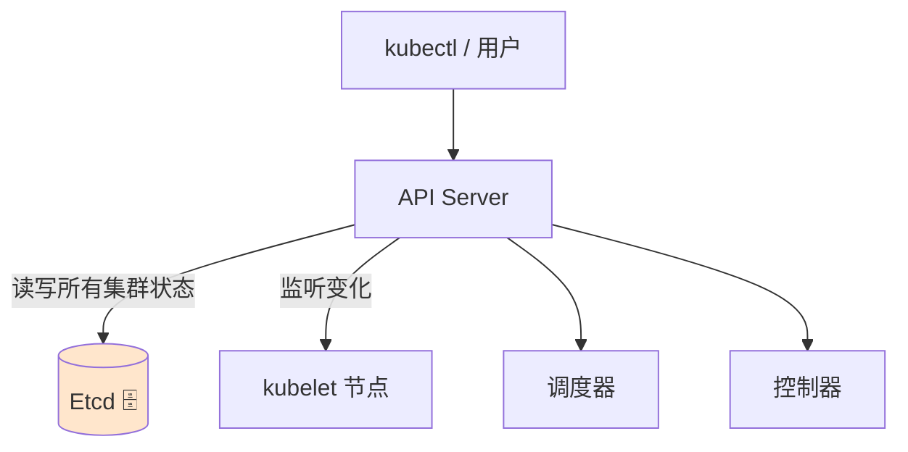
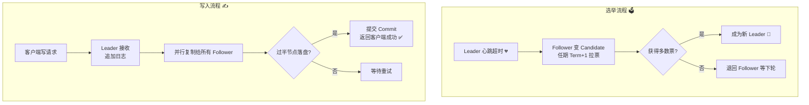
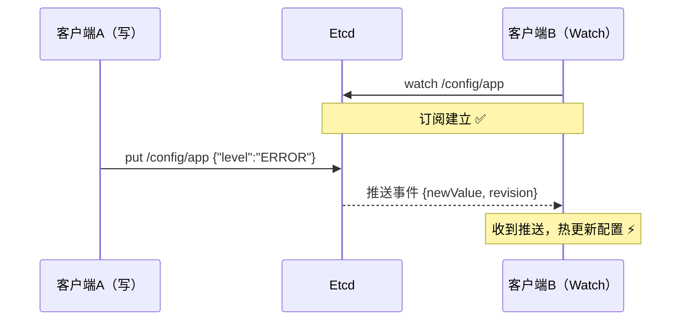
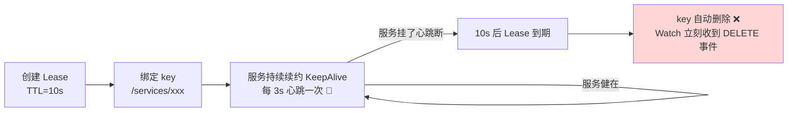
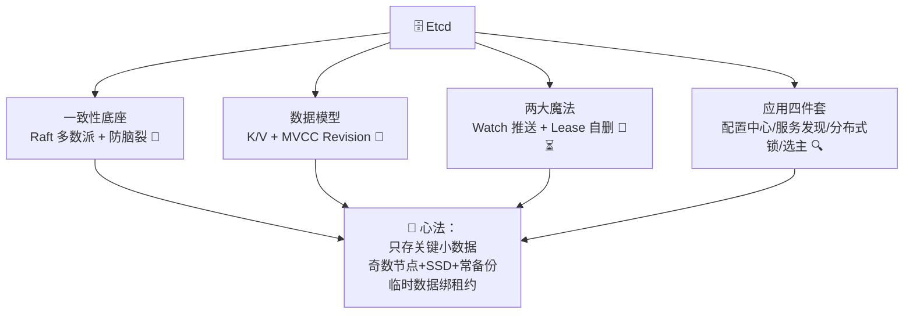

# 🗄️ Etcd 学习笔记

> 今天要吃透的是分布式系统的"定海神针"—— **Etcd** ✨
> Kubernetes 的所有秘密都存在它肚子里！配置共享、服务发现、分布式锁、Leader 选举，都离不开这块"分布式 Bulletin Board"。我会用大白话 + Java（jetcd）实战带您入门～(≧▽≦)

---

## 📚 目录一览

1. [Etcd 是什么？](#一etcd-是什么)
2. [为什么需要 Etcd？](#二为什么需要-etcd)
3. [核心概念速览](#三核心概念速览)
4. [灵魂机制一：Raft 共识](#四灵魂机制一raft-共识)
5. [灵魂机制二：Watch 与 Lease](#五灵魂机制二watch-与-lease)
6. [数据模型：MVCC 与 Revision](#六数据模型mvcc-与-revision)
7. [etcdctl 常用命令](#七etcdctl-常用命令)
8. [Java 客户端实战（jetcd）](#八java-客户端实战jetcd)
9. [实战案例：服务发现与分布式锁](#九实战案例服务发现与分布式锁)
10. [Etcd vs ZooKeeper vs Redis](#十etcd-vs-zookeeper-vs-redis)
11. [部署与运维](#十一部署与运维)
12. [常见坑与最佳实践](#十二常见坑与最佳实践)
13. [总结 & 速查表](#十三总结--速查表)

---

## 一、Etcd 是什么？

### 1.1 一句话解释

> **Etcd = 一个"强一致"的分布式键值（K/V）存储：数据写到多数节点才算成功，任何节点读到的都是最新值——专门用来存分布式系统的"关键小数据"。** 🗄️

### 1.2 它有多重要？

- **Kubernetes 的大脑记忆**：Pod、Service、Secret 等所有对象都存在 Etcd 里——Etcd 挂了，整个 K8s 集群就"失忆"了 🧠；
- **CNCF 毕业项目**：云原生版图的核心基石。



### 1.3 打个比方 📋

Etcd 像办公室的**公告板**：
- 大家都能看（读）、都能贴纸条（写），但必须通过"公告板管理员"排队确认（顺序一致）；
- 贴上去的纸条**所有人看到的内容一模一样**（强一致）；
- 纸条还能贴"便利贴"（Watch）：有人改了公告，立刻收到通知 📢；
- 纸条可以贴"到期自动撕掉"的定时便签（Lease 租约 ⏳）。

---

## 二、为什么需要 Etcd？

### 2.1 分布式系统的"三大灵魂拷问" 😢

| 拷问 | 场景 |
| --- | --- |
| 🤔 数据放哪都一样吗？ | 配置写到节点 A，马上从节点 B 读，读到旧值怎么办？ |
| 🤔 谁说了算？ | 3 台机器，怎么选出一个"Leader"且大家都服气？ |
| 🤔 某台机器挂了呢？ | 数据会不会丢？会不会出现两个"Leader"打架（脑裂）？ |

### 2.2 Etcd 的答案 ✨

| 能力 | 解法 |
| --- | --- |
| 强一致性 | 基于 **Raft 协议**：写入过半节点确认才返回成功 |
| 高可用 | 少数节点挂了照常服务（3 节点容忍 1 台，5 节点容忍 2 台） |
| 防脑裂 | 多数派投票：网线掐断的少数派自动"停摆"，不会出现两个主 |
| 变更通知 | Watch 机制：key 一变，订阅方秒收推送 📢 |
| 临时数据 | Lease 租约：心跳一断，key 自动删除（服务发现的基础！） |

### 2.3 典型应用场景

| 场景 | 用法 |
| --- | --- |
| 📦 K8s 元数据 | 所有集群对象的唯一真相源 |
| ⚙️ 配置中心 | 集中存配置，变更 Watch 推送热更新 |
| 🔍 服务发现 | 服务注册带 Lease，挂了自动"注销" |
| 🔒 分布式锁 | 抢同一个 key，Revision 排队公平锁 |
| 👑 Leader 选举 | 多实例抢锁，抢到的当 Leader |

---

## 三、核心概念速览

| 概念 | 一句话 | 类比 |
| --- | --- | --- |
| **Key / Value** | 键值对，key 是层级字符串 | 公告板上的纸条 📋 |
| **Revision** | 全局递增版本号（每次修改+1） | 公告板编辑的"第 N 次修改"记录 |
| **Lease** | 租约：给 key 设 TTL，到期自动删 | 定时便签 ⏳ |
| **Watch** | 订阅 key/前缀变化，实时推送 | 便利贴通知 📢 |
| **Mini Transaction** | 乐观锁事务：`if 条件 then 操作` | "如果没人改过我就改" |
| **Compact** | 压缩历史版本，释放空间 | 撕掉太旧的修改记录 🧹 |
| **Endpoint** | 节点地址 | 公告板分址 |

key 的层级设计（和 ZooKeeper 的 znode 异曲同工）：

```text
/services/order-service/instance-001 → {"host":"10.0.0.1","port":8080}
/services/order-service/instance-002 → {"host":"10.0.0.2","port":8080}
/config/order-service/datasource-url → "jdbc:mysql://..."
/locks/order-create-lock             → "owner-1"
```

> 💡 key 按前缀组织成"目录树"，Watch 一个前缀 = 监听整棵子树！

---

## 四、灵魂机制一：Raft 共识

### 4.1 为什么需要共识？

数据复制到 3 台机器，怎么保证**三台的数据一模一样、顺序也一样**？这就是"共识问题"。Raft 是目前最通俗易懂的共识算法（Etcd 内置）🧮

### 4.2 三种角色 👥

| 角色 | 干什么 |
| --- | --- |
| **Leader 领导** ⭐ | 唯一接受写入，负责把数据同步给所有 Follower |
| **Follower 跟随** | 安静收 Leader 的日志，投票选举 |
| **Candidate 候选** | Leader 失联时"毛遂自荐"发起选举 |

### 4.3 选举与写入流程



### 4.4 多数派（Quorum）的智慧 🧠

- 3 节点集群：容忍 **1 台**故障（3÷2=2，过半是 2）；
- 5 节点集群：容忍 **2 台**故障（过半是 3）；
- **公式：容忍故障数 = (n-1)/2，集群节点数建议奇数**（偶数不提升容错，白浪费一台）。

> 💡 脑裂防护原理：即使网络把集群劈成两半，**只有"多数派"那半能继续写**，少数派自动只读停摆——永远只有一个真相！🛡️

---

## 五、灵魂机制二：Watch 与 Lease

### 5.1 Watch：变更秒通知 📢



| Watch 能力 | 说明 |
| --- | --- |
| 按前缀监听 | `watch /services/` 前缀 = 监听所有服务的上下线 |
| 事件带类型 | PUT（新增/修改）/ DELETE（删除） |
| 断线续传 | 客户端带着旧 Revision 重连，**补齐错过的事件**，不丢通知 |
| 一次性推送 | 多个变更合并成一次事件，不会打爆客户端 |

### 5.2 Lease：会自删的定时便签 ⏳



> 💡 这就是**服务发现自动注销**的原理：实例宕机 → 心跳断 → key 消失 → 消费者秒感知！不用人工摘除节点～

---

## 六、数据模型：MVCC 与 Revision

Etcd 保存 key 的**多版本历史**（MVCC 多版本并发控制）：

| 概念 | 说明 |
| --- | --- |
| **Revision** | 集群全局版本号，每次写操作 +1（如 `revision=1000`） |
| **ModRevision** | 该 key 最后一次修改时的全局版本 |
| **CreateRevision** | 该 key 创建时的全局版本 |
| **历史查询** | 可以按 Revision 查"过去某一刻"的值 🔮 |
| **Compact** | 定期压缩旧版本，只留最新，释放空间 🧹 |

```text
put /config  "v1"   → revision=100
put /config  "v2"   → revision=205
get /config         → "v2"（最新）
get /config --rev=100 → "v1"（穿越回过去 🔮）
```

> 💡 MVCC 的妙用：**Watch 基于 Revision 做增量推送**——客户端说"我看到了 205"，Etcd 就把 205 之后的事件全部补给它，断线也不丢！

---

## 七、etcdctl 常用命令

```bash
# 基础 K/V 操作
etcdctl put /config/app/log-level "INFO"           # 写
etcdctl get /config/app/log-level                  # 读
etcdctl get /config/ --prefix                      # 按前缀查（列出所有子key）
etcdctl del /config/app/log-level                  # 删
etcdctl get /config/ --prefix --keys-only          # 只看 key 不看 value

# Watch 监听（开一个终端试！）
etcdctl watch /config/app/log-level                # 监听单个 key
etcdctl watch /services/ --prefix                  # 监听前缀（整棵子树）

# Lease 租约
etcdctl lease grant 30                             # 创建 30 秒租约 → 返回 lease id
etcdctl put /services/inst-001 '{"ip":"10.0.0.1"}' --lease=694d...   # key 绑定租约
etcdctl lease keep-alive 694d...                   # 持续续约 💓
etcdctl lease revoke 694d...                       # 主动撤销（立即删 key）

# 事务（乐观锁：条件成立才执行）
etcdctl txn --interactive
compares:
value("/locks/order") = ""        # 如果锁没人持有
success requests:
put /locks/order "me"             # 就写入抢锁
failure requests:
get /locks/order                  # 否则看看谁持有

# 集群运维
etcdctl member list                               # 节点列表
etcdctl endpoint health                           # 健康检查 🏥
etcdctl endpoint status -w table                  # 状态表格（看谁是 Leader）
etcdctl snapshot save backup.db                   # 备份快照 💾
etcdctl snapshot restore backup.db --data-dir ... # 恢复
```

---

## 八、Java 客户端实战（jetcd）

### 8.1 依赖与初始化 ☕

```xml
<dependency>
    <groupId>io.etcd</groupId>
    <artifactId>jetcd-core</artifactId>
    <version>0.7.7</version>
</dependency>
```

```java
import io.etcd.jetcd.*;

public class EtcdClientHolder {
    // 客户端自带负载均衡和故障转移，写多个节点地址即可
    public static final Client CLIENT = Client.builder()
            .endpoints("http://10.0.0.1:2379",
                       "http://10.0.0.2:2379",
                       "http://10.0.0.3:2379")
            .build();
}
```

### 8.2 基础 K/V 操作

```java
import io.etcd.jetcd.ByteSequence;
import io.etcd.jetcd.kv.GetResponse;
import java.nio.charset.StandardCharsets;

public class KvDemo {
    static ByteSequence k(String s) { return ByteSequence.from(s, StandardCharsets.UTF_8); }

    public static void main(String[] args) throws Exception {
        var kv = EtcdClientHolder.CLIENT.getKVClient();

        // ① 写入
        kv.put(k("/config/app/log-level"), k("INFO")).get();

        // ② 读取
        GetResponse resp = kv.get(k("/config/app/log-level")).get();
        resp.getKvs().forEach(kv2 ->
                System.out.println("value = " + kv2.getValue().toString(StandardCharsets.UTF_8)));

        // ③ 前缀查询
        GetResponse list = kv.get(k("/services/order/"),
                GetOption.builder().isPrefix(true).build()).get();
        list.getKvs().forEach(e ->
                System.out.println(e.getKey() + " = " + e.getValue()));

        // ④ 删除
        kv.delete(k("/config/app/log-level")).get();
    }
}
```

### 8.3 Watch：监听配置变更

```java
public class WatchDemo {
    public static void main(String[] args) throws Exception {
        var watchClient = EtcdClientHolder.CLIENT.getWatchClient();

        // 监听前缀 /config/app/ 下的所有变更 📢
        watchClient.watch(
            ByteSequence.from("/config/app/", StandardCharsets.UTF_8),
            WatchOption.builder().isPrefix(true).build(),
            event -> {
                for (WatchEvent<?> e : event.getEvents()) {
                    switch (e.getEventType()) {
                        case PUT -> System.out.println("配置变更: " + e.getKeyValue().getValue());
                        case DELETE -> System.out.println("配置删除，回退默认值");
                    }
                }
            });

        Thread.currentThread().join();   // 挂住主线程持续监听
    }
}
```

---

## 九、实战案例：服务发现与分布式锁

### 9.1 服务注册与发现（Lease + Watch 组合拳）🔍

```mermaid
flowchart LR
    subgraph P[Provider 服务提供者 💻]
        A1[启动：创建 Lease TTL=10s]
        A2[put /services/order/inst-001<br>绑定 Lease]
        A3[后台线程 KeepAlive 续约 💓]
    end
    subgraph E[(Etcd 🗄️)]
        K1[services/order/inst-001]
        K2[services/order/inst-002]
    end
    subgraph C[Consumer 消费者 🛒]
        B1[启动：watch /services/order/ 前缀]
        B2[维护本地实例列表]
        B3[上下线秒感知 负载均衡调用]
    end
    A2 --> K1
    A3 -- 心跳保活 --> K1
    K1 & K2 -- 事件推送 --> B1
    B1 --> B2 --> B3
```

核心 Java 代码：

```java
// ========== Provider：注册 + 心跳 ==========
public class ServiceRegistry {

    public void register(String serviceName, String instanceId, String addr) throws Exception {
        var client = EtcdClientHolder.CLIENT;
        var leaseClient = client.getLeaseClient();

        // ① 创建 10 秒租约（挂了 10 秒内自动注销 ⏳）
        long leaseId = leaseClient.grant(10).get().getID();

        // ② 注册实例信息，绑定租约
        client.getKVClient().put(
                ByteSequence.from("/services/" + serviceName + "/" + instanceId, StandardCharsets.UTF_8),
                ByteSequence.from(addr, StandardCharsets.UTF_8),
                PutOption.builder().withLeaseId(leaseId).build()
        ).get();

        // ③ 后台心跳续约（每 3 秒）
        leaseClient.keepAlive(leaseId, resp ->
                System.out.println("续约成功，TTL 重置 💓"));
    }
}

// ========== Consumer：发现 + 监听 ==========
public class ServiceDiscovery {

    private final Map<String, String> instances = new ConcurrentHashMap<>();

    public void subscribe(String serviceName) throws Exception {
        var client = EtcdClientHolder.CLIENT;
        String prefix = "/services/" + serviceName + "/";

        // ① 先拉一次全量
        client.getKVClient().get(
                ByteSequence.from(prefix, StandardCharsets.UTF_8),
                GetOption.builder().isPrefix(true).build()
        ).get().getKvs().forEach(kv ->
                instances.put(kv.getKey().toString(), kv.getValue().toString()));

        // ② 再持续 watch 增量变更
        client.getWatchClient().watch(
                ByteSequence.from(prefix, StandardCharsets.UTF_8),
                WatchOption.builder().isPrefix(true).build(),
                event -> event.getEvents().forEach(e -> {
                    if (e.getEventType() == WatchEvent.EventType.PUT) {
                        instances.put(e.getKeyValue().getKey().toString(),
                                e.getKeyValue().getValue().toString());     // 上线 ✅
                    } else {
                        instances.remove(e.getKeyValue().getKey().toString()); // 下线 ❌
                    }
                }));
    }
}
```

### 9.2 分布式锁（抢 key 排队）🔒

原理：**大家都来 put 同一个 key，谁的 CreateRevision 最小谁先拿到锁**（Revision 天然全局递增 = 公平排队）。

```java
public class EtcdDistributedLock {

    private final Client client = EtcdClientHolder.CLIENT;
    private final String lockName;

    public EtcdDistributedLock(String lockName) {
        this.lockName = lockName;
    }

    /** 抢锁：返回空 Optional = 没抢到 */
    public Optional<Long> lock(long ttlSeconds) throws Exception {
        var lockClient = client.getLockClient();
        // jetcd 封装好的锁 API：内部就是"创建租约 + 排队"那一套
        var resp = lockClient.lock(
                ByteSequence.from(lockName, StandardCharsets.UTF_8),
                ttlSeconds).get();
        // 返回的 key 就是"锁凭证"，解锁时带上它
        System.out.println("抢到锁！凭证：" + resp.getKey().toString(StandardCharsets.UTF_8));
        return Optional.of(resp.getLeaseId());
    }

    /** 释放锁 */
    public void unlock(Long leaseId) throws Exception {
        client.getLockClient().unlock(null).get();  // 实际项目用保存的 key 解锁
        client.getLeaseClient().revoke(leaseId).get();
        System.out.println("锁已释放 🔓");
    }
}
```

| 分布式锁方案对比 | Etcd | ZooKeeper | Redis |
| --- | --- | --- | --- |
| 一致性 | 强一致（Raft）✅ | 强一致（ZAB）✅ | 最终一致（主从异步） |
| 性能 | 中 | 中 | 高 ⚡ |
| 锁安全性 | Lease 兜底，挂了自动释放 ✅ | 会话失效自动释放 ✅ | 需处理超时续期，稍复杂 |
| 易用性 | API 简单 | 较复杂 | 最简单 |

---

## 十、Etcd vs ZooKeeper vs Redis

| 对比项 | Etcd 🗄️ | ZooKeeper 🐘 | Redis 🔴 |
| --- | --- | --- | --- |
| 定位 | 分布式 K/V 存储 | 分布式协调服务 | 内存数据库/缓存 |
| 一致性 | 强一致（Raft） | 强一致（ZAB） | 最终一致 |
| 数据量 | 小而关键（默认 2GB） | 小而关键 | 可大可小 |
| Watch | 强大（前缀/历史回放） | 一次性需重注册 | keyspace 通知较弱 |
| HTTP/gRPC API | 原生支持 ✅ | 需客户端 | 需客户端 |
| 语言 | Go | Java | C |
| 典型用户 | K8s、CoreDNS | Kafka(旧版)、Dubbo(旧版) | 缓存、锁、排行榜 |

选型口诀 📝：

| 需求 | 推荐 |
| --- | --- |
| K8s 生态、云原生 | Etcd ✅ |
| 老牌 Java 中间件配套 | ZooKeeper |
| 高并发缓存 + 简单锁 | Redis |
| 注册中心 + 配置中心全家桶 | Nacos（内部支持 Etcd/Raft 模式）|

---

## 十一、部署与运维

### 11.1 集群规划

| 项 | 建议 |
| --- | --- |
| 节点数 | **3 / 5 / 7（奇数！）**，生产最少 3 台 |
| 磁盘 | **SSD 必备**：fsync 延迟直接决定写性能 💾 |
| 配置 | 8C16G + SSD 可支撑上千节点 K8s |
| 网络 | 节点间低延迟（同机房） |

### 11.2 Docker 快速体验（学习环境）

```bash
# 单机版（--unsafe 模式仅用于学习！）
docker run -d --name etcd \
  -p 2379:2379 -p 2380:2380 \
  gcr.io/etcd-development/etcd:latest \
  /usr/local/bin/etcd \
  --name etcd-single \
  --listen-client-urls http://0.0.0.0:2379 \
  --advertise-client-urls http://0.0.0.0:2379

# 验证
docker exec etcd etcdctl put hello world
docker exec etcd etcdctl get hello
```

### 11.3 日常运维要点 🛠️

| 任务 | 命令/做法 |
| --- | --- |
| 备份 💾 | `etcdctl snapshot save` 定时快照（**最重要！**） |
| 恢复 | `snapshot restore` 到新数据目录 |
| 碎片整理 | `etcdctl defrag`（compact 后回收磁盘） |
| 查看告警 | `etcdctl alarm list`（磁盘满/空间不足会触发） |
| 监控 | 指标：leader 变化次数、WAL fsync 延迟、DB size |

---

## 十二、常见坑与最佳实践

### 12.1 排雷表 💣

| 坑 | 后果 | 解法 |
| --- | --- | --- |
| 偶数节点集群 | 不提升容错还增加写延迟 | 节点数用奇数：3/5/7 |
| 当普通数据库用 | 数据超 2GB 限制、性能崩 | 只存"关键小数据"，大文件走 COS/DB |
| 忘了 Compact | revision 无限增长，磁盘爆满 | 定期 compact + defrag |
| 用机械盘 | fsync 慢 → 写入巨慢 → K8s 卡顿 | SSD 专属 💾 |
| 不做备份 | Etcd 数据丢 = K8s 集群失忆 🧠 | 定时 snapshot 异地保存 |
| 跨机房部署 | 节点间延迟高，多数派确认慢 | 同机房低延迟网络 |
| 大 value | 单 key 建议小于 1MB | 拆 key 或改存引用地址 |

### 12.2 最佳实践清单 ✅

1. 📌 生产集群 ≥ 3 节点、奇数、SSD；
2. 📌 定时快照备份 + 定期演练恢复；
3. 📌 key 按业务前缀分层，Watch 用前缀缩小范围；
4. 📌 临时数据（服务实例）一律绑 Lease；
5. 📌 只存元数据/配置/协调信息，不存业务大数据；
6. 📌 监控 leader 变更与 fsync 延迟，异常早发现。

---

## 十三、总结 & 速查表

### 13.1 名词速查 📇

| 名词 | 一句话 |
| --- | --- |
| Etcd | 强一致分布式 K/V 存储，K8s 的大脑记忆 🧠 |
| Raft | 多数派共识协议：过半确认才算写入成功 |
| Quorum 多数派 | (n/2)+1 票通过；奇数节点最划算 |
| Leader/Follower/Candidate | Raft 三角色，写入只走 Leader |
| Revision | 全局递增版本号，MVCC 历史基础 |
| Lease 租约 | TTL 到期自动删 key，服务发现核心 ⏳ |
| Watch | 订阅变更实时推送，断线按 Revision 补发 📢 |
| Mini Transaction | if-then 乐观锁事务 |
| Compact/Defrag | 压缩历史 / 回收磁盘 |

### 13.2 命令速查 🛠️

| 操作 | 命令 |
| --- | --- |
| 写/读/删 | `etcdctl put/get/del` |
| 前缀查询 | `get /prefix/ --prefix` |
| 监听 | `watch /prefix/ --prefix` |
| 租约 | `lease grant/keep-alive/revoke` |
| 集群 | `member list / endpoint health / status` |
| 备份恢复 | `snapshot save / restore` |

### 13.3 一图流总结



### 13.4 记住这三句就走不丢 ✨

1. **过半才算数**：Raft 让 Etcd 强一致，3 节点容忍 1 台挂，脑裂永远不可能；
2. **Watch + Lease 是黄金搭档**：变更秒推送 + 挂机秒注销，服务发现的左膀右臂；
3. **小而关键的数据才配进 Etcd**：它是大脑记忆不是仓库，大数据请走数据库和 COS（见旧笔记～）。

> 🎉 恭喜点亮 Etcd 技能树！动手作业：Docker 起个单机 Etcd，用 jetcd 跑一遍"注册 → 发现 → watch 上下线 → 分布式锁"四连～现在回头看 K8s：为什么节点数要奇数、为什么服务发现能秒感知，全都豁然开朗啦！下次想学 Nacos、ZooKeeper 深入或 K8s 专题，随时喊我哦！(๑•̀ㅂ•́)و✧
