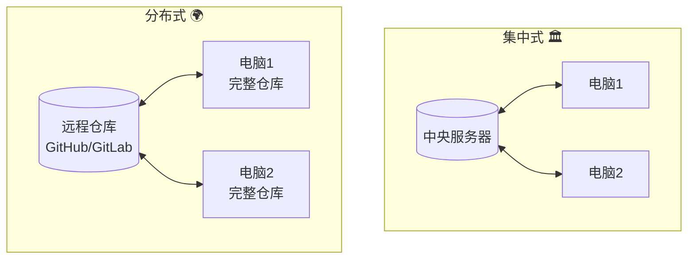
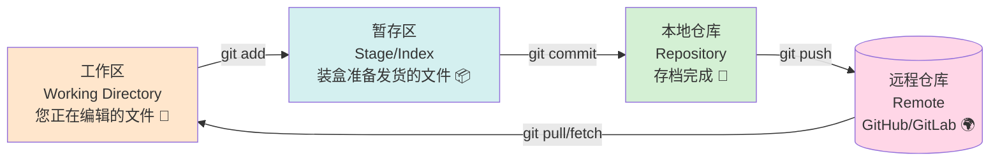
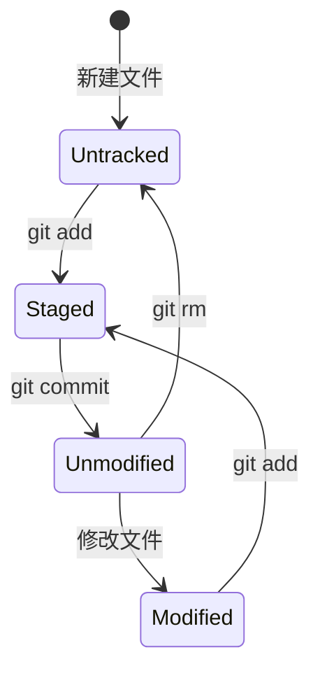
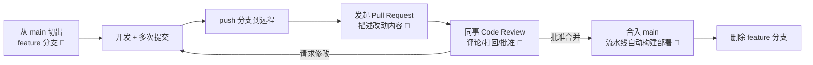
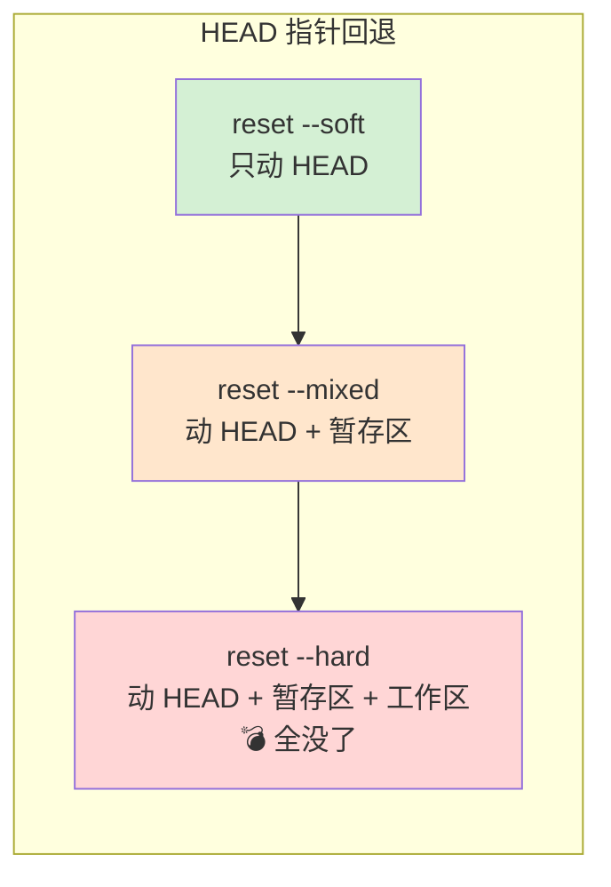
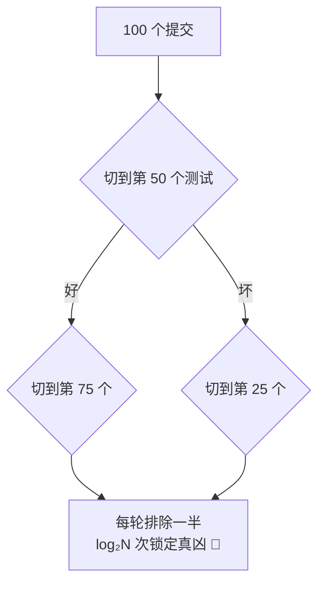
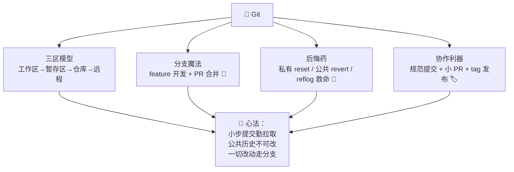

# 🌿 Git 学习笔记

> 今天要吃透的是程序员人手必备的"时光机"—— **Git** ✨
> 代码改崩了怎么办？一秒回到过去！多人协作互不干扰怎么做到？分支魔法！我会用大白话带您从"会提交"到"会救火"，配合 CI/CD 知识食用更佳～(≧▽≦)

---

## 📚 目录一览

1. [Git 是什么？](#一git-是什么)
2. [为什么需要 Git？](#二为什么需要-git)
3. [核心概念：三大区域](#三核心概念三大区域)
4. [安装与初始配置](#四安装与初始配置)
5. [日常操作四连](#五日常操作四连)
6. [分支：并行开发魔法](#六分支并行开发魔法)
7. [合并冲突：手把手解决](#七合并冲突手把手解决)
8. [团队协作与分支策略](#八团队协作与分支策略)
9. [撤销与回退：后悔药大全](#九撤销与回退后悔药大全)
10. [远程仓库与 SSH](#十远程仓库与-ssh)
11. [储藏与标签](#十一储藏与标签)
12. [高级技巧：cherry-pick/bisect/blame](#十二高级技巧cherry-pickbisectblame)
13. [.gitignore 与 Java 项目](#十三gitignore-与-java-项目)
14. [常见坑与最佳实践](#十四常见坑与最佳实践)
15. [总结 & 速查表](#十五总结--速查表)

---

## 一、Git 是什么？

### 1.1 一句话解释

> **Git = 分布式版本控制系统：完整记录代码的每一次修改，随时穿越回任意版本，还能让多人同时在互不干扰的"平行宇宙"里开发，最后安全合并。** 🌿

### 1.2 打个比方 🎮

- **没有 Git**：像打游戏不能存档——改坏了只能重头再来，很多人靠"复制文件夹"保命：`项目_final_真最终版_v3_新.zip` 😂；
- **有 Git**：随时存档（commit）、随时读档（checkout）、还能开"平行世界"练级（branch）、练好了合回主线（merge）！

### 1.3 集中式 vs 分布式

| 对比 | 集中式（SVN） | 分布式（Git）⭐ |
| --- | --- | --- |
| 仓库位置 | 只有服务器一份 | 每人本地都是**完整仓库** |
| 断网 | 不能提交、不能看历史 | 照常提交/看历史/开分支 |
| 速度 | 依赖网络 | 本地操作飞快 ⚡ |
| 服务器挂了 | 全员瘫痪 | 任何人的克隆都能恢复 |



---

## 二、为什么需要 Git？

| 痛点 | Git 的解法 |
| --- | --- |
| 😱 改崩代码回不去 | 每次提交都是存档，`reflog` 连"删掉的提交"都能救回 |
| 🙈 不敢重构 | 分支上随便折腾，好了再合并 |
| 👥 多人改同一个文件 | 自动合并 + 冲突手动裁决，过程全留痕 |
| 🔍 这行代码谁写的？ | `git blame` 一下，作者+时间+提交说明全出来 |
| 🐛 哪个提交引入的 Bug？ | `git bisect` 二分法定位，快准狠 |
| 🚀 配合流水线 | push 触发 CI/CD（复习 CICD 笔记～） |

---

## 三、核心概念：三大区域

Git 最核心的模型：**工作区 → 暂存区 → 本地仓库 → 远程仓库**，四段旅程 🛤️：



| 区域 | 一句话 | 类比 |
| --- | --- | --- |
| 工作区 | 您手头正在改的目录 | 车间里加工的零件 🔧 |
| 暂存区 | 打包拍"快照"前的待提交清单 | 装箱待发 📦 |
| 本地仓库 | 已永久存档的历史 | 本地仓库房 💾 |
| 远程仓库 | 团队共享的仓库 | 云端仓库房 🌍 |

> 💡 为什么要暂存区？让您能**精挑细选**本次提交包含哪些改动——改了 10 个文件，可以只提交其中 3 个，一次提交只做一件事！

---

## 四、安装与初始配置

```bash
# 安装后第一件事：告诉 Git 您是谁（提交记录会署名）
git config --global user.name "Your Name"
git config --global user.email "you@example.com"

# 常用全局配置
git config --global init.defaultBranch main        # 默认分支叫 main
git config --global core.autocrlf input            # 换行符处理（Win 用 true）
git config --global alias.st "status -sb"          # 别名：git st 一秒看状态
git config --global alias.lg "log --oneline --graph --all"   # 神级美化日志 🎨

# 查看配置
git config --list
```

---

## 五、日常操作四连

### 5.1 文件状态生命周期 🔄



### 5.2 高频命令

```bash
# 🚀 起步三选一
git clone https://gitlab.com/team/order-service.git   # 克隆远程仓库
git init                                              # 或：把当前目录变成 Git 仓库

# 📝 日常四连（一天敲 N 遍）
git status                     # 看哪些文件变了（-s 简洁版）
git add .                      # 全部加入暂存区（git add 文件名 = 精确添加）
git commit -m "feat: 新增下单接口"  # 提交到本地仓库 📦
git push                       # 推送到远程

# 🔄 同步远程
git pull                       # 拉取并合并（= fetch + merge）

# 👀 查看历史与差异
git log --oneline --graph      # 图形化一行日志（配上面的 lg 别名更爽）
git diff                       # 工作区 vs 暂存区 的差异
git diff --staged              # 暂存区 vs 上次提交 的差异
git show 3f2a1b                # 看某次提交的详细内容
```

> 💡 **提交信息规范**（Conventional Commits，配合 CI 自动识别）：
> `feat:` 新功能 / `fix:` 修 Bug / `refactor:` 重构 / `docs:` 文档 / `test:` 测试 / `chore:` 杂务

---

## 六、分支：并行开发魔法

### 6.1 分支是什么？

> 分支 = 从某个时间点分出的"平行宇宙"：您在 `feature/login` 宇宙里随便折腾，主线 `main` 宇宙丝毫不受影响 🌌


### 6.2 分支命令

```bash
git branch                       # 看本地分支（-a 含远程）
git branch feature/login         # 创建分支
git switch feature/login         # 切换分支（新命令，推荐！checkout 也行）
git switch -c feature/pay        # 创建 + 切换一步到位
git merge feature/login          # 把 login 分支合并进当前分支
git branch -d feature/login      # 删掉用完的分支
git push -u origin feature/login # 推送新分支并关联远程（-u 只需第一次）
```

### 6.3 merge vs rebase

| 对比 | merge 合并 | rebase 变基 |
| --- | --- | --- |
| 历史 | 保留分叉，有合并节点 | 拉直成一条线，干净 ✨ |
| 原理 | 两个分支的尖端找共同祖先做三方合并 | 把自己的提交"搬到"目标分支后面重放 |
| 风险 | 安全 | 改写历史，**别对已推送的公共分支做！** ⚠️ |

```bash
# 团队常见姿势：feature 分支 rebase 最新 main，保持历史线性
git switch feature/login
git fetch origin
git rebase origin/main       # 把我的提交挪到 main 最新提交之后
# 有冲突：解决 → git add . → git rebase --continue
git push --force-with-lease  # rebase 改写了历史，需强推（比 force 安全）
```

---

## 七、合并冲突：手把手解决

### 7.1 冲突怎么来的？

两人改了**同一个文件的同一片区域**，Git 不知道听谁的 😵：

```text
<<<<<<< HEAD
int price = 100;          // 您的版本（当前分支）
=======
int price = 200;          // 对方的版本（要合并进来的分支）
>>>>>>> feature/login
```

### 7.2 解决五步曲 🛠️

```bash
# ① 合并时提示冲突
git merge feature/login
# Auto-merging failed; fix conflicts and then commit the result.

# ② 查看冲突文件清单
git status          # both modified: OrderService.java

# ③ 打开文件，手动编辑：删掉 <<<<<<< ======= >>>>>>> 标记，保留想要的代码
#    （IDEA 里点 "Accept Left / Accept Right / Merge" 更直观！）

# ④ 标记已解决并提交
git add OrderService.java
git commit -m "merge: 解决订单价格冲突"

# ⑤ 反悔不想合了？
git merge --abort
```

> 💡 **减少冲突的习惯**：勤拉取（`git pull`）、小步提交、一个文件别多人长期霸占、改动前先同步主干！

---

## 八、团队协作与分支策略

### 8.1 Pull Request / Merge Request 流程



### 8.2 三种主流分支策略

| 策略 | 分支结构 | 适合 |
| --- | --- | --- |
| **Git Flow** | main + develop + feature + release + hotfix | 版本发布型项目（客户端） |
| **GitHub Flow** ⭐ | main + feature，PR 合并即部署 | 持续部署的 Web 服务（简单好用！） |
| **Trunk-Based** | 所有人频繁合主干，配合特性开关 | 谷歌式高阶团队 + 强 CI 门禁 |

| 分支名 | 用途 | 命名示例 |
| --- | --- | --- |
| `main` | 稳定可发布版本 | — |
| `feature/*` | 新功能 | `feature/order-export` |
| `fix/*` | 修 Bug | `fix/login-null-pointer` |
| `hotfix/*` | 紧急线上修复 | `hotfix/pay-timeout` |
| `release/*` | 发布准备 | `release/v1.2.0` |

---

## 九、撤销与回退：后悔药大全 💊

**最让人头大的部分，一张表 + 一张图搞定！**

### 9.1 场景速查表

| 场景 | 命令 | 效果 |
| --- | --- | --- |
| 改了工作区，还没 add | `git restore 文件` | 丢弃改动（**不可恢复！**） |
| add 了，还没 commit | `git restore --staged 文件` | 移出暂存区（改动还在） |
| commit 了，还没 push | `git commit --amend` | 修补上次提交（改信息/补文件） |
| commit 了，想回退 | `git reset --soft HEAD~1` | 撤销提交，改动留在暂存区 |
| commit 了，想回退 | `git reset --mixed HEAD~1`（默认） | 撤销提交，改动留在工作区 |
| commit 了，彻底不要了 | `git reset --hard HEAD~1` | 撤销提交，**改动全丢** ⚠️ |
| **已经 push 了** | `git revert 提交号` | 生成一个"反向提交"，安全 ✅ |
| 手滑 reset --hard 了 | `git reflog` | 找到丢失的提交号，reset 回去 🙏 |

### 9.2 reset 三种模式图解



### 9.3 reset vs revert 怎么选？

| | reset | revert |
| --- | --- | --- |
| 原理 | 指针倒退，历史像没发生过 | 新提交抵消旧提交 |
| 改历史 | ✅ 会 | ❌ 不会 |
| 已推送的公共分支 | ❌ 禁用！ | ✅ 安全首选 |

> 💡 **黄金法则**：**没推送的自己随意 reset；已推送的公共分支只用 revert！**（强推公共分支 = 队友仓库爆炸 💥）

---

## 十、远程仓库与 SSH

### 10.1 远程操作

```bash
git remote -v                          # 查看远程地址
git remote add origin <url>            # 关联远程仓库
git remote set-url origin <new-url>    # 改地址

git fetch origin                       # 只拉取不合并（先看看再决定）
git pull origin main                   # 拉取并合并（= fetch + merge）
git pull --rebase                      # 拉取并变基（历史更干净，推荐～）
git push origin main                   # 推送
git push --force-with-lease            # rebase 后安全强推（比 -f 多一层校验）
```

### 10.2 配置 SSH 免密 🔑

```bash
# ① 生成密钥对（一路回车即可）
ssh-keygen -t ed25519 -C "you@example.com"

# ② 复制公钥内容
cat ~/.ssh/id_ed25519.pub

# ③ 粘贴到 GitHub/GitLab → Settings → SSH Keys

# ④ 测试
ssh -T git@gitlab.com
# 之后用 SSH 地址克隆，push 不用输密码啦 ✨
```

> 💡 提示：2021 年起 GitHub 已禁用账号密码认证，HTTPS 推送需用 Personal Access Token，**SSH 更省心**～

---

## 十一、储藏与标签

### 11.1 stash：临时藏起手头改动 🧳

```bash
# 场景：功能写到一半，突然要紧急修 Bug，又不想提交半成品……
git stash                        # 把工作区改动"塞进抽屉"
git stash push -m "登录功能开发中"  # 带备注存

git switch hotfix/pay-timeout    # 安心去修 Bug
# ……修完回来 ……
git switch feature/login
git stash pop                    # 取回改动并删除记录（apply = 取回但保留）
git stash list                   # 查看抽屉里有什么
git stash drop stash@{0}         # 丢弃某条
```

### 11.2 tag：给重要版本拍纪念照 🏷️

```bash
git tag v1.2.0                                # 轻量标签
git tag -a v1.2.0 -m "订单导出功能上线"        # 附注标签（推荐，带信息）
git push origin v1.2.0                        # 推送单个标签（默认 push 不带标签！）
git tag -l "v1.*"                             # 列出匹配的标签
git checkout v1.2.0                           # 回到该版本看看
```

> 💡 配合 CI/CD：打 tag 自动触发发布流水线（语义化版本 `major.minor.patch`）～

---

## 十二、高级技巧：cherry-pick/bisect/blame

### 12.1 cherry-pick：摘樱桃 🍒

把某个分支上的**某一次提交**摘到当前分支（不要整个分支合并）：

```bash
# 场景：main 上有个 Bug 修复，develop 也急需
git switch develop
git cherry-pick 3f2a1b        # 把那次提交"复制"过来
git cherry-pick A..B          # 摘一段连续提交
```

### 12.2 bisect：二分法抓 Bug 🐛

上百个提交不知道哪个引入了 Bug？让 Git 二分排查！

```bash
git bisect start
git bisect bad                 # 当前版本有 Bug
git bisect good v1.0.0         # 这个版本是好的
# Git 自动切到中间提交 → 您测试
git bisect good                # 或 git bisect bad
# 重复几轮…… Git 直接指出：xxx commit 是第一坏提交！
git bisect reset               # 收工退出
```



### 12.3 blame：这行锅是谁的？🔍

```bash
git blame OrderService.java        # 每行显示：提交号 作者 时间
git blame -L 42,50 OrderService.java   # 只看 42-50 行
# 温馨提示：blame 到自己时请保持微笑 🙂
```

---

## 十三、.gitignore 与 Java 项目

告诉 Git 哪些文件**不要管**：

```text
# .gitignore —— Java 项目经典配置

# 构建产物
target/
build/
out/
*.class
*.jar

# IDE 配置
.idea/
*.iml
.vscode/
.settings/

# 日志与临时文件
logs/
*.log
*.tmp

# 系统文件
.DS_Store
Thumbs.db

# 敏感信息（千万别提交！）
*.pem
application-local.yml
src/main/resources/application-secret.yml
```

```bash
# 陷阱：文件已被跟踪后，.gitignore 不生效！先取消跟踪：
git rm --cached application-secret.yml
git commit -m "chore: 移除误提交的密钥文件"

# 查看哪个规则忽略了某文件
git check-ignore -v logs/app.log
```

---

## 十四、常见坑与最佳实践

### 14.1 排雷表 💣

| 坑 | 后果 | 解法 |
| --- | --- | --- |
| 对公共分支 `push -f` | 队友仓库直接爆炸 💥 | 用 `--force-with-lease`，或根本别强推 |
| reset --hard 当撤销用 | 未提交改动全蒸发 | 想丢弃工作区先 `git stash` 保个险 |
| 提交了密钥/密码 | 历史里永久留底（删了也有记录） | .gitignore 提前排除；已泄露立即换密钥！ |
| 半天不 pull | 一 pull 冲突一大片 | 勤拉取勤推送，小步快跑 |
| commit 巨大杂乱 | "修改了一些东西" 😅 | 一次提交只做一件事，写清 message |
| 分支名乱起 | `test1` `new` `temp`… | 统一 `feature/` `fix/` 前缀 |
| 直接在 main 开发 | 未 review 的代码直上主干 | 一切改动走 feature 分支 + PR |

### 14.2 最佳实践清单 ✅

1. 📌 提交信息走规范（Conventional Commits），配 emoji 也行；
2. 📌 feature 分支短命（1-3 天合回），活得越久冲突越多；
3. 📌 合并前先 `pull --rebase` 同步主干，PR 保持干净；
4. 📌 PR 小而专：300 行以内最好 review；
5. 📌 主分支保护：禁止直接 push，只允许 PR 合并 + CI 通过；
6. 📌 打 tag 走发布，出问题可精确回退版本。

---

## 十五、总结 & 速查表

### 15.1 名词速查 📇

| 名词 | 一句话 |
| --- | --- |
| 工作区/暂存区/本地仓库 | 编辑中 → 待提交 → 已存档，三段旅程 |
| commit | 一次不可变的"存档快照" 💾 |
| branch | 平行开发宇宙 🌌 |
| merge / rebase | 合并保留分叉 / 变基拉直历史 |
| HEAD | 指向"当前在哪"的指针 |
| reset / revert | 倒退历史（私有）/ 反向提交（公共安全）|
| stash | 临时藏起手头改动 🧳 |
| tag | 版本纪念照 🏷️ |
| cherry-pick | 摘某一次提交过来 🍒 |
| bisect | 二分法定位坏提交 🐛 |
| reflog | 救命稻草：所有 HEAD 移动都有记录 🙏 |

### 15.2 高频命令地图 🛠️

| 类别 | 命令 |
| --- | --- |
| 日常 | `status / add / commit / push / pull` |
| 查看 | `log / diff / show / blame` |
| 分支 | `branch / switch / merge / rebase` |
| 撤销 | `restore / reset / revert / commit --amend` |
| 远程 | `remote / fetch / push --force-with-lease` |
| 杂项 | `stash / tag / cherry-pick / bisect / reflog` |

### 15.3 一图流总结



### 15.4 记住这三句就走不丢 ✨

1. **三区旅程要分清**：add 进暂存、commit 进仓库、push 上远程，每一步都能反悔；
2. **没推送随意 reset，已推送必须 revert**：公共历史是团队的，谁改谁背锅；
3. **手滑了先 reflog**：Git 几乎不会真丢东西，`reflog` 里全有记录，深呼吸别慌 🙏。

> 🎉 恭喜点亮 Git 技能树！动手作业：建个练习仓库，完整走一遍"切分支 → 制造冲突 → 解决冲突 → PR 合并 → revert 回滚"，再体验一次 `git bisect` 抓 Bug～至此您的知识拼图又亮一块：**Git 管代码版本，CI/CD 管自动发布，配合 DevOps 心法食用绝佳**！下次想学 Git Hooks、Monorepo 或其他主题，随时喊我哦！(๑•̀ㅂ•́)و✧
