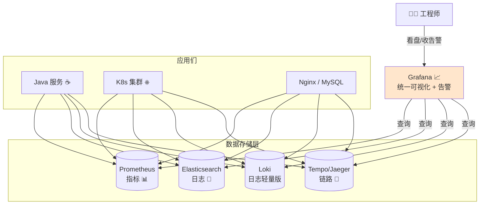
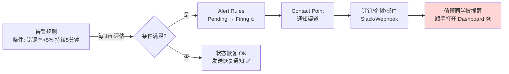
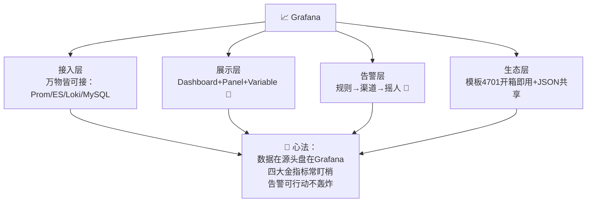

# 📈 Grafana 学习笔记

> 今天要吃透的是监控界的"最美驾驶舱"—— **Grafana** ✨
> 指标数据躺在 Prometheus 里像一堆乱码？Grafana 一出手，酷炫仪表盘立刻安排！还能配告警，半夜出事第一时间摇人～配合之前学的 ELK、云原生食用更佳！(≧▽≦)

---

## 📚 目录一览

1. [Grafana 是什么？](#一grafana-是什么)
2. [为什么需要 Grafana？](#二为什么需要-grafana)
3. [核心概念速览](#三核心概念速览)
4. [数据源：万物皆可接](#四数据源万物皆可接)
5. [面板类型大全](#五面板类型大全)
6. [PromQL 查询基础](#六promql-查询基础)
7. [Java 应用监控接入](#七java-应用监控接入)
8. [Dashboard 设计实战](#八dashboard-设计实战)
9. [告警：主动摇人机制](#九告警主动摇人机制)
10. [Docker Compose 一键部署](#十docker-compose-一键部署)
11. [常见坑与最佳实践](#十一常见坑与最佳实践)
12. [总结 & 速查表](#十二总结--速查表)

---

## 一、Grafana 是什么？

### 1.1 一句话解释

> **Grafana = 开源的数据可视化与监控平台：把散落在各种数据库里的指标/日志"画"成漂亮图表，拼成实时仪表盘，还能设置告警自动通知。** 📈

### 1.2 打个比方 🚗

系统就像一辆行驶中的汽车：
- **Prometheus** 是遍布车身的传感器（采集转速/油耗/水温）；
- **Grafana** 就是驾驶舱仪表盘：时速表、油表、水温报警灯一目了然；
- **告警** 就是"叮——水温过高请停车检查"的提示音 🔔，甚至自动帮您给修理厂（值班群）打电话！

### 1.3 在可观测性版图中的位置



> 💡 回忆一下云原生笔记里的**可观测性三支柱**：Metrics（指标）+ Logs（日志）+ Traces（链路）——Grafana 是三者通吃的"统一看板层"！

---

## 二、为什么需要 Grafana？

| 痛点 | Grafana 的解法 |
| --- | --- |
| 😵 数据在多种库里，看个状态开 N 个后台 | 一个页面聚合 Prometheus/ES/MySQL… |
| 📉 数字表格看不懂趋势 | 折线图/热力图，趋势一眼看穿 |
| 🔁 每次都手写查询 | Dashboard 保存常用图表，打开即看 |
| 🌙 半夜服务挂了没人知道 | 告警规则 + 钉钉/邮件/Webhook 通知 🔔 |
| 👥 每人自己搭监控 | 团队共享 Dashboard + 权限管理 |
| 🔀 多环境切换麻烦 | 变量下拉框一键切换 prod/test |

---

## 三、核心概念速览

| 概念 | 一句话 | 类比 |
| --- | --- | --- |
| **Data Source** 数据源 | 接入的数据库连接（Prometheus/ES/MySQL） | 食材供应商 🥬 |
| **Dashboard** 仪表盘 | 一整页可视化看板 | 一桌菜 🍽️ |
| **Panel** 面板 | 仪表盘上的单个图表 | 一道菜 |
| **Query** 查询 | 面板背后的取数语句（PromQL 等） | 菜谱 📖 |
| **Variable** 变量 | 下拉框动态切换（环境/服务名） | 换食材按钮 🔄 |
| **Folder** 文件夹 | Dashboard 分组管理 | 菜单分类 |
| **Organization / Team** | 多团队隔离与权限 | 包间 👥 |
| **Alert Rule** 告警规则 | 指标越界就通知 | 报警器 🔔 |
| **Annotation** 注释 | 时间轴上标记"这天发版了" | 便签 📌 |

> 💡 Grafana 只负责"读和画"，**不存业务数据**——数据永远躺在数据源里！

---

## 四、数据源：万物皆可接

| 数据源 | 用途 | 说明 |
| --- | --- | --- |
| **Prometheus** ⭐ | 指标监控主力 | K8s + Java 微服务标配 |
| **Elasticsearch** | 日志检索 | 联动 ELK 笔记～ |
| **Loki** | 轻量日志聚合 | "穷人的 ELK"，配 Grafana 原生 |
| **Tempo / Jaeger / Zipkin** | 链路追踪 | TraceID 全链路查询 |
| **MySQL / PostgreSQL** | 业务数据看板 | 订单量/GMV 大屏 |
| **InfluxDB** | 时序数据库 | IoT 场景 |
| **CloudWatch / 阿里云监控** | 云厂商指标 | |

添加姿势：**Configuration → Data Sources → Add data source → 选类型 → 填 URL → Save & Test** ✅

---

## 五、面板类型大全

| 面板 | 适合 | 典型场景 |
| --- | --- | --- |
| **Time series** 折线图 ⭐ | 随时间变化 | CPU、QPS、RT 趋势 |
| **Stat** 数字卡 | 单个关键数值 | 当前在线数、错误率 |
| **Gauge** 仪表盘 | 有区间的值 | 磁盘使用率 80% 报警 |
| **Bar chart** 柱状图 | 对比 | 各服务 QPS 对比 |
| **Table** 表格 | 明细列表 | 慢接口 TOP10 |
| **Heatmap** 热力图 | 分布 | 接口耗时分布（P999 在哪） |
| **Logs** 日志面板 | 查日志 | 配 Loki/ES 直接看日志 |
| **Node Graph** 拓扑图 | 关系 | 服务依赖拓扑 |
| **Text** 文本 | 说明 | 面板组标题/说明文档 |

---

## 六、PromQL 查询基础

Grafana + Prometheus 的面板背后就是 **PromQL**，常用语法一表流：

```promql
# ① 查询 JVM 垃圾回收耗时（简单查询指标名）
jvm_gc_pause_seconds_sum

# ② 按 instance 维度分组展示
sum by (instance) (rate(http_server_requests_seconds_count[5m]))

# ③ HTTP 接口 QPS（rate = 每秒增长率）
rate(http_server_requests_seconds_count{uri="/api/order"}[5m])

# ④ 错误率百分比（状态码 5xx 占比）
sum(rate(http_server_requests_seconds_count{status=~"5.."}[5m]))
  / sum(rate(http_server_requests_seconds_count[5m])) * 100

# ⑤ P95 响应时间（quantile 分位数）
histogram_quantile(0.95,
  sum(rate(http_server_requests_seconds_bucket[5m])) by (le, uri))

# ⑥ CPU 使用率（K8s 容器）
sum(rate(container_cpu_usage_seconds_total{pod=~".*order.*"}[5m])) by (pod)
```

| 语法 | 作用 |
| --- | --- |
| `指标名{label="值"}` | 按标签过滤 |
| `[5m]` | 时间窗口 |
| `rate()` | 计数器转每秒速率 ⭐ |
| `sum by (x)` | 按维度聚合 |
| `histogram_quantile(0.95, ...)` | 算分位数（P95/P99） |
| `* 100` / `/` | 四则运算组合 |

---

## 七、Java 应用监控接入

### 7.1 三剑客关系

```mermaid
flowchart LR
    A[Spring Boot Actuator<br>暴露 /actuator 端点] --> B[Micrometer<br>指标"翻译官" 🌐<br>门面适配器]
    B --> C[Prometheus<br>定时抓取 /actuator/prometheus]
    C --> D[Grafana<br>画图 + 告警 📈]
    style B fill:#d4f0f0
    style D fill:#ffe6cc
```

> 💡 Micrometer = 监控界的 SLF4J：一套 API，翻译成 Prometheus/Datadog 等各种格式！

### 7.2 Spring Boot 接入

```xml
<!-- pom.xml：actuator + prometheus 两个依赖搞定 -->
<dependency>
    <groupId>org.springframework.boot</groupId>
    <artifactId>spring-boot-starter-actuator</artifactId>
</dependency>
<dependency>
    <groupId>io.micrometer</groupId>
    <artifactId>micrometer-registry-prometheus</artifactId>
</dependency>
```

```yaml
# application.yml
management:
  endpoints:
    web:
      exposure:
        include: health,info,prometheus   # 暴露 prometheus 端点
  metrics:
    tags:
      application: order-service          # 全局标签：区分服务 ⭐
```

```bash
# 验证：访问 http://localhost:8080/actuator/prometheus
# 能看到一堆 jvm_*, http_server_requests_* 指标就成功啦 ✅
```

### 7.3 自定义业务指标 ☕

```java
import io.micrometer.core.instrument.*;
import org.springframework.stereotype.Service;
import java.util.concurrent.atomic.AtomicInteger;

@Service
public class OrderMetricsService {

    private final Counter orderCreateCounter;   // 计数器：累计下单量
    private final Timer orderCreateTimer;      // 计时器：下单耗时分布
    private final AtomicInteger pendingOrders; // Gauge：当前待处理订单数

    public OrderMetricsService(MeterRegistry registry) {
        // ① Counter：只增不减，统计"总量"
        this.orderCreateCounter = Counter.builder("business_order_create_total")
                .description("累计创建订单数")
                .tag("service", "order-service")
                .register(registry);

        // ② Timer：记录耗时分布，Grafana 可算 P95/P99
        this.orderCreateTimer = Timer.builder("business_order_create_duration")
                .description("下单接口耗时")
                .publishPercentiles(0.5, 0.95, 0.99)
                .register(registry);

        // ③ Gauge：瞬时值，"现在多少"
        this.pendingOrders = registry.gauge("business_pending_orders",
                new AtomicInteger(0));
    }

    public void recordOrder(long costMillis) {
        orderCreateCounter.increment();            // 下单数 +1
        orderCreateTimer.record(costMillis, java.util.concurrent.TimeUnit.MILLISECONDS);
    }

    public void pendingChange(int delta) {
        pendingOrders.addAndGet(delta);            // 待处理数变化
    }
}
```

| 指标类型 | 一句话 | 场景 |
| --- | --- | --- |
| **Counter** 计数器 | 只增不减 | 下单总量、请求总数 |
| **Gauge** 仪表 | 瞬时值可升可降 | 当前在线数、队列长度 |
| **Timer** 计时器 | 耗时分布（直方图） | 接口 RT、P95/P99 |
| **DistributionSummary** | 分布摘要 | 请求 body 大小分布 |

---

## 八、Dashboard 设计实战

### 8.1 一个合格的服务监控大盘

| 行 | 面板 | 查询示意 |
| --- | --- | --- |
| 第 1 行 | 📊 Stat：总 QPS / 错误率 / P95 RT / 实例数 | 四个 Stat 卡片 |
| 第 2 行 | 📈 折线：QPS 趋势（按 uri 分组） | `rate(http_server_requests_seconds_count[5m])` |
| 第 3 行 | 📈 折线：JVM 堆内存使用 | `jvm_memory_used_bytes{area="heap"}` |
| 第 4 行 | 📈 折线：GC 暂停次数/耗时 | `rate(jvm_gc_pause_seconds_count[5m])` |
| 第 5 行 | 🔥 热力图：接口耗时分布 | `http_server_requests_seconds_bucket` |
| 第 6 行 | 📋 表格：CPU/内存 Top 实例 | `container_cpu_usage_seconds_total` |

### 8.2 变量：下拉框切换环境/服务 🔄

Dashboard Settings → Variables → New：

| 配置 | 示例 | 说明 |
| --- | --- | --- |
| Name | `application` | 查询里用 `$application` 引用 |
| Type | Query | 从数据源动态拉取 |
| Query | `label_values(http_server_requests_seconds_count, application)` | 自动列出所有服务名 |

面板查询里写 `http_server_requests_seconds_count{application="$application"}` → 页面顶部出现下拉框，一键切服务！✨

### 8.3 事半功倍的捷径

- 📌 **导入现成模板**：Dashboards → Import → 输入模板 ID：
  - `4701` JVM (Micrometer) 监控 ⭐
  - `12900` Spring Boot 2.1 统计
  - `315` / `8588` Node Exporter 主机监控
  - `8588` K8s 集群监控
- 📌 配好后 Export JSON 备存，团队共享一键导入！

---

## 九、告警：主动摇人机制 🔔

### 9.1 告警流转



### 9.2 常用告警规则示例

| 告警 | PromQL | 阈值建议 |
| --- | --- | --- |
| 接口错误率高 | `sum(rate(http_server_requests_seconds_count{status=~"5.."}[5m])) by (application) / sum(rate(http_server_requests_seconds_count[5m])) by (application) * 100` | > 5% 持续 5m |
| P95 响应慢 | `histogram_quantile(0.95, sum(rate(http_server_requests_seconds_bucket[5m])) by (le))` | > 1s 持续 10m |
| 实例消失 | `up == 0` | 立即 🔴 |
| JVM 堆内存高 | `jvm_memory_used_bytes{area="heap"} / jvm_memory_max_bytes{area="heap"} * 100` | > 85% |
| 磁盘将满 | `node_filesystem_avail_bytes / node_filesystem_size_bytes * 100` | < 15% |

### 9.3 通知渠道配置

**钉钉机器人示例**：Alerting → Contact points → New → Dingding → 填 Webhook URL（钉钉群里创建机器人获得）+ 加签 Secret ✅

> 💡 **告警三原则**（回忆 DevOps 笔记）：
> ① 可行动——收到告警知道该干什么，否则就是噪音；
> ② 有分级——Critical 摇人、Warning 工作时间处理；
> ③ 防风暴——同一告警分组/静默/抑制，别一次 999+ 条！

---

## 十、Docker Compose 一键部署

Prometheus + Grafana 黄金搭档起飞 🚀：

```yaml
# docker-compose.yml
services:
  prometheus:
    image: prom/prometheus:v2.53.0
    volumes:
      - ./prometheus.yml:/etc/prometheus/prometheus.yml
    ports:
      - "9090:9090"

  grafana:
    image: grafana/grafana:11.1.0
    environment:
      - GF_SECURITY_ADMIN_PASSWORD=admin123   # 首次登录密码
    ports:
      - "3000:3000"                            # http://localhost:3000
    volumes:
      - grafana-data:/var/lib/grafana
    depends_on:
      - prometheus

volumes:
  grafana-data:
```

```yaml
# prometheus.yml：告诉 Prometheus 去哪抓数据
scrape_configs:
  - job_name: 'springboot-app'
    metrics_path: '/actuator/prometheus'
    static_configs:
      - targets: ['host.docker.internal:8080']   # 本机跑的 Java 应用
        labels:
          application: order-service
```

```bash
docker compose up -d
# ① 打开 http://localhost:3000（admin/admin123）
# ② 添加 Prometheus 数据源 → http://prometheus:9090
# ③ Import 模板 4701 → 看到 JVM 面板就通关啦！🎉
```

---

## 十一、常见坑与最佳实践

### 11.1 排雷表 💣

| 坑 | 症状 | 解法 |
| --- | --- | --- |
| 时区不对 | 图表时间差 8 小时 | 数据源/Grafana 设置时区 Asia/Shanghai |
| rate() 用在 Gauge 上 | 数值乱跳无意义 | rate 只用于 Counter 类指标 |
| 高基数标签 | 指标爆炸（每个 userId 一个标签） | 标签只用有限集合（服务名/uri），禁止 userId！ |
| 面板查询太重 | Dashboard 卡死、Prom 高负载 | 缩小时间窗口、减少分组维度、加刷新间隔 |
| 告警太敏感 | 一抖动就轰炸 | 配 For 持续时间（如持续 5 分钟才告） |
| 变量名拼错 | 面板空白 | 查询里 `$变量名` 与定义严格一致 |
| 忘记 Export 备份 | 精心调的盘没了 | 导出 JSON 入 Git 仓库（联动 Git 笔记～） |

### 11.2 最佳实践清单 ✅

1. 📌 优先导入官方/社区模板，再微调，别从零造轮子；
2. 📌 Dashboard 一屏回答一个问题：服务健康盘 / JVM 盘 / 业务盘分开；
3. 📌 Stat 卡片放大屏顶部：QPS、错误率、P95、实例数四大金指标；
4. 📌 指标命名带前缀（`business_`/`app_`）区分业务与系统指标；
5. 📌 告警配"恢复通知"，问题解决也心里有数；
6. 📌 Grafana 配置用代码管理（provisioning/Dashboard JSON 入库），IaC 思想（复习 DevOps～）。

---

## 十二、总结 & 速查表

### 12.1 名词速查 📇

| 名词 | 一句话 |
| --- | --- |
| Grafana | 可视化与告警平台：只读只画不存数据 📈 |
| Data Source | 接 Prometheus/ES/Loki/MySQL 等数据连接 |
| Dashboard / Panel | 仪表盘 / 单个图表 |
| Variable | 下拉框变量，动态切换环境/服务 🔄 |
| PromQL | Prometheus 查询语言 |
| rate() | Counter 转每秒速率（QPS 的灵魂） |
| Micrometer | Java 指标门面，监控界 SLF4J 🌐 |
| Counter/Gauge/Timer | 计数器/瞬时值/耗时分布 |
| Alert Rule / Contact Point | 告警规则 / 通知渠道 |
| 模板 ID 4701 | JVM Micrometer 官方大盘 ⭐ |

### 12.2 操作速查 🛠️

| 场景 | 操作 |
| --- | --- |
| 加数据源 | Configuration → Data Sources → Add |
| 建仪表盘 | Dashboards → New → Add panel → 写查询 |
| 导入模板 | Dashboards → Import → 输入 ID（如 4701） |
| 加变量 | Dashboard Settings → Variables → New |
| 配告警 | Alerting → Alert Rules + Contact Points |
| 备份大盘 | Dashboard → Share → Export JSON |

### 12.3 一图流总结



### 12.4 记住这三句就走不丢 ✨

1. **Grafana 只画不存**：数据永远在 Prometheus/ES 里，Grafana 是最亮的"驾驶舱"；
2. **Java 接入三板斧**：actuator + micrometer + `/actuator/prometheus`，自定义指标 Counter/Gauge/Timer 各司其职；
3. **告警是给人看的**：可行动、有分级、防风暴，噪音多的告警等于没有告警。

> 🎉 恭喜点亮 Grafana 技能树！动手作业：用第十章 Compose 起 Prometheus + Grafana，接入自己的 Spring Boot 应用，导入 4701 模板，再配一条"错误率 > 5% 发钉钉"的告警～至此监控拼图完成：**Micrometer 采集 → Prometheus 存储 → Grafana 展示 → 告警摇人**，配合 ELK 看日志、Arthas 查单机，排障全家桶齐活！下次想学 Prometheus 进阶、Loki 或 SkyWalking，随时喊我哦！(๑•̀ㅂ•́)و✧
