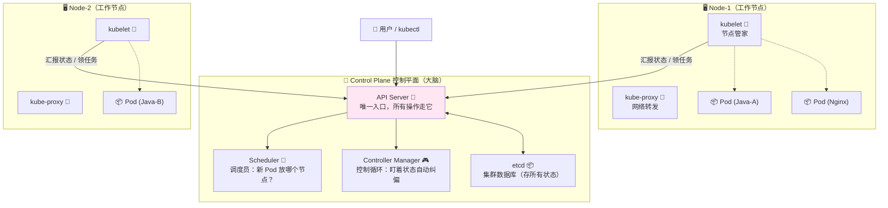
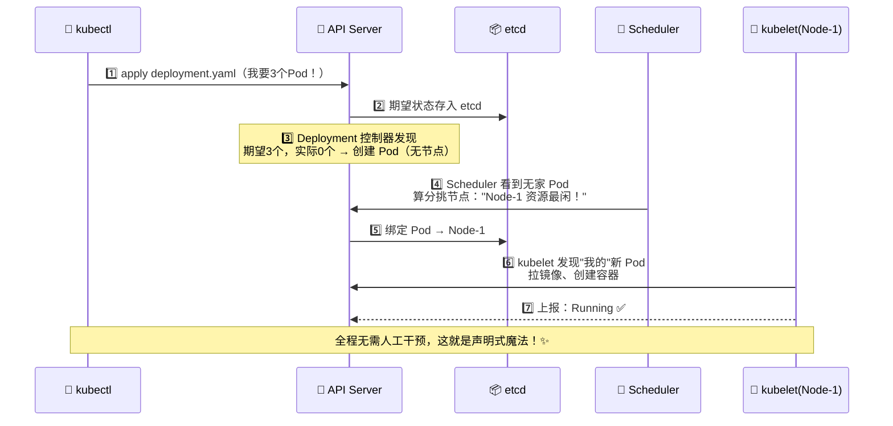
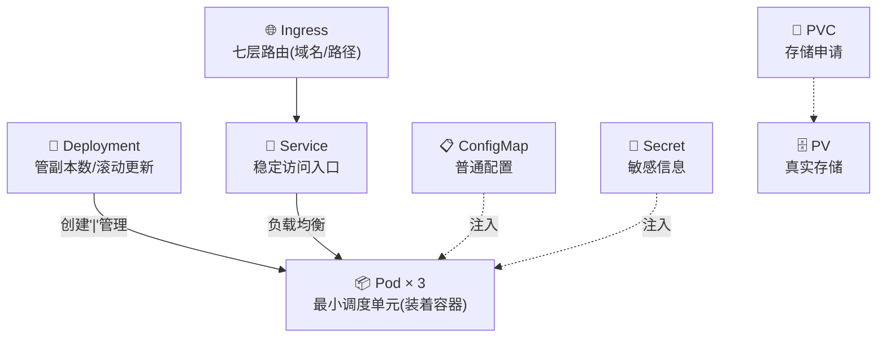
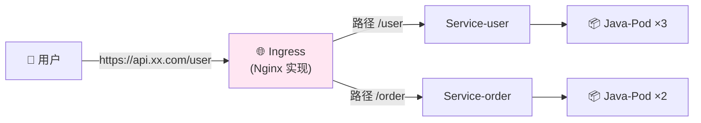
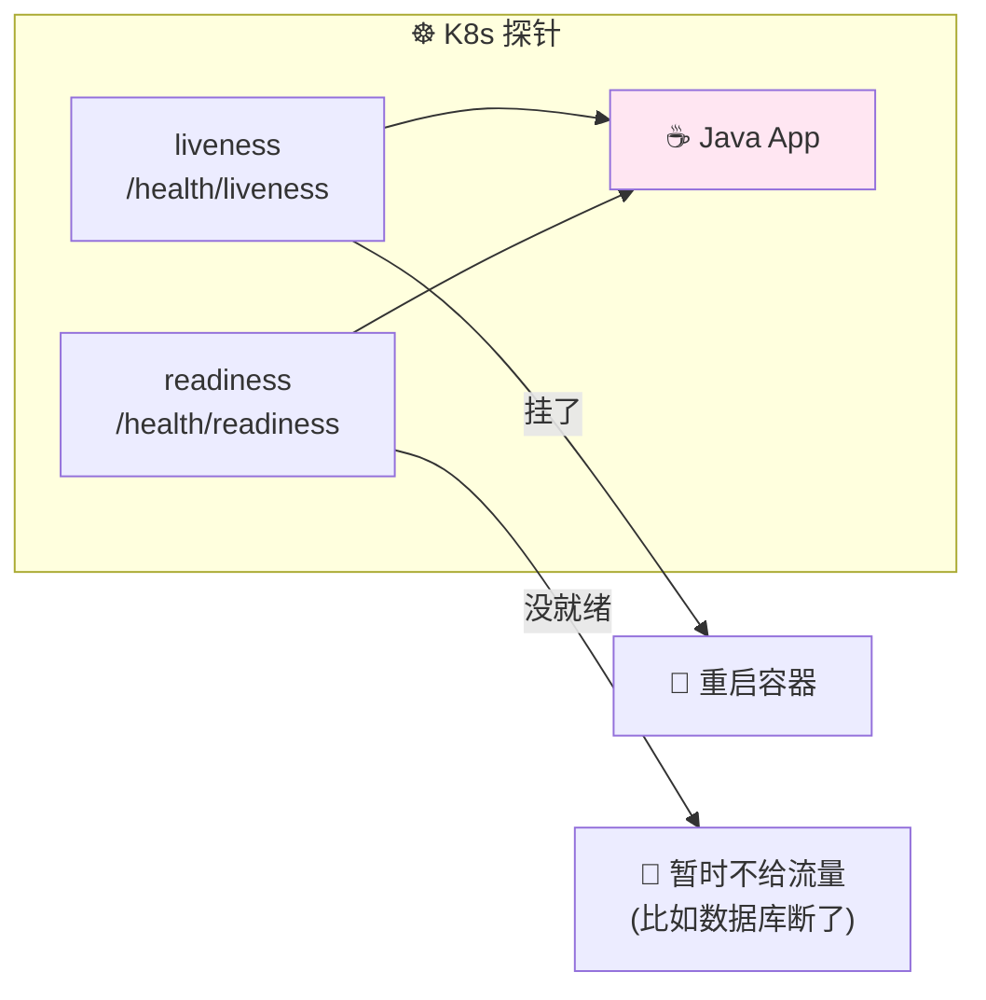
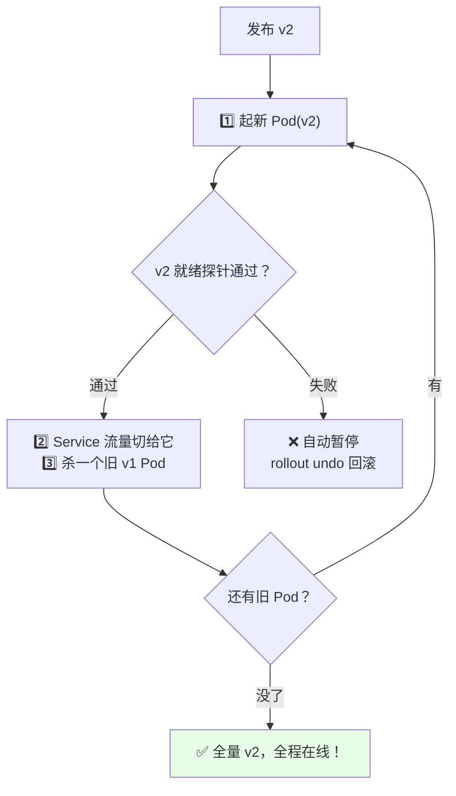
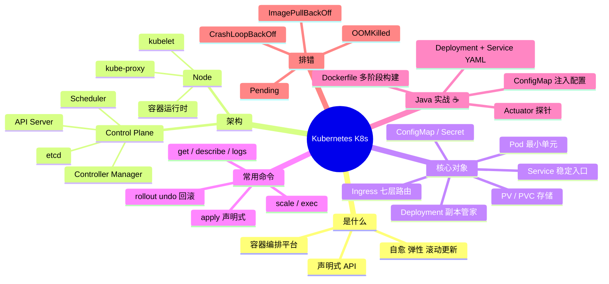

# Kubernetes (K8s) 从入门到实战 ☸️

> 欢迎来到云原生时代的头等舱～ Kubernetes 简称 **K8s**（K 和 s 中间 8 个字母），它是**容器编排界的绝对王者** 👑！学完这篇，你就能把自己的 Java 服务优雅地跑在 K8s 上啦～
>
> **学习目标**：
> - 🎯 搞懂 K8s 是什么、解决什么问题（为什么有了 Docker 还要 K8s）
> - 🎯 认识核心对象：Pod、Deployment、Service、ConfigMap、Ingress
> - 🎯 亲手把 Spring Boot 部署到 K8s（完整 YAML 全流程）
> - 🎯 掌握滚动更新、健康检查、弹性伸缩和常见排错
>
> **前置知识**：了解 Docker 基本操作（镜像/容器）会更丝滑，不懂也没关系，第一章带你快速补课～

---

## 一、初识 K8s：为什么需要它？🌱

### 1.1 从"人肉运维"到 K8s 的演进

先看看没有 K8s 的世界有多惨 😢：


### 1.2 K8s 是什么（一句话版）

> K8s 是一个**容器编排平台**：帮你自动部署、扩缩容、自愈、管理几百上千个容器，像一个**全自动的集装箱码头** 🚢

打个比方 🏗️：

- **Docker 镜像** = 集装箱（把 Java 应用连环境一起打包）
- **K8s** = 整个自动化码头：有调度中心（安排集装箱放哪个岸吊）、有监控（箱子倒了自动扶正）、有导航（流量往哪个箱子送）

### 1.3 Docker vs K8s（别搞混啦！）

| 对比 | Docker 🐳 | Kubernetes ☸️ |
|---|---|---|
| 定位 | 容器技术（打包 + 单机运行） | 容器**编排**系统（管理一群容器） |
| 管理粒度 | 单台机器上的容器 | 集群级：调度、网络、存储、自愈 |
| 挂了怎么办 | `docker restart` 靠人/脚本 | **自动拉起新容器**（自愈！） |
| 扩容 | 手动再跑一个 | 一条命令 / 自动弹性伸缩 |
| 关系 | **基础**，K8s 管的就是它 | **上层**，两者是配合不是竞争 |

> 💡 **一句话记住**：Docker 负责"生"，K8s 负责"养"——生一堆容器容易，养好几百个就需要 K8s 啦！

### 1.4 K8s 帮你解决了什么？

| 痛点 | K8s 的解法 |
|---|---|
| 💥 容器挂了没人管 | **自愈**：自动检测 + 重启/重建 Pod |
| 🔧 发布要停机 | **滚动更新**：新版本逐个替换，全程在线 |
| 📈 流量高峰服务扛不住 | **弹性伸缩（HPA）**：自动加 Pod 分流，低谷自动缩回 |
| 🎲 几百容器怎么安排机器 | **调度**：自动挑最合适的节点运行 |
| 🌐 服务之间怎么找到彼此 | **Service**：稳定的虚拟 IP + 域名发现 |
| 🔐 配置和密码到处复制 | **ConfigMap / Secret**：集中管理挂载注入 |

---

## 二、核心架构：大脑与四肢 🧠

### 2.1 集群全景图

K8s 集群 = **Control Plane（大脑）** + **一堆 Node（干活的节点）**：



### 2.2 组件职责速记

| 组件 | 所在位置 | 职责 | 类比 |
|---|---|---|---|
| **API Server** | 控制平面 | 集群**唯一入口**，认证、增删改查 | 前台总调度 🚪 |
| **etcd** | 控制平面 | 存集群所有数据（KV 数据库） | 档案室 📦 |
| **Scheduler** | 控制平面 | 给没家的 Pod **挑节点** | 分房调度员 📅 |
| **Controller Manager** | 控制平面 | 各种控制循环：**期望 vs 实际**，不符就纠偏 | 巡检队长 🎮 |
| **kubelet** | 每个 Node | 管理本节点容器：创建/重启/上报健康 | 节点大管家 👷 |
| **kube-proxy** | 每个 Node | 维护网络规则，让 Service 能转发到 Pod | 交通警察 🔀 |
| **容器运行时** | 每个 Node | 真正跑容器（containerd） | 干活的叉车 🚜 |

### 2.3 一条 `kubectl apply` 命令后发生了什么？（面试高频！⭐）



> 🧠 **核心思想**：K8s 是**声明式**的——你只说"我要 3 个副本"，不说"怎么启动"；系统自己让实际状态逼近期望状态。传统脚本是"命令式"（一步步告诉它做什么），对比着记忆～

---

## 三、核心资源对象：K8s 的"积木" 🧱

### 3.1 全家福一览



### 3.2 Pod：最小单元

- Pod = **一个或一组**紧挨着的容器（共享网络 IP、存储、生命周期）
- Pod 是**朝生暮死**的：挂了重建后 **IP 会变**！（所以才需要 Service）
- 通常不直接创建 Pod，而是交给 **Deployment** 管理

> ☕ **Java 视角**：一个 Pod ≈ 一个"云上虚拟小机器"里跑着你的 Spring Boot 容器；一个 Pod 里也可以再塞个 sidecar 容器（比如日志收集 agent），俩容器像合租室友共享网络 🏠

### 3.3 Deployment：副本管家

职责：**保持副本数** + **滚动更新** + **回滚**。

| 场景 | Deployment 的反应 |
|---|---|
| 某个 Pod 所在节点宕机 | 自动在别的节点补一个 ✅ |
| `kubectl scale --replicas=5` | 自动加到 5 个 ✅ |
| 发布新镜像版本 | 滚动替换：新起一个、稳了再杀一个旧的 ✅ |
| 新版本有问题 | `kubectl rollout undo` 一键回滚 ✅ |

### 3.4 Service：稳定的门牌号 📇

Pod IP 会变，Service 提供固定入口 + 负载均衡 + 服务发现：

| 类型 | 作用 | 访问范围 | 典型用途 |
|---|---|---|---|
| **ClusterIP**（默认） | 集群内部虚拟 IP | 仅集群内 | 微服务互调 |
| **NodePort** | 每台节点开一个端口（30000-32767） | 外部可访问（IP:端口） | 测试/演示 |
| **LoadBalancer** | 云厂商分配一个公网负载均衡 | 公网 | 生产上云 |
| ExternalName | DNS 别名到外部服务 | 集群内 | 引用外部 API |

> 🍬 集群内访问 Service 就用域名：`http://服务名.命名空间.svc.cluster.local`，同命名空间直接写 `http://java-app` 就行——**这就是服务发现**！

### 3.5 Ingress：七层路由器 🌐

Service（四层）管"IP:端口"，Ingress（七层）管"域名/路径/HTTPS"：



> 💡 类比 Nginx：Ingress 规则 ≈ nginx.conf 里的 `location` + `server_name`，只是配置变成了 YAML、由 K8s 统一管理～

### 3.6 ConfigMap & Secret：配置与密码 📋🔐

| 对比 | ConfigMap | Secret |
|---|---|---|
| 存什么 | 明文配置（端口、开关） | 敏感数据（密码、token、证书） |
| 存储形式 | 明文 | Base64 编码（⚠️ 不是加密！只是不裸奔） |
| 注入方式 | 环境变量 / 挂载文件 | 同左 |

### 3.7 Namespace & 存储简述

- **Namespace**：集群里的"文件夹"，隔离资源（dev / test / prod 各一个）
- **PV**（物理存储）+ **PVC**（存储申请单）：应用要存储就写 PVC，集群自动配对 PV——像"充电宝租借"，你只管申请要多少毫安～ 🔋

---

## 四、kubectl 常用命令速查 🔧

### 4.1 命令行 vs 命令式（先记住口诀）

> 🎀 K8s 有两种玩法：`kubectl run xxx`（命令式，敲命令）和 `kubectl apply -f xxx.yaml`（声明式，交文件）。**生产推荐声明式**——配置进 Git，可审计可回滚！

### 4.2 高频命令表（背下来！✍️）

| 命令 | 作用 | 频率 |
|---|---|---|
| `kubectl get pods` | 看 Pod 列表（`-o wide` 更详细） | ⭐⭐⭐⭐⭐ |
| `kubectl get deployments / svc / ingress` | 看其他资源 | ⭐⭐⭐⭐⭐ |
| `kubectl describe pod xxx` | 看某 Pod 详细情况（**排错第一刀！**） | ⭐⭐⭐⭐⭐ |
| `kubectl logs -f xxx` | 看容器日志（`--tail=100` 最近百行） | ⭐⭐⭐⭐⭐ |
| `kubectl exec -it xxx -- bash` | 进入容器内部（≈ docker exec） | ⭐⭐⭐⭐ |
| `kubectl apply -f xxx.yaml` | 应用/更新配置 | ⭐⭐⭐⭐⭐ |
| `kubectl delete -f xxx.yaml` | 删除资源 | ⭐⭐⭐ |
| `kubectl rollout status deployment/xxx` | 看滚动更新进度 | ⭐⭐⭐⭐ |
| `kubectl rollout undo deployment/xxx` | **回滚上一版** | ⭐⭐⭐⭐ |
| `kubectl scale deployment xxx --replicas=5` | 手动扩缩容 | ⭐⭐⭐⭐ |
| `kubectl set image deployment/xxx app=镜像:tag` | 更新镜像版本 | ⭐⭐⭐⭐ |
| `kubectl top pods` | 看 Pod CPU/内存（需 metrics-server） | ⭐⭐⭐ |
| `kubectl config use-context xxx` | 切换集群 | ⭐⭐ |

```bash
# 本地学习环境（二选一）
minikube start          # 单机迷你集群
kind create cluster      # 用 Docker 跑集群

# get 加 -w 实时盯着变化（发布时超好用！）
kubectl get pods -w
```

---

## 五、实战：把 Spring Boot 部署到 K8s ☕⭐（灵魂章节！）

### 5.1 第一步：写 Dockerfile 打镜像

```dockerfile
# ☕ Dockerfile —— 多阶段构建：构建层 + 运行层
# ---------- 阶段1：Maven 打包 ----------
FROM maven:3.9-eclipse-temurin-17 AS builder
WORKDIR /app
COPY pom.xml .
COPY src ./src
RUN mvn clean package -DskipTests

# ---------- 阶段2：精简运行时 ----------
FROM eclipse-temurin:17-jre
WORKDIR /app
COPY --from=builder /app/target/*.jar app.jar

# 声明端口 + 启动命令
EXPOSE 8080
ENTRYPOINT ["java", "-jar", "app.jar"]
```

```bash
# 打镜像并推到仓库（以阿里云为例）
docker build -t registry.cn-hangzhou.aliyuncs.com/myns/java-app:v1 .
docker push registry.cn-hangzhou.aliyuncs.com/myns/java-app:v1
```

> 💡 为什么用 JRE 不用 JDK 镜像？运行时不需要编译器，镜像从 ~640MB 瘦到 ~260MB，拉取更快、攻击面更小～

### 5.2 第二步：deployment.yaml（核心！）

```yaml
apiVersion: apps/v1
kind: Deployment
metadata:
  name: java-app                # Deployment 名字
spec:
  replicas: 3                   # 🎯 期望 3 个副本
  selector:
    matchLabels:
      app: java-app             # 标签选择器：认领下面这些 Pod
  template:                     # ── Pod 模板 ──
    metadata:
      labels:
        app: java-app           # Pod 贴标签（Service 靠它找 Pod）
    spec:
      containers:
        - name: java-app
          image: registry.cn-hangzhou.aliyuncs.com/myns/java-app:v1
          ports:
            - containerPort: 8080
          # —— 资源申请与上限（防止单个 Pod 吃光节点！）——
          resources:
            requests:           # 调度依据：至少要这么多
              cpu: "250m"       # 0.25 核
              memory: "512Mi"
            limits:             # 天花板：最多用这么多
              cpu: "500m"
              memory: "1Gi"
          # —— 环境变量注入（来自 ConfigMap）——
          env:
            - name: SPRING_PROFILES_ACTIVE
              value: "prod"
            - name: SERVER_PORT
              value: "8080"
          # —— 健康检查（对接 Spring Actuator！见第七章）——
          livenessProbe:
            httpGet:
              path: /actuator/health/liveness
              port: 8080
            initialDelaySeconds: 30    # Java 启动慢，给点启动时间
            periodSeconds: 10
          readinessProbe:
            httpGet:
              path: /actuator/health/readiness
              port: 8080
            initialDelaySeconds: 20
            periodSeconds: 5
```

### 5.3 第三步：service.yaml + ingress.yaml

```yaml
# service.yaml —— 稳定访问入口
apiVersion: v1
kind: Service
metadata:
  name: java-app
spec:
  type: NodePort            # 学习用；生产常用 ClusterIP + Ingress
  selector:
    app: java-app           # 找到贴了这个标签的所有 Pod
  ports:
    - port: 80              # Service 自己的端口
      targetPort: 8080      # 转发到容器端口
      nodePort: 30080       # 节点开放端口（30000-32767）
```

```yaml
# ingress.yaml —— 域名路由（需要先装 Ingress Controller，如 nginx-ingress）
apiVersion: networking.k8s.io/v1
kind: Ingress
metadata:
  name: java-app-ingress
spec:
  ingressClassName: nginx
  rules:
    - host: api.example.com
      http:
        paths:
          - path: /
            pathType: Prefix
            backend:
              service:
                name: java-app
                port:
                  number: 80
```

### 5.4 第四步：一条龙部署 🚀

```bash
kubectl apply -f deployment.yaml
kubectl apply -f service.yaml
kubectl apply -f ingress.yaml

# 验证三连
kubectl get pods -w          # 盯着 Pod 从 Pending→ContainerCreating→Running
kubectl get svc java-app     # 看 NodePort 端口
curl http://节点IP:30080/api/hello   # 🎉 访问成功！
```

---

## 六、配置管理：ConfigMap 注入 Spring Boot 📋

### 6.1 创建 ConfigMap

```yaml
apiVersion: v1
kind: ConfigMap
metadata:
  name: java-app-config
data:
  APP_ENV: "production"
  LOG_LEVEL: "INFO"
  application.properties: |     # 也可以整个文件挂进去
    spring.datasource.url=jdbc:mysql://mysql-svc:3306/demo
    spring.redis.host=redis-svc
```

### 6.2 两种注入方式

```yaml
# 方式①：环境变量注入（在 deployment.yaml 的 env 里引用）
env:
  - name: APP_ENV
    valueFrom:
      configMapKeyRef:
        name: java-app-config
        key: APP_ENV

# 方式②：挂载成文件（修改后 Pod 内热更新生效！）
volumeMounts:
  - name: config-volume
    mountPath: /etc/app/config
volumes:
  - name: config-volume
    configMap:
      name: java-app-config
```

> ☕ **Java 读法**：环境变量方式直接用 `@Value("${APP_ENV}")` 或 `System.getenv("APP_ENV")`；Spring Boot 天然支持环境变量覆盖配置（`SERVER_PORT` 覆盖 `server.port`），所以**不改一行代码**就能云原生化～
>
> 🔐 数据库密码同理：把 ConfigMap 换成 **Secret**（`secretKeyRef`），别把密码写进镜像或 Git！

---

## 七、健康检查探针：K8s 的"体检制度" 🏥⭐

| 探针 | 作用 | 失败后果 | 类比 |
|---|---|---|---|
| **livenessProbe** 存活 | 判断"还活着吗" | **杀掉重启**容器 | 心跳检测 💓，没心跳就抢救 |
| **readinessProbe** 就绪 | 判断"能接客了吗" | **摘除流量**（不重启） | 服务员培训完才上岗端盘子 🍽️ |
| **startupProbe** 启动 | 判断"启动完了吗"（保护慢启动应用） | 通过前不做前两种检查 | JVM 预热期，别催！ 🔥 |

> ⭐ **为什么 Java 必须配 startupProbe/延长延迟**：JVM 启动+Spring 初始化要 20~60 秒，探针太急会把"还在启动"的服务误杀，陷入 **CrashLoopBackOff** 死循环！

### ☕ Spring Boot Actuator 配合（完美搭档）

```java
// pom.xml 加依赖：
// <dependency>
//     <groupId>org.springframework.boot</groupId>
//     <artifactId>spring-boot-starter-actuator</artifactId>
// </dependency>
```

```yaml
# ☕ application.yml —— 开放健康检查端点
management:
  endpoints:
    web:
      exposure:
        include: health,info
  endpoint:
    health:
      probes:
        enabled: true    # 暴露 /actuator/health/liveness 和 /readiness
```



---

## 八、发布与弹性伸缩 🚀

### 8.1 滚动更新（不停机发布！）

```bash
# 更新镜像版本
kubectl set image deployment/java-app java-app=registry.../java-app:v2

# 盯进度
kubectl rollout status deployment/java-app

# 发现 v2 有 bug？秒回滚！
kubectl rollout undo deployment/java-app
kubectl rollout history deployment/java-app   # 看历史版本
```



### 8.2 HPA：自动弹性伸缩 📈

```yaml
apiVersion: autoscaling/v2
kind: HorizontalPodAutoscaler
metadata:
  name: java-app-hpa
spec:
  scaleTargetRef:
    apiVersion: apps/v1
    kind: Deployment
    name: java-app
  minReplicas: 3              # 最少 3 个
  maxReplicas: 10             # 最多 10 个
  metrics:
    - type: Resource
      resource:
        name: cpu
        target:
          type: Utilization
          averageUtilization: 70   # CPU 平均超 70% 就扩容
```

> 💡 **前提**：Pod 必须配了 `resources.requests`（HPA 按它算百分比）+ 集群装了 metrics-server。大促流量一来自动加 Pod，深夜低谷自动缩——省下的都是真金白银 💰！

---

## 九、常见排错指南 🔍（运维救命题！）

### 9.1 Pod 异常状态速查表 ⚠️

| 状态 | 含义 | 常见原因 | 排查动作 |
|---|---|---|---|
| **Pending** | 没节点肯收留 | 资源不够、节点选择不匹配 | `kubectl describe pod xxx` 看 Events |
| **ContainerCreating** | 正在拉镜像 | 镜像名错、仓库没权限 | 等待 / 检查 image 与 secret |
| **ImagePullBackOff** | 镜像拉不下来 | tag 写错、私有仓库未认证 | 核对镜像名；配置 imagePullSecrets |
| **CrashLoopBackOff** | 起来就崩、反复重启 | 应用报错、探针误杀、OOM | `kubectl logs --previous` 看崩溃前日志 |
| **OOMKilled** | 内存超限被杀 | limits 内存设太小 | 调大 memory limit 或查内存泄漏 |
| **Evicted** | 被节点驱逐 | 节点资源紧张/磁盘压力 | 清理或调度到别的节点 |

### 9.2 排错三板斧

```bash
# 🥇 第一刀：describe 看 Events（90% 问题答案在这）
kubectl describe pod java-app-6f9c7b-x2klk

# 🥈 第二刀：看日志（--previous 看上次崩溃的日志！）
kubectl logs java-app-6f9c7b-x2klk --tail=100
kubectl logs java-app-6f9c7b-x2klk --previous

# 🥉 第三刀：钻进容器里看现场
kubectl exec -it java-app-6f9c7b-x2klk -- bash
# 进去后照样能用 Java 排查工具（镜像有 jdk 的话）：
# jps / jstack 1 / jstat -gcutil 1 1000
```

### 9.3 排错流程图

```mermaid
flowchart TB
    A["😱 Pod 不正常！"] --> B{"什么状态？"}
    B -->|Pending| C["describe 看 Events<br/>资源不够 or 调度约束"]
    B -->|ImagePullBackOff| D["检查镜像名/tag/仓库凭证"]
    B -->|CrashLoopBackOff| E["logs --previous<br/>看崩前的报错"]
    B -->|OOMKilled| F["调大内存 limit<br/>或排查内存泄漏"]
    E --> G{"日志显示什么？"}
    G -->|应用报错(NPE/连接失败)| H["改代码/改配置<br/>rollout undo 先回滚止血"]
    G -->|探针太急| I["加 startupProbe<br/>或加大 initialDelay"]
    C & D & F & H & I --> J["kubectl get pods -w 确康复 🎉"]
```

---

## 十、高频面试题速答 🎯

| 问题 | 精简答案 |
|---|---|
| 为什么有了 Docker 还要 K8s？ | Docker 解决"单机打包运行"，K8s 解决**集群编排**：自愈、扩缩容、滚动更新、服务发现 |
| Pod 和容器的关系？ | Pod 是 K8s 最小调度单元，内含 1+ 容器，同 Pod 容器共享网络 IP 和存储 |
| Service 有哪几种类型？ | ClusterIP（集群内）、NodePort（节点端口）、LoadBalancer（云 LB）、ExternalName |
| liveness 和 readiness 区别？ | liveness 失败**重启容器**；readiness 失败只**摘除流量**不重启 |
| 滚动更新原理？ | 新旧交替：起新 Pod → 就绪后切流量 → 逐个删旧 Pod；出问题可 rollout undo 回滚 |
| Pod 一直 CrashLoopBackOff 怎么排查？ | `describe` 看 Events + `logs --previous` 看崩溃日志，常见：应用异常/探针误杀/OOM |
| ConfigMap 和 Secret 区别？ | ConfigMap 存明文配置；Secret 存敏感信息（Base64 编码，非加密，需配合 RBAC/加密措施） |
| 声明式 vs 命令式？ | 声明式只描述期望状态（YAML），控制器自动对齐；命令式是逐步下指令，不可重放、难审计 |
| Deployment、ReplicaSet、Pod 关系？ | Deployment 管 ReplicaSet（版本），ReplicaSet 管 Pod 副本数，层层负责 |
| Java 应用上 K8s 注意什么？ | 配 startupProbe 兼容慢启动、resources 合理限额、Actuator 健康端点、优雅停机（terminationGracePeriodSeconds） |

---

## 十一、知识总结地图 🗺️



> 🎀 **毕业寄语**：K8s 的学习主线就一句话——**"声明期望状态，控制器自动对齐"**！建议用 minikube 把第五章的 Spring Boot 部署完整跑一遍，再故意改错镜像名体验一次 ImagePullBackOff 排错，肌肉记忆直接拉满～ 云原生的大门已经为你打开啦，加油！💪✨
