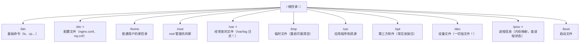
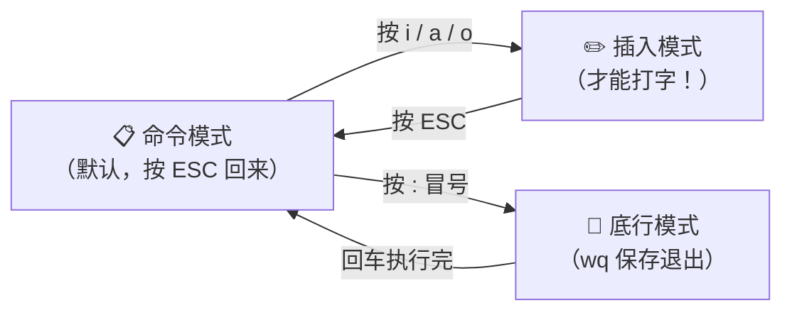
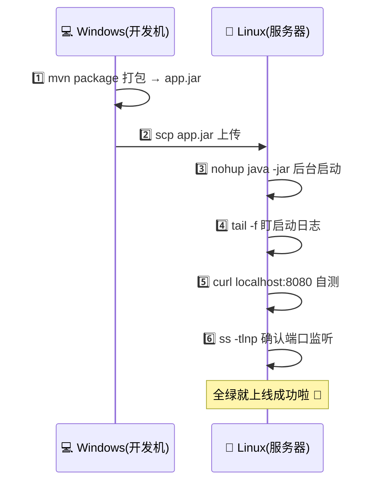
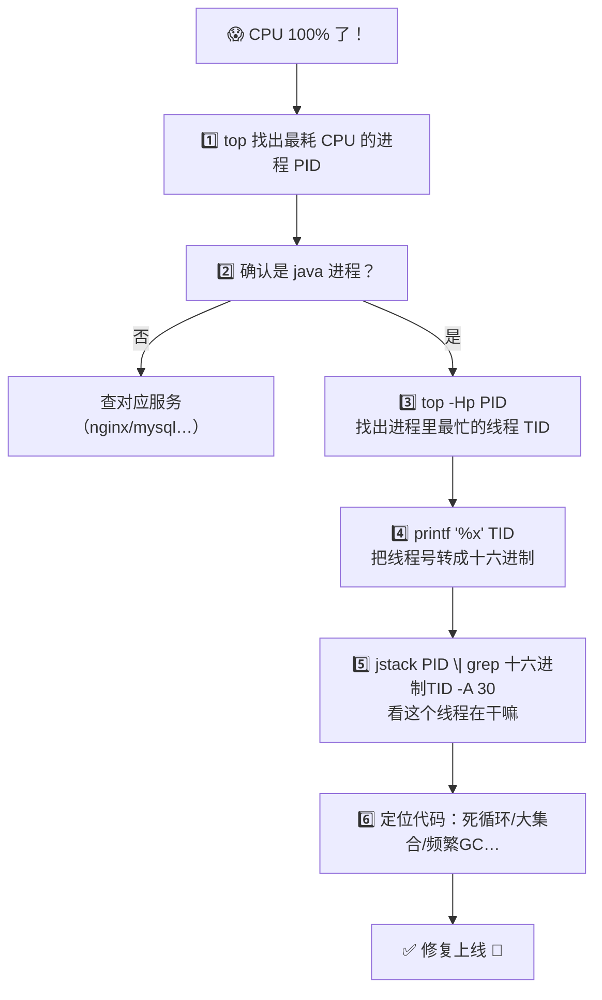
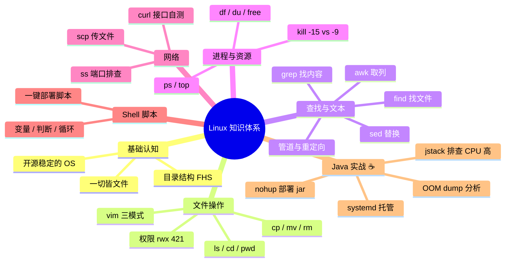

# Linux 从入门到实战 🐧

> 欢迎来到 Linux 小课堂！💖 作为程序员（尤其 Java 后端），Linux 是绕不开的基本功——毕竟生产环境的服务器几乎全是它！学完这篇，日常操作和部署排错都不慌啦～
>
> **学习目标**：
> - 🎯 掌握文件、权限、进程、网络等高频命令
> - 🎯 学会用 `grep`/`tail` 等工具快速定位日志问题
> - 🎯 能独立在 Linux 上部署 Spring Boot 项目（jar 包）
> - 🎯 会写简单 Shell 脚本、会排查 CPU/内存飙升
>
> **前置知识**：零基础也能跟～建议边看边开个 Linux 虚拟机或云服务器练手！

---

## 一、初识 Linux：为什么程序员都要学它？🌱

### 1.1 Linux 是什么（一句话版）

> Linux 是一个**开源、免费、稳定到离谱**的操作系统内核，服务器界的绝对霸主 👑

打个比方 🍜：

- Windows 像装修好的精装公寓 🏠——好看好上手，但你不能乱拆墙
- Linux 像一块自由的地皮 🏗️——想怎么盖就怎么盖，全世界的工程师一起帮你盖（开源），就是需要自己动手能力强一点～

### 1.2 为什么 Java 程序员必须学？

| 场景 | 你会遇到的事 |
|---|---|
| 🚀 项目部署 | Spring Boot 的 jar 包要跑在 Linux 服务器上 |
| 🔍 排查线上问题 | `tail -f` 盯日志、`top` 看 CPU、`jstack` 查线程 |
| 🗄️ 中间件运维 | MySQL、Redis、Nginx、Docker 全家桶都装在 Linux |
| 💼 面试必问 | "怎么部署 jar？"、"CPU 100% 怎么查？" 是高频题！ |

> 💡 **一句话记住**：代码写在你电脑上，但**跑在 Linux 上**——不会它，出了问题只能干瞪眼 😢

### 1.3 常见发行版怎么选？

| 发行版 | 特点 | 常见用途 |
|---|---|---|
| **Ubuntu** 🟠 | 界面友好、文档多 | 个人学习、桌面、云服务器 |
| **CentOS / Rocky Linux** 🔵 | 稳定、企业味浓 | 公司服务器老牌选择 |
| **Debian** 🌀 | 超稳定 | 服务器 |
| **Deepin / 统信 UOS** 🇨🇳 | 国产、颜值高 | 国产化替代 |

> 🎀 命令层面 99% 通用，学哪个都不亏～本文以 Ubuntu/CentOS 通用的命令为主！

---

## 二、目录结构：Linux 的"房间布局" 🏠

Linux 没有 C 盘 D 盘，**一切从根目录 `/` 开始**，像一棵倒挂的树 🌳：



⭐ = Java 程序员高频关注目录

| 目录 | 一句话说明 | 你会用到它干嘛 |
|---|---|---|
| `/etc` | 配置大本营 | 改 Nginx、MySQL、环境变量 |
| `/var/log` | 日志大本营 | 盯系统 & 应用日志 |
| `/home/用户名` | 你的地盘 | 放代码、jar 包 |
| `/opt` | 第三方软件 | 装 JDK、Tomcat |
| `/proc` | 进程"直播现场" | 查进程内存、CPU |

> ⚠️ **保命提醒**：`/etc`、`/boot`、`/usr` 里的东西别乱删！删错了系统直接罢工给你看 😱

---

## 三、基础命令：文件与目录操作 📂

### 3.1 导航三件套

| 命令 | 作用 | 例子 |
|---|---|---|
| `pwd` | 我在哪？打印当前目录 | `pwd` → `/home/rose` |
| `ls` | 看看这里有什么 | `ls -l`（详细）`ls -a`（含隐藏）`ls -lh`（带大小） |
| `cd` | 去别的地方 | `cd /opt`、`cd ..`（回上级）、`cd ~`（回家）、`cd -`（回上个目录） |

```bash
rose@server:~$ pwd
/home/rose
rose@server:~$ ls -lh
total 8.0K
drwxr-xr-x 2 rose rose 4.0K Sep 13 10:00 projects
-rw-r--r-- 1 rose rose  512 Sep 13 09:30 notes.txt
```

### 3.2 增删改查文件

| 命令 | 作用 | 例子 | 危险度 |
|---|---|---|---|
| `mkdir` | 建目录 | `mkdir -p a/b/c`（-p 递归建多层） | 🟢 |
| `touch` | 建空文件 | `touch app.log` | 🟢 |
| `cp` | 复制 | `cp a.txt b.txt`；`cp -r dir1 dir2`（目录加 -r） | 🟢 |
| `mv` | 移动 / 重命名 | `mv old.txt new.txt`（改名）；`mv a.txt /tmp/`（搬家） | 🟡 |
| `rm` | 删除 | `rm a.txt`；`rm -r dir`（目录）；`rm -f`（不询问） | 🔴 |
| `ln -s` | 软链接（快捷方式） | `ln -s /opt/jdk17 /usr/local/jdk` | 🟢 |

> ⚠️⚠️⚠️ **核弹级警告**：`rm -rf /` 会删掉整个系统，**绝对不要手滑**！删东西前先 `ls` 确认路径，重要操作先备份～ 🙏

### 3.3 文件内容查看（日志排查主力！🔍）

| 命令 | 作用 | 使用场景 |
|---|---|---|
| `cat` | 一次性全输出 | 看小文件 |
| `head -n 20` | 看前 20 行 | 看文件开头 |
| `tail -n 50` | 看最后 50 行 | 看最近的日志 |
| `tail -f app.log` | **实时滚动跟踪** ⭐ | 盯线上日志（最常用！） |
| `less` | 分页翻页（q 退出，/搜索） | 看大文件 |
| `wc -l` | 数行数 | 统计日志条数 |

```bash
# ☕ Java 排错黄金组合：实时盯日志 + 只看错误
tail -f app.log | grep --line-buffered ERROR

# 看最近的 100 行日志
tail -n 100 /var/log/nginx/error.log

# 大文件里搜关键词，less 打开按 / 输入关键字回车跳转
less app.log
```

### 3.4 文本编辑器 vim：三模式切换



| 模式 | 常用按键 | 作用 |
|---|---|---|
| 命令模式 | `dd` | 删除（剪切）整行 |
| 命令模式 | `yy` / `p` | 复制行 / 粘贴 |
| 命令模式 | `u` | 撤销（后悔药！） |
| 命令模式 | `G` / `gg` | 跳到末行 / 首行 |
| 命令模式 | `/关键字` | 搜索，`n` 下一个 |
| 插入模式 | `i` / `a` / `o` | 光标前插入 / 后插入 / 下一行插入 |
| 底行模式 | `:w` / `:q` | 保存 / 退出 |
| 底行模式 | `:wq` / `:q!` | 保存退出 / **不保存强退**（改崩了就靠它） |

> 🎀 新手最容易的懵圈：打开 vim 打不了字 → 因为你不在插入模式，先按 `i`！退不出 vim → 按 `ESC` 再输 `:q!` 回车！从此告别"vim 绑架" 😆

---

## 四、权限管理：谁能干什么 🔐

### 4.1 看懂 ls -l 的"天书"

```
-rw-r--r-- 1 rose dev 512 Sep 13 09:30 app.log
└┬┘└┬┘└┬┘ └┬┘ └─┬─┘ └─┬─┘
 ①  ②  ③   ④    ⑤     ⑥
```

| 段 | 含义 |
|---|---|
| ① `-rw-r--r--` | 文件类型 + 权限（下面详解） |
| ② 硬链接数 | 一般不用管 |
| ③ `rose` | **属主**：文件属于谁 |
| ④ `dev` | **属组**：属于哪个组 |
| ⑤ `512` | 文件大小（字节） |
| ⑥ 时间 + 文件名 | 最后修改时间 |

### 4.2 rwx 权限拆解

`-rw-r--r--` 拆成 4 段：`-` `rw-` `r--` `r--`

| 位置 | 对象 | 读 r | 写 w | 执行 x |
|---|---|---|---|---|
| 第 1 段 | **属主** (user) | ✅ | ✅ | ❌ |
| 第 2 段 | **属组** (group) | ✅ | ❌ | ❌ |
| 第 3 段 | **其他人** (other) | ✅ | ❌ | ❌ |

**数字换算法**：r=4，w=2，x=1，加起来就是权限数字～

```
rwx = 4+2+1 = 7
rw- = 4+2   = 6
r-x = 4+1   = 5
r-- = 4     = 4
```

| 常见组合 | 属主 | 属组 | 其他人 | 典型用途 |
|---|---|---|---|---|
| `755` | rwx | r-x | r-x | 脚本、目录（大家能跑能进，只有我能改） |
| `644` | rw- | r-- | r-- | 普通文件（大家能读，只有我能写） |
| `700` | rwx | --- | --- | 私密文件（只有我能碰） |

### 4.3 改权限、改主人

```bash
# 改权限：数字法（推荐，快！）
chmod 755 deploy.sh      # 给脚本加执行权限

# 改权限：符号法（u=主,g=组,o=其他,a=全部）
chmod u+x deploy.sh      # 给属主加执行权限
chmod a+r app.log        # 所有人加读权限

# 改主人（常在部署时用到）
sudo chown rose:rose /opt/app/app.jar   # 文件划归 rose

# 递归修改目录下所有东西
chmod -R 755 /opt/app
```

> ☕ **Java 场景**：部署 jar 时常报 `Permission denied`？八成是没执行权限——`chmod +x xxx.sh` 或者目录属主不是当前用户，`chown` 一下就好啦～

---

## 五、查找与文本处理三剑客 🔎

### 5.1 find：找文件

```bash
# 基本姿势：find 目录 -条件
find / -name "nginx.conf"          # 按名字全盘找（慢但全）
find /var/log -name "*.log"        # 找所有 .log
find /opt -name "*.jar" -mtime +7  # 7天前修改过的 jar（清理旧包！）
find / -size +100M -type f         # 大于100M的文件（磁盘满了查元凶）
```

| 参数 | 含义 |
|---|---|
| `-name` | 按文件名（支持 `*` 通配） |
| `-mtime +7` | 7 天**前**修改的（`-7` 是 7 天内） |
| `-size +100M` | 大于 100M |
| `-type f / d` | 只找文件 / 目录 |

### 5.2 grep：找内容（重中之重！⭐）

```bash
# 在文件里找关键字（-n 显示行号，-i 忽略大小写）
grep -n "ERROR" app.log
grep -ni "exception" app.log

# 递归搜整个目录的文件（-r）—— 找配置在哪个文件里
grep -r "jdbc:mysql" /opt/app/

# 反向：不包含某关键词的行（-v）
grep -v "DEBUG" app.log

# 统计出现次数
grep -c "ERROR" app.log

# ⭐ 配合管道过滤进程（Java 人天天用！）
ps -ef | grep java
```

### 5.3 管道与重定向：命令积木 🧩

```bash
# 管道 | ：左边的结果流给右边继续加工
ps -ef | grep java | grep -v grep

# 重定向 > ：覆盖写入文件
echo "hello" > test.txt
# 追加 >> ：接到文件末尾（日志常用！）
echo "new line" >> test.txt
```

### 5.4 awk / sed（会用皮毛就够啦）

```bash
# awk：按列取数据 —— 拿第1列（PID）
ps -ef | grep java | awk '{print $2}'

# sed：替换文本（-i 直接改文件）
sed -i 's/8080/9090/g' application.yml   # 把 8080 全换成 9090
```

> 🎀 记住组合拳：**`ps + grep + awk`** 三连是 Java 排查的基本功，下面第七章实战就能看到～

---

## 六、进程与系统资源管理 📊

### 6.1 查看进程

```bash
# 查所有进程（-e 全部 -f 详细）
ps -ef | grep java

# 输出解读：
# UID  PID  PPID  C STIME TTY  TIME CMD
# root 1234     1  0 09:00 ?    0:05 java -jar app.jar
#          └─  PID 就是进程身份证号！

# ☕ Java 专属：jps 只看 Java 进程（JDK 自带）
jps -l
# 输出：1234 app.jar  ←  Java 人查进程最快方式！
```

### 6.2 干掉进程：kill 的两种姿态

```bash
kill -15 1234    # 温柔版：通知它"收拾一下下班吧"（优雅停止 ⭐）
kill -9  1234    # 暴力版：直接拖走枪毙（进程没机会保存现场）
killall java     # 按名字杀（危险，全杀！）
```

| 信号 | 名字 | 行为 | 类比 |
|---|---|---|---|
| `15` (SIGTERM) | 默认 | 通知进程自行收尾 | 敲门说"该下班了" 🚪 |
| `9` (SIGKILL) | 强制 | 内核直接回收，进程无法拦截 | 直接拉电闸 ⚡ |

> ⚠️ Java 服务**优先用 -15**：Spring Boot 会执行优雅停机（处理完请求、关闭连接池）；`-9` 会导致事务做到一半被掐断，数据可能不一致！

### 6.3 top：系统体检仪 🏥

```bash
top        # 实时刷新，按 q 退出
```

```
top - 10:30:00 up 30 days,  1 user,  load average: 0.52, 0.58, 0.59
Tasks: 120 total,   1 running, 119 sleeping
%Cpu(s):  8.3 us,  2.1 sy,  0.0 ni, 89.5 id
MiB Mem :   3800.0 total,    500.2 free,   2000.5 used

  PID USER      %CPU  %MEM     TIME+ COMMAND
 1234 root      98.7  25.1   10:05.32 java     ← CPU 飙高的就是你！☕
```

| 指标 | 含义 | 关注点 |
|---|---|---|
| `load average` | 1/5/15 分钟负载 | 超过 CPU 核数说明忙不过来 |
| `%CPU` | 进程 CPU 占用 | 谁 100% 谁可疑 |
| `%MEM` | 进程内存占用 | Java 关注是否逼近上限 |
| `us / sy` | 用户态 / 内核态 | us 高=应用问题，sy 高=系统问题 |

**top 交互快捷键**：`P` 按 CPU 排序、`M` 按内存排序、`1` 展开各核、`k` 杀进程

### 6.4 磁盘与内存

```bash
df -h              # 磁盘还剩多少（-h 人类可读单位）
# 常见事故：/ 分区 Use% 100% → 服务写日志失败集体罢工！

du -sh /var/log    # 这个目录占了多大
du -sh /* | sort -rh | head -5   # 找出最占空间的目录 Top5

free -h            # 内存情况（Java 人关注 available）
# 注意：buff/cache 高是好事（Linux 拿空闲内存做缓存），看 available 才准！
```

---

## 七、网络相关命令 🌐

| 命令 | 作用 | 例子 |
|---|---|---|
| `ping` | 测网络通不通 | `ping www.baidu.com` |
| `curl` | 发 HTTP 请求（接口自测神器） | `curl http://localhost:8080/api/hello` |
| `curl -X POST` | 发 POST | `curl -X POST -H "Content-Type: application/json" -d '{"id":1}' http://localhost:8080/api/user` |
| `ss -tlnp` | 看监听端口（netstat 继任者）⭐ | `ss -tlnp \| grep 8080` |
| `ip addr` | 看网卡 IP | 代替老命令 `ifconfig` |
| `wget` | 下载文件 | `wget https://xxx/jdk17.tar.gz` |
| `scp` | 跨机器传文件 ⭐ | 见下方部署实战 |

```bash
# 检查 8080 端口有没有被占用 / 服务起没起
ss -tlnp | grep 8080
# 没输出 = 没人监听 = 你的 Java 服务八成没起来！

# 防火墙放行端口（CentOS）
sudo firewall-cmd --add-port=8080/tcp --permanent
sudo firewall-cmd --reload
# Ubuntu
sudo ufw allow 8080
```

> 🎀 **排错小套路**：服务访问不了？先 `curl localhost:端口` 自测 → 通就是防火墙/安全组问题；不通就是服务本身没起来，回去看日志！

---

## 八、Shell 脚本入门：让命令自动干活 🤖

### 8.1 第一个脚本

```bash
#!/bin/bash
# 上面这行叫 shebang：告诉系统用 bash 来跑

echo "Hello Shell！我是第一个脚本 🎉"
```

```bash
chmod +x hello.sh   # 脚本必须有执行权限！
./hello.sh          # 执行
```

### 8.2 变量与参数

```bash
#!/bin/bash
NAME="rose"              # 定义变量（=两边不能有空格！）
echo "Hello, $NAME"      # 用 $ 取值

echo "脚本名: $0"
echo "第1个参数: $1"      # 运行时传参
echo "第2个参数: $2"
echo "参数个数: $#"
```

```bash
./demo.sh 8081 8082      # $1=8081, $2=8082
```

### 8.3 判断与循环

```bash
#!/bin/bash
# if 判断：注意 [ ] 里两边要有空格！
if [ "$1" = "8081" ]; then
    echo "这是 1 号服务 🥇"
else
    echo "这是其他服务"
fi

# for 循环
for port in 8081 8082 8083; do
    echo "启动服务，端口：$port"
done

# 函数
deploy() {
    echo "正在部署 $1 ..."
}
deploy "app.jar"
```

### 8.4 实战：一键部署脚本（Java 人值得拥有 ☕）

```bash
#!/bin/bash
# deploy.sh —— 一键部署 Spring Boot 脚本
JAR_NAME="app.jar"

echo "1. 停止旧服务..."
PID=$(ps -ef | grep "$JAR_NAME" | grep -v grep | awk '{print $2}')
if [ -n "$PID" ]; then
    kill -15 $PID
    sleep 3
    echo "   已停止 PID=$PID"
else
    echo "   没有在跑的旧服务"
fi

echo "2. 启动新服务..."
nohup java -jar $JAR_NAME --server.port=8081 > app.log 2>&1 &

echo "3. 检查启动状态..."
sleep 5
if ss -tlnp | grep -q 8081; then
    echo "✅ 部署成功！日志：tail -f app.log"
else
    echo "❌ 启动失败，看日志找原因：tail -n 50 app.log"
fi
```

---

## 九、Java 程序员 Linux 实战 ☕⭐（灵魂章节！）

### 9.1 完整部署流程：把 Spring Boot 跑起来



**Step 1：本机打包**

```bash
mvn clean package -DskipTests    # 生成 target/app.jar
```

**Step 2：scp 上传到服务器**

```bash
# 把 jar 传到服务器 /opt/app 目录（注意冒号别丢）
scp target/app.jar rose@192.168.1.100:/opt/app/
```

**Step 3：后台启动（nohup 大法）**

```bash
nohup java -jar app.jar --server.port=8081 > app.log 2>&1 &
```

这行"咒语"逐字拆解👇（面试常问！）

| 片段 | 含义 |
|---|---|
| `nohup` | 关掉终端也不死（no hang up 不挂断） |
| `java -jar app.jar` | 启动我们的 Java 程序 |
| `> app.log` | 标准输出写进 app.log |
| `2>&1` | 错误输出也并到同一个日志里 |
| `&` | 放后台运行，终端还能继续敲命令 |

**Step 4~6：验证三连**

```bash
tail -f app.log                   # 盯日志等 Spring Boot 启动完成
curl http://localhost:8081/api/hello   # 自测接口
ss -tlnp | grep 8081              # 确认端口在监听
```

### 9.2 更专业的姿势：systemd 托管服务

nohup 挂了就没了，用 systemd 可以**开机自启 + 挂了自动拉起**！

```bash
sudo vim /etc/systemd/system/myapp.service
```

```ini
[Unit]
Description=My Spring Boot App
After=network.target

[Service]
User=rose
ExecStart=/usr/bin/java -jar /opt/app/app.jar --server.port=8081
SuccessExitStatus=143        # 143=SIGTERM，标记为正常退出

[Install]
WantedBy=multi-user.target
```

```bash
sudo systemctl daemon-reload      # 改完配置必须刷新
sudo systemctl start myapp        # 启动
sudo systemctl status myapp       # 看状态
sudo systemctl enable myapp       # 开机自启
journalctl -u myapp -f            # 看这个服务的日志
```

### 9.3 线上 CPU 飙高排查（高频面试题！🎯）



```bash
# 实操演示（命令可直接抄）
top                          # ① 发现 PID=1234 的 java 占 98%
top -Hp 1234                 # ② 发现线程 TID=1250 最忙
printf '%x\n' 1250           # ③ 转十六进制 → 4e2
jstack 1234 | grep '0x4e2' -A 30   # ④ 看线程栈 → 定位到类和行号！

# 顺便看看 GC 是不是在疯狂打工
jstat -gcutil 1234 1000      # 每秒打印 GC 情况
```

### 9.4 内存溢出（OOM）排查

```bash
# 先给 Java 加参数：OOM 时自动导出堆快照
java -jar app.jar -XX:+HeapDumpOnOutOfMemoryError -XX:HeapDumpPath=/opt/app/dump.hprof

# 事后用 MAT 或 jvisualvm 分析 dump.hprof，找占内存最大的对象
```

### 9.5 Java 人常用命令速查卡 📇

| 需求 | 命令 |
|---|---|
| 看 Java 进程 | `jps -l` |
| 实时看 GC | `jstat -gcutil PID 1000` |
| 打印线程栈 | `jstack PID` |
| 导出堆内存 | `jmap -dump:format=b,file=heap.hprof PID` |
| 看 jar 里结构 | `jar -tf app.jar \| head` |
| 看日志中的异常 | `grep -n "Exception" app.log \| tail -20` |
| 统计访问量 | `grep -c "/api/user" access.log` |

---

## 十、实用小技巧锦囊 🎁

| 技巧 | 说明 |
|---|---|
| `Tab` 键 | 自动补全命令/路径（按两下显示候选）——用起来！ |
| `↑` / `↓` | 翻历史命令 |
| `Ctrl + C` | 强制终止当前前台命令 |
| `Ctrl + Z` | 暂停前台任务（`fg` 恢复、`bg` 转后台） |
| `history \| grep xxx` | 搜自己敲过的历史命令 |
| `!!` | 再执行上一条命令 |
| `which java` | 看命令装在哪（配 JAVA_HOME 用） |
| `echo $PATH` | 看环境变量 |
| `alias ll='ls -lh'` | 起别名（写进 ~/.bashrc 永久生效） |
| `date` | 看时间（对时、看日志时间戳） |
| `clear` / `Ctrl + L` | 清屏 |

### 环境变量配置（装 JDK 必会 ☕）

```bash
# 编辑用户级配置文件
vim ~/.bashrc
# 在末尾追加：
# export JAVA_HOME=/opt/jdk17
# export PATH=$JAVA_HOME/bin:$PATH

# 让配置生效
source ~/.bashrc
java -version    # 验证安装成功 🎉
```

---

## 十一、高频面试题速答 🎯

| 问题 | 精简答案 |
|---|---|
| 软链接 vs 硬链接？ | 软链接 = 快捷方式（可跨分区、删原文件失效）；硬链接 = 同一文件的另一个名字（不跨分区、删除互不影响） |
| `kill -9` 和 `kill -15` 区别？ | -15 通知进程优雅退出（可触发 Spring Boot 优雅停机）；-9 内核强制回收、进程无法拦截，可能丢数据 |
| 后台运行 jar 且关终端不死？ | `nohup java -jar app.jar > app.log 2>&1 &` |
| 怎么看实时日志？ | `tail -f app.log`，配合 `grep` 过滤：`tail -f app.log \| grep ERROR` |
| CPU 100% 怎么排查？ | `top` 定位进程 → `top -Hp PID` 定位线程 → 线程号转十六进制 → `jstack` 看线程栈定位代码 |
| 磁盘满了怎么查？ | `df -h` 看哪个分区满 → `du -sh /* \| sort -rh \| head` 找大目录 → 清理日志/旧包 |
| `chmod 755` 啥意思？ | 属主 rwx、属组 r-x、其他 r-x（7=4+2+1, 5=4+1） |
| `find` 和 `grep` 区别？ | find 按**文件名/属性**找文件；grep 按**内容**在文件里找文本 |
| 怎么看端口占用？ | `ss -tlnp \| grep 端口号`（老命令 netstat） |
| 两个命令组合处理数据用什么？ | 管道 `\|`，如 `ps -ef \| grep java \| awk '{print $2}'` |

---

## 十二、知识总结地图 🗺️



> 🎀 **毕业寄语**：Linux 学的不是背命令，而是**形成"出问题→定位→解决"的肌肉记忆**！建议把第九章的部署流程亲手跑一遍，再故意把服务搞挂排查一次，比看十遍教程都管用～ 你已经比昨天的自己更强啦，加油！💪✨
