# Nginx 从入门到实战 🎀

> 嘿嘿～今天由我来带你搞定 Nginx！💖 学完这篇，你就能 confidently 地说自己"会用 Nginx"啦～
>
> **学习目标**：
> - 🎯 搞懂 Nginx 是干嘛的、为什么需要它
> - 🎯 看懂并能手写常用配置（反向代理、负载均衡、动静分离）
> - 🎯 学会和 Java（Spring Boot）项目配合使用
> - 🎯 能独立排查 502、404 等常见问题
>
> **前置知识**：会一点 Linux 命令、了解 HTTP 基础就够啦～

---

## 一、初识 Nginx：它是谁？为什么需要它？🌱

### 1.1 Nginx 是什么（一句话版）

> Nginx 是一个**高性能的 HTTP 服务器 + 反向代理服务器**，特点是：**吃得少（内存小）、干得多（并发强）**！💪

打个比方 🍽️：

- 你的 Java 服务（Tomcat / Spring Boot）像后厨的大厨 👨‍🍳——手艺好，但一个人忙不过来太多客人
- **Nginx 就是门口超能干的迎宾 + 服务员** 🙋‍♀️——接客、分流、端静态的菜（静态资源）、把点单递给后厨（反向代理），一个人能同时招呼几万个客人！

### 1.2 直接用 Java 裸跑不行吗？

能跑，但会遇到这些痛点👇

| 痛点 | 裸跑 Java 的问题 | Nginx 的解法 |
|---|---|---|
| 🔥 高并发 | Tomcat 工作线程有限（默认 200），大流量直接卡死 | Nginx 单机轻松扛 **几万并发连接**，把流量"过滤"后再转给 Java |
| 📦 静态资源 | 图片/CSS/JS 也走 Java，浪费宝贵的业务线程 | Nginx 直接返回静态文件，**快到飞起** |
| 🔄 多实例部署 | 一个 Java 进程挂了，服务就没了 | Nginx **负载均衡** + 自动剔除故障节点 |
| 🌐 HTTPS / 域名 | 证书管理、多站点配置麻烦 | Nginx 统一入口处理 |
| 🛡️ 安全 | Java 服务直接暴露公网，容易被打 | Nginx 挡在前面，限流、屏蔽恶意 IP |

> 💡 **一句话记住**：让专业的干专业的事——Nginx 管接客分流，Java 专心写业务！

### 1.3 Nginx vs Apache 老前辈

| 对比项 | Nginx ⚡ | Apache 🐢 |
|---|---|---|
| 并发模型 | **事件驱动**（异步非阻塞） | 每个连接一个进程/线程（阻塞式） |
| 内存占用 | 小 💧 | 大 |
| 万级并发（C10K） | 轻松拿捏 ✅ | 吃力 ❌ |
| 静态文件 | 超快 | 一般 |
| 模块化 | 动态模块（相对克制） | 模块超多、超灵活 |
| 配置风格 | 简洁直观 | 稍显啰嗦 |

> 📖 小知识：2004 年俄罗斯大叔 Igor Sysoev 为了解决 **C10K 问题**（一台服务器同时处理 1 万个连接）写出了 Nginx，如今它已是全球最流行的 Web 服务器之一～

### 1.4 Nginx 的五大应用场景

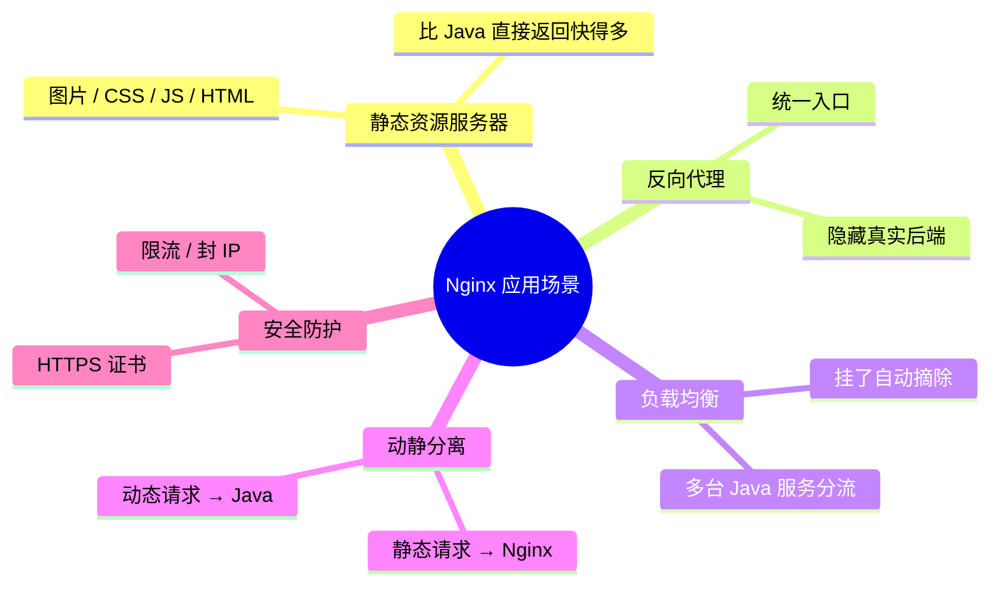

---

## 二、核心架构：Master-Worker 模型 🏗️

### 2.1 进程结构

Nginx 跑起来后其实是**一堆进程**在协作：1 个 Master（老板）+ N 个 Worker（打工人）+ 可选的 Cache 进程～

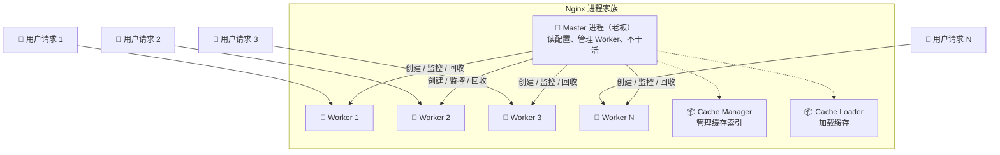

各自的职责超清晰👇

| 进程 | 数量 | 职责 | 类比 |
|---|---|---|---|
| **Master** | 1 个 | 读取/校验配置、管理 Worker 生死、不处理请求 | 老板 👑 |
| **Worker** | 通常 = CPU 核数 | **真正处理请求**的打工人 | 服务员 👷 |
| **Cache Manager/Loader** | 各 1 个（可选） | 管理磁盘缓存的元数据 | 仓库管理员 📦 |

### 2.2 事件驱动：为什么这么能扛？⚡

传统服务器（一连接一线程）就像**每来一个客人就雇一个服务员**，客人多了老板先破产 😱

Nginx 的 Worker 使用 **epoll**（Linux 事件通知机制），一个 Worker 就能同时盯几万个连接：

> 类比：一个服务员站在餐厅中央，**哪个桌子招手就服务哪个**，而不是每桌站一个服务员傻等！🌀

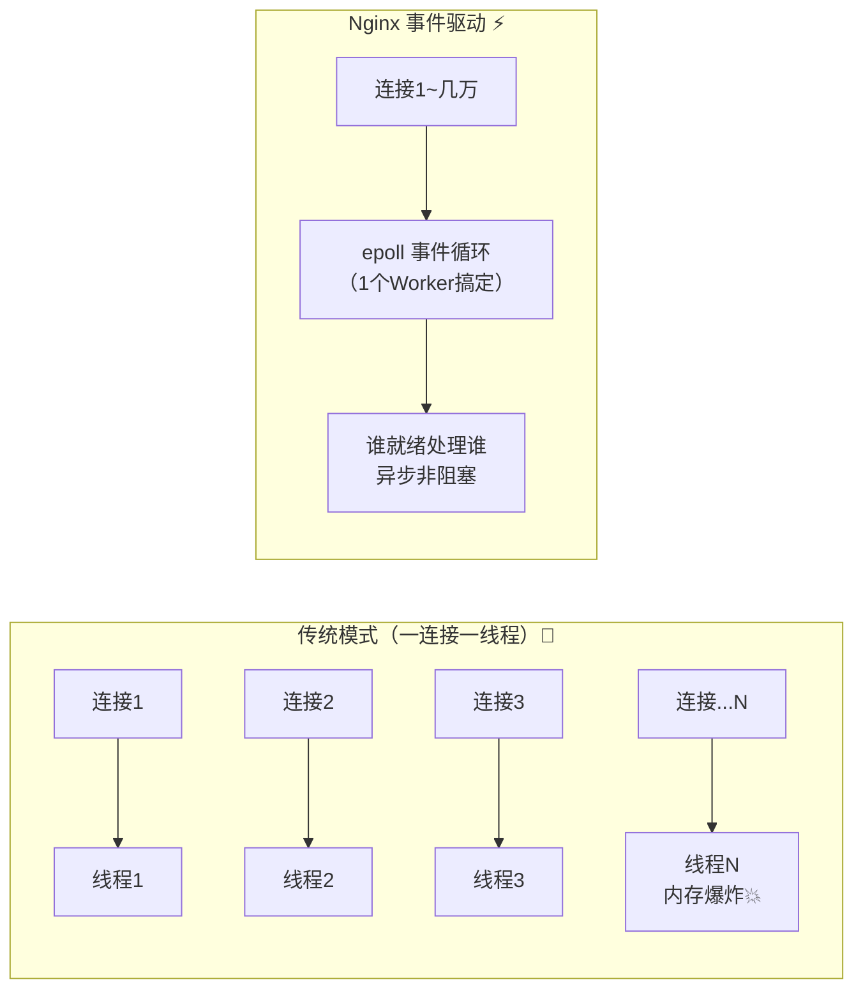

### 2.3 一次请求的完整旅程（反向代理场景）

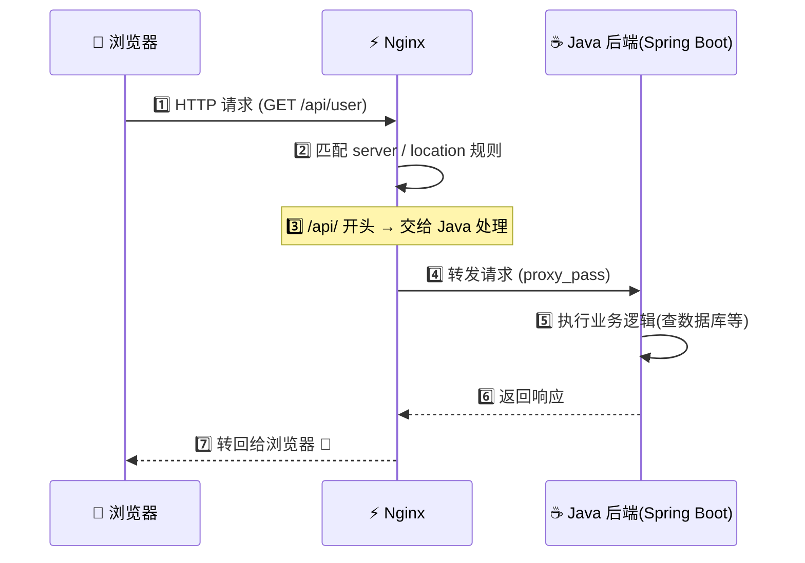

---

## 三、安装与常用命令 🔧

### 3.1 安装（Linux 为例）

```bash
# Ubuntu / Debian 系
sudo apt update && sudo apt install nginx -y

# CentOS / RHEL 系
sudo yum install epel-release -y && sudo yum install nginx -y

# 装好后启动
sudo systemctl start nginx
sudo systemctl enable nginx   # 开机自启
```

> 🪟 Windows 同学：去 [nginx.org](https://nginx.org/en/download.html) 下载 zip 解压，`nginx.exe` 双击即可（学习用，生产环境都是 Linux 哦～）

### 3.2 安装后目录一览

| 路径 | 作用 |
|---|---|
| `/etc/nginx/nginx.conf` | 📄 **主配置文件**（重点！） |
| `/etc/nginx/conf.d/` | 子配置目录（每个站点一个 `.conf`） |
| `/usr/share/nginx/html/` | 默认静态页面存放处 |
| `/var/log/nginx/` | 日志目录（access + error） |
| `/usr/sbin/nginx` | 可执行文件本体 |

### 3.3 常用命令（背下来！✍️）

| 命令 | 作用 | 使用频率 |
|---|---|---|
| `nginx -t` | **测试配置文件语法**（改完必跑！） | ⭐⭐⭐⭐⭐ |
| `nginx` | 启动 | ⭐⭐⭐ |
| `nginx -s reload` | **平滑重载配置**（不断服务！） | ⭐⭐⭐⭐⭐ |
| `nginx -s stop` | 立即停止（暴力） | ⭐⭐ |
| `nginx -s quit` | 优雅停止（处理完当前请求再退） | ⭐⭐⭐ |
| `nginx -s reopen` | 重新打开日志文件（日志切割用） | ⭐⭐ |

```bash
# 黄金三连（改配置后的标准流程）✅
sudo nginx -t                # 1. 先测语法
sudo nginx -s reload         # 2. 没问题就重载
tail -f /var/log/nginx/error.log   # 3. 盯一眼日志确认
```

### 3.4 为什么 reload 不断服务？

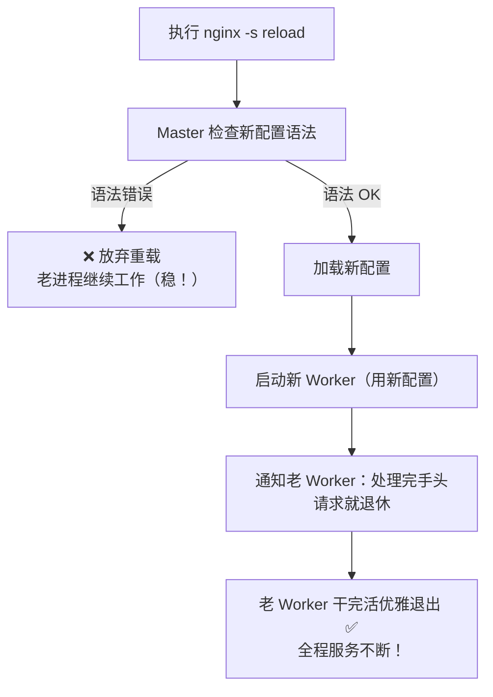

---

## 四、配置文件全解析 📖（核心章节！）

### 4.1 配置文件整体结构

Nginx 配置是**嵌套块**结构，像俄罗斯套娃🪆：

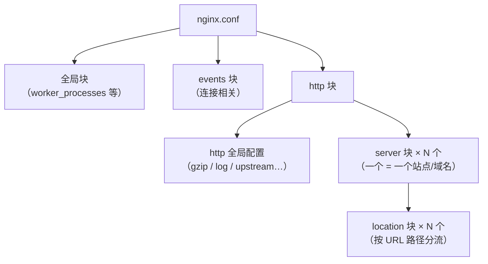

### 4.2 一份带注释的完整骨架

```nginx
# ========== 全局块：管 Nginx 进程本身 ==========
# worker 数量：设为 CPU 核数最优（auto 自动检测）
worker_processes auto;

# 错误日志的位置和级别
error_log /var/log/nginx/error.log warn;

# Nginx 主进程 PID 存放位置
pid /run/nginx.pid;

# ========== events 块：管连接 ==========
events {
    # 每个 Worker 最大连接数（默认 1024，可调大）
    worker_connections 10240;
    # 允许一次接受多个新连接，提高效率
    multi_accept on;
}

# ========== http 块：管 HTTP 业务 ==========
http {
    # 文件扩展名 → MIME 类型映射
    include       /etc/nginx/mime.types;
    default_type  application/octet-stream;

    # 访问日志格式
    log_format main '$remote_addr - $remote_user [$time_local] '
                    '"$request" $status $body_bytes_sent '
                    '"$http_referer" "$http_user_agent"';
    access_log /var/log/nginx/access.log main;

    # 开启高效文件传输
    sendfile      on;
    # 客户端保持连接的超时时间
    keepalive_timeout 65;

    # ---------- 集群定义（负载均衡用） ----------
    upstream java_backend {
        server 127.0.0.1:8081;
        server 127.0.0.1:8082;
    }

    # ---------- server 块：一个站点 ----------
    server {
        listen       80;              # 监听端口
        server_name  www.example.com; # 域名，可写多个

        # location：按 URL 路径分流
        location / {
            root   /usr/share/nginx/html;  # 静态文件根目录
            index  index.html index.htm;   # 默认首页
        }

        # /api/ 开头的请求转发给 Java
        location /api/ {
            proxy_pass http://java_backend;
        }
    }
}
```

### 4.3 location 匹配规则（重点+易错！⚠️）

先看匹配符号和**优先级**（从高到低）：

| 优先级 | 符号 | 含义 | 例子 |
|---|---|---|---|
| 1️⃣ | `=` | **精确匹配**（命中即停，最快） | `location = /login` |
| 2️⃣ | `^~` | 前缀匹配（命中后不再看正则） | `location ^~ /static/` |
| 3️⃣ | `~` | **区分大小写**的正则匹配 | `location ~ \.jpg$` |
| 4️⃣ | `~*` | **不区分大小写**的正则匹配 | `location ~* \.(png\|gif)$` |
| 5️⃣ | `/xxx` | 普通前缀匹配（最长优先） | `location /api/` |
| 兜底 | `/` | 通用匹配（谁都接） | `location /` |

> 🧠 **记忆口诀**：先看等号 `=`，再看 `^~`，然后正则 `~` 抢着配，最后才是普通前缀比长短～

匹配流程走一遍👇

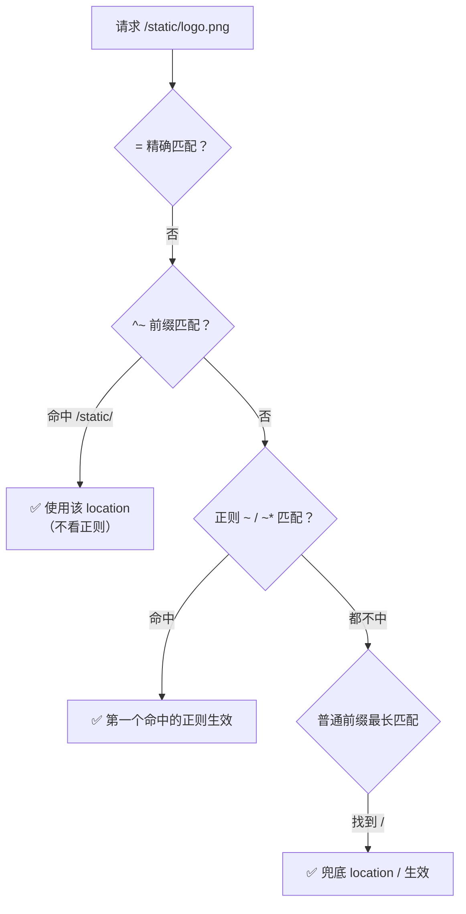

### 4.4 root vs alias（超经典易混点！）

| 对比 | `root` | `alias` |
|---|---|---|
| 拼路径方式 | **拼接**：root + 完整 URI | **替换**：alias 替换匹配部分 |
| 例子 | `location /img/ { root /data; }` | `location /img/ { alias /data/; }` |
| 访问 `/img/a.png` | → `/data/img/a.png` | → `/data/a.png` |
| 能用在 location 外 | ✅ 能 | ❌ 只能用在 location 中 |

> 💡 **防呆技巧**：`root` 是"接着拼"，`alias` 是"偷梁换柱"；alias 结尾的 `/` 要和 location 的 `/` 保持一致哦～

---

## 五、核心功能实战 🚀

### 5.1 静态资源服务（Nginx 老本行）

```nginx
server {
    listen 80;
    server_name static.example.com;

    # 静态站点
    location / {
        root /data/www;
        index index.html;
    }

    # 图片单独优化：不记日志 + 浏览器缓存 30 天
    location ~* \.(jpg|jpeg|png|gif|ico|svg|webp)$ {
        root /data/www/images;
        expires 30d;
        access_log off;
    }
}
```

> ☕ **Java 视角**：以前把图片放 Spring Boot 的 `src/main/resources/static` 里，每次请求都要占用 Tomcat 线程；现在交给 Nginx 直接从磁盘吐文件，Java 线程全省下来跑业务，美滋滋～

### 5.2 反向代理（最常用！🔥）

**先分清正向 vs 反向**（面试必问！）：

| 对比 | 正向代理 🧑‍🤝‍🧑 | 反向代理 🏢 |
|---|---|---|
| 代理谁 | 代理**客户端** | 代理**服务器** |
| 谁知道它存在 | 客户端知道，服务器不知道 | 服务器知道，客户端不知道 |
| 典型场景 | 翻墙、公司上网管控 | 负载均衡、隐藏后端、网关 |
| 类比 | 帮你跑腿代购买奶茶的小哥 🧋 | 你只管点单，奶茶店后厨换了几个人你不知道 🍳 |

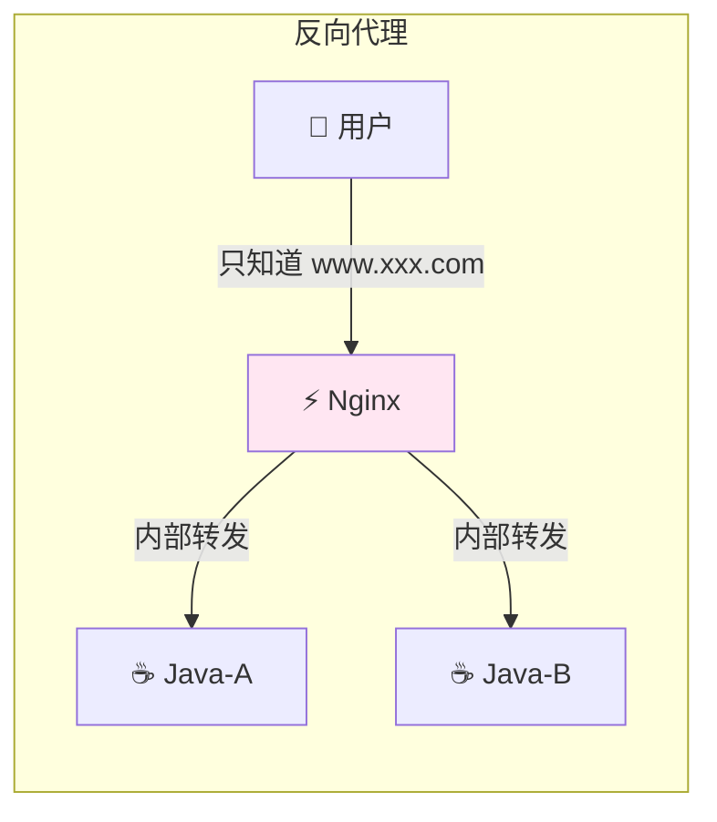

**配置示例（代理到 Java Spring Boot）**：

```nginx
upstream java_backend {
    server 127.0.0.1:8081;
}

server {
    listen 80;
    server_name www.example.com;

    location /api/ {
        proxy_pass http://java_backend/;   # 末尾 / 有讲究，见下方表格⚠️

        # —— 传递真实客户端信息（不然后端只能看到 Nginx IP）——
        proxy_set_header Host              $host;
        proxy_set_header X-Real-IP         $remote_addr;
        proxy_set_header X-Forwarded-For   $proxy_add_x_forwarded_for;
        proxy_set_header X-Forwarded-Proto $scheme;

        # —— 超时设置 ——
        proxy_connect_timeout 5s;    # 连接后端超时
        proxy_read_timeout    60s;   # 等后端响应超时
        proxy_send_timeout    60s;   # 向后端发数据超时
    }
}
```

**`proxy_pass` 末尾 `/` 的大坑！⚠️**

| 配置 | 请求 `/api/user` 实际转发到 |
|---|---|
| `proxy_pass http://backend/;`（带 `/`） | `http://backend/user`（**/api 被替换**） |
| `proxy_pass http://backend;`（不带） | `http://backend/api/user`（**原样拼上**） |

> 🎀 Java 小提示：后端想拿真实 IP？读 Header `X-Forwarded-For` 第一个值即可，Spring 里可用 `request.getHeader("X-Forwarded-For")`～

### 5.3 负载均衡（5 大策略）

先起两个 Java 实例（Spring Boot 小例子）：

```java
// ☕ HelloController.java —— 打包后跑两份：8081 和 8082
@RestController
public class HelloController {

    @Value("${server.port}")
    private String port;   // 注入端口，方便看请求打到了谁身上

    @GetMapping("/api/hello")
    public String hello(HttpServletRequest request) {
        return "Hello~ 我是从端口 " + port + " 回应你的哟 💖";
    }
}
```

```bash
# 同一个 jar 跑两份，用 --server.port 区分
java -jar app.jar --server.port=8081
java -jar app.jar --server.port=8082
```

**Nginx 负载均衡配置与策略对比**：

```nginx
# upstream 定义后端集群
upstream java_backend {

    # —— 策略①：轮询（默认，不用写任何指令）——
    # server 127.0.0.1:8081;
    # server 127.0.0.1:8082;

    # —— 策略②：权重 ——
    server 127.0.0.1:8081 weight=3;   # 机器好就多分点
    server 127.0.0.1:8082 weight=1;

    # —— 策略③：ip_hash（ uncomment 并注释上面两行 ）——
    # ip_hash;   # 同一 IP 永远打同一台（解决 Session 问题）

    # —— 策略④：最少连接 ——
    # least_conn;

    # —— 故障摘除：挂了 10 秒内失败 3 次就踢出局 30 秒 ——
    server 127.0.0.1:8081 max_fails=3 fail_timeout=30s;
}
```

| 策略 | 关键字 | 规则 | 适用场景 |
|---|---|---|---|
| 轮询 | （默认） | 一人一个，排队来 | 后端机器配置相同 |
| 权重 | `weight=n` | 按 ratio 分配 | 机器配置有强有弱 |
| IP 哈希 | `ip_hash;` | 同 IP 固定打同一台 | 有 Session 依赖（但现在多用 Redis + JWT 啦） |
| 最少连接 | `least_conn;` | 谁手上活少给谁 | 请求耗时差异大 |
| 第三方 fair | 需装模块 | 按响应速度分配 | 追求极致（需额外编译 `nginx-upstream-fair`） |

> 💡 **Java 最佳实践**：Spring 前后端分离项目一般**无状态 + JWT**，所以默认轮询就很好；Session 放 Redis，随便哪台接单都认识你～

### 5.4 动静分离

**核心思想**：动态请求给 Java，静态资源 Nginx 自己搞定，互不耽误！

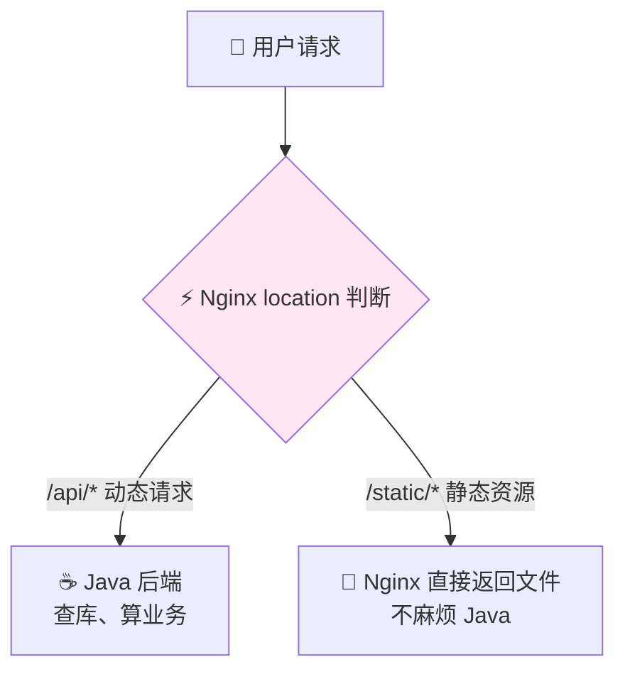

```nginx
server {
    listen 80;
    server_name www.example.com;

    # 动态 → Java
    location /api/ {
        proxy_pass http://java_backend;
    }

    # 静态 → 本地文件
    location /static/ {
        alias /data/www/static/;
        expires 7d;             # 浏览器缓存 7 天
        access_log off;
    }

    # 前端页面（Vue/React 打包产物）
    location / {
        root /data/www/dist;
        try_files $uri $uri/ /index.html;   # ⭐前端路由必须！
    }
}
```

> ⭐ `try_files $uri $uri/ /index.html;` 是**前端路由（history 模式）的保命符**：用户刷新 `/user/123` 时磁盘上根本没有这个文件，不配它就会 404！有了它，找不到的统统回退到 `index.html` 交给前端路由处理～

---

## 六、进阶功能锦囊 🎁

### 6.1 Gzip 压缩（省带宽神器）

```nginx
http {
    gzip on;                       # 开启压缩
    gzip_min_length 1k;            # 小于 1k 不压（不划算）
    gzip_comp_level 6;             # 压缩级别 1-9，6 是性价比之王
    gzip_types text/plain text/css application/json
               application/javascript text/xml application/xml;  # 压哪些类型
    gzip_vary on;                  # 告诉代理服务器缓存压缩版
}
```

> 📉 效果：一个 100KB 的 JS 压完可能只有 25KB，用户加载速度嗖嗖的～

### 6.2 代理缓存（给后端减负）

```nginx
http {
    # 定义缓存存放地
    proxy_cache_path /data/nginx_cache levels=1:2
                     keys_zone=my_cache:10m
                     max_size=1g inactive=60m;

    server {
        location /api/ {
            proxy_pass http://java_backend;
            proxy_cache my_cache;             # 启用缓存
            proxy_cache_key $uri$is_args$args;
            proxy_cache_valid 200 10m;        # 200 响应缓存 10 分钟
            add_header X-Cache-Status $upstream_cache_status;  # HIT=命中/MISS=未命中
        }
    }
}
```

> ☕ Java 配合小技巧：接口数据变化不频繁时，也可以在 Controller 上加 `@Cacheable` 做 Redis 缓存；Nginx 缓存适合"整个 URL 响应"级别的复用～

### 6.3 HTTPS 配置

```nginx
server {
    listen 443 ssl;
    server_name www.example.com;

    ssl_certificate      /etc/nginx/ssl/example.com.pem;      # 证书
    ssl_certificate_key  /etc/nginx/ssl/example.com.key;      # 私钥
    ssl_protocols        TLSv1.2 TLSv1.3;                     # 只留安全版本
    ssl_ciphers          HIGH:!aNULL:!MD5;

    location / {
        root /data/www/dist;
        index index.html;
    }
}

# HTTP 自动跳 HTTPS
server {
    listen 80;
    server_name www.example.com;
    return 301 https://$host$request_uri;
}
```

> 🆓 证书用 Let's Encrypt 免费申请：`sudo certbot --nginx -d example.com` 一条命令搞定～

### 6.4 跨域（CORS）配置

前端 `https://a.com` 调后端 `https://b.com` 就会跨域。**最优雅方案：Nginx 反向代理让它们同源**！

```nginx
server {
    listen 80;
    server_name www.example.com;

    # 前端页面
    location / {
        root /data/www/dist;
        index index.html;
    }

    # API 代理到 Java —— 前端请求 /api/xxx，和页面同域，根本不跨！
    location /api/ {
        proxy_pass http://java_backend/;
    }

    # 如果必须直连另一个域的后端，则加 CORS 头
    location /other/ {
        proxy_pass http://other-backend/;
        add_header Access-Control-Allow-Origin  $http_origin always;
        add_header Access-Control-Allow-Methods "GET, POST, PUT, DELETE, OPTIONS" always;
        add_header Access-Control-Allow-Headers "Content-Type, Authorization" always;
        # 预检请求 OPTIONS 直接放行
        if ($request_method = OPTIONS) {
            return 204;
        }
    }
}
```

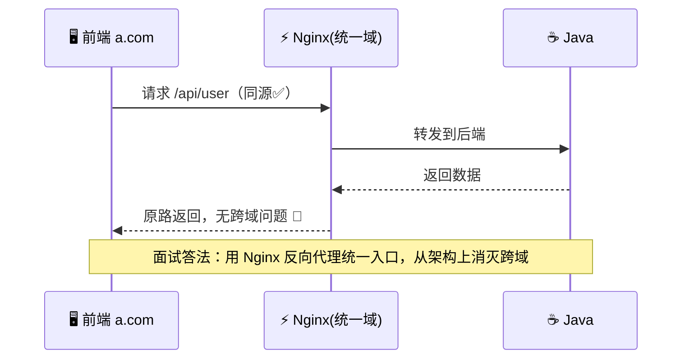

### 6.5 限流（防刷防打 🛡️）

```nginx
http {
    # 规则1：按 IP 限速，10MB 内存存 IP，每秒 10 个请求，突发容忍 20 排队
    limit_req_zone $binary_remote_addr zone=req_limit:10m rate=10r/s;

    # 规则2：按 IP 限连接数，最多 50 个并发连接
    limit_conn_zone $binary_remote_addr zone=conn_limit:10m;

    server {
        location /api/ {
            limit_req  zone=req_limit burst=20 nodelay;
            limit_conn conn_limit 50;
            limit_req_status 429;   # 超限返回 429
            proxy_pass http://java_backend;
        }
    }
}
```

> ☕ **Java 配合**：方法级防刷也可以用 Guava `RateLimiter` 或 Sentinel（阿里开源），Nginx 挡"面"，Java 挡"点"，双层保险～

### 6.6 URL 重写 rewrite

```nginx
server {
    # 把 /old.html 永久重定向到 /new.html（301 利于 SEO）
    rewrite ^/old\.html$ /new.html permanent;

    location / {
        # 例：/goods/123 → /api/goods/detail?id=123
        rewrite ^/goods/(\d+)$ /api/goods/detail?id=$1 last;
        proxy_pass http://java_backend;
    }
}
```

| flag | 含义 |
|---|---|
| `last` | 停止当前匹配，重新走一遍 location（内部重写） |
| `break` | 停止匹配，用重写后的地址直接处理 |
| `redirect` | 302 临时重定向（浏览器地址会变） |
| `permanent` | 301 永久重定向 |

---

## 七、Java 项目整合实战：Spring Boot + Nginx 🤝

### 7.1 完整场景

> 需求：Vue 前端 + 2 台 Spring Boot + WebSocket 推送 + 大文件上传

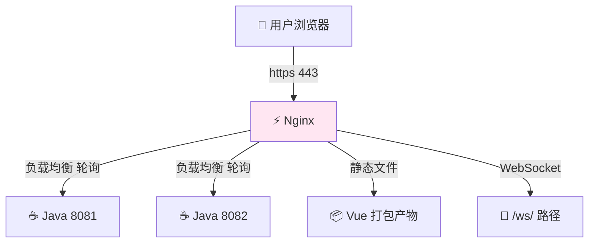

### 7.2 Java 端代码（WebSocket 示例）

```java
// ☕ WebSocket 服务端示例（Spring Boot）
@ServerEndpoint("/ws/{userId}")   // 原生注解方式
@Component
public class WebSocketServer {

    private static final Map<String, Session> CLIENTS = new ConcurrentHashMap<>();

    @OnOpen
    public void onOpen(Session session, @PathParam("userId") String userId) {
        CLIENTS.put(userId, session);
        System.out.println("用户 " + userId + " 连上来啦 🎉");
    }

    @OnMessage
    public void onMessage(String message, Session session) throws IOException {
        // 简单回声：收到啥回啥
        session.getBasicRemote().sendText("服务端收到: " + message);
    }

    @OnClose
    public void onClose(@PathParam("userId") String userId) {
        CLIENTS.remove(userId);
    }
}
```

### 7.3 Nginx 完整配置

```nginx
upstream java_backend {
    server 127.0.0.1:8081 max_fails=3 fail_timeout=30s;
    server 127.0.0.1:8082 max_fails=3 fail_timeout=30s;
}

# WebSocket 需要走 http 协议头的 upgrade 映射
map $http_upgrade $connection_upgrade {
    default upgrade;
    ''      close;
}

server {
    listen 80;
    server_name www.example.com;

    # —— 文件上传限制（默认才 1M，传大文件必改！⚠️）——
    client_max_body_size 100m;

    # ① 前端页面
    location / {
        root /data/www/dist;
        try_files $uri $uri/ /index.html;
    }

    # ② API 负载均衡
    location /api/ {
        proxy_pass http://java_backend/;
        proxy_set_header Host $host;
        proxy_set_header X-Real-IP $remote_addr;
        proxy_set_header X-Forwarded-For $proxy_add_x_forwarded_for;
    }

    # ③ WebSocket 专用代理
    location /ws/ {
        proxy_pass http://java_backend;
        proxy_http_version 1.1;
        proxy_set_header Upgrade    $http_upgrade;         # ⭐必须！
        proxy_set_header Connection $connection_upgrade;   # ⭐必须！
        proxy_read_timeout 3600s;    # WS 长连接，超时给足
    }
}
```

> ⚠️ **WebSocket 两大坑**：不加 `Upgrade`/`Connection` 头 → 连接秒断；`proxy_read_timeout` 太短 → 一会儿就掉线。上面的配置直接抄就稳～

---

## 八、日志与排错 🔍

### 8.1 看懂 access_log

```nginx
log_format main '$remote_addr - [$time_local] "$request" '
                '$status $body_bytes_sent "$http_user_agent" '
                'rt=$request_time uct=$upstream_response_time';
```

```
# 一条日志长这样：
192.168.1.5 - [13/Sep/2026:10:00:01 +0800] "GET /api/user HTTP/1.1" 200 512 "Mozilla/5.0..." rt=0.032 uct=0.030
```

| 字段 | 含义 |
|---|---|
| `$remote_addr` | 客户端 IP |
| `$request` | 请求方法 + URI + 协议 |
| `$status` | 状态码 |
| `$request_time` | Nginx 全程耗时 |
| `$upstream_response_time` | **后端 Java 的响应耗时**（定位慢接口神器！） |

### 8.2 常见报错速查表 ⚠️

| 状态码 | 含义 | 常见原因 | 解决思路 |
|---|---|---|---|
| **502 Bad Gateway** | 后端挂了/连不上 | Java 进程没起、端口错、防火墙 | `curl 127.0.0.1:8081` 先测后端；看 Java 日志 |
| **504 Gateway Timeout** | 后端太慢 | Java 接口超时（慢 SQL 等） | 看 `$upstream_response_time`；调 `proxy_read_timeout`；优化接口 |
| **404 Not Found** | 找不到资源 | root 路径错、location 没匹配、少 `try_files` | 检查文件真实路径；前端路由加回退 |
| **403 Forbidden** | 没权限 | 文件权限不够、无 index、autoindex 关着 | `chmod 755` 目录；检查 `index` 指令 |
| **413 Request Entity Too Large** | 上传文件太大 | 默认 1M 限制 | `client_max_body_size 100m;` |
| **429 Too Many Requests** | 触发限流 | 限流规则太严 | 调整 `limit_req` rate/burst |

### 8.3 排错万能流程图

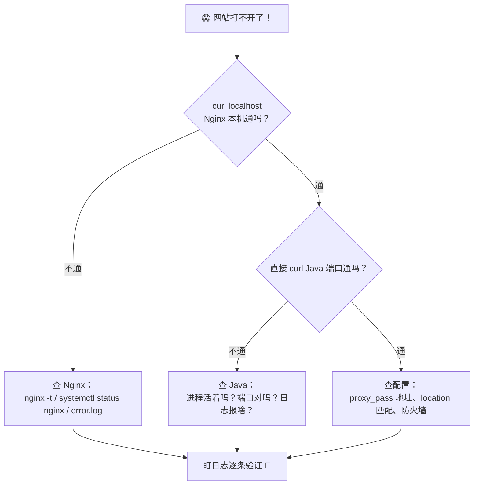

---

## 九、性能优化清单 ✨

| 优化项 | 配置 | 说明 |
|---|---|---|
| Worker 数 | `worker_processes auto;` | 等于 CPU 核数 |
| 单 Worker 连接数 | `worker_connections 10240;` | 记得调系统 `ulimit -n` |
| CPU 亲和 | `worker_cpu_affinity auto;` | 减少上下文切换 |
| 高效传输 | `sendfile on;` | 静态文件零拷贝 |
| 压缩 | `gzip on;` | 见 6.1 |
| 长连接 | `keepalive_timeout 65;` + upstream 里 `keepalive 32;` | 到后端也复用连接 |
| 缓冲区 | `proxy_buffer_size 16k;` 等 | 大响应场景调整 |
| 日志瘦身 | 静态资源 `access_log off;` | 减少磁盘 IO |

> 🎀 小提醒：先压测（`ab` / `wrk` / `jmeter`）再调优，别拍脑袋乱改哦～

---

## 十、高频面试题速答 🎯

| 问题 | 精简答案 |
|---|---|
| Nginx 为什么快？ | 多进程 + 事件驱动（epoll 异步非阻塞）+ 内存占用小，单 Worker 可扛几万连接 |
| 正向代理 vs 反向代理？ | 正向代理客户端（服务器不知情）；反向代理服务器（客户端不知情） |
| 负载均衡策略有哪些？ | 轮询、权重、ip_hash、least_conn、fair（第三方） |
| location 匹配优先级？ | `=` > `^~` > `~`/`~*`（正则按书写顺序） > 普通前缀（最长优先） > `/` |
| 502 和 504 区别？ | 502 = 后端连不上/返回异常；504 = 连上了但响应超时 |
| reload 原理？ | Master 校验新配置 → 起新 Worker → 老 Worker 处理完存量请求后退出，服务不断 |
| 前端 history 路由刷新 404？ | `try_files $uri $uri/ /index.html;` 回退到入口页 |
| WebSocket 代理注意啥？ | 设置 `Upgrade` 和 `Connection` 头 + `proxy_http_version 1.1` + 加大读超时 |

---

## 十一、知识总结地图 🗺️

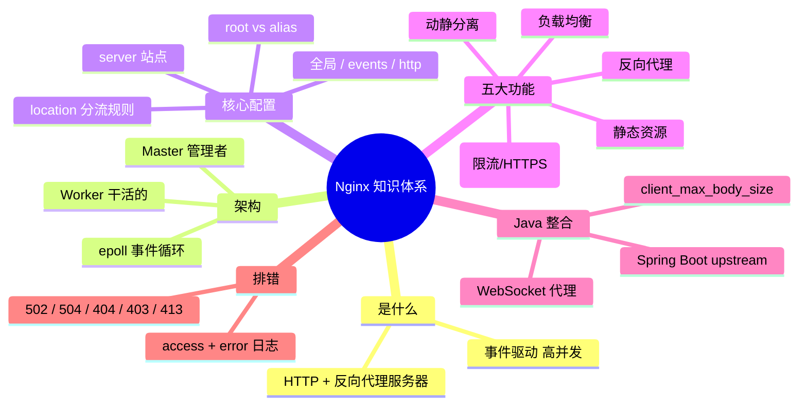

> 🎀 **毕业寄语**：Nginx 学习的核心就是 **location 匹配 + proxy_pass 转发** 这两招，吃透它们其他都是组合拳！建议自己起两个 Spring Boot 实例亲手配一遍负载均衡，胜过看十遍文档哦～ 学习加油！💪✨
